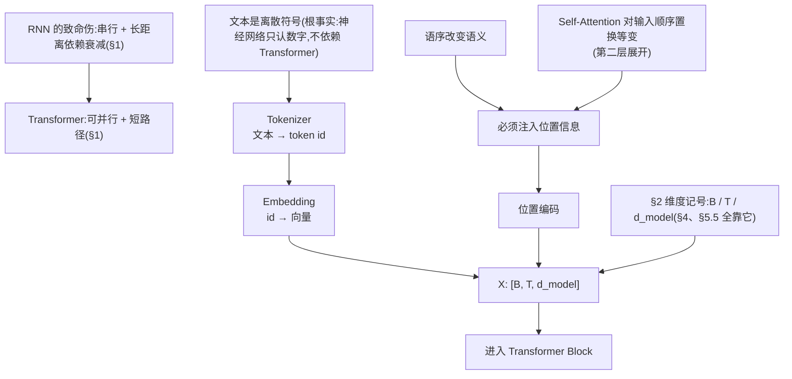
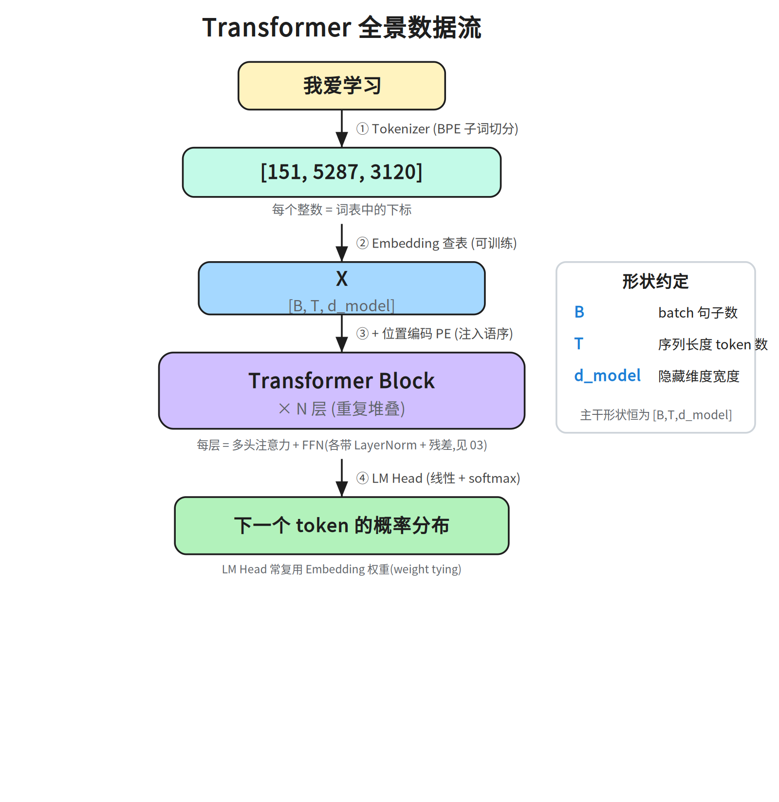
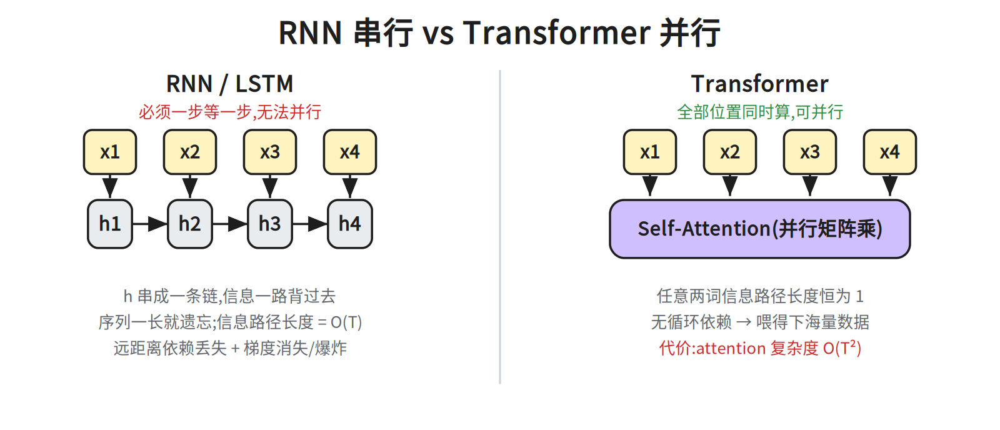
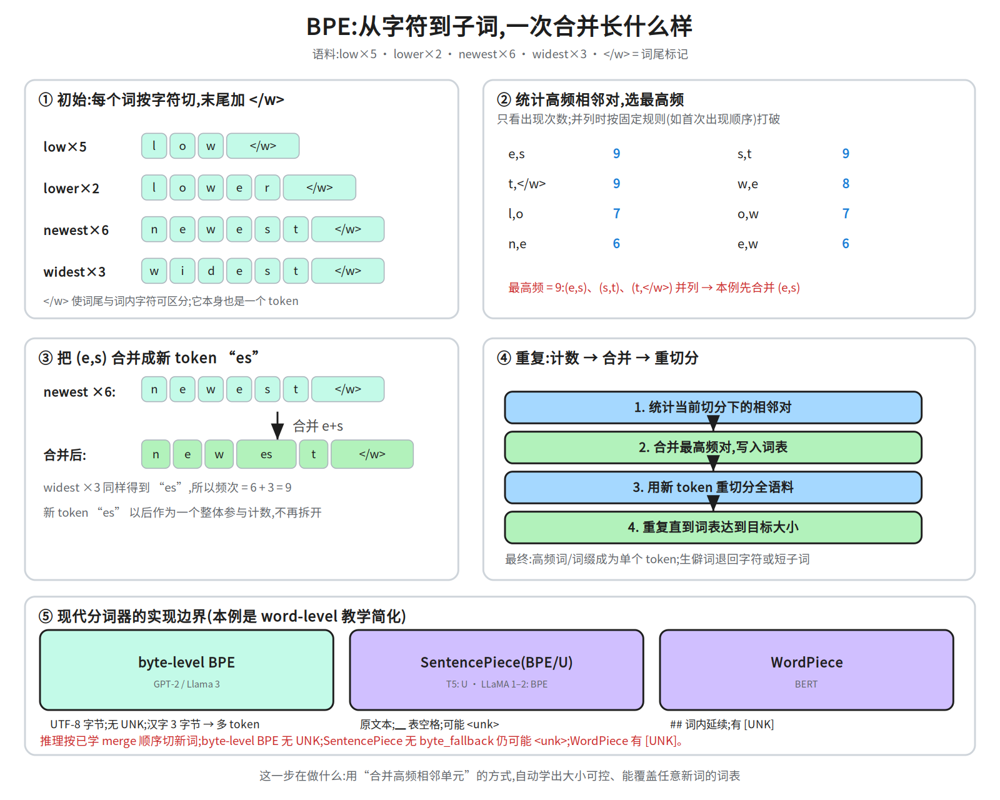
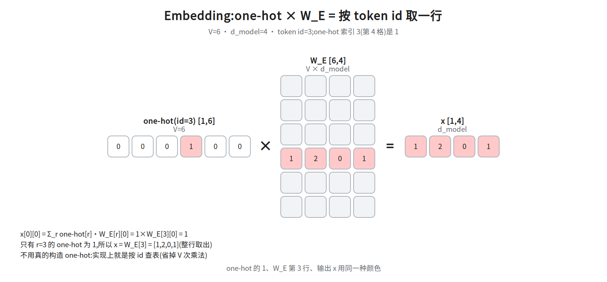
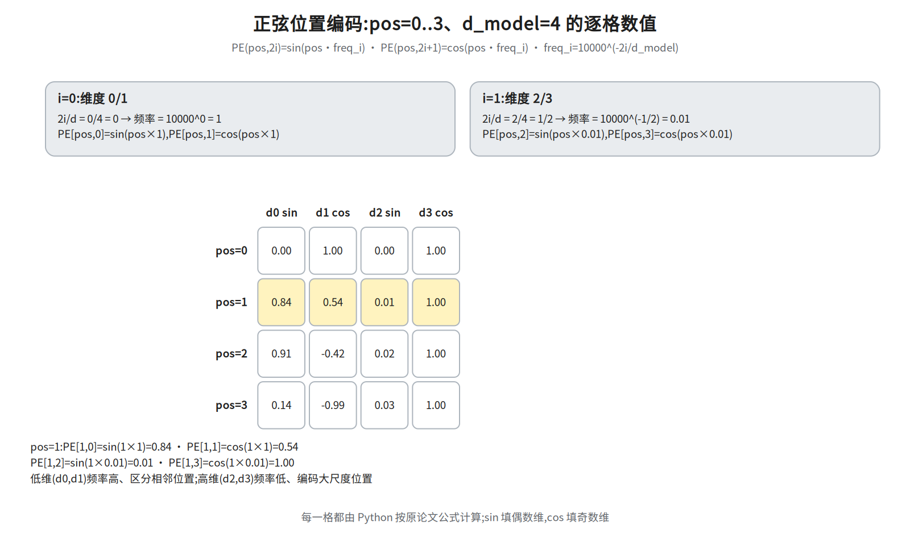
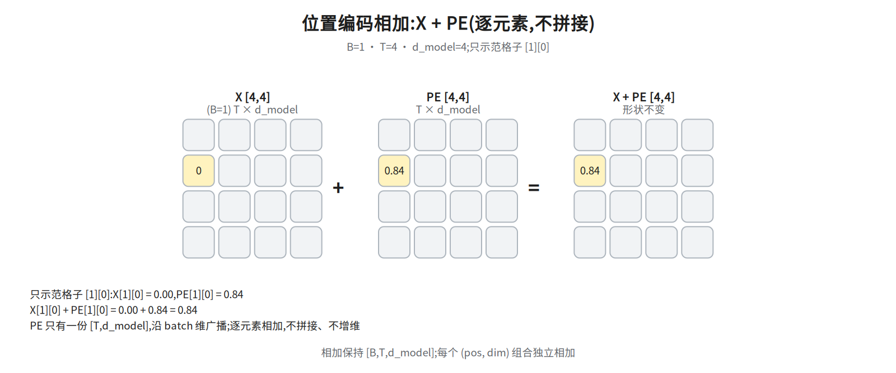
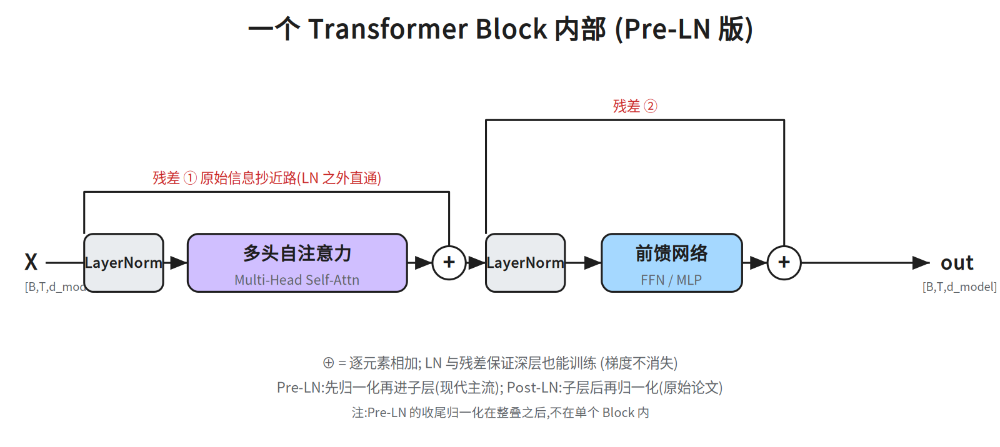

# 第一层 · 骨架 —— 从文本到矩阵

> 本层回答:一句话到底是怎么变成一堆数字(张量)送进模型的。

## 0. 依赖图(学习顺序)

> 根节点是**可以无条件接受**的事实;箭头表示「前者支撑后者」。学习顺序 = 从根到汇点的拓扑序。
> Obsidian 手机端可直接渲染下图。



## 全景



```
文本 → ①Tokenizer → ②Embedding → ③ + 位置编码 → ④Transformer Block ×N → ⑤LM Head → 下一个 token 概率
```

## 1. 为什么需要 Transformer

前一代主力 RNN/LSTM 的致命伤有两条:**串行**——第 t 步必须等第 t-1 步,无法并行;以及**长距离依赖丢失**——信息靠 `h` 一路"背"过去,序列一长就衰减,反向传播时**梯度也会消失/爆炸**(RNN 的经典病症)。



Transformer 的两个核心收益(面试直接能用):

- **可并行**:没有循环依赖,整句一次矩阵乘搞定 → 能吃海量数据。
- **短路径**:这里的“路径长度”指计算图上两个位置之间要经过的边数——RNN 需沿 `h` 逐步传 `O(T)` 步,Transformer 任意两个位置都只隔一次 attention,恒为 1 步,长距离依赖不再衰减。

代价:attention 对序列长度 `T` 是 **O(T²)**,这是长上下文研究的根源。

## 2. 维度记号(全程统一)

| 记号 | 含义 | 例 |
|---|---|---|
| `B` | batch size | 2 |
| `T` | 序列长度(token 数) | 5 |
| `d_model` | 隐藏维度 | 512 / 768 / 4096 |

**主干形状恒为 `[B, T, d_model]`** —— 后面每个部件都是在这个形状上做手术。

## 3. token → id(tokenizer)

神经网络只认数字,先把文本切成 token(BPE / SentencePiece)再映射成整数 id。

```
"我爱学习"  ──tokenizer──►  [151, 5287, 3120]     # 示意:虚构 id,非特定分词器/词表的真实输出;每个整数 = 词表下标
```

上例 4 个汉字只出 3 个 id,说明有两个相邻字被合并成了一个 token(具体哪两个取决于分词器与词表)。

BPE 要点:从字符开始,按频率反复合并高频相邻对。最小示例:

```
初始(按字符切):  l o w e r </w>  ← 语料里 "lower" 只出现 2 次(低频,会被拆开)
统计相邻对频次:  (l,o) (o,w) (w,e) (e,r) (r,</w>) …
合并最高频的一对,比如 (e,r) → "er"(只为演示合并语法,合并顺序与下文真实语料无关):
             l o w er </w>      ← 只合并了 (e,r),</w> 仍是独立符号
再合并 (er,</w>) → "er</w>"(原文漏写的这一步):
             l o w er</w>
再合并 (l,o) → "lo",再 (lo,w) → "low":
             low er</w>
最终"lower" 可能切成 ["low", "er</w>"] 两个 token(低频词,未合并到整词);更低频的生僻词则拆到字符级。

注意:上面的 (e,r) 不是真实语料的首轮选择——下文小语料里 (e,r) 只出现 2 次,首轮 9 次并列的是 (e,s)/(s,t)/(t,</w>)。
```

这样**常见词**占一个 token、**生僻词**拆成子词,词表规模可控,又能表示任意新词。



图里用一个小语料(`low×5 · lower×2 · newest×6 · widest×3`)走一遍真实机制:

1. **先按字符切**,并在词尾加 `</w>`(词边界标记)。如果没有它,词尾的 `w` 和词内的 `w` 无法区分,词尾位置也就丢失了。
2. **统计所有相邻对**的频次:例如 `(e,s)` 出现在 `newest` 的 6 份和 `widest` 的 3 份里,共 9 次。
3. **合并最高频的一对**(注意:本例 `(e,s)`、`(s,t)`、`(t,</w>)` 各 9 次并列,按实现规则取 `(e,s)`)成一个新 token:`(e,s) → es`,于是 `n e w e s t </w>` 变成 `n e w es t </w>`。
4. **重切分、重复**:新 token `es` 以后作为一个整体参与下一轮计数,直到词表达到目标大小。

> 并列时怎么选?**各实现规则不同**(有的按首次出现,有的按字典序);具体顺序不影响核心机制,核心始终是"数频次 → 合并最高频 → 更新切分"。推理时不再统计新语料,而是按训练好的合并规则顺序应用。

### 3.1 现代分词器的三个边界(面试常追问)

上图是 **word-level BPE** 的教学简化。真实模型常见三种实现:

| 实现 | 代表 | 单位 | 未登录词(OOV) | 中文/多语 |
|---|---|---|---|---|
| **byte-level BPE** | GPT-2 / Llama 3 | UTF-8 **字节** | 无 UNK:任何字符都能用字节表示 | 常用汉字占 3 字节(生僻字 4);但「→ 多个 token」只是 GPT-2 级约 50k 词表的结论,128k 词表(如 Llama 3)里大量常用汉字本身就是单 token(此格无来源,勿当 byte-level BPE 通则) |
| **SentencePiece(BPE / Unigram)** | T5(Unigram)、LLaMA 1–2(BPE) | 原文本(空格记 `▁`) | 通常可回退到字符/字节(需 `byte_fallback`);否则仍可能 `<unk>` | 直接在多语文本上训练,覆盖更好 |
| **WordPiece** | BERT | 子词(`##` 表词内延续) | 仍有 `[UNK]` | 英文中心,中文常被切碎 |

**词表大小的取舍**(面试很爱问):

- 词表大 → 同样文本 token 数少、序列短、训练/推理省;但 embedding 与 LM Head 是 `V × d_model`,参数和显存变大。
- 词表小 → 参数省,但序列变长、注意力 `O(T²)` 更贵;低频子词欠训练。
- 还要预留 special token(`<bos>`、`<eos>`、`<pad>`、角色标记等),它们也占词表。

**推理时遇到新词**:不是"查不到就失败",而是按训练好的 merge 顺序把新词切成已知子词/字节。**byte-level BPE 无 UNK**;SentencePiece 通常能回退到字符/字节(需 `byte_fallback` 等配置),否则仍可能出 `<unk>`;WordPiece 则**可能**有 `[UNK]`(是否出现取决于是否切到未登录字符)。

## 4. Embedding:id → 向量

```python
import torch, torch.nn as nn

B, T = 2, 5
vocab_size, d_model = 30000, 512

tok_emb = nn.Embedding(vocab_size, d_model)      # 本质 [vocab_size, d_model] 的可训练矩阵
ids = torch.randint(0, vocab_size, (B, T))       # [B, T]
x = tok_emb(ids)                                 # [B, T, d_model]
```

**关键:`nn.Embedding` 等价于「对 id 做 one-hot(长度 vocab_size),再乘那个大矩阵」**,实现上直接取第 id 行,省掉 one-hot 的浪费。它是可学习参数,训练后语义相近的词向量会靠近。

> 参数量体感(高频追问):嵌入层参数 = `vocab_size × d_model`。典型 `vocab=50000, d_model=768` → 约 **3800 万**,往往占小模型参数量的一大块。这也是为什么大模型常用**权重共享**:让最后的 LM Head 复用这个矩阵,省掉一份 `vocab × d_model`。

## 5. 位置编码(本层重点)

### 为什么不能省

self-attention 对输入是**置换等变**的:把输入的向量打乱顺序,输出只是跟着换位置,集合内部关系不变。


```
attention 眼里:  {狗, 咬, 人}  和  {人, 咬, 狗}  是同一个东西
现实里:          "狗咬人" ≠ "人咬狗"
```

所以必须**显式注入位置信息**。

> 术语澄清(两个词挨着容易混):**置换等变(equivariant)** = 打乱输入,输出只跟着**同样地**打乱(内部关系不变);**置换不变(invariant)** = 输出完全不受打乱影响。注意力是**等变**——它照样"能算",但**它不知道谁在前谁在后**,语序信息在它眼里丢失了。所以缺的不是"能力",是"顺序信息"。

### 怎么做(原论文:正弦位置编码)

```
PE(pos, 2i)   = sin( pos / 10000^(2i/d_model) )
PE(pos, 2i+1) = cos( pos / 10000^(2i/d_model) )
```

```python
def positional_encoding(T, d_model):
    pos = torch.arange(T).unsqueeze(1).float()        # [T, 1]
    i   = torch.arange(0, d_model, 2).float()         # [d_model/2]
    div = torch.pow(10000.0, i / d_model)
    pe  = torch.zeros(T, d_model)
    pe[:, 0::2] = torch.sin(pos / div)
    pe[:, 1::2] = torch.cos(pos / div)
    return pe                                         # [T, d_model]

x = tok_emb(ids) + positional_encoding(T, d_model)    # 相加,广播到 [B, T, d_model]
```

直觉:每个位置叠一串**不同频率的正弦波**当"指纹"。低维频率高、区分相邻位置;高维频率低、编码大尺度位置。

### 三个必须知道的设计点

- **相加,不是拼接**:不增维、不增计算;值域有界 `[-1,1]` 数值稳。论文只给了「位置编码与嵌入同为 `d_model`,故可相加」,并未论证拼接更差;sin/cos 的「可分离」是公式自身性质、拼接也保留,不能算作相加更优的理由。
- **为什么用 sin/cos**:`PE(pos+k)` 可写成 `PE(pos)` 的固定线性变换 → 论文只是假设(§3.5:We hypothesize)这能让模型易学"相隔 k 位"这种相对关系(并未证明);无参数;理论上可外推更长序列。
  (补充:原论文其实也试了**可学习**位置编码,二者效果"几乎相同"(nearly identical);选正弦是为了可能的外推能力,而非它明显更优。)
  ⚠️ **别夸大成"能外推现在就能用"**:正弦 PE 的**实际外推效果有限**——训练长度之外性能会掉,后来针对外推的补救是位置插值一族(PI/NTK/YaRN,第五层)。RoPE 的出发点与此不同:它让位置信息显式进入 Q/K 的旋转、天然携带相对位置(本讲义 §5 表格也如此描述),并非为修正弦 PE 的外推掉点而提出。所以"理论上可外推"不等于"实践已经解决长序列"。
- **现代演进**(第五层展开):

  | 方案 | 代表 | 做法 |
  |---|---|---|
  | 可学习位置编码 | GPT / BERT | `nn.Embedding(T_max, d_model)`,简单、外推差 |
  | **RoPE** | LLaMA 系(主流) | 在 attention 里对 Q、K 做**旋转**,天然编码相对位置 |
  | ALiBi | Bloom 等 | 直接给 attention 分数加随距离递减的偏置,零参数 |

## 5.5 数值演算:Embedding 与位置编码

### ① Embedding:id → one-hot × W_E → 一行向量

取 `V=6, d_model=4, token id=3`。one-hot 只在索引 3(第 4 格)为 1:
`[0,0,0,1,0,0]`。乘 `W_E [6,4]` 后,结果就是 `W_E` 的第 3 行:

```
x[0][0] = Σ_r one-hot[r]·W_E[r][0] = 1×W_E[3][0] = 1
x = W_E[3] = [1, 2, 0, 1]
```



关键:one-hot 的 1、`W_E` 第 3 行、输出 `x` 用同一种颜色——实现里根本不用构造 one-hot,
直接按 id 查表即可。

### ② 正弦位置编码:pos=0..3、d_model=4

按原论文公式逐格计算:

```
PE(pos, 2i)   = sin(pos / 10000^(2i/d_model))
PE(pos, 2i+1) = cos(pos / 10000^(2i/d_model))
```

- `j=0`(维度 0/1):除数 `10000^(2j/d_model)=10000^0=1`,角度 = `pos/1 = pos`。
- `j=1`(维度 2/3):除数 `10000^(2j/d_model)=10000^(1/2)=100`,频率 = 1/除数 = `0.01`,角度 = `pos/100 = 0.01·pos`。

> 记号:`j` 是「第几对维度」的编号;§5 代码里的 `i` 是实际维度下标(`i=0,2,4…`),对应 `j=i/2`,两者不要混用。



逐格结果(`pos=0..3`,除数 j=0 为 1、j=1 为 100):


pos=0: PE[0,0]=sin(0)=0.00   PE[0,1]=cos(0)=1.00   PE[0,2]=sin(0)=0.00   PE[0,3]=cos(0)=1.00
pos=1: PE[1,0]=sin(1)=0.84   PE[1,1]=cos(1)=0.54   PE[1,2]=sin(0.01)=0.01 PE[1,3]=cos(0.01)=1.00
pos=2: PE[2,0]=sin(2)=0.91   PE[2,1]=cos(2)=-0.42  PE[2,2]=sin(0.02)=0.02 PE[2,3]=cos(0.02)=1.00
pos=3: PE[3,0]=sin(3)=0.14   PE[3,1]=cos(3)=-0.99  PE[3,2]=sin(0.03)=0.03 PE[3,3]=cos(0.03)=1.00


### ③ 位置编码相加:X + PE(逐元素、广播)

先明确记号:`X = tok_emb(ids)`,形状 `[B, T, d_model]`;下面取 batch=0、token=0、第 0 维。



只示范 `[0][0][0]` 一格:`X[0][0][0]=1`(即 ① 的 `W_E[3][0]`),`PE[0][0]=0.00`,相加得 `1.00`。
`PE` 只有一份 `[T, d_model]`,沿 batch 维广播;相加不拼接、不增维,形状仍是
`[B, T, d_model]`。

## 6. 预告:一个 Block 长什么样



每个 Block = `多头自注意力` + `前馈网络`,各自外套 **残差连接**与 **LayerNorm**(现代主流 Pre-LN:先归一化再进子层)。第二、三层细拆。

## 面试要点(合上书能否讲出来)

1. **Transformer 相比 RNN 好在哪?** → 可并行 + 任意位置路径长度恒为 1。
2. **位置编码为什么必需?** → self-attention 置换等变,不注入位置就分不清语序。
3. **PE 为什么相加而不是拼接?** → 不增维、不增计算、值域有界数值稳;论文只给了「位置编码与嵌入同为 `d_model`,故可相加」,并未论证拼接更差(「可分离」是 sin/cos 公式本身的性质,拼接同样保留,不能当相加更优的理由)。
4. **sin/cos 的设计动机?** → 相对位置可线性表示、无参数、可外推。
5. **`nn.Embedding` 是什么?** → 可训练查表矩阵,等价于 one-hot × W。
6. **BPE 怎么处理新词?词表大小怎么选?** → 按已学 merge 顺序切成子词/字节,不依赖整词表;词表大省序列但 embedding/LM Head 变大,词表小则序列长、低频子词欠训练。

## 常见坑

- 把 BPE 当成“按词频切词”:它合并的是**相邻单元**,不是统计整词频率;`</w>`/byte-level 等边界处理会改变结果。
- 以为子词一定没有 OOV:byte-level BPE 无 UNK;SentencePiece 需要 `byte_fallback` 等配置才能回退,否则仍可能 `<unk>`;WordPiece 则可能有 `[UNK]`。
- 把位置编码“理论上可外推”当成“实践已解决”:正弦 PE 直接外推到训练长度之外通常会掉点,现代靠 RoPE 扩展(第五层)。
- 把位置编码“相加”误解成“拼接”:相加不改变 `d_model`,拼接会加宽特征维,后续层都要改。
- 以为 `nn.Embedding` 只是固定索引表:它是可训练参数,和 LM Head 共享时是同一份矩阵。

## 相关图

`01_pipeline` · `01b_bpe` · `02_rnn_vs_transformer` · `03_block_internal` · `04_position_encoding`
· `15a_embedding` · `15b_posenc` · `15c_pos_add`(均在 `diagrams/`,横竖双版本)

## 下一步

第二层 · 心脏:**Self-Attention 的 Q/K/V** —— 缩放点积、为何除以 √d_k、注意力如何一步步算出。
