# 第二层 · 心脏 —— Self-Attention 的 Q/K/V

> 本层回答:手里有一堆 `[B, T, d_model]` 的向量(每个词一个),怎么让**每个词看到别的词、并按相关度汇总信息**?这是整个 Transformer 最核心的机制。

## 0. 依赖图(学习顺序)

> 根节点是**可以无条件接受**的事实(个别根节点正文会补推导,如 §4 的 D,可先接受、后自证);箭头表示「前者支撑后者」。学习顺序 = 从根到汇点的拓扑序。

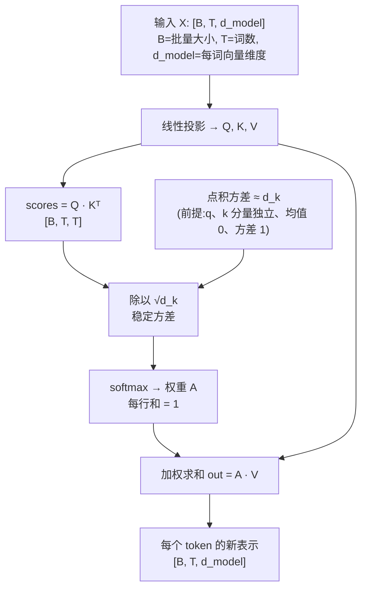

## 1. 一句话直觉:注意力 = 软性查字典

想象你在图书馆找书:

```
你手里的问题        → Query  (我想找什么)
每本书的标签/编号    → Key    (检索依据)
每本书的内容        → Value  (真正要取的信息)
```

检索过程 = 用你的 Query 去和每本书的 Key 比对相似度 → 得到一组"该看哪本书"的权重 → 按权重把各本书的 **Value** 加权求和,就是你带走的答案。

和真实查字典的区别:字典是**硬检索**(要么命中要么不命中),注意力是**软检索**——每本书都给一个 `[0,1]` 的权重,最后取"所有书的加权混合"。软的好处:**全程可微**,能端到端训练。

> 关键:Q、K、V **都来自同一个输入 X**(所以才叫 **self**-attention)。是 X 乘三个不同的**可学习**权重矩阵投影出来的。

## 2. 从 X 到 Q/K/V:三个线性投影

```
Q = X · W_Q        X [B, T, d_model]   W_Q [d_model, d_k]   → Q [B, T, d_k]
K = X · W_K        X [B, T, d_model]   W_K [d_model, d_k]   → K [B, T, d_k]
V = X · W_V        X [B, T, d_model]   W_V [d_model, d_v]   → V [B, T, d_v]
```

- `d_k` 是每个头的 key/query 维度,`d_v` 是 value 维度。原论文在多头设定里取 **每个头** `d_k = d_v = d_model / h`(h=8 时即 64)。

**先把三条运算规则写出来,否则下面的形状约束只是空壳:**
① **转置 `ᵀ`(代码里写 `T` 或 `.transpose`)**:行列互换,数值不变、只换排布。`W [d_model, d_k]` 转置后是 `Wᵀ [d_k, d_model]`;`K [T, d_k]` 转置成 `Kᵀ [d_k, T]`。它唯一的作用就是让后面的乘法形状对得上。
② **矩阵乘 `A·B`**:要求 `A` 的列数 = `B` 的行数,结果的第 i 行第 j 列 = **`A` 的第 i 行与 `B` 的第 j 列「对应位置相乘、再全部相加」**:`C[i][j] = Σ_p A[i][p] · B[p][j]`(p 走完 A 的列 = B 的行)。所以 `[T, d_model] · [d_model, d_k] = [T, d_k]`——形状规则就是「中间那两维必须相等,然后一起消失」。**记住这条乘加规则,§5.5 的 ①–⑦ 每一步都是同一个动作,只是换了矩阵。**
③ **点积 `q · k`**:两个**等长**向量对应位置相乘再相加,结果是一个**数**(标量):`q · k = Σ_p q[p] · k[p]`。它就是矩阵乘在「一行 × 一列」时的特例,所以 `scores = Q·Kᵀ` 里 `scores[i][j]` = 「Q 的第 i 行」与「Kᵀ 的第 j 列(= K 的第 j 行)」的点积。
**拿 §5.5 的第一格先验一遍:** `X` 第 0 行 `[1,0,1,0]` × `W_Q` 第 0 列 `[1,0,1,0]`,对应位置相乘得 `1·1, 0·0, 1·1, 0·0`,再相加 `1+0+1+0 = 2`,即 `Q[0][0] = 2`——正是 14a 图上填的那一格。遮住图自己算出这个 2,后面 ④–⑦ 的图像核对才有意义。


**先把「头(head)」说清,否则 64 只能死记:** 一个「头」= 一条独立的「投影出 Q/K/V → 打分 → 加权求和」通道。多头 = 把这条通道并行做 h 份:`d_model` 维切成 h 份,每份 `d_model/h` 维、各有自己的 `W_Q/W_K/W_V`,各算出一份输出再拼回 `d_model`。所以「每个头 `d_k = d_model/h`」说的是**单个通道内部**的维度:512 维切 8 头,每头 64 维,`d_k` 就是这 64,**不是** 512。本篇讲的是单头(只有一条通道),`d_k`、`d_v` 可取任意值(§5.5 的例子就取 `d_model=4, d_k=2`);h=8 只是原论文 base 配置的取值,多头怎么拼见第三层。

- **为什么 `W_Q` / `W_K` 都是 `[d_model, d_k]`?** 因为 `scores = Q·Kᵀ` 是点积,矩阵乘要求 `Q` 的最后一维 = `Kᵀ` 的第一维,所以 **Q 和 K 必须同维**——数学上可写 `d_q = d_k`,工程上通常只用一个符号 `d_k`。不是"恰好相等",是**约束使然**。
- **`d_v` 可以 ≠ `d_k`**:`out = A·V` 中 `A` 是 `[T,T]`,不约束 `V` 的最后一维;原论文 base 配置取 `d_v = d_k = d_model/h = 64`(Vaswani 2017 §3.2.2 只给了这个取值,未说明取等的理由;「为简单」是后人补的动机,不算原文)。
- 三个 `W` 是**独立的、可训练的**——这是模型自己学出来"怎么问、怎么标注、怎么取值"。
- **为什么不直接拿 X 自己点乘,而要三套投影?** 直接 `X·Xᵀ` 是对称的,无法表达“我找你”与“你被找”的非对称关系;Q/K 投影把同一个 X 映射到两个**不同的比较空间**,V 再提供一套**独立的内容空间**。没有可学的投影,注意力就退化成固定的相似度,表达能力大幅下降。
- 维度上 `[B,T,d_model] @ [d_model,d_k] = [B,T,d_k]`,逐 token 独立投影,不跨位置混合。**注意混合点不是 `Q·Kᵀ`**:`Q·Kᵀ` 只产出两两相似度分数 `[B,T,T]`,不改变任何 token 的表示;真正的跨位置混合发生在 §5 的 `A·V`——每个位置按权重把所有位置的 value 汇总成自己的新表示。

## 3. 打分:Q · Kᵀ

每个 query 要和**每个** key 算一个相似度(点积):

```
scores = Q · Kᵀ                            [B, T, d_k] · [B, d_k, T] → [B, T, T]
```

得到的 `[B, T, T]` 矩阵:`scores[b, i, j]` = 第 i 个词(query)对第 j 个词(key)的关注分数。**这就是那张"注意力矩阵",行是 query、列是 key。**
注意:这里的「注意力矩阵」指 softmax **之前**的原始分数(可正可负、行和不为 1);归一化后的权重矩阵专指 §5 的 `A = softmax(scores/√d_k)`(每行和为 1),两者别混用。

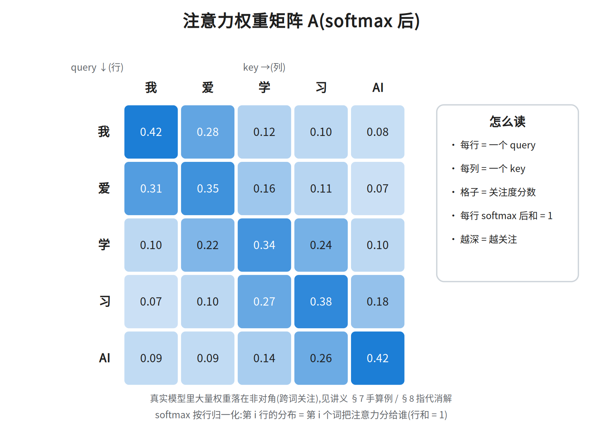

(上图:softmax 后每行和为 1,颜色越深=关注度越高。第 3 行"学"把最多注意力给了它自己——**但 06 是构造出来的示意矩阵(每行恰好归一到 1.00),不是任何模型的输出**:这种对角占优只是"画法",不能当成"模型自己学出来的"观测结论——图内注脚本身就写明真实模型大量权重落在非对角。)

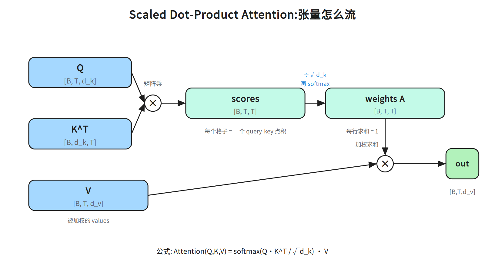

## 4. 缩放:为什么除以 √d_k(本层最经典的面试题)

```
scaled_scores = scores / √d_k
```

**原因(方差论证,务必能推):** 假设 q、k 的各分量是独立、均值 0、方差 1 的随机变量,那么点积

```
q · k = Σ_{i=1}^{d_k} q_i k_i
```

的均值是 0,方差是 **d_k**(各分量乘积的方差逐个累加)。所以 `q·k` 的标准差是 **√d_k**。
**先把「方差」定义清楚,再补两条恒等式——这一步才是「能推」的关键:** 方差 = 偏离均值的平方的平均,`Var(z) = E[(z − E z)²]`,它衡量的是**离散程度**(数值摊得多开),不是整体抬高。
① 两个独立变量之和,方差可加:`Var(a + b) = Var(a) + Var(b)`(独立保证交叉项 `2E[(a−Ea)(b−Eb)] = 0` 消失)。
② 均值 0、方差 1 且彼此独立的 `q_i`、`k_i`,乘积的方差是 1:`Var(q_i k_i) = E[q_i²k_i²] − (E[q_i k_i])² = E[q_i²]·E[k_i²] − 0 = 1×1 = 1`。
把 ①② 套到 `q·k = Σ q_i k_i`:每一项 `q_i k_i` 相互独立、方差都是 1,`d_k` 项相加 → 方差 = `1 + 1 + … + 1` = `d_k`,标准差 = √d_k;除以 √d_k 就把标准差(以及方差)拉回 1。

> 依赖顺序先说明:依赖图里 A(softmax)画在 S 之后,那是**计算顺序**;本节走的是**论证顺序**——要先讲清 softmax 在极端输入下会怎样,才能说明「为什么非缩放不可」。所以下面这段提前借用了 §5 的三句话(softmax 把一行分数指数归一化 / 输入过大会变 one-hot 尖峰 / 饱和处导数≈0),§5 才正式定义它。读到 softmax 先当已知往下走,读完 §5 再回看这段即可闭环。
**再补三个词的定义(下面整段论证都靠它们):** 训练 = 反复调整参数(这里的 `W_Q/W_K/W_V`)让**损失**(loss,一个数,衡量模型输出离正确答案有多远)变小;**梯度** = 损失对某个参数的敏感度,即「这个参数动一点点,损失会变多少」;**反向传播**(backprop)= 从损失出发,按链式法则一层层往回算这个敏感度——每退一层,就把「上游传来的梯度 × 本层自己的导数」乘起来,得到更前面那层的梯度。所以链上任何一层的导数 ≈0,敏感度传到它这里就被乘成 0,它前面的参数就收不到「该往哪改」的信号。下面这段就从这条链推。

**不缩放会怎样?** `d_k` 越大,logits(这里的 scores,即 softmax 之前的原始打分,§5 正式定义)的数值范围越大(量级 ~√d_k)。softmax(把一行打分经指数归一化成和为 1 的概率,§5 正式定义,此处先只需记住这一句)对大幅度输入会**饱和**——分布被推成一个近乎 one-hot 的尖峰(某个位置≈1,其余≈0)。饱和指输出几乎不再随输入变化,即**导数≈0**;而导数(梯度)是反向传播唯一的传递媒介——从损失往回每层都要乘本层导数,乘到 0 梯度就没了。后果:

- **梯度消失**:softmax 在饱和区导数≈0,反向传播几乎传不动。
- 训练不稳定、难收敛。

除以 √d_k 把 logits 的方差**拉回 1**,softmax 落在敏感区间,梯度健康。
**「导数≈0」为什么等于「训练不动」:** softmax 的输出对输入的导数在饱和区趋近 0——输入再加,输出几乎停在 1 或 0,曲线走平。反向传播时每层拿到的梯度 = 上游梯度 × 本层导数;乘上 ≈0 的导数,这一层参数的更新量就 ≈0,损失再降也传不回去。所以「饱和 → 导数≈0 → 梯度传不动 → 训练不动」是一条因果链,不是三个并列结论。

> 常见误区:缩放是除以 √**d_k**(每个头的维度),不是 √d_model,也不是随便一个常数。注意:原论文在 footnote 里**给出了点积方差 ≈ d_k 的论证**(所以除以 √d_k 把标准差拉回 1),但**没有**报告"不同缩放因子"的对照消融实验;「不同缩放因子/温度的系统比较」属后续工作,本篇未标文献出处,故不作结论。

## 5. softmax + 加权求和

对 scores 的**每一行**做 softmax(行内归一化,每行和 = 1):

```
A = softmax(scores / √d_k)                 A [B, T, T]   # 每行是一个概率分布
out = A · V                                [B,T,T] · [B,T,d_v] → [B,T,d_v]
```

`out[b, i, :]` = 第 i 个词按对它相关度加权的、所有词 value 的混合。

**完整公式:**

```
Attention(Q, K, V) = softmax( Q Kᵀ / √d_k ) · V
```

## 5.5 数值演算(逐步可手算)

<!-- ws-ref:begin -->
> 🧮 **手算卡**（打印出来在纸上算，算完拍照发我核对）
> - `ws-attention-chain` ｜ §5.5 数值演算 ｜ X→Q/K/V→scores→softmax→out 七步走完整条链，L=3、能手算
<!-- ws-ref:end -->


用 `B=1, T=3, d_model=4, d_k=2` 的小例子(14 系列图都按 `B=1` 画,矩阵全是二维:`X[3,4]`、`W_Q/W_K/W_V[4,2]`、`scores/A[3,3]`;batch 维只剩 1,本例不再写出),**每一步一张图**。矩阵画成方格,只显示参与运算的
第 0 行/第 0 列,颜色标出"哪一行 × 哪一列 → 哪个结果格"。

**① Q = X·W_Q**

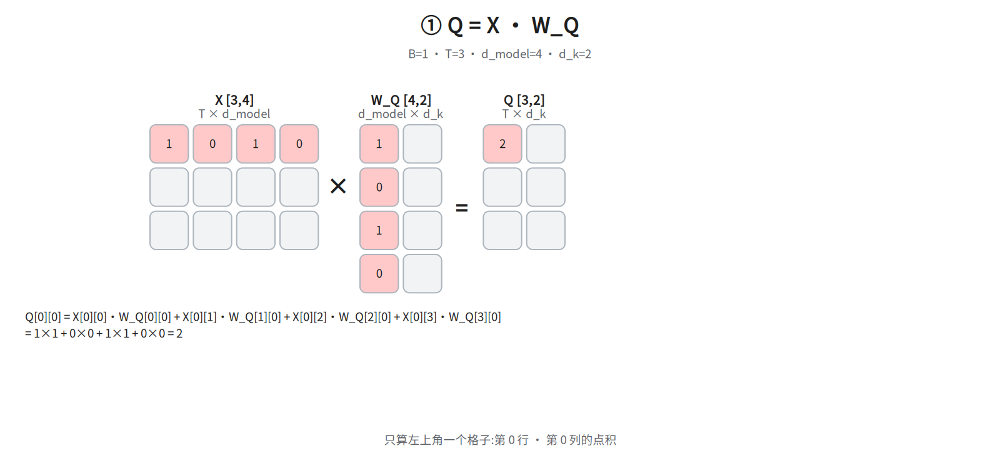

**② K = X·W_K**

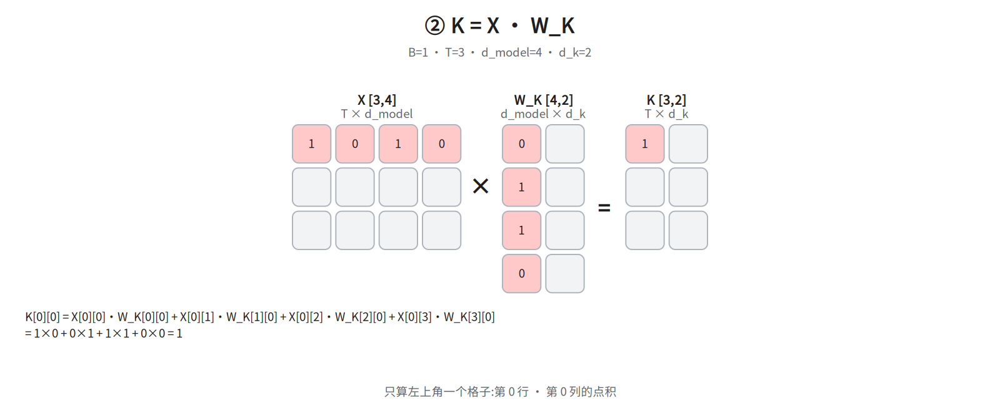

**③ V = X·W_V**


**④ scores = Q·K^T**

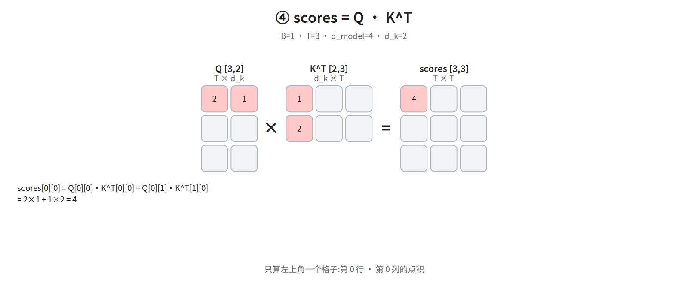

**⑤ 缩放:scaled = scores / √d_k**

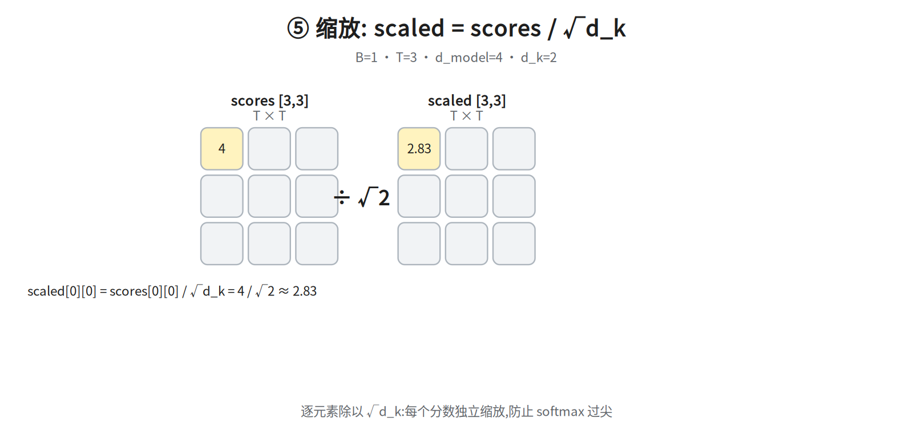

**⑤.5 因果掩码(加在 softmax 之前):scores(示意)→ +mask → softmax**

> 为什么遮住未来?④ scores = Q·Kᵀ 这一步(即 §3 的打分)里,每个词都能看到它**后面**的词;做生成式任务时,预测第 i 个词不该看见第 i+1 个词(训练时会变成抄答案)。做法:在 softmax **之前**把 `j>i`(未来位置)的分数加上 `-inf`,使 `e^{-inf}=0`、权重精确为 0。本节只要求会算"加 mask 后某一行如何归一化";它在完整架构里的位置(第四层 Masked Attention)见 §10,不属本层要求。
> 位置说明:本小节**不在 §0 依赖图里**——依赖图只画本层必学主链(S → A → O),掩码是给第四层 Masked Attention 预热的前置阅读。所以在 §5 与 §6 之间多出这一段不算跳步,跳过它直接读 §6 也不影响本层主线。

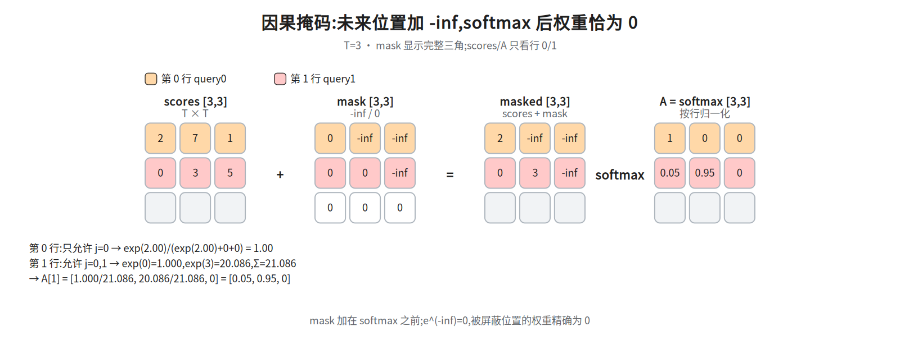

小例 `scores [3,3] = [[2,7,1],[0,3,5],[4,2,6]]`(本例略去 `÷√d_k`,只演示掩码)。注意:这组数是**掩码专用**的示意数,与 ④⑤⑥ 的 14d/14f 那条 `[3,3]` 链不是同一套,手算时各以对应图上的数字为准。future mask 在 `j>i` 处加 `-inf`:

- 第 0 行只剩 `j=0`:`exp(2.00)/(exp(2.00)+0+0)=1.00` → `A[0]=[1,0,0]`。
- 第 1 行只剩 `j=0,1`:`exp(0)=1.000`、`exp(3)=20.086`,归一化 → `[0.05,0.95,0]`。

`mask` 必须加在 **softmax 之前**;被屏蔽位置的 `e^(-inf)=0`,权重精确为 0。
想深入掩码的工程细节,可自行查阅 `notes/04_architecture.md §2`(本篇不依赖它:此处只需会算上面那两行)。

**⑥ A = softmax(scaled)(按行)**

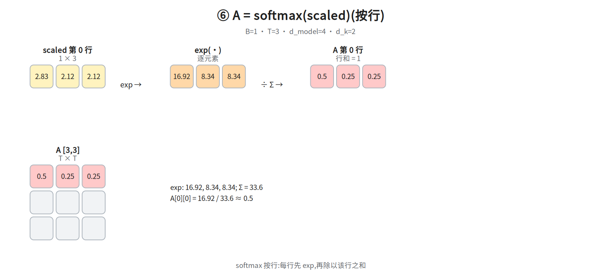

> 注意:⑥ 的 14f 是**未加掩码**的示例(其未缩放 `scores` 第 0 行为 `[4, 3, 3]`，除以 √2 得第 0 行 `[2.83, 2.12, 2.12]` → `[0.50, 0.25, 0.25]`);
> 若加因果 mask,第 0 行只剩 `j=0`,softmax 变为 `[1, 0, 0]`,见 ⑤.5 的 14h。

**⑦ out = A·V**

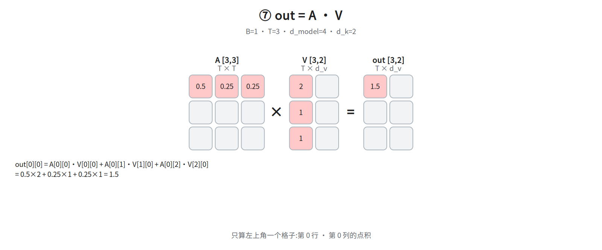

**总览(全部数值)**

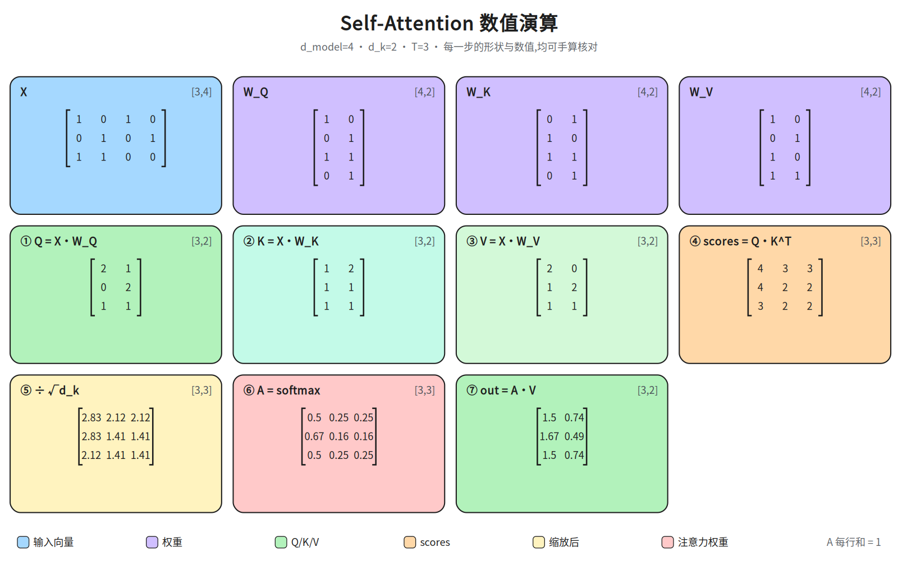

**建议用法**:先看 14a–14h,每一步遮住结果、自己手算 `[0][0]`;再用总览图核对全部数值。
随讲义交付的只有横版(即上面这些 `../diagrams/*.landscape.png`);竖版**未随本篇同步**,需要时到源码仓 `ai-notes/diagrams/` 取 `14a_q_proj.portrait.png` … `14h_mask.portrait.png`。
**正文数值(图裂 / 纯文本粘贴时的兜底)**:本例 `B=1, T=3, d_model=4, d_k=d_v=2`,矩阵都是二维,主链形状 `X[3,4] → Q/K[3,2] → scores[3,3] → A[3,3] → out[3,2]`。有一条可脱离图片独立核对的锚点链(第 0 行):`scores` 第 0 行 `[4, 3, 3]` → ÷√2 = `[2.83, 2.12, 2.12]` → softmax = `[0.50, 0.25, 0.25]` → `out[0][0] = 0.50·2 + 0.25·1 + 0.25·1 = 1.50`、`out[0][1] = 0.50·0 + 0.25·2 + 0.25·1 = 0.75`(14g 图只填了 `out[0][0] = 1.5` 一格,完整 `out[0] = [1.5, 0.74]` 在 `14_attention_math` 总览图;总览图的 0.74 是用未取整权重 0.503/0.248/0.248 算的,用上面已四舍五入的 `[0.50,0.25,0.25]` 手算得 0.75,差 0.01 来自取整,不是抄错)。
`X`(3×4)与 `W_Q`/`W_K`/`W_V`(各 4×2)是示意数,逐格数值在 `14_attention_math` 总览图里**是全量给全的**(14a–14c 每张只填第 0 行/第 0 列,总览图才三行都填),正文照抄如下:`X = [[1,0,1,0],[0,1,0,1],[1,1,0,0]]`、`W_Q = [[1,0],[0,1],[1,1],[0,1]]`、`W_K = [[0,1],[1,0],[1,1],[0,1]]`、`W_V = [[1,0],[0,1],[1,0],[1,1]]`;乘出来 `Q = [[2,1],[0,2],[1,1]]`、`K = [[1,2],[1,1],[1,1]]`、`V = [[2,0],[1,2],[1,1]]`,于是 ④ 的 `scores = Q·Kᵀ = [[4,3,3],[4,2,2],[3,2,2]]`,①–③ 脱离图片也能一路算到 ④。自检:`Q` 第 0 行 `[2,1]` 的第一格,必须等于 14a 图上填的那一格 `Q[0][0] = 2`(14a 只填第 0 行第 0 列,整行 `[2,1]` 要到 `14_attention_math` 总览图里对照;抄错这里最先暴露)。

## 6. 手写一遍(带维度标注)
**先认 6 个 PyTorch 记号,否则这段代码只能跳过:** `nn.Linear(d_in, d_out, bias=False)` 就是一个线性层,内部存 `[d_out, d_in]` 的权重矩阵(注意是反的:§2 的 `W_Q [d_model, d_k]` 在这里存成 `[d_k, d_model]`),前向算 `x · Wᵀ`,即 §2 的 `X·W_Q`;`bias=False` 表示**不加偏置项**(不额外加一个可学常数向量),所以它和 §2 的纯矩阵乘一一对应。`@` 是**批量矩阵乘**:只对最后两维做矩阵乘法、前面维度当批量循环,故 `[B,T,d_k] @ [B,d_k,T]` → `[B,T,T]`。`K.transpose(-2, -1)` 交换最后两维(`-1`=最后一维、`-2`=倒数第二维),`[B,T,d_k]` 变成 `[B,d_k,T]`,即 §3 的 `Kᵀ`。`scores.softmax(dim=-1)` 沿**最后一维**(key 方向)归一化,就是 §5 的「每一行和为 1」。`Q.size(-1)` 取最后一维长度,即 `d_k`,所以 `math.sqrt(Q.size(-1))` = `√d_k`,与 §4 一致。看不懂代码时:把 `nn.Linear` 读成「乘一个可学矩阵」、`@` 读成「矩阵乘」,这段便与 §2–§5 的公式逐行对上。

```python
import torch, torch.nn as nn, math

class SelfAttention(nn.Module):
    def __init__(self, d_model, d_k, d_v):
        super().__init__()
        self.W_q = nn.Linear(d_model, d_k, bias=False)   # weight: [d_k, d_model]
        self.W_k = nn.Linear(d_model, d_k, bias=False)   # weight: [d_k, d_model]
        self.W_v = nn.Linear(d_model, d_v, bias=False)   # weight: [d_v, d_model]

    def forward(self, x):                      # x: [B, T, d_model]
        Q = self.W_q(x)                        # [B, T, d_k]
        K = self.W_k(x)                        # [B, T, d_k]
        V = self.W_v(x)                        # [B, T, d_v]
        scores = Q @ K.transpose(-2, -1)       # [B, T, T]     每个 query×key 点积
        scores = scores / math.sqrt(Q.size(-1))# 缩放,√d_k
        A = scores.softmax(dim=-1)             # [B, T, T]     按行归一化
        out = A @ V                            # [B, T, d_v]   加权求和
        return out, A

x = torch.randn(2, 5, 512)                     # [B=2, T=5, d_model=512]
out, A = SelfAttention(512, 64, 64)(x)
print(out.shape, A.shape)                      # [2, 5, 64]   [2, 5, 5]
```

**维度追踪表:**

| 步骤 | 形状 |
|---|---|
| 输入 X | `[B, T, d_model]` |
| Q / K | `[B, T, d_k]` |
| V | `[B, T, d_v]` |
| scores = Q·Kᵀ | `[B, T, T]` |
| A = softmax(·) | `[B, T, T]`,每行和=1 |
| out = A·V | `[B, T, d_v]` |
> 形状对不上的原因(必读):§2 的 `W_Q [d_model, d_k]` 是**数学记号**,`nn.Linear` 内部存的是它的转置 `[d_k, d_model]`,前向算的是 `x·Wᵀ`——两处不矛盾,只是**存储约定**不同。手算维度时统一走一条:`X [B,T,d_model] · W_Q [d_model,d_k] = [B,T,d_k]`。

## 7. 一个能拿笔算的小例子(演示"跨词关注")

设 `T=2`(两个词:猫、鱼)、`d_k=2`,投影后让"猫的 query"和"鱼的 key"对上:

```
Q = [[1, 0],   (猫)      K = [[0, 1],   (猫的 key)      V = [[10, 0],   (猫的 value)
     [0, 1]]   (鱼)           [1, 0]]   (鱼的 key)           [0, 10]]   (鱼的 value)
```

```
scores = Q·Kᵀ        = [[0, 1],     # 猫 vs (猫key,鱼key):和鱼的 key 更接近
                        [1, 0]]     # 鱼 vs (猫key,鱼key):和猫的 key 更接近
scaled = /√2 ≈         [[0, 0.71],
                        [0.71, 0]]
A = softmax(按行)   ≈  [[0.33, 0.67],   # 猫把 67% 注意力给了"鱼"
                        [0.67, 0.33]]   # 鱼把 67% 注意力给了"猫"
out = A·V           =  [[3.3, 6.7],     # 猫的表示,67% 来自鱼的 value
                        [6.7, 3.3]]     # 鱼的表示,67% 来自猫的 value
```

看 `out` 第 0 行 `[3.3, 6.7]`:这是"猫"的新表示,它 **67% 取自鱼的 value、33% 取自自己的 value**——每个词都从**另一个词**那里汇总了信息,这就是 self-attention 的核心动作。

**关于缩放的一个准确说法:** softmax 把 logit 差距(这里是 `0` 和 `0.71`)经**指数**变成 `1` 和 `2.03`,再归一化成 `0.33 / 0.67`。注意这里并没有"放大"到更极端——**关键是如果不缩放**,logit 的**差距(spread)**会随 `d_k` 变大而变大(方差 ≈ d_k),指数会把分布推向 one-hot(如 `0.01/0.99`),那才是问题。所以除以 √d_k 是**防止过尖**,而不是"主动放大差距"。

## 8. 实际案例:指代消解(reference resolution)

经典例子(注意力可视化里广为流传的一个,出自 Alammar《The Illustrated Transformer》):

> "**The animal** didn't cross the street because **it** was too tired."

人类知道 "it" 指 "the animal"(而不是 "the street")。模型怎么知道?看 "it" 那一行(query=it)的注意力权重(注意:这是**某一个 head 的热力图**上的观察)——按 Alammar 的描述，处理 "it" 时**有一部分注意力落在 "the animal" 这个 key 上**（原文是 "part of the attention"，不是「高度集中」）。
(Alammar 原文本节的原话是:处理 "it" 时,**一部分注意力落在 "The animal" 上**;「一个 head 主要看 the animal、另一个 head 主要看 tired」这句就是 Alammar 正文的原话(该句位于小节「The Beast With Many Heads」末尾,原文并无「Attention heads」小节:one attention head is focusing most on "the animal", while another is focusing on "tired"),并非出自 Google 2017 博客或 Tensor2Tensor notebook 的转述。所以上面那行是**单头**热力图上的观察,不是 it 行权重的整体规律。)

这正是 attention 在做的事:某一行权重 = "当前这个词把多少注意力分给了哪些词"。把注意力矩阵画成热力图,就能看见模型"看哪里"。这是可解释性研究的入口,也解释了为什么 attention 这么好用——它让**任意两个位置直接建立联系**,距离为 1(对比 RNN 要一步步背过去)。

## 9. 复杂度(面试常问)

- **时间**: `Q·Kᵀ` 是 `[B,T,d_k]·[B,d_k,T]`,约 **O(B · T² · d_k)**;`A·V` 约 O(B·T²·d_v)。合起来 **O(T² · d)**,对序列长度是**平方**。
- **显存**: 注意力矩阵 `A` 是 `[B, T, T]`,也是 **O(T²)**——长序列显存爆炸的根源。
- 这是长上下文(32K/128K/1M)研究的核心战场:FlashAttention(重算换显存,不改变 O(T²) 但大幅降显存)、稀疏/线性注意力(改结构降复杂度)、KV Cache(推理时复用,第六层讲)。

## 10. 和前后的衔接

- 本层是**单头**。为什么要多头、怎么拼 → 第三层。
- 把 **`scores`(softmax 之前的 logits)** 的某些位置置为 **-∞ 再 softmax**(掩码),就能让一个词只许看前面的词 → 第四层的因果掩码 / Masked Attention。
- Q 来自一段、K/V 来自另一段 → Cross-Attention(第四层)。

## 面试要点(务必能脱口而出)

1. **Q/K/V 分别是什么?** → X 经三个独立可学习投影得到;Q=我在找什么,K=我的标签,V=我的内容。
2. **为什么要除以 √d_k?** → 点积方差随 d_k 增长(≈d_k),softmax 会饱和成 one-hot → 梯度消失;除以 √d_k 把方差拉回 1。
3. **self-attention 复杂度?** → 时间 O(T²·d),显存 O(T²)(注意力矩阵),对序列长度平方。
4. **attention 为什么可微、能训练?** → 全程是矩阵乘 + softmax,没有不可微的硬选择,是"软检索"。
5. **一个词的信息怎么流到另一个词?** → 通过 `Q·Kᵀ` 得到的权重,对 `V` 加权求和。
6. **attn 矩阵怎么读?** → 行=query,列=key,`A[i,j]`=第 i 个词分给第 j 个词的注意力;每行和为 1。

## 常见坑

- **Q/K/V 都来自同一个 X**(self-attn),不要以为 K/V 来自别的序列(那是 cross-attn)。
- 缩放除的是 **√d_k**(key 维度),不是 √d_model。
- softmax 是**沿最后一维(列=key 方向)**归一化的,结果是**每一行(query)和为 1**;不是每列和为 1。
- `d_k` vs `d_v` 可以不同,但不影响 `A·V` 的形状一致性(`A` 是 `[T,T]`,`V` 是 `[T,d_v]`)。

**两个常见 follow-up:**
- **点积 vs 加性(additive)注意力:** 打分方式可以是点积 `q·k`,也可以是小 MLP `v·tanh(W_q q + W_k k)`(Bahdanau)。点积胜在能用高效矩阵乘、且与硬件契合,所以 Transformer 选它;代价是需要 √d_k 缩放。
- **温度(temperature):** 缩放系数 `1/√d_k` 本质上是个"温度"。把 `scores/√d_k` 推广成 `scores/T`,T 越小分布越尖(越确定)、T 越大越平(越随机)。这既是理论视角,也是采样时的旋钮。


## 相关图

`05_attention_flow`(张量流)· `06_attention_heatmap`(注意力矩阵热力图)
· `14_attention_math`(数值总览)· `14a_q_proj` … `14h_mask`(逐步数值演算)
(均在 `diagrams/`,横竖双版本)

## 下一步

第三层 · 加强:**Multi-Head、残差连接、LayerNorm、FFN** —— 把单头 attention 组装成一个能堆很深的 Block。
