# 第三层 · 加强 —— Multi-Head、残差、LayerNorm、FFN

> 本层回答:把第二层的单头 attention 加上**多头、残差、归一化、前馈网络**,组装成一个能重复堆 N 层、还能训得动的 Block。

## 0. 依赖图(学习顺序)

> 根节点是**可以无条件接受**的事实;箭头表示「前者支撑后者」。学习顺序 = 从根到汇点的拓扑序。

>
> 补充口径:C/E/G 三条本层都会**从头解释**,不是要求你提前掌握的前置——§2 的求导框给「梯度难传」的依据,§3 给「激活漂移」的动机,§4 给「为什么必须逐位置非线性」。标成「根」只表示「本层不再往前追问」;现在讲不出理由也没关系,读完 §2–§4 再回来看。

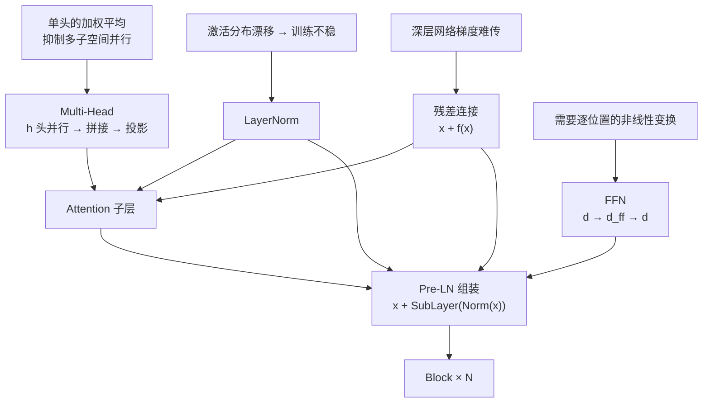

## 1. Multi-Head Attention:为什么一个头不够

单个 attention 头的局限不是「只能表达一种关系」——一个 softmax 行本来就可以有多个峰;Vaswani §3.2.2 的原话是「With a single attention head, averaging inhibits this」:单头的加权**平均**会抑制「在不同位置、不同表示子空间上同时关注」。但语言里的关系是多样的:语法依存、指代、语义相近、位置邻近…… 一个 softmax 分布很难同时装下这些。

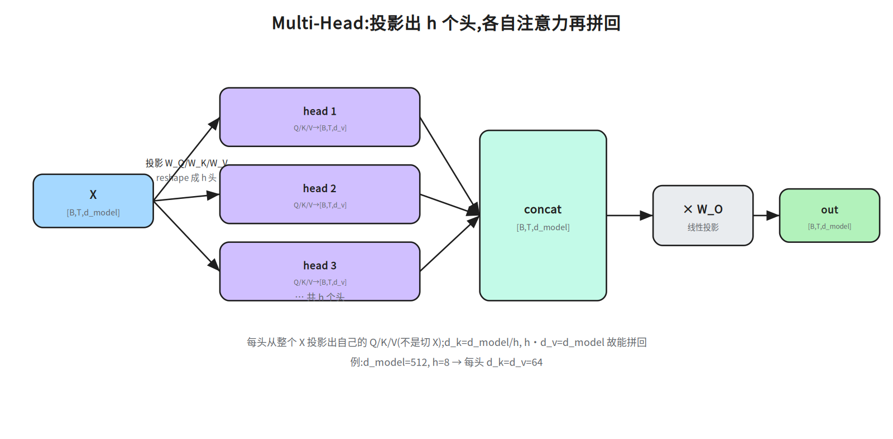

**做法:把 `d_model` 切成 `h` 个子空间,每头独立做一次 attention,再拼回来。**

形状记法先定一下:`B` = batch 大小(一次并行喂进模型的句子条数,训练时是超参、推理时常为 1),`T` = 序列长度(每句的 token 数,句间可以不同),`d_model` = 每个 token 的向量维度。下面所有 `[B, T, …]` 的第一维都是 batch;§3 里 BatchNorm 说的「batch 统计量」就是沿这个 `B` 维统计出来的量,`B` 越小时它越不稳。

```
设 d_model = 512, h = 8 → 每头 d_k = d_v = d_model / h = 64

对第 i 个头 (i=1..h):
    Q_i = X·W_Q^i   [B,T,d_k]      K_i = X·W_K^i   V_i = X·W_V^i
    head_i = Attention(Q_i, K_i, V_i)              [B,T,d_v]
拼接:  concat(head_1..head_h)                       [B, T, d_model]  (因为 h·d_v = d_model)
投影:  out = concat(...) · W_O          W_O [d_model, d_model] → [B, T, d_model]
```

```python
class MultiHeadAttention(nn.Module):
    def __init__(self, d_model, h):
        super().__init__()
        self.h, self.d_k = h, d_model // h
        self.W_q = nn.Linear(d_model, d_model)   # 一次投影出所有头,省循环
        self.W_k = nn.Linear(d_model, d_model)
        self.W_v = nn.Linear(d_model, d_model)
        self.W_o = nn.Linear(d_model, d_model)

    def forward(self, x):                        # [B, T, d_model]
        B, T, _ = x.shape
        # 投影后 reshape 成多头: [B,T,d_model] -> [B,T,h,d_k] -> [B,h,T,d_k]
        def split(w):                            # 返回 [B, h, T, d_k]
            return w(x).view(B, T, self.h, self.d_k).transpose(1, 2)
        Q, K, V = split(self.W_q), split(self.W_k), split(self.W_v)
        scores = Q @ K.transpose(-2, -1) / (self.d_k ** 0.5)   # [B, h, T, T]
        A = scores.softmax(dim=-1)                             # [B, h, T, T]
        out = A @ V                                            # [B, h, T, d_k]
        out = out.transpose(1, 2).reshape(B, T, -1)            # [B, T, d_model]
        return self.W_o(out)                                   # [B, T, d_model]
```

**代码里这几个 API 一句话交代（本节后不再重复）：**

- `nn.Module`：PyTorch 所有网络层的基类——继承它、在 `__init__` 里登记子层、实现 `forward`；之后写 `mha(x)` 就等于调 `forward(x)`。
- `nn.Linear(in, out)`：可学的仿射层 `y = x·Wᵀ + b`，它的 `weight` 形状是 `[out, in]`（第 0 维是输出维度），所以 `nn.Linear(d_model, d_model)` 的 `weight` 是 `[d_model, d_model]`。
- `view(B, T, h, d_k)`：把最后一维 `d_model` 重新解释成 `h × d_k`（只换形状、不动数据）；`transpose(1, 2)` 再把 `[B,T,h,d_k]` 挪成 `[B,h,T,d_k]`，让每个头各占一个矩阵。
- `@`：矩阵乘（等价 `torch.matmul`），`Q @ K.transpose(-2, -1)` 就是每头算 `QKᵀ`。
- `softmax(dim=-1)`：在最后一维做 softmax，即每个 query 对所有 key 的分数归一化成和为 1 的权重。

顺序上再强调一次：先对完整的 `x` 做投影（`self.W_q(x)`），再 `view/transpose` 按头拆开——不是先把 `x` 按列劈成 h 份。

**维度追踪:**

| 步骤 | 形状 |
|---|---|
| 输入 X | `[B, T, d_model]` |
| 每头 Q/K/V | `[B, h, T, d_k]` |
| 每头 scores | `[B, h, T, T]` |
| 每头 out | `[B, h, T, d_k]` |
| concat + reshape | `[B, T, h·d_k] = [B, T, d_model]` |
| `· W_O` | `[B, T, d_model]` |

**计算量没变**:每头把维度除 h、再做 h 次,总量与单头 `d_model` 相当(约 `O(T²·d_model)`),但**表达能力更强**。这也是它名字里"多头"而非"更大单头"的意义。

> 多头为什么有效(面试):类似 CNN 的**多通道**——不同头学不同的关注模式(可视化能看出来),但类型要按来源说:Voita et al. 2019 归纳的专门头只有三类——位置头、句法头、关注稀有词的头;「指代头」出自 Clark et al. 2019,不在这个框引用的来源里。**关键是让模型在多个表示子空间并行地找关系**,而不是逼一个头兼顾所有。
>
> 诚实补充:多头**并不保证**每头都学到不同的东西——研究表明存在大量**冗余头**——Voita et al. 2019 在 WMT 英俄上把 48 个 encoder 头(encoder = 编码器栈,第四层才讲;这里只需知道它是一个 6 层、每层 8 头的栈,所以 48 = 6×8,被剪的只是这一半结构里的头)剪到 10 个,BLEU 掉 0.15(**是极小损失,不是不掉点**;先给刻度:BLEU 是机器翻译的 n-gram 重合度自动评分,通行口径 0–100 分、越高越好,WMT 英俄这类任务上的强系统一般在 25–30 分,所以 0.15 分约等于 0.5% 的相对差——这就是「极小」的依据;范围仅限 encoder、仅这一语言对),多个头会被注意力层最后的 `W_O` 混合起来。所以"多通道"是**类比不是机制保证**;被追问时别把它说死。
>
> 现代变体 MQA/GQA(第五层)会动 K/V 的**共享方式**,那是为了省推理显存,和多头的原始动机不同。
没学过 CNN 的话这个类比可以整句跳过(卷积/通道不在本层前置里):要记的只有——每头一套自己的投影矩阵,等于在 h 个 `d_k` 维子空间里各算一次 attention 再拼回 `d_model`;“多通道”只是帮助记忆,不是机制保证。

## 2. 残差连接(Residual / Skip Connection)
> **前置:本节用到的求导记号(没学过反向传播也能读)。** 训练有一个损失 `L`;反向传播就是用**链式法则**把 `∂L/∂y` 一层层往回乘:若 `y = g(x)`,则 `∂L/∂x = (∂y/∂x)ᵀ·∂L/∂y`。其中 `∂y/∂x` 叫**雅可比矩阵**——y 的每个分量对 x 的每个分量求偏导排成的表。多层串联时,回传的梯度就是一串雅可比矩阵**连乘**;每乘一次尺度大致被一个“放大/缩小系数”乘一次,几十层下来系数 <1 就指数衰减到 0(**梯度消失**),>1 就指数放大(**梯度爆炸**)。下面的 `∂(x+f(x))/∂x = 1 + f'` 就是在看这一次连乘里的矩阵长什么样。

```
out = x + Sublayer(x)
```

把子层的输入 `x` 原样加到输出上。两个作用:

- **梯度高速公路**:反向传播时 `∂(x + f(x))/∂x = 1 + f'`,那条 `1` 让梯度可以**无衰减地直通**到浅层。没有它,几十层堆起来梯度就消失/爆炸了。
- **恒等映射的默认选项**:让子层只需学"相对于输入的**增量**",学不动时直接输出 0 也能把 x 传下去(最坏情况是恒等),训练更稳。

代价:残差要求输入输出**同形状**,所以子层输出必须映回 `d_model`。原论文取 `d_v = d_model/h`,使 concat 宽度恰好是 `d_model`;更一般地,`W_O` 可以把 `h·d_v` 映回 `d_model`,并不强制 `h·d_k=d_model`。
（和「常见坑」第 1 条对照着读:那条说的是原论文「让 concat 宽度恰好等于 d_model」的取法(`d_v=d_model/h`),是习惯约定;这里的「不强制」说的是形状上的硬性约束只有「子层输出能映回 d_model」,concat 宽度不必等于 d_model。两句不冲突,层次不同。）

### 2.1 数值演算:残差到底加了什么

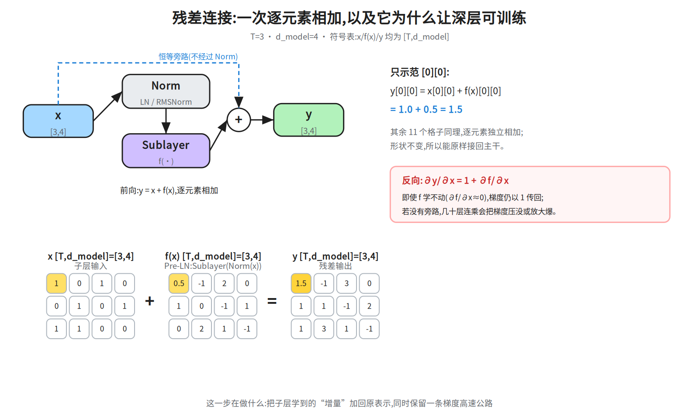

取 `T=3, d_model=4` 的小例子,`x` 是子层输入,`f(x)` 是子层输出(**没**过 Norm —— 本图是 Pre-LN,`y = x + Sublayer(Norm(x))`,Norm 只作用在旁路之外的支路上,见下方注记),两者形状都是
`[T, d_model] = [3,4]`:

```
x    = [[1, 0, 1, 0],      f(x) = [[0.5, -1, 2, 0],
        [0, 1, 0, 1],              [1,   0, -1, 1],
        [1, 1, 0, 0]]              [0,   2,  1, -1]]

y = x + f(x)  # 逐元素:y[i][j] = x[i][j] + f(x)[i][j]
y[0][0] = 1.0 + 0.5 = 1.5
y    = [[1.5, -1, 3, 0],
        [1,    1, -1, 2],
        [1,    3,  1, -1]]     # 形状仍是 [3,4]
```

**关键不是加法本身,而是反向传播**:`∂y/∂x = 1 + ∂f/∂x`。那个常数 `1` 来自旁路,它**不经过 Norm、不经过子层**,
所以即使子层学不动(`∂f/∂x≈0`),梯度仍能以 1 传回浅层。没有旁路时,几十层的雅可比连乘会把梯度压没/放大爆。

> 注意:残差旁路连接的是**子层输入 x** 和**子层输出**,不是把 Norm 之后的向量再加一遍。
> Pre-LN 的写法是 `y = x + Sublayer(Norm(x))`;旁路里的 `x` 保持原样。
>
> 图只画了 Pre-LN。**Post-LN** 是 `y = Norm(x + Sublayer(x))`:旁路先与子层输出相加,再一起过 Norm,
> 恒等路径被 Norm 打断,深层更容易失稳——这正是 §5 说的 Pre-LN 动机。

>
> **本节先用到的两个词（还没讲，先当黑箱）：** `Norm` 就是 LayerNorm——对每个 token 的 $d_model$ 维减均值、除标准差再仿射，§3 才正式定义；`Pre-LN` / `Post-LN` 指 Norm 放在子层之**前**还是之**后**，§5 才展开。本节要算的只是「旁路里的 $x$ 原样相加」，这件事与 Norm 摆在哪一侧无关——所以 §0 图里 D（残差）和 F（LayerNorm）是并列前置节点：残差机制本身不依赖 LN，只是套进 Pre-LN 组装时，Norm 落在旁路**之外**的支路上（$y = x + \text{Sublayer}(\text{Norm}(x))$）。此处只需记住「旁路那一路没有 Norm」，§3 再回看 Norm 的定义，§5 再回看两种摆法的差别。

## 3. LayerNorm:归一化

**对每个 token 的 `d_model` 维做归一化**(减均值、除标准差),再乘可学的 γ、加 β。
口径先说清:这里的标准差按**总体**算,即方差 = Σ(xᵢ−μ)²/N(除以 N,不除 N−1),与 PyTorch `nn.LayerNorm` 一致。§5.5 ④ 的 `σ²=(9+1+1+9)/4=5.00` 用的就是这个口径;若按样本标准差 ÷(N−1) 会得 20/3≈6.67、σ≈2.582,后面的 `x_hat` 与 −1.81 就全对不上。
`ε` 是什么(本层第一次出现,顺手交代):默认 `1e-5`,加在方差上再开方,只干两件事——某维方差恰好为 0 时避免 0 除,以及让浮点计算更稳。它小到不改变可见数字:§5.5 ④ 里 `σ₀²=5.00`,`5.00+1e-5` 再开方仍是 2.2361(前 4 位不变),所以 `x_hat` 与 −1.81 和不含 ε 时一致;算出来「没变化」不是漏项。为什么要 γ/β?归一化把每层输入限制在零均值、单位方差,虽然稳定但**限制了表达力**;仿射参数让模型自己学回合适的尺度(γ)与偏移(β),相当于“归一化后再给模型一个可调的旋钮”。

```
μ = mean(x)          # 沿最后一维(d_model)
σ₀ = std(x)          # 总体口径(÷N);含 ε 的那个记作 σ = √(σ₀²+ε),与 §5.5 ④ 同记号
LayerNorm(x) = γ · (x - μ) / √(σ₀² + ε) + β
```

```python
norm = nn.LayerNorm(d_model)
   # 对最后一维归一化,每个 token 独立


**σ 别写成两个意思:** 分母是 `√(σ²+ε)`,所以下面统一记 `σ = √(std(x)² + ε)`——先按总体口径算 `std(x)`,平方、加 ε、再开方;不是 `√(std(x))`,也不是把 `std(x)` 直接叫 σ。§5.5 ④ 的 `σ²=5.00` 指 `std(x)²`。```

**为什么用 LayerNorm 而不是 BatchNorm(面试高频)?**

| | 归一化维度 | 对 batch 的依赖 | 适合 NLP 吗 |
|---|---|---|---|
| BatchNorm | 跨 **batch** 的同一特征 | 强,依赖 batch 统计 | 差 |
| LayerNorm | 每个样本**内部**(d_model 维) | 无 | 好 |

原因:NLP 序列长度可变、batch 内句子长度不一,BN 的 batch 统计量不稳定;LN 对**每条样本独立**、与 batch 大小无关,推理时也无需存运行统计量。所以 Transformer 全程用 LN。


**补上 §0 说的「激活漂移」到底指什么（§0 承诺由本节给动机）。** 训练时每层的输入分布不是固定的：前面层参数一更新，这一层收到的激活的均值/方差就跟着变；越深，这种偏移经过的层数越多、被放大的机会越大（某几维尺度暴涨、出现极端值）。后果是数值尺度漂移——落进饱和区的那部分梯度趋近 0，过大的方向又把梯度顶爆，表现为 loss 抖、深层训不动，这就是「激活分布漂移 → 训练不稳」（§0 的 E 节点）。LayerNorm 的做法是在**每层入口**把每个 token 的 $d_model$ 维重新拉成零均值、单位方差，再用 $γ/β$ 学回需要的尺度：不管上一层把分布推成什么样，这一层入口的尺度都被钉在固定范围，深了也不至于逐层累积漂移。
口径说明：原始动机用的是「内部协变量偏移（internal covariate shift）」这一说法；后续工作（如 Santurkar et al. 2018 对 BatchNorm 的分析）认为「减少偏移」并非归一化起效的主要解释，更站得住的说法是它让优化曲面更平滑。被追问时两句话都给，别把 ICS 说成定论；但「逐层固定尺度让深层可训」这个工程结论是实测成立的。

## 4. Position-wise FFN:前馈网络

每个位置**独立**过两层 MLP(位置之间不混合):

```
FFN(x) = W₂ · 激活(W₁·x + b₁) + b₂
```

- 中间维度 `d_ff` 通常 `= 4 · d_model`(原论文 512→2048)。
- 式中的“激活”原论文取 **ReLU**:`ReLU(z) = max(0, z)`,逐元素保留正数、把负数压成 0。它是**非线性**的来源:没有它,`W₂(W₁x+b₁)+b₂` 会塌成一次线性变换,FFN 等价于一个矩阵;有了它才能拟合分段线性的复杂函数。现代模型多换 GELU / SwiGLU(第五层),作用相同。
- 张量形状:**逐位置**作用,`[B, T, d_model] → [B, T, d_ff] → [B, T, d_model]`,形状进出不变。
- 它是**逐 token** 的,不做跨位置交互——跨位置交互由 attention 负责。

```python
ffn = nn.Sequential(
    nn.Linear(d_model, 4 * d_model),
    nn.ReLU(),                        # 原论文;现代用 GELU / SwiGLU(第五层)
    nn.Linear(4 * d_model, d_model),
)
```

**FFN 的作用(面试):** 它是 Block 里参数量最大的一部分(两层共 `2·4·d_model² = 8·d_model²`,远超 attention 的 `4·d_model²`)。直觉上 attention 负责**在位置间搬运/汇聚信息**,FFN 负责**对每个位置的信息做非线性变换与"记忆"**——有研究把 FFN 的键值对当机制解释(Geva et al. 2021:FFN 第一层参数矩阵 W₁ 的每一行是一个“键”,第二层参数矩阵 W₂ 的列是“值”;输入 x 与这些**固定的参数键**作用、过激活后得到记忆系数 m,再用 m 对“值”加权求和——键是第一层的参数,不是它的激活输出);另一批工作(ROME、knowledge-neurons 等)用因果干预定位到“部分事实性知识确实写在 FFN 里”。两组结论常被合称“FFN 是知识存储”,但来源不同、强度不同,不宜当成单一共识。至于「去掉 FFN 会怎样」,上面两组来源都没给消融口径(掉多少分、在哪个任务上),本讲义不当它有实验依据:能说的是 FFN 占了约 2/3 参数、并被因果干预定位到承载部分事实性知识;而「表达能力大幅下降」这种量级判断,要具体消融实验才敢说。

## 5. 组装:一个 Block

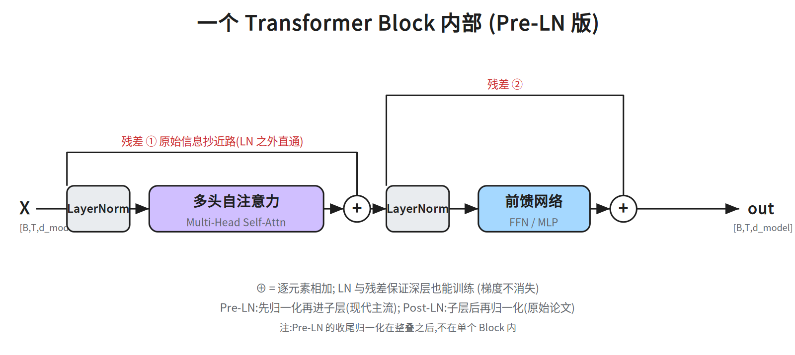

**Pre-LN(现代主流,GPT/LLaMA 系):**

```
x = x + MHA( LayerNorm(x) )          # 注意力子层 + 残差
x = x + FFN( LayerNorm(x) )          # 前馈子层 + 残差
```

**Post-LN(原始论文):**

```
x = LayerNorm( x + MHA(x) )
x = LayerNorm( x + FFN(x) )
```

区别:LN 放在子层**前**还是**后**。**为什么 Pre-LN 更稳(面试会追问机制):**

- **Pre-LN:** 残差恒等路径 `x + Sublayer(Norm(x))` 里的 `x` **不经过 Norm**,梯度可以从最后一层一路**无损直通**回第一层(那条 `+1` 不被打断),所以深层也能训。
- **Post-LN:** `Norm(x + Sublayer(x))` 里最外层的 Norm 把整条残差输出**又缩放了一遍**,恒等路径被 Norm 打断;层数一深,梯度/激活范数容易失稳,必须靠 **learning-rate warmup** 这类技巧救。

Pre-LN 的代价是最后要再补一个 LN。**为什么必须补?** 残差流 `x` 从第一层一路累加,其范数会随深度增长;进入 LM Head 前做一次归一化,把尺度拉回稳定范围,否则 logits 量级会随层数漂移。
补两个名词:LM Head 是 Block 栈之后那一层线性映射,把每个位置的 `d_model` 维向量映到词表大小 `|V|`(`[B,T,d_model] → [B,T,|V|]`);它输出的、过 softmax 之前的实数就叫 **logits**。logits 的绝对尺度决定 softmax 有多“尖”(差一个量级就近乎 one-hot),所以尺度随深度漂移会直接让训练不稳——这才是必须补最后一个 LN 的原因。
（依赖图外的一件收尾事,顺带交代:这里的「最后的 LN」和「LM Head + logits」都不在 §0 图的 A–K 节点里,它们属于「Block × N 之后」的部分,本层只要知道「Pre-LN 要在栈顶补一个 LN,再接 LM Head 出 logits」即可;下面的 dropout 细节同理,也只在图外。）Post-LN 把 Norm 放在残差之后,早期层的梯度要穿过 Norm,容易过大/过小,所以常配 learning-rate warmup。


**补一个名词：learning-rate warmup（学习率预热）是什么、凭什么能救 Post-LN。** 做法是训练最初几千步不用目标学习率，而是从 0（或极小值）线性升到峰值，再按计划衰减。为什么有用：初始化是随机的，Post-LN 的 $y = \text{Norm}(x + \text{Sublayer}(x))$ 里最外层 Norm 让回传梯度先穿过一次缩放，而这个缩放的尺度在初期完全不可控；此时若一步就用大学习率，等于在「梯度尺度还没校准」时迈大步，很容易把某层激活推进饱和/爆炸区，Norm 再把这个坏尺度固定住，就退不回来了。先把学习率压小，让模型在最初这几千步里把各层尺度调到合理范围，再放开步长，深层才训得起来——和「恒等路径被最外层 Norm 打断、梯度尺度不受控」是同一个因果链。
两句边界：① warmup 是**绕开初期不稳定区的技巧**，不是「修正」Post-LN 的机制，所以它是补丁、不是 Post-LN 的优点；② Pre-LN 也常配 warmup（工程习惯），但它不是必需品——「Pre-LN 更稳」指的正是「不靠这个补丁也能堆深」。本节前面「必须靠 learning-rate warmup 这类技巧救」与后面「常配 learning-rate warmup」指的是同一个机制。

**现代大模型几乎都用 Pre-LN**(第五层细讲)。

整个 Block 的形状不变:`[B, T, d_model] → [B, T, d_model]`——所以才能**堆 N 层**。

**Dropout 打在哪(高频细节):** 原论文 §5.4 的 dropout 共三处:①每个子层的输出“在加入子层输入并归一化之前”;②“词嵌入与位置编码求和处”;③对 softmax 后的注意力权重 `A` 做 dropout。版本差异要看清楚:arXiv v1(1706.03762v1)的 §5.4 有独立小标题 “Attention Dropout”,给出 Attention(Q,K,V)=dropout(softmax(QKᵀ/√d_k))V,并写 “we found attention dropout to be beneficial for our parsing experiments”;v5/v7 删掉了这段正文,但 §5.4 仍以 “We employ three types of regularization during training” 开头(后面只剩 Residual Dropout、Label Smoothing 两类),§6.3 也仍把 attention dropout 归到 “(section 5.4)”。所以 attention dropout 是论文正文写过的东西,官方实现(tensor2tensor)的 `attention_dropout` 是同一件事的工程落地,不是实现里才有的私货。作用是正则化、防过拟合;现代大模型因为数据量巨大,常把 dropout 设得很小或直接关掉。
机制:训练时对张量每个元素以概率 p 随机置零,保留下来的元素乘以 1/(1−p) 以保持期望不变(置零位置的梯度也为 0),于是每次迭代都在训练一个“残缺版”子网络,近似于集成大量共享参数的子模型,从而抑制过拟合;推理时不置零、不缩放,直接用全部元素。

## 5.5 数值演算:多头、LayerNorm 与 FFN

<!-- ws-ref:begin -->
> 🧮 **手算卡**（打印出来在纸上算，算完拍照发我核对）
> - `ws-block-chain` ｜ §5.5 数值演算 ｜ 残差 + FFN 数据流走完一个 Block，含 ReLU 真的置零的一次
> - `ws-layernorm-stats` ｜ §5.5 数值演算 ｜ μ→σ→x_hat→y，含 ε 的敏感性（换 0.01 看 σ 动多少）
<!-- ws-ref:end -->


### ① Multi-Head:按列切成两个头

沿用 `X [3,4]` 的小例子,`h=2`,每个头 `d_k=2`。按**列**切(行/T 维不动):

```
head_1 = X[:, 0:2] = [[1,0],[0,1],[1,1]]
head_2 = X[:, 2:4] = [[1,0],[0,1],[0,0]]
```

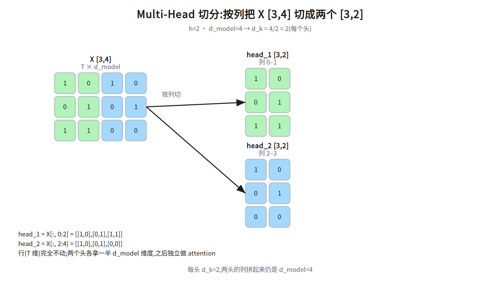

> 图上用 `X` 演示切分方式;真实实现里通常先投影出 `Q/K/V`,再按头 reshape 成
> `[B, h, T, d_k]`。
**别把“切列”当成机制:** 这里按列切只是把“每个头各占 `d_k` 维”画出来便于手算。真实的多头是每头用自己的一套 `W_Q^i/W_K^i/W_V^i` 把**完整的 `X`** 投影到 `d_k` 维(§1),两个头的投影矩阵不同,所以 `head_1` 看到的输入并不等于 `X` 的前两列。

**三处 `x`/`X` 分别指谁（别混着代）:** ① 的 `X [3,4]` 就是 §2.1 那组数（`T=3` 个 token、每个 4 维），这里把它当作 **attention 子层的输入**来切/投影——多头并没有另起一个张量，切列只是示意；④ 的 `x=[1,3,5,7]` 与 ⑥ 的 `x=[1,2,0,1]` 都是**单个 token 的 4 维向量**，是为手算另取的整数示意值（不是 §2.1 的 `X` 的某一行）；三者维度同为 `d_model=4`，但取值各自独立给定，别拿 ④/⑥ 的向量回 ① 的 `X` 里重算。


**补上被跳过的一步:一个头怎么算出输出(① → ② 之间)**

§1 的算式,以 head_1 为例(`d_k=2`):`Q₁=X·W_Q¹`、`K₁=X·W_K¹`、`V₁=X·W_V¹` → `scores=Q₁K₁ᵀ/√d_k` → `A=softmax(scores)`(按行)→ `head₁=A·V₁`。取 `V₁` 的三行为 `v₁=[-2,0]`、`v₂=[6,0]`、`v₃=[2,6]`,第 0 行的 scores(已除 `√d_k`)为 `[1.61, 1.61, 0.69]`:

这几个数不是天上掉的,出处如下(以 head_1 为例,`d_k=2`;三个权重都是 `[4,2]`,按 `Q=X·W` 右乘):


W_Q¹ = [[1,0],[0,1],[1,1],[0,0]]
W_K¹ = [[0,0.49],[0,0.49],[0,1.79],[0,1.79]]
W_V¹ = [[0,6],[2,0],[-2,-6],[4,0]]

Q₁ = X·W_Q¹ = [[2,1],[0,1],[1,1]]
K₁ = X·W_K¹ = [[0,2.28],[0,2.28],[0,0.98]]
V₁ = X·W_V¹ = [[-2,0],[6,0],[2,6]]        # 与下面用的 v₁/v₂/v₃ 一致

第 0 行,取 q₀ = Q₁[0] = [2,1]:
q₀·k₀ = 2×0 + 1×2.28 = 2.28   → 2.28 / 1.4142 = 1.61
q₀·k₁ = 2×0 + 1×2.28 = 2.28   → 1.61
q₀·k₂ = 2×0 + 1×0.98 = 0.98   → 0.98 / 1.4142 = 0.69


口径:上面这组 `W` 只保证**第 0 行**能逐步对上(可以自己乘一遍核对)。第 1、2 行的 scores 行是另给的示意值——第 1 行 `[-0.54,-2.49,-1.10]`、第 2 行 `[-0.61,-1.23,-1.79]`,代入下面的 softmax 与加权求和,正好得 `[0,2]` 与 `[1,1]`;它们不要求与这组 `W` 自洽,作用是让 ② 的拼接出现三行不同数值。


A[0]      = softmax([1.61,1.61,0.69]) = [5/12, 5/12, 2/12] ≈ [0.417, 0.417, 0.167]
head_1[0] = 0.417×[-2,0] + 0.417×[6,0] + 0.167×[2,6] = [2.00, 1.00]


第 1、2 行用同一算式、只换 scores 行,分别得 `[0,2]`、`[1,1]`——② 的 `head_1` 就是这三行;head_2 另有一套 `W_Q²/W_K²/W_V²`,过程完全一样。

### ② Multi-Head:拼回

设两头输出为 `head_1=[[2,1],[0,2],[1,1]]`、`head_2=[[1,0],[1,2],[2,1]]`,
按最后一维拼接:

```
concat[0] = [head_1[0] | head_2[0]] = [2,1 | 1,0] = [2,1,1,0]
```

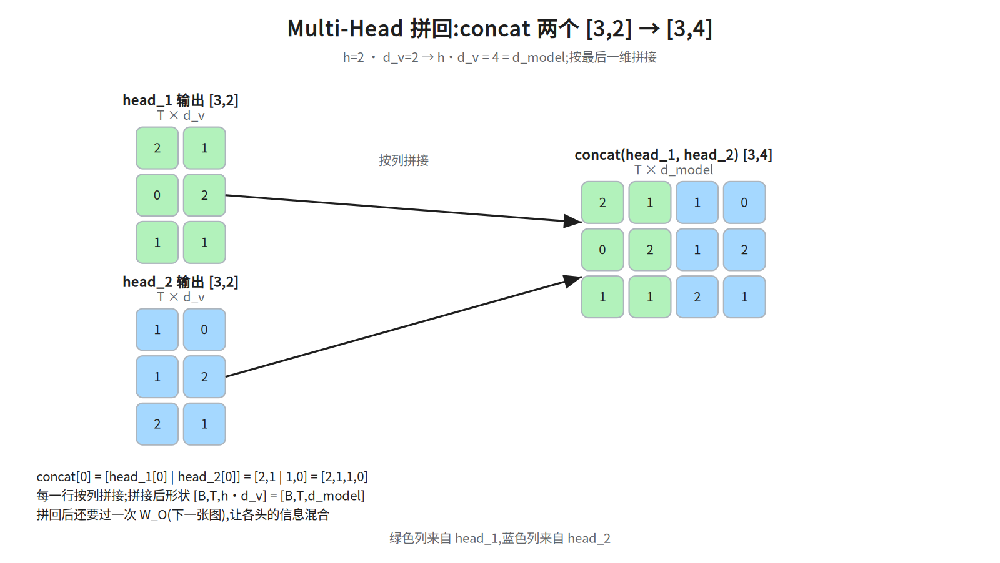

拼接后形状 `[B,T,h·d_v]=[B,T,d_model]`;绿色列来自 `head_1`,蓝色列来自 `head_2`。

### ③ 输出投影:concat · W_O

`concat [3,4]` 第 0 行为 `[2,1,1,0]`,`W_O [4,4]` 第 0 列为 `[1,0,1,0]`:

```
out[0][0] = 2×1 + 1×0 + 1×1 + 0×0 = 3
```

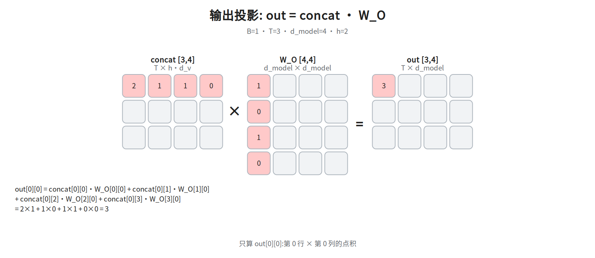

### ④ LayerNorm:统计与归一化

一个 token 向量 `x=[1,3,5,7]`:

```
μ = (1+3+5+7)/4 = 4.00
x-μ = [-3,-1,1,3]
σ² = (9+1+1+9)/4 = 5.00
σ₀ = std(x) = √5.00 = 2.2361(总体口径,见 §3)
σ = √(σ₀²+ε) = √(5.00+1e-5) = 2.2361,1/σ = 0.4472
x_hat = (x-μ)/σ = [-1.34,-0.45,0.45,1.34]
```

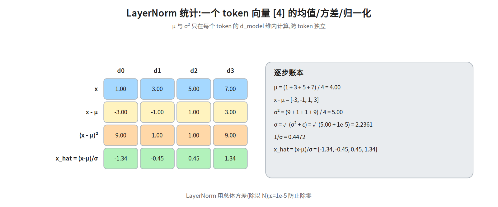

### ⑤ LayerNorm 仿射:y = γ ⊙ x_hat + β

`γ=[1.5,0.5,2.0,1.0]`、`β=[0.2,1.0,0.0,-0.5]`,只示范第 0 个元素:

```
y[0] = γ[0]·x_hat[0] + β[0] = 1.5×(-1.34) + 0.2 = -1.81
```

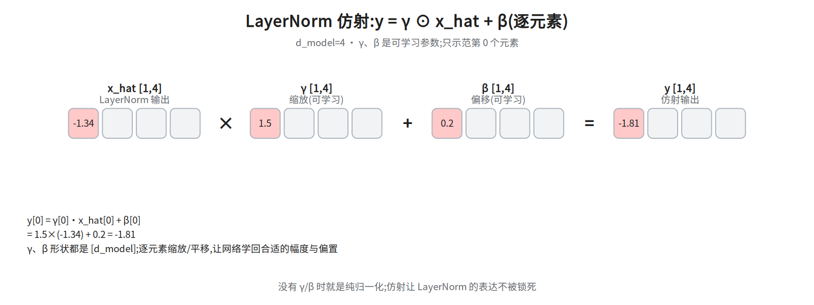

### ⑥ FFN 第一层:x · W1 + b1,再过 ReLU

`x=[1,2,0,1]`,取 `W1` 的第 0 行 `[-1,0,1,-1]`(按 §4 的 `W₁·x`,W₁ 形状是 `[d_ff, d_model]`,乘 `x` 得到第 0 个隐藏维的是**行**不是列;`nn.Linear(d_model, 4*d_model)` 的 `weight` 也正是 `[d_ff, d_model]`)、`b1[0]=0.5`:

```
pre[0] = 1×(-1) + 2×0 + 0×1 + 1×(-1) = -2.00
z[0]   = pre[0] + b1[0] = -2.00 + 0.50 = -1.50
h[0]   = ReLU(z[0]) = max(0, -1.50) = 0.00
```

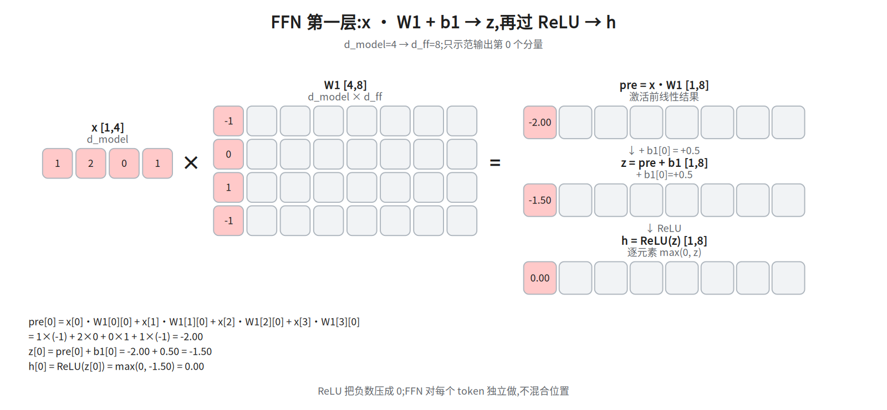
> **两处口径统一一下:** ⑥ 只演算了 `h[0]`,`h[1..7]` 是直接给定的取值(想看全量就把 ⑥ 的算式对 `W1` 的每一行各做一遍)。另外为了让手算短,本例把 `d_ff` 缩成 `2·d_model = 8`;§4 说的 `4·d_model` 是真实配置,`d_model=4` 时真实 `d_ff=16`,只是 `W1` 多 8 列、`h` 多 8 维,算式一模一样。所以 ⑦ 的 `h` 和 `W2` 列都是 8 个元素,不是 16。

### ⑦ FFN 第二层:h · W2 + b2

第一层 ReLU 后的完整 `h=[0,2.5,1,2.5,2.5,1,2.5,3]`。取 `W2` 的第 0 行(按 §4 的 `W₂·h`,W₂ 形状是 `[d_model, d_ff]`,输出第 0 维取的是**行**)
`[1,0,1,0,1,1,0,1]`、`b2[0]=-0.5`:

```
y[0] = 0×1 + 2.5×0 + 1×1 + 2.5×0 + 2.5×1 + 1×1 + 2.5×0 + 3×1 + (-0.5)
     = 7.5 - 0.5 = 7.00
```

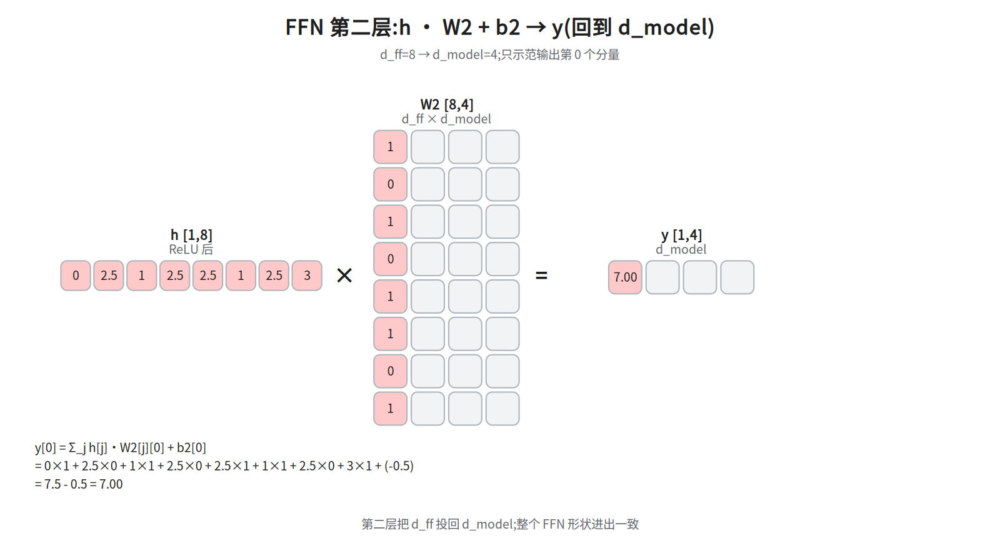

整个 FFN 形状进出不变:`[B,T,d_model] → [B,T,d_ff] → [B,T,d_model]`。

## 6. 一个真实规模的感觉(GPT-3 量级)

用两个具体配置建立体感(`d_model`/层数/头数取自 GPT-3 论文 Table 2.1;`d_ff` 不在该表里,是按正文的 `d_ff = 4·d_model` 算出来的):

| | GPT-3 6.7B | GPT-3 175B(旗舰) |
|---|---|---|
| `d_model` | 4096 | 12288 |
| 层数 N | 32 | 96 |
| 头数 h | 32(d_k=128) | 96(d_k=128) |
| `d_ff` | 16384(=4·d) | 49152(=4·d) |

单层参数量级:attention ≈ `4·d_model²` + FFN ≈ `8·d_model²` ≈ `12·d_model²`。
6.7B 配置下 12×4096² ≈ 2.01 亿/层,堆 32 层 ≈ 64.4 亿;剩下那部分来自词嵌入(50257×4096 ≈ 2 亿,输入与输出若共用嵌入就是这一份,不共享则是两份 ≈ 4 亿)。64.4 + 2 ≈ 66.5 亿,与公布的 6.7B 对得上;若按“两处 embedding”算则是 ≈ 68.5 亿。所以只说“单层×层数”会漏掉 embedding 这一项,报 67 亿时要交代口径。**可见 FFN 占了大头**(两层 FFN 是 attention 的约 2 倍)。

这解释了为什么"参数量"和"FFN 宽度/层数"关系密切,以及为什么 MoE(第五层)专门去稀疏化 FFN。

## 面试要点

1. **多头为什么比单头好?** → 在多个表示子空间里并行做 attention——单头的加权平均会把它们混掉;计算量与单头 `d_model` 相当。「类似 CNN 多通道」只是类比,不是机制保证:实测有大量冗余头(Voita et al. 2019,剪 38/48 个 encoder 头只掉 0.15 BLEU),被追问时别把它说死。
2. **LayerNorm 和 BatchNorm 区别?为什么 NLP 用 LN?** → LN 对每个样本内部归一化,与 batch 大小/序列长度无关,统计稳定。
3. **残差连接为什么重要?** → 提供梯度直通路径(那个 +1),让深层网络可训练。
4. **FFN 干嘛的、在哪一层起作用?** → 逐位置非线性变换 + 知识存储,是 Block 参数量主体;不跨位置。
5. **Pre-LN vs Post-LN?** → LN 放子层前/后;Pre-LN 深层更稳,是现代主流。
6. **一个 Block 的输入输出形状?** → 都是 `[B, T, d_model]`,故可堆叠。

## 常见坑

- `d_k = d_model / h` 是常见约定;取 `d_v = d_model / h` 时 `h·d_v = d_model`,concat 宽度**恰好**是 `d_model`(原论文取法)。这不是硬性前提:concat 宽度可以是 `h·d_v ≠ d_model`,由 `W_O` 映回 `d_model`(见 §2 末段)。
- LayerNorm 归一化的是**最后一维(d_model)**,不是序列维;每个 token 独立。
- FFN 是**逐位置**的,别以为它也做 token 间交互。
- 残差要求形状一致——但保持 `d_model` 的只有子层的**输入与输出**,子层**内部**的投影并不保持:`W_Q/W_K/W_V` 把每个头投到 `d_k = d_model/h`(§1:d_model=512、h=8 → d_k=64),`W₁` 把维度抬到 `d_ff = 4·d_model`(§4),所以中间会出现 `[B,T,d_ff]` 这种形状(§5.5 ⑥⑦);残差之所以成立,是因为子层输出被 `W_O` / `W₂` 映回了 `d_model`。


## 相关图

`03_block_internal`(Block 内部结构)· `07_multihead`(多头切分与拼回)
· `16a_multihead_split` / `16b_multihead_concat` / `16c_out_proj` / `16e_residual`
(多头/残差的逐步数值;`16d_gqa_sharing` 属第五层 GQA)
· `17a_layernorm_stats` … `18b_ffn2`(LayerNorm/FFN 的逐步数值)
(均在 `diagrams/`,横竖双版本)

## 下一步

第四层 · 组装:**Encoder / Decoder 两种架构、因果掩码(Masked Attention)、Cross-Attention**。
