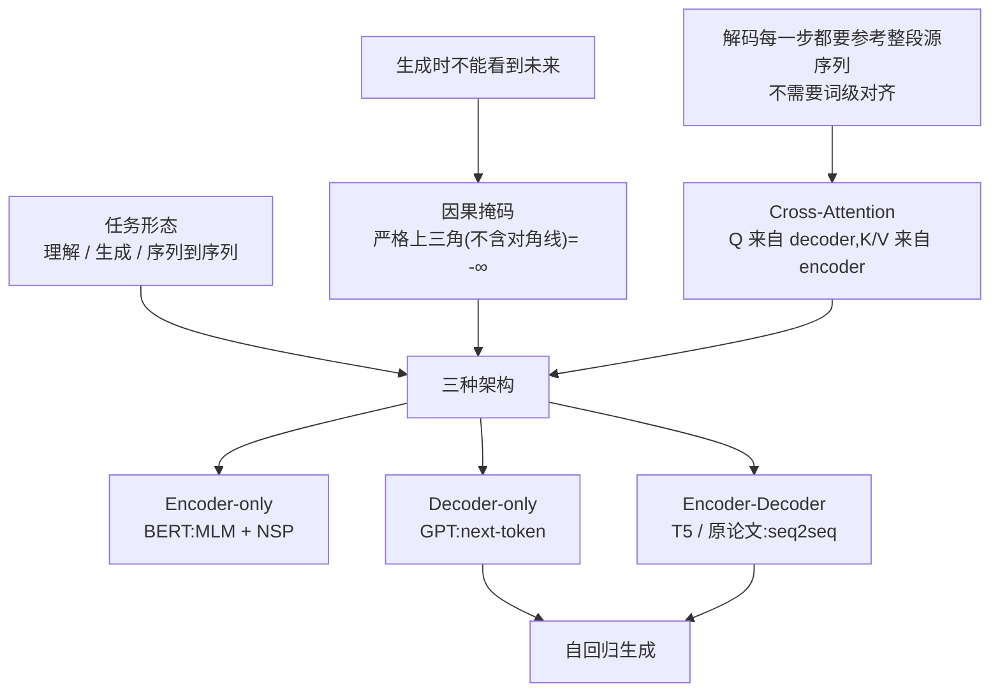
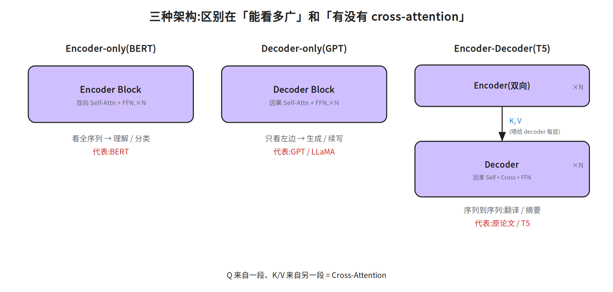
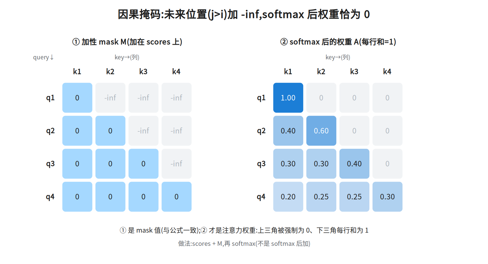
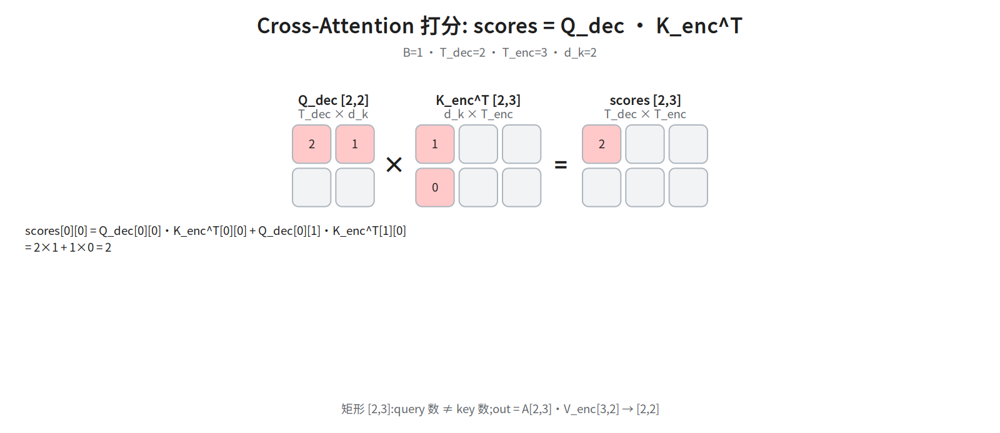

# 第四层 · 组装 —— Encoder / Decoder / 掩码 / Cross-Attention

> 本层回答:把 Block 拼成完整模型,有哪几种拼法?为什么生成任务需要**掩码**和 **Cross-Attention**?

## 0. 依赖图(学习顺序)

> 根节点是**可以无条件接受**的事实;箭头表示「前者支撑后者」。**能力依赖**的拓扑序是从根到汇点 J(D、F 先于 B,B 再经 G/H/I 汇到 J);但**成文顺序不是拓扑序**:§1 先给中间节点 B 的结论表,§2/§3 再回填 D、F 的定义,所以读 §1 时先当标签收下是正常的。
> 例外只有一处:C(「生成时不能看到未来」)是**带前提的根**,严格读作「**逐 token 自回归解码时**不能看到未来」。§2 用 Mask-Predict、扩散式解码说明「没有因果掩码也能生成」,那是把 C 的前提收窄,不是推翻它——按这个读法,图与 §2 不冲突,不必回头怀疑这张图。
> **图 ≠ 成文顺序**:图只声明能力依赖(D、F 支撑 B)。§1 先给结论表格时,“因果掩码”“cross-attention”“自回归”先当标签接受,读完 §2/§3 再回看表格,不必在 §1 卡住。
§1 还会提前用到几个标签,一并先当标签收下:**teacher forcing**(§2 末给定义)、**encoder/decoder 与 Block 的堆叠关系**(§5 给代码)、**decoder 的三个子层**(§3:因果 self-attention → cross-attention → FFN)、**KV Cache / CLM / few-shot(上下文学习)**(§1 中段「三个裸术语」段各给一句定义),它们只影响细节回看,不影响 §1 的结论。图上未单列的三块都挂在 B 之下、属下游而非前置:位置编码差异(§4)、padding mask(§3 与「常见坑」,与因果掩码并列的第二种 mask)、MLM/NSP(§6;它们就写在 G 节点「BERT:MLM + NSP」的标签里,图上没有独立节点或边,属下游预训练目标而非前置)。



## 1. 三种架构(先记结论)

| 架构 | 由谁组成 | 每层里的 attention | 代表 | 适合 |
|---|---|---|---|---|
| **Encoder-only** | 只堆 encoder | 双向 self-attention | BERT | 理解类:分类、抽取、判别 |
| **Decoder-only** | 只堆 decoder(去掉 cross) | 带因果掩码的 self-attention | GPT / LLaMA | 生成类:续写、对话 |
| **Encoder-Decoder** | encoder + decoder | encoder 双向;decoder 因果 + **cross-attention** | 原论文 / T5 / 机器翻译 | 序列到序列:翻译、摘要 |

一句话:**区别就在 Block 内部(骨架都是第二三层的那个 Block,换掉的是 Block 里的 attention 子层:mask 决定可见范围、有没有 cross-attention 子层),即"注意力能不能看全序列"和"有没有 cross-attention"。**

**为什么现代通用大模型几乎都收敛到 decoder-only?**(面试追问):

- **目标统一**:翻译、摘要、问答、代码都能写成“给前缀,生成后缀”,不用为任务换架构。
- **训练/推理一致(注意:这条对「选哪种架构」没有区分力,不是 decoder-only 独有的优势)**:训练与推理的目标其实一致——encoder-decoder 的解码端同样是 next-token prediction(训练时配 teacher forcing——每步喂真实前缀、不用模型自己的预测,§2 末给定义)、推理时同样自回归,不存在“目标错位”。真正的差别是结构(一套还是两套 Block、两堆之间要不要 cross-attention 这个连接件)与调度复杂度。


- **工程更简单**:只有因果 self-attention,一套 mask + KV Cache;encoder-decoder 多一套 cross-attention 与调度。

  > 这一条里的 **KV Cache**、下一条的 **CLM / few-shot** 都还没定义,先当标签读;定义就在本节末「三个裸术语」段,不影响本段结论。
- **上下文学习**:海量 CLM 预训练自然学出“看提示、照格式续写”,few-shot 很顺。

encoder-only(BERT 类)仍适合分类/抽取等理解任务;encoder-decoder 仍适合翻译/摘要等严格 seq2seq。详见 `notes/07_pretraining.md §1.5`。
**三个裸术语先各给一句定义**(细节在后面几层):**KV Cache** = 自回归生成时把已算过的 K、V 缓存复用,每步只算新 token,不重算整段;**CLM** = Causal Language Modeling,因果语言建模,即“给前缀预测下一个 token”这个预训练目标(GPT 系);**few-shot / 上下文学习** = 不改参数,只在提示里给几个示例,模型照格式续写。第 3、4 条理由(工程更简单、上下文学习)的落点是:K/V 同源 → 缓存只有一套;预训练目标与推理用法同形 → 提示里的例子就等于“前缀”。



## 2. 因果掩码(Masked / Causal Attention)—— 生成的关键

**问题:** 生成任务里,预测第 `t` 个词时,模型**不能偷看**第 `t+1` 及之后的词(那是答案/未来)。但标准 attention 是"每个位置都能看全序列",会泄露未来信息。

**解法:** 在 softmax **之前**,把"未来位置"的分数置成 `-∞`,`e^{-∞}=0`——未来位置的权重就变成 0,不参与加权。

```
mask[i, j] = 0      if j ≤ i    (允许看:自己及之前)
mask[i, j] = -∞     if j > i    (禁止看:未来)

scores = Q·Kᵀ / √d_k + mask
A = softmax(scores)             # 被 mask 的位置权重精确为 0
```

```
掩码后的注意力矩阵(严格上三角(不含对角线)为 0,下三角含对角线才有值):
      k1   k2   k3   k4          · 有值,空白 = 0
q1 [  ·  ]
q2 [  ·    ·  ]
q3 [  ·    ·    ·  ]
q4 [  ·    ·    ·    ·  ]
```



> 本框数值可逐格按框内算式自核(`notes/02_attention.md §5.5 ⑤.5` 用的是另一组 scores、且明写略去 ÷√d_k,不能用来核本框);掩码**形状**示意见 `diagrams/14h_mask.landscape.png`(数值口径见本框末注)。
> 不翻外部文件也能验的一组数(取 `T=3, d_k=2`,`Q=K=[[1,0],[0,1],[1,1]]`):
>
> 
> scores_raw = Q·Kᵀ  = [[1,0,1],[0,1,1],[1,1,2]]
> scores     = /√2  ≈ [[0.71,0,0.71],[0,0.71,0.71],[0.71,0.71,1.41]]
> mask              = [[0,-∞,-∞],[0,0,-∞],[0,0,0]]
> scores+mask       = [[0.71,-∞,-∞],[0,0.71,-∞],[0.71,0.71,1.41]]
> A = softmax(逐行)  = [[1,0,0],[0.33,0.67,0],[0.25,0.25,0.50]]
> 
>
> 第 1 行只有 `k1` 有权重(`A[0][1]=A[0][2]=0`),被 mask 的位置**精确为 0**;每行仍归一化为 1。图 `14h_mask` 只用来看**掩码形状**(哪些格子被置 `-∞`、哪些留空),**不要拿它核验本框的数值**:那张图用的是另一套示例数,且未除 √d_k,与本框的 scores/A 不是同一组;本框的数一律以本框算式为准(逐格按本框算式自核即可;`notes/02_attention.md §5.5 ⑤.5` 的 scores 与掩码口径都和本框不同,不能当核对依据)。

```python
def causal_mask(T, device):
    m = torch.full((T, T), float("-inf"), device=device)   # mask 必须和 scores 同 device
    m = torch.triu(m, diagonal=1)          # 上三角(不含对角线)= -inf
    return m

# Q/K 就是上面公式里的 Q、K;用 Q.device,不要引用本篇从未定义的 x
scores = Q @ K.transpose(-2, -1) / (d_k ** 0.5) + causal_mask(T, Q.device)
A = scores.softmax(dim=-1)
```

**为什么用 `-∞` 而不是 0?** 必须让 softmax **之后的权重精确等于 0**。如果加 0,softmax 仍会给未来位置分配非零概率(`e^score > 0`),就泄露了。`-∞` 保证被 mask 的权重恰好为 0。

**为什么叫"因果"?** 因为它保证每个位置只依赖**它之前**的信息,和"时间上不能穿越"一致。常被顺口叫作“自回归注意力”,但严格说两者不等价:因果掩码是**机制**(禁止看未来),自回归是**使用方式**(逐个生成)。


> 下面马上要用到四个词,先各给一句最小定义免得边读边猜(本节只给一遍,后面不再重复):**NAR(非自回归)** = 不逐 token、一次并行吐整段;**Mask-Predict** = 先全填 `[MASK]` 再迭代重填低置信位置;**扩散式解码** = 从噪声多步去噪出整段;**block-wise** = 序列切块、一次生成一块(块内多 token 由并行的独立 proposal 猜、再因果验证),注意力仍是普通因果掩码、不额外加块内掩码。

>
> (四个词的定义到此结束;以下转入**论证**——证明「因果掩码不是生成的必要条件」、以及两类反例方向相反。别把论证当定义读。)BERT 用非因果注意力、训练时一次前向就并行算出所有位置的输出;反过来要小心所举反例的方向:非自回归(NAR)模型(Mask-Predict、扩散式解码等)是**「没有因果掩码也能生成」**的例子,它证明的是「因果掩码不是生成的必要条件」,并不能证伪「因果掩码 → 自回归」;至于 block-wise 解码(Stern et al., 2018),它恰恰**是**「有因果掩码也不等于严格逐 token」的例子:注意力全程保留因果掩码;块内 k 个候选由 k 个独立 proposal 模型各自只看同一段已确定的因果前缀并行猜出(块内不靠掩码隔离),验证阶段用普通因果注意力并行打分(Figure 1 的 verify 明写要 condition on the previous independent predictions,即块内靠前的 token 对靠后位置是可见的),再取最长可接受前缀;所以它只能说明「生成粒度是块、不是单个 token」。
换句话说,这两类反例方向相反,别混为一类:Mask-Predict、扩散式解码属于「根本没有因果掩码」,用来证明因果掩码不是生成的必要条件;block-wise 则是「保留因果掩码、但一次吐多个 token」,它证明的正是「有因果掩码也不等于严格逐 token」,方向和前者正好相反。(此处只是举例,不影响主线,不必先去补语音识别或扩散模型的知识。)


> (四个词的定义见上文,不重复。出处:block-wise 并行解码见 Stern et al., 2018 *Blockwise Parallel Decoding*;Mask-Predict 见 Ghazvininejad et al., EMNLP 2019;扩散式解码属另一支,此处不展开。)

> 训练时的巧妙之处:因为有掩码,一次前向就能并行算出**所有位置**的预测(位置 i 的预测只用 ≤i 的信息),不用像推理那样一步步来。这是 Transformer 训练高效的来源。
>
> 这跟 **teacher forcing** 是两件事,别混:并行前向是**因果掩码**带来的效果(位置 i 只看得到 ≤i 的输入);**teacher forcing** 指的是**喂法**——训练时解码器每一步的输入都用**真实的前缀**(而非模型自己上一步的预测)。正因为喂的是真实前缀、不依赖上一步的输出,整段才能并行喂进去;推理时才换成用自己生成的 token(第六层的自回归)。

## 3. Cross-Attention:连接两段序列

翻译任务:输入是英文(source),输出是中文(target)。解码器生成中文第 `t` 个词时,需要**参考整个英文句子**。

Cross-Attention 的巧妙:**Q 来自解码器,K/V 来自编码器**。

```
Q = 解码器当前状态 · W_Q      [B, T_dec, d_k]     (我在找什么)
K = 编码器输出     · W_K      [B, T_enc, d_k]     (源序列每个词的标签)
V = 编码器输出     · W_V      [B, T_enc, d_v]     (源序列每个词的内容)

scores = Q·Kᵀ  [B, T_dec, T_enc]     ← 注意形状:query 数 ≠ key 数
out = softmax(...) · V  [B, T_dec, d_v]
```

对比 self-attention:`Q,K,V` 同源、`T×T` 方阵;cross-attention:`Q` 一段、`K/V` 另一段,矩阵是 `T_dec × T_enc` 的**矩形**。这是唯一用"两段序列"的地方。

- **mask 用不用?** cross-attention 通常**不用因果掩码**(目标端可以看全整个源句);但要 mask 掉 **padding**。padding 是为把 batch 里长短不一的句子凑成同长矩阵、在**源句尾部补的占位符**(如 `<pad>`,id=0),不是真词。做法:softmax **之前**把 padding 对应的 **key 列**(位置上是 K 的第 j 行,落到 scores 上是第 j 列)**只在 scores 上**置 `-∞`;K 只读、V 完全不动——权重不在 V 里,而在 softmax 之后的 A 的 padding 那一列(精确为 0);V 的每一行只是源序列某个词的向量本身、不带权重,所以 `A[:,pad]=0` 乘出来自然是 0。若反过来去动 V 那行(置 `-∞`),0×(-∞) 直接 NaN——不是加 0(加 0 仍有概率);而且**只屏蔽列,别整行填 `-∞`**(整行 `-∞` 时 softmax 分母 `Σe^{-∞}=0`,直接 NaN)。下面数值例子取 `T_enc=3`,若第 3 个是 padding,就只把 scores 的第 3 列置 `-∞`,两行仍各自归一化(注意:下面给出的 A 是**未加** padding mask 的;加了之后约为 `[[0.67,0.33,0],[0.20,0.80,0]]`)。
- 解码器每层有**三个**子层:`因果 self-attention` → `cross-attention` → `FFN`。


**FFN(前馈网络,Feed-Forward Network)**:两层线性 + 激活,维度 `d → 4d → d`,参数约 `8d²`;加上注意力四个投影的 `4d²`,合计就是前置清单里的 `12d²`。**(这只是顺手把账记上:FFN 是解码器三个子层里的第三个,和下面 cross-attention 的矩形演算无关——记完这句就回到矩形。)**
> **FFN 三问(可跳过,不影响下面的矩形演算)**:①**激活** = 逐元素套在中间那层上的非线性函数(原论文 ReLU,即 `max(0, x)`;现代变体 GELU / SwiGLU),只给非线性、不改形状;②**为什么必须非线性**——两层线性叠起来等价于一层线性(`W₂(W₁x) = (W₂W₁)x`),不加激活 FFN 就退化成一个线性投影;③**为什么中间是 4d**——原论文的工程选择(给每个位置一条更宽的非线性通道,参数正好 `4d²+4d² = 8d²`),不是理论必然,现代模型常改比例(如 LLaMA 的 SwiGLU 取约 `8/3·d` 并加第三个投影)。本层只需记住「FFN = 逐位置的两层 MLP + 非线性」,变体留第五层。

**数值/形状演算(矩形从哪里来):**

取 `T_dec=2, T_enc=3, d_k=2`:

```
Q_dec = [[2,1],[0,2]]                 # [2,2] = T_dec × d_k
K_enc = [[1,0],[0,1],[1,1]]           # [3,2] = T_enc × d_k
scores_raw = Q_dec · K_enc^T = [[2,1,3],[0,2,2]]     # [2,3] = T_dec × T_enc
scores = scores_raw / √d_k = scores_raw / √2 ≈ [[1.41,0.71,2.12],[0,1.41,1.41]]
```

只算左上角:`scores_raw[0][0] = 2×1 + 1×0 = 2`,再除以 √d_k = √2 得 `scores[0][0] ≈ 1.41`(**cross-attention 和 §2 一样要缩放**,d_k=2 也不例外)。shape 的来历是
`[T_dec,d_k]·[d_k,T_enc] → [T_dec,T_enc]`——query 数和 key 数不必相等,所以 scores
**不是方阵**;之后 `out = A[T_dec,T_enc]·V_enc[T_enc,d_v] → [T_dec,d_v]`。
对缩放后的 scores 逐行 softmax 可直接验算:`A ≈ [[0.284,0.140,0.576],[0.108,0.446,0.446]]`(每行和为 1)。取 `V_enc = [[1,0],[0,1],[1,1]]`(`d_v=2`)再乘,得 `out = A·V_enc ≈ [[0.86,0.72],[0.55,0.89]]`,即 [T_dec, d_v] = [2,2] 的输出。


> 图 `14m_cross_scores` 用的是与本段同一组 `Q_dec`、`K_enc`,但图上标的是**未除 √d_k** 的 `scores_raw`:左上角是 `2`(不是 `1.41`),图上只有 `Q_dec` 第 0 行、`K_enc^T` 第 0 列和 `scores_raw[0][0]=2` 这一格,既没有 A、也没有 softmax 任何一步——不要照图去找 A。图能核对的是**矩形形状** `[T_dec,T_enc]=[2,3]` 和这一格 `scores_raw[0][0]=2`;缩放后的 scores/A/out 请照本段算式算,别照图。



## 4. 位置编码在编码器/解码器里的差异

- Encoder-only(BERT):可学习位置编码,双向看,适合理解。
- Decoder-only(GPT):因果掩码 + 位置编码。**GPT-1/2/3 用的是可学习绝对位置编码**;RoPE 出自 RoFormer(Su et al., 2021),LLaMA(2023)只是采用者;PaLM、GPT-NeoX 早在 2022 年就已采用,目前是主流做法(第五层展开)。
- Encoder-Decoder:两端都加位置编码;解码器靠因果掩码保证自回归。
三者一句话分清:**正弦 PE** 是固定公式,与词向量逐元素相加;**可学习 PE** 是另一张 `[max_len, d_model]` 的可训练矩阵(按位置查表后相加,参数另算,不在前面记的 12d² 里);**RoPE** 不“加”在词向量上,而是按位置对 Q/K 做旋转,让内积只依赖相对位置差 m−n(带符号:位置 (5,2) 与 (2,5) 分数不同,不是只依赖 |m−n|)(第五层展开)。BERT 与 GPT 用的都是**可学习 PE**(上面第二种);它与正弦 PE 同属「加在词向量上」的加法式,LLaMA 一系用 RoPE 则不加在词向量上、改对 Q/K 做旋转。

## 5. 实际案例:同一个 Block,三种用法

同一个第三层的 Block,通过"改 attention 的可见范围 + 加不加 cross"变成三种用途:


**先把「右移」和 BOS 说清楚**——不然后面那行 `tgt = 右移的真实前缀` 照字面写不出来:

- 目标序列记作 `y = [y1, y2, …, yT]`;最前面补一个起始符 `[BOS]`(可学习,或固定 id),再砍掉最后一个词,得到喂给解码器的输入:`tgt = [BOS, y1, y2, …, y_{T-1}]`。这就是「右移一位」(shift right)。
- 对齐关系:**位置 t 的输入是目标词 t−1,位置 t 的监督目标才是目标词 t**。所以第 1 个位置的输入只能是 `[BOS]`(它没有前一个词);最后一个目标词 `yT` 只出现在监督里,不作为输入出现。
- 因果掩码在训练时保证位置 t 只看得到 `tgt[0..t-1] = [BOS, y1, …, y_{t-1}]`,正好不含 `yt`,所以整段并行算也不泄露。
- 一句话:`dec = embed([BOS] + y[:-1]) + PE`,`loss = CE(logits, y)`;推理时没有真实 `y`,才改成把上一步**生成**的词接到输入末尾(§2 末的自回归)。

- 补两个定义:`logits` = 解码器最后一层输出的**未归一化**分数向量,形状 `[T, V]`(V = 词表大小);`CE`(cross-entropy,交叉熵)= 先对 logits 做 softmax 得概率,再取目标词那一项概率的负对数、沿位置取平均,即 `loss = -mean_t log softmax(logits[t])[y_t]`。这样才和上面「位置 t 的监督目标才是目标词 t」对上:第 t 行的 logits 只与 `y_t` 算损失。

```
# Pre-LN:每个子层先 LN 再进模块、再残差相加(下面写成 LN(x))
Encoder Block:   x += MHA_双向(LN(x))      ; x += FFN(LN(x))
Decoder Block:   x += MHA_因果(LN(x))      ; x += CrossAttn(Q=LN(x), K=enc_out, V=enc_out) ; x += FFN(LN(x))

# 模型级组装(补上 §0 承诺的堆叠关系):enc_out 是 encoder 那堆 Block 的输出
enc_out = encoder(embed(src) + PE)                  # [B, T_enc, d_model],堆 N 层 Encoder Block
dec = embed(tgt) + PE                               # 训练时 tgt = 右移的真实前缀
for blk in decoder_blocks:  dec = blk(dec, enc_out) # 每个 Decoder Block 都读同一份 enc_out
# 注意:K、V 都取自 enc_out,但各自乘自己的 W_K / W_V —— 两份不同张量,不相等
```

**BERT 怎么做分类?** 在输入最前面加一个特殊的 `[CLS]` token,它经过双向 attention 汇聚了整句信息,取它的输出接一个分类头(一个线性层,把 `d` 维句向量映射到类别数)即可。这就是"理解类"任务的范式。

**GPT 怎么做生成?** 因果注意力 + 训练时用"下一个 token 预测"目标;推理时逐个生成(第六层讲 KV Cache)。

## 6. 补:BERT 是怎么预训练的(高频,别再只答"结构")

结构之外的必问点——BERT 的**预训练目标**:

- **MLM(Masked Language Modeling,掩码语言模型):** 随机**选中**输入中约 15% 的 token 作为待预测位置(这 15% 里真正换成 `[MASK]` 的只有 80%,约 12%),让模型**双向**地根据上下文预测这些位置的词(像完形填空)。**这正是 BERT 能双向看的原因**——因为要预测的是中间被挖空的位置,看两边都不算"偷看答案"。这也是它区别于 GPT(因果、只能看左边)的根本。

  > 一个易错细节:那 15% 里,80% 换成 `[MASK]`、10% 换成随机词、10% 保持不变——因为下游任务(真正要应用的任务,如分类、抽取)**没有 `[MASK]`**,要防止模型只学会"盯着 `[MASK]` 做预测"。

- **NSP(Next Sentence Prediction):** 判断两句话是否相邻。**现已基本被弃用**,但证据要分清:RoBERTa 的消融(ablation:去掉某个组件看指标怎么变)是**去掉 NSP 后下游持平或略好**(即贡献有限/无贡献),并没有说它“有害”;“换成更难的句子顺序目标(SOP)更强”是 **ALBERT** 的结论。两句常被并成一句,引用时要分开。后续模型多只用 MLM,或改用 SOP。

**面试口径:** 问"BERT 怎么预训练"→ 答 MLM(双向完形填空)+ NSP(且 NSP 已弃用)。问"BERT 和 GPT 为什么一个能双向一个只能单向"→ 答预训练目标不同:MLM 挖空预测中间词(可双向),GPT 是下一个词预测(必须因果)。

## 面试要点

1. **BERT 和 GPT 的结构区别?** → 都是 Transformer 系;BERT encoder-only 双向,GPT decoder-only 因果。一个是"填空/理解",一个是"续写/生成"。
1b. **BERT 怎么预训练的?** → MLM(随机选中 15% 位置待预测、其中 80% 换 `[MASK]`,双向预测)+ NSP;**NSP 现已弃用**(RoBERTa)。双向能力正来自 MLM 挖空预测(看两边不算偷看)。
2. **为什么生成任务需要掩码?** → 否则会看到未来 token,训练时信息泄露,学不到真正的自回归生成。
3. **掩码为什么用 -∞?** → 让 softmax 后的权重精确为 0,彻底屏蔽未来。
4. **cross-attention 和 self-attention 区别?** → Q 与 K/V 是否同源;矩阵是方阵还是 `T_dec×T_enc`。
5. **训练时为什么能并行?** → 因果掩码让每个位置的预测只依赖前缀,一次前向即可并行算所有位置。
6. **`[CLS]` 是干嘛的?** → BERT 里一个汇聚整句信息的特殊 token,用于下游分类。

## 常见坑

- 掩码加在 **softmax 之前**(加在分数上),不是之后。
- padding mask 和 causal mask 是两回事:前者屏蔽填充位,后者屏蔽未来;可以叠加。
- 别把 padding mask 写成整行 `-∞`:一行全是 `-∞` 时 softmax 分母为 0,结果 NaN;只屏蔽 padding 所在的 key 列。
- cross-attention 里 Q 的序列长度是**解码器**的,别写反。
- Decoder-only 模型没有 cross-attention(它只有自回归 self-attention + FFN)。

## 相关图

`09_architectures`(三种架构)· `08_causal_mask`(因果掩码矩阵)· `14h_mask`(掩码形状示意;示例数与 §2 不同、未除 √d_k,只核形状不核数值)
· `14m_cross_scores`(Cross-Attention 矩形 scores;Q/K 与 §3 同、scores 未除 √d_k,只核形状与 scores_raw)(均在 `diagrams/`,**只有横版 `.landscape.png`**,没有竖版;竖版未随本篇同步,需要时到源码仓取)

## 下一步

第五层 · 现代变体:**Pre-LN/RMSNorm、RoPE、GQA/MQA、SwiGLU、MoE** —— 从原论文到 LLaMA/GPT 的工程演进。
