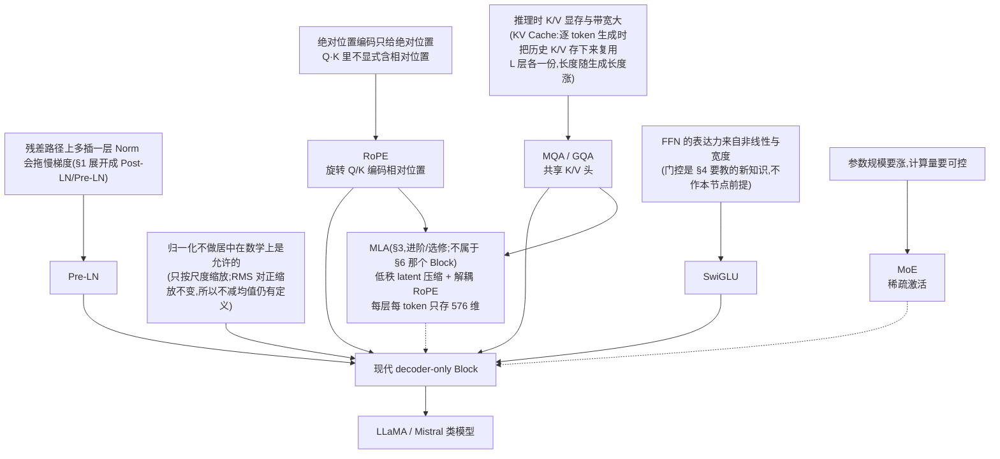
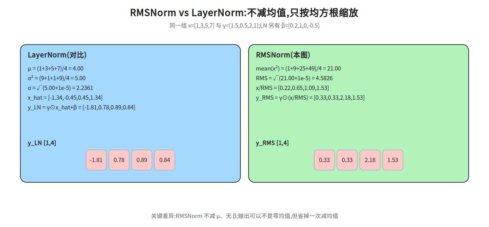
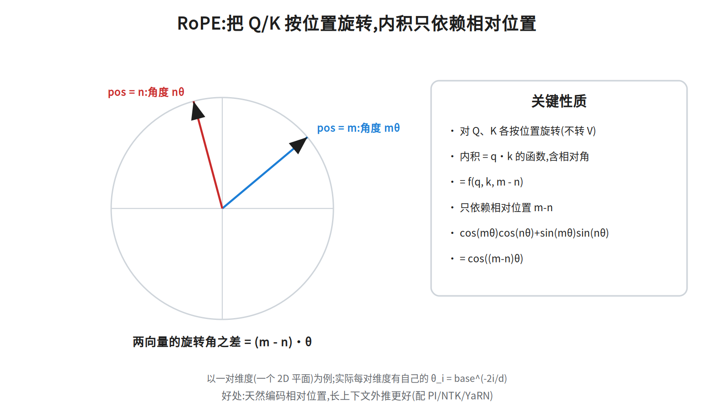
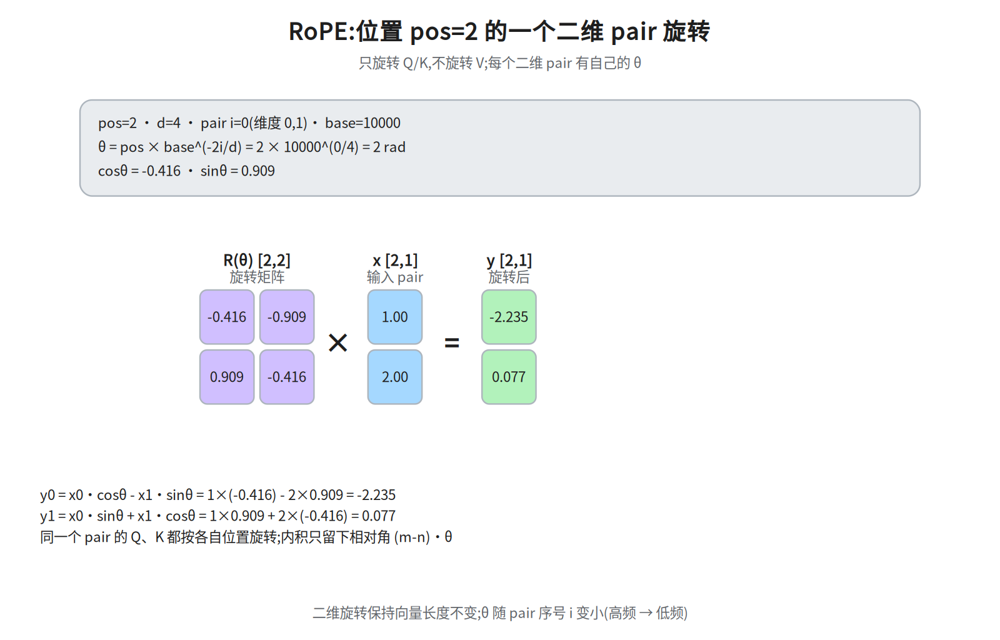
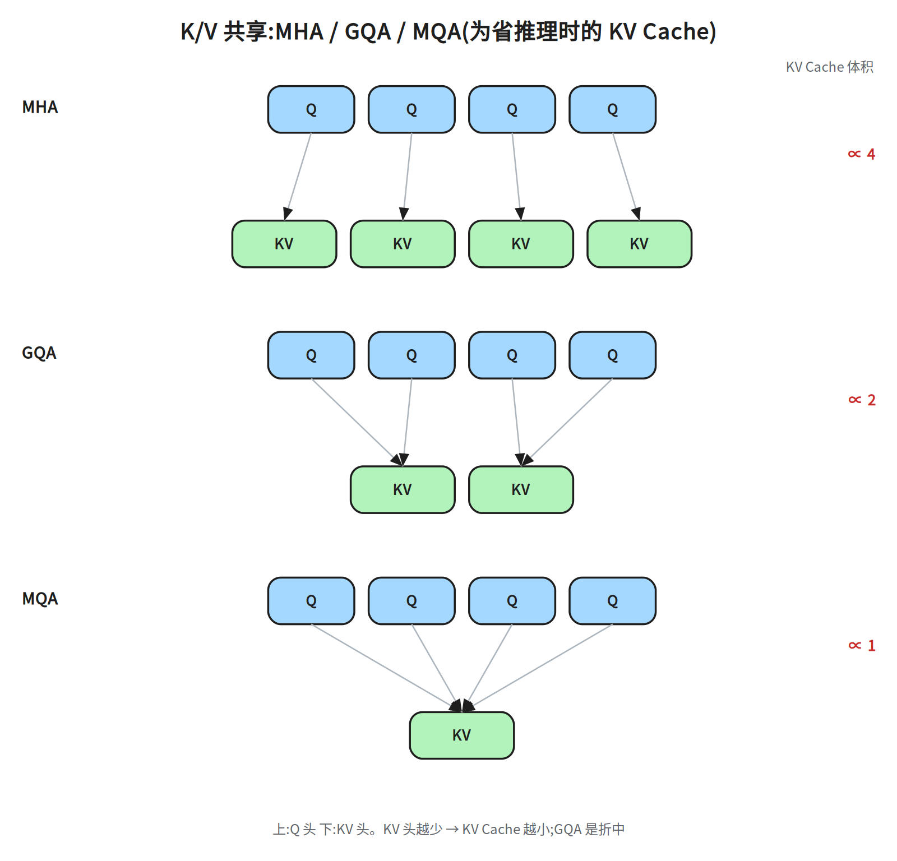
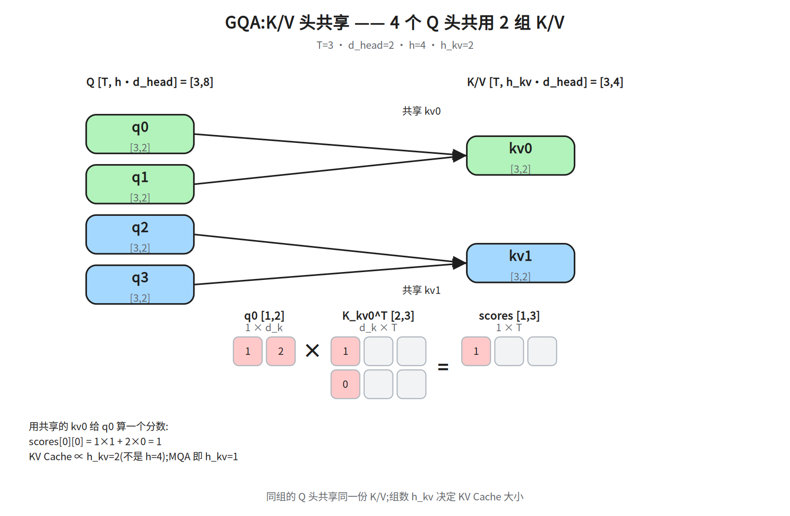
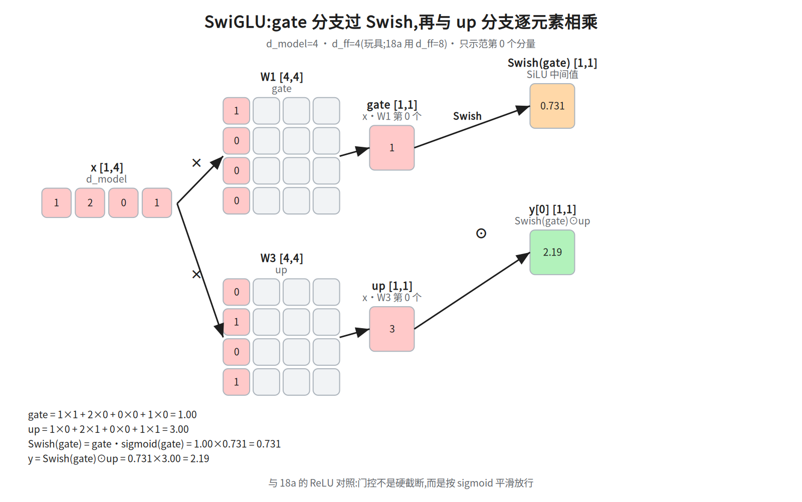
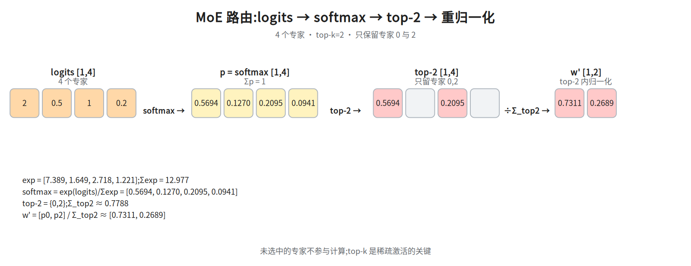
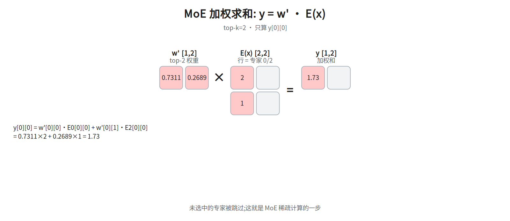
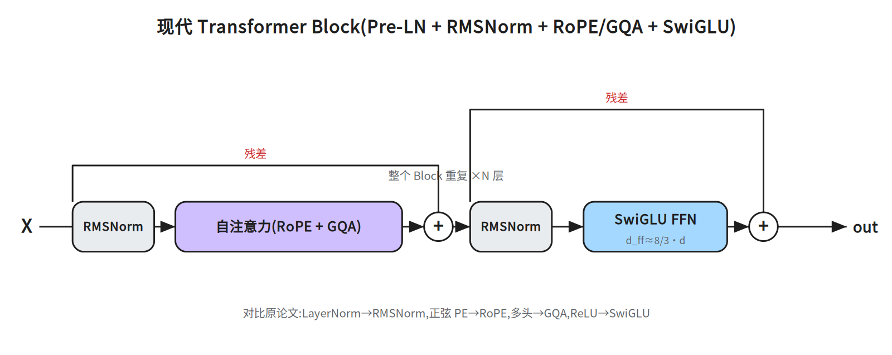

# 第五层 · 现代变体 —— 从原论文到 LLaMA/GPT

> 本层回答:2017 年的原论文到今天的大模型,哪些部件被**换掉了、为什么换**。这一层是"能读懂 LLaMA/Llama 源码"的关键,也是面试拉开差距的地方。

原论文 → 现代 decoder-only LLM 的改动清单:

| 部件 | 原论文 | 现代主流 | 动机 |
|---|---|---|---|
| 归一化 | Post-LN + LayerNorm | **Pre-LN + RMSNorm** | 深层更稳、更省算 |
| 位置编码 | 正弦(加到输入) | **RoPE**(旋转 Q/K) | 天然相对位置;外推需 PI/NTK/YaRN 配合 |
| 激活 | ReLU | **SwiGLU / GeGLU** | 效果更好 |
| K/V | 每头独立 | **GQA / MQA**(K/V 共享) | 砍 KV Cache(推理时缓存的历史 K/V,见 §3)显存 |
| FFN | 单一大 FFN | **MoE**(稀疏专家,超大规模用) | 加参数不加算力 |

## 0. 依赖图(学习顺序)

> 方框分两类:**根节点(前提)**是可以无条件接受的事实,**其余节点(要学的概念)**是结论;箭头表示「前者支撑后者」。根节点只是入口,**不等于可以跳过它支撑的概念**——C 支撑的 RMSNorm 就是必须学的一项(§1 专门论证)。学习顺序 = 从根到汇点的拓扑序,**概念节点也在学习清单里**。



## 1. 归一化:Pre-LN 与 RMSNorm

**Pre-LN**(第三层已提):把 LN 放到子层**之前**。

```
Pre-LN:   x = x + Sublayer( Norm(x) )
Post-LN:  x = Norm( x + Sublayer(x) )
```

为什么 Pre-LN 更适合深层:残差的恒等路径是一条**不被 Norm 打断**的直通线,梯度可从最后一层一路干净地回到第一层;Post-LN 里 Norm 在残差**之后**,恒等路径穿过 Norm,深层训练困难(需要 warmup)。
warmup 指**学习率预热**:开头把学习率从很小(如 0)在头几千步线性升到峰值,再按计划衰减。Post-LN 深网在初始化附近各层梯度尺度差异大,一上来用大学习率容易发散,预热让参数先走到较平稳的区域;Pre-LN 的恒等路径使梯度范数对深度不敏感,对预热的依赖就小得多(多数 Pre-LN 模型仍用短 warmup,但不再是「救命」手段)。

**RMSNorm**(LLaMA 用):比 LayerNorm 更简单——**不减均值,只按均方根缩放**:

```
RMSNorm(x)   = x / sqrt( mean(x_i²) + ε ) · γ
LayerNorm(x) = γ · (x - μ) / sqrt( σ² + ε ) + β     ← 多了减均值 μ 和偏置 β
```

(ε 都写在根号内,与各自的工程实现一致;两者差别只在"是否减均值、是否有 β"。)

**同一组数值对比**:`x=[1,3,5,7]`、`γ=[1.5,0.5,2,1]`(LN 另取 `β=[0.2,1,0,-0.5]`):

```
LayerNorm:μ=4.00,σ=√(5+1e-5)=2.2361
          x_hat=[-1.34,-0.45,0.45,1.34]
          y_LN=[-1.81,0.78,0.89,0.84]
RMSNorm:mean(x²)=(1+9+25+49)/4=21.00
        RMS=√(21+1e-5)=4.5826
        x/RMS=[0.22,0.65,1.09,1.53]
        y_RMS=[0.33,0.33,2.18,1.53]
```

RMSNorm 不把均值拉到 0,所以输出可以不是零均值——换来的是减均值和 β 的省略。

**为什么可以不减均值/不加 β(机制,不只“实验不输”)**:

- RMSNorm 只做**缩放**,对输入的**正缩放不变**:`RMS(c·x) = c·RMS(x)`,所以 `RMSNorm(c·x) = RMSNorm(x)`(c>0)。它控制的是向量的“长度/尺度”,不是均值。
- 均值偏移**不能被严格补偿**——这只是条经验性的弱说法:无偏置的权重矩阵满足 `W·0=0`,表示不了平移;即使有偏置,也只加得上一个与输入无关的常数,而 RMSNorm 少减掉的 `μ(x)/RMS(x)` 是**逐 token 变化**的量,常数偏置同样吸收不了。能站住的只有更弱的一句:**下游线性层 + 残差有能力学到**一个等价变换(把「中心」交给后续层去管),不是理论上无损。
- LayerNorm 的 `β` 是仿射偏移;很多现代 LLM 在 Norm 后接线性层,线性层自身能学偏移,`β` 的边际作用小,省掉更省算。

**一句话**:LayerNorm 同时管「中心 + 尺度」,RMSNorm 只管理「尺度」,把「中心」交给后续线性/残差去学——这是它**在实践中**能省掉减均值与 β 的依据(经验成立,不是数学上的无损等价)。



省掉了减均值和 β 偏置,计算更少、实验上效果不输甚至更好。是现代 LLM 的默认选择。

## 2. 位置编码:RoPE(旋转位置编码)

原论文的正弦编码是**加到输入 embedding 上**。
为什么「加在输入上」拿不到相对位置:设 `q_m = W_Q(x_m + p_m)`、`k_n = W_K(x_n + p_n)`,展开 `q_m·k_n` 会多出 `p_m^T W_Q^T W_K p_n` 这一项。`p` 的各维是不同频率的 sin/cos,而 `W_Q^T W_K` 会把不同频率、不同维度混在一起。由 `sin(mθ)sin(nθ)=½[cos((m-n)θ)-cos((m+n)θ)]`、`sin(mθ)cos(nθ)=½[sin((m+n)θ)+sin((m-n)θ)]` 可知,**每个乘积项都同时带 `(m-n)` 与 `(m+n)`**;只有同一频率的 sin/cos 以**等权**配对相加时 `(m+n)` 才抵消(这才是无权重时 `p_m·p_n = Σ_k cos((m-n)θ_k)` 的来源),而 `W_Q^T W_K` 的任意权重打乱了这种同频等权配对——加起来不是 `m-n` 的函数。即:正弦编码只是把位置「塞进」向量,内积结果没有被结构约束成相对位置;而且它在输入端就加,还要穿过后续层,位置与内容进一步纠缠。RoPE 反过来:把旋转放到内积之前、只作用在 Q/K 上,靠旋转矩阵乘积的三角结构强制只剩 `(m-n)θ`。RoPE 换了个思路:**不在输入上加,而是在 attention 里对 Q、K 做"按位置旋转"**。



**做法(以二维为例):** 把一个 `d` 维向量两两配对成 `d/2` 个二维平面,第 `i` 对按位置 `pos` 旋转角度 `θ_i·pos`:

```
θ_i = base^(-2i/d),   base 通常 10000
旋转矩阵:
[q'_2i  ]   [cos(pos·θ_i)  -sin(pos·θ_i)] [q_2i  ]
[q'_2i+1] = [sin(pos·θ_i)   cos(pos·θ_i)] [q_2i+1]
```

### 数值演算:pos=2 的一个二维 pair

取 `d=4`、pair 序号 `i=0`(维度 0/1)、`pos=2`,则

```
φ = pos · θ_i = 2 × 10000^(0/4) = 2 rad      # θ_i = base^(-2i/d) 是第 i 对的基频,φ 是这一对的旋转角
cosφ = -0.416,sinφ = 0.909
x = [1, 2]
y0 = x0·cosφ - x1·sinφ = 1×(-0.416) - 2×0.909 = -2.234
y1 = x0·sinφ + x1·cosφ = 1×0.909 + 2×(-0.416) = 0.077
```


同一 `d=4` 还有第二对 `i=1`(维度 2/3),它是**低频维**:`φ_1 = pos·θ_1 = 2 × 10000^(-2/4) = 2 × 0.01 = 0.02 rad`(`θ_1=0.01` 是基频,`φ_1` 才是角度),`cosφ_1 ≈ 0.9998`、`sinφ_1 ≈ 0.020`;对同一个 `x=[1,2]` 得 `y0 ≈ 1×0.9998 - 2×0.020 = 0.960`、`y1 ≈ 1×0.020 + 2×0.9998 = 2.020`——几乎没转动。这就是「不同频率」的具体含义:`i` 小的维转得快,相位变化大,只对近距离敏感;`i` 大的维转得慢,相邻位置的相位差极小,要走很多步才转过去,因而能区分远距离。这条频率阶梯是后面所有外推技巧的抓手:按频段给不同的 `i` 不同缩放,还是全维按同一比例压缩,正是它们的分野(具体三种做法 PI / NTK-aware / YaRN 见本节末尾的项目符号,此处先只记住这条阶梯)。

只旋转 **Q 和 K**,不旋转 V。核心好处:两个位置 `m`、`n` 旋转后的内积**只依赖它们的相对位置 `m-n`**:

```
⟨RoPE(q, m), RoPE(k, n)⟩  =  f(q, k, m - n)
```

即**天然编码相对位置**。**二维推导(面试常要求"能推")**:设 `q=(q1,q2)`、`k=(k1,k2)`,旋转矩阵 `R(φ)=[[cosφ,-sinφ],[sinφ,cosφ]]`,则

```
步骤 1(用旋转矩阵的乘积关系,一行到位):R(φ) 是正交矩阵,且
  R(mθ)ᵀR(nθ) = [[cos mθ, sin mθ],[-sin mθ, cos mθ]]·[[cos nθ,-sin nθ],[sin nθ, cos nθ]]
              = [[cos((n-m)θ), -sin((n-m)θ)],[sin((n-m)θ), cos((n-m)θ)]] = R((n-m)θ)
所以 ⟨R(mθ)q, R(nθ)k⟩ = qᵀR(mθ)ᵀR(nθ)k = qᵀR((n-m)θ)k,只剩一个角度差。
步骤 2(直接乘开验证):R(mθ)q = (q1cos mθ - q2sin mθ,  q1sin mθ + q2cos mθ),R(nθ)k 同理
⟨R(mθ)q, R(nθ)k⟩
= (q1cos mθ - q2sin mθ)(k1cos nθ - k2sin nθ)
  + (q1sin mθ + q2cos mθ)(k1sin nθ + k2cos nθ)
= (q1k1 + q2k2)(cos mθcos nθ + sin mθsin nθ)
  + (q1k2 - q2k1)(sin mθcos nθ - cos mθsin nθ)      ← 合并同类项
= (q1k1 + q2k2)·cos((m-n)θ)                          ← 用和差公式 cos(m-n)=cos m cos n + sin m sin n
  + (q1k2 - q2k1)·sin((m-n)θ)                        ← 及 sin(m-n)=sin m cos n - cos m sin n
= (q·k)·cos((m-n)θ) + (q1k2 - q2k1)·sin((m-n)θ)
```

两项的**三角因子**都只含 `(m-n)θ`,所以内积只依赖相对位置 `m-n`。注意**不能只留 cos 项**:交叉项 `q1k2-q2k1` 乘的是 `sin((m-n)θ)`,漏掉它推导不完整(但它同样只依赖 `m-n`,结论不变)。

配合位置外推技巧,把上下文从 4K 扩到 32K/128K/1M 时会用到。但这些技巧只是让位置编码在更长范围上仍有定义,真正把窗口拉长还要在长文数据上继续预训练,1M 级别更依赖数据与工程手段,不是改一下频率公式就够了。注意这几招机制不同,别都叫"插值":

- **PI(Position Interpolation):** 把超长的位置**线性压缩**回训练范围(最简单)。
- **NTK-aware:** 调大 RoPE 的 base(频率缩放);**YaRN:** 在 PI 与 NTK 之间做**分频段**处理的组合方案。

> 面试:问"RoPE 和正弦编码的区别"?答——正弦是**加**到输入(绝对位置),RoPE 是**旋转** Q/K,内积天然含相对位置;RoPE 是 LLaMA 等主流选择,但纯 RoPE 超过训练长度后注意力分布会漂移,外推是变差的;长上下文能力要靠 PI/NTK/YaRN 配合长文继续预训练才拿到,并非 RoPE 自带。

## 3. K/V 共享:MQA 与 GQA(为推理省显存)

**背景:** 自回归生成是**逐 token** 的:第 t 步只对刚产生的这个 token 算一份新的 q/k/v,历史 token 的 K/V 算过就不再重算,直接存下来复用——这份缓存就是 **KV Cache**(L 层每层各存一份 K、一份 V,长度 `T` = 已生成长度)。cache 大小 ∝ `h · T · d_k`,长上下文时非常吃显存。
为什么 K/V 能跨步复用:第 t 步的 attention 只多出一行 `q_t`,它要内积的 K/V 全是前 t-1 步已经算过的(因果掩码保证不看未来),所以每步只把新的 `k_t`、`v_t` **追加**进缓存,不必重跑前 t-1 个 token 的前向;复用的历史 K/V 与当时算出的完全一致,不损失任何信息。

- **MQA(Multi-Query, g=1):** 所有 query 头**共享一份 K/V**。cache 直接缩到 1/h。
- **GQA(Grouped-Query, 1<g<h):** 把 h 个 query 头分成 g 组,**每组共享一份 K/V**。是 MQA(省最多)和 MHA(效果最好)的折中。



```
MHA: h 个 Q 头, h 个 K/V 头    (每头独立)
GQA: h 个 Q 头, g 个 K/V 头    (每组共享, 如 h=32, g=8)
MQA: h 个 Q 头, 1 个 K/V 头    (全共享)

KV Cache 大小 ≈ 2 · L · B · T · g · d_k · dtype字节数   (L=层数; B=batch,即同时并发生成的序列条数; T=已生成长度; g=K/V 头数(即 h_kv); d_k=每头维数; g 越小越省)
```

**形状与共享关系**(以 `h=4, h_kv=2, d_head=2, T=3` 为例;下文的 `h_kv` 与上面公式里的 `g` 是同一个量——都是 K/V 头数,可互换,别当成两套符号):

```
Q: [T, h·d_head]   = [3, 8]    # 4 个 query 头,每头 [3,2]
K/V: [T, h_kv·d_head]= [3, 4]  # 2 个 K/V 头,每头 [3,2]
q0,q1 → kv0 ; q2,q3 → kv1
这里 `q0` 指**第 0 个 query 头**,不是第 0 个 token;下面 `q0=[1,2]` 是这个头在**某一个 token** 上的 `d_head=2` 维向量。`scores[0][0]` 的两个下标依次是 [头序号 0, 被注意的 key 位置 0],与 `Q` 第一维(token)无关——因为此处只算单个 query token 的那一行分数。
```

用共享的 `kv0` 给 `q0` 算一个分数:`q0=[1,2]`、`K_kv0^T=[[1,0,1],[0,1,1]]` →
`scores[0][0]=1×1+2×0=1`。KV Cache 的规模只随 `h_kv` 增长,不随 `h` 增长;
MQA 就是 `h_kv=1` 的极端情况。



**谁在用:** LLaMA-2 的 **34B 和 70B** 用了 GQA(A.2.1 明写 for the 34B and 70B models we chose to use GQA,8 个 KV 头),已发布的 7B/13B 仍是 MHA,**LLaMA-3 才全线 GQA**;很多新模型默认 GQA。**注意:MHA→GQA 不是"多头"动机的改变**——多头原始动机是多子空间表达,这里纯粹是**推理效率**优化。
「推理效率」具体指**显存带宽**:decode 每一步都要把 L 层、每层长度 `T` 的 K/V 整份从显存读一遍,单步耗时主要是「读 cache」的时间,算力反而不是瓶颈,所以 `T` 越长越慢。g 从 h 减到 1,每步要读的字节数按 `g/h` 比例下降(KV Cache 容量同样下降)——这才是 GQA/MQA 提升吞吐的来源;只省容量并不会自动更快,快是因为每步读得少。


**读 MLA 前先对齐基数**:DeepSeek-V2 的真实配置是 `n_h=128` 个 query 头、每头 `d_h=128`,MLA 不对 K/V 头做 GQA 式分组,被压缩的是全部 128 个头的 K(每个头 128 维;连 V 共 32768 维)。上面 `h=4, h_kv=2` 只是**本节前文** GQA 的玩具算例(就在 §3 开头的「形状与共享关系」里),与这里的数字无关。

**MLA(Multi-head Latent Attention,DeepSeek-V2/V3)**:比 GQA 更进一步,不让每个 token 每层存 `h_kv` 份完整 K/V,而是先从隐状态 `h_t` **下投影**出一个低维 latent:`c_t^{KV} = W^{DKV}·h_t`(`W^{DKV} ∈ R^{512×d}`,DeepSeek-V2 的 `d_c=512`,源码里叫 `kv_lora_rank`);各头的内容 K/V 全部由这个 latent **上投影**还原(`k_t^C = W^{UK}c_t^{KV}`、`v_t^C = W^{UV}c_t^{KV}`)。另额外缓存一份**解耦 RoPE key** `k_t^R`(`d_h^R=64`);decode 时缓存的是 `c_t^{KV}` + `k_t^R`,需要时再上投影出各头的 K/V。
(先给一句理由,细节见下文「为什么 RoPE 必须单独抽一份 key」:RoPE 按位置乘性地旋转,而 `c_t^{KV}` 必须与位置无关,才能延迟到用时再上投影;一旦把 RoPE 压进 latent,query 侧就无法提前吸收 `W^{UK}`,低秩缓存的前提也就没了。所以位置段另存一份 64 维、所有头共用。)这里的「不丢」不是精确无损,而是**低秩假设**:128 个头的 K 合计 128×128=16384 维(连 V 共 32768 维),被压进一个 512 维**所有头共享**的 latent,实际缓存再加 64 维解耦 RoPE key、共 576 维:单看 K 的内容段是 16384→512 ≈ 32×,按 K+V 的 32768 维对 576 维缓存算则是约 56.9×(论文自己的说法:约等于只有 2.25 组 K/V 头的 GQA)。之所以压这么狠还敢用,不是「压缩比小所以损失小」,而是论文消融显示 MLA 质量不弱于 MHA(D.2/Table 9);GQA/MQA 只在 D.1/Table 8 里与 MHA 比过、且明显更低(MMLU 41.2 / 37.9 vs 45.2),论文没做 MLA 与它们的同条件对比——能说的只是「MLA ≥ MHA > GQA/MQA」这条由两次实验拼起来的结论,不是一次四者横评(出处见论文消融表,正文不必记节号)。它是「实测够用的近似」,不是「压完仍严格等价」。


**「低秩 / 秩」在这里指什么**:先从隐状态 `h_t` 做下投影 `c_t^{KV} = W^{DKV}h_t`(`W^{DKV}` 是 512×d,把 d 维隐状态压成 512 维 latent),再用 `W^{UK}` 上投影还原各头的 K——单头 `W^{UK}`(128×512)的列空间最多 128 维(秩 ≤ 128),128 个头共用同一份 512 维 latent,拼成论文的全头矩阵 16384×512 后整体秩 ≤ 512,而不再允许取 16384 维空间里的任意向量,这就叫「低秩」。
(零基础读法:**秩** = 这个矩阵的列向量能张出的「独立方向」个数,**列空间** = 所有可能输出向量构成的集合。`W^{UK}` 只有 512 列、每头输出 128 维,所以单头最多 128 个独立方向,128 个头拼起来最多 512 个——16384 维里绝大多数方向根本取不到。)至于「低秩为什么损失可控」,它不是数学保证:赌的是各头真正用到的内容 K/V 有效自由度远小于名义维数,并由论文消融(MLA vs MHA 质量不降;GQA/MQA 未与 MLA 同条件对比)背书。
**为什么 RoPE 必须单独抽一份 key:** RoPE 是**按位置、乘性地**旋转,而 MLA 缓存的 `c_t^{KV}` 是**位置无关**的低维 latent——它的价值就在于同一个上投影矩阵 `W^{UK}` 对历史所有 token 都成立,可以延迟到用时再算。关键一步是把 `W^{UK}` **提前吸收进 query**:`q_t^C·(W^{UK}c_j) = (W^{UK⊤}q_t^C)·c_j`,于是内容段根本不必物化各头 K,直接拿 latent 做内积即可。一旦给 `k^C` 也加 RoPE,内积就同时依赖 m(旋转后的 q 带的)和 n(旋转后的 k 带的),吸收后的 query 无法预先算好,只能按位置逐个物化 K——等于每个位置要一套投影,低秩缓存的前提就没了。这才是位置段必须单独抽成 `k_t^R` 的原因。所以 MLA 把 key 拆成两段——**内容段** `k_t^C = W^{UK}·c_t^{KV}`(不带位置,用时才算,因此**不必缓存各头的 K**)、**位置段** `k_t^R = RoPE(W^{KR}·x_t)`(只带位置,64 维,所有头共享一份);attention 里两段拼起来用:`score = q_t^C·k_j^C + q_t^R·k_j^R`,两段各算内积再相加,与在完整 key 上做 RoPE 等价。于是 decode 只缓存 `c_t^{KV}`(512)+`k_t^R`(64),而不是 `h_kv` 份完整 K/V——这就是 576 那笔账的来历。
形状补全:`W^{UK} ∈ R^{128×512}`(`qk_nope_head_dim=128`,把 `d_c=512` 的 latent 映到每个头的内容 key)、`W^{UV} ∈ R^{128×512}`(从 `c_t^{KV}` 还原每个头的 V;与 `W^{UK}` 同记法:行=输出头维、列=输入 latent 维)、`W^{KR} ∈ R^{64×d}`(`d` 为 hidden 维,`d_h^R = qk_rope_head_dim = 64`),query 侧对称,但 latent 维度不同:`c_t^{Q} = W^{DQ}·h_t`(`d_c' = 1536`);`q_t^C = W^{UQ}·c_t^{Q}`(`W^{UQ} ∈ R^{h·128×1536}`,每个头 128 内容维)、`q_t^R = RoPE(W^{QR}·c_t^{Q})`(`W^{QR} ∈ R^{8192×1536}`,即 `d_h^R·n_h = 64×128`——每个头各出一份 64 维位置 query;只有 `k_t^R` 才是全头共用一份 64 维)。query 侧同样做了低秩压缩,只是它每步只算一次、不必缓存进 KV Cache,所以 latent 可以比 K/V 侧的 512 更大方。


记法口径对一下:上文 `W^{UK}/W^{UV} ∈ R^{128×512}` 是**按单个头**写的(乘上 `n_h=128` 就是论文里的 `16384×512`),`W^{UQ}/W^{QR}` 则**按全头**写(输出维已含 h),输入都是 `d_c'=1536`;两套写法只差「写不写 h」,共同点是行=输出维、列=输入维。等价性从哪来:把两段拼起来看,`[k^C; k^R]` 就是完整 key(128+64=192 维),`[q^C; q^R]` 是完整 query,`q^C·k^C + q^R·k^R` 正好是拼接后的整体内积;而 RoPE 只作用在末 64 维(`R(mθ_i)` 作用到 `q^R`、`R(nθ_i)` 作用到 `k^R`),前 128 维内容维完全不旋转。所以「拆两段各算内积再相加」= 「在拼接 key 上只对 RoPE 段做旋转」,信息一点没丢,变的只是缓存形式(存 latent,而不是存各头完整 K/V)。
**为什么恰好 64 维:** `d_h^R` 是**分给位置的那部分头维**。DeepSeek-V2 的内容段仍占完整 `d_h=128` 维(`qk_nope_head_dim=128`),RoPE 的 64 维是在这 128 维**之外另加**的(`qk_rope_head_dim=64`),所以每个头的 q/k 是 128+64=192 维;且 `k_t^R` 是**所有头共用一份**,所以按 64 计、不是 `h_kv×64`。取舍是:要小到不破坏压缩收益(64 ≈ 512 的 1/8),又要大到足够区分长上下文中的相对位置;这个数是论文直接设定的经验值(§2 只写 `d_h^R = d_h/2 = 64`,并没有给出针对 `d_h^R` 的消融;论文消融(D.2/Table 9)只比较了 MLA 与 MHA,GQA/MQA 仅出现在 D.1/Table 8、且是三者与 MHA 的对比),不是推导出来的常数。

- KV Cache 从 `2·L·T·h_kv·d_k` 降到 `L·T·(d_c + d_h^R)` 量级;DeepSeek-V2 每 token 每层是 `512+64=576` 维。
- 长上下文收益明显;代价是额外的投影计算、解耦 RoPE 与实现复杂度。
- 面试被问"GQA 之后还有什么省 KV 的方法"时,MLA 是标准答案;细节见 DeepSeek-V2 论文 §2,AI Infra `notes/22_inference_systems.md` 的 KV 账本可对照(该篇尚未展开 MLA)。

## 4. FFN 激活:SwiGLU

把 FFN 换成**门控**结构:

```
原版:  FFN(x) = ReLU(xW₁) · W₂
SwiGLU: FFN(x) = ( Swish(xW₁) ⊙ (xW₃) ) · W₂        ⊙ = 逐元素乘
# 从本节起统一用行向量约定 x·W(x 是行向量);于是 d_ff = W₁/W₃ 的列数
# 注意 §3 的 MLA 公式沿用论文的列向量写法 W·h(行=输出维),与本节互为转置:同一个矩阵只是左右位置不同,输出维始终是行数
```

用一个分支当"门"去调制另一个分支(`⊙` 逐元素乘)。`Swish(z)=z·sigmoid(z)`。
sigmoid 定义为 `sigmoid(z) = 1/(1+e^(-z))`,把任意实数压到 (0,1);`sigmoid(1) = 1/(1+0.3679) = 0.731`,这就是下面 0.731 的出处。换别的 gate 同法可算(下面括号里是 sigmoid 值,不是最终输出):gate=0 → sigmoid=0.500、gate=2 → sigmoid=0.881,再乘回 gate 即得 Swish 值,即 Swish(0)=0、Swish(2)=1.762。

**为什么门控有效(直觉):** 门分支输出一串系数,像水龙头一样**有选择地放大/放行/抑制**主分支的每个维度(别把它当成 (0,1) 的凸组合权重:门是 `Swish(z)=z·sigmoid(z)`,值域是 `[-0.28, +∞)`——`Swish(2)=1.762`、`Swish(3)≈2.86`,负半轴还能压到 -0.278;只有 sigmoid 本身才严格落在 (0,1))——类似 LSTM 的**门**(用一条支路算出 0~1 的系数、再逐元素乘到另一条支路上,决定信息保留多少;LSTM 是循环网络,本篇不展开)、**GLU 家族**(gated linear unit:一路线性投影过激活函数当门,与另一路线性投影逐元素相乘;`SwiGLU`、`GeGLU` 都是它的成员)的可选信息流。比"死板"的 ReLU 多了一层数据依赖的开关。(`GeGLU` 是同一家族,把 Swish 换成 GELU,机制相同。)
GELU 的形式:`GELU(z) = z·Φ(z)`(Φ 是标准正态分布的累积分布函数),工程实现常写成 `GELU(z) ≈ 0.5z(1 + tanh(√(2/π)(z + 0.044715z³)))`。
Φ 的数值可以自己算:`Φ(z) = 0.5(1 + erf(z/√2))`,查表得 `Φ(1) = 0.8413`、`Φ(-1) = 0.1587`,于是 `GELU(1) = 1×0.8413 ≈ 0.841`、`GELU(-1) = (-1)×0.1587 ≈ -0.159`(正好是后面那两个数)。`tanh` 是双曲正切 `tanh(u) = (e^u - e^(-u))/(e^u + e^(-u))`,把 `z=1` 代进上面那个 tanh 近似式同样得 ≈0.841,两条路子一致。它不像 ReLU 在 0 处硬拐,而是平滑地把负值压向 0、但不像 ReLU 那样完全截断:`GELU(1) = 0.841`、`GELU(-1) = -0.159`。所以 GeGLU 与 SwiGLU 的差别只在门分支换哪个平滑激活,结构完全一致。

**一个分量的数值**(`x=[1,2,0,1]`,即 d=4;`d_ff` 指 FFN 中间维,也就是 `W₁`/`W₃` 的**列数**,本节开头的代码注释已给出这一定义,玩具取 `d_ff=4`,18a 用 `d_ff=8`。只取第 0 列,等价于 `W₁` 第 0 列 = `[1,0,0,0]`、`W₃` 第 0 列 = `[0,1,0,1]`;给出这两列是为了换个 `x` 也能自己复算):

```
gate = x·W1 = 1×1 + 2×0 + 0×0 + 1×0 = 1.00
up   = x·W3 = 1×0 + 2×1 + 0×0 + 1×1 = 3.00
Swish(gate) = gate·sigmoid(gate) = 1.00×0.731 = 0.731
y = Swish(gate) ⊙ up = 0.731×3.00 = 2.19
```

与 18a(03_block §⑥ 的 ReLU 版 FFN)只在**结构**上对照,不是同数值对照:那里取 `W1` 第 0 列 `[-1,0,1,-1]`、`b1[0]=0.5`,同一个 `x=[1,2,0,1]` 得 pre=-2.00 → z=-1.50 → h[0]=0.00,与本节这组权重(`W1` 第 0 列 `[1,0,0,0]`、`W3` 第 0 列 `[0,1,0,1]`)不同,数字对不上是正常的。结构差别在于:ReLU 版 `y = ReLU(gate)·up` 是硬截断(负数直接变 0)、对正数原样放行,Swish 是平滑门控
(`x·sigmoid(x)`),再由 `⊙` 逐元素调制 up 分支。



代价:多了一个 `W₃` 矩阵。为保持参数量与 ReLU-FFN 大致不变(`2·4d² = 8d²`),门控结构有 3 个 `d×d_ff` 矩阵,故取 `d_ff = 8/3·d`。LLaMA/PaLM 等用 SwiGLU。

## 5. MoE(专家混合)

**问题:** 稠密模型"加参数"往往也"加算力"(每个 token 过全部参数)。想加容量又不想加算力怎么办?

**做法:** 把每层的 FFN 换成 `E` 个并行专家,加一个**路由器(router)**,每个 token 只激活 **top-k** 个专家:

```
router(x) = softmax(x · W_r)         [B,T,E]    每个 token 对各专家的倾向
选 top-k 专家 → 只让这些专家的 FFN 参与计算 → 加权求和

总参数量 ≈ E × (单专家参数)                ← 巨大
每 token 计算量 ≈ k × (单专家计算量)        ← 稀疏,可控(只激活 k 个)
```

**top-2 路由数值**(4 个专家,`logits=[2.0,0.5,1.0,0.2]`):
softmax 逐元素定义为 `p_e = e^{z_e} / Σ_j e^{z_j}`(本层第一次用到,此处给定义)。逐个算:`e^2.0 = 7.3891`、`e^0.5 = 1.6487`、`e^1.0 = 2.7183`、`e^0.2 = 1.2214`,分母 `Σ = 12.9775`;各自除以 12.9775 就是下面那 4 个概率(7.3891/12.9775 = 0.5694,依此类推)。

```
softmax ≈ [0.5694, 0.1270, 0.2095, 0.0941]
top-2 = {专家 0, 2};Σ_top2 ≈ 0.7788
w' = [p0, p2] / Σ_top2 ≈ [0.7311, 0.2689]
```

若 `E0(x)=[2,0]`、`E2(x)=[1,3]`,则
`y[0][0] = 0.7311×2 + 0.2689×1 = 1.73`(未选中的专家完全不参与计算)。





- Mixtral 8x7B 这类命名:8 个专家,每 token 激活 2 个。**但“7B”不是单专家大小**:8x7B 总参约 46.7B、每 token 激活约 12.9B。原因是专家只替换 FFN,注意力、embedding、Norm 等非专家参数不按专家复制,所以上面 `总参数量 ≈ E × 单专家参数` 只能当“专家部分”的粗估,完整要写成 `E × 单专家 FFN 参数 + 非专家参数`。
- **收益:** 参数容量大(模型更"记得住"),但算力只按激活的部分算。
- **难点与对策:**
  - **负载均衡**:若不约束,router 会"赢者通吃",所有 token 挤向少数专家,其余专家学不到东西。对策是加一个 **辅助负载均衡损失(auxiliary load-balancing loss)**,惩罚"专家使用过于集中",逼 router 把 token 摊开。
  - **容量与丢弃**:很多实现给每个专家设 **capacity factor**(如 1.25),超出容量的 token 会被丢弃或走残差;这是吞吐与质量之间的权衡。
  - **专家坍缩**:监控每个专家的 token 占比与**路由熵**——对单个 token,router 的 softmax 输出 `p`(在 E 个专家上的分布)的熵(**自然对数,底 e**)`H(p) = -Σ_e p_e·ln p_e`,再对一批 token 取平均。为什么熵能衡量集中度:熵是「分布有多平」的度量,越大越接近均匀、越小越是把质量压在少数专家上,所以它天然是集中度的反向指标;完全均分时取最大值 `ln E`(E=8 → 2.08,E=64 → 4.16——按 log₂ 会是 3.00/6.00,别算错),若平均熵长期显著低于它(比如不到一半)、或 top-k 长期集中在少数几个专家,就说明路由在退化。
  - **无辅助损失 / 共享专家**:DeepSeek-V3 等用 aux-loss-free 的偏置调节路由——给每个专家一个偏置 `b_e`,**加**在 router logits 上再取 top-k(不是乘进概率);每步训练后按本批该专家的负载反向微调:`b_e ← b_e − γ`(过载)、`b_e ← b_e + γ`(闲置),用偏置把使用率推回均匀;偏置**不进损失、不进梯度**,所以不像 aux loss 那样拿主任务损失换均衡。还有一处常被忽略:**V3 并非完全不用辅助损失**——它在 aux-loss-free 之外另留了一个很小的 complementary sequence-wise balance loss(权重 α=0.0001,只用来避免单条序列内出现极端不均),**不做全局均衡**。(出处备注:该超参见 V3 论文 Hyper-Parameters 一节,原话 just to avoid extreme imbalance within any single sequence;Discussion 一节不含这句,其中 4.5.3 只做 batch-wise 与 sequence-wise 的消融对比。)偏置也不是「收敛后冻结」,而是**按阶段关闭**:γ=0.001 一直生效,跑完 14.3T token 后令 γ=0,偏置才随之固定。另设 **shared expert(共享专家)**:所有 token **必过**它,它不参与路由、不占 top-k 名额、**不计入 `E`**(`E` 只数路由专家);它的输出与 top-k 路由专家的加权和**相加**后一起进残差,用来承载所有 token 共享的通用知识(DeepSeek-V3 就是 256 个路由专家 + 1 个共享专家,每 token 算 1+8 个 FFN)。细节见 `notes/21_single_node_ops.md` 的 MoE 部分。
  - **通信**:专家常分布在不同设备,一个 token 要跨设备送到它的专家,带来通信开销。
  - **训练稳定性**:路由是离散选择,梯度估计较难,需要专门技巧。
  - **省的是算力,不是显存**:总参数仍要存(所有专家都在显存里),MoE 降低的是每 token 的 FLOPs,不是权重占用。

## 6. 一张"现代 decoder-only Block"的样子



把上面拼起来,今天主流 LLM 的一层(Pre-LN + RMSNorm + GQA + RoPE + SwiGLU):

```
x = x + Attention( RMSNorm(x) )        # Q,K 先过 RoPE;K/V 用 GQA 共享
x = x + SwiGLU_FFN( RMSNorm(x) )       # 或 MoE 版 FFN
```

对比原论文:归一化换了、位置编码换成旋转、KV 共享了、激活换成门控——**骨架没变**,都是第二三层的那个 Block。

## 面试要点

1. **Pre-LN 比 Post-LN 好在哪?** → 残差恒等路径不被 Norm 打断,梯度直通,深层更稳。
2. **RMSNorm 和 LayerNorm 区别?** → RMSNorm 不减均值、无 β,只按均方根缩放,更省。
3. **RoPE 原理和好处?** → 对 Q/K 按位置旋转,内积天然含相对位置;但纯 RoPE 超出训练长度后注意力分布会漂移,外推变差,长上下文要靠 PI/NTK/YaRN + 长文继续预训练。
4. **MQA/GQA 解决什么问题?** → 砍推理时 KV Cache 显存;GQA 是多头与 MQA 的折中。
5. **SwiGLU 相比 ReLU FFN?** → 门控结构,效果更好;中间维降到 8/3·d 保持参数。
6. **MoE 怎么做到"加参数不加算力"?** → 稀疏激活,每 token 只过 top-k 专家。

## 常见坑

- RoPE 只作用于 **Q/K**,不作用于 V。
- GQA/MQA 影响的是**推理显存(和少量参数)**,不是"多头表达能力"的动机。
- SwiGLU 中间维不是 `4d` 而是约 `8/3·d`(为了参数量对齐)。
- MoE 是**换 FFN**,不是换 attention;attention 通常仍是稠密的。

## 相关图

`10_rope`(RoPE 旋转)· `11_gqa`(K/V 共享)· `12_modern_block`(现代 Block)
· `19a_rope_num`(RoPE 数值)· `16d_gqa_sharing`(GQA 共享)· `17c_rmsnorm`(RMSNorm)
· `18c_swiglu`(SwiGLU)· `19b_moe_router` / `19c_moe_out`(MoE)
(均在 `diagrams/`,横竖双版本)

## 下一步

第六层 · 跑起来:**训练 vs 推理、KV Cache、完整 forward pass 走一遍**。
