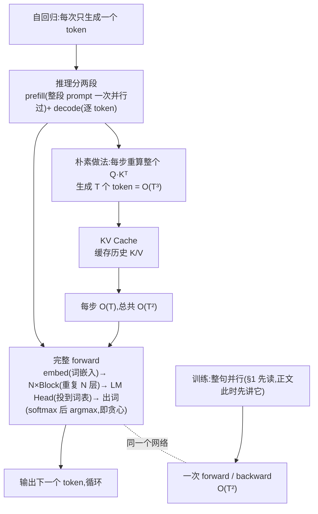
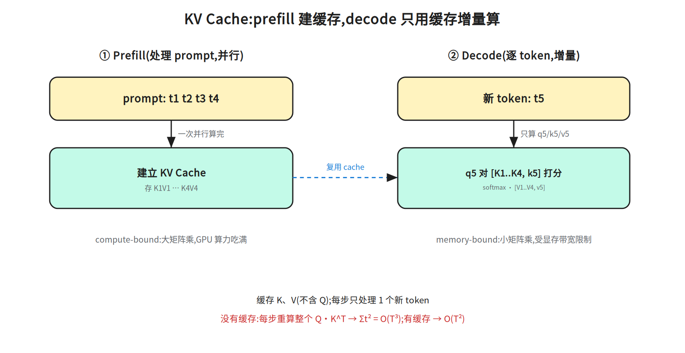
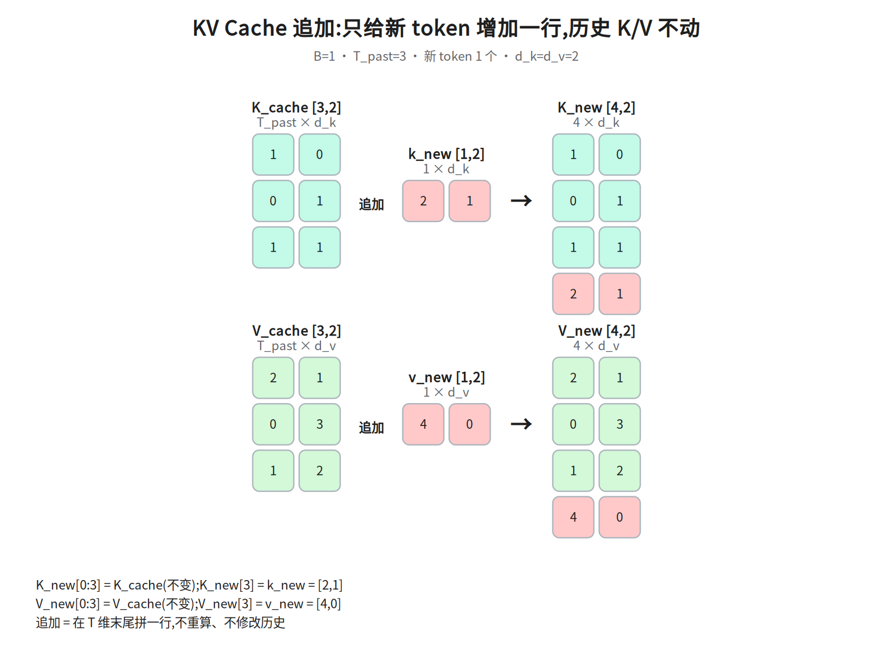
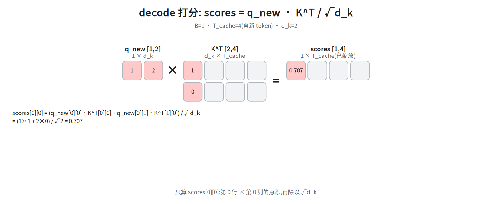
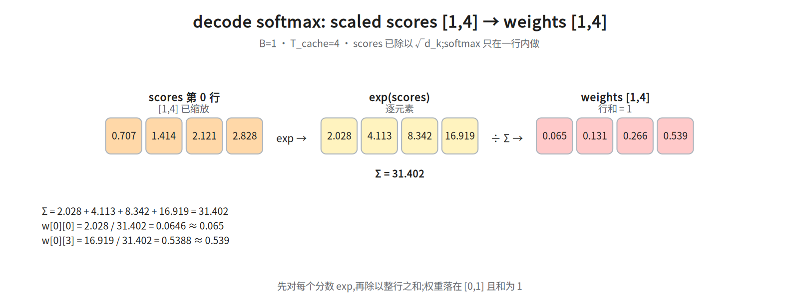
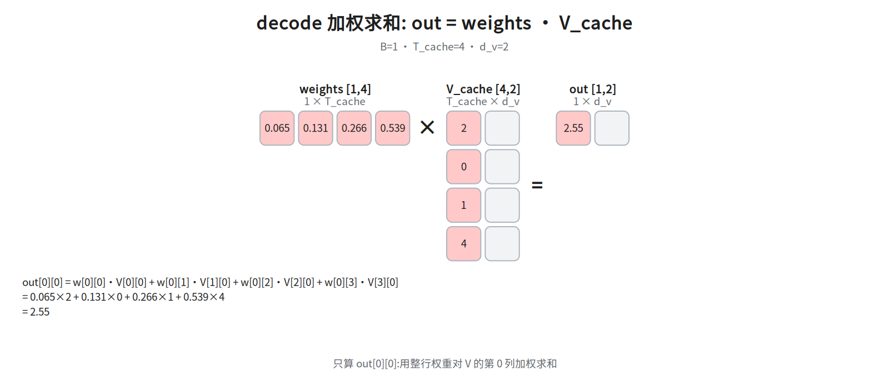

# 第六层 · 跑起来 —— 训练/推理、KV Cache、完整 forward

> 本层回答:模型怎么训练、怎么推理?为什么推理要 KV Cache?把前面五层串成一次完整的 forward pass。

## 0. 依赖图(学习顺序)

> 根节点是**可以无条件接受**的事实;实线箭头表示「前者支撑后者」;虚线不带箭头,表示「同一套结构与网络的两种用法」,不代表学习顺序。学习顺序 = 从根到汇点的拓扑序;**但正文的书写顺序与拓扑序不同**:§1 先讲训练(H)和 prefill/decode(B),§2 才正式展开自回归(A)(§1 表格里已先用「自回归」「decode」这两个词,先按字面理解即可)——读 §1 时把 H、B 都当成「可以先无条件接受」的起点即可(图里 B 仍有 A→B 入边,这里只是借用「根」的说法,不改变依赖关系),§2 开头那句「训练时的一次并行」说的就是 H。



## 1. 训练 vs 推理:两个截然不同的阶段


> 阅读顺序提示:**compute-bound / memory-bound** 的完整定义在表格下方的「先把这两个词定义掉」,建议先扫一眼那段再回读「计算模式」一行。
一句话先垫住:**compute-bound** = 矩阵够大、GPU 乘加单元跑满,瓶颈在算力;**memory-bound** = 算力闲着,时间花在把权重和 KV Cache 从显存搬进计算单元(完整定义仍在下面那段)。

| | 训练 | 推理 |
|---|---|---|
| 输入 | 整段序列(teacher forcing:每个位置喂数据集里的真值,不喂模型上一步自己的输出) | prefill 一次并行喂整段 prompt,decode 逐 token(自回归) |
| attention | 因果掩码,一次并行算所有位置 | prefill 并行算整段(因果掩码);decode 每步只算最新 token |
| 有没有标签 | 有(下一个 token) | 无,自己生成 |
| 计算模式 | 大矩阵乘,**compute-bound** | prefill 并行整段 → **compute-bound**;decode 逐 token 小矩阵乘 + 访存 → **memory-bound** |
| 关键优化 | GPU 利用率、混合精度(fp16/bf16 存权重、fp32 主权重与优化器状态、矩阵乘用 fp32 累加,省的是显存与带宽;与 §5 的推理显存优化(把权重/KV 存成 int8/int4、减少要搬的字节)不是一回事) | **KV Cache**(§3 才展开;此处只需知道=缓存历史 K/V,避免重算)、批处理、量化 |

**训练目标(decoder-only):** 下一个 token 预测(next-token prediction)。


> **补:表里「混合精度 / fp32 主权重 / 优化器状态」是什么。** ①**fp16/bf16 存权重**:前向/反向的矩阵乘用低精度,省带宽、算得快;②**fp32 主权重(master weights)**:参数更新必须在一份 fp32 副本上做,否则学习率量级的小更新会被 fp16 的精度直接抹掉;③**优化器状态**:Adam 给每个参数额外存一阶动量 m、二阶动量 v(通常也是 fp32),所以它比权重本身更占显存。
④**fp32 累加**:矩阵乘里低精度乘出的结果要送进 fp32 累加器求和,否则数千项的部分和会溢出或丢精度。它与 ② 的 fp32 主权重是两件事(一个是权重的副本,一个是乘加时的累加器);下面 16 字节的账里那 4 字节对应的是主权重,累加器不进模型状态、只占运行时临时显存。粗算每个参数:2(fp16 权重)+2(fp16 梯度)+4(fp32 主权重)+4(m)+4(v) ≈ **16 字节**,是纯 fp16 推理权重(2 字节)的 8 倍——这是「训练比推理吃显存」的主因之一。


> **交叉熵的定义放在本节后面「交叉熵在这里做什么」callout**(本层只出现一次完整定义),这里先记一句话:它就是「真实下一个词的负对数概率」。


> **先把这两个词定义掉**(后面 §3、§4、§5 都靠它):**compute-bound** = 瓶颈在算力,矩阵够大、GPU 的乘加单元跑满;**memory-bound** = 瓶颈在显存带宽,时间花在把权重和 KV Cache 从显存搬进计算单元,算力闲着。上表「计算模式」一行的差别就是这个,不是两种硬件的差别。

**训练 loss 怎么算:** 把序列右移一位当标签,对每个位置算交叉熵,再对所有位置取平均后反向传播(平均与求和差一个 1/(B·(T-1)) 的因子(B = batch 大小,即一次 forward 同时处理的序列条数;T-1 是每条序列的有效预测位置数)。这直接影响学习率标定:求和时梯度大小随 B·(T-1) 线性增长,最优 lr 要跟着缩小,所以 batch 或序列长度一变就得重扫 lr;取平均等于把这个因子除掉,是 lr 能跨配置迁移的前提)。
**lr(学习率)= 每步沿梯度更新参数的步长**,即 `w ← w - lr·grad`;**在 SGD 这一更新式下**,梯度整体放大 k 倍与 lr 放大 k 倍对更新量的效果相同,所以跨配置前要先把这个因子除掉(取平均);「重扫 lr」就是在同一份数据上试几档 lr、看验证 loss 挑最优的那一档。
**但这个等价只在 SGD 下成立**:Adam 的更新是 `lr·m̂/(√v̂+eps)`,梯度整体乘 k 时 m 同比乘 k、v 乘 k²、√v 乘 k,分子分母约掉,更新量几乎不变(只剩 eps 的影响)。前文已把 Adam 的 m/v 定为训练标配,所以「batch 或序列长度一变就得按 B·(T-1) 重扫 lr」这句要按 SGD 口径读;Adam 下改 batch/序列长度主要变的是梯度噪声与有效步数,学习率一般只需小幅微调,不必按因子重扫。因果掩码保证位置 `i` 的预测只用 `≤i` 的信息,所以一次前向能并行算所有位置的 loss。
**节点 I 的「backward 也是 O(T²)」怎么来的:** 反向传播的 FLOPs 约为前向的 2 倍(每个算子都要算对输入和对权重的梯度),但**量级不变**——前向里唯一对 T 是二次的只有每层 `T×T` 的注意力分数矩阵(对 T 是 O(T²·d),二次但不最贵);`T·d·d` 的投影对 T 只是 O(T)(d 不随序列长度变,属线性项,不参与「二次」那一类);反向逐层复用同规模的矩阵,所以 forward+backward 合起来仍是 O(T²),不额外升阶。但 O(T²) 只是量级上界,不等于二次项占主导:一步训练的 FLOPs ≈ 6 × 参数量 × token 数(每层 T·d·d 的投影与 FFN,对 T 是线性)+ O(T²·d)(注意力)。
**把这三个数算出来:** 每层线性部分 ≈ 12d² 参数 × 6(前向 2 + 反向 4)× T = 72Td²;每层注意力 = 2 个 T×T×d 矩阵乘(Q·Kᵀ 与 scores·V),前向 4T²d,训练 ≈ 3× 前向 = 12T²d。①两项相等:12T²d = 72Td² → **T = 6d**,所以 6d 是交叉点、不是「主导点」;②代入 GPT-3 175B(d=12288、96 层、T=4096):注意力 ≈ 96×12T²d ≈ 2.4e14,一次训练步 ≈ 6×1.75e11×4096 ≈ 4.3e15,占比 ≈ 5.5%;③T 翻倍:线性 ×2、注意力 ×4,总 FLOPs ≈ 0.945×2 + 0.055×4 ≈ 2.1 倍。GPT-3 175B(d=12288、96 层)在 T=4096 时注意力只占 5–6%,T 翻倍总耗时约 2.1 倍;而 T = 6d 只是「二次项 = 线性项」的交叉点:此处两项各占一半,T 翻倍总 FLOPs ≈ 0.5×2 + 0.5×4 = 3 倍;要接近 4 倍必须 T ≫ 6d(T ≈ 100d 时才约 3.9 倍),把 6d 当「主导点」会把「T 翻倍→总耗时」高估约 1/3(3 倍被当成接近 4 倍,4/3≈1.33),而不是一倍。


> **交叉熵在这里做什么:** 每个位置的 logits 过 softmax 就是「下一个词是词表里各词的概率」,交叉熵 = 取真实下一个词的负对数概率 `-log p(真值)`,越准越小。
(`logits` = LM Head 输出、softmax 之前的未归一化分数,形状 `[B, T, vocab]`;LM Head 是 §4 第 12 步那个 `d_model→vocab` 的线性层。)所以「右移一位当标签 + 逐位置交叉熵」正好等价于在每个位置做 next-token prediction,一次前向并行算出 T-1 个位置的 loss。代码里的 `vocab` 就是 `logits.shape[-1]`(词表大小);`reshape(-1, vocab)` 把 `[B, T-1, vocab]` 摊平成 `(B·(T-1)) × vocab` 的行,与标签 `ids[:, 1:].reshape(-1)` 的行一一对应。

```python
logits = model(ids)                 # [B, T, vocab]
vocab = logits.shape[-1]            # 词表大小 = 最后一维
loss = F.cross_entropy(
    logits[:, :-1].reshape(-1, vocab),   # 位置 0..T-2 的预测
    ids[:, 1:].reshape(-1))              # 位置 1..T-1 的真实答案
```

## 2. 推理为什么慢:自回归的生成本质

生成第 `t` 个 token 要依赖前 `t-1` 个。所以推理是**串行**的:算完 token 1 才能算 token 2…… 这和训练时的"一次并行"完全不同。

**没有优化时的浪费:** 生成第 `t` 个 token 时,如果**把前 `t-1` 个 token 连同新 token 整个重算一遍**,那么第 `t` 步要重新算整个注意力矩阵 `Q·Kᵀ`,代价是 **O(t²)**(t 个 query × t 个 key);从 1 到 T 累加:

```
Σ_{t=1}^{T} t²  =  T(T+1)(2T+1)/6  =  Θ(T³)
```

所以不缓存时,生成 T 个 token 的注意力量级是 **O(T³)**——每个历史位置被反复卷入越来越大的矩阵乘,极其浪费。

> 注意别搞混:`K/V 投影被重复计算` 本身只值 O(T²);真正把量级推到 **O(T³)** 的是**每一步重算整个 `Q·Kᵀ` 矩阵**。(面试被追问时,这句要能说清。)

## 3. KV Cache:推理的核心优化



**观察:** 生成第 `t` 个 token 时,前 `t-1` 个 token 的 **K 和 V 不会变**——它们是各位置上下文表示 h_i = f(x_0…x_i) 的投影,依赖 0..i 的全部 token,只是不依赖其后的 token,所以与后面无关。变的只有新 token 的 Q(以及它的 K、V)。

**做法:把每层已经算过的 K、V 缓存起来**,新 token 只算自己的 `q_new, k_new, v_new`,注意力只用:

```
scores = q_new · [K_cache, k_new]ᵀ / √d_k   # 只和缓存的 K、新 K 算,别忘了除以 √d_k
out    = softmax(scores) · [V_cache, v_new]
然后把 k_new, v_new 追加进 cache
```

这样每步只处理**1个**新 token(增量),避免了重复计算。

- **复杂度:** 生成 T 个 token 从 `O(T³)` 降到 **O(T²)**(每步 O(T),共 T 步)。训练仍是 O(T²)。
- **代价:显存。** 每层缓存 2 个张量(K、V),大小:

```
KV Cache 显存 ≈ 2 · B · T · 层数 · (K/V 头数) · d_k · dtype 字节数
```

  **代个具体数字感受一下**(GPT-3 175B 量级:`层数=96, 头数=96, d_k=128`,FP16 每数 2 字节):
  单条序列 `T=4096`、`B=1` 时
  `≈ 2 · 1 · 4096 · 96 · 96 · 128 · 2 ≈ 19.3 GB`(≈ **18 GiB**)—— **一条 4K 序列的 KV Cache 就要约 18 GiB**,
  比模型权重(FP16 约 350GB)虽小,但批量一大就爆显存。

  长上下文时这一项非常可观——**这正是 GQA/MQA(第五层)要砍的东西**:GQA 把 `头数` 从 96 降到 `g`(如 8),上面这个数字直接缩到约 1/12。
- **前提:被缓存的那些位置的 K/V 不能依赖其后的 token**。decoder 自注意力用因果掩码保证这一点,于是常被简写成「必须因果掩码」;但这不是缓存本身的要求:encoder-decoder 的 cross-attention 缓存的正是双向编码器的 K/V(T5、Whisper),prefix-LM(前段双向编码、后段因果生成的混合结构;其前缀部分的 K/V 由双向注意力算出,同样不依赖后文)也缓存双向 prefix——两者都不满足因果掩码,却完全合法。

### 3.1 数值演算:缓存追加 + decode 单步

用 `d_k=d_v=2`(`d_v` 是 V 每个头的维度;这里为省事取 `d_v=d_k`,所以 §3 的显存公式里只出现 `· d_k ·`;若 `d_v≠d_k`,要把 §3 公式里前导的 `2 · d_k` **整体**换成 `(d_k+d_v)`,而不是只替换 `d_k`(前导的 2 已经代表 K、V 两个张量,只换 `d_k` 会把 K、V 算两遍))、已有 3 个历史 token 的小例子,把 decode 一步拆成四张图。

**① 追加 K/V**:历史 `K_cache [3,2]` 末尾拼上新 token 的 `k_new [1,2]`,得到 `K_new [4,2]`;
`V` 同理。前 3 行完全不变,只多一行。



`K_cache=[[1,0],[0,1],[1,1]]`、`k_new=[2,1]` → `K_new[3]=[2,1]`;
`V_cache=[[2,1],[0,3],[1,2]]`、`v_new=[4,0]` → `V_new[3]=[4,0]`。

**② decode 打分**:`q_new=[1,2]`(括号里是**两个具体的数** 1 和 2,不是在说「形状是 1×2」;它的形状恰好也是 1×2 的行向量——一个 query 一行,所以下面 `scores` 是 1×4,`scores[0][j]` 里的 0 指的就是这一行本身,不是 batch 维)乘 `K_new^T [2,4]`,再除以 `√d_k`;只示范 `scores[0][0]`(其余三个可自验:`(1×0+2×1)/√2=1.414`、`(1×1+2×1)/√2=2.121`、`(1×2+2×1)/√2=2.828`):

```
scores[0][0] = (1×1 + 2×0) / √2 = 0.707
scores = [0.707, 1.414, 2.121, 2.828]
```



**③ 对 scaled scores 做 softmax**(只在当前这一行内):

```
exp = [2.028, 4.113, 8.342, 16.919],Σ = 31.402
weights = [0.065, 0.131, 0.266, 0.539]
```



**④ 加权求和**:`weights [1,4] × V_new [4,2]`,只示范 `out[0][0]`:

```
out[0][0] = 0.065×2 + 0.131×0 + 0.266×1 + 0.539×4 = 2.55
```



追加后的 `V_new` 第 0 列为 `[2,0,1,4]`(前 3 个来自 `V_cache` 第 0 列 `[2,0,1]`,最后一个来自 `v_new[0]=4`),所以点积正好落在这个 2.55 上。

**自回归生成的伪代码:**

```python
@torch.no_grad()
def generate(model, prompt_ids, max_new):
    cache = None
    ids = prompt_ids
    step_in = prompt_ids                       # 首次喂整段 prompt(prefill)
    for _ in range(max_new):
        logits, cache = model(step_in, cache=cache)
        next_id = logits[:, -1].argmax(-1)
        ids = torch.cat([ids, next_id[:, None]], dim=1)
        step_in = next_id[:, None]             # 之后每步只喂新的 1 个 token(decode)
    return ids
```

> 注意 `model` 内部:首次(filling/prefill)一次处理整段 prompt 并建 cache;后续(decode)每步只喂 1 个新 token。这就是"**prefill 阶段 compute-bound、decode 阶段 memory-bound**"的由来。

## 4. 把六层串起来:一次完整 forward(decoder-only)

以 `"我爱"` → 预测下一个字为例,`d_model=512, h=8, N=6`(原论文 base 就是 512/8/6;512/8/12 与原论文 base(512/8/6)、GPT-2 small(768/12/12)都对不上——「标准配置」没有公认清单,这句只按这两处对照,别读成全称结论;12 层对应的是 GPT-2 small 那种 768/12/12):


**注意:只有维度 512/8/6 来自原论文。** 下面的列表走的是**现代 Pre-LN、decoder-only** 结构(RMSNorm、RoPE、SwiGLU、带出口 LN);原论文是 **Post-LN 的 encoder-decoder**(输出为 LN(x+Sublayer(x))、没有出口 LN、decoder 含 cross-attention、正弦位置编码加在输入端)。两套结构不要按同一份清单去对号。

```
1. 文本 "我爱"
2. tokenizer                          → ids [B, T]           e.g. [[151, 5287]](仅示意:真实 id 由 tokenizer 决定,中文在 BPE 下常被拆成多个 token,T 通常大于字数;下文 T=2 只是为维度演示好算)
3. Embedding                          → X  [B, T, 512]
4. (仅原论文 Post-LN encoder-decoder 如此:在此 + 正弦位置编码。本列表是 Pre-LN decoder-only,不加到输入——
    RoPE 在下面第 6 步的 attention 内部完成)
   ────────────── 重复 N=6 层 ──────────────
5.   LayerNorm(RMSNorm)               → [B, T, 512]
6.   多头自注意力(因果掩码 + RoPE)   → [B, T, 512]
7.   + 残差                           → [B, T, 512]
8.   LayerNorm
9.   前馈网络(FFN / SwiGLU)          → [B, T, 512]
10.  + 残差                           → [B, T, 512]
   ────────────────────────────────────────
11. 最后再 LayerNorm(本列表是 Pre-LN,需要;原论文 Post-LN 无此步)    → [B, T, 512]
12. LM Head: Linear(d_model → vocab)  → logits [B, T, vocab]
13. 取最后位置 → softmax / argmax     → 下一个 token
```

**关键维度:** 全程主干形状都是 `[B, T, d_model]`,只有最后 LM Head 把它投到词表维度 `vocab`。LM Head 常与 embedding 矩阵**共享权重**(weight tying),省参数。


> **第 13 步的 argmax 与图里说的出词是一回事吗?** 代码走的是**贪心解码**:softmax 出分布后取 argmax(概率最大的那个 token)。真实产品若用温度/top-k/top-p 采样,只需把 argmax 换成按分布抽样,其余流程(KV Cache、prefill/decode)完全不变——本层演示的是贪心版。
**第 7、10、11 步的 Pre-LN 接法(列表顺序 LN → 子层 → 加残差本身就是 Pre-LN;唯一容易写错的是把「+ 残差」理解成加到 LN(x) 上,那是错的混合写法):** 第 7 步「+ 残差」加的是**子层输入 x**,不是 LN 之后的值——即 `x = x + Attn(LN(x))`,残差要跨过 LN 和注意力两个算子;第 10 步同理 `x = x + FFN(LN(x))`。所以正确顺序是「LN → 子层 → 加回 x」(Pre-LN),而「子层 → 加回 x → LN」才是 Post-LN。第 11 步的出口 LN 也不是重复:Pre-LN 里每个 LN 都在残差支路内部,主干这条直通路径从头到尾**没有做过归一化**,出口必须补一个 LN 把主干数值收回正常尺度再接 LM Head,否则 logits 尺度会随层数漂移。

**各阶段名字(面试有用):**
- **Prefill(filling):** 处理整段 prompt,一次并行,compute-bound,建立 KV Cache。
- **Decode:** 逐 token 生成,每步只算 1 个 token,memory-bound(受显存带宽限制,GPU 算力用不满)。

## 5. 为什么推理是 memory-bound(进阶,理解即可)

Decode 每步的矩阵运算很小(就 1 个 token),但要把**所有模型权重 + 整个 KV Cache**从显存读一遍。瓶颈在**显存带宽**而非算力。这解释了一堆推理优化:

- **批处理(batching):** 一次服务多个请求,把"读权重"的成本摊薄(吞吐↑)。
- **量化:** 权重/KV 用 int8/int4,减少要搬的字节数。
- **GQA/MQA:** 砍 KV Cache 体积。
- **投机解码(speculative decoding):** 小模型草稿 + 大模型验证,减少串行步数。
- **PagedAttention(vLLM):** KV Cache 分页管理,减少碎片、提高显存利用率。

> 这些是 AI Infra 模块的入口——这里埋点,后续展开。
本节整体不进 §0 的依赖图:它是对 F 之后 decode 阶段的横向优化面,与 §3 的 KV Cache(治分数矩阵/显存)是并列关系,不是先后依赖。

## 面试要点

1. **训练和推理的 attention 有什么不同?** → 训练一次并行算全序列(因果掩码);推理分 prefill(整段 prompt 一次并行)+ decode(逐 token),decode 靠 KV Cache 增量算。
2. **KV Cache 是什么、为什么需要?** → 缓存历史 K/V,新 token 只算自己的 q/k/v,把生成 T 个 token 从 O(T³) 降到 O(T²)。
3. **KV Cache 的代价?** → 显存 ∝ B·T·层数·KV头数·d_k,长上下文很吃显存 → GQA/MQA。
4. **KV Cache 和因果掩码是什么关系?** → 严格说要求的是「被缓存位置的 K/V 不依赖其后的 token」;decoder 自注意力靠因果掩码满足它,而 cross-attention(T5/Whisper)、prefix-LM 缓存的是双向 K/V,同样合法。
5. **prefill 和 decode 的区别?** → prefill 并行处理 prompt(compute-bound);decode 逐 token(memory-bound)。
6. **LM Head 是什么?和 embedding 的关系?** → `d_model→vocab` 的线性层;常与 embedding 共享权重。

## 常见坑

- **只有推理需要 KV Cache**,训练不需要(训练本来就是整段并行)。
- KV Cache 缓存的是 **K 和 V**,不含 Q(Q 每步是新算的)。
- 长上下文慢的两大原因要分清:attention 的 **O(T²)** 计算 + KV Cache 的 **O(T)** 显存;GQA 治显存,FlashAttention 治的是注意力分数矩阵(每层 `T×T`)的显存与访存——它分块计算、不把整张 `T×T` 分数矩阵写回显存,**不减小 KV Cache**;KV Cache 能砍的不止 GQA/MQA:GQA/MQA 砍头数(§3),MLA 缓存低秩 latent(第五层),量化把 K/V 存成 int8/int4、减少要搬的字节数(§5)——三条路都在减小 KV Cache;而 GQA 与 FlashAttention 管的是不同的显存。
- 训练 loss 里的 shift:输入 `[:-1]` 对标签 `[1:]`,别对错。

## 相关图

`13_kv_cache`(prefill/decode 与 KV Cache)· `14i_kv_append` … `14l_decode_out`
(decode 单步的逐步数值)(均在 `diagrams/`,横竖双版本)

## 下一步

Transformer 六层走完。后续可深入:**AI Infra 模块**(推理系统、并行策略、算子与编译、KV Cache 与显存管理),或按需回到某层抠细节。
