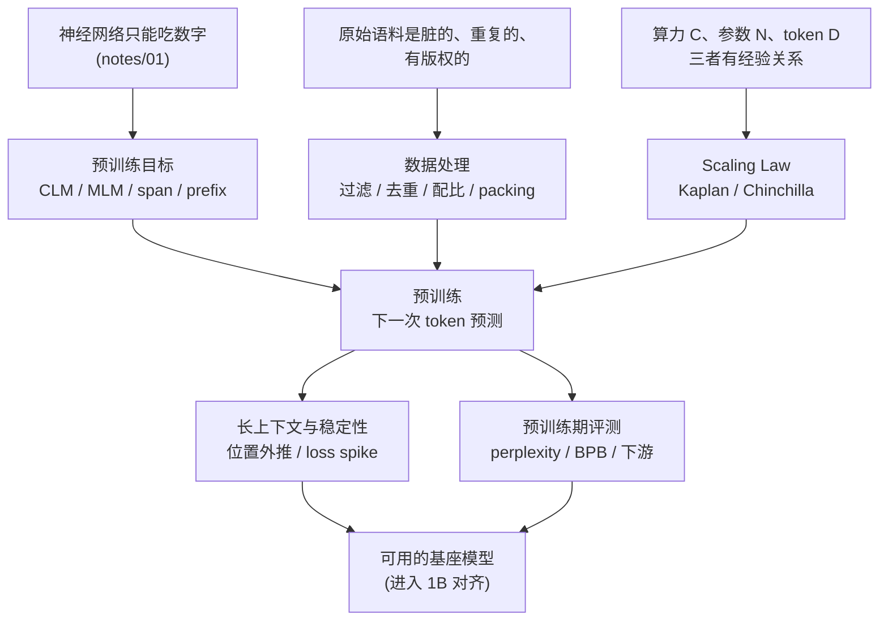
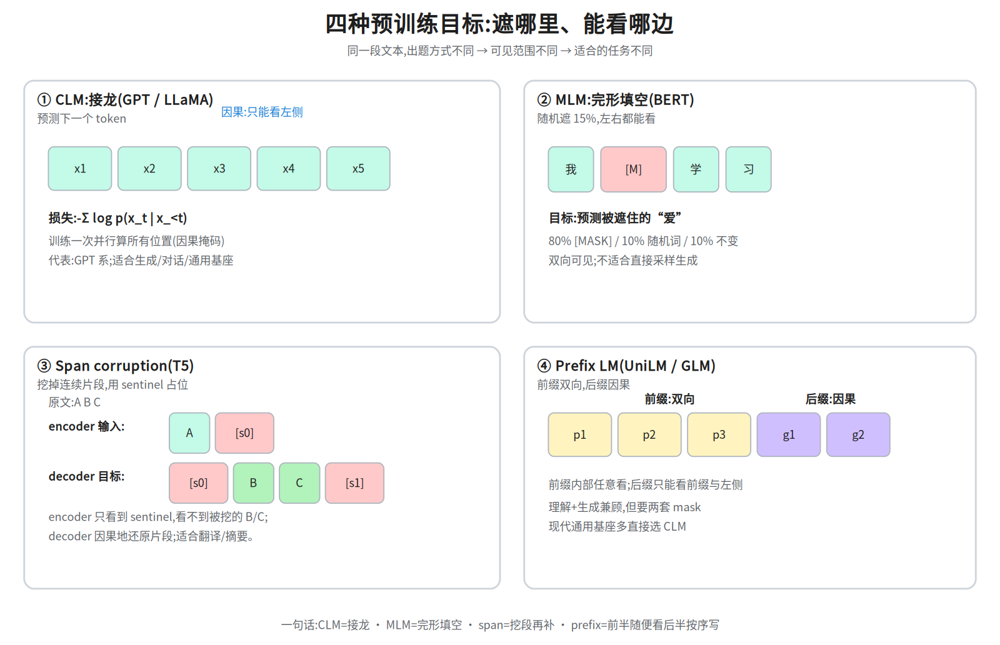
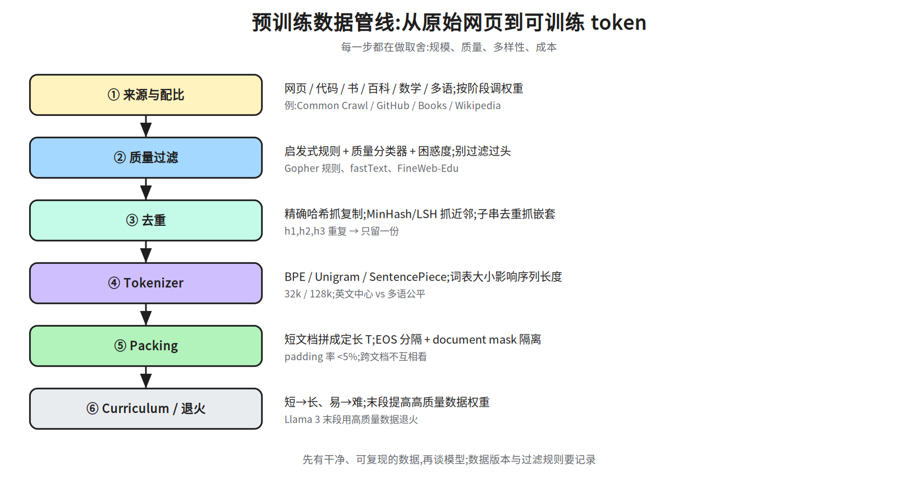
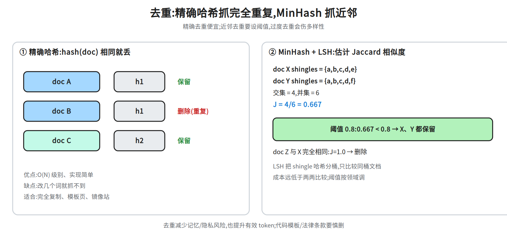
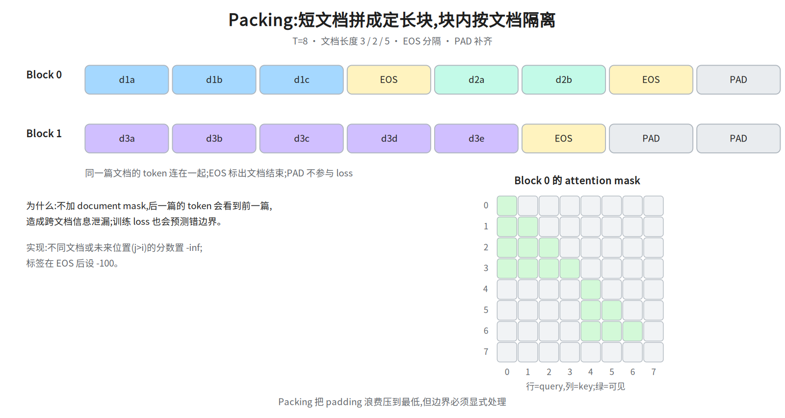
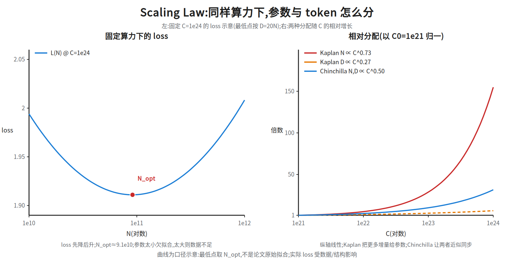
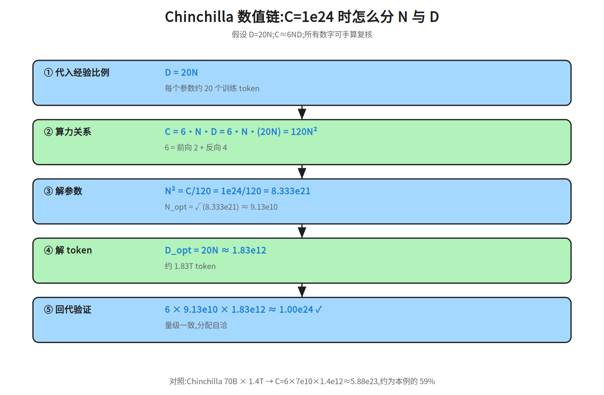
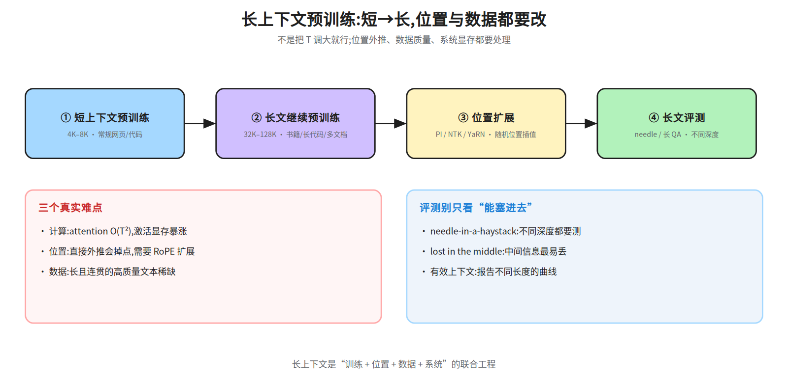
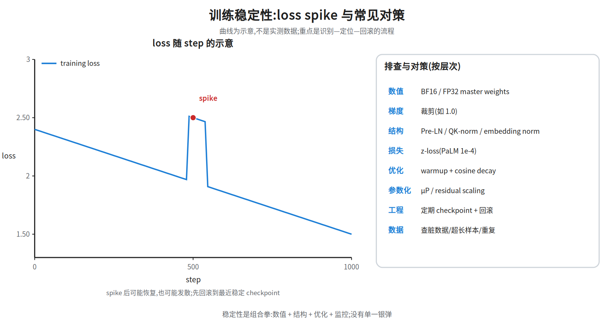
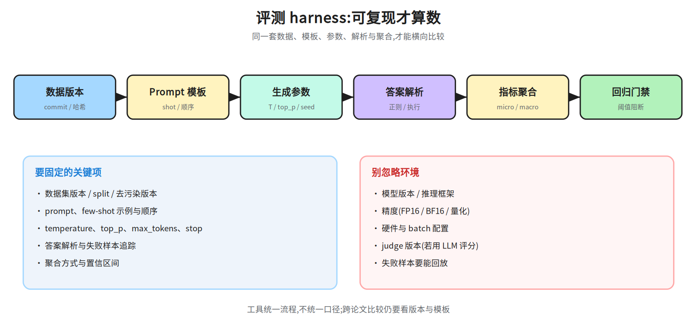

# 第七层 · 预训练 —— 目标、数据与 Scaling Law

> 本层回答:一个只会“续写”的模型,是怎么从原始网页/代码/书里学出来的?要多少 token、多大模型才划算?训练为什么会突然炸?

> **前置(按节)**
> - §1 预训练目标:先看 `notes/01_skeleton.md §3–§4`(token/embedding)与 `notes/04_architecture.md §2、§6`(因果掩码、MLM)。
> - §2 数据与 tokenizer:先看 `notes/01_skeleton.md §3`(BPE)。
> - §3 Scaling Law:只需指数、对数与四则运算;`C ≈ 6ND` 会在正文解释。
> - §4 长上下文:先看 `notes/02_attention.md §9`(O(T²))与 `notes/06_inference.md §3`(KV Cache)。
> - §5 训练稳定性:先看 `notes/03_block.md §5`(Pre-LN)与 `notes/06_inference.md §1`(训练/推理)。
>
> **建议路径(3 次 × 45 分钟)**
> - 第 1 次(必学):§1 目标对比 + §2.1–§2.4 数据管线(图 30a–30d)。
> - 第 2 次(必学):§3.1–§3.3 Kaplan/Chinchilla + 数值链 30f;有余力看 §3.4–§3.5。
> - 第 3 次(加分):§4 长上下文、§5 稳定性、§6 预训练评测;把 §7 面试要点合上书复述一遍。

## 0. 依赖图(学习顺序)

> 根节点 = 可以无条件接受的事实;箭头 = 前者支撑后者;汇点 = 本层目标。
> 学习顺序 = 从根到汇点的拓扑序。



## 1. 预训练目标:模型到底在学什么

### 1.1 直觉:四种“填空/接龙”方式

预训练不需要人工标注,它把文本本身当答案。区别只在**遮住哪里、让模型看哪里**:

| 目标 | 怎么出题 | 模型能看哪边 | 代表 | 适合 |
|---|---|---|---|---|
| **CLM**(Causal LM,因果语言模型) | 给前 `t-1` 个 token,预测第 `t` 个 | 只能看**左边** | GPT / LLaMA | 生成、对话、通用基座 |
| **MLM**(Masked LM,掩码语言模型) | 随机挖掉一些 token,让模型填 | **左右都能看** | BERT | 理解类:分类、抽取 |
| **Span corruption**(片段破坏) | 挖掉连续片段,用 sentinel 替代,让 decoder 还原 | encoder 双向;decoder 因果 | T5 | 序列到序列 |
| **Prefix LM**(前缀语言模型) | 前缀双向看,后缀因果预测 | 前缀双向 + 后缀因果 | UniLM、GLM | 理解+生成兼顾 |



**一句话记住**:CLM 是“接龙”,MLM 是“完形填空”,span corruption 是“挖掉一段再补”,prefix LM 是“前半段随便看、后半段按顺序写”。

### 1.2 CLM:数学形式与代码

给定 token 序列 `x = [x_1, …, x_T]`,CLM 最大化每个位置在给定前缀下的条件概率:

```
L_CLM = - (1/T) Σ_{t=1}^{T} log p_θ(x_t | x_1, …, x_{t-1})
```

实现时把序列右移一位当标签,一次前向并行算所有位置:

```python
import torch, torch.nn.functional as F

# ids: [B, T]; logits: [B, T, vocab]
logits = model(ids)
loss = F.cross_entropy(
    logits[:, :-1].reshape(-1, logits.size(-1)),  # 位置 0..T-2 的预测
    ids[:, 1:].reshape(-1),                        # 位置 1..T-1 的答案
)
```

维度追踪:

| 张量 | 符号维度 | 数值 shape | 语义 |
|---|---|---|---|
| `ids` | `[B, T]` | `[2, 4]` | 两条序列、每条 4 个 token id |
| `logits` | `[B, T, V]` | `[2, 4, 32000]` | 每个位置对词表 `V` 的打分 |
| 输入切片 | `[B, T-1]` | `[2, 3]` | 前 3 个 token 的预测 |
| 标签切片 | `[B, T-1]` | `[2, 3]` | 后 3 个 token 的真实 id |

**为什么能并行?** 因果掩码保证位置 `t` 的表示只依赖 `≤t` 的 token(见 `notes/04_architecture.md §2`),所以一次矩阵乘就能同时算 `T` 个位置的 loss。

### 1.3 MLM:为什么 BERT 能双向

MLM 随机选约 15% 的位置,把其中 80% 换成 `[MASK]`、10% 换随机词、10% 保持不变,然后让模型预测原词。因为被遮的位置在输入里已经“看不见答案”,看左右两边不构成偷看,所以可以用**双向** attention。

```
原句:  我 爱 学 习
遮后:  我 [M] 学 习     目标:预测“爱”
```

MLM 的缺点是:训练时有 `[MASK]`,下游没有;且每个 batch 只监督 15% 的位置,样本效率低。它也不是一个天然可采样的生成目标。

### 1.4 Span corruption 与 prefix LM

**Span corruption(T5)**:把连续片段挖掉,用 `<extra_id_0>` 这样的 sentinel(占位符)占位,decoder 依次输出被挖片段。它把“去噪”变成 seq2seq,适合翻译、摘要等 encoder-decoder 任务(seq2seq,序列到序列)。

**Prefix LM**:把序列分成前缀和后缀。前缀内部双向 attention(像 encoder),后缀只能看前缀和自己之前(像 decoder)。它试图同时拿到“理解”和“生成”,但实现上要两种 mask,训练/推理都更复杂;现代通用基座大多直接选 CLM。

### 1.5 为什么 decoder-only 赢了

不是一个目标在数学上绝对更优,而是工程与规模效应的合力:

- **目标统一**:任何任务都能写成“给定前缀,生成后缀”,不需要为每个任务改结构。
- **训练/推理一致**:训练时就是 next-token prediction,推理时就是自回归采样,没有 train/test 目标错位。
- **扩展简单**:一套因果 mask + KV Cache 就能扩到很大;encoder-decoder 多一套 cross-attention 参数与调度。
- **上下文学习**:CLM 在预训练后表现出“看提示、照格式续写”的 few-shot 能力,few-shot 很顺;但**形成机制尚无定论**(任务向量、隐式梯度、n-gram 复制等解释并存),这里只把它当待论证的观察,不当作“decoder-only 赢”的论据。

> 面试口径:**MLM 的双向是“为了填中间的空”,CLM 的因果是“为了生成下一个”;不是谁更高级,而是目标决定了可见范围。**

## 2. 数据:预训练的真正瓶颈

### 2.1 来源与配比

典型来源:

| 来源 | 例子 | 作用 | 风险 |
|---|---|---|---|
| 网页 | Common Crawl、C4、FineWeb | 规模最大、覆盖广 | 噪声、重复、低质、版权 |
| 代码 | GitHub、StackExchange | 结构化推理、长程依赖 | 许可证、漏洞、私有代码 |
| 书籍/论文 | Books3、arXiv、PubMed | 长文连贯性、知识密度 | 版权、扫描噪声 |
| 百科 | Wikipedia | 事实性、多语 | 规模小、风格单一 |
| 数学 | OpenWebMath、Proof-Pile | 符号推理 | 答案错误、格式杂乱 |
| 多语 | 各语种网页/新闻 | 跨语言能力 | 低资源语种质量差 |

**配比不是固定公式**。GPT-3 论文 Table 2.2 给出的训练采样权重是:Common Crawl 60%、WebText2 22%、Books1 8%、Books2 8%、Wikipedia 3%。注意这是**采样权重**,不是唯一 token 占比;高质量来源会被重复采样。现代模型还会按阶段调权重(见 §2.5)。

> 面试追问:**“数据越多越好吗?”** 不是。重复低质数据会浪费算力、加剧记忆与版权风险;Chinchilla 之后大家更重视“token 质量 × 数量”,而不是只堆网页。

### 2.2 质量过滤

常见三层:

1. **启发式规则**:词数、平均词长、符号/词比例、以标点结尾的行比例、停用词比例、语言识别置信度。Gopher 论文给过一套具体阈值(如词数 50–100k、符号/词比 ≤0.1 等),现代管线多在其上调整。
2. **分类器**:用高质量种子训练 fastText / 小型 transformer 质量分类器;FineWeb-Edu 用教育价值分类器给网页打分。
3. **模型困惑度**:用一个小语言模型给文档打分,过滤“模型都觉得不像自然语言”的文本;注意别把领域特有的难文本误杀。

过滤的目标不是“越干净越好”,而是**在规模、质量、多样性之间取平衡**;过度过滤会让语料变窄(例如只剩百科腔)。

### 2.3 去重:精确、近邻、子串



- **精确去重**:对文档/段落做哈希,相同哈希只留一份。便宜,但抓不到“改了几个词”的复制。
- **近邻去重**:MinHash + LSH,把文档表示成 shingle 集合,估计 Jaccard 相似度;阈值常见 0.8 左右(按数据调)。
  (`shingle` = 连续 n 个 token/字符的片段;MinHash = 用多个哈希函数把集合压成签名;LSH = 局部敏感哈希,把相似签名分到同桶;Jaccard = 交集/并集。)
- **子串去重**:后缀数组/后缀自动机找长公共子串,能抓“一篇长文里嵌了另一篇”。成本高,适合高价值语料。



去重的好处:减少记忆与隐私风险、提升有效 token 数、降低训练波动。**注意**:完全去重也可能删掉合法的重复模式(代码模板、法律条款),要按领域设阈值。

### 2.4 Tokenizer 与 packing

**Tokenizer**:BPE(Byte Pair Encoding)/ Unigram / SentencePiece。词表大小直接影响:

- 序列长度:词表越大,同样文本的 token 数通常越少,注意力与激活的序列开销随之下降;但这不是单向收益:embedding 与 LM Head 的 `V × d_model` 参数、softmax 输出层算力与显存都随 `V` 线性上涨,词表大小是这两项的权衡(见下条参数估算)。
- 多语公平:英文中心词表会让中文/小语种被切得很碎,同样一句话占用更多 token。
- 参数:embedding 与 LM Head 是 `V × d_model`;`V=128k, d=4096` 时单份就是 5.24 亿参数(FP16 约 1 GB)。

> 具体词表:LLaMA-2 用 32k;Llama 3 扩到 128k;GPT-3 约 50k;不同版本的 GPT-4 使用 cl100k/o200k 级别的词表。**引用具体模型时以官方 config 为准**;本讲义只把它们当量级例子。

**Packing**:把多篇短文档拼成固定长度 `T` 的序列,减少 padding 浪费。关键细节:

- 文档之间插入 `EOS`(或专门的 separator)。
- **不要让一篇文档的 token 看到另一篇**:要么在 attention 里加 document mask,要么接受轻微跨文档污染(很多实现为了效率会接受,但要在评测里注意)。
- **解码器还要文档内因果**:mask 同时满足“同一文档”和 `j ≤ i`;只按文档分块、不做因果下三角,会训练出“文档内双向”的错误实现。
- 标签也要按文档边界处理,避免“上一篇的末尾预测下一篇的开头”。



图里用 `T=8` 的例子:三篇文档长度 3/2/5,拼成两块;块内用 `EOS` 分隔,attention mask 按文档重置。这样 GPU 不会为大量 padding 白算。

### 2.5 Curriculum 与数据退火

- **Curriculum(课程学习)**:先短序列/简单数据,再长序列/难数据;或按阶段调数据配比。不是所有模型都用,收益依任务而定。
- **数据退火(data annealing)**:训练最后阶段提高高质量数据(百科、教科书、数学)的权重,常能明显提升下游。Llama 3 等模型公开提到在最后阶段用高质量数据退火。
- **阶段式长上下文**:先在 4K–8K 上预训练,再用长文档继续训练到 32K–128K(见 §4)。

### 2.6 合成数据

合成数据(用强模型生成教科书、指令、代码解释)可以补足稀缺领域,但有两个风险:

- **多样性下降**:模型倾向于生成自己熟悉的模式,反复训练会让分布变窄。
- **模型坍缩(model collapse)**:只用生成数据递归训练,尾部信息逐渐丢失(Shumailov et al., 2024 的讨论)。

实践上要混合真实数据、做去重与质量过滤、保留人类数据锚点,并把合成数据比例当超参而不是“免费午餐”。

### 2.7 数据污染

预训练语料可能包含评测集原题。污染会让 benchmark 分数虚高,且对模型能力判断产生误导。检测与治理见 `notes/09_evaluation.md §2`;预处理阶段能做的是:

- 用 n-gram 重叠、canary 字符串、时间切分筛掉疑似评测文本;
- 记录数据版本与截止时间,评测时用“训练截止后发布”的题集;
- 对无法确认的分数标 `待核`,不要拿污染分数做结论。

## 3. Scaling Law:要多少参数、多少 token

### 3.1 Kaplan 2020:损失随规模幂律下降

Kaplan 等人的经验结论(固定其他因素)大致是:

```
L(N) ∝ N^(-0.076)      N = 参数量
L(D) ∝ D^(-0.095)      D = 训练 token 数
L(C) ∝ C^(-0.050)      C = 训练算力(FLOPs)
```

在固定算力下,他们给出的最优分配近似 `N_opt ∝ C^0.73`,`D_opt ∝ C^0.27`——**大头给参数**,数据相对少。这种“参数优先”的取向与 GPT-3 时代“大模型、少 token”的做法方向一致,但两篇来源都没给出这个因果:Kaplan 2020 只给拟合指数、未讨论 GPT-3,GPT-3 论文把停在 300B token 归因于算力与时间预算、也未提 Kaplan;Chinchilla 反而把 GPT-3 当作“参数过量、token 不足”的反例(175B 参数只训了 300B token)。

### 3.2 Chinchilla 2022:参数和数据要一起涨

Chinchilla 用更系统的实验修正了分配。核心关系:

```
训练算力(稠密 Transformer,近似):C ≈ 6 · N · D
  N = 参数量(非 embedding)
  D = 训练 token 数
  6 = 前向 2 + 反向 4 的每参数每 token FLOPs 量级
```

在 `C` 固定时最小化损失,经验上得到 `N_opt` 与 `D_opt` **近似等比例**增长(约 `C^0.5`),并给出一个非常好记的实践口径:

```
D_opt ≈ 20 × N_opt        # 每个参数约 20 个训练 token
```

Chinchilla 的 70B 模型训练了 1.4T token,约 20 token/参数,在相同算力下优于更大的 Gopher 280B(300B token)。

> 更精确的拟合:Chinchilla 论文 Approach 3 给出
> `L(N,D) = E + A/N^α + B/D^β`,其中 `E=1.69, A=406.4, B=410.7, α=0.34, β=0.28`。
> 由此 `N_opt ∝ C^{β/(α+β)} ≈ C^0.45`,`D_opt ∝ C^{α/(α+β)} ≈ C^0.55`。
> 面试时先说“约各占一半、20 token/参数”的结论,再补这个更精确的指数,会显得你真的读过论文。



### 3.3 数值链:给定算力,Chinchilla 怎么分?



取 `C = 1 × 10^24 FLOPs`,用 `D = 20N` 和 `C = 6ND`:

```
① 代入:D = 20N
   C = 6 · N · (20N) = 120 N²
② 解 N:
   N² = C / 120 = 1e24 / 120 = 8.333e21
   N_opt = √(8.333e21) ≈ 9.13e10  (约 91B 参数)
③ 解 D:
   D_opt = 20 × 9.13e10 ≈ 1.83e12  (约 1.83T token)
④ 回代验证:
   6 × 9.13e10 × 1.83e12 ≈ 1.00e24   ✓
⑤ 对照 Chinchilla 70B:
   C_70B = 6 × 7.0e10 × 1.4e12 = 5.88e23
   → 约为本例算力的 59%,量级一致
```

**结论**:算力翻倍,参数和 token 都约按 `√2` 增长;不是“只把模型做大”。实际训练还会受推理成本、数据可得性、硬件利用率影响(见 §3.4)。

### 3.4 推理最优:为什么 LLaMA 要“过度训练”

Chinchilla 只最小化**训练**算力。若模型要服务大量请求,推理成本也会进入总账:

```
总成本 ≈ 训练成本(∝ 6ND) + 推理成本(∝ 2N × 推理 token 数)
```

推理请求越多,第二项越重;此时把模型**做小、数据做多**更划算——小模型单次推理便宜,虽然训练多花 token。这就是“over-training / inference-optimal”:

- LLaMA-1 7B 在 1T token 上训练(约 143 token/参数),远超 20;
- Llama 3 8B 在 15T token 量级上训练(约 1875 token/参数);
- Llama 3 70B 同样约 15T token(约 214 token/参数),比 8B 更接近 Chinchilla 比例。

> 结论:Chinchilla 是“训练算力最优”的基准,不是“任何部署都最优”。面试要能说出**训练最优 vs 推理最优**的差别(Sardana et al., 2024 系统讨论了这一点)。

### 3.5 涌现能力:能力突变还是度量假象?

Wei et al. (2022) 观察到某些任务在模型规模跨过阈值后分数突然上升,称为“涌现”。但 Schaeffer et al. (2023) 指出:很多“突变”来自**不连续/严格的评价指标**(如全对才算对);换成连续指标(如 token 级准确率、log-likelihood)后,曲线往往更平滑。

诚实结论:

- 某些能力确实随规模出现**非线性提升**,但是否“突然涌现”依赖任务与度量;
- 不要用单条 benchmark 的拐点推断“模型突然会推理了”;
- 评测要同时看连续指标与任务级指标,并控制污染。

### 3.6 两个现代修正:多 epoch 与 MoE

**数据受限时重复训练**:高质量数据不够时,同一批 token 会被重复多轮。Muennighoff et al. (2023) 的经验结论是:**约 4 个 epoch 以内**,重复数据与等量新数据的效果接近;超过后收益递减,继续加 epoch 不如加新数据。做数据预算时,可以把 `D_eff ≈ D_unique × min(epochs, 4)` 当粗略上界(不是精确公式,实际随数据/模型变)。

**MoE 的 scaling**:稀疏 MoE 的总参数 `N_total` 很大,但每 token 只激活 `N_active`。经验上 loss 更依赖**激活参数与数据量**,总参数提供容量但需要路由/负载均衡/通信配合;不能直接把稠密模型的 `6ND` 套到 MoE 上,要按激活 FLOPs 与专家并行开销分别记账。详见 AI Infra `notes/21_single_node_ops.md` 的 MoE 部分。

## 4. 长上下文预训练

### 4.1 为什么难

- **计算**:attention 对 `T` 是 `O(T²)`,训练长序列的 FLOPs 与激活显存都涨。
- **位置外推**:在 4K 上训练的正弦/RoPE 位置编码,直接用到 128K 往往性能崩(见 `notes/05_modern.md §2`)。
- **数据**:真正长且高质量、跨文档连贯的语料少;很多“长文本”只是拼接。
- **评测**:长上下文不是“能塞进去”就行,还要能**检索并使用**中间位置的信息。

### 4.2 常见做法

1. **短→长继续预训练**:先 4K–8K 常规预训练,再用长文档/长代码继续训练到 32K–128K。
2. **位置扩展**:RoPE 的 PI / NTK-aware / YaRN;或在训练中随机插值位置,让模型适应更长位置。
3. **数据配比**:加入书籍、长代码库、多文档问答、长对话;避免只拼随机短文本。
4. **系统优化**:FlashAttention、序列并行、上下文并行、激活重算(AI Infra 模块展开)。



### 4.3 怎么评测

- **Needle-in-a-haystack**:在长文本里放一个事实,问模型能不能找到;要测不同深度(开头/中间/结尾)。
- **长文 QA/摘要/代码**:如 LongBench、∞Bench 等;注意任务是否真的需要长距离信息。
- **Lost in the middle**:Liu et al. (2023) 发现信息在长上下文中间时最容易被忽略;别只看“开头/结尾”位置。
- **有效上下文长度**:模型声称 128K,不代表 128K 上都好用;要报告不同长度上的曲线。

## 5. 训练稳定性:loss spike 与对策

### 5.1 常见现象

- **loss spike**:训练 loss 突然大幅上升,可能随后恢复,也可能彻底发散。
- **梯度爆炸/消失**:深层网络、长序列、低精度都可能触发。
- **数值溢出**:FP16 的指数/softmax、attention logits 过大。
- **数据问题**:脏数据、重复、极端长样本也会造成尖峰。



### 5.2 常见对策(按层次)

| 层次 | 手段 | 说明 |
|---|---|---|
| 数值 | BF16 / FP32 master weights | BF16 动态范围大,训练更稳 |
| 梯度 | 梯度裁剪(如 1.0) | 限制梯度范数的上界;实际单步更新幅度还取决于学习率、Adam 二阶矩与 batch,裁剪后步长仍可能很大;GPT-3 用了 1.0 |
| 归一化 | Pre-LN、QK-norm、embedding norm | 控制激活/注意力 logits 规模 |
| 损失 | **z-loss**(PaLM 用 1e-4) | 惩罚 logits 的 log-sum-exp 过大,稳住 softmax |
| 优化 | warmup + cosine decay | 初期小步,避免一上来炸 |
| 参数化 | μP / residual scaling | μP(最大更新参数化:按宽度缩放初始化与学习率,使最优超参可跨宽度迁移) |
| 工程 | 定期 checkpoint、检测 spike 回滚 | 出问题能退回最近稳定点 |

**面试怎么答**:先分类(数值/梯度/数据/结构),再说“裁剪 + BF16 + Pre-LN + z-loss + warmup + checkpoint 回滚”的组合,最后强调**监控与复现**比单点技巧更重要。

## 6. 预训练期评测

预训练不是“训完再看”,而是持续评测:

- **held-out perplexity / BPB**:BPB(bits per byte)对 tokenizer 不敏感,更适合跨模型比较;perplexity 依赖词表,别直接横比不同 tokenizer。
- **下游 few-shot**:MMLU、GSM8K、HumanEval 等的早期信号(见 `notes/09_evaluation.md §1`)。
- **scaling 外推**:用小模型拟合 loss 曲线,预测大模型是否值得训;外推有风险,要用多个规模验证。
- **污染检查**:n-gram 重叠、canary、时间切分(见 09 §2)。
- **健康度**:loss spike 频率、梯度范数、激活范数、吞吐/ MFU(模型 FLOPs 利用率)、数据加载是否卡住。



## 7. 面试要点

1. **CLM / MLM / span corruption / prefix LM 的区别?** → 遮哪里、能看哪边、代表模型与适用任务(§1.1 表)。
2. **为什么 BERT 能双向、GPT 只能因果?** → MLM 挖掉中间词,看两边不算偷看;CLM 要预测下一个,必须因果。
3. **数据管线有哪些步骤?** → 来源与配比 → 质量过滤 → 去重 → tokenizer → packing → curriculum/退火 → 污染治理。
4. **为什么要去重?** → 减少记忆/隐私风险、提升有效 token、稳定训练;精确哈希抓完全重复,MinHash 抓近邻。
5. **packing 的坑?** → 文档边界要隔离(EOS/document mask),否则跨文档注意力污染。
6. **Kaplan 和 Chinchilla 的结论差在哪?** → Kaplan 更偏“参数优先”;Chinchilla 用 `C≈6ND` 得出参数与数据约等比例,20 token/参数。
7. **Chinchilla 最优一定是部署最优吗?** → 不是;推理量大时小模型多数据更划算(over-training)。
8. **涌现能力是真的吗?** → 能力随规模非线性提升可能存在,但“突变”常由不连续指标造成;要看连续指标与控制污染。
9. **长上下文怎么训?** → 短→长继续预训练、RoPE 扩展、长文数据、系统优化;评测要测不同深度。
10. **loss spike 怎么办?** → BF16、梯度裁剪、Pre-LN/QK-norm、z-loss、warmup、checkpoint 回滚、数据排查。

## 常见坑

- 把 `C ≈ 6ND` 当成精确等式:它忽略了 attention 的 `T²` 项、embedding、通信与重算,是量级估算。
- 把 Chinchilla 的 20 token/参数当成硬规则:它是最优训练算力下的经验口径,不是所有部署的答案。
- 把 GPT-3 的 60/22/8/8/3 当成唯一 token 占比:那是采样权重,且会重复采样高质量来源。
- 把“去重”理解成“只留一篇”:近邻去重有阈值,过度去重会伤害多样性。
- 忽略 tokenizer 对比较的影响:不同词表下 perplexity 不可直接横比,优先 BPB。
- 把长上下文“能塞进去”当成“能用好”:要测中间位置、跨文档与真实任务。

## 动手清单

1. **BPE 复现**:用 §2 的语料(或自选 1000 行文本)实现一个最简 BPE,输出前 20 个 merge;验收:相邻对计数与合并顺序可复算。
2. **Packing 检查**:把 100 篇长度不一的文档 pack 到 `T=2048`,统计 padding 率与跨文档边界数;验收:padding 率 <5%,每个边界都有 EOS/document mask。
3. **Chinchilla 计算器**:输入 `C`,输出 `N_opt`、`D_opt`、验证 `6ND`;验收:与 §3.3 的 `C=1e24` 例子一致。
4. **BPB vs PPL(perplexity)**:用两个不同 tokenizer 的模型算同一验证集的 loss,分别转成 BPB;验收:能解释为什么 BPB 更可比。

## 相关图

`30a_objectives` · `30b_data_pipeline` · `30c_dedup` · `30d_packing` · `30e_scaling_curves`
· `30f_chinchilla_alloc` · `30g_long_context` · `30h_stability` · `32a_eval_harness`
(均在 `diagrams/`,横竖双版本)

## 下一步

第八层 · 对齐:SFT、RLHF/PPO、DPO 家族、拒绝采样与安全对齐——把“会续写的基座”变成“会按指令、符合偏好地回答问题”的助手。
