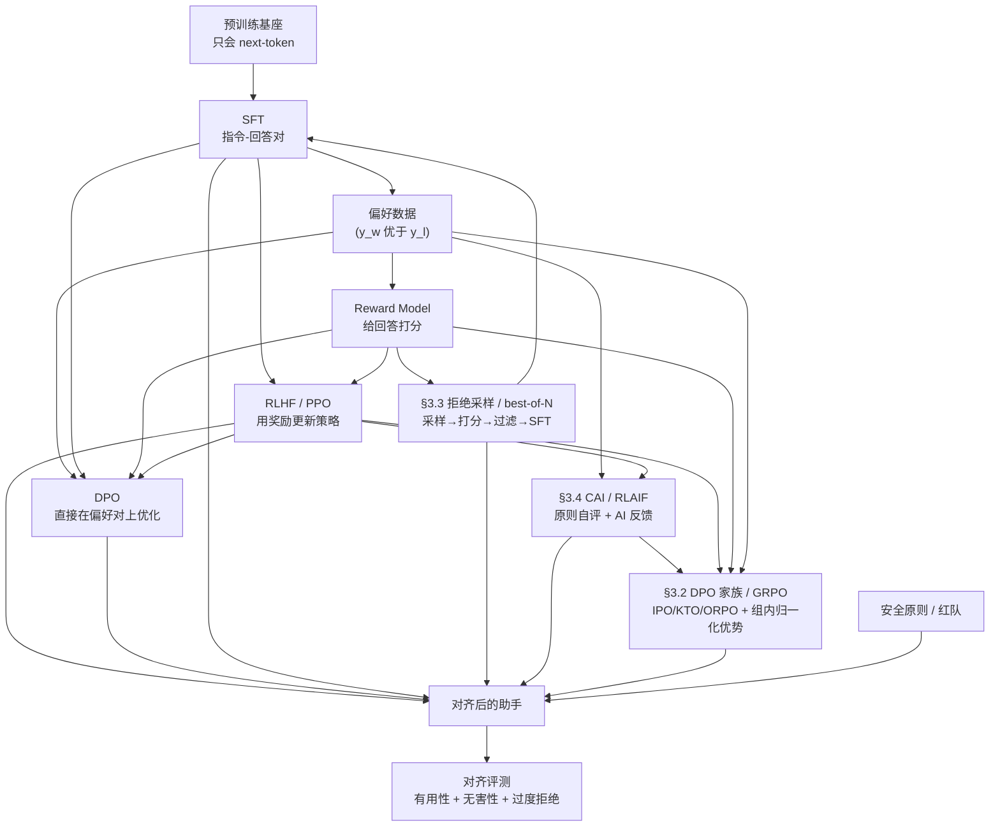
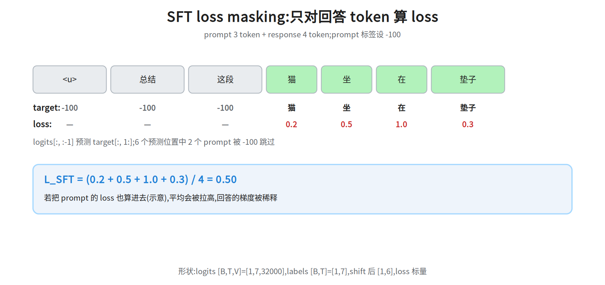
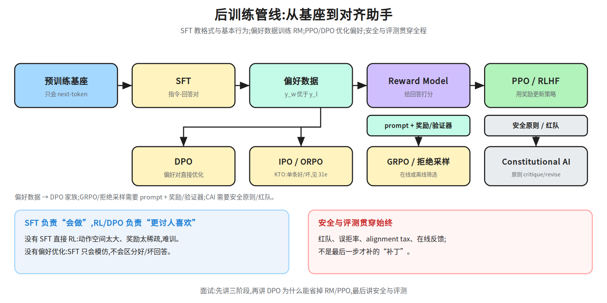
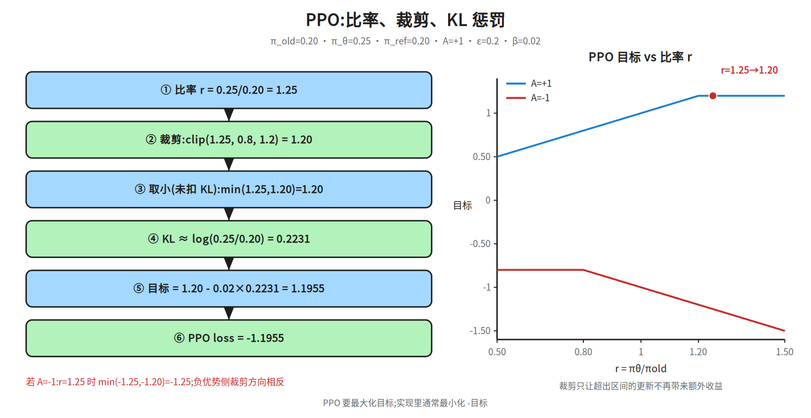
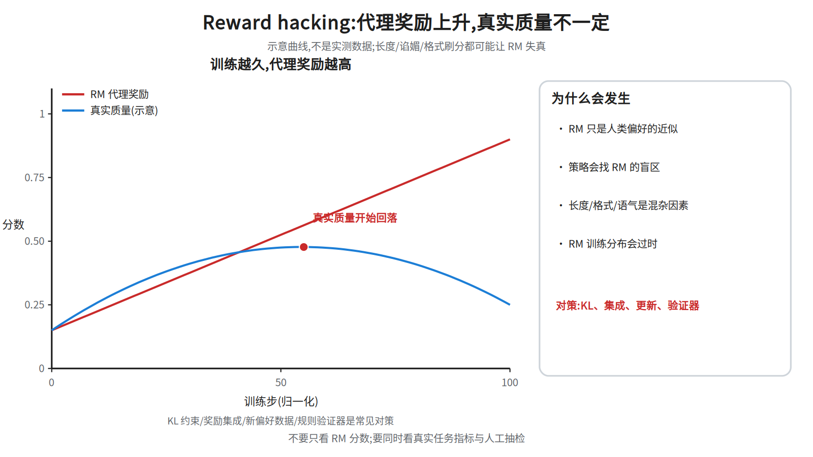
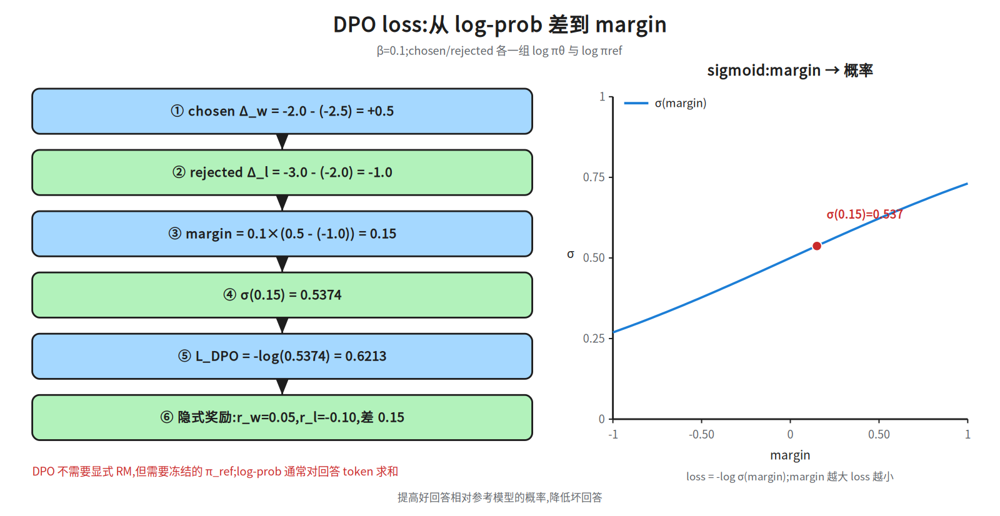
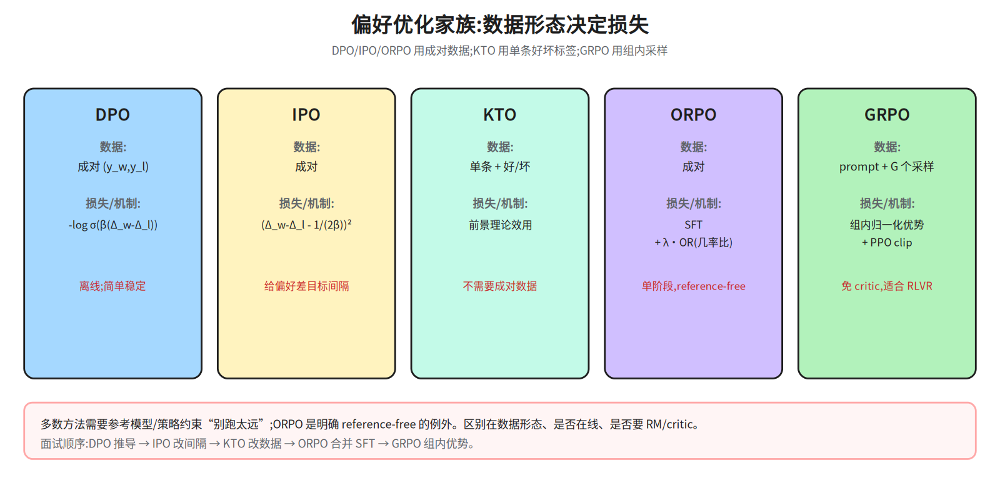
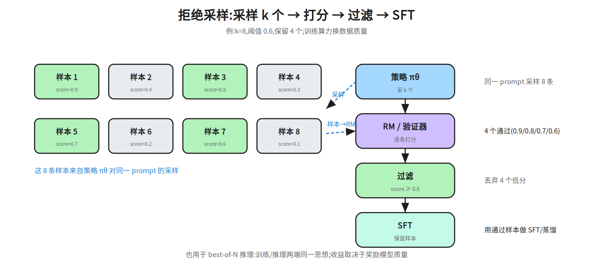
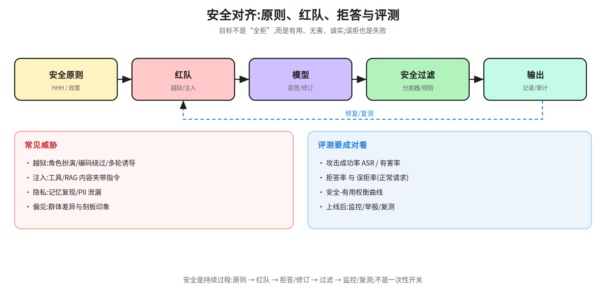

# 第八层 · 对齐 —— SFT、RLHF、DPO 与安全

> 本层回答:基座模型只会“接龙”,怎么让它**听懂指令、按人类偏好回答、同时不学坏**?SFT、RLHF、DPO 各自在优化什么?

> **前置(按节)**
> - §1 SFT:先看 `notes/07_pretraining.md §1.2`(CLM loss)与 `notes/06_inference.md §1`(训练/推理)。
> - §2 RLHF:需要概率、期望、梯度;先看 §1;KL 散度的直觉在 §2.2 解释。
> - §3 DPO:需要 log、sigmoid;先看 §2.1 的 Bradley-Terry 模型,以及 §2.2 的 KL 正则目标、`β` 与 `π_ref` 这套记号(§3.1 第一句就要用)。
> - §4 安全:先看 §1–§3;评测细节接 `notes/09_evaluation.md §5`。
>
> **建议路径(3 次 × 45 分钟)**
> - 第 1 次(必学):§1 SFT + loss masking(图 31a/31b)。
> - 第 2 次(必学):§2 RM + PPO/KL(图 31c/31f),§3.1 DPO 数值链(31d)。
> - 第 3 次(加分):§3.2 DPO 家族、§3.3 拒绝采样、§3.4 CAI、§4 安全与 alignment tax(31e/31g/31h)。

## 0. 依赖图(学习顺序)



## 1. SFT:先教会“按指令回答”

### 1.1 直觉与数据

SFT(Supervised Fine-Tuning,监督微调)就是拿 `(指令, 好回答)` 对继续做 next-token 训练。它不直接教“偏好”,只教**格式与基本行为**:听懂任务、按格式输出、该停时停。

数据质量比数量更关键:

- InstructGPT 用了约 **13k** 条人工写的 SFT 提示(论文口径);
- LIMA 用 **1,000** 条精选示例就得到很强的对话模型,说明“高质量、多样、干净”比“海量噪声”更重要;
- Alpaca 用 Self-Instruct 生成 52k 条,是低成本复现路线,但会继承教师模型的风格与错误。

> 数据配比通常要覆盖:开放问答、写作、摘要、抽取、代码、数学、多轮、拒答/安全。只训单一任务会让模型“只会一种腔调”。

### 1.2 格式与特殊 token

对话模型通常有 chat template,把角色、轮次、结束符编码成特殊 token:

```
<|system|>你是助手<|end|>
<|user|>把这句话翻译成英文:我爱学习<|end|>
<|assistant|>I love learning.<|end|>
```

训练时要保证:

- 角色边界与结束符和推理时**完全一致**;
- 只对 assistant 的回答计算 loss(见 §1.3);
- 多轮对话中,历史 assistant 内容作为上下文,但 loss 口径属**实现选择**(不是硬性保证),要显式约定取哪一种——①只算最后一轮 assistant(历史轮标签设 -100),或②所有 assistant 轮都算;②才是主流框架的默认(TRL 的 `assistant_only_loss`、LLaMA-Factory 的 `mask_history`),所以「只算最后一轮」不能写成多数口径;
- 序列结束要有 EOS,否则模型学不会停。

### 1.3 Loss masking:只学回答,不学提问

SFT 的损失通常只在**回答 token** 上计算:

```
L_SFT = - (1/|y|) Σ_{t∈回答} log π_θ(y_t | x, y_<t)
```

其中 `x` 是指令/历史,`y` 是目标回答。实现上把 prompt 位置的标签设成 `-100`,`cross_entropy(ignore_index=-100)` 会跳过。

```python
import torch, torch.nn.functional as F

# input_ids: [B, T]; labels: [B, T],prompt 位置 = -100
logits = model(input_ids)                      # [B, T, V]
# next-token shift:位置 t 的 logits 预测 t+1 的标签
loss = F.cross_entropy(
    logits[:, :-1].reshape(-1, logits.size(-1)),
    labels[:, 1:].reshape(-1),
    ignore_index=-100,
)
```



**数值例子**:prompt 3 个 token(`<user> 总结 这段`),回答 4 个 token(`猫 坐 在 垫子`)再加 EOS(§1.2:回答侧以 EOS 结束,它算 target),`|y|=5`,对应 loss 为
`0.2, 0.5, 1.0, 0.3, 0.4`(末项是 EOS 的 loss)。只对回答侧(含 EOS)求平均:

```
L_SFT = (0.2 + 0.5 + 1.0 + 0.3 + 0.4) / 5 = 0.48
```

如果把 prompt 也算进去(shift 后只有 2 个 prompt 预测位置,假设 loss 为 `2.0, 1.8`),平均会变成
`(2.0+1.8+0.2+0.5+1.0+0.3+0.4)/7 ≈ 0.89`——回答的贡献被稀释,模型会花力气去“预测用户会说什么”,这不是我们想要的。

> 形状:`logits [B,T,V]=[1,8,32000]`,shift 后 `[1,7,32000]`;`labels [B,T]=[1,8]`,shift 后 `[1,7]`;有效预测位置 7 个(2 个 prompt + 4 个回答 + 1 个 EOS),mask 后只对 5 个回答侧位置(含 EOS)求平均;`loss` 是标量。**不要 shift 两次**:用 HuggingFace 模型内部算 loss 时,传未 shift 的 labels 即可。

### 1.4 多轮、packing 与常见问题

- **多轮**:把历史拼进 `x`,loss 范围按 §1.2 约定的那一种执行(只算最后一轮,或所有 assistant 轮都算),不要两套混用——口径直接改 loss 数值和梯度;要保证上一轮 assistant 的 EOS 在上下文里。
- **Packing**:多条短样本拼进一个 `T`,用 document/attention mask 隔离;标签在每条样本结束后设 `-100`。
- **过拟合**:SFT 数据少、训练久会背答案、丢通用能力;用早停、低 LR、数据混合(掺预训练数据)缓解。
- **灾难性遗忘**:只训窄领域会让基座能力退化;可混入通用指令/预训练 loss(如 PPO-ptx 思路)。

## 2. RLHF:用“比较”训练奖励,再用奖励训练策略

RLHF(Reinforcement Learning from Human Feedback)分两步:**先学一个奖励模型(RM),再用 RL 优化策略**。InstructGPT 的经典三阶段是 SFT → RM → PPO。



### 2.1 Reward Model:把“哪个更好”变成分数

人类标注的原始形态是**整体排序**:同一个 prompt `x` 采 4~9 个回答(InstructGPT 取 K=9)让标注者排序,再从排序里采样出成对样本 `y_w`(winner)≻`y_l`(loser)。用 Bradley-Terry(成对比较)模型假设:

```
P(y_w ≻ y_l | x) = σ(r_φ(x, y_w) - r_φ(x, y_l))
```

其中 `σ(z)=1/(1+e^{-z})`,`r_φ` 是奖励模型(通常由基座模型加一个标量头得到)。训练损失:

```
L_RM = - E[ log σ( r_φ(x, y_w) - r_φ(x, y_l) ) ]
```

**数值**:`r_w=2.0`,`r_l=1.0`,差 `1.0`,`σ(1)=0.7311`,`L_RM=-log(0.7311)=0.3133`。若差为 0,`σ=0.5`,`loss=0.693`;差越大,loss 越小。

**数据与工程要点**:

- 标注要控制风格偏差(长度、格式、自信语气),否则 RM 会学“长/客气=好”。
- RM 通常比策略小(InstructGPT 用 6B RM 服务 175B 策略),但容量太小会成为瓶颈。
- 同一 prompt 的多个回答要一起采样/比较,减少 prompt 难度带来的噪声。
- RM 只在训练分布附近可靠;策略跑远后奖励会失真(reward hacking,见 §2.3)。

### 2.2 PPO(Proximal Policy Optimization,近端策略优化)

PPO 的目标是最大化奖励,同时**不要一步走太远**。核心是重要性比率 `r_t` 与裁剪:

> 记号对回 §1.3:`a_t` 就是第 t 个生成的 token(即 `y_t`),`s_t` 是状态 = prompt + 已生成前缀(即 `x, y_<t>`),因此 `π_θ(a_t|s_t)` 与 §1.3 的 `π_θ(y_t|x,y_<t)` 是同一个分布;`π_old` 是采样这批数据时的旧策略。`A_t`(advantage,优势)表示“在 `s_t` 下选 `a_t` 比该状态的平均水平好多少”:`A_t>0` 抬概率,`A_t<0` 压概率。

```
r_t(θ) = π_θ(a_t | s_t) / π_old(a_t | s_t)

L_PPO = E_t[ min( r_t A_t, clip(r_t, 1-ε, 1+ε) A_t ) ] - β · E_t[ KL(π_θ || π_ref) ]
```

- `A_t`:优势(advantage),表示这个动作比“平均水平”好多少;常用 GAE 估计。
- `ε`:裁剪范围,常见 0.2。比率超出 `[0.8, 1.2]` 后,目标不再奖励继续偏离。
- `π_ref`:参考策略(通常是 SFT 模型);KL 惩罚防止策略为了刷奖励而跑偏。
- `β`:KL(Kullback-Leibler 散度)系数;InstructGPT 的 PPO 配置里 KL 惩罚系数约为 **0.02**(以论文/config 为准)。

在 RLHF 里,奖励通常是**序列级**的(RM 在整段回答结束时给一个分),而 KL 可以**逐 token** 估计:

先给直觉:`KL(π_θ‖π_ref) = E_{a~π_θ}[ log π_θ(a|s) - log π_ref(a|s) ]`,即对**每个 token 位置**上两个 next-token 分布之差取期望;由 Jensen/吉布斯不等式它恒 `≥0`,且仅在两分布完全相同时为 0,所以这个数值正好当“偏离参考模型的程度”。下面的 `KL_t` 就是它的单样本逐 token 估计,沿序列求和即整条回答的 KL。

```
KL_t ≈ log π_θ(a_t|s_t) - log π_ref(a_t|s_t)      # 单样本估计
shaped_reward_t = - β · KL_t                       # 只在序列末尾加 RM 奖励
```



**数值链**:某个 token 上 `π_old=0.20`,`π_θ=0.25`,`π_ref=0.20`,`A=+1.0`,`ε=0.2`,`β=0.02`:

```
① 比率:r = 0.25 / 0.20 = 1.25
② 裁剪:clip(1.25, 0.8, 1.2) = 1.20
③ 取小:min(r·A, clip·A) = min(1.25, 1.20) = 1.20
④ KL:log(0.25/0.20) = 0.2231
⑤ 目标 L_PPO:1.20 - 0.02×0.2231 = 1.1955   (要最大化的是 L_PPO)
   loss = -L_PPO = -1.1955
```

如果 `A=-1.0`,则 `r·A=-1.25`,`clip·A=-1.20`,`min=-1.25`;裁剪在负优势侧的方向相反。**记住:PPO 裁剪不是“把比率永远夹在区间里”,而是让超出区间的更新不再带来额外收益。**

> 面试追问:**为什么用 PPO 而不是朴素策略梯度?** 朴素 PG 对步长敏感、方差大;PPO 用旧策略采样的数据做多步更新,裁剪限制分布漂移,训练更稳。代价是要维护 value/critic、实现复杂。
> 补一句「朴素 PG 在优化什么」:策略梯度直接最大化 `J(θ)=E_{y~π_θ(·|x)}[R(y)]`,用 `∇_θ log π_θ(y|x)·R(y)` 的单样本估计更新参数——无偏,但方差极大(整条序列共用一个标量回报,credit assignment 全靠它;一次采样只能走一步,所以对步长敏感)。加基线/优势(`A_t`)、用重要性比率复用旧数据做多步更新,就是 PPO 的来路。

**优势怎么估(GAE)**:RLHF 里常用 token 级或序列级的 GAE(广义优势估计):

```
δ_t = R_t + γ V(s_{t+1}) - V(s_t)          # R_t:即时(塑形)奖励,不是上面那个比率 r_t
A_t = Σ_{l≥0} (γλ)^l δ_{t+l}
```

`γ` 是折扣、`λ` 控制偏差-方差;序列级奖励只在末尾给,KL 惩罚可以逐 token 塑形。
> 记号提醒:GAE 里的 `R_t` 是 token 级即时(塑形)奖励——RM 的序列级分数只在末尾给,KL 塑形项分摊到各 token;它和本节前面裁剪公式里的重要性比率 `r_t(θ)=π_θ/π_old` 是两个量。照符号代数值时,别把 1.25 这样的比率当奖励塞进 `δ_t`。同理 §3.1 的 `r(x,y)`、§3.2 的 `r_i` 都是奖励,不是比率。
其中 `V(s)` 是 **critic(value 网络)** 的输出:在状态 `s`(prompt+已生成前缀)下对**未来累计(塑形)奖励**的期望预测;critic 就是“四个模型”里的第四个,靠回归实际回报训练。`δ_t` 是一步 TD 误差,`A_t` 用 `(γλ)^l` 把多步 `δ` 加权累加:`λ=0` 只看一步(方差低、偏差大),`λ=1` 接近 Monte-Carlo(偏差低、方差大)。正因为要额外训这个 `V`,GRPO 才用组内均值当基线把它省掉(见 §3.2)。RLHF 常取 `γ=1`(序列有限、不折扣未来 token),但具体实现差异很大,报告时要写清。

**四个模型与显存**:PPO-RLHF 通常同时驻留 **actor(策略)、critic(value)、reward model、reference model**;即使初始权重相同,训练后也是四份参数,再加优化器状态与激活。显存吃紧时可以让 RM 单独部署、或让 actor/critic 共享底座但**不共享训练后的权重**。

**什么时候选 online(PPO)而不是 DPO?** 奖励不可微/需要在线探索(代码单测、工具调用、多步推理)、或偏好数据分布会随策略变化时,online RL 更合适;偏好对固定、追求实现简单稳定时,DPO 更划算。

### 2.3 Reward hacking:奖励模型的漏洞

策略会找到 RM 的“捷径”,而不是人类真正想要的东西:

- **长度偏置**:更长的回答平均得分更高;
- **谄媚(sycophancy)**:顺着用户说,而不是说真话;
- **格式刷分**:堆 bullet、加免责声明;
- **钻 RM 盲区**:在训练分布外生成 RM 高分的怪文本。

缓解:

1. **KL 约束**:别让策略离 `π_ref` 太远(§2.2)。
2. **奖励集成/不确定性**:多个 RM 取保守值,或对高不确定性降权。
3. **持续更新偏好数据**:用当前策略采样新回答,让人重新标注,避免 RM 过时。
4. **规则/验证器混合**:代码用单测、数学用答案校验,不完全依赖 RM。
5. **长度/风格归一化**:训练与评测时控制长度等混杂因素。



## 3. 偏好优化:不训练 RM 也能对齐

### 3.1 DPO:把偏好直接写进损失

DPO(Direct Preference Optimization)的关键观察:先写出被优化的 KL 正则目标 `max_π E_{y~π(·|x)}[r(x,y)] - β·KL(π(·|x)‖π_ref(·|x))`(逐 token 分解后每个位置形式相同),对它求导令零,得最优策略满足——`β` 在分母上,所以 β 越大 `π_ref` 权重越大、最优策略越保守:

```
π*(y|x) ∝ π_ref(y|x) · exp( r(x,y) / β )
**这一步怎么来的(可自己验)**:对每个 `x` 解 `max_π Σ_y π(y|x)·r(x,y) − β·Σ_y π(y|x)·log(π(y|x)/π_ref(y|x))`,约束 `Σ_y π(y|x)=1`;用拉格朗日乘子 λ,对每个 `y` 求偏导令零:`r(x,y) − β·( log(π/π_ref) + 1 ) + λ = 0`。解出 `log π = log π_ref + r/β + (λ−β)/β`,与 `y` 无关的项收进归一化常数 `Z(x)`,即得 `π* = π_ref·e^{r/β} / Z(x)`。`β` 落到分母上,是因为它给整个 KL 项加权:β 越大,同样一份收益要付更多 KL 罚,最优解就越贴 `π_ref`。
```

反解出隐式奖励:

```
r(x,y) = β · log( π*(y|x) / π_ref(y|x) ) + β · log Z(x)
```

把它代入 Bradley-Terry,配分函数 `Z(x)` 在成对比较中抵消,得到:

```
L_DPO = - E[ log σ( β · ( log π_θ(y_w|x)/π_ref(y_w|x)
                         - log π_θ(y_l|x)/π_ref(y_l|x) ) ) ]
```

直观:提高“好回答”相对参考模型的概率,降低“坏回答”相对参考模型的概率;`β` 是约束强度(也是温度):β 越大,最优策略越贴近 `π_ref`、偏离越小;β 越小越敢跑。

**数值链**(`β=0.1`):

```
chosen:   log π_θ(y_w|x) = -2.0,  log π_ref(y_w|x) = -2.5
          Δ_w = -2.0 - (-2.5) = +0.5
rejected: log π_θ(y_l|x) = -3.0,  log π_ref(y_l|x) = -2.0
          Δ_l = -3.0 - (-2.0) = -1.0
margin = β(Δ_w - Δ_l) = 0.1 × (0.5 - (-1.0)) = 0.15
σ(0.15) = 0.537430
L_DPO = -log(0.537430) = 0.6210
隐式奖励:r_w = 0.1×0.5 = 0.05,r_l = 0.1×(-1.0) = -0.10,差 0.15
```



**实现要点**:

- 需要四个前向:策略/参考 × chosen/rejected;参考模型冻结。
- log-prob 通常对回答 token **求和**(不是平均),长度会影响 margin;可按任务做长度归一化,但要与论文口径区分。
- DPO 是**离线**的:偏好数据固定,不会像 PPO 那样在线采样;数据覆盖不足时容易过拟合。
- `β` 常见 0.1 左右;太小约束弱,太大会学不动。

> 口径提醒:这里的 `β` 作用在**整条序列**的 log-prob 比上(序列级,同时充当 DPO 温度);§2.2 PPO 的 `β≈0.02` 乘的是 **Σ_t KL_t**(L_PPO 里 `E_t` 已对 token 求和),DPO 的 `β` 乘的是整条序列上**未缩放的 log-ratio 差**。两者都是无量纲系数、乘的都是 nats,量纲相同;不可直接比较的原因是**惩罚对象与求和范围不同**(KL vs 与 π_ref 的 log-prob 差;逐 token 求和后的量 vs 序列级量),不是单位不同。别把 0.02 与 0.1 当成同一个超参在调。

### 3.2 DPO 家族:IPO / KTO / ORPO / GRPO

> 名称展开:IPO = Identity Preference Optimization;KTO = Kahneman-Tversky Optimization;ORPO = Odds Ratio Preference Optimization;GRPO = Group Relative Policy Optimization。

| 方法 | 数据形态 | 核心损失/机制 | 要不要 RM | 备注 |
|---|---|---|---|---|
| **DPO** | 成对 `(y_w, y_l)` | `-log σ(β(Δ_w-Δ_l))` | 否 | 简单稳定,离线 |
| **IPO** | 成对 | `(Δ_w-Δ_l - 1/(2β))²` | 否 | 给偏好差一个目标间隔,缓解 DPO 对确定性偏好的过拟合 |
| **KTO** | 单条 + 好/坏标签 | 用前景理论效用(人对收益/损失非对称),分别推高/压低好/坏样本 | 否 | 不需要成对,适合只有二元反馈的数据 |
| **ORPO** | 成对 | SFT loss + λ·odds-ratio loss | 否 | 单阶段,reference-free,省一个参考模型 |
| **GRPO** | prompt + 一组采样 | 组内归一化优势 + PPO 裁剪/ KL | 可选(免 critic,但奖励仍需 RM/规则/验证器) | 在线 RL,适合可验证奖励(数学/代码) |

ORPO 的 odds ratio(OR)= `[π(y_w)/(1-π(y_w))] / [π(y_l)/(1-π(y_l))]`,即好回答与坏回答的几率比;λ 控制偏好项相对 SFT 损失的权重。



**GRPO 的一句话**:对同一个 prompt 采样 `G` 个回答,用奖励的组内均值/标准差算优势,省掉 PPO 的 value 网络:

```
A_i = (r_i - mean(r_1..r_G)) / std(r_1..r_G)
```

数值:`r=[1,0,1,0]`,`mean=0.5`,`std=0.5`(总体标准差),`A=[1,-1,1,-1]`。组内比较让“这个回答比同组平均好多少”成为信号,适合答案可自动判对错的推理任务。

> **preview(1C 展开)**:GRPO 只需要**组内奖励**(可来自学习 RM、规则或验证器),并不等同于 RLVR;RLVR 特指用 exact match/单测等可验证信号做 RL。`notes/13_reasoning.md §4` 会讲完整训练管线与数值链。这里先记住:GRPO 省掉 critic,但仍要参考策略做 KL 约束。

**DPO 的失败模式(面试加分)**:

- **likelihood displacement**:DPO 可能同时降低 chosen 和 rejected 的绝对概率,只保证二者**相对差**变大;生成质量不一定同步提升。
- **长度偏置**:log-prob 对 token 求和,长回答的 margin 天然更大;需长度归一化或长度平衡数据。
- **离线分布偏移**:偏好对固定,策略跑出数据分布后无法纠正;迭代/在线 DPO(用当前策略采样、重新标注)可缓解。
- **变体**:SimPO(Simple Preference Optimization)去掉 reference model、用长度归一化奖励与目标 margin;cDPO(conservative DPO)对标签噪声做保守处理;KTO/ORPO 见上表。引用具体方法时以原论文公式为准。

### 3.3 拒绝采样与 best-of-N

**拒绝采样(rejection sampling)**:用当前策略对每个 prompt 采 `k` 个回答,用 RM/验证器打分,只保留高分回答,再做 SFT。它是**离线**的,实现简单,常用于:

- 冷启动 SFT 数据增强(STaR、RAFT 类方法);
- 迭代式自我改进:采样 → 过滤 → 再训练;
- 蒸馏:把大模型的好回答给小模型学。

**Best-of-N**:推理时采 `N` 个,用 RM/验证器选最好的一个。代价是推理算力 ×N;收益取决于奖励模型质量与多样性。和拒绝采样是同一思想在训练/推理两端的应用。



### 3.4 Constitutional AI 与 RLAIF

Constitutional AI(Anthropic, 2022)用一套**书面原则**让模型自我批评/修订,减少人工标注:

1. **Supervised 阶段**:模型对有害回答做 critique → revise,用修订后的数据做 SFT。
2. **RL 阶段**:用 AI 对成对回答按原则打分,训练偏好模型(RLAIF,RL from AI Feedback),再做 RL。

优点:可扩展、原则可审计;风险:原则覆盖不全、模型自我评价有偏见、可能学到“表面合规”。它不能替代红队与人工审核。

## 4. 安全对齐与 alignment tax

### 4.1 安全对齐做什么

- **有用、无害、诚实**(HHH):不仅要拒答明显有害请求,还要避免过度拒绝正常请求。
- **越狱与注入**:角色扮演、编码绕过、长上下文夹带、间接 prompt injection;防御包括安全分类器、系统提示、工具权限隔离、输出过滤。
- **隐私与版权**:训练数据中的 PII、记忆复现;需要去重、脱敏、输出过滤与许可审查。
- **偏见与公平**:评测不同群体的表现,避免系统性歧视。



### 4.2 Alignment tax:对齐不是免费的

对齐可能带来能力回退:

- RLHF 后某些基准(代码、数学、长文)掉点;
- 过度安全导致“什么都不敢答”(over-refusal);
- 风格变得模板化、啰嗦。

缓解:

- **PPO-ptx**:在 RL 目标里混入预训练 loss,保留基座能力(InstructGPT 的做法);
- 数据混合:SFT/偏好数据里保留通用任务与推理数据;
- 同时评测**有用性**与**无害性**,不只看安全分;
- 对拒答做误拒率测试,设“安全-有用”权衡曲线。

> 面试口径:alignment tax 不是“对齐必然降智”,而是**优化目标变窄 + 数据分布偏移**的结果;用 ptx/数据混合/多目标评测可以显著缓解。

## 5. 对齐评测

- **有用性**:MT-Bench、Chatbot Arena(见 `notes/09_evaluation.md §1`;Arena 的 Elo/BT 口径见 §3)、AlpacaEval(本层补充,`notes/` 暂无条目,数字以官方 leaderboard 为准)。
- **无害性**:安全基准、红队集、越狱鲁棒性、过度拒绝率。
- **事实性**:TruthfulQA、幻觉率、引用一致性。
- **偏好一致性**:RM 打分与人类判断的一致性;对抗样本。
- **在线指标**:点赞/点踩、追问率、会话完成率、人工抽检。

评测要固定 prompt 模板、解码参数、judge 版本;否则分数不可比。

## 6. 面试要点

1. **SFT 和 RLHF 的区别?** → SFT 教“照着好回答做”(token 级监督);RLHF 用比较学奖励,再优化“人类更喜欢”的行为。
2. **SFT 为什么要 mask prompt?** → 只学回答,避免把算力花在预测用户输入上,也避免模型学成“复读机”。
3. **RM 的损失是什么?** → Bradley-Terry:`-log σ(r_w-r_l)`;只要求相对排序,不要求绝对分数。
4. **PPO 的 clip 在干什么?** → 限制策略比率,超出 `[1-ε,1+ε]` 的更新不再带来额外收益,防止一步走太远。
5. **KL 惩罚为什么必要?** → 防止策略钻 RM 空子、偏离参考模型太远;β 控制保守程度。
6. **DPO 和 RLHF 的关系?** → DPO 在 KL 正则下把最优策略的隐式奖励代入 BT,直接在偏好对上优化,不需要显式 RM 与在线 RL。
7. **DPO 的 β 是什么?** → 偏离参考模型的强度;β 小更敢跑,β 大更保守。
8. **IPO/KTO/ORPO/GRPO 各解决什么?** → IPO 加目标间隔;KTO 支持单条二元反馈;ORPO 单阶段 reference-free;GRPO 组内归一化、免 critic,适合 RLVR。
9. **reward hacking 怎么防?** → KL、RM 集成/更新、规则验证器、长度/风格归一化、在线红队。
10. **alignment tax 怎么缓解?** → PPO-ptx、数据混合、多目标评测、误拒率监控。

## 常见坑

- 把 SFT 的 loss 算在 prompt 上:回答的梯度被稀释,模型会去学“用户会说什么”。
- 以为 RM 分数是绝对质量:它只在训练分布附近可靠,且会继承标注偏差。
- 把 PPO 的 clip 说成“把比率夹住”:实际是目标里的 `min`,超出区间后梯度不再奖励继续偏离。
- 把 DPO 当成“不需要参考模型”:DPO 仍然要冻结的 `π_ref` 算 log-prob。
- 把 DPO 的 log-prob 做平均/求和混用:两者数值不可比,报告时要写清口径。
- 只测安全、不测有用:过度拒绝也是失败;要同时报告误拒率与能力回退。
- 把 Constitutional AI 当成“完全自动对齐”:原则、红队、人工审核仍然必要。

## 动手清单

1. **SFT mask 实验**:构造一条 prompt+response,分别用“全序列 loss”和“只算回答 loss”训练 50 步;验收:能打印两种 loss 曲线并解释差异。
2. **DPO 手算**:给定四组 log-prob,手算 margin、σ、loss;再用 PyTorch 实现 `-logsigmoid` 对照;验收:数值与 §3.1 一致。
3. **PPO clip 表格**:枚举 `r∈{0.5,0.8,1.0,1.2,1.5}`、`A∈{+1,-1}`,算 `min(rA, clip(r)A)`;验收:能画出裁剪后的目标曲线。
4. **拒答评测**:准备 20 条正常请求 + 20 条有害请求,统计误拒率与漏拒率;验收:给出“安全-有用”权衡,而不是单一分数。

## 相关图

`31a_posttrain_pipeline` · `31b_sft_mask` · `31c_ppo_clip` · `31d_dpo_loss`
· `31e_pref_family` · `31f_reward_hacking` · `31g_rejection` · `31h_safety`
(均在 `diagrams/`,横竖双版本)

## 下一步

第九层 · 评测:benchmark 怎么选、污染怎么查、pass@k 与 LLM-as-judge 怎么算——没有可靠评测,对齐就只是“感觉变好了”。
