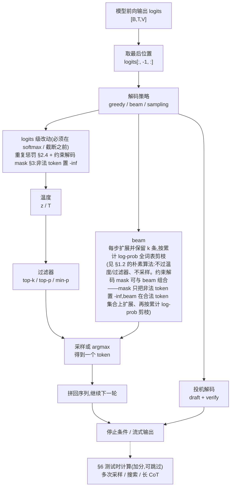
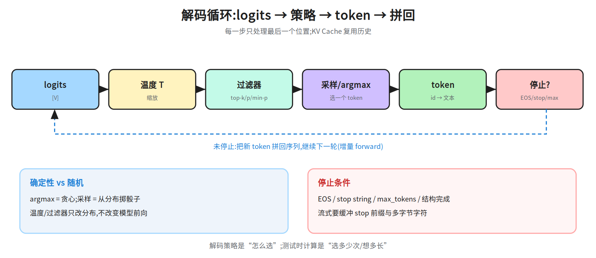
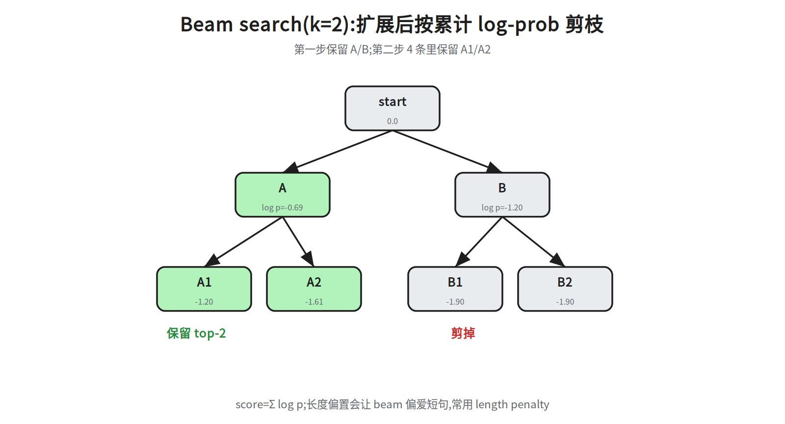
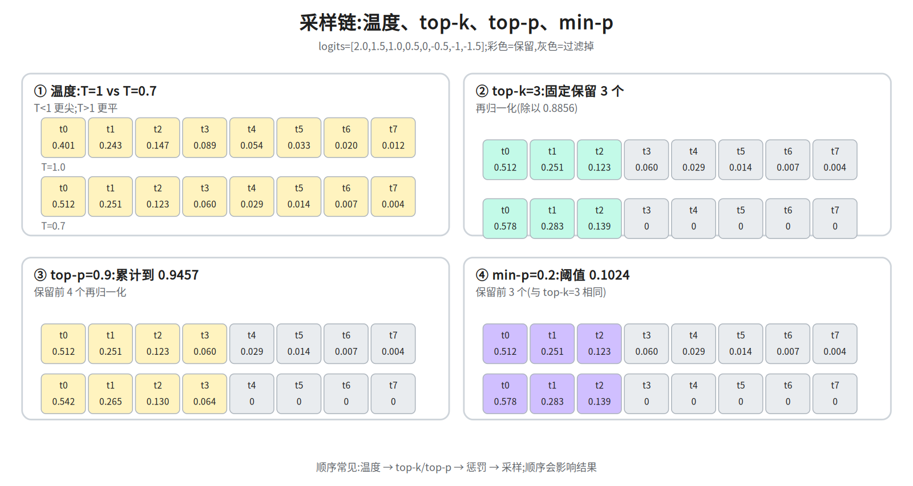
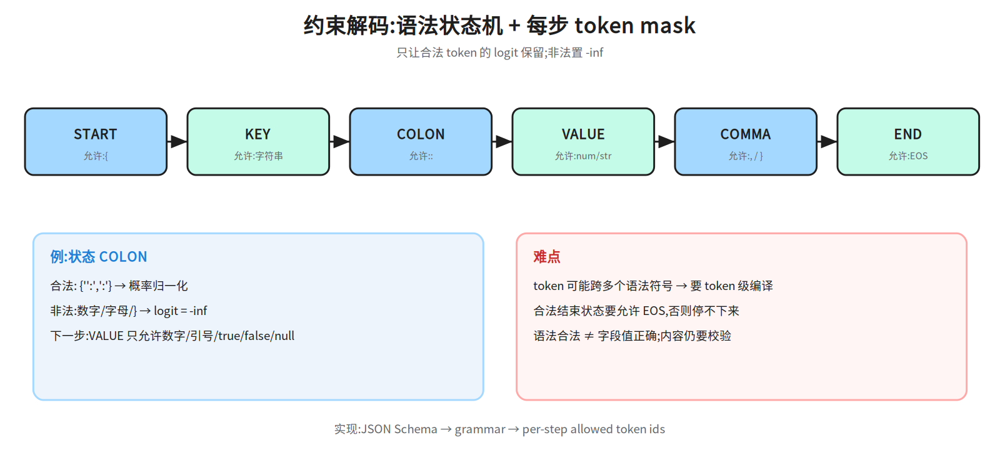

# 第十层 · 解码 —— 从 logits 到 token

> 本层回答:模型每一步输出一个 `[vocab]` 的打分,怎么把它变成一个 token?贪心、beam、温度、top-k/top-p/min-p、约束解码、投机解码各自在做什么、什么时候会坑?

> **前置(按节)**
> - §1–§2:先看 `notes/06_inference.md §4`(前向输出 logits)与 `notes/02_attention.md §5`(softmax)。
> - §3 约束解码:只需理解“在 logits 上加 mask”。
> - §4:不需要额外前置(用 §1–§2 的 logits/采样即可);§5:系统实现可另看 AI Infra `notes/22_inference_systems.md §9`,但本层 §5 已自带接受/拒绝与无损性推导,不读也不影响;只需确认「因果掩码下每个位置只能看到它之前的 token」——目标模型一次前向并行验证 k 个位置靠的就是这一点。`notes/06_inference.md §3`(KV Cache / prefill-decode)属系统实现,读 §4–§5 不必先补。
> - §6 测试时计算:可先跳过,接 `notes/13_reasoning.md`。
>
> **建议路径(2 次 × 45 分钟)**
> - 第 1 次(必学):§1 贪心/beam + §2 采样(图 40a–40c,数值链 40b)。
> - 第 2 次(必学):§3 约束解码 + §4 stop/流式;加分:§5 投机解码、§6 测试时计算边界。
>
> 说明:投机解码的系统实现(草稿模型、KV 管理、调度)在 AI Infra `notes/22_inference_systems.md §9` 与图 `20q_spec_verify`;本层只讲模型侧的接受/拒绝逻辑,不重复画系统图。

## 0. 依赖图(学习顺序)
读图前先约定记号:`B` 是 batch 维(一次并行处理几条序列),`T` 是序列维(这次前向输入了多少个位置),`V` 是词表大小,所以 logits 形状为 `[B,T,V]`。之所以有 `T`:§1 起默认已经做过一次 prompt 前向(prefill)——整段 prompt(长度 T)一次进模型,**每个位置**都算出了「下一个 token」的打分;而逐 token 生成本身每步只要新 token 前一位的那片打分,即 `logits[:, -1, :]`(取每条序列的最后一个位置),形状 `[B,V]`,§1.1 的 argmax 就是作用在这个 `[V]` 向量上。之后每轮把新 token 拼到末尾、只前向新增位置(T 变 1),所以「取最后位置」始终成立。本层不依赖 prefill/decode 的系统细节,记住「打分张量有 batch 和位置两维、只取最后位置那一片」即可。
> **⚠ `T` 在本层有两义,别串**:记号里的 `T` 是**序列维**(`[B,T,V]`、“T 变 1”);§2 把温度也写作 `T`(`z/T`、`p_i(T)`、“温度 T=1.0”、依赖图里那个 id 为 `T`、标注“温度 z / T”的节点)。两者同名不同义,别把“logits 除以温度 T”读成“按序列长度缩放”。读 §2 时把温度当成一个标量即可;若要彻底区分,可把温度写成 `τ`(即 `z/τ`),本层为照顾常见写法仍用 `T`:凡 §2 出现的 `T` 一律指温度,凡形状/位置语境里的 `T` 一律指序列维。



## 1. 贪心与 beam:确定性解码



### 1.1 贪心(greedy)

每一步取概率最大的 token(softmax 单调保序,所以 `argmax logits` 与 `argmax p` 等价;§2.2 的 top-k 在 `p` 上排序只是换了坐标系,不是两套口径):

```
x_t = argmax_v logits[v]
```

优点:简单、确定、快;缺点:**局部最优 ≠ 全局最优**。一步选错,后面无法回头;开放式生成容易重复、平淡。

### 1.2 Beam search

维护 `k` 条候选序列(beam width),每步把每条候选扩展到所有 token,保留总分最高的 `k` 条:

```
score(y_1..y_t) = Σ_{i=1}^{t} log p(y_i | y_<i)
```



图里 `k=2`:第一步保留 A(log p=-0.69)、B(log p=-1.20);第二步扩展出 6 条(2 条候选 × 3 个 token),图中只画前 2 个共 4 条,按累计 log-prob 保留前 2 条(A1=-1.20、A2=-1.61),B 分支被剪掉。文中若写概率,一律由 `exp(log p)` 换算:第一步 A=exp(-0.69)≈0.50、B=exp(-1.20)≈0.30;第二步 A1=exp(-1.20)≈0.30、A2=exp(-1.61)≈0.20(0.20 属第二步,不是第一步 B 的概率)。另:这组 log p 是两位小数的示意值,只保证排序;概率本身是归一化的,`0.50+0.30=0.80` 只说明第一步只列了前 2 个候选,漏掉的第三个 token 占 `1-0.5016-0.3012≈0.197`(log p≈-1.62),补上就回到 1.00,不能据此说“没做归一化”。要看完整的归一化数值链请用 §2.3。
补全第二步的 4 条(这个玩具例子词表只有 3 个 token——第一步 3 个候选剪成 2 条、第二步每条候选有 3 个扩展,这里只列前 2 个,所以 `2 条候选 × 2 = 4`,与 §2.3 的 `V=8` 不是同一个例子):A1=-1.20、A2=-1.61、B1=-1.74、B2=-2.10;排序后保留 A1、A2,要求 B1/B2 都低于 -1.61,B 分支才会被剪掉。A1 的 -1.20 与第一步 B 的 -1.20 只是数值巧合,不是笔误。
补上第二步的分支增量 log p(第一步累计 + 增量 = 第二步累计):A 分支 -0.51→A1、-0.92→A2,B 分支 -0.54→B1、-0.90→B2,即 -0.69-0.51=-1.20、-0.69-0.92=-1.61、-1.20-0.54=-1.74、-1.20-0.90=-2.10(每组只列前 2 个扩展、第三个扩展吃掉剩余概率:A 组 exp(-0.51)+exp(-0.92)=0.99901,第三项 0.00099≈exp(-6.92);B 组 exp(-0.54)+exp(-0.90)=0.98932,第三项 0.01068≈exp(-4.54);都为正,归一化成立。这两组增量是先定累计值再反推的,第三项偏小是反推的痕迹,只当示意值用)。图 40c 是示意图,把 B1/B2 一并简标成 -1.90,数值以正文这四个累计值为准:两者都 < -1.61,剪枝结论(留 A1、A2)不变。

**注意**:

- beam 优化的是**序列概率**,适合翻译/摘要等“有标准答案”的任务;开放式对话/写作里,高概率序列往往无聊、重复。
- 长度偏置:log-prob 越乘越小,beam 偏爱短句;常用 **length penalty**(如除以 `((5+|y|)/6)^α`)缓解。

> 本处的 `α` 是长度惩罚指数(常取 0.6–1.0),与 §2.4 频率惩罚的系数 `α`、§5 的接受率 `α` 同名不同义,不要互相代入。
- `k` 越大越贵,且收益递减;很多产品默认不用 beam。

## 2. 采样:从分布里掷骰子

### 2.1 温度(temperature)

对 logits 除以温度 `T`,再 softmax:

```
p_i(T) = exp(z_i / T) / Σ_j exp(z_j / T)
```

- `T < 1`:分布更尖,更确定、更保守;
- `T > 1`:分布更平,更多样、更容易跑偏;
- `T → 0`:退化成 argmax(greedy)。

### 2.2 top-k / top-p / min-p

| 方法 | 做法 | 特点 |
|---|---|---|
| **top-k** | 只保留概率最高的 `k` 个 token,重新归一化 | 简单;`k` 固定,不随分布形状自适应 |
| **top-p**(nucleus) | 按概率从高到低累加,保留累计 ≥ `p` 的最小集合 | 自适应:分布尖时保留少,分布平时保留多 |
| **min-p** | 保留概率 ≥ `min_p × p_max` 的 token | 以最大概率为锚,分布越尖阈值越高 |
| **typical** | 保留“信息量接近期望”的 token | 降低重复/平庸,但实现与调参更复杂 |
| **contrastive search**(不是 contrastive decoding) | 对与上下文表示过于相似的 token 施加退化惩罚(Su et al. 2022) | 减少重复,计算更贵 |


> 两行的可执行口径(存在才能算,不存在只是名词):**typical**(locally typical sampling)以信息量 `-log p_i` 与分布熵 `H = -Σ_i p_i log p_i` 的差为判据,保留 `|-log p_i - H|` 最小的 token,直到累计概率达到给定质量(或到固定个数);**contrastive**(准确说是 contrastive **search** 的 degeneration penalty)先按 top-k 取候选集 `V_k`(截断在前、不做采样),再在 `V_k` 上取 `argmax_v [(1-α)·p(v|ctx) − α·max_j cos(h_v, h_j)]`,带 `(1-α)` 的是概率项 `p(v|ctx)`,退化惩罚项自己的系数是 `α`(不是 `(1-α)`),没有 top-p;别和 contrastive **decoding**(Li et al. 2023:把 amateur 模型的 log-prob 从 expert 里减掉)混为一谈,两者只是名字像、机制不同。
`h_v`/`h_j` 的取法(这一项不写清就没法复现):`h_v` 是候选 token v 在**最后一层**的隐状态(把每个候选 v 接到当前序列末尾再前向一次、取这个新增位置在**最后一层**的输出 `h_v ∈ R^{d_model}`,工程上把 k 个候选并成一个 batch 做这一次前向;不是 `lm_head` 输出里 token v 那一行 `[V]` 打分,也不是词嵌入矩阵的行),`h_j` 是上下文里已存在位置 j 的**最后一层**隐状态;`j` 取**完整上下文**(prompt + 已生成部分,不设滑窗,论文 Su et al. 2022 就是对全部位置取最大余弦)。换实现只要保证 h 在同一表示空间即可,但写报告时必须注明“隐状态还是词嵌入”和“j 的范围”,否则这个惩罚项算不出来。面试只问 top-k/top-p/min-p,这两行记住判据是“熵差/相似度惩罚”即可。

### 2.3 数值链:同一组 logits 过不同过滤器



取 `V=8`,原始 logits:

```
z = [2.0, 1.5, 1.0, 0.5, 0.0, -0.5, -1.0, -1.5]
```

**① 温度 `T=1.0`(此处的 `T` 是温度,不是序列维,见 §0 警告)的 softmax**:

```
p = [0.4008, 0.2431, 0.1474, 0.0894, 0.0542, 0.0329, 0.0200, 0.0121]
```

**② 温度 `T=0.7`**:先算 `z/0.7`,再 softmax:

```
z/0.7 = [2.857, 2.143, 1.429, 0.714, 0, -0.714, -1.429, -2.143]
p(0.7) = [0.5121, 0.2507, 0.1227, 0.0601, 0.0294, 0.0144, 0.0070, 0.0035]
```

**③ top-k=3**:保留前 3 个,其余置 0,再归一化(除以 0.8856):

> 基准:`③④⑤` 全部接在 **② 的 `p(0.7)`** 上算(分母 0.8856 就是 `p(0.7)` 前 3 项之和),不是从 ① 的 `p` 续算。若误用 ① 复算,会得到 top-3 和 0.7913、top-p 第 5 个才到 0.935(打印值相加 0.9349,未舍入值 0.9350)、min-p 阈值 0.0802,与下面的数字都对不上——那是基准不同,不是算错。
另:`p(0.7)` 只打印 4 位、但正文的 `cum` 与 `Σ` 是用未舍入值相加的,所以拿打印值手加会差 1e-4(0.5121+0.2507=0.7628 vs 0.7629;前三项 0.8855 vs 0.8856),这不是算错。


```
keep = {0,1,2};Σ = 0.88560(即 0.5121+0.2507+0.1227;按打印值手加为 0.8855,1e-4 是舍入);归一化统一除以 0.88560
p_top3 = [0.5783, 0.2831, 0.1386, 0, 0, 0, 0, 0]
```

**④ top-p=0.9**:按概率累加,到第 4 个才 ≥0.9(0.9457),所以保留前 4 个,再归一化:

```
cum = [0.5121, 0.7629, 0.8856, 0.9457, ...]
p_topp = [0.5416, 0.2651, 0.1298, 0.0635, 0, 0, 0, 0]
```

**⑤ min-p=0.2**:阈值 `0.2 × 0.5121 = 0.1024`;概率 ≥0.1024 的只有前 3 个,结果与 top-k=3 相同:

```
p_minp = [0.5783, 0.2831, 0.1386, 0, 0, 0, 0, 0]
```

> 结论:**温度改形状,过滤器改支撑集**。top-k 固定数量;top-p/min-p 随分布自适应。实际常组合使用,但顺序会影响结果(常见:先惩罚 → 再温度 → 再 top-k/top-p → 采样(与 §0 依赖图的 P→T→D 一致)。惩罚必须作用在 logits 上、softmax 与截断之前;top-p 之后其余概率已置 0 并重归一化,再乘 `r` 或减 `α·count` 都救不回来。§2.5 的代码只演示截断链,不含惩罚步骤)。

### 2.4 重复惩罚

对**已经出现过的 token** 的 logit 做惩罚:

> 本节 `α` 是频率惩罚系数(常取 0.05–0.2)、`β` 是存在惩罚系数,与 §1.2 长度惩罚的指数、§5 的接受率无关。

```
重复惩罚:z_i' = z_i / r   (z_i > 0)
          z_i' = z_i × r   (z_i < 0)     r > 1
频率惩罚:z_i' = z_i - α × count(i)
存在惩罚:z_i' = z_i - β × 1[i 已出现]
```

重复惩罚太强会伤害正常重复(数字、代码括号、专有名词);通常从 1.05–1.2 这种小值调起。
`count(i)` 和 `1[i 已出现]` 的统计范围必须先说清(同一 token 在 prompt 里出现 3 次,计不计数就差 3α):默认口径是**整段已进入模型的序列**——prompt + 本轮已生成,不做滑动窗口。不同实现并不一致:HF 的 `repetition_penalty` 按输入 `input_ids`(含 prompt + 已生成)计数,部分 API 的 `frequency_penalty` 只统计已生成部分;跨实现复算对不上,先查这两项(含不含 prompt、有没有滑窗)。

### 2.5 采样代码


> 口径说明:下面这段是**串联管线**(温度 → top-k → top-p → min-p 依次作用),与 §2.3 `①—⑤` 的**并列演示**(同一组 logits 分别过单个过滤器)不是同一个口径。用 §2.3 的 logits 跑这条链只剩 3 个 token(0.5783/0.2831/0.1386),和 ④ 单独用 top-p 保留 4 个对不上属正常,不是哪边算错。


```python
import torch, torch.nn.functional as F

def sample_next(logits, temperature=0.7, top_k=3, top_p=0.9, min_p=0.2):
    # logits: [V]
    z = logits / temperature
    p = F.softmax(z, dim=-1)

    if top_k:
        kth = torch.topk(p, top_k).values[-1]
        p = torch.where(p < kth, torch.zeros_like(p), p)

    if top_p:
        sorted_p, idx = torch.sort(p, descending=True)
        cum = torch.cumsum(sorted_p, dim=-1)
        keep = cum - sorted_p < top_p          # 保留累计到 p 之前的部分
        mask = torch.zeros_like(p, dtype=torch.bool)
        mask[idx[keep]] = True
        p = torch.where(mask, p, torch.zeros_like(p))

    if min_p:
        p = torch.where(p < min_p * p.max(), torch.zeros_like(p), p)

    p = p / p.sum()
    return torch.multinomial(p, 1).item(), p
```

> 代码里的 top-p 保留“累计概率首次 ≥ p”的最小集合;不同实现的边界处理略有差异,报告时要写清。

## 3. 约束解码:只让合法 token 出现

### 3.1 问题

要模型输出 JSON、SQL、正则语言或函数参数时,自由采样会生成非法结构(缺引号、括号不配对)。**约束解码**在每一步把不合法 token 的 logit 置 `-inf`,只在合法集合里采样。

### 3.2 JSON Schema / grammar 的有限状态机



以 `{"name": "Ada", "age": 36}` 为例,状态机(FSM,有限状态机):

```
START --"{"--> EXPECT_KEY --string--> EXPECT_COLON --":"--> EXPECT_VALUE
EXPECT_VALUE --number/string/true/false/null--> EXPECT_COMMA_OR_END
EXPECT_COMMA_OR_END --","--> EXPECT_KEY
EXPECT_COMMA_OR_END --"}"--> END
```

在 `EXPECT_COLON` 状态,只允许 `:`;在 `EXPECT_VALUE`,只允许合法字面量/数字/字符串的起始 token。
这段 FSM 是**最小示意**:为省篇幅略去了字符串内部的闭合引号、空白字符、嵌套对象/数组的状态,key 的引号与内容也压成了 `EXPECT_KEY --string-->` 一步。自己实现(动手清单 2)时这些必须补全,或直接用 Outlines / JSON Schema 编译出完整语法,别把这几行当模板照抄。实现上:

```python
allowed = grammar.allowed_token_ids(state)      # 由 FSM/语法编译得到
mask = torch.full_like(logits, float("-inf"))
mask[allowed] = 0
logits = logits + mask
next_id = torch.multinomial(F.softmax(logits, -1), 1)
state = grammar.step(state, next_id)
```

**难点**:

- **token 与字符不一一对应**:一个 token 可能跨多个语法符号,需要“token 级”编译语法,不能只看下一个字符。
- **强制终止**:要允许 EOS 在合法结束状态出现,否则模型停不下来。
- **性能**:每步做 mask 有开销;常用预编译的 token mask / FSM 缓存。
- **不是语义正确**:语法合法不代表字段值正确;约束解码只保证“结构”,不保证“内容”。
> **与 §2 串联时的唯一口径**(上面那段代码是**独立最小实现**,只演示 `mask → softmax → multinomial`):约束 mask 是 logits 级操作、属于 §0 的 P 节点,和 §2 组合时按 **惩罚 → 约束 mask → 温度 → top-k/top-p/min-p → 采样** 的固定顺序;也就是说约束解码之后**仍然可以**再过温度与过滤器,只是 mask 必须在 softmax 和任何截断之前完成。三条可算的结论:
> - `-inf / T` 仍是 `-inf`,mask 与温度**可交换**,谁先都行,但都要在 softmax/截断前。
> - 乘性重复惩罚 `z/r`(正数除、负数乘)与 `z/T` **可交换**,结果都是 `z/(rT)`;真正**不可交换**的是加法惩罚:`(z - α·count)/T ≠ z/T - α·count`(后者等价于系数变成 `αT`)。例:`α=0.1、count=3、T=0.7`,先惩再除温度扣 `0.4286`,先除温度再惩只扣 `0.3`。
> - §2.3 的数值链与 §2.5 的 `sample_next` 都**不含**惩罚步骤,要验证「顺序影响结果」得在 §2.5 里自己插一步惩罚再跑;§0 的 P→T→D 是口径约定,不是这两处代码已经算过的事实。

### 3.3 结构化输出的工程做法

- 用 JSON Schema 生成 grammar(vLLM guided decoding、Outlines、llama.cpp GBNF 等)。
- 给模型明确的 schema 与示例;约束解码是“兜底”,不是替代 prompt。
- 失败重试:解析失败时把错误信息喂回模型,而不是静默返回非法 JSON。
- 对工具调用,参数 schema 要与真实函数签名一致;不要让模型猜字段名。

## 4. 停止条件与流式输出

**停止条件**:

- **EOS token**:模型自己生成结束符;
- **stop strings**:遇到指定字符串(如 `\n\nHuman:`)停止;
- **max_tokens**:硬上限,防止无限生成;
- **结构完成**:JSON 括号闭合、工具参数完整。

注意:stop string 可能在 token 中间出现;流式输出要做“尾部缓冲”,避免把 stop 前缀先吐给用户。

**流式**:每生成一个 token 就增量解码并推送;需要处理多字节字符跨 token 的情况(UTF-8 解码缓冲),否则会出现乱码/半个汉字。

## 5. 投机解码(模型侧)

**思想**:用小/快的 draft 模型先草拟 `k` 个 token,再用目标模型一次前向并行验证;接受则一次前进多个 token,拒绝则从修正分布重采样。

```
draft:  x_1..x_k ~ q(·)
verify: 目标模型 p 并行算这 k 个位置
接受:  以 min(1, p(x_i)/q(x_i)) 的概率接受
拒绝:  从归一化的 max(0, p-q) 分布重采样一个 token
```

期望生成 token 数(含目标模型多采的 1 个)约:

```
E[generated] = (1 - α^{k+1}) / (1 - α)
```

其中 `α` 是接受率。


> 前提:各位置相互独立、第 i 个位置被接受的概率恒为同一 `α`、按最长前缀接受;于是接受长度服从几何分布,`E[generated] = 1 + α + α² + … + α^k = (1-α^{k+1})/(1-α)`,末尾那项 `+1` 与接受长度(几何分布)无关:k 个 draft 全被接受时并没有被拒位置,这 1 个 token 是目标模型在位置 k+1 从 p 采到的新 token;只有发生拒绝时,才从归一化的 `max(0, p-q)` 补采 1 个。`α` 是**逐位置**接受率,不是“整轮全接受的概率”,也不是“被接受 token 的占比”。
收益条件:draft 足够快、接受率高、验证成本可摊销;batch 很大或接受率低时会退化。

**为什么是无损的**:接受概率取 `min(1, p/q)`,被拒绝时从 `max(0, p-q)` 归一化分布补采样;这两步合起来使最终 token 的分布**严格等于目标模型 p**,而不是 draft 的 q。
> **合成推导(面试第 10 题被追问时要能写出来)**:draft 记作 `q`、目标记作 `p`,对任一 token `x`,走到「输出 x」只有两条互斥路径——在 x 上接受,或在别处被拒后从补采样里抽到 x。
> - 接受项:`q(x)·min(1, p(x)/q(x)) = min(p(x), q(x))`。这里必须封顶到 1:`p(x) > q(x)` 时若照 `p/q` 接受,接受概率会大于 1,多出来的质量没有去处。
> - 拒绝总质量:`1 - Σ min(p,q) = Σ max(0, p-q)`(逐点 `min(p,q) + max(0,p-q) = p` 求和移项即得)。
> - 补采样分布:`r(x) = max(0, p-q)(x) / Σ max(0, p-q)`。必须是**先截断再归一化**的 `max(0, p-q)`,不能直接用 `p-q`:`p-q` 有负项且 `Σ(p-q) = 0`,不是分布。
> - 合成:`P(final=x) = min(p,q)(x) + [Σ max(0,p-q)] · r(x) = min(p,q)(x) + max(0,p-q)(x) = p(x)`。
> 所以「无损」是逐点恒等:`min(p,q)` 承担两边都认的质量,`max(0,p-q)` 承担只有目标模型认的质量,相加还原 `p`;draft 的 `q` 只决定一次能前进几个 token,不改变最终分布。greedy 目标下则更简单:draft token 与目标 argmax 相同就接受,否则用目标 argmax。现代变体包括 Medusa(多解码头)、EAGLE(特征级 draft)、self-speculative(跳过部分层)与 n-gram/prompt lookup(检索式 draft);系统图见 `notes/22_inference_systems.md §9` 与 `diagrams/20q_spec_verify.*`。

## 6. 解码 vs 测试时计算

- **解码策略**:在**单次前向的分布**上做选择(贪心/采样/约束);每步只多一次词表级操作、不增加前向次数,计算量基本固定。**beam 是例外**:width=k 时每步要扩展并保留 k 条候选,前向调用次数不变:这 k 条候选通常并成一个 batch 做**一次**前向,k 倍体现在 batch 维与 FLOPs 上(不是每步跑 k 次前向);k 越大越贵(见 §1.2)。
- **测试时计算**:在**多次采样/多步推理/搜索**上花更多算力( self-consistency、best-of-N、树搜索、长 CoT(Chain-of-Thought,思维链));见 `notes/13_reasoning.md`。
  一句话判据:**self-consistency** = 同一 prompt 采 N 条**完整答案**,按答案一致性(多数投票)选,不需要验证器;**best-of-N** = 采 N 条,用**验证器/打分器**选最高分,候选之间不必一致;**树搜索** = 把中间步骤当节点、边扩展边估值剪枝(ToT/MCTS),算力花在中间步;**长 CoT** = 单条链写更长,用推理长度换正确率,不做多候选。验证器从哪来:有标准答案的域用可执行检查(单测、编译器、JSON Schema);没有就用 reward model 或 LLM judge,后者带偏好偏差,只能算近似验证器。
- 两者可以组合:例如先高温采样 N 条,再用验证器选一条;或约束解码 + 多次尝试。

## 7. 面试要点

1. **greedy 和 beam 的区别?** → greedy 每步取最大;beam 保留 k 条候选,优化序列总 log-prob;beam 更适合有标准答案的任务。
2. **温度在做什么?** → logits 除以 T 再 softmax;T<1 更尖,T>1 更平,T→0 退化 greedy。
3. **top-k 和 top-p 的区别?** → top-k 固定保留 k 个;top-p 按累计概率自适应保留;min-p 以最大概率为锚。
4. **top-p 的 p 越大越随机吗?** → 是,保留的集合更大;p=1 等于不截断。
5. **重复惩罚的副作用?** → 伤害合法重复(数字、代码、专名);频率/存在惩罚要小步调。
6. **约束解码怎么实现?** → 语法/FSM 编译出每步合法 token 集合,把非法 logit 置 -inf;难点是 token 跨符号与强制 EOS。
7. **stop string 与 EOS 的区别?** → EOS 是词表特殊 token;stop string 是文本匹配,可能跨 token,流式要缓冲。
8. **投机解码为什么能加速?** → draft 草拟 + 目标模型并行验证;接受率高且 draft 便宜时,一次前向前进多个 token。
9. **解码与测试时计算的区别?** → 前者在单次分布上选,后者用多次采样/搜索/长推理换质量。
10. **投机解码为什么无损?有哪些变体?** → 接受/拒绝构造保持目标分布;greedy 用 argmax 匹配;Medusa/EAGLE/self-speculative/n-gram lookup 是常见变体。

## 常见坑

- 把 temperature 和 top-p 的作用混为一谈:温度改**分布形状**,top-p 改**候选集合**。
- top-p 实现边界写错(保留累计 ≥p 还是 >p),导致复现不了论文数字。
- 约束解码只保证语法,不保证语义;别把“能解析 JSON”当成“字段正确”。
- stop string 没做流式缓冲,把停止前缀吐给用户。
- beam 用在开放式对话,生成无聊/重复;length penalty 没调好会偏爱短句。
- 投机解码在 batch 大、接受率低时不但不加速,还可能变慢。

## 动手清单

1. **采样链复算**:用 §2.3 的 logits,写 Python 复算 T=1/0.7、top-k=3、top-p=0.9、min-p=0.2 的概率;验收:与图/正文一致。
2. **约束解码最小实现**:用 Outlines 或手写 FSM,约束模型输出 `{"name": string, "age": int}`;验收:100 次生成全部可解析。
3. **stop/流式**:实现带 stop string 的流式输出,故意让 stop 跨 token;验收:用户看不到 stop 前缀,中文不乱码。

## 相关图

`40a_decoding_loop` · `40b_sampling_chain` · `40c_beam` · `40d_constrained`
· 投机解码系统图:`20q_spec_verify`(AI Infra)
(均在 `diagrams/`,横竖双版本)

## 下一步

第十一层 · 应用:Prompt/CoT、工具调用、RAG、Agent 循环与 guardrails——把“会生成”变成“会查资料、会用工具、会完成任务”。
