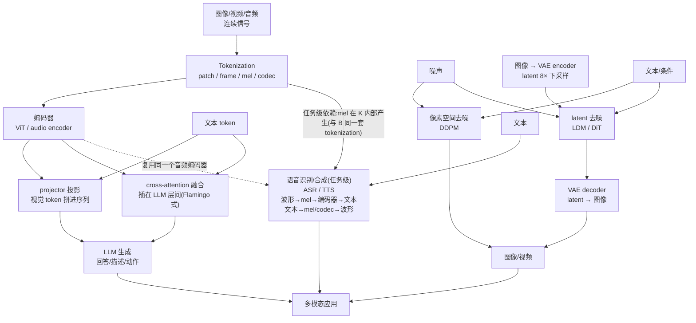
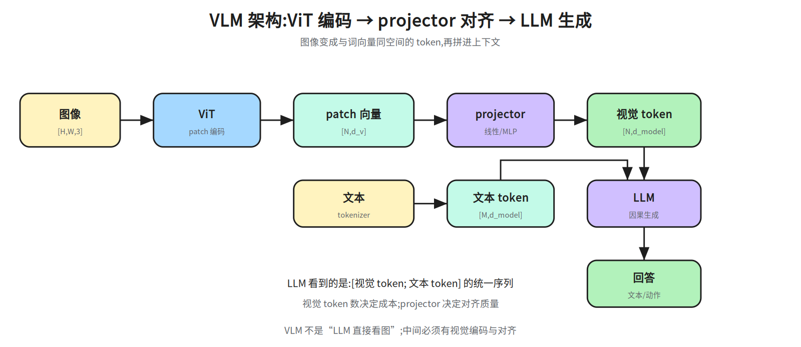
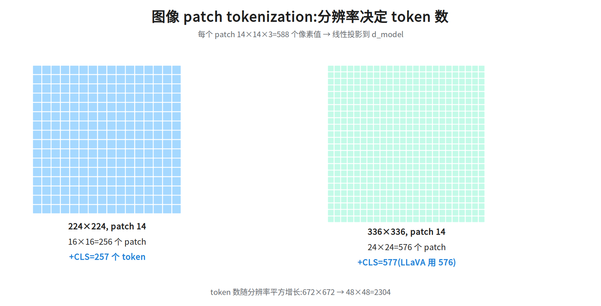
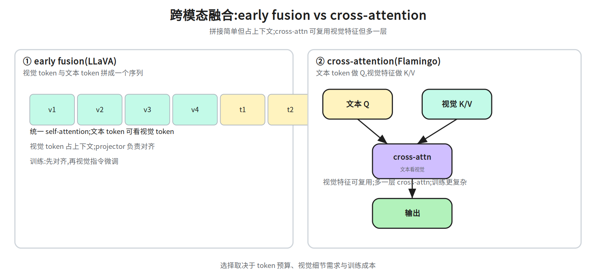
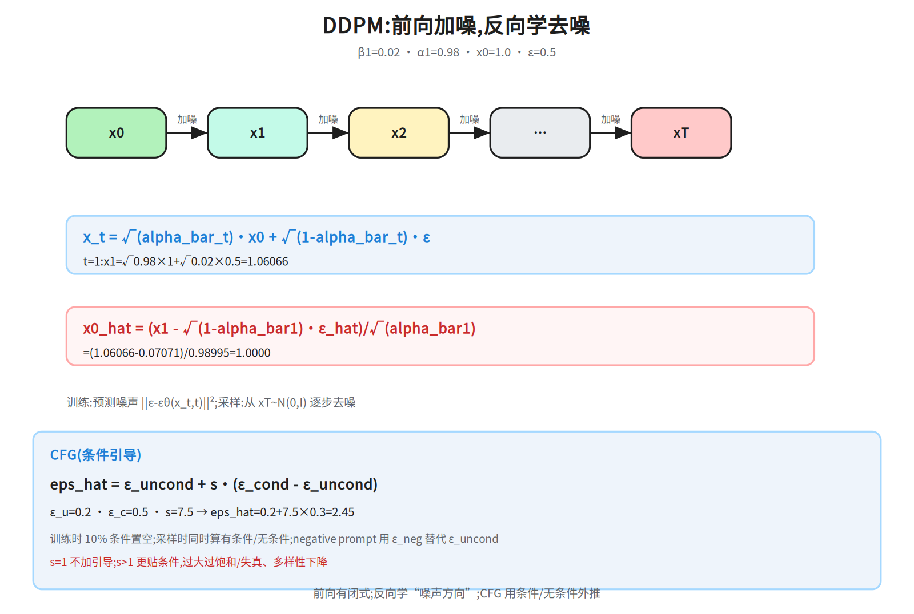
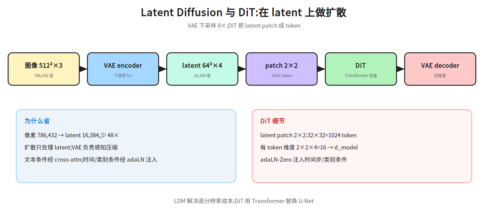
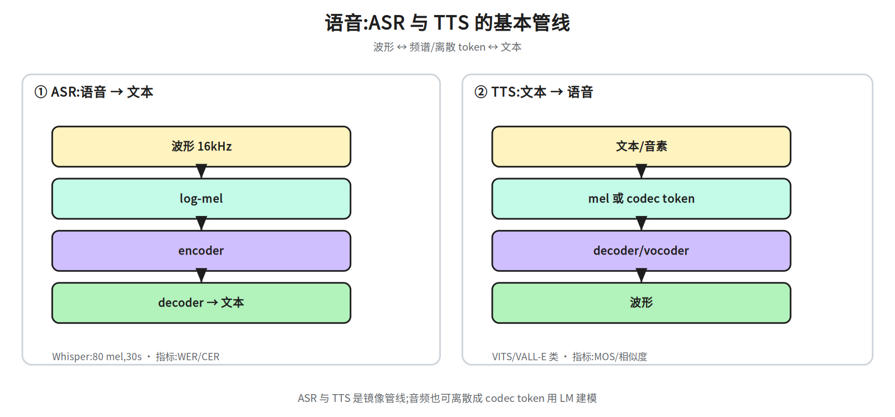

# 第十二层 · 多模态 —— VLM、扩散与语音

> 本层回答:图像/视频/音频怎么变成模型能吃的 token?VLM 的视觉编码器与 LLM 怎么接?扩散模型怎么从噪声生成图像?ASR/TTS 的管线长什么样?

> **前置(按节)**
> - §1–§3:先看 `notes/02_attention.md`(attention)与 `notes/06_inference.md §4`(LLM forward)。
> - §4 扩散:需要正态分布、平方根;§4.2 的系数还要一步条件高斯(后验均值 + 配方),不熟就照 §4.2 那两行自己推一遍、再往下读(正文的推导链从后验均值一直给到「把 x_0 的估计代入、合并 x_t 项得递推式」;μ̃_t 里 √alpha_bar_{t-1}β_t/(1-alpha_bar_t) 与 √alpha_t(1-alpha_bar_{t-1})/(1-alpha_bar_t) 两个系数在 §4.2 已展开:①两个高斯相乘、精度相加、均值按精度加权;②分母统一成 1-alpha_bar_t 乘开,即得这两个系数;想先记结论跳过也能接上)。
> - §5 LDM/DiT:先看 §4;§4.4 会用「骨干/中间层」指去噪网络本身,读 §4.4 不必提前扫:§4.4 正文里已内联了一段等价的 U-Net 说明;§5.1 末尾另有一整段 U-Net 补注(不是「5 行」),位置在 §4.4 **之后**;它与 §4.4 的内联版**不完全等价**:内联版多了 attn2 的 Q/K/V 方向,§5.1 版多讲了卷积感受野与「DiT 换掉了什么」,所以不能真按「读其一即可」——赶时间读 §4.4 内联版就够本节,§5.2 做对比时再看 §5.1 那段;§6 语音:只需了解频谱/波形。
>
> **建议路径(2 次 × 45 分钟)**
> - 第 1 次(必学):§1 VLM 架构 + §2 tokenization(图 42a/42b;42c 属 §3,第 2 次再看)。
> - 第 2 次(必学):§3 跨模态融合 + §4 DDPM 数值链(42d);加分:§5 LDM/DiT、§6 语音、§7 评测与安全(42e/42f)。

## 0. 依赖图(数据流,阅读顺序见上方「建议路径」)

> 先说明:图中的箭头是**数据流**,不是正文的阅读顺序。正文先 §1 讲编码器整体(ViT → projector → LLM),再在 §2 拆开讲切块与投影;同一件事在图里是 B→C 两个节点、在正文里是 §1.1 的第 1 步 + §2.1,所以 §2.1 的补注回指 §1.1 是正常的:patch 向量由 §1.1 的 ViT 产出,§2.1 讲的只是「切块 + 线性投影」那一步。
音频同理:图中 K 节点文字里的「编码器」就是 C 这个音频编码器,所以只画一条 C⇢K 的复用虚线,不再单列 C2;另外要分清层级:K 是任务级节点(一条完整管线:波形→mel→编码器→文本),C/D/F 是阶段级节点,而 L 才是应用层,K 与 L 不在同一层。



## 1. VLM 架构:ViT + projector + LLM

### 1.1 三段式



1. **视觉编码器**:通常是 ViT(Vision Transformer;或 CLIP/SigLIP 的 ViT),把图像切成 patch,输出每个 patch 的向量。

   > 碰到 CLIP/SigLIP 只需记结论:它们的输出落在自己的图文联合空间,**不是** LLM 的词嵌入空间,所以「CLIP 的输出能直接喂 LLM」是错的,必须有 projector——这正是第 2 步和「对齐预训练」要解决的事;CLIP/SigLIP 的定义与 NaViT 一并放在 §1.2 后的「这几个名字补一句」,这里不重复。
2. **投影器(projector)**:把视觉向量映射到 LLM 的词嵌入空间;可以是线性层、2 层 MLP、Q-Former/Perceiver Resampler(用少量 query 从视觉特征抽取信息)。
3. **LLM**:把“视觉 token + 文本 token”拼成一个序列,一起做因果生成。

```
图像 [H,W,3] → ViT → patch 向量 [N, d_v] → projector → 视觉 token [N, d_model]
文本 → tokenizer → 文本 token [M, d_model]
拼接: [视觉 token; 文本 token] → LLM → 回答
```

**训练通常分两阶段**:

- **对齐预训练**:冻结 LLM(或只训 projector),用图文对教“视觉 token 与词空间对齐”;
- **指令微调**:解冻 LLM(或 LoRA,低秩适配:冻结底座权重,只训练低秩矩阵 A、B,用 A·B 加到原权重上),用视觉问答/对话数据教“看图回答”。

### 1.2 LLaVA-1.5 的关键数字(原版 LLaVA 是 224 输入→256 token、projector 为单层线性)

- 视觉编码器:CLIP ViT-L/14-336;
- 输入 336×336, patch 14×14 → `24×24=576` 个视觉 token;
- projector:LLaVA-1.5 用 2 层 MLP;
- LLM:Vicuna/LLaMA 系;
- 训练:先图文对齐,再视觉指令微调(具体数据量随版本变化,引用时以官方仓库为准)。


**这几个名字补一句**:CLIP 是用数亿级图文对做图文对比对齐(contrastive)预训练出来的模型——配对的图与文在向量空间里被拉近、不配对的被推远,所以它的视觉编码器输出落在 CLIP 自己的图文联合空间(图像↔CLIP 文本编码器)里,但**并不是** LLM 的词嵌入空间;SigLIP 是同一思路换成 sigmoid 损失的变体;NaViT 是原生支持可变分辨率与 token packing 的 ViT。
**token packing** 顺手解释:把一个 batch 内长度/分辨率不同的样本 token 首尾拼进同一条长序列,靠 attention mask 互相隔离(位置编码不必重置:NaViT 用 factorized/分数位置编码区分不同样本,「重置位置编码」是文本序列 packing 的做法,别当成 token packing 的统一机制),省掉 padding 到批内最长样本的算力浪费,GPU 利用率更高;所以别把它记成「没有 token packing」:Qwen2-VL 原报告 §2.1 明写 inference 阶段把不同分辨率的图像 packed into a single sequence、并用 packed length 控制显存,它能吃任意分辨率靠的正是这种跨样本 packing,而不是补齐到批内等长。§7.1 的 CLIPScore 就是拿 CLIP 算图与文的相似度;§1.1 的「对齐预训练」是训练 projector 做**跨空间搬运**:把 CLIP 视觉特征从 CLIP 的图文联合空间(不是另一个「CLIP 文本空间」)搬到 LLM 的词嵌入空间(LLaVA 必须有 projector 就是因为这一步);它对的是 LLM 的词表,与 CLIP 的图文联合空间不是同一个空间。

> 面试口径:**VLM 不是“把图像塞进 LLM”,而是“把图像编码成与词向量同空间的 token,再拼进上下文”**;projector 决定对齐质量,视觉 token 数决定成本。

**现代变体(面试加分)**:模块化 VLM(LLaVA/Flamingo)之外,还有

- **native multimodal**:从预训练起就把视觉离散 token 与文本 token 放在同一个 Transformer 里(Chameleon 类),或直接吃 patch(Fuyu);两者能力边界不同:Chameleon 类统一理解/生成,Fuyu 只做理解(patch 直接进 decoder-only Transformer、只输出文本,不能生成图像);共同点是训练与数据要求都高。
- **任意分辨率/动态切图**:Qwen2-VL 类用 naive dynamic resolution(思路接近 NaViT,同样做 token packing):先按 14×14 patch 切分,再把相邻 2×2 个 patch 合并成 1 个视觉 token(等效 28×28 像素/token),并保留位置;避免固定 336 拉伸导致小字/文档细节丢失,代价是 token 数可变、批处理更复杂。
- **统一理解与生成**:Janus 类把“理解用视觉特征、生成用离散 token”解耦到两条路径,减少任务冲突。

## 2. Tokenization:图像、视频、音频

### 2.1 图像 patch



ViT 的标准做法:

```
图像 224×224, patch 14×14
→ 网格 224/14 = 16 × 16 = 256 个 patch
→ 加 [CLS] = 257 个 token
每个 patch:14×14×3 = 588 个像素值 → 线性投影到 ViT 宽度 d_v(如 1024)
  注意:这个 1024 是 d_v(编码器宽度),不是 LLM 的 d_model;projector 才做 d_v → d_model(LLaVA-1.5 是 1024→4096,这里的 4096 是 Vicuna-7B 的 d_model;换 13B 就是 5120)
```

若输入 336×336:网格 `24×24=576` 个 patch(LLaVA-1.5 用这个分辨率;原版 LLaVA 是 224 输入 → 256 token,别把 336/576 记成所有 LLaVA 的数字)。


**管线还有两步没画出来**(面试常追问):① 位置:patch 序列要先加位置编码,否则 self-attention 是置换不变的,patch 不知道自己在上半张还是下半张图;ViT 用**可学习**的一维位置向量(按 patch 序号逐元素相加);它和文本常用的正弦位置编码不是一套:正弦式频率固定、不参与训练、换长度可按公式直接算,而 ViT 这套向量是学出来的参数、个数跟训练时的 patch 数绑定,所以换分辨率时通常要把旧向量插值到新网格(「通常插值」就是这么来的)。② 上下文:这串 patch 向量要过若干层 Transformer encoder(self-attention + MLP),每个 patch 才能“看到”其它 patch;接 LLM 的 VLM 里,这层编码器就是 §1.1 的 ViT/CLIP 视觉编码器,输出 [N, d_v] 才交给 projector。所以上面四行只是「切块 + 投影」,编码与位置在编码器这一层完成。


**[CLS] 口径统一说明**:[CLS] 是 ViT 在 patch 序列最前面额外加的一个可学习向量(不是 patch,不含图像内容),分类头用它汇总整图信息。接 LLM 的 VLM(LLaVA 系)一般不加 [CLS],只用 patch token,所以 336→576、§2.3 的 16 帧→9216 都是「不含 CLS」的口径;§2.1 的 224→256 再加 1 = 257 是「ViT 分类」口径。两种口径不要混算。**token 数随分辨率平方增长**:672×672 → 48×48=2304 个 token,上下文和计算都会涨。

### 2.2 连续 token vs 离散 token

- **连续 patch 向量**(ViT):保留细节,直接进 LLM;token 数多。
- **离散视觉 token**(VQ-VAE/VQGAN,向量量化自编码器/生成器):把 patch 量化到 codebook(如 1024/16384 个码字),变成“视觉词”;可用自回归生成,但量化有信息损失。
- **压缩/重采样**:Q-Former、Perceiver Resampler 把 N 个 patch 压成少量 query token(如 32/64 个),降低 LLM 上下文成本,但会丢细节。

### 2.3 视频 token

视频 = 多帧图像 + 时间。常见做法:

- 均匀采样 `F` 帧(如 8/16/32),每帧过 ViT → `F × N` 个 token;
- 加时间位置编码/时间 embedding;
- 或先做时空 patch(3D tubelet),一次编码;
- 长视频要分层/稀疏采样,否则 token 爆炸。**算例**:336×336 输入、每帧 576 token,采 16 帧就是 `16×576=9216` 个视觉 token;32 帧翻倍。先估 token 预算,再定帧数与分辨率。

### 2.4 音频 token

- **波形 → 频谱**:用 log-mel spectrogram(Whisper 用 80 个 mel bin,30 秒窗口;large-v3 用 128)。


**STFT 与功率谱是两个词,先定义**(下面把 mel 矩阵的尺寸复算清楚,靠的就是这两步;同段用到的 mel 滤波器组与「取 log」两个运算,定义紧接在本段之后——先按「压成 80 个 bin」「压动态范围」读过去,下一段再交代为什么):STFT(短时傅里叶变换)= 对每一帧 400 个采样点先乘窗函数、再做 FFT,得到这一帧的频域复数(每个频点一个 a+bi,幅值 √(a²+b²)、相位 atan2(b,a));功率谱 = 复数取模平方 |a+bi|² = a²+b²,即丢掉相位、只留每个频点的能量。16 kHz 采样下 400 点 FFT 给出 201 个频点(0~8 kHz,间隔 40 Hz),所以 30 s 音频的功率谱是 [201, 3000];再乘 80×201 的 mel 滤波器组压成 [80, 3000],最后取 log。

  mel 是模拟人耳听感知的频率刻度:低频按线性、高频按对数压缩(1 kHz 附近的变化比 8 kHz 附近更容易听出来),把 Hz 轴重新分箱成 80 个 mel bin;取 log 是压动态范围(响度感知近似对数),同时把乘性的音量增益变成加性的偏移,输入尺度更稳。具体怎么得到 [80, 3000]:16 kHz 波形按 25 ms 窗(400 个采样点)、10 ms 移(160 点)切帧;30 s = 480000 点,按上面的窗长/帧移直接切:帧数 = 1+⌊(480000-400)/160⌋ = 2998,少 2 帧;Whisper 是在 STFT 阶段做 center padding(首尾各补 n_fft/2 = 200 点,共 480400 点),帧数变成 1+⌊(480400-400)/160⌋ = 3001,再丢掉最后一帧,才是 3000 帧;每帧做 STFT 取功率谱,再乘 80 个 mel 滤波器并取 log,就得到 [80, 3000] 的矩阵(mel bin × 时间帧),这就是 Whisper 的输入;large-v3 只是把 bin 数换成 128。
- **离散 codec token**:EnCodec/SoundStream 把音频压成码本索引,可像文本一样自回归建模。
- **ASR/TTS** 见 §6。

## 3. 跨模态融合:拼 token 还是 cross-attention



| 方式 | 做法 | 代表 | 特点 |
|---|---|---|---|
| **Early fusion(拼接)** | 视觉 token 与文本 token 拼成一个序列,统一 self-attention | LLaVA | 简单;视觉 token 占上下文;图文对齐靠 projector |
| **Cross-attention** | 文本 token 做 query,视觉特征做 K/V | Flamingo | 视觉特征可复用;需要额外 cross-attn 层;训练更复杂 |
| **Adapter/Resampler(压缩器,不是独立的第三类融合)** | 两种不同机制:**Resampler** 用少量 query 从视觉特征“抽取”信息(Q-Former/Perceiver),压完仍是**拼进序列**,融合方式上归 early fusion 那一行(它只省 token、不改融合类型;§1.1 把它列为 projector、§2.2 列为压缩器,是同一模块的两个视角);**Adapter** 在 LLM 层间插瓶颈 MLP(先降维再升维)做微调,不涉及 query(代表是 Houlsby 式 Adapter) | Q-Former / Perceiver;瓶颈 Adapter(Houlsby 式) | Resampler 压缩 token、可能丢细节;Adapter 只加少量参数、不压 token(同名的 LLaMA-Adapter 不是这一格:它用零初始化门控的旁路 attention + 可学习 prefix,没有降维-升维瓶颈,也不压 token) |

**因果 mask 的细节**:拼接后,文本 token 通常可以看全部视觉 token(视觉在前),视觉 token 之间是否互相看取决于实现;要保证训练/推理一致。

## 4. 扩散基础:DDPM(Denoising Diffusion Probabilistic Models)

### 4.1 前向:逐步加噪

给定真实图像 `x_0`,每一步加少量高斯噪声:

```
q(x_t | x_{t-1}) = N( √(1-β_t) · x_{t-1},  β_t · I )
```

其中 `β_t` 是噪声 schedule(如 0.0001→0.02)。令 `α_t = 1-β_t`,`alpha_bar_t = Π_{s=1}^t α_s`,可以**一步跳到任意 t**:

```
x_t = √(alpha_bar_t) · x_0 + √(1-alpha_bar_t) · ε,     ε ~ N(0, I)
```

### 4.2 反向:学习去噪

模型 `ε_θ(x_t, t)` 预测噪声;训练损失:

```
L_simple = E_{x_0,t,ε} [ || ε - ε_θ( √(alpha_bar_t)x_0 + √(1-alpha_bar_t)ε, t ) ||² ]
```

采样时从 `x_T ~ N(0,I)` 开始,逐步去噪。每一步的递推式在下面的公式块里(前面先有一段符号说明和一段可跳过的展开):


先把符号交代清楚:σ_t 是每步注入的噪声强度,DDPM 原文取的是方差 σ_t² = β_t(即标准差 σ_t = √β_t);严格的后验方差是 β̃_t = β_t(1-alpha_bar_{t-1})/(1-alpha_bar_t),两种方差取法实测效果相当;z ~ N(0,I) 是标准正态采样;**最后一步 t=1 取 σ_1 = 0,不再加噪声**,否则 x_0 上会多叠一层噪声。整条式子是后验 q(x_{t-1}|x_t,x_0) 的均值形式——把 x_0 用 ε_θ 的估计代入即得递推式(代入过程见下面括号,可跳过)


(展开一步,可跳过:后验均值 μ̃_t = (√alpha_bar_{t-1}·β_t/(1-alpha_bar_t))·x_0 + (√alpha_t·(1-alpha_bar_{t-1})/(1-alpha_bar_t))·x_t,由贝叶斯公式 + 高斯配方得到;把 x_0 = (x_t - √(1-alpha_bar_t)·ε_θ(x_t,t))/√alpha_bar_t 代入并合并 x_t 项,即得下面这条递推式——系数 β_t/√(1-alpha_bar_t) 正是由此而来,它在 t=1(此时 alpha_bar_1 = alpha_1)时恰好等于 √(1-alpha_bar_1),但不能当成对任意 t 成立的恒等式);它和 §4.3 ② 的前向闭式反解不是同一条式子(§4.3 走闭式代回,不是逐步递推),只在 t=1(此时 alpha_bar_1 = alpha_1)且 σ_1 = 0 时两者重合。
想把 μ̃_t 的两个系数自己推一遍,只需两行:① 把 q(x_t|x_{t-1}) = N(√alpha_t·x_{t-1}, β_t) 与 q(x_{t-1}|x_0) = N(√alpha_bar_{t-1}·x_0, (1-alpha_bar_{t-1})) 都看成 x_{t-1} 的高斯,相乘时精度(方差倒数)相加、均值按精度加权,得 1/σ² = alpha_t/beta_t + 1/(1-alpha_bar_{t-1}) = (1-alpha_bar_t)/(beta_t·(1-alpha_bar_{t-1})),μ = σ²·(√alpha_t·x_t/beta_t + √alpha_bar_{t-1}·x_0/(1-alpha_bar_{t-1}));② 把分母统一成 1-alpha_bar_t 乘开,即得上式两个系数;再代入 x_0 的 ε_θ 估计、合并 x_t 项,系数就化成 β_t/√(1-alpha_bar_t),它在 t=1 时正好等于 √(1-alpha_bar_1)。

```
x_{t-1} = (1/√alpha_t) · ( x_t - (β_t/√(1-alpha_bar_t)) · ε_θ(x_t,t) ) + σ_t · z
```

### 4.3 数值:一步前向 + 一步反推



取 `t=1, β_1=0.02, α_1=0.98, alpha_bar_1=0.98`,真实值 `x_0=1.0`,噪声 `ε=0.5`(注意:这里的 0.02 是为手算方便把步长放大到 β_T 的量级;DDPM 原始 schedule 是 β_1=1e-4、β_T=0.02,别把 0.02 记成「第一步的 β」):

```
① 前向:
   x_1 = √0.98 × 1.0 + √(1-0.98) × 0.5
       = 0.98995 + 0.14142×0.5
       = 1.06066
② 模型预测 ε_hat=0.5,反推 x_0:
   x_0_hat = (x_1 - √(1-alpha_bar_1)·ε_hat) / √alpha_bar_1
           = (1.06066 - 0.07071) / 0.98995
           = 1.0000
```

**直觉**:前向把图像“溶解”进噪声;反向学一个“去噪方向”,从纯噪声一步步走回数据分布。训练目标不是直接预测像素,而是预测**噪声**,数值更稳定。


**注意 ② 和 §4.2 的关系**:上面 ② 用的是前向闭式 x_t = √alpha_bar_t·x_0 + √(1-alpha_bar_t)·ε 的代数反解(把 x_0 解出来),不是 §4.2 的逐步递推;两者只在 t=1 且 alpha_bar_1 = alpha_1、σ_1 = 0 时才给出同一结果,不要把它推广成「反向一步就能精确还原 x_0」。另外这里取了 ε_hat = ε = 0.5,才精确回到 1.0000;真实采样时 ε_hat ≠ ε,x_0_hat 只是估计。

### 4.4 Classifier-free guidance(CFG)

> CFG 的手算数值例在本节末(2.45);图 42d 只画 §4.3 的前向/反向,不含 CFG。

条件生成的关键技巧。


条件的入口先记住一句:到 §4.4 为止,网络本身还是 ε_θ(x_t,t),多出来的条件(文本/类别)分两路进来:文本条件走 cross-attention 注入骨干的中间层(Q/K/V 的方向和 §3 表格里 Flamingo 那一格正好相反(那格是「文本出 Q、视觉出 K/V」,因为 LLM 的文本流才是主序列):扩散骨干里被去噪的图像 latent 才是主序列,所以是该层图像特征出 Q、文本 token 出 K/V——实现上 attn2 的 to_q 作用于图像特征,to_k/to_v 作用于文本 context;§5.1 只讲 U-Net 这个骨干本身,不展开融合细节,读 §4.4 不必等它),类别条件更简单,直接把类别 embedding 加到时间步 embedding 上。这一句就够读完本节。
补一句实现命名:attn2/norm2 里的 2 只是「第二组」的编号(Stable Diffusion 的每个 transformer block 里有 attn1=自注意力、attn2=交叉注意力两套,各自配一个 LayerNorm),norm2 就指同一 block 里紧接在 attn2 之前的那层 LayerNorm,与 §5.2 的 adaLN 不是一回事;不同实现名字可能不同,认「图像特征出 Q、文本出 K/V」这条方向就不会记反。
这里说的「骨干」就是那个去噪网络 ε_θ 本身——§4 里它一直是黑箱,常见形态是 U-Net:先下采样若干次(分辨率减半、通道加倍)、再上采样回原尺寸,同尺度的下采样层与上采样层之间用跳连把细节直接送过去,细节见 §5.1 末尾的补注(不读也不影响本节);「中间层」指它内部那些分辨率介于原图与最深层之间的特征图,文本条件就在这几层以 cross-attention 与图像特征交互(该层图像特征出 Q、文本 token 出 K/V,即 attn2(norm2(x), context=text):to_q 作用于图像 latent,to_k/to_v 作用于文本)。所以 ε_cond 与 ε_uncond 不是两个模型,而是同一个网络「喂条件」与「把条件置空」的两次前向。训练时以一定概率(如 10%)把条件(文本/类别)置空,让同一个模型同时会“有条件去噪”和“无条件去噪”;采样时把两者外推:

```
eps_hat = ε_uncond + s · (ε_cond - ε_uncond)
```

- `s=1`:不加引导;`s>1`:放大条件影响,更贴 prompt,但过大容易过饱和/失真、多样性下降。

- 口径换算:上式是 diffusers 一类实现的口径;ADM 原文写成 `ε̃ = (1+w)·ε_cond − w·ε_uncond`,w=0 时才不加引导,换算关系 **s = 1+w**(「s=1 不加引导」⇔「w=0」)。若按论文口径把 w 直接填 7.5,算得 8.5×0.5 − 7.5×0.2 = 2.75,与下面的 2.45 不是同一口径,别混用。
- **negative prompt**:把 `ε_uncond` 换成 `ε_neg`(负面条件),即 `eps_hat = ε_neg + s(ε_cond-ε_neg)`,用于压掉不想出现的属性。
- 数值:`ε_uncond=0.2`,`ε_cond=0.5`,`s=7.5` → `eps_hat=0.2+7.5×0.3=2.45`。
- 代价:每步要算两次前向(有条件+无条件);常与步数、guidance scale 一起调。

### 4.5 采样加速

- **DDIM**(Denoising Diffusion Implicit Models):确定性/半确定性采样,少步数(如 20–50 步)也能出图;
- **蒸馏**:把多步教师压成少步学生;
- **一致性模型**:直接学“噪声→数据”的映射。

## 5. Latent Diffusion(LDM)与 DiT

### 5.1 Latent Diffusion

在高分辨率像素上做扩散太贵。**Latent Diffusion**(Stable Diffusion 的思路):

```
图像 [512,512,3] → VAE(变分自编码器)encoder → latent [64,64,4](下采样 8×)
在 latent 上做扩散;条件(文本)通过 cross-attention 注入
latent → VAE decoder → 图像
```

512×512×3 = 786,432 个值 → 64×64×4 = 16,384 个值,扩散计算量大幅下降。VAE 负责“感知压缩”,扩散负责“语义生成”。


**补一句 U-Net(§5.2 要替换掉的那个骨干)**:DDPM 的骨干是 U-Net——卷积编解码结构:先下采样若干次(分辨率减半、通道加倍),再上采样回原尺寸,同尺度的下采样层与上采样层之间有跳连(skip connection),把高分辨率细节直接送过去,补上采样时丢的空间信息;卷积核小、感受野偏局部,要堆很多层才能覆盖全图。所以 DiT 换掉的是「局部卷积 + 跳连 + 固定分辨率层级」这套骨架,换成一次能建模全图关系的 Transformer。


> VAE 到底做了什么:它是**重建式有损自编码器**——encoder 把图像压到 latent,decoder 从 latent 重建回图像,训练目标是重建损失(像素/LPIPS)+ patch 对抗损失(GAN,专管锐度)+ 极小权重的 KL 正则让 latent 好采样——注意:decoder 不糊主要是对抗目标在起作用,不是重建损失的自然结果。
三个损失项各管什么:① 重建损失 = 逐像素差(L1/L2)+ LPIPS,LPIPS 是把重建图与真图各过同一个固定的 AlexNet/VGG 特征提取器、比深层特征的距离,所以它惩罚「感知上不像」而不是逐像素差,管大体结构与语义;② patch 对抗损失是 GAN 目标:判别器 D 只看随机裁出的小块 patch,判断它是真图还是 decoder 的输出,生成器 G(这里就是 VAE 的 decoder)要骗过 D,高频纹理与锐度这一项管;③ KL 正则把 encoder 输出的 latent 分布拉向 N(0,I)(权重极小,SD 里是 1e-6 量级),使 latent 各维尺度可比、扩散与采样时能直接用标准高斯先验,管的是「latent 好不好采样」。所以 8× 下采样、4 通道不是无损的,重建必然丢信息,只是丢的多是感知不敏感的高频细节。这也回答了「在 latent 上扩散为什么不出糊图」:糊不糊主要取决于 decoder 的重建与对抗训练(它在自然图像上训过),扩散只负责在 16,384 维 latent 里把语义结构去噪对;decoder 本身糊,latent 再准也没用。4 通道 = latent 的 channel 数、8× = 空间下采样倍率,这两个是训练时选定的压缩率(工程取舍),不是从信息论推出来的。

### 5.2 DiT

**DiT(Diffusion Transformer)**:用 Transformer 替换 U-Net 作为扩散骨干:

- 把 latent 切成 patch(如 2×2),展平成 token 序列;
- 用 adaLN-Zero(自适应 LayerNorm,零初始化门控)注入时间步/类别条件;
- 用 Transformer block 建模全局关系。


adaLN-Zero 到底做了什么:普通 LayerNorm 有两组可学习参数 γ、β;自适应版本(adaLN)不把它们当参数学,而是用一个 MLP 从条件向量 c(时间步 embedding 与类别 embedding 相加,再过 SiLU)算出每个 block 的 γ、β,以及残差分支的门控缩放 α。**零初始化**指把这个 MLP 的最后一层权重置零,于是训练开始时 γ=β=α=0,调制式是 x·(1+scale)+shift(γ 作 scale、β 作 shift),所以 γ=β=0 时 LayerNorm 输出按因子 1 原样通过、只加 0,并没有被缩小;真正把残差分支输出压成 0 的是门控 α=0,于是每个 block 才退化成恒等映射——网络从「什么都不做」起步,深层扩散 Transformer 才稳得住。
(补一个定义:SiLU 是逐元素激活函数 SiLU(x) = x·sigmoid(x),也叫 swish——它只是给算 γ/β/α 的 MLP 加一层非线性,门控是后面那个 α,两者别混;正文前置清单里没有 SwiGLU 这个东西,不必去对。)



数值:64×64 latent,patch 2×2 → `32×32=1024` 个 token;每个 token 维度 `2×2×4=16`,线性投影到 `d_model`。这比像素空间便宜得多。

## 6. 语音:ASR 与 TTS



### 6.1 ASR(语音识别)

- **输入**:16kHz 波形 → log-mel 频谱(如 80 通道,25ms 窗/10ms 移);
- **模型**:Whisper 用 encoder-decoder Transformer,30 秒窗口,多语种/多任务 token;CTC(Connectionist Temporal Classification)模型不需要帧级对齐标注(训练时把「哪一帧对应哪个标签」这个隐变量的所有可能对齐方式上的概率加总——这就是「边缘化」,一个求和,不是额外再做一步积分),推理非自回归;
- **输出**:文本 token;指标 **WER**(词错误率)/CER(字错误率)。
  - 口径:**WER** = (替换 S + 删除 D + 插入 I) / 参考词数 N(可大于 1);**CER** 把单位换成字符(中文/日文常用)。算之前必须先做文本归一化——统一大小写、去掉或统一标点、数字写成同一形式(LibriSpeech 官方脚本有一套固定规则,Whisper 仓库也有自己的英文 normalizer);归一化不同,WER 能差好几个点,所以报告数字时要写明用的哪套(动手清单第 4 条同样适用),否则和自己、和论文的数都不可比。
- **难点**:口音、噪声、重叠说话、专名、标点;长音频要切段/流式。
- **幻觉**:Whisper 类模型在静音/纯噪声/音乐上可能“编”出文本;要做 VAD(语音活动检测)切分、静音过滤、置信度/无语音概率检查,不能盲信输出。
- **架构对比**:CTC(非自回归、不要逐帧标签、只需「单调」对齐假设)、attention encoder-decoder(Whisper,灵活但可能幻觉)、RNN-T(RNN Transducer,流式、带预测网络);流式场景优先 RNN-T/分块 attention。

  - RNN-T 的「预测网络」= predictor:只吃已输出的文本 token(相当于一个小的自回归语言模型),它的输出与 encoder 的声学表示相加后送 joint network 决定下一个 token;预测网络不看声学、只看历史文本,所以它只相当于一个小的自回归语言模型;RNN-T 能「边听边出」不是因为这个 predictor,而是靠帧同步的单调对齐加因果(分块)encoder——CTC 同样能流式,却没有 predictor。

### 6.2 TTS(语音合成)

- **经典管线**:文本 → 音素/对齐 → mel 频谱 → vocoder(WaveNet/HiFi-GAN)→ 波形;
- **端到端**:VITS 等直接文本→波形;
- **神经 codec 语言模型**:文本 → 离散音频 token → 解码器 → 波形(VALL-E 类),可零样本克隆音色;
- **flow matching / diffusion TTS**:F5-TTS、CosyVoice 等用 flow matching 或扩散直接建模 mel/codec,训练更稳、音质/可控性更好,是当前主流方向之一;

  - 一句话说清 flow matching:扩散学的是噪声 ε_θ(预测该去多少噪),flow matching 学的是**速度场** v_θ(x,t)——把噪声分布连续搬到数据分布的那条常微分方程的瞬时速度;训练就是回归速度场的 MSE,推理用 ODE 求解器从噪声积分到数据。所以「训练更稳」是相对扩散的噪声 schedule/方差参数化而言:路径更直、目标更简单、β_t 一类超参更少,不是指模型更大。
- **指标**:MOS(Mean Opinion Score,主观)、WER(可懂度)、说话人相似度。

### 6.3 音频 token 的两种用法

- **连续特征**:mel/encoder 输出,喂给 LLM 做理解(音频问答);
- **离散 token**:codec 码本索引,像文本一样自回归生成(语音合成/对话)。

## 7. 多模态评测与安全

### 7.1 评测

| 任务 | 基准示例 | 指标 | 坑 |
|---|---|---|---|
| 图像问答 | VQAv2、MMMU、MathVista | 准确率 | 题目偏简单/偏学科;答案格式 |
| 文档理解 | DocVQA | ANLS/准确率(ANLS=归一化编辑距离的答案相似度,设计上就容忍 OCR 噪声;不是 OCR 指标) | OCR 质量、版面 |
| 图像描述 | COCO Caption | CIDEr/BLEU(描述指标) | 指标与人类偏好不一致 |
| 视频 | MVBench 等 | 准确率 | 帧采样、时序推理 |
| 语音 | LibriSpeech | WER | 口音/噪声域外 |
| 生成质量 | FID、CLIPScore(图文对齐,不是生成质量)、人类偏好 | 分布距离/对齐 | FID 依赖特征提取器;偏好主观 |

> 这几个指标一句话:FID = 生成图与真实图各过同一个 Inception 特征提取器,再比两组特征高斯的均值与协方差距离(越小越好;换提取器或换数据集,分数就不可比);CIDEr = 把 n-gram 按 TF-IDF 加权后与参考描述比相似度(重「信息量大」的词);BLEU = n-gram 精确率 + 简短惩罚(短句别靠少说拿高分)。后两个都只是与参考句的字面重合度,所以和人类偏好不一致是常态:换个说法但意思对,CIDEr/BLEU 会掉;堆砌常见词反而可能涨。

### 7.2 安全

- **幻觉**:模型描述图中不存在的东西;要做 grounding/引用/不确定性。
- **越狱**:图像里嵌入文字指令、对抗 patch;要测视觉 prompt injection。
- **NSFW/暴力**:输入输出过滤;生成模型还要防滥用。
- **隐私/版权**:人脸、个人信息、训练图像版权;生成模型的水印/溯源。
- **偏见**:人物描述、职业/性别刻板印象;分群体评测。

## 8. 面试要点

1. **VLM 的三段式?** → ViT 编码 → projector 对齐到词空间 → LLM 拼接生成。
2. **图像怎么变成 token?** → 切 patch → 线性投影;224/14→256+CLS;336/14→576;分辨率越高 token 越多。
3. **连续 token 与离散 token 的区别?** → 连续保留细节但占上下文;离散可自回归但量化有损。
4. **early fusion 与 cross-attention 的区别?** → 拼接统一 self-attn(LLaVA)vs 文本 query 看视觉 K/V(Flamingo)。
5. **DDPM 的前向/反向?** → 前向逐步加噪,闭式到任意 t;反向学预测噪声,逐步去噪。
6. **DDPM 的损失?** → 预测噪声的 MSE:`||ε-εθ(x_t,t)||²`。
7. **Latent Diffusion 为什么省?** → 在 VAE latent(下采样 8×)上扩散,而不是像素空间。
8. **DiT 是什么?** → 用 Transformer 替换 U-Net 做扩散骨干;latent patch + adaLN 条件。
9. **ASR/TTS 的基本管线?** → 波形→mel→编码器→文本;文本→mel/codec→vocoder→波形。
10. **多模态评测的坑?** → 幻觉、帧采样、OCR、指标与人类偏好不一致、安全/偏见。
11. **CFG 是什么?** → `eps_hat=eps_uncond+s(eps_cond-eps_uncond)`;训练时条件 dropout,negative prompt 用 eps_neg;s 过大过饱和/多样性下降。
12. **视频 token 怎么估?** → `F×N`;336 输入每帧 576 token,16 帧就是 9216;先估预算再定帧数/分辨率。
13. **ASR 幻觉与架构?** → Whisper 在静音/噪声可能编文本,要 VAD/过滤;CTC/attention/RNN-T 三类。
14. **TTS 的现代路线与指标?** → VITS/codec LM(VALL-E)/flow matching(F5-TTS、CosyVoice);指标 MOS/说话人相似度。

## 常见坑

- 把 VLM 说成“LLM 直接看图”:中间必须有视觉编码器与对齐投影。
- 忽略视觉 token 数:高分辨率/视频会让上下文和延迟爆炸。
- 以为 projector 越复杂越好:Q-Former 压缩省 token,但可能丢细节;要按任务权衡。
- 把 DDPM 的训练目标说成“预测原图”:标准做法是预测噪声(或 v/score)。
- 把 Latent Diffusion 的下采样说成“无损”:VAE 是有损压缩。
- 把 ASR 的 WER 与 TTS 的 MOS 混用:一个是识别错误率,一个是主观音质。
- 只测干净图片/标准口音,不测对抗/域外/多语。

## 动手清单

1. **patch 数计算器**:输入图像尺寸与 patch 大小,输出 token 数;验收:224/14=16 → 16×16=256 个 patch,含 [CLS] 为 257;336/14=24 → 24×24=576 个 patch,含 [CLS] 为 577(LLaVA 不加 [CLS],用 576)。
2. **DDPM 一步复算**:用 §4.3 的数字,写 Python 复算 `x_1` 与 `x_0_hat`;验收:1.06066 / 1.0000。
3. **VLM 推理**:用 LLaVA 或同类开源模型,给一张图 + 问题,输出回答与视觉 token 数;验收:能解释 token 数来源。
4. **ASR 评测**:用 Whisper 在 LibriSpeech 子集上算 WER;验收:报告数据/模型/解码设置。

## 相关图

`42a_vlm_arch` · `42b_patch_tokens` · `42c_cross_modal` · `42d_ddpm_step`
· `42e_audio_pipeline` · `42f_ldm_dit`(均在 `diagrams/`,横竖双版本)

## 下一步

第十三层 · 推理模型:测试时计算、长 CoT、搜索/验证、RLVR/推理 RL、process vs outcome reward、预算控制——把“会答”推进到“会想”。
