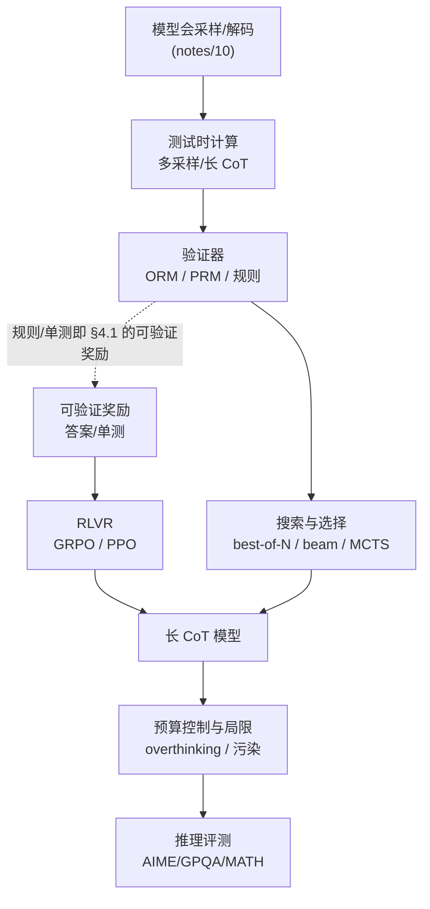
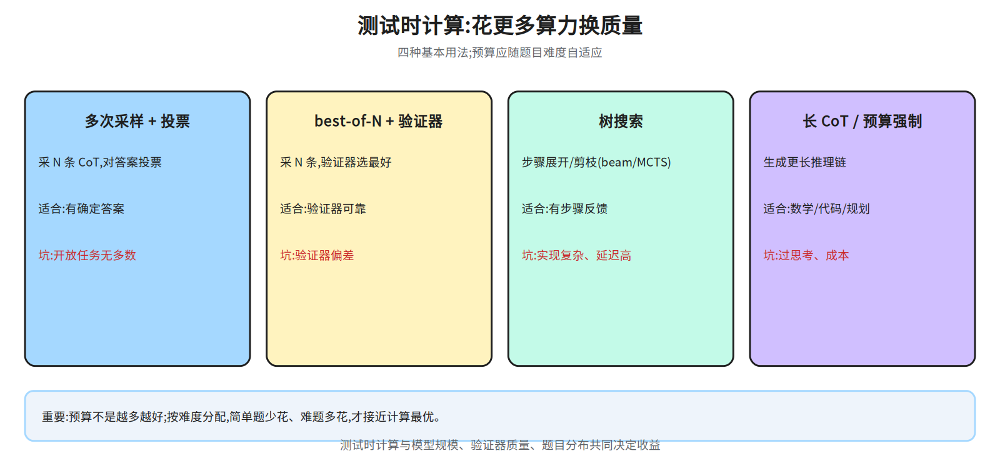
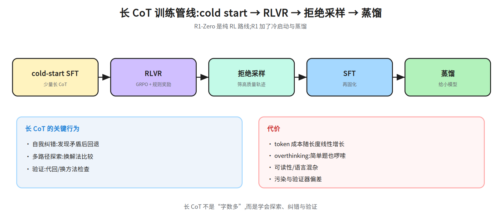
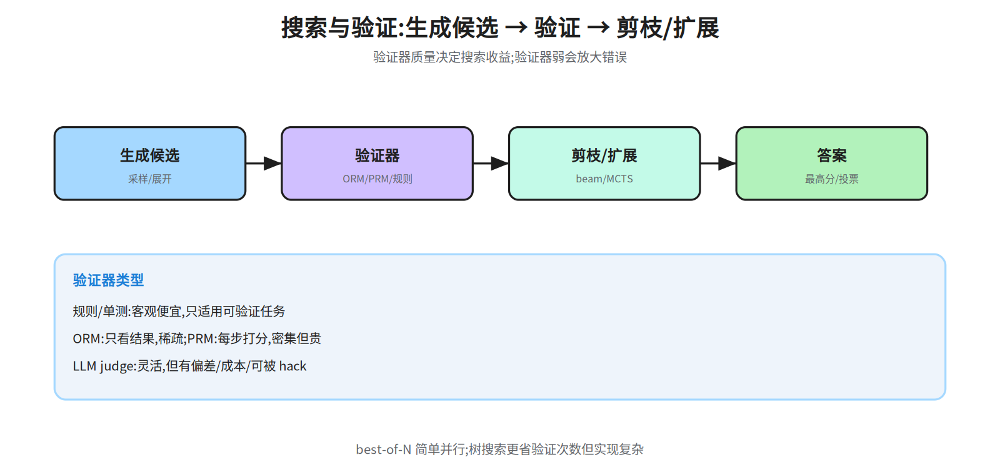
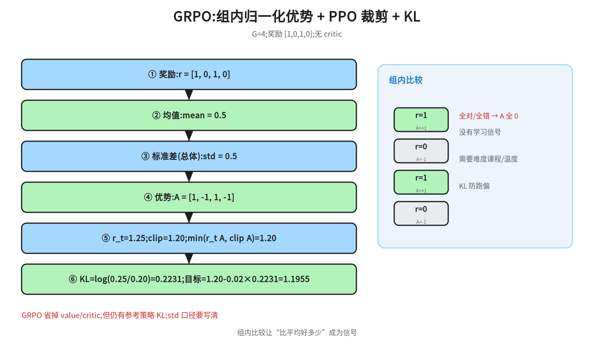
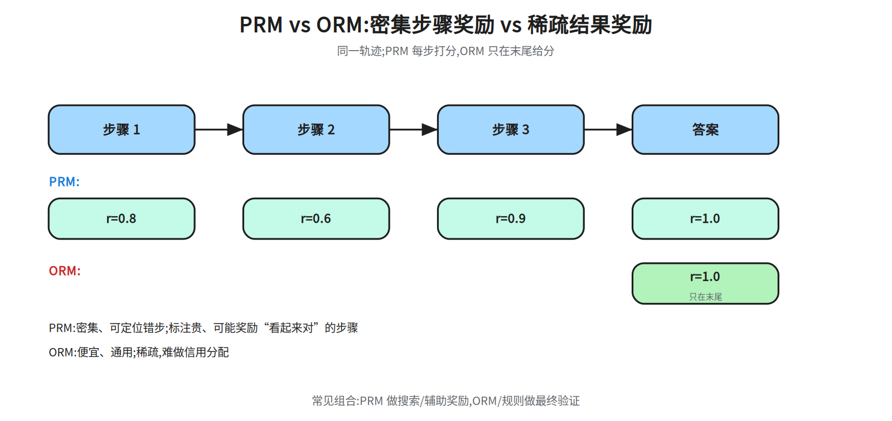
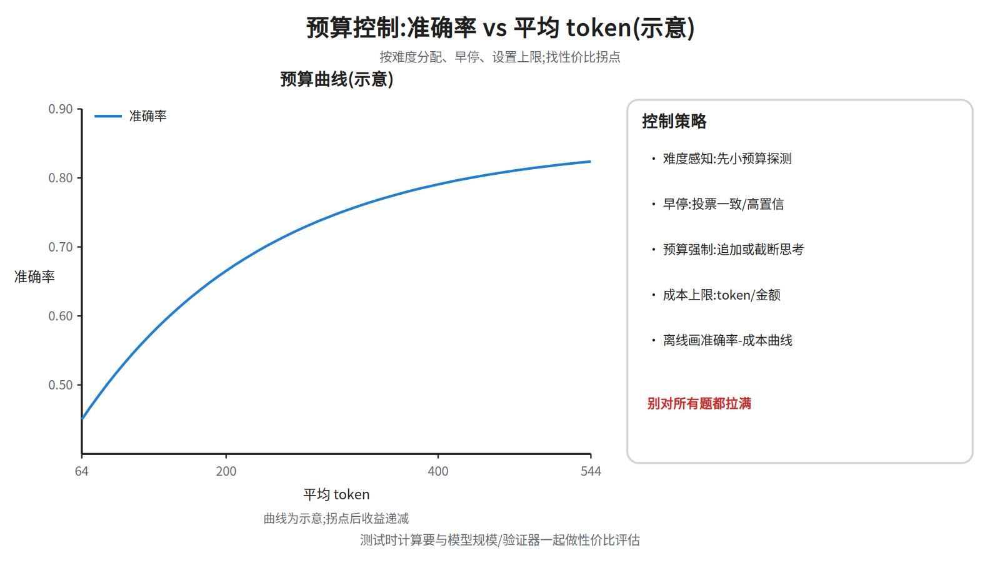

# 第十三层 · 推理模型 —— 测试时计算、长 CoT 与 RLVR

> 本层回答:为什么“多想一会儿”能提升数学/代码?测试时计算有哪些用法?长 CoT 是怎么训出来的?RLVR、GRPO、process/outcome reward 各自在优化什么,边界在哪?

> **前置(按节)**
> - §1–§2:先看 `notes/10_decoding.md §2、§6`(采样/测试时计算)与 `notes/07_pretraining.md §3`(scaling)。
> - 顺序说明:依赖图按「概念前置」画(F→G:只表示「RLVR 要建立在可验证奖励上」这一条概念依赖,不表示「没有 RLVR 就没有长 CoT」——§2.1 的长 CoT 是 o1/R1 的既有能力,§2.2 的 cold start SFT + 蒸馏路线并不需要 RLVR;图中 D→G 那条边同理,只是「搜索/筛选也会用来产出长 CoT 轨迹」的提示,正文没有单独段落展开,不必回头找),正文按「先看现象、再拆训练」排,所以 §2 会先出现 §4 的名词。
因此这张图只表示概念前置关系,**不能当阅读顺序**;阅读顺序以本前置块最后那条「建议路径」为准(它在本块末尾,中间还隔着下面几条前置说明,不在章节末尾;本块后面出现的「第 1 次读/第 2 次读」就是指那条建议路径里的两遍读法,先当标记往下读即可)。§2.2 里的 GRPO/规则奖励/RLVR 定义在 §4.1–§4.2(`notes/08_alignment.md §2.2、§3.2`);同节还会提前出现**拒绝采样**与**蒸馏**两个词,已在 §2.2 就地用一段说明兜住(拒绝采样 = 采样 + 验证器筛选,机制同 §3.2 best-of-N,只是用途不同);第 1 次读先记名字,第 2 次读 §4 时回填,不要跳过 §4。
> - §3 搜索/验证:需要概率与树搜索的基本概念;正文解释。
> - §4 RLVR/GRPO:先看 `notes/08_alignment.md §2.2、§3.2`(PPO/GRPO),正文给数值链。
> - §4 前置补充:§4.1「读 §4.2 前的 PPO 最小说明」已就地给出策略比率、clip 区间、advantage/基线、KL 四个量的定义,没读过 `08_alignment` 也能跟完 §4.2 的数值链;KL 的定义在 §4.1 那条 KL 约束下面。

> - **哪些外部前置是硬要求(按这条判定,别停在原地纠结)**:只有两处值得先补——(i) §1.2「FLOPs 匹配下测试时计算 vs 加预训练」需要 `notes/07_pretraining.md §3` 的 scaling 框架才有推导,本讲义只给结论,**不读也能往下读**,把 §1.2 那一条当结论接受即可;(ii) `notes/10_decoding.md §2、§6` 是 §1–§3 的词汇表,没读过就把 §1.1 的表和 §3 当定义读。`notes/08_alignment.md §2.2、§3.2` **不是硬前置**:PPO/GRPO 的四个量在 §4.1 就地给了,GRPO 目标式已在 §4.2 写全,所以「先看 08」是给想补原文的人的可选路径,与「没读过 08 也能跟完 §4.2 数值链」不冲突。
> - §5–§6:先看 §4;评测接 `notes/09_evaluation.md`。
>
> **建议路径(2 次 × 45 分钟)**
> - 第 1 次(必学):§1 测试时计算方法 + §2 长 CoT(图 43a/43b),§3 搜索/验证(43c)。
> - 第 2 次(必学):§4 RLVR/GRPO 数值链(43d)+ §5 PRM/ORM(43e)+ §6 预算(43f)+ §7 评测与局限。

## 0. 依赖图(只看概念前置,不是阅读顺序)



## 1. 测试时计算:花更多算力换质量

### 1.1 四种基本用法


> 术语说明(先记名字,定义在后面):**RM** = reward model,§3.1 的 ORM/PRM 都是 RM;**ORM/PRM** = outcome/process RM,见 §3.1 表与 §5;**beam/MCTS** 是 §3.2 的树搜索。读完 §3 再回看本表。
  **奖励黑客**(reward hacking)同样先记名字:它和「验证器偏差」是两件事,区分见 §3.2 末,完整定义见 §4.4。
另:**CoT** = Chain-of-Thought,思维链,即模型在给出最终答案前写出的中间推理步骤——本表第 1 行的「采 N 条 CoT」就是让模型独立写 N 条这样的链、再对最终答案投票;第 4 行的「长 CoT」指单条链很长(数千到数万 token),展开见 §2.1。

| 方法 | 做法 | 计算量 | 适合 | 局限 |
|---|---|---|---|---|
| **多次采样 + 多数投票** | 采 N 条 CoT,对最终答案投票 | N 倍生成 | 有确定答案的数学/常识 | 开放任务无“多数” |
| **best-of-N + 验证器** | 采 N 条,用 RM/PRM/规则选最好 | N 倍生成 + 打分 | 有可靠验证器 | 验证器偏差/奖励黑客 |
| **树搜索** | 在推理步骤上展开/剪枝(beam/MCTS) | 受搜索宽度/深度控制 | 需要中间步骤反馈 | 实现复杂、延迟高 |
| **长 CoT / 预算强制** | 让模型生成更长的推理链 | token 预算 | 数学/代码/规划 | 过思考、成本高 |
> 别名:表中第 1 行「多次采样 + 多数投票」就是 §3.2 与动手清单第 1 条的 **self-consistency**,同一方法、两个名字;全文方法总数仍是四条,§8 第 1 问的四条不要重复计数。


> **第 4 行的两种身份**:§1.1 把「长 CoT / 预算强制」列为测试时方法,说的是**推理阶段怎么用**——不改权重,把 token 预算给足、必要时追加"继续思考",让模型把已有的长推理能力用出来;§2.2 说的是这种**能力本身怎么训出来**(RLVR 让模型学会写长 CoT)。两者不冲突:对没做过长 CoT 训练/RL 的基座模型,单纯加大 token 预算**收益有限**(s1(Muennighoff et al., 2025)图 4b 测的只是**并行采样条数**:对 Qwen2.5-32B-Instruct 每题采 64 条、温度 1,再对 2/4/8/16/32/64 条做多数投票;未微调的基座准确率随采样条数仍在升,只是追不上 s1。这是「多采几条再投票」,不是「把单条思考的 token 预算拉长」——对未微调基座做 sequential 式的延长思考,该文没有报告过准确率「不为负」,所以这里不断言;该文「过度抑制 end-of-thinking 会陷入重复循环」是在**已用 s1K 微调过**的 s1-32B 上做 budget forcing 才观察到的现象,不能外推成基座的既定事实;称呼上拆开记:s1 = 那篇论文(Muennighoff et al., 2025),s1-32B = 用它训出的模型(基于 Qwen2.5-32B-Instruct,用 s1K 微调),s1K = 该文构造的 1,000 条带推理过程的高质量样本(1K 即 1000 条);前文「追不上 s1」指追不上 s1-32B 这个模型的准确率,不是追不上那篇论文),因为它本来就写不出有效的长链;§6 第 3 条的预算强制是**双向**操作:既可以追加「继续思考」把预算延长,也可以截断思考并追加「Final Answer:」逼模型提前收尾(这里的 s1 指 Muennighoff et al. (2025) 那篇 budget forcing:它把 budget forcing 定义为强制思考 token 的「最大值和/或最小值」,两个方向并列;两个方向都是主用途:摘要把 budget forcing 定义为「强制终止思考过程、或用追加『Wait』把它延长」,终止在前;图 4a 低预算一侧的数据点正是靠截断思考得到,§6.2 还把「往下压测试时计算」的收益可预测列为该方法的优点之一;该文的高分主结果确实来自延长侧(抑制 end-of-thinking 后追加「Wait」,摘要 50%→57%、图 4a 最右三点),但这不等于截断只是对照);无论哪个方向,前提都是模型已有长 CoT 能力,而不是「凭预算凭空逼出新能力」。

### 1.2 一个重要的结论:测试时计算也有“最优点”

Snell et al. (2024) 等工作表明:给定推理预算,**最优的方法选择和预算配置随题目难度变化**:易题上把算力花在推理上比花在预训练上更划算(这是「推理 vs 预训练」的口径;模型固定、只排方法时,易题上是高预算下 best-of-N 占优——两个口径别混,本节末会再分一次),难题上 beam search 在**全部预算区间**都稳定优于 best-of-N(易题上反而相反:beam 随预算增大而退化,best-of-N 在更高预算下更好);FLOPs 匹配的对比里,易题、中等题、乃至难题(取决于预训练与推理 workload 的具体条件)上追加测试时计算往往都优于加预训练,只有 with the most challenging questions 才相反(加预训练更划算)——最难的 level 5 上,没有任何方法有实质进展。
（这里的 level 5 指 Snell et al. (2024) §5 自己的**模型相关难度分箱**第五档,不是 MATH 基准自带的 Level 1–5(Hendrycks et al., 2021):该文把「这个基座模型在该题上的 pass@1(用 2048 条采样估计)」在测试集上按五分位切成五档,每档对应递增难度,并说这种模型相关分箱比人工标注的 difficulty 更有预测力。所以 level 5 按构造就是最难的约 1/5 题(每档约 1/5,该文没有逐档报题量的绝对值),与 AoPS 的分学科难度标签无关;别把它和本文第五节的编号混为一谈,也别套到其它基准上。）
另一种常见说法是「易题上多数采样已接近正确率上限,追加算力的边际收益趋近 0(高预算下 best-of-N 也只是反复答对同样的题)」——它看着像是在否定上一段,其实两句的对比基准不同,不能当同一条结论读:**「优于加预训练」比的是这笔算力花在哪**——同样 FLOPs，拿去在推理时多采样，比拿去训一个更大的模型更容易把易题的正确率买上来；**「边际收益趋近 0」比的是模型固定之后、预算在题与题之间怎么分**——易题上这个模型多采几条也几乎都答对，正确率已贴近它的上限，best-of-N 虽是几种方法里相对最好的，绝对收益仍接近 0，只是反复答对同样的题。所以这里要分清两个比较:**「优于加预训练」比的是这笔算力花在哪**(推理 vs 预训练);**「边际收益趋近 0」比的是模型固定之后、同一笔预算在题与题之间怎么分**——参照系不同,两者并不冲突。另外单看「模型固定、同一笔预算下几种方法谁更好」这个口径,易题上是高预算 best-of-N 相对占优,这来自 Snell et al. (2024) 图 3 右的按难度分箱结果(易题上 beam search 随预算增大反而退化,best-of-N 在更高预算下更好),是**相对占优**,不等于「易题该追加预算」。模型固定后,易题的正确率已贴近这个模型的上限,额外预算的绝对收益趋近 0;可省的是「无条件给易题加预算」这一条,而不是说易题上几种方法的排序反了过来;预算往哪投仍由「模型在哪类题上处于能力边缘」决定。最难的题则任何方法都无实质进展，给了也白给：两头都不划算。所以预算应集中在“模型处于能力边缘”的题上,而不是一律给难题多花。
**零基础只记这一条**:模型固定以后,易题不必再加预算,明显超出能力的难题给了也白给,预算优先投给「答对一部分、多试几次就能对」的题——§6 第 1 条的难度感知策略(先用小预算探测,不确定的题再加)就是按这个口径写的;「易题值得多花算力」只在「这笔算力原本要拿去训一个更大的模型」这个对比下成立,不是在「模型固定后预算怎么在题间分配」这个口径下成立。测试时计算不是免费的 scaling,它与模型规模、验证器质量、题目分布一起决定收益。

## 2. 长 CoT:从“写步骤”到“学会想”

### 2.1 长 CoT 是什么

普通 CoT(Chain-of-Thought,思维链)是“多写几步”;长 CoT 是模型在推理时生成**很长的中间推理**(数千到数万 token),包含尝试、回溯、验算、换方法。代表:OpenAI o1 系列、DeepSeek-R1。

长 CoT 的关键不是“字数”,而是:

- **自我纠错**:发现矛盾后回退重算;
- **多路径探索**:尝试不同解法,比较;
- **验证**:把结果代回/用另一种方法检查;
- **长度可控**:难题想久一点,简单题别啰嗦。



### 2.2 DeepSeek-R1 的两条路线(公开做法)

- **R1-Zero**:从基座直接做 RL(GRPO + 规则奖励),不做 SFT cold start;训练中出现反思/“aha moment”,但可读性和语言混杂较差。
- **R1**:先用少量 cold-start 数据做 SFT,再做 RLVR,然后用拒绝采样筛出高质量轨迹,做 SFT,最后再 RL;并把大模型的能力蒸馏到小模型。


> **五个名词就地解释**(末尾追加 §4 的三个前置名词,先记名字)
> - **SFT(supervised fine-tuning,监督微调)**:用「输入 → 目标输出」成对样本做普通的下一 token 训练,只模仿样本,不直接优化「答案对不对」这个奖励,所以它是 RL 的起点而不是替代品。本节三处用到它:① cold start 用少量长 CoT 样本做一次 SFT,先教会格式与可读性,再交给 RL 优化正确性;② 拒绝采样把筛出的正确轨迹当 SFT 数据(即 R1 阶段三的「拒绝采样 + SFT」,与阶段一的 cold start SFT 是两个不同阶段(§4.4 只写 cold start + SFT 缓解可读性,不涉及拒绝采样),省掉它就没有可读的正例);③ §4.1 的 KL 把参考策略 $\pi_{ref}$ 锚在这个 SFT 模型上,β 的作用就是别离它太远。
> - **cold start**:先用少量人工/强模型写好的长 CoT 做一次 SFT,把"会写长推理"的格式与可读性先教给模型,再交给 RL 去优化正确性。R1-Zero 跳过这一步,所以虽学到反思行为,可读性和语言混杂都差。
> - **拒绝采样(rejection sampling)**:对一批 prompt 各采多条轨迹 → 用规则/验证器判对错(数学查最终答案,代码跑单测)→ **只保留判对的轨迹**当 SFT 数据。它和 §3.2 的 best-of-N 是同一套"采样 + 验证器筛选"机制,区别只在用途:best-of-N 把选中的那条直接当答案交付,拒绝采样把选中的轨迹拿去当训练数据(所以要的是可读性好的正例,不是最高分那条)。
> - **"aha moment"(反思行为)**:训练中模型自发出现"等一下,这里不对,我重算"这类回溯,说明奖励把"检查并改错"的行为也一起强化了;它不等于可靠的自我纠错能力(边界见 §2.3)。
> - **蒸馏**:用大模型(教师)采出的高质量轨迹做 SFT 数据去训小模型(学生),把长 CoT 能力搬到小模型上。
> - **RLVR / GRPO / 规则奖励(§2 只记名字,定义在 §4.1–§4.2)**:RLVR = 用规则可判的奖励做 RL(答案 exact match、代码单测通过,不用训练 RM);规则奖励 = 直接用这些判据给 0/1 分,替代奖励模型;GRPO = 一种不需要 critic 的 RL 算法,用同一 prompt 下 $G$ 条回答的平均分当基线。R1-Zero 与 R1 的差别不只在用不用 cold start:R1 还多了「拒绝采样筛轨迹 + SFT + 再 RL」这一轮迭代,以及把大模型能力蒸馏到小模型;R1-Zero 只有从基座直接做的一步 RL。机制见 §4,完整链路见上面 R1 / R1-Zero 两条 bullet 与 §8 第 3 问。

> 结论:**RL 可以让模型自己学出长 CoT,但冷启动数据 + 拒绝采样 + 蒸馏能显著改善可读性与稳定性。** 具体超参/数据量以官方技术报告为准。

### 2.3 自我纠错的边界

“让模型自己检查一遍”并不总是有效:没有外部验证器/工具/环境反馈时,**intrinsic self-correction** 可能把对的改错,或在错误上越走越远(Huang et al., 2023 的讨论)。可靠的做法是引入**外部信号**:代码执行、计算器、检索、单测、PRM/ORM 验证;长 CoT 的“反思”只有在能拿到新证据时才有稳定收益。

**Tool-integrated reasoning(TIR)**:让模型在推理链中调用代码/搜索/计算器,把工具结果写回上下文再继续推理。它把“想”和“算/查”结合,适合数学、数据分析和多跳问答;代价是工具延迟、错误级联与沙箱安全。

### 2.4 长 CoT 的代价

- **token 成本**:推理费用主要随输出 token 数近似线性增长(长上下文下 attention/KV cache 开销会让它超线性);
- **overthinking**:简单题也长篇大论,延迟/成本上升;
- **可读性**:推理链可能混乱、重复;
- **评测偏差**:只看最终答案会忽略过程质量;只看长度会奖励啰嗦。

## 3. 搜索与验证

### 3.1 验证器的种类

| 验证器 | 信号 | 优点 | 缺点 |
|---|---|---|---|
| **规则/单测** | 答案 exact match、代码通过测试 | 客观、便宜 | 只适用于可验证任务 |
| **ORM(outcome RM)** | 只看最终答案/结果打分 | 标注便宜、通用 | 稀疏、难定位错步 |
| **PRM(process RM)** | 对每个推理步骤打分 | 密集、可指导搜索 | 标注贵、可能奖励“看起来对”的步骤 |
| **LLM judge** | 用强模型评推理质量 | 灵活 | 偏差、成本、可被 hack |

### 3.2 搜索



- **best-of-N**:独立采样 N 条,选验证器最高分;简单,适合并行。
（口径提醒:本节按「候选怎么生成、怎么选」编排,best-of-N 放在这里只因为它与 beam/MCTS 共用验证器与预算口径;**分类**仍以 §1.1 的四分法为准——best-of-N+验证器单独占一行、与树搜索并列,不是树搜索的子类。§8 第 1 问按四条答、不要重复计数。）
- **beam search over reasoning**:每步保留 top-k 个前缀,按 PRM 分数扩展;需要步骤级打分。
- **MCTS**(Monte Carlo Tree Search,蒙特卡洛树搜索):在步骤树上做探索/利用,适合有明确状态与回退的任务;实现复杂。


> **树搜索的最小对应关系(beam / MCTS 通用)**
> - **节点** = 一个推理前缀(从 prompt 到当前这一步的文本);根节点是 prompt,子节点 = 在前缀后再采样一步。
> - **展开(expansion)** = 从某个节点采样下一步(可采多个),产生若干子节点。
> - **价值(value)** = 给这个前缀打分,主力就是 §3.1 的 PRM;没有 PRM 时用 ORM 给完整答案打分,或用规则验证器。
> - **回退(backtracking)** = 丢掉低分分支,把预算让给高分分支;MCTS 里对应"回到祖先节点重新展开",beam 里对应"只保留 top-k 前缀"。
> - **一次 MCTS 迭代** = 选择(按 UCB:既看平均价值,也偏向访问次数少的探索项)→ 展开一个新子节点 → 用 PRM 直接给前缀打分,或用 rollout 估价值(rollout = 从该前缀续写若干条到最终答案,用最终正确率或 ORM 分数当这一步的价值;一次估价值通常要采多条,条数直接计入 §6 的验证器调用次数) → 把价值回传给祖先;beam 是它的简化版,不做回传与探索项,每步只按分数留 top-k。
> - 对应 §6 的预算项:**搜索宽度** = 每步保留/展开几个候选,**搜索深度** = 最多往下几步;调用次数不能只按节点数算:宽度×深度只数了「给几个节点打分」,若用 PRM 直接给前缀打分是每节点 1 次,若用 rollout 估价值则还要乘每节点采样条数(每条都要过验证器/ORM),best-of-N 另加 N 次——即 验证器调用次数 ≈ 宽×深×每节点采样条数 (+ best-of-N 的 N),这才是延迟和成本的主因。
- **self-consistency**:不训练验证器,直接对答案投票;便宜,但对推理过程无约束。

**关键**:搜索的收益取决于**验证器质量**与**候选多样性**;验证器弱时,搜索会放大错误( reward hacking)。


**这里把「放大错误」拆成两种**(reward hacking 的完整定义见 §4.4):① **验证器自己判错**——RM/PRM 把错答案打成高分,错在验证器准确率,修法是换更强/更对齐的验证器,或对分数做校准;② **模型学会骗验证器**(即奖励黑客)——策略收敛到「格式对/答案碰巧对」这类能过验证器、但推理并未学会的捷径,错在奖励口径可被利用,修法是加隐藏测试、多验证器交叉、或收紧判据。同一句「放大错误」对应两套完全不同的应对,读到这里别把 ② 当成 ①。

## 4. RLVR 与推理 RL

### 4.1 RLVR:用可验证奖励做 RL

RLVR(Reinforcement Learning with Verifiable Rewards)用**规则可判**的奖励训练:

- 数学:最终答案 exact match / 符号等价;
- 代码:单元测试通过;
- 逻辑/约束:满足格式与约束;
- 工具:任务完成/状态正确。


> **exact match 的口径**(§2.2、§3.1 与本处同):把答案抽出来做规范化(去空格、统一大小写与全半角、剥掉公式外壳)后与参考答案**逐字符相等**才算对,不判数值/语义等价;所以 0.5 vs 1/2、`\frac{1}{2}` vs 1/2、带单位 vs 不带单位,严格 exact match 都判错,要靠「符号等价」(化简/数值容差)兜。这是「可验证奖励」松紧的旋钮:越严越干净但误判多,越松越好刷、奖励黑客空间越大——报告要写清用哪种。

优点:奖励客观、可扩展;缺点:只覆盖可验证任务,模型可能学“格式对但推理错”的捷径。


> **读 §4.2 前的 PPO 最小说明(四个概念)**
> - **策略比率** $r_t=\pi_\theta(a_t\mid s_t)/\pi_{old}(a_t\mid s_t)$:同一个 token 在新旧策略下的概率之比。用比率而不用概率本身,是为了让“这一步改了多少”可比,且比值在 1 附近时梯度稳定。
> - **clip 区间** $[1-\epsilon,1+\epsilon]$:把比率夹在 $1\pm\epsilon$(常取 $\epsilon=0.2$,即 $[0.8,1.2]$)内。下界防"把这个 token 的概率压得太狠",上界防"一步抬得太猛"把策略打崩;只有 $\min$ 取到裁剪分支(比率朝优势增大的方向越界)时,这个 token 的策略项梯度才为 0;$A<0$ 而比率越过上界、或 $A>0$ 而比率跌破下界时,$\min$ 取的是未裁剪项,梯度并不为 0。
> - **advantage / critic**:$A_t$ 表示这个动作比"平均水平"好多少。PPO 另训一个 critic(值函数 $V_\phi$)估计基线 $V(s)$,用奖励 $R_t$ 与基线之差当优势(单步是 TD 残差 $R_t+\gamma V(s_{t+1})-V(s_t)$,实际再沿轨迹用 GAE 累积成 $A_t$;注意 $R_t$ 是奖励,不是第 1 条的比率 $r_t$)以降低方差——GRPO 把这套基线换成了"同组 $G$ 条的平均分",所以省掉的正是 critic 这份工作。
> - **KL 约束**:目标里减 $\beta\,\mathrm{KL}(\pi_\theta\|\pi_{ref})$,把新策略锚在参考策略(通常是 SFT 模型)附近,防止跑偏成语言混杂/可读性崩坏。
> - **KL 的量定义(§4.2 ⑥ 直接要用)**:$\mathrm{KL}(\pi_\theta\|\pi_{ref})=\mathbb{E}_{a\sim\pi_\theta}[\log(\pi_\theta(a\mid s)/\pi_{ref}(a\mid s))]$——对每个 token 算 log 概率比,再用**新策略自己的概率**加权求和,所以它恒 ≥0,只在两分布处处相等时为 0;它是全词表上的加权平均,不是某个 token 的 log 比。§4.2 ⑥ 的 $\log(\pi_\theta/\pi_{ref})$ 是「单个 token、且该 token 已被采样」时的教学近似:它就是那一个 token 的 log 比,**可正可负**——$\pi_\theta<\pi_{ref}$ 时为负,这并不违反 KL≥0(该 token 的负贡献会被其它 token 的正贡献抵消),也正是 §4.2 强调「回拉力来自全词表 KL」的原因。
> **补：第 3 条（advantage/critic）里 γ、TD 残差、GAE 的最小定义（前置清单未覆盖；上一条括注只提了作用，这里把定义写全）**
> - $\gamma$：折扣因子，$0\le\gamma\le1$，越接近 1 越看重远期奖励；$\gamma=0$ 时只看即时奖励 $R_t$。
> - **TD 残差** $R_t+\gamma V(s_{t+1})-V(s_t)$：一步实际奖励 + 下一状态估值 − 当前估值，即单步优势估计。
> - **GAE**（generalized advantage estimation）：把沿轨迹的一串 TD 残差按 $\lambda\in[0,1]$ 指数加权求和，用 $\lambda$ 在偏差与方差间折中，得到 PPO 用的 $A_t$。
> 三者都属于 MDP / 值函数框架；本节只要求认出符号和「为什么要有基线」，推导可跳过。
另外，§4.2 代码块里的 ①②③④⑤⑥ 是那一小段自己的步骤编号，与本节的项目符号列表无关；本节说「第 3 条」一律指上面 advantage/critic 那一条。

### 4.2 GRPO:组内比较,不要 critic

GRPO(Group Relative Policy Optimization)对同一个 prompt 采样 `G` 个回答,用组内奖励的均值/标准差算优势:

```
A_i = (r_i - mean(r_1..r_G)) / (std(r_1..r_G) + \varepsilon_s)   # \varepsilon_s 是数值稳定项(常取 1e-4 量级)，与 ⑤ 的裁剪 \varepsilon=0.2 无关
```

然后套 PPO 的比率/裁剪 + KL 约束,但**不需要 value/critic**。


先把目标式写全当锚点($\hat A_i$ 就是上面的 $A_i$,$o_i$ 是第 $i$ 条回答的 token 序列):


J_GRPO(θ) = (1/G) Σ_i (1/|o_i|) Σ_t [ min( r_{i,t}·Â_i , clamp(r_{i,t}, 1-ε, 1+ε)·Â_i ) - β·KL_{i,t} ]
r_{i,t} = π_θ(o_{i,t} | q, o_{i,<t}) / π_old(o_{i,t} | q, o_{i,<t})


- 两层归一化各管一件事:`(1/G) Σ_i` 是**序列之间**(组内平均),`(1/|o_i|) Σ_t` 是**序列之内**(按回答长度平均)。
- 原始 GRPO 的序列内层就是 `(1/|o_i|) Σ_t`;Dr. GRPO 把它换成常数 `(1/max_len) Σ_t`(每 token 等权);DAPO 的 token-level loss 把 `(1/G)Σ_i(1/|o_i|)Σ_t` 整体换成 `(1/Σ_i|o_i|)Σ_iΣ_t`(批内总 token 数当分母)。
- §4.3 要判的几种写法(求和 / 常数 `max_len` / `|o_i|` / `Σ_i|o_i|`)都能在这张式子里指出位置,不用靠文字想象;下文提到「分母」时请回到这里对照。数值链(`G=4`):



```
① 奖励(此处的 r 是奖励向量,与 §4.1 的策略比率 $r_t$ 不同):r = [1, 0, 1, 0]
② 均值:mean = 0.5
③ 标准差(总体):std = √(((0.5)²×4)/4) = 0.5
④ 优势:A = [(1-0.5)/0.5, (0-0.5)/0.5, ...] = [1, -1, 1, -1]
⑤ 某个 token:π_old=0.20, π_θ=0.25, A=+1, ε=0.2
   比率 r_t = 1.25(这是策略比率,不是 ① 的奖励值);clip=1.20;min(r_t A, clip A)=1.20
⑥ KL≈log(π_θ/π_ref)=log(0.25/0.20)=0.2231(本例取 π_ref=0.20;π_ref 是参考策略,与 ⑤ 的 π_old 是两个不同分布,数值相同只是本例设定);β=0.02
   目标=1.20-0.02×0.2231=1.1955

   口径:这是**单个 token 的括号项**,已略去外层 (1/G) 与 (1/|o_i|) 两个因子(相当于假定 G=1、|o_i|=1);本例 G=4、|o_i| 未给,序列级目标还要再除以 G·|o_i|,所以 1.1955 不是整条回答的目标值(下文与动手清单第 2 条沿用这个单 token 口径)
```

注意:

- **⑤ 演示的是"clip 生效",不是正常更新**:$r_t=1.25>1.20$,$\min$ 走的是裁剪分支,这个 token 的**策略项梯度已为 0**(比率被夹在 1.20,对 $\pi_\theta$ 的偏导被截断),目标里只剩 $-\beta\cdot\mathrm{KL}$ 这一项在起作用；严格说，单 token 近似 $\log(\pi_\theta/\pi_{ref})$ 单独求导是单调的（会把 $\pi_\theta$ 推向 0），真正的回拉力来自全词表 KL——对单个 token 的偏导是 $\log(\pi_\theta/\pi_{ref})+1$，再配合 $\sum_a\pi_\theta(a)=1$ 的约束，均衡点才是 $\pi_\theta=\pi_{ref}$。所以 1.1955 不是"这一 token 该更新到的目标值",而是"这步只由 KL 项驱动";想看正常更新,把 ⑤ 改成 $r_t\in(0.8,1.2)$ 再算一遍。

- **补:「clip A」是什么(⑤ 第一次出现,给通式)**:裁剪后的替代目标是 $\min\big(r_t A,\ \mathrm{clamp}(r_t,1-\epsilon,1+\epsilon)\cdot A\big)$——`clamp` 只夹**比率**,夹完再乘 $A$,所以「clip A」= 夹后比率 × 优势,不是「夹后的比率」本身,也不是把 $A$ 一起夹。⑤ 里 $A=+1,r_t=1.25,\epsilon=0.2$:$r_tA=1.25$、$\mathrm{clamp}=1.20$、$\mathrm{clamp}\cdot A=1.20$,$\min=1.20$——两种读法数值相同只是 $A=+1$ 的巧合。换 $A=-1$:$r_tA=-1.25$、$\mathrm{clamp}\cdot A=-1.20$,$\min(-1.25,-1.20)=-1.25$,取**未裁剪分支**,梯度不为 0;若 $A=-1$ 且 $r_t=0.7$:$\mathrm{clamp}=0.80$、$\mathrm{clamp}\cdot A=-0.80<r_tA=-0.70$,$\min=-0.80$,取**裁剪分支**,梯度为 0。汇总:$A>0$ 越上界 / $A<0$ 跌破下界 → 裁、梯度为 0;$A>0$ 跌破下界 / $A<0$ 越上界 → 不裁、梯度不为 0。
- `std` 用总体还是样本标准差、`\varepsilon_s` 加在哪，不同实现不同；报告时要写清。分母的 `\varepsilon_s` 是数值稳定项（常取 1e-4 量级），⑤ 的 `\varepsilon=0.2` 是裁剪区间，两者不是同一个量；④ 的 ±1 相当于取 `\varepsilon_s≈0`。
- 这里的 KL 用 `log(πθ/πref)` 的教学近似;DeepSeek 的 GRPO 实现使用 k3 无偏估计器,公式不同但作用都是约束偏离参考策略。
- 组内全对/全错时,优势全 0,没有学习信号;要控制题目难度/采样温度。

  - 补充:这与 §4.3「难度偏置」不矛盾——**恰好**全对/全错时 $A_i=0$(无信号);**接近**全对/全错时(如 $G=8$、7 对 1 错)方差小但不为 0,除以小 `std` 会把优势放大,但题级权重只被抬到约 1.5 倍(这个倍数只对这组 $G=8$、二值奖励、7 对 1 错成立;换大 $G$ 就更大:$G=64$ 的 63 对 1 错约为**同一 $G$ 下均衡组**(即 $G=64$ 的 32 对 32 错;不是上面 $G=8$ 的「4 对 4 错」)的 4 倍,$G=256$ 的 255 对 1 错约为同 $G$ 均衡组(128 对 128 错)的 8 倍)(比的一律是**同一 $G$ 内**的 $1/\text{std}$:二值奖励的均衡组恒有 $\text{std}=0.5$、$1/\text{std}=2.0$,与 $G$ 无关,所以倍数只由极端组那一侧决定;$G=8$ 这组是 7 对 1 错 $1/\text{std}\approx3.02$ vs 4 对 4 错 $2.0$),被放大的是少数派错例的单样本优势,不构成「过度加权」的量级(复算见 §4.3)。
- KL 约束防止策略跑偏,但也可能限制探索;β 是超参。

- **补:⑥ 那句「偏导 $=\log(\pi_\theta/\pi_{ref})+1$、再加 $\sum_a\pi_\theta(a)=1$ 就得到 $\pi_\theta=\pi_{ref}$」被跳过的两步**:
  1. **对谁求导**:求的是 $\mathrm{KL}(\pi_\theta\|\pi_{ref})=\sum_a\pi_\theta(a)\log\frac{\pi_\theta(a)}{\pi_{ref}(a)}$ 对**分布分量** $\pi_\theta(a)$ 的偏导(不是直接对参数 $\theta$)。乘积法则给出 $\frac{\partial}{\partial\pi_\theta(a)}\big[\pi_\theta(a)\log\frac{\pi_\theta(a)}{\pi_{ref}(a)}\big]=\log\frac{\pi_\theta(a)}{\pi_{ref}(a)}+1$——那个 $+1$ 来自对前面乘着的 $\pi_\theta(a)$ 求导。
  2. **加约束**:$\pi_\theta$ 落在单纯形上($\sum_a\pi_\theta(a)=1$),引入乘子 $\lambda$,令 $\log\frac{\pi_\theta(a)}{\pi_{ref}(a)}+1+\lambda=0$ 对**每个** $a$ 都成立 → 所有分量的比值 $\pi_\theta(a)/\pi_{ref}(a)$ 等于同一个常数 $e^{-1-\lambda}$ → $\pi_\theta\propto\pi_{ref}$;再用 $\sum_a\pi_\theta=\sum_a\pi_{ref}=1$ 定出该常数 $=1$,得 $\pi_\theta=\pi_{ref}$。
  3. 所以「多出的 $+1$」是乘积法则的产物,归一化约束的作用是逼各分量的偏导条件取同一个常数——缺任一条,均衡点都落不到 $\pi_{ref}$。对 $\theta$ 求梯度还要再过一层链式法则,但均衡点由上面这个对 $\pi_\theta(a)$ 的条件决定。

### 4.3 GRPO 的坑与现代变体

原始 GRPO 有两个已知偏差:

- **难度偏置**:除以组内 `std` 会让“全对/全错”附近(方差小)的题被放大,简单题/难题的题级权重只是被抬高(约 1.5 倍只是下面复算那组 $G=8$、二值奖励、7 对 1 错的设定;换大 $G$ 会明显变大——$1/\text{std}$ 随 $G$ 增大,$G=64$ 的 63 对 1 错约为**同 $G$ 均衡组**(32 对 32 错,$1/\text{std}=2.0$)的 4 倍、$G=256$ 的 255 对 1 错约为同 $G$ 均衡组(128 对 128 错)的 8 倍,见 §4.2 补充条),不是量级上的「过度加权」——真正被放大的是少数派样本的单条优势。
（这一段里「放大」有三个不同口径,先约定再算,否则算到 $\sum A^2\approx8$ 不变会误以为难度偏置不存在:**题级权重** = $1/\text{std}$,整题被抬高多少(7 对 1 错 3.02 vs 4 对 4 错 2.0,只差 1.5 倍);**单条优势** $|A_i|$,个别样本被放大多少(错误那条 −1→−2.65);**总权重** = $\sum_i A_i^2$,整题占多少梯度(两题都是 8,不变)。下文「放大」若无定语,分别按这三个口径读。)
可复算的例子($G=8$、二值奖励、7 对 1 错):$\text{mean}=0.875$,$\text{std}=\sqrt{0.109375}\approx0.331$;对的 7 条 $A=(1-0.875)/0.331\approx+0.38$,错的那条 $A\approx-2.65$。而 4 对 4 错时 $\text{std}=0.5$、$A=\pm1$——同一条错轨迹,在"几乎全对"的题上被放大到 $-2.65$,真正被放大的题级权重是 $1/\text{std}$：7 对 1 错为 $1/0.331\approx3.02$，4 对 4 错为 $1/0.5=2.0$，只差约 1.5 倍；$-2.65$ 是「偏差变大」(0.5→0.875,×1.75)与「$1/\text{std}$ 变大」($2.0\to3.02$,×1.51)叠加的结果(1.75×1.51≈2.64)，不等于题级权重比，不能当作过度加权的量级(被放大的是少数派错例的误差信号:7 条正例的 $|A|$ 反而从 1 降到 0.38,而 $7\times0.38^2+2.65^2\approx8$ 与 4 对 4 错时的 $8\times1^2=8$ 相同,即整题总权重(平方和)不变,只是分布被拉偏到少数派);难题(几乎全错)同理反向。**Dr. GRPO**(Liu et al., 2025)去掉 `1/std` 归一化,并处理长度归一化偏差,改用更一致的 token-level 目标。
- **长度偏置**:归一化口径要分方向说：
先约定两个轴,下面 (1)(2)(3) 的判断都按这套名字读——**轴一(序列内)**:一条回答内部各 token 的权重是否相等(对 logprob 求和等价于分母取常数,每个 token 等权;除以 $|o_i|$ 则每 token 权重变成 $1/|o_i|$);**轴二(序列之间)**:整条回答的总权重是否随长度变化(求和时 $\propto|o_i|$;除以 $|o_i|$ 时总权重恒为 1)。一句话记:轴一看 token 之间,轴二看回答之间。(1) 先说清方向（**定位:(1) 只讲轴二**——整条回答的总权重 $\propto|o_i|$,所以 $A>0$ 偏爱长、$A<0$ 罚长更重;(2) 里 Dr. GRPO 去掉 $1/|o_i|$ 修的是**轴一**的每 token 权重,两条不是同一件事,分工见本段末「这里补一句口径」），别把「求和」当成偏置本身：对每条回答的 logprob 求和、再除以一个常数（如 `max_len`），梯度量级随长度 $|o_i|$ 增长——$A>0$ 时等于给长回答更大权重（偏爱长），$A<0$ 时则是长错误回答受罚更重（抑制长），所以它并非一律偏爱长回答，方向由优势符号决定（`notes/08_alignment.md §3.2` 给了条 DPO 失败模式「log-prob 对 token 求和,长回答的 margin 天然更大」——那是 chosen/rejected 的 log-prob 差(margin)随长度放大,与优势符号无关,并不是对 $A>0$/$A<0$ 的区分;而且 DPO 的 margin 与本节「逐 token logprob 求和 / 按长度平均」不是同一个量,别按这条回查去对上文的 $A$ 方向）；(2) 按 token 平均（= 除以回答长度 $|o_i|$）的偏置是间接的：它不直接把长回答抬高，而是把长错误回答的负优势摊薄、惩罚变轻，训练因此往长里走——所以 Dr. GRPO 主张**去掉** `1/|o_i|`（改除以常数 `max_len`），DAPO 把样本级平均换成 token-level loss（分母是批内总 token 数 $\sum_i|o_i|$,随批次长度变化,不是固定常数）——**注意两个名字撞车、方向不同**:「按 token 平均」除的是**单条回答**的长度 $|o_i|$,(2) 把它当偏置来源;DAPO 的「token-level loss」除的是**批内所有回答**的总 token 数 $\sum_i|o_i|$,是批次级常数。两者分母都长在 token 上,但一个随每条回答长度变、一个是批次总量;在轴一上 DAPO 与 Dr. GRPO 同类(每 token 等权),别因为名字像就把「按 token 平均=偏置来源」和「token-level loss=修法」读成矛盾；
这里补一句口径,免得 (1)(2) 看起来互相打架——它们是两个不同的轴。**轴一(序列内)**:一条回答内部各 token 的权重是否相等;对 logprob 求和(等价于分母取常数)时每个 token 权重相同,按 $|o_i|$ 平均时每 token 权重变成 $1/|o_i|$。**轴二(序列之间)**:整条回答的总权重是否随长度变化;求和时总权重 $\propto|o_i|$,所以 (1) 说 $A>0$ 偏爱长、$A<0$ 罚长更重;除以 $|o_i|$ 时总权重恒为 1,但长回答的每条 token 被压小——这条机制属于**轴一**(每 token 权重),不是轴二,所以它与「轴二上长度中性」并不冲突;(2) 的「训练往长里走」正来自这里(长错误回答的负优势被摊薄)。Dr. GRPO 去掉 $1/|o_i|$、(2) 里「改除以常数 `max_len`」,消的是**轴一**上的「按长度归一」(恢复每 token 等权);(1) 讲的**轴二**效应它并不否认(总权重 $\propto|o_i|$,$A>0$ 偏爱长)——但 DAPO 的 token-level loss 不是它的解法:按 (2) 自己的定义,它只是把分母换成批内总 token 数 $\sum_i|o_i|$(与 Dr. GRPO 的常数 `max_len` 属同一类「常数分母」做法,轴一上的效果一致,差别只在常数取批内总量还是全局上限),仍是和式形态,总权重照样 $\propto|o_i|$、$A>0$ 照样偏爱长;轴二只能靠 DAPO 的超长奖励塑形(soft overlong punishment)或长度惩罚去处理。所以「常数归一算不算偏置」取决于问哪个轴,两处结论并不矛盾。(3) 长度惩罚/预算上限是抑制长度爆炸的独立手段，与归一化口径不是二选一。

主流改进:

- **DAPO**(Decoupled Clip and Dynamic sAmpling Policy Optimization):clip-higher(放宽上界)、动态采样(过滤全对/全错组)、token-level policy gradient、超长奖励塑形;适合大规模 RLVR。
- **GSPO**(Group Sequence Policy Optimization):用**序列级**重要性比率替代 token 级比率,训练更稳,尤其适合 MoE/长序列。

面试答法:先说 GRPO 省 critic、组内优势;再补“std/长度偏差 → Dr. GRPO/DAPO/GSPO 的修正”,最后说奖励设计与难度课程。

### 4.4 推理 RL 的常见问题

- **奖励黑客**:模型学会“格式对/答案碰巧对”的捷径;要用多种验证器/隐藏测试。
- **长度爆炸**:奖励只看正确性时,模型可能越写越长;要长度惩罚/预算。
- **难度塌缩**:训练题太简单,组内全对;要课程/难度过滤。
- **语言混杂/可读性**:纯 RL 可能牺牲可读性;cold start + SFT 缓解。

## 5. Process vs outcome reward



| | ORM(outcome) | PRM(process) |
|---|---|---|
| 信号 | 只在最终结果给分 | 每个推理步骤给分 |
| 标注成本 | 低 | 高(PRM800K 约 80 万条步骤标签,约 1.2 万题) |
| 信用分配 | 稀疏,难知道哪步错 | 密集,可定位 |
| 风险 | 结果对但过程错也会被奖励 | 步骤“看起来对”但最终错;标注偏差 |
| 用法 | best-of-N、RL 最终奖励 | 搜索/剪枝、过程监督 |

**步骤标签怎么来?** 两条路:(1)**人工标注**每一步正确/错误/中性(PRM800K 路线,质量高但贵);(2)**自动估计**,从该步出发做 Monte Carlo rollout,用最终正确率当步骤价值,或用强模型/规则给步骤打分。PRM 常训成“步骤打分器”(分类/回归),用于搜索剪枝或辅助 RL 奖励。

**直觉**:过程奖励像“老师逐步批改”,结果奖励像“只看最后答案”。过程奖励信息多,但贵且可能教模型“讨好标注者”;实践中常把二者结合:PRM 做搜索/辅助奖励,ORM/规则做最终验证。

## 6. 预算控制



测试时计算的预算包括:**采样条数 N、每条 CoT 的最大 token、搜索宽度/深度、验证器调用次数**。控制策略:

1. **难度感知**:先用小预算探测(短 CoT/单样本),不确定的题再加预算。
2. **早停**:验证器给出高置信正确/多次投票一致时停止。
3. **预算强制(budget forcing)**:给模型设 token 上限;需要更长时追加“继续思考”提示,或反过来截断强制收敛。
4. **成本上限**:按请求设 token/金额上限,超限返回当前最好答案。
5. **离线评估**:画“准确率 vs 平均 token”曲线,找性价比拐点,而不是只看最大预算。

## 7. 评测与局限

- **基准**:AIME(竞赛数学)、GPQA(博士级科学)、MATH、LiveCodeBench(代码);报告 pass@1、采样次数、token 预算。
- **污染**:竞赛题/代码题可能进训练集;用时间切分(LiveCodeBench)与 n-gram 检查。
- **长度偏差**:长 CoT 模型在“允许更长输出”时分数更高;比较时要控制 token 预算。
- **验证器偏差**:best-of-N/搜索的分数依赖验证器;要报告验证器类型与准确率。
- **泛化**:在可验证任务上训出的长 CoT,未必迁移到开放写作/对话;要分任务评估。
- **成本**:推理费用/延迟是产品约束;“最强”不等于“最合适”。

## 8. 面试要点

1. **测试时计算有哪些方法?** → 多采样投票、best-of-N+验证器、树搜索、长 CoT/预算强制。
2. **best-of-N 什么时候有效?** → 验证器可靠、候选多样、题目在能力边缘;验证器弱会放大错误。
3. **长 CoT 是怎么训的?** → cold-start SFT + RLVR(GRPO/PPO)+ 拒绝采样 + 蒸馏;R1-Zero 是纯 RL 路线。
4. **GRPO 和 PPO 的区别?** → GRPO 用组内归一化优势,省掉 critic;仍有比率裁剪与 KL。
5. **RLVR 的奖励从哪来?** → 规则/单测/exact match 等可验证信号;覆盖有限,可能奖励黑客。
6. **PRM 和 ORM 的区别?** → 步骤级密集 vs 结果级稀疏;PRM 标注贵、可指导搜索,ORM 便宜、通用。
7. **为什么组内全对/全错没信号?** → 优势全 0;需要难度课程/温度控制。
8. **预算怎么分?** → 按难度自适应,早停,设 token/金额上限;看准确率-成本曲线。
9. **长 CoT 的局限?** → overthinking、成本、可读性、污染、验证器偏差、泛化有限。
10. **怎么评测推理模型?** → AIME/GPQA/MATH/LiveCodeBench,固定预算与采样,报告 pass@1、token、验证器。
11. **GRPO 有哪些已知偏差/变体?** → std 归一化带来难度偏置、长度偏置;Dr. GRPO 去 std/长度归一,DAPO 加 clip-higher/动态采样/token-level loss,GSPO 用序列级比率。
12. **自我纠错和 TIR?** → 无外部验证时 intrinsic self-correction 可能越改越错;TIR 把代码/搜索/计算器接进推理链。
13. **PRM 的步骤标签怎么来?** → 人工逐步标注(PRM800K)或 Monte Carlo rollout/强模型自动估计;PRM 可做搜索或辅助奖励。

## 常见坑

- 把“更长”当成“更强”:不做预算控制,简单题也长篇大论。
- 只用最终答案评分,忽略过程;或只看过程“像不像”,忽略最终正确性。
- 用同一个验证器既做搜索又做评测,导致乐观偏差。
- GRPO 组内全对/全错仍训练,梯度为 0,白白烧算力。
- 忽略 KL/参考策略,策略跑偏后语言混杂、可读性崩。
- 拿污染过的竞赛题分数做结论;不报告采样次数/token 预算。

## 动手清单

1. **self-consistency**:同一道 GSM8K 题采 8 条 CoT,多数投票;验收:记录单条 vs 投票准确率与成本。
2. **GRPO 手算**:用 §4.2 的奖励,复算均值/标准差/优势;再算一个 token 的目标——先按 ⑤ 的 $r_t=1.25$ 算(会得到 1.1955,即「clip 生效、策略项梯度为 0、只剩 KL」的退化步);再把 $r_t$ 换到 $(0.8,1.2)$ 内重算一次正常更新(如 $\pi_\theta=0.22$ 使 $r_t=1.10$);验收:两种情形都能与 §4.2 的式子对上,并说清哪一步梯度为 0。
3. **预算曲线**:同一模型在 max_tokens ∈ {256, 512, 1024, 2048} 下评测,画准确率 vs 平均 token;验收:能找到性价比拐点。
4. **验证器对比**:best-of-N 用 ORM vs 规则验证器;验收:报告两者分数与失败案例。

## 相关图

`43a_ttc_tree` · `43b_long_cot` · `43c_search_verify` · `43d_grpo` · `43e_prm_orm` · `43f_budget`
(均在 `diagrams/`,横竖双版本)

## 下一步

1C 收尾后,可回到模块二 AI Infra 深入推理系统/训练系统;或按面试岗位选择专题(RAG、Agent、评测、推理优化)做项目实战。
