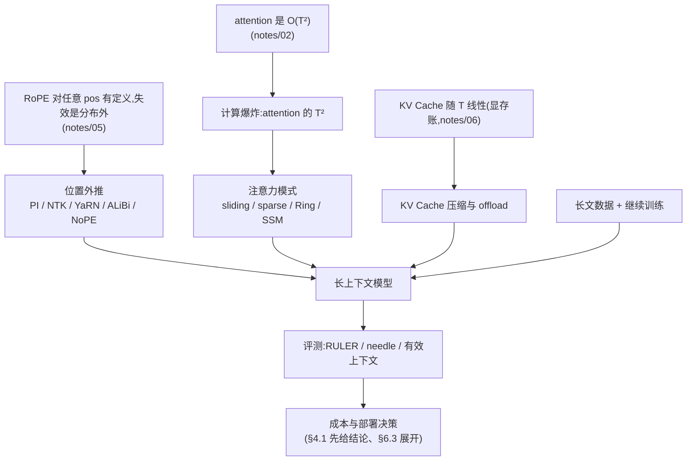
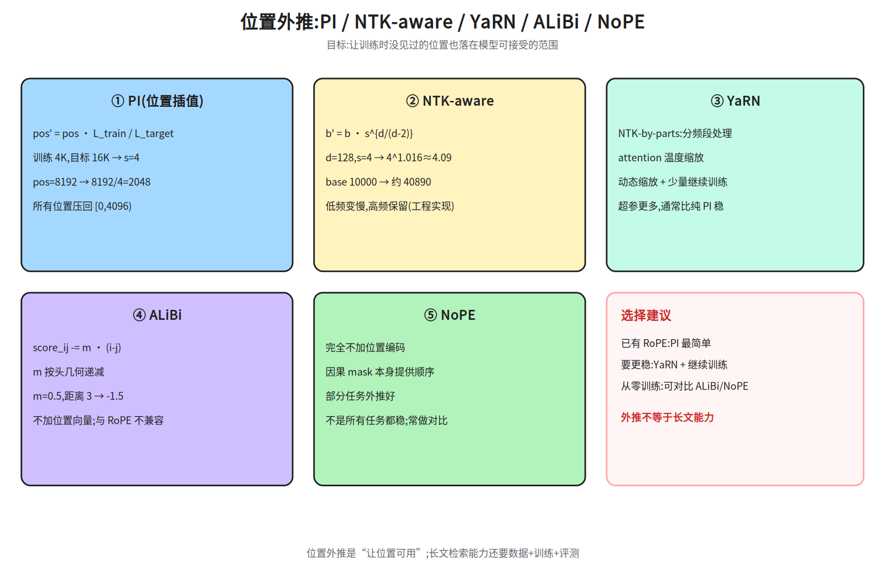
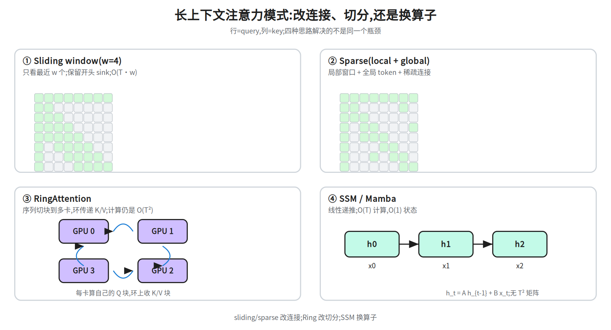
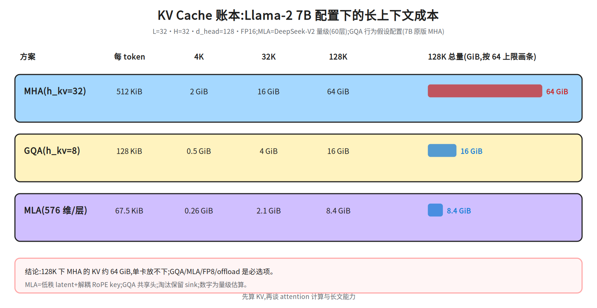
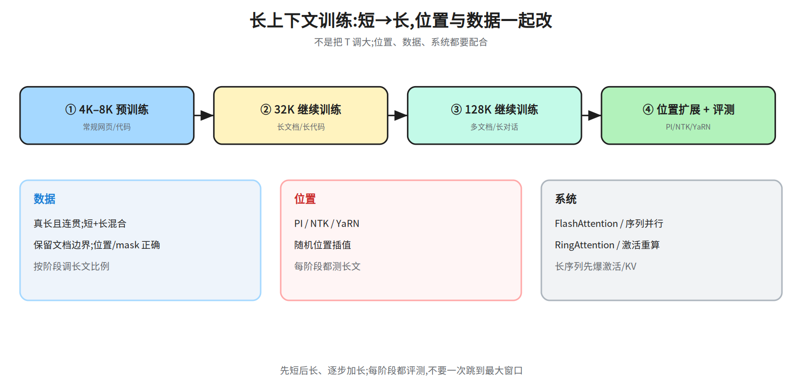
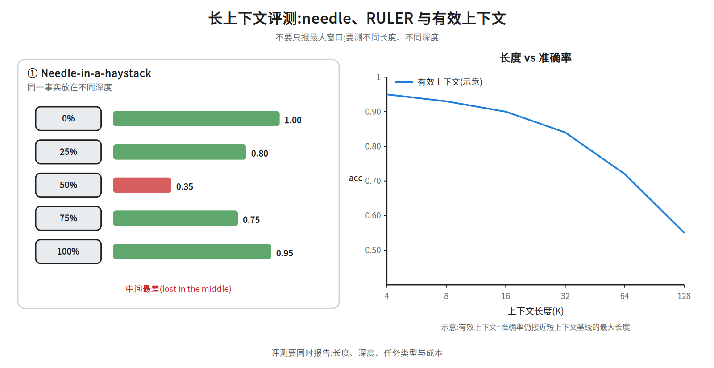

# 第十四层 · 长上下文 —— 位置外推、注意力模式与 KV 账本

> 本层回答:模型宣称 128K/1M 上下文,到底靠什么做到?位置编码怎么外推?sliding window / sparse / RingAttention / SSM 各自省了什么?KV Cache 为什么是长上下文的第一成本?

> **前置(按节)**
> - §1–§2:先看 `notes/05_modern.md §2`(RoPE)与 `notes/07_pretraining.md §4`(长上下文预训练)。
> - §3:先看 `notes/02_attention.md §3、§9`(attention 与 O(T²))。
> - §1.2、§4:先看 `notes/06_inference.md §3`(KV Cache;§1.2 就用这条公式算账)与 `notes/22_inference_systems.md §3、§10`(KV 账本/长上下文推理)。
> - §5–§6:先看 `notes/07_pretraining.md` 的 §2.4(packing)、§4.2–§4.3(短→长三阶段、needle/LongBench)、§6(预训练评测:held-out ppl/BPB、few-shot、scaling 外推、污染检查),再 `notes/09_evaluation.md §1`(benchmark 口径,RULER 在此)。
>
> **建议路径(3 次 × 45 分钟)**
> - 第 1 次(必学):§1 为什么难 + §2 位置外推(PI/NTK/YaRN/ALiBi/NoPE,图 50a)。
> - 第 2 次(必学):§3 注意力模式(50b)+ §4 KV 压缩/offload 账本(50c)。
> - 第 3 次(必学):§5 长上下文数据与训练(50d)——它是 §2 位置外推与 §4 压缩手段落成模型的唯一接口,不能跳过;§6 评测与成本(50e)——§6.1/§6.2 必学(needle/RULER 与「有效上下文」的定义、相对阈值口径唯一定位在这里,§1.3 只是预告),§6.3 成本可复述、算加分项。

## 0. 依赖图(学习顺序)
> **读图约定**:这张图只画「学什么依赖什么」的主干,不为每一节各设节点;I/J 是**落位(收口处)**,不是概念首次出现的地方。§1.3 的有效上下文曲线是能力账的预告(定义与阈值口径在 §6.2),§4.1 结尾的成本排序是先给结论(prefill/decode/服务侧展开在 §6.3)——顺序没有错,按 §1→§6 读即可。
另有一处预告:§2.2 的 NTK-aware 行拿 §6.3 的 `d_model=4096`(论文口径的 `|D|`)对比 `head_dim=128`(实现口径)(4096 由 §1.2 的 `d_head=128 × H=32` 得到),不是漏读。



## 1. 为什么长上下文难:三条独立的账

### 1.1 计算账:attention 的 O(T²)

标准 self-attention 的 scores 是 `[T, T]`,计算量约 `O(T²·d)`。把 `T` 从 4K 提到 128K(`×32`),attention 计算约 `×1024`;这不是“线性变长”,而是**平方级**。

### 1.2 显存账:KV Cache 随 T 线性长

推理时每层要缓存 K/V(见 `notes/06_inference.md §3`):

```
KV Cache ≈ 2 · L · B · T · H_kv · d_head · bytes
```

`T` 翻倍,Cache 翻倍;128K 的 KV Cache 是否超过权重取决于 batch 与头配置:7B-MHA 在 128K 时约 64 GiB(本节显存用 GiB、权重与 PCIe 用 GB,1 GiB≈1.0737 GB,故 64 GiB≈68.7 GB),68.7 GB 约为 FP16 权重 14 GB 的 4.9 倍(KV 与权重打平约在 2.7 万 token,32K 时 16 GiB 已是权重的 1.2 倍),7B-GQA-8 约 16 GiB(=17.18 GB,已是 14 GB 权重的 1.23 倍,交叉点约 107K token,128K 早已越过),70B-GQA-8 约 40 GiB 仍远小于权重 140 GB(§4 给具体数字)。

  这三个结论数的公共口径是 B=1、FP16、d_head=128;层数不统一、按模型取——7B 两档 L=32,70B 一档 L=80:7B-MHA 取 H_kv=32、7B-GQA-8 取 H_kv=8、70B-GQA-8 取 H_kv=8(320 KiB/token × 131072 ≈ 40 GiB,140 GB 权重需 ~427K token 才追平)。B、L、H_kv 一改,交叉点随之变。

### 1.3 能力账:“能塞进去”≠“能用好”

- **lost in the middle**:信息放在长上下文中间时最容易漏(Liu et al., 2023)。
- **有效上下文**:模型在 128K 上的准确率可能远低于 8K;要测“不同长度 + 不同深度”的曲线,而不是只看最大窗口。

> 三条账要分开算:计算看 `T²`,显存看 `T`,能力看评测曲线。
> 口径提示:这里「能力」只做预告——有效上下文的定义、相对阈值与曲线读法在 §6.2,评测任务在 §6.1;成本这条线在 §4.1 先给部署结论、§6.3 收口,读到 §6 时属于复述与展开,不是新概念。面试被问“长上下文为什么贵”时,先分这三条,再谈优化。

## 2. 位置外推:让模型见到训练时没见过的位置

### 2.1 问题:RoPE 的位置在训练分布内

RoPE 用 `θ_i·pos` 旋转 Q/K(见 `notes/05_modern.md §2`)。训练只见过 `pos < 4096`;直接喂 `pos=100000` 时,旋转角进入模型没学过的范围,注意力分数会失真。

### 2.2 五种常见方案



| 方案 | 做法 | 直觉 | 代价/坑 |
|---|---|---|---|
| **PI**(Position Interpolation) | 把目标位置线性压缩回训练范围:`pos' = pos · L_train / L_target` | 128K 压回 4K,所有位置都“见过” | 压缩后相邻位置更挤,短距离分辨率下降 |
| **NTK-aware** | 调大 RoPE base:`b' = b · s^{d/(d-2)}`,`s=L_target/L_train` | 低频转得慢、高频保留,减少远处失真 | 公式是常见工程实现,不同框架细节不同;`b`=RoPE base(`θ_i=b^{-2i/d}` 的底数,常见 10000),`d`=工程实现取的 head_dim(7B 为 128);论文定义的 `|D|` 才是隐层宽度(7B 为 4096,即 §6.3 的 d_model)。按实现口径取 128 得 `s^{128/126}≈s^{1.016}`,按论文口径取 4096 得 `s^{4096/4094}≈s^{1.0005}`,两者都≈`b·s`、只差百分之几(s=4 时约 2%,s=32 时约 5%),所以两套口径都不等于「没缩放」,差别只在偏离论文指数的程度——指数要 |D| 小才显著(|D|=8 时是 `s^{1.33}`) |
| **YaRN** | NTK-by-parts + attention temperature(另可附加 Dynamic Scaling 动态缩放) | 不同频段分别处理,兼顾近/远 | 超参多,需按模型调;s 按目标长度取定,现算 s 属附加项 |
| **ALiBi** | 不加位置向量;在 attention 分数上加 `-m·(i-j)` | 距离越远惩罚越大;`m` 按头几何递减 | 概念上取代位置编码(训练不用位置向量,与 RoPE 是二选一);但它的形式是加在分数上的偏置,工程上可与 RoPE 叠用(叠用超出 ALiBi 原设定,要自己评测);外推好但长文检索未必强 |
| **NoPE** | 完全不加位置编码,只靠因果 mask | 因果结构本身隐含顺序 | 不是所有任务都稳;常与 RoPE 混用/对比 |
> 表里先用到的 YaRN 三个词,这里只留一句口径(定义、式号与数值例子统一放在「诚实边界」之后那一段,不重复写):NTK-by-parts = 按频率分档;attention temperature = logits 进 softmax 前先降温;动态缩放 = 推理时按当前长度现算 s,是 YaRN 论文另设的附加项、不是本体。NTK-aware 那格里的 4096 是论文口径的 `|D|`(隐层宽,即 §6.3 的 `d_model`,由 §1.2 的 `d_head=128 × H=32` 得到);那串百分比只说明「两套口径的差别」,本节不引入新符号。

**数值例子(PI)**:训练 `L_train=4096`,目标 `L_target=16384`,`s=4`。原位置 `pos=8192` 压缩为 `8192/4=2048`;所有目标位置都落回 `[0,4096)`。

**数值例子(ALiBi)**:某头斜率 `m=0.5`,query 在 `i=10`,key 在 `j=7`,距离 3,则分数加 `-0.5×3=-1.5`。

> **诚实边界**:PI/NTK/YaRN 都是“让位置落在可接受范围”的工程手段,不保证长文推理能力;还要继续训练/评测。NTK-aware 的 base 缩放公式最早来自社区实践,但 YaRN 论文附录 A.2 的 Definition 已把它写成正式定义 `b' = b·s^{|D|/(|D|-2)}`(附录 A.2 给推导;`|D|` 按论文定义是隐层宽度(7B 为 4096,所以式(2) 的分母 √|D| 就是 √4096),不是 head 的维度;工程实现(HF 等)改用 head_dim=128、分母 √128,那是另一套口径),所以它既有论文里的官方形式、也有多种工程实现;引用时写清实现。

  表里 YaRN 那三个词补一下定义:**NTK-by-parts** = 按频率分档处理,低频维做插值、高频维保持原样(不是整体缩放);**attention temperature** = 原文式(14)(15):logits 进 softmax 前除以 `t`,且 `1/√t = 0.1·ln s + 1`(s=8 时 1/√t≈1.21)。实现上不改 attention 代码,把 Q/K 的 RoPE embedding 各乘 `1/√t`(cos/sin 同乘),等价于 logits 乘 `1/t = (0.1·ln s + 1)²`(s=8 时 ≈1.46):是「降温」不是「升温」:softmax 的有效温度从 1 降到 t=1/1.46≈0.68,logits 被放大 1.46 倍,分布因此变尖,用来补偿长序列下 attention 分布被摊平、熵升高的效应(乘 1.46 等价于除以 0.68;若除以 1.21 则是把 logits 缩到 0.83 倍,反而升温、更平),别把它和采样温度(见 `notes/10_decoding.md`)混为一谈;**动态缩放** = 推理时按当前实际长度现算 s 与温度,而不是训练时固定一个。

### 2.3 怎么选

- **已有 RoPE 模型、想扩窗口**:优先 PI(简单)或 YaRN(效果更稳),配合少量长文继续训练。
- **从零训练**:ALiBi/NoPE 可作为对比方案;主流大模型仍以 RoPE 为主。
- **只改推理、不训练**:PI/NTK 可以临时试,但分布偏移大时效果有限;要评测再上线。

## 3. 注意力模式:少看一些,或把序列切开



### 3.1 Sliding window

每个 token 只看最近 `w` 个 token(如 Mistral 7B 的 window=4096),复杂度从 `O(T²)` 降到 `O(T·w)`。

- 信息仍能通过**多层**逐跳传播:理论感受野约 `L·w`(32 层 × 4096 ≈ 131K),但不是精确的“全连接”。
- 适合局部连贯的文本/代码;对“远处精确检索”不如全注意力。
- **Attention sink**:滑窗/淘汰如果把开头 token 全丢掉,模型会崩;保留少量开头 token(attention sink)或 StreamingLLM 的 sink+window 是常见做法。

  机制:softmax 每行必须归一到 1,当这一行没有真正相关的 key 时,多余的注意力会摊到少数几个「排水口」token(通常是开头几个,其 value 被大量读出);这些 token 一被删,注意力被迫重新分配到其余 token,分布失真、输出崩坏。所以 §4.2 淘汰 KV 时要固定保留开头 1–4 个 sink token(数量按模型实测调)。

### 3.2 Sparse attention

Longformer/BigBird 等用“局部窗口 + 全局 token + 随机/膨胀连接”的稀疏模式,把 `T²` 降到近线性。

- 关键是**保留全局 token**(如 `[CLS]`、问题 token)和跨块连接;
- 稀疏模式是手工设计的先验,任务不匹配时会掉点。

### 3.3 RingAttention

把长序列按块切到多张卡上,每张卡持有自己的 Q 块,沿环传递 K/V 块,边算边传、计算与通信重叠。

- **计算量仍是 O(T²)**,但每卡显存/序列长度变为 `O(T/P)`;
- 适合“单卡放不下”的训练/推理,不是降低总 FLOPs;
- 依赖高速互联(见 `notes/24_distributed_base.md`)。

### 3.4 SSM / Mamba

状态空间模型用线性递推 `h_t = A h_{t-1} + B x_t` 代替 attention:

- LTI SSM 训练可用卷积形式并行;Mamba 的选择性 SSM 用并行 scan,不是卷积。推理每步 `O(1)` 状态、总 `O(T)`;

  术语拆开:LTI(线性时不变)= A、B、C 不随 t 变,递推可展开成对输入的固定卷积核 `y = x * K`(核长 T),所以能一次卷积/FFT 算完;Mamba 让 B、C、Δ 随输入变(选择性),核不再固定,只能并行 scan。
先给结论(§7 第 8 题背这一句就够):训练是 O(T) 工作量、O(log T) 深度,推理每步 O(1) 状态、总 O(T);下面点到的算法名只是「复杂度按哪种实现算」的注脚,不必记——work-efficient = 工作量最优的前缀扫描,Brent-Kung/Blelloch = 它的上扫/下扫两趟实现,Hillis-Steele = 朴素的两两合并版,FFT = 把卷积降到 O(T log T) 的快速傅里叶变换。「pseudo-linear」是 Mamba 引言对卷积式 SSM 的叫法,前置篇没有这个概念,读到这里不用回头找。复杂度口径要按实现分开,别压成一个数:训练若走逐 token 递推(按 B·L·D·N 计),是 O(T) 工作量、但是 O(T) 深度的纯串行链(每步依赖前一步,没有并行度);走 work-efficient 前缀扫描(Brent-Kung/Blelloch 上扫/下扫)才是 O(T) 工作量、O(log T) 深度——并行扫描的全部意义就在把深度从 T 压到 log T;只有朴素 Hillis-Steele 版 scan 才是 O(T log T) 工作量,O(log T) 深度;卷积式走 FFT 是 O(T log T)(直接卷积 O(T²))。Mamba 原文 §3.3.2 的口径正是这样:朴素递归 O(BLDN) FLOPs(随 L 线性)、卷积 O(BLD log L),引言贡献段说的「比卷积式 SSM 的 pseudo-linear 更快」(这句在 §1 引言的贡献段,不在摘要;摘要只讲线性扩展与吞吐,没有 pseudo-linear 这个词)指的就是递推/scan 对 T 线性,被叫 pseudo-linear 的是卷积式 SSM。所以「对 T 线性」与「O(T log T)」不冲突:前者是递推/work-efficient scan 的训练 FLOPs,后者只是朴素并行扫描或 FFT 卷积的实现代价;推理的逐 token 递推同样是总 O(T)、每步 O(1),O(T) 并非推理独有。注:符号有两套,别混。递推 `h_t = A h_{t-1} + B x_t` 里的 A、B 是状态矩阵/输入矩阵;而 FLOPs 式 `O(BLDN)` 里的 B 回到 §1.2 的 batch size,L 是序列长度(不是层数),D 是 d_model 模型宽度(不是 §2.2 的 head_dim d),N 是 SSM 的状态维(每个通道的状态数,不是 §6.3 的 7e9 参数量)——所以 `O(BLDN)` 就是「batch × 序列长 × 模型宽 × 状态维」的线性量级。

  另有两处缺式,补齐才好读:输出是 `y_t = C h_t`(C 决定「从状态里读什么」,所以「B、C、Δ 随输入变」里 C 才有出处);`Δ` 是离散化步长,连续时间 SSM 中 `Ā=exp(ΔA)`、`B̄≈ΔB`,Mamba 让它随 token 变,相当于按输入调「记多久、写多少」。**并行 scan** = 前缀扫描:递推可写成仿射复合 `(A,B)∘(A',B')=(A'A, A'B+B')`,结合律成立,于是 T 步串行可压成 log T 轮两两合并并行算完(朴素 Hillis-Steele 版 O(T log T) 工作量;work-efficient 的上扫/下扫只 O(T) 工作量,两者深度都是 log T)——这正是「核不再固定却仍能整段并行训练」的机制,推理时才退回逐 token 的 O(1) 状态更新。
- 没有 `T²` 的注意力矩阵,长序列成本低;
- 代价是“精确检索/复制”能力通常弱于 attention;常见 hybrid(Mamba + attention)折中。

> 面试口径:sliding/sparse 改**连接模式**,Ring 改**切分方式**,SSM 改**序列建模算子**;三者不是同一层的东西。

## 4. KV Cache 压缩与 offload:长上下文的第一成本

### 4.1 账本:以 Llama-2 7B 为例

配置:L=32 层,H=32 头,d_head=128,FP16(2 bytes),MHA。

```
每 token:2 · 32 · 32 · 128 · 2 = 524,288 B = 512 KiB
4K:   512 KiB × 4096 ≈ 2 GiB
32K:  ≈ 16 GiB
128K: ≈ 64 GiB
```



- **GQA(h_kv=8)**:每 token 128 KiB;128K ≈ 16 GiB(头数 32→8 是 1/4(7B);前置篇 22 §3.2 的 1/8 指 70B 的 64→8,两个数各自正确,不是笔误)。
- **MLA(DeepSeek-V2)**:每层缓存 `d_c + d_h^R = 512+64=576` 维;60 层 FP16 ≈ 67.5 KiB/token;128K ≈ 8.4 GiB(具体 config 以官方为准)。
  MLA 先把 K/V 压成低秩 latent `c_t^{KV}`(`d_c=512`),再额外缓存一份**解耦 RoPE key** `k_t^R`(`d_h^R=64`);K/V 在用时上投影出来。与 GQA/MQA 的区别:后者共享**头**,MLA 压缩**每层 K/V 的表示**,缓存的是 latent 而不是完整 K/V。
- **FP8 KV**:再减半;但要做 scale/outlier 处理(见 `notes/22_inference_systems.md §8`)。

### 4.2 压缩与淘汰

- **GQA/MQA/MLA**:减少 K/V 头数或维度(见 `notes/05_modern.md §3`)。
- **KV 量化**:INT8/FP8,按 head/block 维护 scale;注意长上下文 outlier。
- **淘汰/稀疏**:H2O 等只保留“重要 token”的 KV;实现简单但可能丢关键信息。淘汰时要保留少量 attention sink(开头 token),否则容易崩。
- **offload**:把冷 KV 放 CPU/SSD,需要时搬回 GPU。PCIe Gen4 x16 理论 ~32 GB/s,实际 20–25 GB/s;把 16 GiB(17.18 GB)的 GQA cache 单向全搬一次约 0.7–0.9 s(17.18 GB ÷ 20–25 GB/s);offload 要搬出再搬回,往返约 1.4–1.7 s,故适合“分块/预取”,不适合每 token 全量搬。
- **PagedAttention**:分页管理 KV,减少碎片(见 `notes/22_inference_systems.md §5`)。
  一句话够面试用:PagedAttention 把 KV 按固定大小 block 分页存放、用 block table 做逻辑→物理映射,省的是**显存碎片**(外部/内部碎片,同样显存能塞更多序列),不改每步要搬的 KV 字节,所以不降带宽;offload 换的是存储层级(显存→CPU/SSD),量化换的是每字节精度(FP16→FP8/INT8),前缀缓存省的是跨请求重复 prefill(相同前缀的 K/V 只算一次),H2O/StreamingLLM 换的是「保留哪些 KV」(重要 token / sink+window)。五者不在同一层,别混答。

> 长上下文成本排序:**显存侧:KV 与权重的交叉点随配置变——7B-MHA 在 32K(16 GiB)已反超 14 GB 权重,7B-GQA-8 约 107K token 才打平,70B-GQA-8 单条要到 ~427K token(4K 下 batch≈104 就反超);故「128K 才反超」只在 7B-GQA-8、batch=1 时成立;计算侧:attention 是 O(T²) 的增长项**。先看 KV 账本,再决定 GQA/MLA/量化/offload。

## 5. 长上下文数据与训练



### 5.1 三阶段

1. **短上下文预训练**:4K–8K,常规网页/代码/书。
2. **长文继续训练**:32K→128K,加入长文档、长代码库、多文档 QA、长对话;序列长度逐步加,避免一上来 OOM/发散。
3. **位置扩展 + 评测**:RoPE 扩展(PI/NTK/YaRN)、随机尺度插值(见下);每阶段都测长文任务。


   **随机尺度插值**(random scale interpolation,本节主线术语;这个名字专指下面的「每 batch 随机采一个全局缩放尺度 s」,「随机位置插值」不是它的别名、而是下条 Ruoss 版)= 继续训练时每个 batch 随机采一个缩放尺度 s(在训练长度到目标长度之间取)再做位置插值,让模型见过连续的一整段尺度、不只适配某个固定 s;与 PI(固定 s)、YaRN(按目标长度取固定 s)的区别是 s 在训练期就随机化;「推理时按当前长度现算 s」是 YaRN 论文另设的 Dynamic Scaling(动态缩放),只有与 YaRN 合用时才叫 Dynamic-YaRN,不是 YaRN 本体的组成部分,属于纯推理期的做法:只按当前长度现算 s 与温度,不改权重、无需额外继续训练——这正是 §2.3「只改推理、不训练」那条判断的适用对象。

  主线与出处(先记这条):面试问「随机尺度插值」时,按上面「每 batch 随机采一个全局缩放尺度 s」这套答——它是本节主线、工程实践里的叫法,没有单篇论文的正式定义;被追问文献时再补一句「Ruoss et al. 2023 的 Randomized Positional Encoding 是另一种机制,随机化的是位置集合」,就不会把工作定义当成引了一个无出处的说法。
  来源与同名辨析(上面那条已按机制改叫「随机尺度插值」,是本节自洽的工作定义、正文未标来源;「随机位置插值」这个名字留给下面 Ruoss 版):Ruoss et al.(2023)《Randomized Positional Encodings Boost Length Generalization of Transformers》里的做法是「先模拟更长序列的位置、再随机抽一个递增的位置子集来适配当前长度」,随机化的是「位置集合」(逐 token/逐样本),不是每 batch 一个全局缩放尺度 s。中文里两者常被混译成同一个「随机位置插值」,但机制不同:Ruoss 版随机化的是位置集合,本节主线随机化的是缩放尺度;引用时写清是哪一种(本节主线 = 随机尺度插值),否则会把关键机制读丢。

### 5.2 数据与 packing

- 长文要**真长且连贯**:书籍章节、长代码文件、多文档;不要只把短文本随机拼接冒充长文。
- packing(把多条短样本首尾拼进一个定长序列,以提高 token 利用率)时要保留文档边界:用 EOS 分隔、文档内保持因果、标签按边界处理;跨文档隔离是二选一——要么在 attention 里加 document mask(block-diagonal)互相看不见,要么接受轻微跨文档污染(很多实现为了效率会接受),这一取舍见 `notes/07_pretraining.md §2.4`;「位置 id 在每篇文档内从 0 重数」是实现选择而非硬性要求(不少实现只加 document mask、位置 id 保持连续),该篇并未提出这条;长文样本的 attention mask/位置要正确。
- 数据配比:长文比例过高会牺牲短任务;常用“短+长”混合、按阶段调。

### 5.3 系统

- **FlashAttention**:不把 `[T,T]` 分数矩阵写回 HBM(高带宽显存,GPU 的片外显存),分块搬进片上 SRAM(shared memory/寄存器那一层,容量百 KB 级、带宽高一个数量级以上)算完,省的是 HBM 读写(FLOPs 不变;完整定义见本节末补充段);**序列并行/上下文并行**:沿序列维切到多卡,每卡只放一段的激活/KV;**RingAttention**:按块切序列、沿环传 K/V,计算与通信重叠(§3.3);**激活重算**:前向只存少量 checkpoint,反向重算中间激活,用算力换显存;
- 训练长序列时,显存往往先被激活/KV 类中间量吃满,不是权重(见 `notes/23_training_systems.md`)。


  两个存储层级这里给完整定义(上面第一条已给一句话口径):**HBM** = 高带宽显存,即 GPU 的片外显存(权重、KV Cache、`[T,T]` 分数矩阵平时都放这里);**SRAM** = 片上缓存(CUDA 里的 shared memory / 寄存器那一层),容量百 KB 级但带宽比 HBM 高一个数量级以上。FlashAttention 的省法是:把 Q/K/V 分块搬进 SRAM 算完再写回,`[T,T]` 矩阵从不整体落到 HBM——省的是 HBM 读写带宽,FLOPs 不变,这也正是它与「显存账」直接相关的原因。

  为什么先吃满的是激活:**激活** = 前向时每层产生的中间张量(Q/K/V 投影、attention 输出、MLP 隐层等),训练要用它做反向传播算梯度,所以必须留到反向后才能释放(推理不存,这一项几乎为 0);激活量 ≈ `层数 × batch × 序列长度 × hidden × 常数`,随 T 线性增长且还要乘 L、B;权重是常数 `参数量 × bytes`。7B FP16 权重约 14 GB 是定值,而 128K、batch=1 时单层要存的激活就是 GB 量级(128K × 4096 × 2 B ≈ 1 GiB/张量),乘 32 层轻松超过权重——所以长序列训练先被激活卡住,才需要重算、切分与 FlashAttention。

## 6. 评测与成本



### 6.1 三类评测

- **Needle-in-a-haystack**:在长文不同深度放一个事实,问模型能否找到;要测 0/25/50/75/100% 深度。
- **RULER**:多类合成任务(检索、多跳、聚合)在 4K–128K 不同长度上的准确率;比单点 needle 全面。
- **真实任务**:LongBench(长文 QA/摘要/代码)、多文档 QA、长对话;注意任务是否真的需要长距离信息。

### 6.2 有效上下文

不要只报“支持 128K”。定义**有效上下文**:在给定任务上,准确率不低于短上下文基线某个相对阈值的最大长度(如以 4K 基线为参照取其 90%,即允许相对下降 10%(相对口径,不是绝对 10 个百分点:基线 80% 时门槛是 72%,只降 8 个百分点))。常见曲线是:长度增加 → 先平、后缓慢下降、再陡降;中间位置更差(lost in the middle)。

### 6.3 成本

- **prefill**:`O(T²)` 的 attention + `O(T)` 的线性层;128K 的 prefill 比 4K 贵约两个数量级(attention 部分 ×1024;整段还含 O(T) 线性层,只 ×32;7B 实算 d=4096、L=32 时总倍数约 ×103)。

  ×103 补上可复核的口径:prefill 是 causal 的,attention 只算下三角,全序列 FLOPs ≈ `2·L·T²·d`(每层 QK^T 与 AV 各约 `T²/2·d` 次 MAC,合 `T²·d` MAC = `2·T²·d` FLOPs),线性层 `2·N·T`(N 取 7e9,即 7B 名义总参数、含 embedding;若改用前置篇的单层口径 12d²·L=6.44e9,线性层为 5.28e13、总量比 ×108、4K 的 attention 占比 7.7%,不是算错),且统一按 **1 MAC = 2 FLOPs** 计。
  **MAC** = multiply-accumulate,一次乘加 `a×b + c`(先算 `a×b`,再把结果累加进 `c`);硬件与论文常按 MAC 计数,而 FLOPs 把乘、加各记一次,所以 1 MAC = 2 FLOPs。本文的「`T²/2·d` 次 MAC」指每层 QK^T 有 T²/2 个点积、每个点积 d 次乘加,合 `T²/2·d` 次;AV 同理,两项相加为 `T²·d` MAC,乘这个 2 才得 `2·T²·d` FLOPs——后面 ×103/×164 全部数字都以此 2 为地基。d=4096、L=32 时:4K 一档 attention≈4.4e12、线性层≈5.7e13,attention 占约 7%;128K 一档 attention≈4.5e15、线性层只≈1.8e15,总量比 4K 约 ×103(6.33e15 ÷ 6.17e13)。若统一改成「MAC 记一次」,两项必须一起减半(2.2e12 与 2.87e13 同步除以 2),占比与比值都不变:4K 里 attention 仍约 7%,总量比仍 ≈×103——单位换算同时缩放分子与分母,改不了比值。反过来,拿满 T²(非因果)的 `4·L·T²·d` 去配 causal 的线性层,才会算出 4K 占比约 13%、总倍数 ≈×164(1.084e16 ÷ 6.614e13 = 163.9),那是口径没统一(被高估的是增长倍数,约 1.59 倍 = 164÷103;128K 的绝对总量是 1.08e16 对 6.33e15,约 1.71 倍,别把这个 1.6 当成总量之比),不能拿来复核 ×103。
- **decode**:每步要读全部 KV;KV 越大,memory-bound 越严重。

  两个词先定义,否则这句因果是断的:**prefill** = 把整段输入一次并行送进模型、一次算出所有位置的 K/V(和训练前向同构),区别 decode 的逐 token 前向,贵在 attention 的 `T²` 项;**memory-bound**(带宽瓶颈)= 按 roofline,单步耗时 ≈ 要搬的字节 ÷ 有效带宽,而 FLOPs 远没喂满算力;decode 每步要搬「全部权重 + 全部 KV」却只算 1 个 token,所以 KV 越大、搬得越多、单步越慢——瓶颈在带宽不在算力,这也是 GQA/量化/offload 能直接加速的原因。
- **服务**:长上下文请求会拉低并发;需要分块 prefill(chunked prefill)、前缀缓存、KV 量化/压缩、PD 分离(这四项见 `notes/22_inference_systems.md §10`);KV offload 的账见 §4.2,「按长度分层调度」属工程经验、notes/22 未覆盖——引用只挂那四项。
  **PD 分离**补半句:P=prefill(把整段输入一次并行算完、得到全部位置的 K/V),D=decode(逐 token 生成)。两者瓶颈相反:prefill 吃算力(attention 的 T² 项),decode 是 memory-bound、且要一直占着 KV。把 P 与 D 拆到不同机器(甚至不同型号的卡)上,各自按自己的瓶颈配资源、互不拖累,KV 经高速互联由 P 机传给 D 机;长请求不再把 decode 的并发槽位长时间占住,所以能救并发。代价是多一跳 KV 传输与调度复杂度。

## 7. 面试要点

1. **长上下文为什么贵?** → 三条账:attention `O(T²)`、KV Cache `O(T)`、能力随长度/深度下降。
2. **PI 是什么?** → 把目标位置线性压缩回训练范围:`pos' = pos·L_train/L_target`;简单但损失近距分辨率。
3. **NTK-aware / YaRN 的区别?** → NTK 调 base(频率缩放);YaRN 做分频段(NTK-by-parts)+ 温度,通常更稳;动态缩放是另设的可选附加项(推理期按当前长度现算 s),不算 YaRN 本体。
4. **ALiBi 怎么做?** → 不加位置向量,在 attention 分数上加 `-m·(i-j)`,距离越远惩罚越大。
5. **NoPE 为什么能工作?** → 因果 mask 本身提供顺序信息;不是所有任务都稳。
6. **sliding window 省了什么?** → 连接数从 `T²` 降到 `T·w`;信息靠多层传播,远处精确检索会弱。
7. **RingAttention 降低计算量吗?** → 不,仍是 O(T²);它把序列/显存切到多卡,计算通信重叠。
8. **SSM 和 attention 的区别?** → 线性递推、对 T 线性(训练递推 O(BLDN) 与 work-efficient scan 都是 O(T) 工作量;只有朴素 Hillis-Steele scan 与 FFT 卷积是 O(T log T),直接卷积 O(T²);推理逐 token 递推总 O(T)、每步 O(1))、固定状态;精确检索弱,常 hybrid。
9. **KV Cache 怎么省?** → GQA/MQA/MLA(省头/省维度)、量化(省精度)、淘汰/PagedAttention/前缀缓存(省 token、省碎片、省重复 prefill)、offload(省显存层级);各层一句话区别见 §4.2 末那段;先算账再选。
10. **怎么评测长上下文?** → needle 不同深度 + RULER 多任务多长度 + 真实 LongBench;报有效上下文与成本。

## 常见坑

- 把“最大窗口”当“有效上下文”:128K 支持不等于 128K 都好用。
- 只测开头/结尾,不测中间:lost in the middle 会漏。
- 以为 RingAttention 降低 FLOPs:它降低的是单卡显存/序列切分。
- 把 sliding window 的 `L·w` 当精确感受野:多层传播是近似上界。
- 直接外推 RoPE 不继续训练:分布偏移,分数会崩。
- 只算权重不算 KV:长上下文 decode 的瓶颈通常是 KV 带宽/显存。
- 忽略 offload 的 PCIe 带宽:以 §4.2 那笔 16 GiB 的 GQA cache 为例,全量搬运一次(单程)约 0.7–0.9 s、往返 1.4–1.7 s(7B-MHA@128K 是 64 GiB,同带宽下应为 2.7–3.4 s),不能每 token 搬。

## 动手清单

1. **PI 复算**:训练 4K、目标 16K,把 pos=0/4096/8192/16383 压缩,验证都落在 `[0,4096)`。
2. **KV 账本**:用 Llama-2 7B 配置算 4K/32K/128K 的 MHA 与 GQA-8 KV 大小;验收:与 §4.1 一致。
3. **needle 评测**:在 8K/32K 文本的 0/50/100% 深度各放一个事实,测召回;验收:报告不同深度准确率。
4. **sliding window 估算**:给定 `w=4096,L=32`,估算理论感受野,并说明为什么不是精确全连接。

## 相关图

`50a_position_ext` · `50b_attention_patterns` · `50c_kv_ledger` · `50d_long_train` · `50e_long_eval`
(均在 `diagrams/`,横竖双版本)

## 下一步

第十五层 · PEFT/LoRA:Adapter、prefix/prompt tuning、LoRA/QLoRA/DoRA、rank/alpha、target modules、合并与多适配器服务、显存账本。
