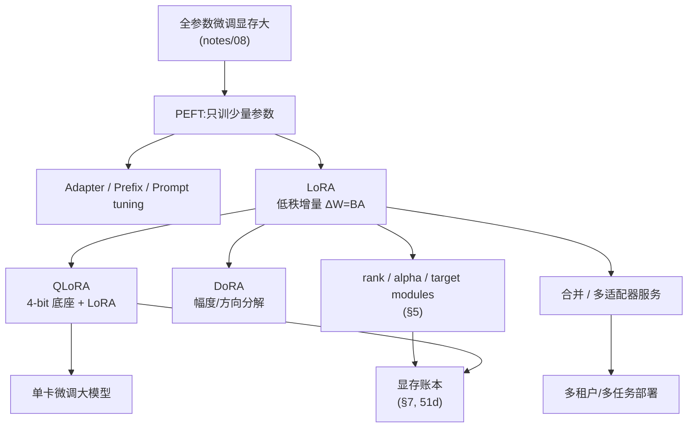
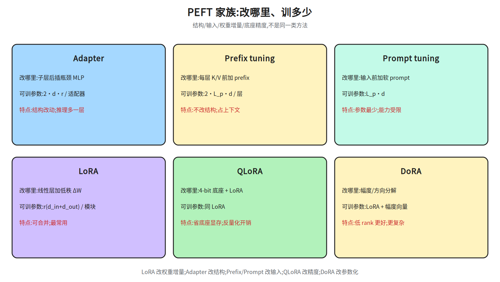
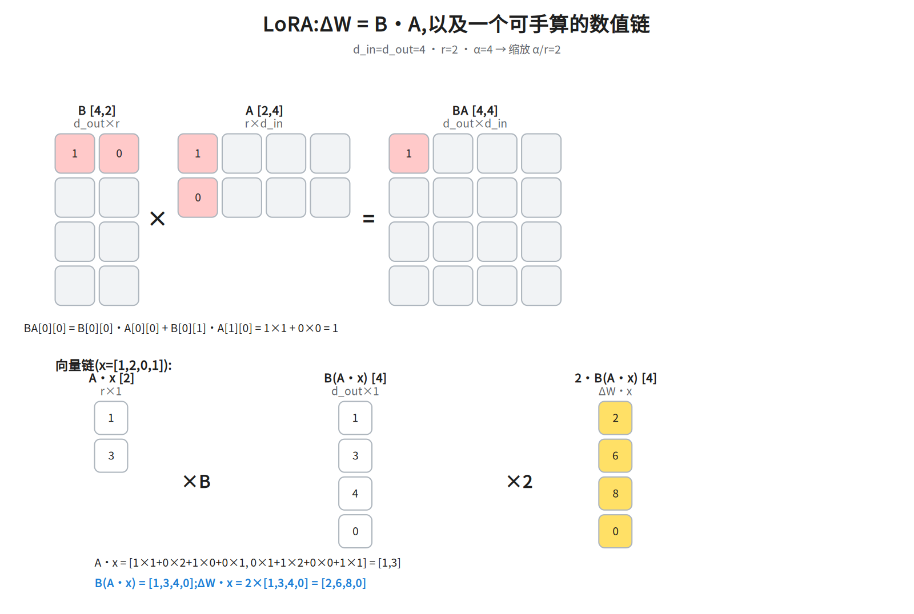
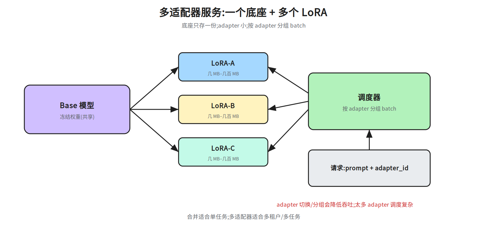
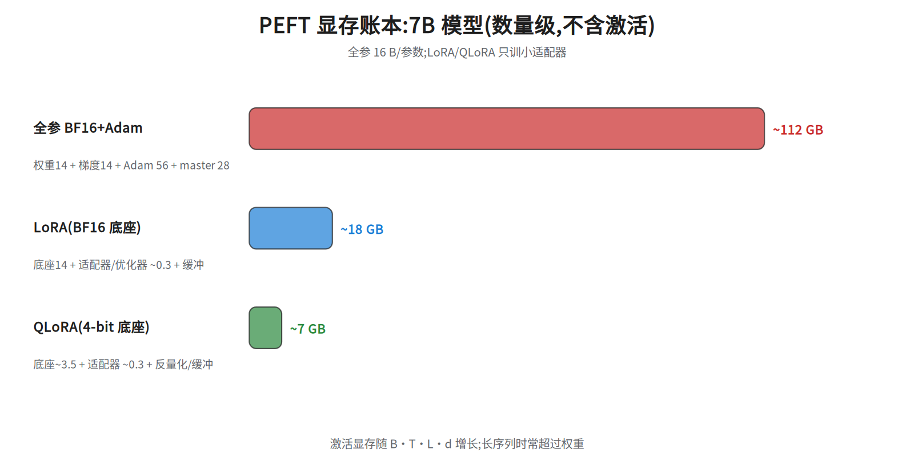

# 第十五层 · PEFT 与 LoRA —— 用 0.1% 参数做微调

> 本层回答:全参数微调为什么贵?Adapter / prefix / prompt tuning / LoRA / QLoRA / DoRA 各自改哪里?rank、alpha、target modules 怎么选?多个 adapter 怎么服务?

> **前置(按节)**
> - §1–§2:先看 `notes/08_alignment.md §1`(SFT)与 `notes/03_block.md`(线性层/Block 结构)。
> - §3 LoRA 数学:只需矩阵乘法与维度;正文给数值例子。
> - §4 QLoRA/DoRA:先看 §3;量化基础见 `notes/22_inference_systems.md §8`。
> - §5:rank/alpha/target 本层自洽,不需要外部笔记;唯一外链是末条「训练数据」用的 `notes/08_alignment.md §1`(SFT 数据/格式)。
- §6:合并/多适配器本层自洽,不需要外部笔记。
- §7:先看 `notes/22_inference_systems.md §3`(显存账本)。本层全节只算显存,不做 roofline/算术强度/带宽分析,所以 `notes/06_inference.md §5` 的 memory-bound 判据不必先读,留作 §7 之后对照推理瓶颈用。
>
> **建议路径(2 次 × 45 分钟)**
> - 第 1 次(必学):§1 为什么 PEFT + §2 家族对比(51b)+ §3 LoRA 数学(51a)。
> - 第 2 次(必学):§4 QLoRA/DoRA + §5 rank/alpha/target + §6 合并/多适配器(51c)+ §7 显存账本(51d)。

## 0. 依赖图(学习顺序)



## 1. 为什么需要 PEFT

全参数微调 7B 模型,显存不只是权重:

```
BF16 权重 14 GB + BF16 梯度 14 GB + Adam m/v(FP32)56 GB + FP32 master 28 GB
≈ 112 GB(16 bytes/参数)
```

再加激活、临时缓冲,单卡很难放下;多卡还要通信。PEFT(Parameter-Efficient Fine-Tuning)只训练**少量新增参数**,底座冻结:

- 显存从“权重+梯度+优化器”降到“权重(可量化)+小适配器”;
- 一个底座可以挂多个任务适配器,便于多租户/多任务;
- 降低灾难性遗忘(底座不变,只学增量)。

## 2. PEFT 家族:改哪里、训多少



| 方法 | 改哪里 | 可训参数 | 特点 |
|---|---|---|---|
| **Adapter** | 每个子层后插入瓶颈 MLP(`d→r→d`) | `2·d·r`/适配器 | 结构改动;推理多一层串行 |
| **Prefix tuning** | 每层 K/V 前加可学习 prefix | `2·L_p·d`/层 | 不改结构;占上下文 |
| **Prompt tuning** | 输入前加软 prompt 向量 | `L_p·d` | 参数最少;能力受限于输入 |
| **LoRA** | 给线性层加低秩增量 `BA` | `r(d_in+d_out)`/模块 | 不改结构;可合并;最常用 |
| **QLoRA** | 底座 4-bit 量化 + LoRA | 同 LoRA | 省底座显存;反量化有开销 |
| **DoRA** | 把权重分解为幅度 + 方向,LoRA 调方向 | 比 LoRA 多一个幅度向量(每个输出通道 1 个标量,共 `d_out` 个,即 +`d_out` 参数) | 低 rank 下通常更好;实现更复杂 |

**符号**:`d`=隐藏维;`r`=Adapter 瓶颈维/LoRA 秩;`L_p`=prefix 或 soft prompt 长度;`d_in/d_out`=线性层输入/输出维。

**一句话**:Adapter/prefix/prompt 改“结构或输入”,LoRA 改“权重增量”,QLoRA 改“底座精度”,DoRA 改“权重参数化”。

## 3. LoRA:低秩增量

### 3.1 公式

对某个线性层 `W [d_out, d_in]`,LoRA 不直接改 `W`,而是学一个低秩增量:

```
h = W x + ΔW x = W x + (α/r) · B A x
A [r, d_in],  B [d_out, r],  r << min(d_in, d_out)
```

- `A`、`B` 是可训练矩阵;`W` 冻结。
- `α/r` 是缩放:改变 rank 时保持增量尺度大致不变。
- 初始化:`A` 随机(如 Kaiming),`B=0` → 初始 `ΔW=0`,不破坏底座。
- 参数量:`r(d_in+d_out)`,远小于 `d_in·d_out`。
- **为什么低秩够用**:LoRA 论文假设微调时的权重更新具有很低的 intrinsic rank(该术语溯源到 Aghajanyan 等人对 intrinsic dimension 的研究,LoRA 是借用这一观察,不是提出者),任务适配不需要改满秩空间;这不是定理,rank 太小/任务需要大幅改变表示时会欠拟合。

### 3.2 数值例子

取 `d_in=d_out=4, r=2, α=4`,缩放 `α/r=2`:

```
A [2,4] = [[1,0,1,0],
           [0,1,0,1]]
B [4,2] = [[1,0],
           [0,1],
           [1,1],
           [0,0]]

BA [4,4] = [[1,0,1,0],
            [0,1,0,1],
            [1,1,1,1],
            [0,0,0,0]]
ΔW = 2·BA = [[2,0,2,0],
             [0,2,0,2],
             [2,2,2,2],
             [0,0,0,0]]
```

输入 `x=[1,2,0,1]`:

```
A x = [1·1+0·2+1·0+0·1,  0·1+1·2+0·0+1·1] = [1, 3]
B(Ax) = [1·1+0·3, 0·1+1·3, 1·1+1·3, 0] = [1, 3, 4, 0]
ΔW x = 2·[1,3,4,0] = [2, 6, 8, 0]
```

若 `Wx=[0,0,0,0]`,则 `h=[2,6,8,0]`;LoRA 只加了这一份低秩增量。



### 3.3 真实规模

Llama-2 7B:`d=4096`,32 层。若只给 q、v 加 LoRA,`r=16`:

```
每个模块:r(d+d)=16×8192=131,072 参数
q+v,32 层:131,072×2×32=8,388,608 ≈ 8.39M
占 7B:8.39M/7B ≈ 0.12%
```

若 q/k/v/o 全加:`16.78M ≈ 0.24%`。实际常用 rank 8–64、target modules 覆盖 q/k/v/o + MLP。

## 4. QLoRA 与 DoRA

### 4.1 QLoRA

QLoRA 把冻结底座量化到 **4-bit NF4**,再在上面加 LoRA:

- **NF4**:按权重分布设计的 4-bit 浮点,比普通 INT4 更适合正态权重;
- **double quantization**:对量化常数再量化,进一步省显存;
- **paged optimizers**:把优化器状态分页到 CPU,缓解峰值显存;
- 计算时反量化到 BF16 做矩阵乘,LoRA 参数保持 BF16/FP32。

7B 底座 4-bit 约 `7B×0.5 B ≈ 3.5 GB`(不含额外开销),加上 LoRA/激活,单卡 24GB 可以微调 7B–13B(取决于序列长度/batch)。

### 4.2 DoRA

DoRA 把权重分解为**幅度**和**方向**:

```
W' = m · (W0 + BA) / ||W0 + BA||_c
```

- `W0` 冻结,`BA` 是 §3 的 LoRA 低秩增量(rank `r`);DoRA 只用它更新「方向」;
- `m` 是可训练的幅度向量:每个输出通道 1 个标量(论文的 column-wise,`m ∈ R^{1×k}`,k = 输出维);在 `W0 [d_out, d_in]` 布局下 `||·||_c` 就是沿 `dim=1` 的范数,`m` 长度 = `d_out`;
- 参数量 = LoRA 的 `r(d_in+d_out)` + `d_out`;
- 低 rank 时通常比 LoRA 更接近全参数微调,但前向更复杂、训练稍慢。

> 面试口径:QLoRA 省的是**底座显存**,不省 LoRA 计算;DoRA 改的是**参数化方式**,不是量化。

## 5. rank / alpha / target modules 怎么选

- **rank r**:8–64 常见;任务越复杂/数据越多,rank 可以大一点;太大接近全参数,失去 PEFT 意义。
- **alpha**:常见 `α=r` 或 `α=2r`;缩放 `α/r` 控制增量强度。改 rank 时保持 `α/r` 大致不变,减少调参。
- **target modules**:只加 q/v 最省;q/k/v/o 覆盖更好;MLP(gate/up/down)对知识/风格任务有帮助,但参数更多。
- **秩的变体**:rsLoRA 用 `α/√r` 稳定大 rank;AdaLoRA 动态分配 rank;多 LoRA 合并可能冲突,需按任务隔离/正交化。
- **dropout**:LoRA 层可加 dropout,小数据防过拟合。
- **学习率**:LoRA 常用比全参微调更大的 LR(如 1e-4–3e-4),因为只训小矩阵;具体按任务调。
- **训练数据**:PEFT 不改变“数据质量决定上限”;SFT 数据/格式仍按 `notes/08_alignment.md §1`。

## 6. 合并与多适配器服务

### 6.1 合并(merge)

推理时可以把 LoRA 合并进底座:

```
W' = W + (α/r) · B A
```

- 合并后推理**没有额外延迟**,适合单任务部署;
- 合并要在 FP32 做(在 FP16/BF16 里做加法会累积误差),合并后再存回 BF16/FP16 供部署;
- 需要保留未合并底座,以便切换/回滚。

### 6.2 多适配器服务



一个底座 + 多个 adapter:

- 每个请求带 `adapter_id`;调度器按 adapter 分组 batch,或使用支持 multi-LoRA 的引擎(vLLM 等);
- 底座只存一份,adapter 很小(几 MB–几百 MB),适合多租户/多任务;
- 代价:adapter 切换、分组 batching 会降低吞吐;adapter 太多时显存/调度变复杂。

## 7. 显存账本



以 7B 为例(数量级,不含激活):

| 方案 | 权重 | 梯度/优化器 | 总计(约) |
|---|---|---|---|
| 全参 BF16 + Adam | 14 GB | 14 + 56 + 28 = 98 GB | **112 GB** |
| LoRA(BF16 底座) | 14 GB | 适配器 ~0.27 GB | **≈14.3 GB**(14 + 0.27) |
| QLoRA(4-bit 底座) | ~3.5 GB | 适配器 ~0.27 GB | **≈3.8 GB**(3.5 + 0.27) |

> 激活显存随 `B·T·L·d` 增长(`B`=batch、`T`=序列长、`L`=层数、`d`=隐藏维),按每元素 2 B(BF16)、每层存十来个 `B·T·d` 张量粗估:7B(`L=32,d=4096`)、`B=4,T=2048` 时单个张量 ≈67 MB,单层 ≈0.7 GB,32 层 ≈20+ GB,长序列确实会超过 14 GB 权重;要配合梯度检查点(就是前置清单里的「激活重算」,用算力换激活显存)或序列并行(把序列维切到多卡,每卡只存 1/N 的激活分片;省激活、不省权重,可与激活重算叠加)。具体数字随实现/精度变化,报告时写清口径。

>
> **适配器口径**:0.27 GB 是按 q/k/v/o 全加(16.78M 参数 × 16 B ≈ 268 MB)算的;若用 §3.3 的 q+v(8.39M),同一算法只有 ≈134 MB ≈ 0.13 GB,LoRA 总计随之 ≈14.1 GB。
这 16 B/参数沿用 §1 的构成(权重 2 B + 梯度 2 B + Adam m/v 8 B + FP32 master 4 B):底座虽冻结,适配器自己的梯度、两个矩和 FP32 master 一样不能省,所以同一套 16 B 可以直接套到 LoRA 参数上。

>
> **复算口径**:「总计」列 = 权重 + 梯度/优化器,逐列可加(全参 14+98=112;LoRA 14+0.27≈14.3;QLoRA 3.5+0.27≈3.8),不含激活。真实峰值 = 总计 + 激活 + 运行时开销约 1–6 GB(CUDA context、反量化临时缓冲、显存碎片、通信 buffer),所以 LoRA 实测常见 15–20 GB、QLoRA 常见 5–10 GB——那是 `B=1、T=512` 量级下的口径,激活只有几 GB;换成上一段的 `B=4、T=2048` 代入同一算法,则是 LoRA ≈14.3+21.5+1–6 ≈37–42 GB、QLoRA ≈3.5+0.27+21.5+1–6 ≈26–31 GB。两组数并不矛盾,差别只在 B/T(以及是否开梯度检查点);报告时必须把 B/T、精度、是否重算一起写清。

## 8. 面试要点

1. **全参微调为什么贵?** → 16 bytes/参数:权重+梯度+Adam m/v+FP32 master;7B 约 112GB。
2. **LoRA 的公式?** → `h=Wx+(α/r)BAx`;`A[r,d_in]`、`B[d_out,r]`,只训 `r(d_in+d_out)` 参数。
3. **为什么 B 初始化为 0?** → 初始 `ΔW=0`,不破坏底座;A 随机初始化是为了让 B 第一步就有非零梯度(破对称)。注意 `B=0` 时 `∂L/∂A = Bᵀ(∂L/∂h)xᵀ = 0`,A 首步收不到梯度;若 A、B 都置 0,两者梯度全为 0、训练不动。
4. **rank/alpha 怎么选?** → r 8–64;α=r 或 2r;保持 α/r 尺度,按任务调。
5. **target modules 选哪些?** → q/v 最省;q/k/v/o 更好;MLP 对知识/风格有用但更贵。
6. **QLoRA 省什么?** → 底座 4-bit NF4 + double quant + paged optim;省权重显存,计算仍要反量化。
7. **DoRA 和 LoRA 的区别?** → DoRA 把权重拆成幅度 `m` 与方向,更新方向的是公式里的 `BA`(§4.2),`m` 是额外的可训向量;LoRA 没有这层分解,只学 `BA` 整体(§2 的说法是「DoRA 改的是权重参数化」,不是换个 loss)。低 rank 通常更好,但前向更复杂、训练稍慢。
8. **LoRA 能合并吗?** → 能,`W'=W+(α/r)BA`;合并后无额外延迟,注意精度。
9. **多适配器怎么服务?** → 一个底座 + 多 adapter,按 adapter 分组 batch;支持 multi-LoRA 的引擎。
10. **PEFT 的局限?** → 不改变数据质量上限;rank 太小欠拟合;多 adapter 调度/显存有成本。

## 常见坑

- 以为 LoRA 一定比全参好:数据/任务不匹配时,LoRA 可能欠拟合;rank/模块要调。
- 把 `α` 当独立超参:真正影响增量尺度的是 `α/r`。
- 只加 q/v 却期待知识注入:知识/风格任务常需要 MLP 模块。
- 合并时用低精度:FP16 合并误差会累积;用 FP32 完成合并、再存回 BF16/FP16,并抽样验证误差(≤1e-4)。
- 多 adapter 不做分组:每请求切 adapter 会拖垮吞吐。
- 忽略激活显存:长序列微调时,激活可能比权重更大。
- 把 QLoRA 当“免费”:反量化/分页有开销,训练速度可能下降。

## 动手清单

1. **LoRA 复算**:用 §3.2 的 A/B/x,手算 `Ax`、`B(Ax)`、`ΔWx`;验收:与正文一致。
2. **参数量计算器**:输入 `d,r,target_modules,layers`,算 LoRA 参数量与占比;验收:7B q/v r=16 ≈8.39M。
3. **合并验证**:训练一个小 LoRA,合并后比较 `W'x` 与 `Wx+ΔWx`;验收:误差在 1e-4 内。
4. **显存对比**:同一 7B 模型跑全参/LoRA/QLoRA 的最小配置,记录峰值显存;验收:解释差异来源。

## 相关图

`51a_lora_math` · `51b_peft_family` · `51c_multi_adapter` · `51d_peft_ledger`
(均在 `diagrams/`,横竖双版本)

## 下一步

第十六层 · Agent RL:Agent 循环、rollout 引擎、环境扩展、reward/verifier、异步 RL、GRPO/PPO、权重同步、沙箱与成本。
