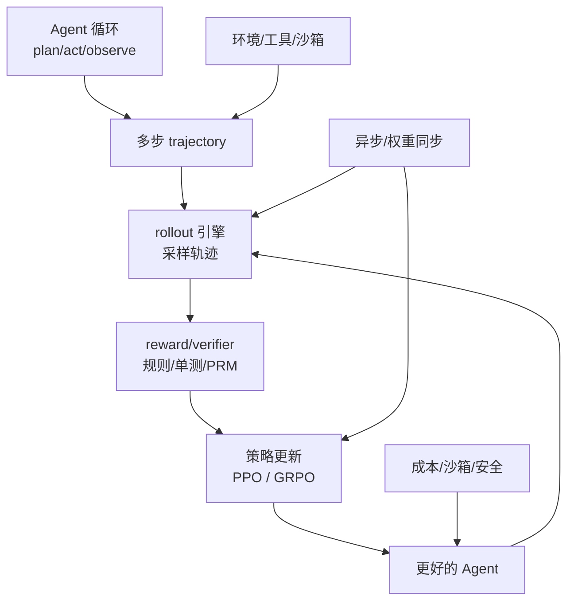
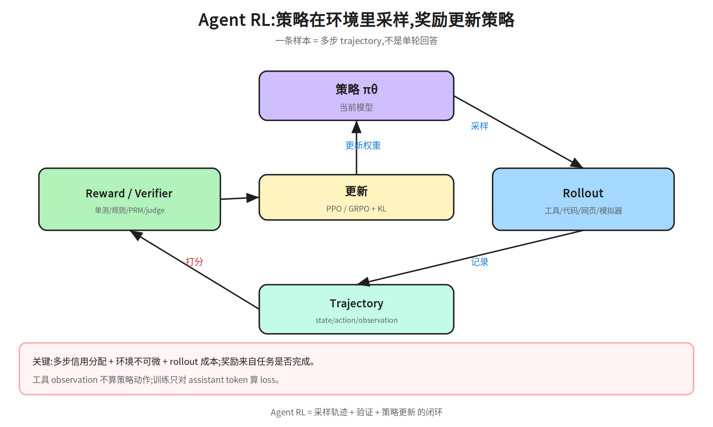
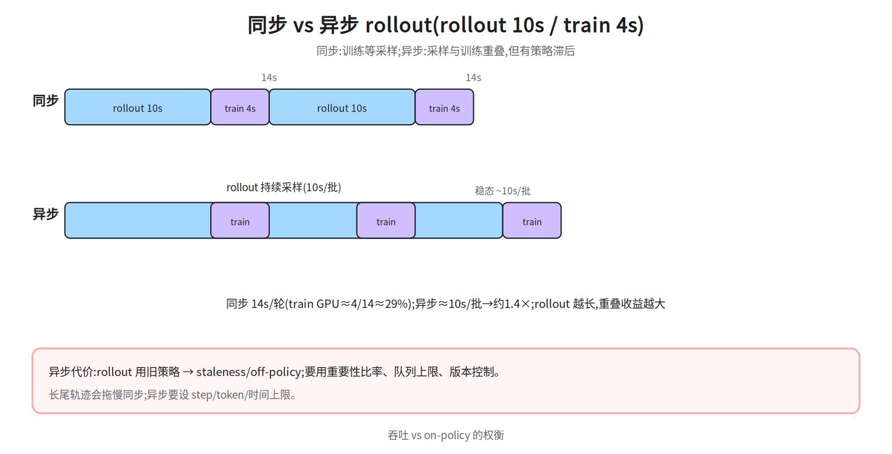
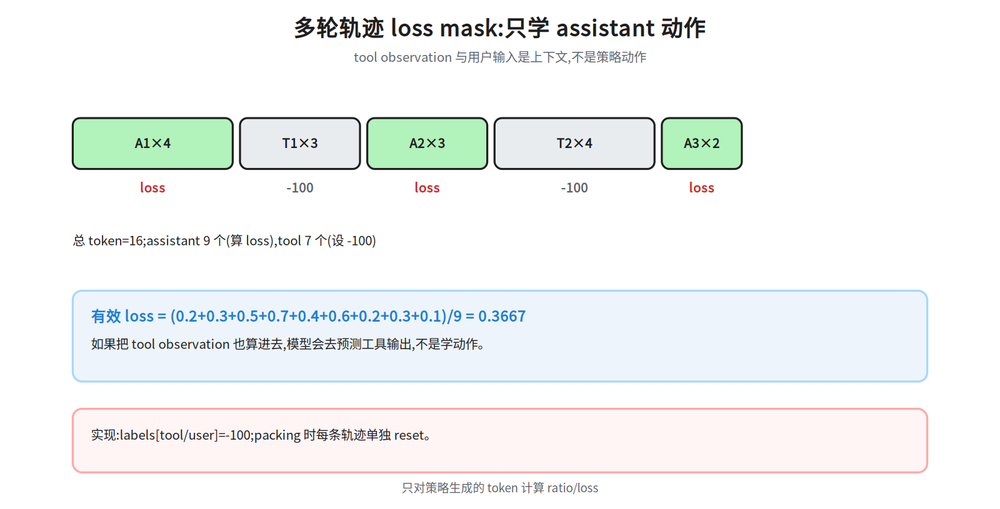
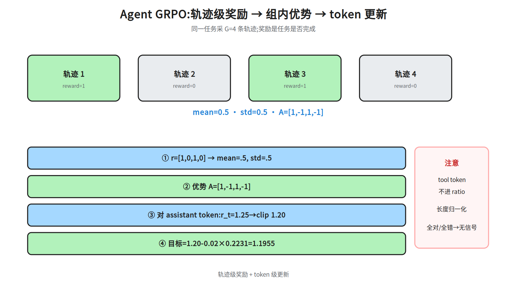
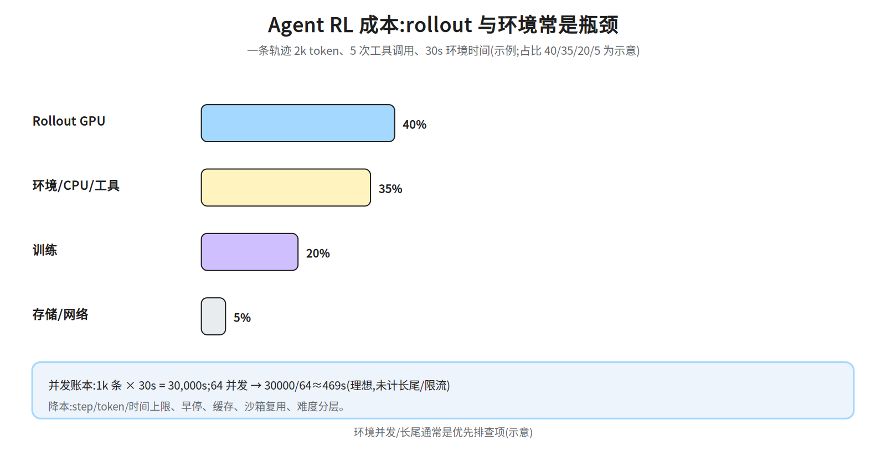

# 第十六层 · Agent RL —— rollout、环境、奖励与异步训练

> 本层回答:Agent 的 RL 和普通 RLHF 差在哪?为什么 rollout 是新的数据生产线?多轮工具调用怎么做 loss mask、奖励与异步训练?沙箱和成本怎么算?

> **前置(按节)**
> - §1–§2:先看 `notes/11_applications.md §5`(Agent 循环)与 `notes/26_frontier_edge.md §2`(Agent Runtime)。
> - §3–§4:先看 `notes/13_reasoning.md §4`(RLVR/GRPO)与 `notes/08_alignment.md §2`(PPO/KL)。
> - §5–§6:先看 `notes/26_frontier_edge.md §3`(RL Infra / rollout)。
> - §7–§8:先看 `notes/09_evaluation.md`(评测口径)。
>
> **建议路径(3 次 × 45 分钟)**
> - 第 1 次(必学):§1 Agent RL 的问题形态 + §2 rollout 引擎(52a/52b)。
> - 第 2 次(必学):§3 环境扩展 + §4 reward/verifier + §5 多轮 GRPO/loss mask(52c/52d)。
> - 第 3 次(加分):§6 异步 RL/权重同步 + §7 沙箱/成本(52e)+ §8 评测与安全。
>
> **与 26 的分工**:26 §2–§3 从平台/基础设施视角讲 Agent Runtime、沙箱选型与 rollout 闭环;
> 本篇从 RL 训练视角讲问题形态、reward/信用分配、多轮 loss mask、GRPO/PPO、异步与权重同步。
> 26 给系统口径与容量账本,本篇给训练机制与数值例子;实现细节两边互相引用,不重复展开。

## 0. 依赖图(学习顺序)



## 1. Agent RL 和普通 RLHF 差在哪

普通 RLHF 的一条样本通常是“一个 prompt → 一个回答 → 一个奖励”。Agent RL 的样本是**一条多步 trajectory**:

```
state_0 (prompt)
  → action_0 (tool call / code)
  → observation_0 (tool result)
  → action_1 ...
  → final answer / task state
```

差别:

- **多步信用分配**:最终成功/失败要归因到哪一步?中间工具调用错了,后面全错。
- **环境不可微**:工具/代码/网页不是可微函数,只能通过 rollout 采样。
- **动作空间混合**:自然语言 token + 结构化工具调用 + 代码执行。
- **成本高**:一条轨迹可能几十步、几万 token、几秒到几分钟;rollout 是瓶颈。
- **可验证性**:很多任务有客观结果(单测通过、网页状态、答案匹配),适合 RLVR。

> 一句话:Agent RL 把“模型输出”变成“模型在环境里执行一串动作”,奖励来自**任务是否完成**,而不是单个回答的偏好分。

## 2. Rollout 引擎:新的数据生产线



### 2.1 一次 rollout 的组成

- **策略(policy)**:当前模型,按 token/动作采样;
- **环境(environment)**:工具、代码沙箱、网页、数据库、模拟器;
- **执行器**:解析工具调用、执行、把 observation 写回上下文;
- **轨迹存储**:state/action/observation/reward/token logprob;
- **验证器**:任务完成判定(单测、状态检查、精确匹配、LLM judge)。

### 2.2 同步 vs 异步



**同步**:采样一批轨迹 → 全部完成后训练 → 再采样。简单、on-policy;但 rollout 的长尾会让训练 GPU 空转。

**异步**:rollout  worker 持续采样,训练器从队列取数据;采样与训练重叠,吞吐更高。代价是**策略滞后**(stale policy),需要用重要性比率/截断/版本控制处理。

数值示意:rollout 10 s、train 4 s。同步每轮 14 s,训练 GPU 利用率约 `4/14≈29%`;异步稳定后每 10 s 产出一批(训练 4 s 藏在 10 s 内),吞吐约 `14/10=1.4×`。如果 rollout 更长(30 s),重叠收益更大;但队列/滞后也更大。

### 2.3 rollout 的工程要点

- **并发**:每个环境一个沙箱;并发受 CPU/内存/网络/工具配额限制,不一定受 GPU 限制。
- **长尾**:少数轨迹跑很久;要设 step/token/时间上限,超时截断并给部分奖励。
- **可复现**:记录随机种子、工具版本、环境状态;否则 reward 不可复现。
- **缓存**:相同 prompt/工具结果可缓存,但要注意训练分布与缓存一致性。

## 3. 环境扩展:从玩具到真实任务

### 3.1 环境类型

| 类型 | 例子 | 验证方式 | 难点 |
|---|---|---|---|
| 代码/终端 | SWE-bench、repo 修复 | 单测/隐藏测试 | 环境依赖、长轨迹、沙箱 |
| 工具/API | 搜索、数据库、订票 | 状态/结果检查 | 工具 schema、错误处理 |
| 网页 | WebArena | 页面状态/答案 | 动态页面、反爬、延迟 |
| 对话/客服 | tau-bench | 规则/数据库状态 | 用户模拟、多轮 |
| 游戏/模拟 | 文本游戏 | 环境 reward | reward 设计、探索 |

### 3.2 环境扩展的难点

- **任务生成**:人工写任务贵;可从 issue/工单/日志合成,但要保证可验证、无泄漏。
- **状态隔离**:每个 rollout 独立沙箱,避免互相污染;启动速度很关键(Firecracker/gVisor/容器)。
- **工具版本**:工具 API 变更会让旧轨迹失效;要锁定版本。
- **可验证性**:不是所有任务都有单测;需要规则/状态/LLM judge 组合。

## 4. Reward / verifier:多步任务怎么打分

### 4.1 奖励类型

- **结果奖励(ORM/规则)**:任务完成/单测通过/答案匹配;稀疏但客观。
- **过程奖励(PRM)**:每步打分;密集但标注贵,可能奖励“看起来对”。
- **LLM judge**:灵活,适合开放任务;有偏差、可被 hack。
- **复合奖励**:结果 + 格式 + 效率(步数/token)+ 安全约束。

### 4.2 多步信用分配

最终奖励 `R` 只在轨迹末尾;要把它分配给各步:

- **轨迹级**:整条 trajectory 一个 advantage(GRPO/PPO 都可以);简单,但难定位错步。
- **turn 级**:每个 assistant turn 一个奖励(用 PRM/规则);密集,但需要步骤标签。
- **token 级**:PPO 的 token advantage;最细,但需要 value/critic 或 GAE。

> 面试口径:Agent RL 的难点不是“算法”,而是**奖励是否可靠 + 轨迹是否可复现 + rollout 是否够快**。

### 4.3 Reward hacking

Agent 会找捷径:跳过必要步骤、伪造工具结果、只改格式、刷单测、利用环境漏洞。防御:隐藏测试、工具权限、状态校验、多验证器、KL/预算、红队。

## 5. 多轮 GRPO / PPO:loss mask 与优势

### 5.1 多轮序列的 loss mask

一条轨迹的 token 序列通常包含:

```
system + user + assistant(tool call) + tool observation + assistant(final) + ...
```

训练时**只对 assistant 生成的 token 算 loss**;tool observation/user 输入要 mask 掉:

```
labels[tool_obs] = -100
labels[user] = -100
labels[assistant] = token id
```



数值例:一条轨迹 3 个 assistant 段,分别 4/3/2 个 token;tool observation 共 7 个 token。总 token 16,有效 loss token 9;平均 loss 只对这 9 个算。

### 5.2 GRPO for agents

GRPO 的组内比较可以直接用在轨迹级奖励上:

```
对同一任务采 G 条 trajectory
r_i = 任务是否完成(0/1) 或 复合奖励
A_i = (r_i - mean(r)) / (std(r)+ε)
```

数值(`G=4`,`r=[1,0,1,0]`):`mean=0.5`,`std=0.5`,`A=[1,-1,1,-1]`。然后对每条轨迹的 assistant token 做 PPO 比率/裁剪 + KL。



**关键细节**:

- 轨迹长度不同:按 token 平均还是按轨迹平均?按 token 平均会偏爱长轨迹;要长度归一化或按轨迹加权。
- 工具 observation 的 token 不算策略动作,不能进 ratio/loss。
- 同一任务的多条轨迹要一起采样(组),否则没有组内比较。
- 全成功/全失败组优势为 0;要难度课程/过滤。

### 5.3 PPO for agents

PPO 需要 critic/value;多步任务里 value 可以按 turn 或 token 估。优势可用 GAE;但环境奖励稀疏时,critic 很难学。工程上 GRPO 更常用(省 critic),PPO 适合有密集奖励/复杂信用分配的场景。

## 6. 异步 RL 与权重同步

### 6.1 异步架构

```
rollout workers (policy v) → trajectory queue → trainer (policy v+k) → new weights → rollout workers
```

- **staleness**:rollout 用的是旧策略,训练时策略已更新;用重要性比率 `π_new/π_old` 修正,或限制队列长度/版本差。
- **权重同步**:训练器更新后,把权重广播给 rollout workers(NCCL/共享内存/对象存储);colocated 可在同一组 GPU 上换权重,disaggregated 需要跨节点传输。同步开销要隐藏在 rollout 中,否则会吃掉异步收益。
- **故障**:worker 挂掉/环境超时;要重试、丢弃坏轨迹、记录原因。

### 6.2 同步 vs 异步的取舍

- 同步:on-policy、稳定、易复现;吞吐低。
- 异步:吞吐高;但 off-policy、staleness、实现复杂。
- 常见折中:小滞后(1–2 个版本)+ 重要性裁剪 + 队列上限。

## 7. 沙箱与成本



### 7.1 成本构成

- **GPU rollout**:策略前向生成 token;长轨迹/高并发吃 GPU。
- **CPU/环境**:沙箱、工具、编译、浏览器;常是瓶颈。
- **训练**:PPO/GRPO 更新;通常比 rollout 短,但大模型+长序列也贵。
- **存储/网络**:轨迹、日志、权重同步。

### 7.2 账本示例(相对量级)

一条轨迹 2k token、5 个工具调用、30 s 环境时间;1k 条轨迹 = 30k s 环境时间。若 64 个并发沙箱,理论上 `30000/64≈469 s`;实际受长尾/工具限流影响更大。训练 8 卡、rollout 8 卡时,同步模式会有一侧空转;异步可把空转压下去,但需要更多 rollout 并发/队列。

### 7.3 降本

- 限制 step/token/时间;早停(任务完成/失败);
- 缓存工具结果/前缀;复用沙箱;
- 小模型 draft/蒸馏;只对困难任务用大模型;
- 按任务难度分配 rollout 预算。

## 8. 评测与安全

### 8.1 评测

- **任务成功率**:SWE-bench resolved rate、tau-bench pass^k、WebArena success。
- **效率**:步数、token、环境时间、成本。
- **轨迹质量**:工具调用正确率、错误恢复、是否绕过必要步骤。
- **鲁棒性**:工具失败/超时/空结果;对抗注入。
- **安全**:越权、沙箱逃逸、数据泄漏、危险操作。

### 8.2 安全

- 沙箱隔离(容器/Firecracker/gVisor)、最小权限、网络白名单;
- 工具 allowlist、参数校验、速率限制;
- 危险操作人工确认;审计日志;可回滚;
- 红队:注入、越狱、工具滥用、资源耗尽。

## 9. 面试要点

1. **Agent RL 和 RLHF 的区别?** → 多步 trajectory、环境不可微、信用分配、rollout 成本。
2. **rollout 引擎是什么?** → 策略在环境里采样轨迹,存 state/action/observation/reward,供训练。
3. **同步 vs 异步?** → 同步 on-policy 但 GPU 空转;异步重叠吞吐高但有 staleness/off-policy。
4. **多轮 loss mask?** → 只对 assistant token 算 loss;tool/user token 设 -100。
5. **GRPO 怎么用于 Agent?** → 同一任务采 G 条轨迹,轨迹级奖励算组内优势,再对 assistant token 做 PPO clip+KL。
6. **多步信用分配怎么做?** → 轨迹级/ turn 级/ token 级;PRM 密集但贵,ORM 稀疏但客观。
7. **reward hacking 怎么防?** → 隐藏测试、多验证器、权限/沙箱、KL/预算、红队。
8. **权重同步?** → trainer 更新后广播给 rollout workers;队列/版本差控制 staleness。
9. **成本瓶颈?** → 环境/CPU/长尾常比 GPU 更瓶颈;并发、早停、缓存、难度分层。
10. **怎么评测 Agent?** → 任务成功率、效率、轨迹质量、鲁棒性、安全;SWE-bench/tau-bench/WebArena。

## 常见坑

- 把 Agent RL 当成“单轮 RLHF 加长”:忽略多步信用分配与环境成本。
- 把 tool observation 算进 policy loss:模型会去“预测工具输出”,不是学动作。
- 异步队列无限长:策略滞后严重,重要性修正失效。
- 只看任务成功率,不看步数/成本/安全:Agent 可能用危险捷径刷分。
- 沙箱不复用/启动慢:环境启动成为吞吐瓶颈。
- 任务不可复现:工具版本/随机性导致 reward 抖动。

## 动手清单

1. **多轮 mask**:构造一条 tool-call 轨迹,标出 assistant/tool token,算有效 loss 数;验收:tool token 全为 -100。
2. **GRPO 手算**:用 `r=[1,0,1,0]` 复算 mean/std/advantage;再算一个 token 的目标;验收:与 52d 一致。
3. **rollout 时间账**:给定 rollout 10s/train 4s,算同步/异步吞吐;验收:解释 1.4× 与滞后。
4. **沙箱并发**:估算 1k 条轨迹、64 并发、30s/条的环境时间;验收:给出瓶颈与降本建议。

## 相关图

`52a_agent_rl_loop` · `52b_sync_async` · `52c_multiturn_mask` · `52d_grpo_agent` · `52e_agent_cost`
(均在 `diagrams/`,横竖双版本)

## 下一步

第十七层 · 数据工程:数据源/配比、MinHash/LSH 去重、质量分类器、curriculum、合成数据/self-instruct/蒸馏、许可与污染、数据飞轮。
