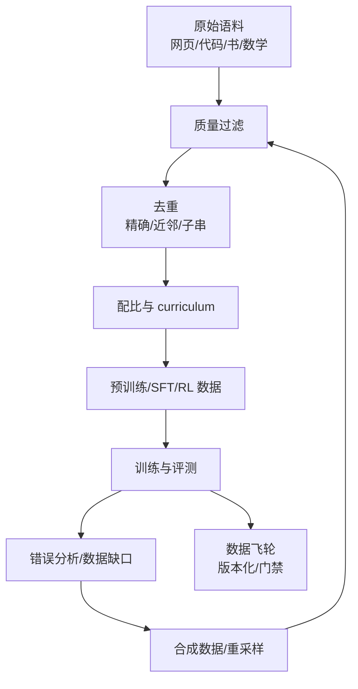
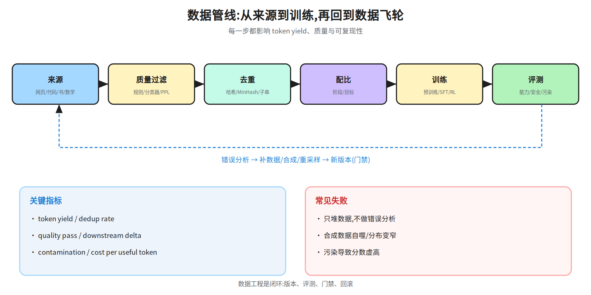
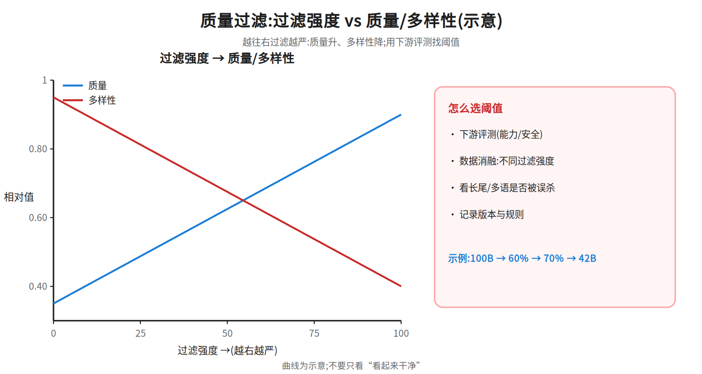
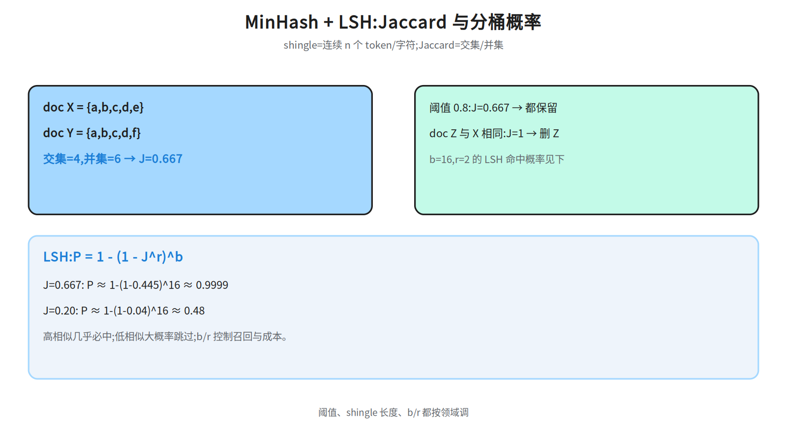
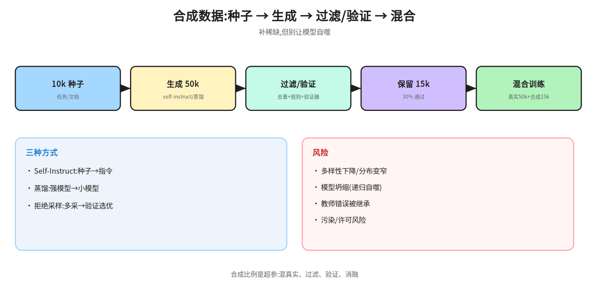
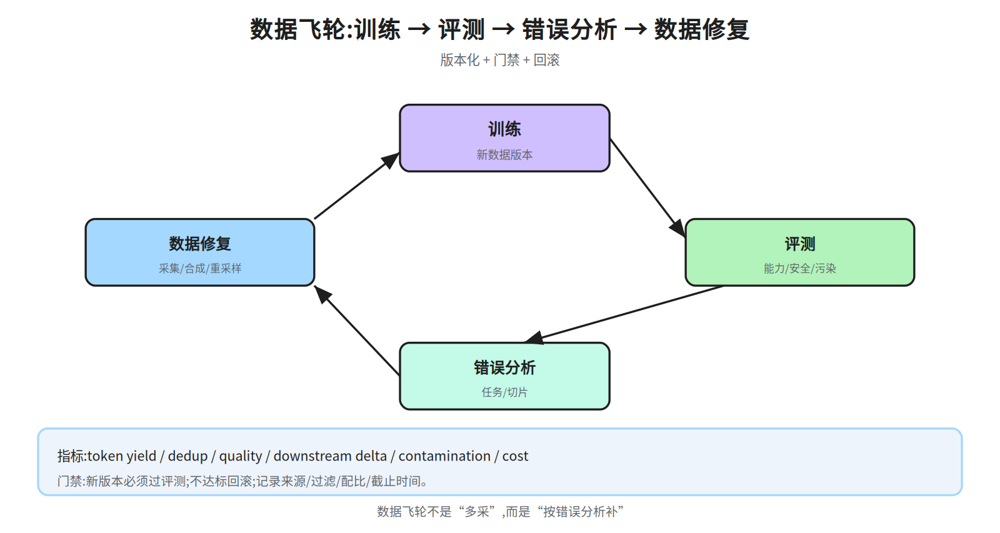

# 第十七层 · 数据工程 —— 从原始语料到数据飞轮

> 本层回答:预训练/后训练的数据管线怎么搭?配比、过滤、去重、curriculum、合成数据各自解决什么?怎么用评测驱动“数据飞轮”而不是拍脑袋?

> **前置(按节)**
> - §1–§3:先看 `notes/07_pretraining.md §2`(数据管线/去重/packing)。
> - §4 合成数据:先看 `notes/08_alignment.md §3.3`(拒绝采样)与 `notes/09_evaluation.md §2`(污染)。
> - §5–§6:先看 `notes/09_evaluation.md §4、§6`(harness/治理)。
>
> **建议路径(2 次 × 45 分钟)**
> - 第 1 次(必学):§1 数据源与配比 + §2 质量过滤 + §3 去重(53a–53c)。
> - 第 2 次(必学):§4 合成数据 + §5 许可/污染 + §6 数据飞轮(53d/53e)。
>
> **与 07 的分工**:07 §2 给预训练数据管线的“最小闭环”(来源、过滤、去重、packing、退火);
> 本篇把数据工程作为独立层展开:配比/curriculum 的取舍、过滤阈值与数值账本、MinHash/LSH 参数、
> 合成数据风险、许可/污染/PII 与数据飞轮。07 已讲的机制只引用,不重复推导;两篇冲突时以本篇的工程口径为准。

## 0. 依赖图(学习顺序)



## 1. 数据源与配比:先决定“吃什么”

### 1.1 来源

| 来源 | 例子 | 价值 | 风险 |
|---|---|---|---|
| 网页 | Common Crawl、FineWeb | 规模、覆盖 | 噪声、重复、版权 |
| 代码 | GitHub、StackExchange | 结构化推理、长程依赖 | 许可证、漏洞、私有代码 |
| 书/论文 | Books3、arXiv、PubMed | 长文连贯、知识密度 | 版权、扫描噪声 |
| 百科 | Wikipedia | 事实性、多语 | 规模小、风格单一 |
| 数学 | OpenWebMath、Proof-Pile | 符号推理 | 答案错误、格式乱 |
| 多语 | 各语种网页/新闻 | 跨语言 | 低资源质量差 |

**示例配比**(不是官方公式):网页 60% · 代码 20% · 数学 10% · 书/百科 10%。真实配比按阶段/模型目标调,并用消融验证;不要把它当固定真理。

### 1.2 配比的原则

- **目标决定配比**:代码/数学多 → 推理强;多语多 → 跨语言好;网页多 → 覆盖广但噪声大。
- **质量优先**:高质量小语料可能胜过低质量大语料;但要注意多样性。
- **阶段化**:预训练早期重规模,末段提高高质量数据(退火);SFT/RL 阶段重任务分布。
- **可复现**:记录每个来源的版本、采样权重、过滤规则。

### 1.3 Curriculum 与数据退火

- **长度课程**:先短序列,再逐步加长;长文比例过高会拖慢早期训练。
- **难度课程**:先易后难,或按模型当前能力筛题;太简单没有梯度,太难全是失败。
- **数据退火**:末段提高高质量数据(百科/教科书/数学)权重,常能提升下游。
- **阶段配比**:预训练早期重规模,后期重质量;SFT/RL 阶段重任务分布。



## 2. 质量过滤:在规模与质量之间取平衡

### 2.1 三层过滤

1. **启发式规则**:词数、平均词长、符号/词比、以标点结尾的行比例、停用词比例、语言识别置信度。Gopher 论文给过一套阈值(如词数 50–100k、符号/词比 ≤0.1 等),现代管线多在其上调整。
2. **质量分类器**:用高质量种子训练 fastText/小型 transformer 分类器;FineWeb-Edu 用教育价值分类器。
3. **模型困惑度**:用小语言模型给文档打分,过滤“模型都觉得不像自然语言”的文本;别误杀领域难文本。

### 2.2 过滤的取舍



- 过滤太松:噪声/重复/低质多,训练浪费算力;
- 过滤太紧:语料变窄(只剩百科腔),多样性/长尾丢失;
- 用**下游评测 + 数据消融**找阈值,不要只看“看起来干净”。

**数值示例**:100B token 原始语料,规则过滤保留 60%,分类器保留其中 70%,最终 42B;如果分类器阈值再提高,保留率降到 25%,但下游可能提升也可能因多样性下降而回退。阈值要实验。

## 3. 去重:精确、近邻、子串

### 3.1 三种粒度

- **精确去重**:文档/段落哈希,相同哈希只留一份;便宜,抓不到改写。
- **近邻去重**:MinHash + LSH,估计 Jaccard;抓“改几个词”的复制。
- **子串去重**:后缀数组/自动机找长公共子串;抓长文嵌套,成本高。

### 3.2 MinHash + LSH 数值



- `shingle`:连续 n 个 token/字符的片段(如 5-gram);
- 文档表示成 shingle 集合;Jaccard = 交集/并集;
- MinHash 用多个哈希函数把集合压成签名;LSH 把签名分到桶,只比较同桶。

例:doc X shingles = {a,b,c,d,e},doc Y = {a,b,c,d,f};交集 4、并集 6,J=0.667。阈值 0.8 → 都保留;若 doc Z 与 X 完全相同,J=1 → 删 Z。

**LSH 概率**:band 数 `b=16`,每 band `r=2` 行,两个文档至少在一个 band 相同的概率:

```
P = 1 - (1 - J^r)^b
J=0.667 → P ≈ 1 - (1-0.445)^16 ≈ 0.9999
J=0.2   → P ≈ 1 - (1-0.04)^16 ≈ 0.48
```

所以 LSH 对高相似文档几乎必中,对低相似文档大概率跳过;`b/r` 控制召回与成本。

## 4. 合成数据:补稀缺,但别自噬

### 4.1 三种常见方式

- **Self-Instruct**:用种子任务让强模型生成指令/回答,过滤后做 SFT(Alpaca 路线)。
- **蒸馏**:用强模型生成高质量回答/推理轨迹,给小模型学。
- **拒绝采样/验证**:采样多条,用规则/验证器/PRM 选好的,再做 SFT 或 RL。



### 4.2 风险

- **多样性下降**:生成数据趋同,分布变窄;
- **模型坍缩**:递归用生成数据训练,尾部信息丢失(Shumailov et al., 2024);
- **错误放大**:教师模型的错误被学生继承;
- **污染/许可**:生成内容可能复现训练集或受版权保护文本。

### 4.3 实践

- 混合真实数据,保留人类锚点;
- 去重 + 质量/一致性过滤 + 验证器;
- 控制合成比例,按任务/阶段调;
- 记录教师模型、prompt、过滤规则,便于审计。

**数值示例**:10k 种子 → 生成 50k 指令 → 去重/过滤保留 30% → 15k 合成样本;与 50k 真实 SFT 混合,合成占比 23%。比例不是越高越好,要做消融。

## 5. 许可、污染与 PII

### 5.1 许可

- 网页/书/代码许可证不同(CC-BY、CC-BY-NC、专有、GPL 等);训练/再分发要逐类审查;
- 尊重 opt-out/robots/许可条款;保留来源与处理记录;
- 代码数据要扫许可证、密钥、私有仓库。

### 5.2 污染

- 训练集含评测原题 → 分数虚高;
- 检测:n-gram 重叠、canary、时间切分、困惑度、人工抽查;
- 治理:数据管线去污染、记录截止时间、报告分数附检查结果(见 `notes/09_evaluation.md §2`)。

### 5.3 PII/隐私

- 去重、脱敏、可删除机制;记忆复现测试;
- 敏感数据(医疗/金融/儿童)要额外合规审查;
- 训练数据来源与用途要可审计。

## 6. 数据飞轮:用评测驱动数据迭代



### 6.1 闭环

```
定义目标 → 训练 → 评测/错误分析 → 找数据缺口
→ 采集/合成/重采样 → 过滤/去重 → 新版本 → 再训练
```

关键:

- **错误分析**要具体到任务/数据切片,不是“模型不够好”;
- **数据版本**可复现:来源、过滤规则、去重阈值、配比、截止时间;
- **门禁**:新数据版本必须过评测门槛(能力/安全/污染),否则回滚;
- **反馈来源**:人工标注、用户反馈、红队、自动验证器;注意偏差/噪声。

### 6.2 指标

| 指标 | 说明 |
|---|---|
| token yield | 原始 → 可用 token 的保留率 |
| dedup rate | 去重删除比例 |
| quality pass rate | 分类器/规则通过率 |
| downstream delta | 新数据版本在目标评测上的变化 |
| contamination rate | 与测试集重叠比例 |
| cost per useful token | 采集/过滤/训练成本 |

### 6.3 常见失败

- 只堆数据、不做错误分析:数据越多,噪声越多;
- 合成数据自噬:分布变窄,尾部能力下降;
- 评测污染:分数涨但真实能力没涨;
- 数据版本不可复现:出了问题无法回滚/定位。

## 7. 面试要点

1. **预训练数据管线有哪些步骤?** → 来源/配比 → 质量过滤 → 去重 → tokenizer/packing → curriculum/退火 → 污染治理。
2. **配比怎么定?** → 目标/阶段决定;示例网页 60/代码 20/数学 10/书百 10;用消融验证,不是固定公式。
3. **质量过滤的三层?** → 启发式、分类器、困惑度;在规模/质量/多样性间取平衡。
4. **去重的三种粒度?** → 精确哈希、MinHash/LSH、子串;分别抓完全复制、近邻、嵌套。
5. **MinHash/LSH 怎么工作?** → shingle 集合 → 多哈希签名 → 分桶;Jaccard 估计;b/r 控制召回/成本。
6. **合成数据的风险?** → 多样性下降、模型坍缩、错误放大、污染/许可;要混真实数据+过滤+验证。
7. **怎么防污染?** → n-gram/canary/时间切分/人工抽查;数据管线去污染;报告附检查。
8. **许可/PII 怎么管?** → 逐类审查、opt-out、脱敏、可删除、审计记录。
9. **数据飞轮怎么转?** → 训练→评测→错误分析→补数据→过滤→新版本→门禁→再训练。
10. **数据工程的指标?** → token yield、dedup rate、quality pass、downstream delta、contamination、cost。

## 常见坑

- 把配比当固定公式:不同模型/阶段/目标差异很大。
- 只过滤不评测:过滤掉有用长尾,分数不升反降。
- 去重过度:删掉代码模板/法律条款等合法重复。
- 合成数据比例过高:模型自噬,分布变窄。
- 不做污染检查:高分来自背题。
- 数据版本不可复现:无法回滚/定位。
- 忽略许可/PII:上线后法律/隐私风险。

## 动手清单

1. **MinHash 复算**:构造两个 shingle 集合,算 Jaccard;用 `b=16,r=2` 算 LSH 命中概率;验收:与 §3.2 一致。
2. **过滤消融**:同一小模型,用 100%/60%/30% 保留率的数据训练,比较下游;验收:给出质量-多样性权衡曲线。
3. **合成数据混合**:10k 真实 + 5k 合成 SFT,比较 0/25/50% 合成比例;验收:记录退化/提升点。
4. **数据卡**:为一个数据版本写来源、过滤、去重、配比、许可、污染检查;验收:可复现。

## 相关图

`53a_data_pipeline` · `53b_dedup_lsh` · `53c_filter_tradeoff` · `53d_synthetic` · `53e_flywheel`
(均在 `diagrams/`,横竖双版本)

## 下一步

Phase 1 四篇完成。后续按 `docs/advanced-roadmap.md §5` 选定主方向,再开 Phase 2(可解释性/多模态深化)或 Phase 3(模块三方向深入)。
