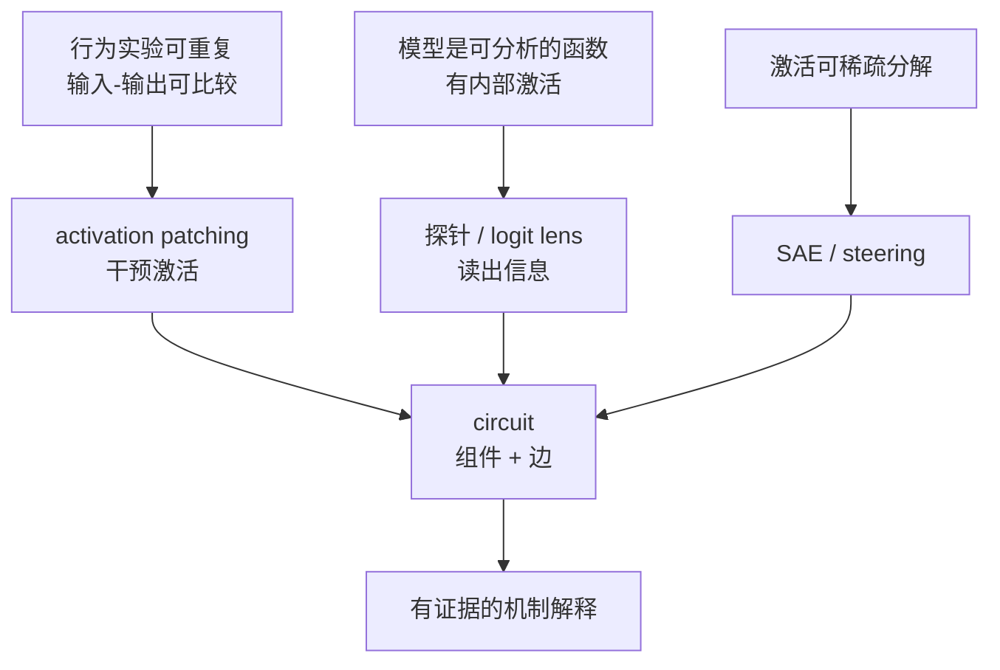
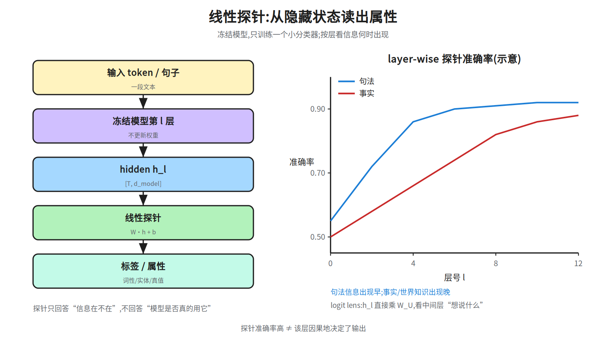
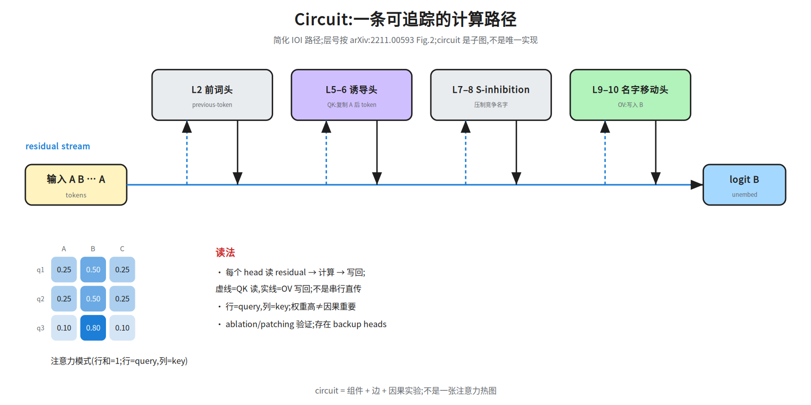
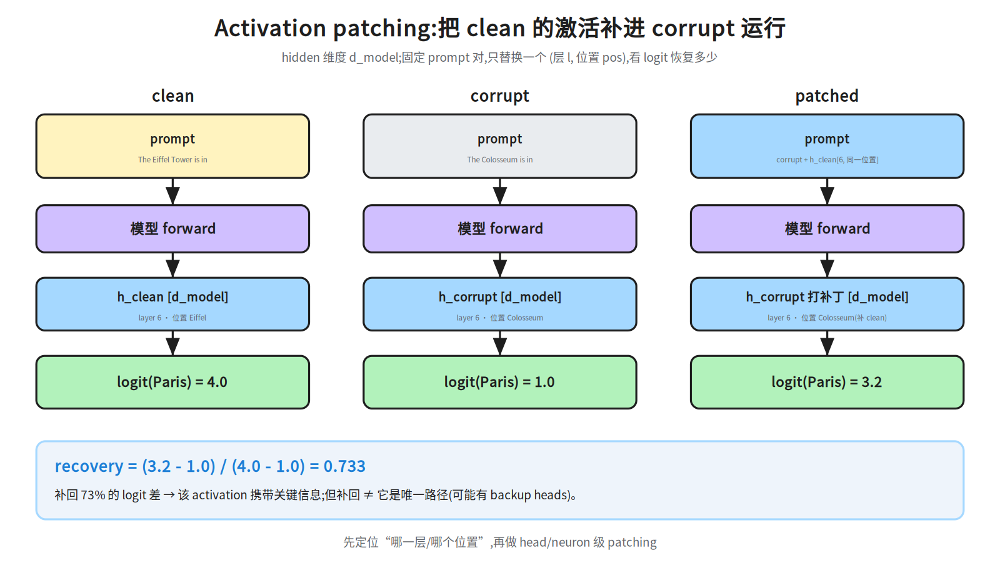
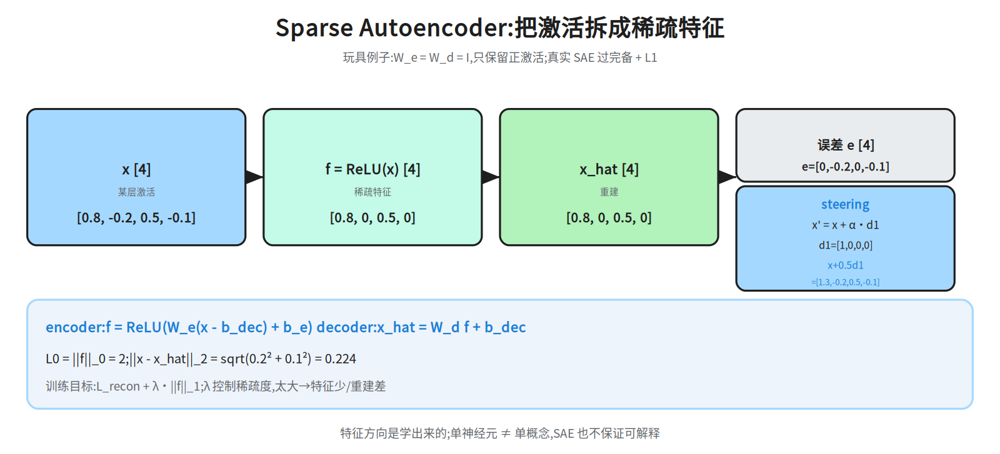

# 第十八层 · 可解释性 —— 从探针到电路与 SAE

> 本层回答:我们怎么从“模型输出看起来对”走到“知道模型内部哪部分在算什么”?探针、logit lens、attention、activation patching、circuit、SAE 各自能回答什么、不能回答什么?

> **前置(按节)**
> - §1–§3:先看 `notes/02_attention.md`(attention)与 `notes/03_block.md`(残差/LayerNorm/FFN)。
> - §4–§6:先看 `notes/06_inference.md §4`(完整 forward 的 13 步文字流水线;06 §4 不含截取激活的 hook/缓存机制,**本篇**讲义 §5 会补一段最小说明(`run_with_cache` / `fwd_hooks`，连 `hook_resid_post` 的形状都给了),不用先去外部文档翻)。
> - §3、§9:再补 `notes/13_reasoning.md §2`(长 CoT);§4–§6 用不到它。
> - §7:只需基础线性代数;正文给数值例子。

> **建议路径(2 次 × 45 分钟)**
> - 第 1 次(必学):§1 行为 vs 机制 + §2 probing + §3 logit lens + §4 attention(54c)。
> - 第 2 次(必学):§5 patching(54b)+ §6 circuit(54c)+ §7 SAE/steering(54d)。

## 0. 依赖图(学习顺序)



无入边的起点有三个:A「可以把模型当函数分析、可以做干预」、C「行为实验可重复」、F「激活可稀疏分解」;它们是三条证据链各自的前提,不是学习顺序(起点仍按上方建议路径)。


> **读图注意**:这张图表示「证据汇入关系」,不是严格章节顺序。§4 attention analysis 不在图上——它是 §5 patching 的动机(先看权重线索,再用干预验证),建议读完 §2–§3 就读它;G → E 表示 SAE 能给 circuit 提供**独立交叉证据**,不表示要先学完 §7 才能读 §6(正文顺序 §5 → §6 → §7,§8 再把两者并列比较)。
同理 B → E 是**弱边、不是因果边**:probe / logit lens 只给「这个信息在某层线性可读」的**相关/读出证据**,单独不能支撑因果结论;它在图上汇入 E,意思是这些读出结果可以用来**提出组件假设**(例如「第 l 层能读出这个属性」),随后必须回 §5/§6 用 ablation、patching 验证。这与 §8 的口径一致:probe/logit lens 只算相关证据,§4 的 attention analysis 同理只是线索。;汇点是“机制解释”,不是“一张好看的热图”。

## 1. 为什么需要可解释性:行为解释 vs 机制解释

- **行为解释(behavioral)**:只描述输入-输出关系。例如“给 few-shot 例子,准确率上升”“加 CoT,数学题更好”。它有用,但不知道内部为什么。
- **机制解释(mechanistic)**:把模型拆成组件(attention head、MLP 神经元、残差方向),找出**因果路径**。例如“这个 induction head 把前一个 A 后面的 token 复制到当前位置”。

两类解释都要有**可证伪的预测**:

| 问题 | 行为证据 | 机制证据 |
|---|---|---|
| 模型会不会做指代消解? | 换句子测准确率 | 哪个 head/路径负责? |
| 去掉某组件会怎样? | 输出变化 | ablation/patching 的因果效应 |
| 这个特征是什么? | 输入输出相关 | SAE 特征 + steering 干预 |

用途:安全审计(找拒答/越狱路径)、调试(定位幻觉/复制)、科学理解(电路/特征)、模型编辑(ROME = Rank-One Model Editing，秩一模型编辑:给某个事实换一条秩一权重更新;以及 steering)。

## 2. Probing:信息在不在?

**做法**:冻结模型;取第 `l` 层的 hidden `h_l`;训练一个**小分类器**(常用线性层)预测标签(词性、实体、情感、真值)。

```
h_l [T, d_model] → 线性探针 W [d_model, C] → logits [T, C] → softmax
```

只训练 `W`(和 bias),不更新模型。**layer-wise**:对每一层都训一个探针,看准确率随层数怎么变。


> **C=1 的退化**:上面管线写的是 `W [d_model, C]` + softmax;做二分类时 `C=1`,`W` 退化成 `[d_model]`、`W @ h` 是标量,softmax 不能当概率用:只有一个 logit 时 softmax 恒等于 1(与 z 取值无关)。二分类要么直接换成 sigmoid 输出,要么用「两个 logit 之差 = z」的 softmax——σ(z) 对应后者;下面的数值例子用的是前者。
这里的 `p` 一律指**类别 1 的概率**(P(y=1))，所以 p = 0.2689 < 0.5 就判成类别 0;另外「C=1 时 `W` 退化成向量」是形状问题，和「选 sigmoid 还是两 logit softmax」是两件独立的事，别混着记。



**数值例子**:`h=[1.0, 2.0]`,`W=[1.0, -1.0]`,`b=0`:

```
z = 1×1 + 2×(-1) + 0 = -1.0
p = sigmoid(-1.0) = 0.2689 < 0.5 → 预测类别 0
```

```python
import torch
h = torch.tensor([1.0, 2.0])
W = torch.tensor([1.0, -1.0])
b = torch.tensor(0.0)
z = W @ h + b          # -1.0
p = torch.sigmoid(z)   # 0.2689
```

**能回答**:某层是否**线性可读**出某个属性;信息出现得早还是晚。
**不能回答**:模型是否**使用**了这个信息;探针容量大时可能“自己学会”任务。

**控制**:用 control task(随机标签/打乱标签)看探针是否只是记住;用 selectivity(只对目标属性敏感)和 causal probe(把探针方向注入,看输出)补强。

> 常见误区:把探针准确率 95% 说成“模型 95% 依赖这个特征”。探针是**相关**,不是因果。

## 3. Logit lens:中间层“想说什么”

把第 `l` 层的 residual `h_l` 先过模型末端的 final LayerNorm `LN_f`,再乘输出投影 unembedding `W_U`(形状 `[d_model, vocab]`,就是把 hidden 变成词表 logits 的那个矩阵),得到词表分布:

```
logits_l = LN_f(h_l) · W_U   # [T, vocab]
```

看 top-k token 随层数怎么变化。**tuned lens** 会为每层学一个小变换再 unembed,缓解“中间层表示不在最终基”的问题。

**能回答**:哪一层开始出现答案候选;模型是否“早就知道”。
**不能回答**:这个候选是否被后续层使用;中间层表示与最终 unembedding 的基不一定对齐。

> 与 13 的衔接:CoT/推理模型里,logit lens 可看“中间答案”是否在 CoT 之前出现;但**看到候选 ≠ 证明它是推理依据**。

## 4. Attention analysis:权重只是线索

常见做法:

- 看 attention 热力图:行=query,列=key;
- head ablation:去掉一个 head,看任务指标;
- attention rollout:把多层 attention 复合,追踪信息流;常见写法先用 `Ã_l = 0.5·A_l + 0.5·I`(单位阵代表残差直通)再按**从深到浅**的顺序连乘 `Ã_L·Ã_{L-1}·…·Ã_1`(递推式 `Ã_l = A_l·Ã_{l-1}`,展开与 `V_L = A_L···A_1·V_0` 同向;attention 矩阵不可交换,写成升序 `Ã_1·Ã_2·…·Ã_L` 得到的是另一个矩阵、另一组数值);不加 `I` 直接连乘 `A_L···A_1` 是另一种约定,两者结果不同,报结果时须写明用哪种;
- 找 induction head:`A B … A → B` 的复制模式。



**关键警告**:

- attention 权重高 **≠** 因果重要(Jain & Wallace 2019 等)。
- 注意力权重是“混合比例”,不是“信息量”;FFN/残差也在写信息。
- 存在 attention sink、冗余 head、backup head;单个 head 去掉可能被补偿。

  - **attention sink**:很多 query 把权重倒向第一个(或极少数固定)token,该位置权重很高但几乎不携带任务信息,是「没处可看时的默认落点」;判定看「多个 head/多层是否都把大权重给同一位置」,而不是单看一次热图。
  - **backup head**:与主 head 功能重叠,单独 ablation 指标基本不掉,成对/成组 ablation 才掉——这就是「被补偿」在实验上的长相。

**能回答**:模型在哪些位置/头上有可读的模式。
**不能回答**:这个 head 是否必要、是否唯一。

## 5. Activation patching / causal tracing:做干预

**固定一对 prompt**:

- clean:`The Eiffel Tower is in` → 正确答案 Paris,logit 4.0(示意数值,非实测,未绑模型版本;下面的 1.0 / 3.2 / 0.733 同);
- corrupt:`The Colosseum is in` → Paris logit 1.0。


> **causal tracing 与 activation patching 是同一件事的两个名字**:causal tracing(ROME,Meng et al. 2022)指「跑 clean 前向存下各层激活 → 跑 corrupt 前向,在某点把 clean 激活恢复(restore)进去 → 看输出恢复多少」这套流程,patching 是它的通用名;本节的 recovery 公式就是它的度量。后面 §8 对比表与面试要点只写 patching,指的都是这个方法;下面说的 noising/denoising 两向则是同一框架的两个方向(clean 打进 corrupt 得恢复率,corrupt 打进 clean 得破坏度)。

把 clean 在 `(层 l, 位置 pos)` 的 hidden state **替换**进 corrupt 的前向,得到 patched logit。用**恢复率**衡量:

```
recovery = (logit_patched - logit_corrupt) / (logit_clean - logit_corrupt)
         = (3.2 - 1.0) / (4.0 - 1.0) = 0.733
```



**读法**:补回 73% 的 logit 差 → 这个 activation 携带关键信息。但它仍可能是**多条路径之一**;要做 head/neuron 级 patching、noising/denoising 两向(把 clean 的激活打进 corrupt 前向、按 (patched-corrupt)/(clean-corrupt) 得恢复率;把 corrupt 的激活打进 clean 前向、得到的是破坏度,两者方向相反别混)和 path patching(只允许特定边传递)。
> **hook 与缓存是什么**:`run_with_cache(ids)` 跑一次完整前向,沿途把每个 hook 点的张量按 `hook.name` 存进字典;`fwd_hooks=[(名字, fn)]` 是在另一次前向跑到同名 hook 点时调用 `fn(act, hook)` 并用其返回值替换该点的激活继续往下。`hook_resid_post` 指「该 block 的残差加完之后」写回 residual stream 的那份张量,形状 `[batch, pos, d_model]`。两次前向用的是同一套模块名,所以 `clean_cache[hook.name]` 才能和这次 corrupt 前向的同名 hook 对上——这也是「按 hook 名取缓存」的全部依据。

**代码骨架**(库名仅示意,不同框架 API 不同):

```python
clean_cache = model.run_with_cache(clean_ids)
def patch_pos(act, hook):
    act[:, pos, :] = clean_cache[hook.name][:, pos, :]
    return act
patched_logits = model.run_with_hooks(
    corrupt_ids,
    fwd_hooks=[(f"blocks.{l}.hook_resid_post", patch_pos)],
)
```

**能回答**:哪一层/哪个位置对输出有因果影响;信息在哪一步被写入。
**不能回答**:所有交互路径(需要 path patching/电路分析);分布外是否仍成立。

## 6. Circuit:组件 + 边 + 因果实验

一个 circuit 是**子图**:

- 节点:attention head、MLP 神经元/方向、residual stream 位置;
- 边:QK 组合(query 从某处读)、OV 写回、MLP 读出/写入;


> **QK / OV 是什么**:一个 head 的四个矩阵可两两合成两个双线性映射:`W_QK = W_Q · W_K^T` 决定「位置 i 的 query 从位置 j 读多少」(读哪里),`W_OV = W_V · W_O` 决定「读到的内容怎么写回 residual」(写什么)。所以一个 head 就是一条「QK 选位置 + OV 定内容」的边;MLP 的边同理,由 `W_in` 的某一行(读出方向)和 `W_out` 的对应列(写入方向)构成。
> **形状约定(与本节其余部分一致)**:文中按 `x @ W` 的约定,取 `W_Q/W_K/W_V` 为 `[d_model, d_head]`、`W_O` 为 `[d_head, d_model]`,于是 `W_QK = W_Q·W_K^T`、`W_OV = W_V·W_O` 都是 `[d_model, d_model]`;若按 `nn.Linear` 的 `W x` 习惯存放(每个矩阵都转置一次),有效矩阵就要写成 `W_Q^T·W_K` 与 `W_O·W_V`(存法下 `W_V` 是 `[d_head, d_model]`、`W_O` 是 `[d_model, d_head]`,硬写 `W_V^T·W_O` 是 d_model 对 d_head 相乘,只有 d_head=d_model 才乘得起来;`W_O·W_V` 与 `W_V^T·W_O^T` 互为转置(`W_O·W_V = (W_V^T·W_O^T)^T`)、数值不同——按「每个矩阵都转置一次、相乘顺序不变」得到的是 `W_V^T·W_O^T`,要写成 `W_O·W_V` 得同时把相乘顺序反过来;两者形状都合法、不会报维度错,所以照「等价」任抄一个都会静默拿到另一个的转置),两种写法差一个转置,抄的时候别混。
- 验证:ablation、patching、path patching,而不是只看权重。


> **为什么能这么读写**:residual stream 是一条从 embedding 一路加到最后的主干,每个 head/MLP 都从**同一份当前向量**读(用自己的 `W_Q/W_K` 或 `W_in` 打分/投影),算完把结果**加**回主干而不是覆盖。于是 (1) 往主干加一个方向 `d`,近似等于给末端 logit 加 `d · W_U[:, token]` 这一项,方向对就能抬高某个 token;(2) 多个 head 的写回是**相加**,可以共存——这解释了「同类 head 有多份副本,去掉一份指标也不怎么掉」,但**不能**拿来解释 backup head。backup head 平时并不把这个 token 写进输出,只有在主 name mover 被敲除之后才接管这个角色(论文把它归因于训练期 dropout 带来的冗余,所以单独敲掉 backup head、主 name mover 还在时，logit difference 几乎不掉;反过来把 9.6/9.9/10.0 这三个 name mover 一起敲掉,logit difference 也只掉约 5%,因为 backup head 会接手——论文 §3.4 的原话是 the circuit still worked, only 5% drop in logit difference);它不是「别人的写回还在」,而是「换一组头来写」。FFN 那半句同理:第一层矩阵的每一行像一个 key,第二层对应的列是 value,激活大 = 命中并写回对应 value。


> **口径别混**:本段的 `logit difference` 指**同一 prompt 内两个候选 token 的 logit 之差**,即 `logit(A) - logit(B)`(A = 正确答案,如 John;B = 句末重复的那个名字,如 Mary)——它是 IOI 论文的标准度量,不是 §5 那种「同一个 token 在 clean / corrupt 两段 prompt 之间的差」。§5 的 4.0 / 1.0 / 3.2 才是后者,并归一化成恢复率 0.733;两者不能直接换算。

典型例子(IOI,Indirect Object Identification,arXiv:2211.00593 Fig.2;这是 **GPT-2 small(12 层 × 12 头)** 上验证的电路,下面所有层号/头号都是该模型专属编号,不是「IOI 电路」的通用结构):`A B … B → A`——句首出现 A、B,句末再出现一次 B,要填回靠前的那个 A。一个简化路径:

```
L2/L4 previous-token head(2.2 在第 2 层、4.11 在第 4 层;两层各 12 个 head 里的 1 个):看前一个 token(这两个 head 只负责 previous-token;induction 功能在下一行的 L5–6)
L5–6 induction head:匹配“前一个 B 后面的位置”,产出 =「被重复的名字是 B」这个身份信号(它的活不是找答案 A)
L7–8 S-inhibition head:接过上一步的 B 身份,压低竞争名字(上面那句里的 B),A 因此成为唯一没被压的候选
L9–10 name mover head:在句末 attend 到 A 所在位置,把 A 写入 residual,提升 A 的 logit
```

> 层号按论文图示;不同模型/任务会有偏移。图 54c 是“简化 IOI 路径”示意,不是唯一电路。

**能回答**:哪些组件/边足以复现行为;是否有 backup。
**不能回答**:circuit 是否完整、是否唯一;不同 prompt/模型可能换路径。

> 面试口径:circuit 不是“画出 attention 热图”,而是“提出组件假设 + 做因果干预 + 检查反例”。

## 7. SAE 与 steering:把激活拆成稀疏特征

**动机**:单个神经元常是**多义**的(polysemantic)。一个关键解释是 **superposition**:模型要表示的特征数可能**远大于**神经元/维度数;在特征稀疏激活的假设下,多个特征可以叠加在同一个激活方向里,单个神经元因此看起来“什么都管”。SAE 用**过完备字典**(`d_feature >> d_model`)+ 稀疏约束,试图把叠加的特征拆开;但拆开不保证每个特征单义,也不保证覆盖全部概念。

```
f = ReLU(W_e (x - b_dec) + b_e)      # 编码,得到稀疏特征
x_hat = W_d f + b_dec                 # 解码/重建
L = ||x - x_hat||² + λ ||f||_1        # 重建 + 稀疏(L1)
```

**参数绑定要看存法(这条最容易抄错)**：本文「行=特征」把 `W_e`、`W_d` **都**存成 `[d_feature, d_model]`(编码 `(x-b_dec) @ W_e.T`、解码 `f @ W_d`)，这种存法下绑定写成 `W_d = W_e`;`W_d = W_e^T` 成立的是「`W_e` 存 `[d_feature, d_model]`、`W_d` 存 `[d_model, d_feature]`」那套(按 `nn.Linear` 各存各的转置，上面公式块的 `x_hat = W_d f` 用的就是这套)。两套只差一个转置，别混着抄。常见实现还把 `W_e` 与 `W_d` **分开训练**(绑定只是可选的省参/正则)。稀疏项除了 L1,也有 L0(L0 = f 中非零特征的个数)/其他稀疏惩罚;λ 控制“重建 vs 稀疏”的权衡。


> **形状别抄错**:按行=特征存放时 `W_e` 和 `W_d` 都是 `[d_feature, d_model]`,编码写 `(x - b_dec) @ W_e.T`、重建写 `f @ W_d`。下面的玩具例子取 `W_e = W_d = I`,两个维度相等,转置前后一模一样,所以看不出这个约定;换成真实 SAE(`d_feature >> d_model`)抄错就立刻报维度错。

**玩具数值**(`W_e = W_d = I`,偏置 `b_e = b_dec = 0`,只保留正激活):

```
x = [0.8, -0.2, 0.5, -0.1]
f = ReLU(x) = [0.8, 0, 0.5, 0]        # L0 = 2
x_hat = [0.8, 0, 0.5, 0]
e = x - x_hat = [0, -0.2, 0, -0.1]
||e||_2 = sqrt(0.2² + 0.1²) = 0.224
```



**Steering**:找到某个特征方向 `d_i`,在推理时加:

```
x' = x + α · d_i
```

看输出是否按预期变化。**能回答**:SAE 给“特征是否可分离”;steering/ablation 才能给“是否因果可控制”。
**不能回答**:特征是否“单义”、是否覆盖所有概念;SAE 会有 feature splitting/absorption,steering 可能副作用。


> **feature splitting / absorption 是什么**:**splitting** = 一个人类可辨的概念被拆成好几个特征(把 `d_feature` 调大往往拆得更细,单看每个都不完整);**absorption** = 反过来,一个特征把多个概念吃在一起(常见原因是稀疏惩罚过强,或高频特征把低频特征「吞」进自己的方向),于是它看起来多义。两者都说明「单义」不是 SAE 的保证,要靠 steering/ablation 交叉验证。

**代码骨架**:

```python
# 这里 W_e 存成 [d_feature, d_model](行=特征,列=d_model);若存成 [d_model, d_feature] 则写 (x - b_dec) @ W_e
f = torch.relu((x - b_dec) @ W_e.T + b_e)
x_hat = f @ W_d + b_dec
loss = ((x - x_hat) ** 2).sum(-1).mean() + lam * f.abs().sum(-1).mean()
```

## 8. 方法对比:能回答什么、不能回答什么

| 方法 | 能回答 | 不能回答 | 主要风险 |
|---|---|---|---|
| Linear probe | 某层是否有线性可读信息 | 模型是否使用 | 探针容量/虚假相关 |
| Logit lens | 中间层答案候选 | 候选是否被使用 | 基不对齐 |
| Attention analysis | 模式/头的位置 | 因果必要性 | 权重≠解释 |
| Patching | 某层/位置的因果效应 | 全路径/分布外 | 单点干预、补偿 |
| Circuit | 组件+边的机制假设 | 完整性/唯一性 | 只验证了部分路径 |
| SAE | 稀疏特征/可 steering 假设 | 单义性/全覆盖/因果作用(需 steering 验证) | 特征分裂/吸收 |

**一句话**:probe/logit lens/attention 主要给**相关/读出**证据;activation patching/circuit 通过**干预**给因果证据;SAE 是**表示分析**,特征是否因果地控制行为要靠 steering/ablation 验证。方法越靠因果,成本越高;好的解释是**多种证据交叉**。

## 9. 与 01–06、13 的衔接

- **01–06**:residual stream 是“共享黑板”;attention head 读/写黑板;FFN 可看作 key-value memory。可解释性把这些结构变成可检验的假设。
- **13**:CoT/推理模型给我们“行为轨迹”;可解释性问“这些中间步骤是否真的参与计算”。两者结合:行为 + 机制,而不是只看 CoT 文本。
- **安全**:找拒答/越狱/欺骗的路径;但**不要**把一次 circuit/SAE 结果当成完整证明。

## 面试要点

1. **行为解释和机制解释的区别?** → 行为只描述输入输出;机制给组件/因果路径。
2. **linear probe 能证明什么?** → 某层线性可读出属性;不能证明模型使用它。
3. **logit lens 是什么?** → 中间层 residual 先过 LN_f 再乘 unembedding 看词表分布;注意基不对齐。
4. **attention 权重能当解释吗?** → 不能单独;权重≠因果,要 ablation/patching。
5. **activation patching 怎么算恢复率?** → `(patched-corrupt)/(clean-corrupt)`;示意数值例 0.733。
6. **circuit 是什么?** → 组件+边+因果实验;不是热图,也不保证完整/唯一。
7. **SAE 的损失?** → 重建误差 + L1 稀疏;`f=ReLU(W_e(x-b)+b_e)`,`x_hat=W_d f+b`。
8. **SAE 特征一定单义吗?** → 不;有 feature splitting/absorption,多义神经元问题仍在。
9. **steering 怎么做?** → `x'=x+αd`;要测副作用与分布外。
10. **为什么相关≠因果?** → 探针/热图只给相关;patching/ablation 才是干预。

## 常见坑

- 把探针准确率当成“模型依赖该特征”。
- 把 attention 权重当成“解释”;忽略 FFN/残差/backup。
- 只做单点 patching,不做 path patching/多种子,误判唯一路径。
- 把 SAE 特征名当“真概念”;特征名是人给的标签,不是模型内部的唯一语义。
- 把 circuit 说成“完整机制”;论文通常只验证一部分路径。
- 在分布外/对抗样本上直接外推机制结论。

## 动手清单

1. **探针**:取一个小模型某层 hidden,训线性探针预测词性;验收:报告 layer-wise 准确率、control task、训练/验证差距。
2. **Patching**:构造 clean/corrupt prompt 对,替换一层一个位置,复算 recovery;验收:画出层×位置的恢复热图,并做至少一个 head ablation。
3. **SAE/steering**:用开源 SAE 或玩具字典,找一个特征方向做 `x+αd`;验收:报告 α 扫描、输出变化与副作用。

## 相关图

`54a_probing` · `54b_patching` · `54c_circuit` · `54d_sae`(均在 `diagrams/`,横竖双版本)

## 下一步

第十九层 · 多模态深化:VLM 训练目标、视觉 tokenizer、跨模态融合、视频/音频、扩散与评测安全——把 12 的概览推进到可推导、可复算的深度。
