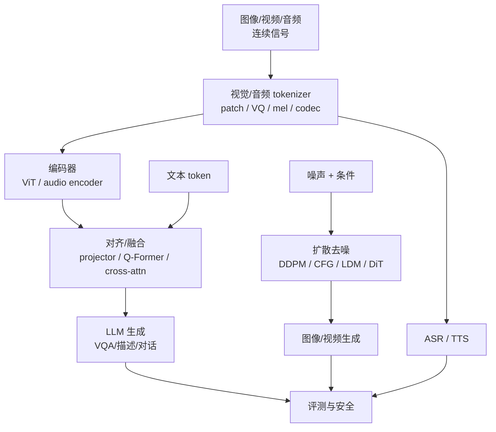
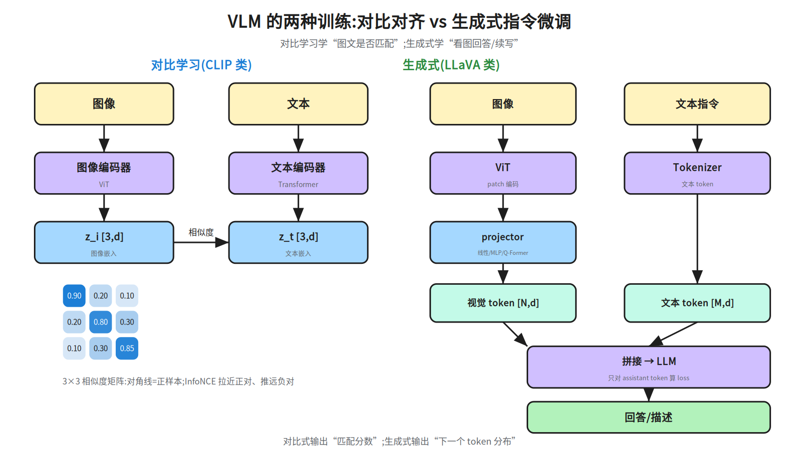
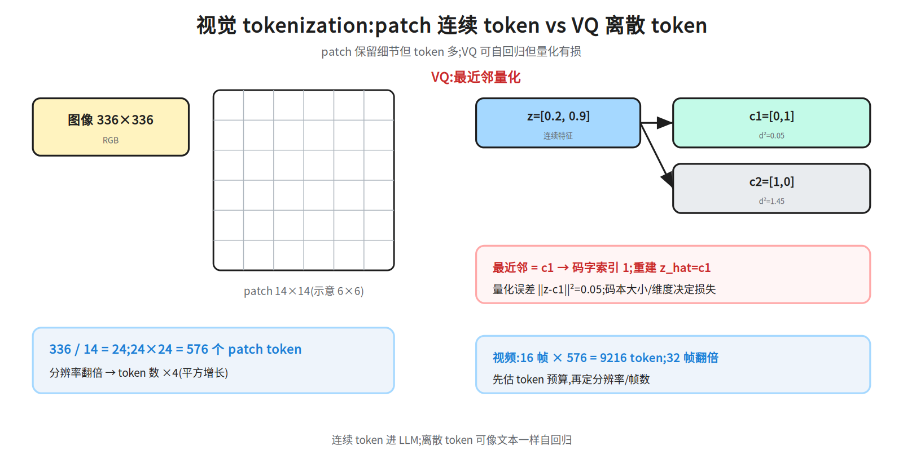
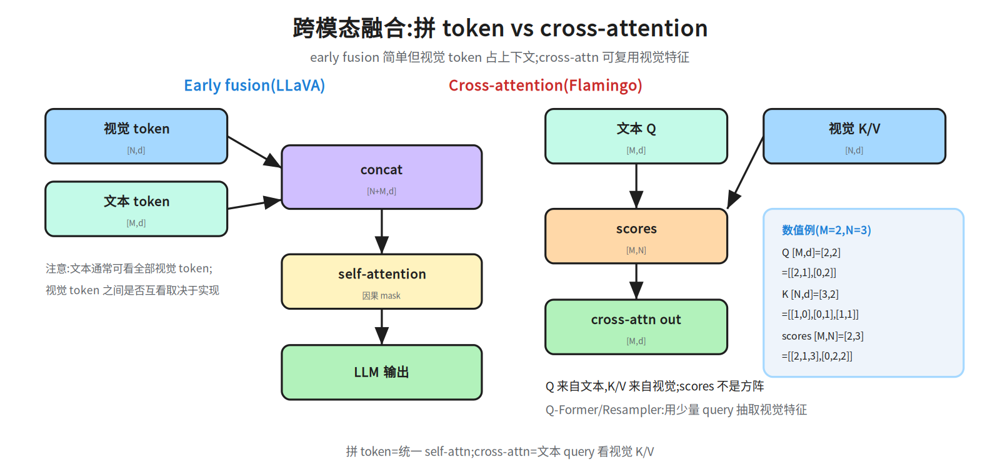
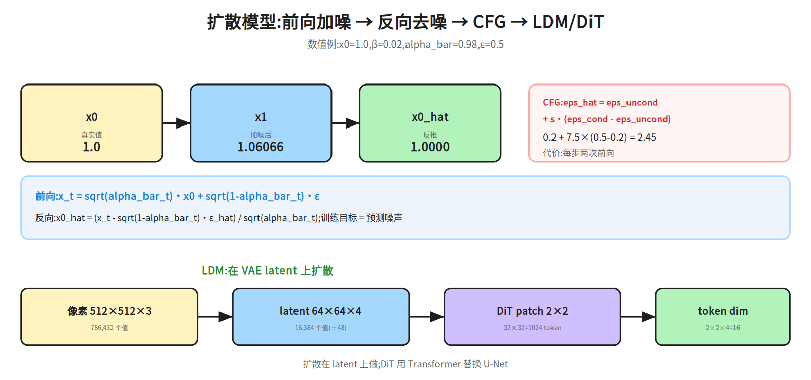
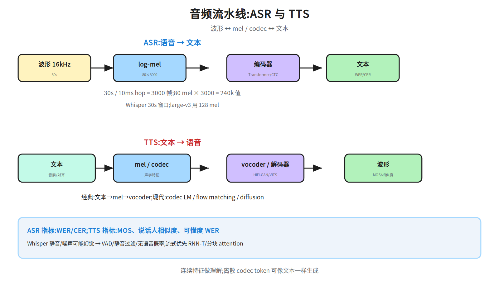

# 第十九层 · 多模态深化 —— VLM、视频/音频与扩散

> 本层回答:VLM 到底怎么训练(对比 vs 生成)?视觉 token 怎么来(patch/VQ)?图文怎么融合?视频/音频管线怎么估成本?扩散模型的前向/反向、CFG、LDM/DiT 怎么推导与复算?

> **前置(按节)**
> - §1–§4:先看 `notes/12_multimodal.md §1–§3`(VLM 概览/tokenization/融合)。
> - §5 扩散:先看 `notes/12_multimodal.md §4–§5`(DDPM/LDM/DiT 概览);本篇给公式与数值链。
> - §6 音频:先看 `notes/12_multimodal.md §6`;§7 评测:先看 `notes/12_multimodal.md §7` 与 `notes/09_evaluation.md`。

> **建议路径(2 次 × 45 分钟)**
> - 第 1 次(必学):§1 VLM 训练 + §2 视觉 tokenizer + §3 融合 + §4 指令微调/现代变体(55a–55c)。
> - 第 2 次(必学):§5 扩散数值链 + §6 视频/音频 + §7 评测与安全(55d/55e)。

## 0. 依赖图(学习顺序)



> **与 12 的分工**:12 是“多模态全景”:每块给直觉、代表性数字和一个数值例。
> 19 只补深水区:VLM 训练目标与 projector/Q-Former 的取舍、VQ 量化与 token 预算、
> 扩散的公式/CFG/LDM/DiT 计算链、音频管线与指标。12 已讲的定义不重复推导。

## 1. VLM 训练:对比对齐 vs 生成式指令微调

### 1.1 对比学习(CLIP 类)

一对图文 `(I, T)` 分别过图像/文本编码器,得到 `z_i, z_t`,做归一化后算相似度矩阵:

```
S = z_i · z_t^T / τ          # [N, N],N=batch
L = (CE(S, labels=arange(N)) + CE(S^T, labels=arange(N))) / 2
```

对角线是正样本;温度 `τ` 控制分布的尖锐程度。训练后,图像/文本嵌入在同一空间,可做零样本分类/检索。

**CLIP vs SigLIP**:

- **CLIP**:对 `N×N` 相似度矩阵做 **softmax 对比损失**(InfoNCE),依赖 batch 内的负样本;batch 越大,负样本越多,效果通常越好,但显存/通信成本高。
- **SigLIP**:对每个图文对做 **sigmoid 二分类**(匹配/不匹配),不要求整行 softmax 归一化;对 batch 大小的依赖更弱,小/中 batch 往往更稳,训练也更易扩展。两者都不是“没有负样本”,而是负样本的组织方式不同。
- 选择:数据/算力有限时 SigLIP 常更友好;需要经典 CLIP 生态/蒸馏时仍常用 CLIP。具体效果依数据与规模,不要把它说成绝对优劣。



**数值直觉**(3×3,示意):

```
S = [[0.90, 0.20, 0.10],
     [0.20, 0.80, 0.30],
     [0.10, 0.30, 0.85]]
```

对角线应被推高,非对角线被压低。**能回答**:图文是否匹配、检索/零样本。
**不能回答**:细粒度问答、计数、空间关系;需要生成式训练。

### 1.2 生成式(LLaVA 类)

```
图像 → ViT → patch 向量 [N, d_v] → projector → 视觉 token [N, d_model]
文本 → tokenizer → 文本 token [M, d_model]
拼接 [视觉; 文本] → LLM → 回答
```

训练通常两阶段:

1. **对齐预训练**:冻结 LLM,只训 projector(或只训少量参数),用图文对教“视觉 token 与词空间对齐”;
2. **指令微调**:解冻 LLM(或 LoRA),用视觉问答/对话数据教“看图回答”;loss 只对 assistant token 算。

**对比**:

| | 对比式(CLIP) | 生成式(LLaVA) |
|---|---|---|
| 输出 | 匹配分数/嵌入 | 下一个 token 分布 |
| 监督 | 图文对(正/负) | 回答文本(教师强制) |
| 强项 | 检索、零样本分类 | VQA、描述、对话 |
| 弱项 | 细粒度生成 | 需要高质量指令数据 |

### 1.3 Projector / Q-Former:对齐与压缩

- **线性层**:最便宜,LLaVA-1 用;把 `d_v` 投到 `d_model`。
- **2 层 MLP**:LLaVA-1.5 用;非线性更强,参数量仍小。
- **Q-Former / Perceiver Resampler**:用 `K` 个可学 query 从 `N` 个视觉特征里抽取,输出 `K` 个 token(`K << N`);省上下文,但可能丢细节。
- **动态分辨率**:Qwen2-VL 类把大图切块,保留更多 patch;代价是 token 数可变、批处理复杂。

> 面试口径:projector 决定“视觉特征能不能被 LLM 读”;Q-Former 决定“用多少 token 读”。token 数 = 成本,细节 = 能力,二者要按任务权衡。

## 2. 视觉 tokenizer:patch vs VQ

### 2.1 Patch token(连续)

```
图像 H×W, patch P×P → 网格 (H/P) × (W/P) 个 patch
每个 patch: P×P×3 个像素 → 线性投影到 d_model
```

数值:

```
224/14 = 16 → 16×16 = 256;加 [CLS] = 257
336/14 = 24 → 24×24 = 576(LLaVA 常用)
672/14 = 48 → 48×48 = 2304
```

**分辨率翻倍 → token 数 ×4**;视频再乘帧数:

```
16 帧 × 576 = 9216 个视觉 token
32 帧 → 18432
```

### 2.2 VQ token(离散)

VQ-VAE/VQGAN 把连续特征 `z` 量化到码本 `{c_k}`:

```
k* = argmin_k ||z - c_k||²
z_hat = c_{k*}
```



**数值**:

```
z = [0.2, 0.9]
c1 = [0, 1] → ||z-c1||² = 0.2² + (-0.1)² = 0.05
c2 = [1, 0] → ||z-c2||² = (-0.8)² + 0.9² = 1.45
→ 选 c1,码字索引 1;重建 z_hat=[0,1];量化误差 0.05
```

VQ 的损失通常包含:重建损失 + 码本损失 + commitment loss。码本大小/维度决定信息损失;离散 token 可像文本一样自回归生成。

**codebook collapse(码本坍缩)**:训练中编码器可能只反复使用少数码字,其余码字变成“死码”,有效码本变小、重建变差。常用缓解:

- **EMA 更新码本**:用编码器输出的指数滑动平均更新码字,而不是只靠码本损失的梯度;
- **commitment loss**:`β·||z - sg[c]||²`,让编码器输出靠近所选码字(`sg` 为 stop-gradient);
- **死码重启/重初始化**:长时间不被选中的码字用随机样本或当前 batch 的编码重置;也可用 k-means 初始化、码本归一化、温度/噪声。
- 监控:每码字使用率、perplexity、死码比例;不要只看重建 loss。

> 注意:VQ 的“离散化”本身有损;collapse 是优化/使用率问题,和量化误差不是同一件事。

**Token 预算**:先定“视觉 token 上限”,再反推分辨率/帧数/是否用 Q-Former 压缩。不要先拉满分辨率再发现上下文爆了。

## 3. 跨模态融合:拼 token vs cross-attention

| 方式 | 做法 | 代表 | 代价 |
|---|---|---|---|
| Early fusion | 视觉 token 与文本 token 拼接,统一 self-attn | LLaVA | 视觉 token 占上下文 |
| Cross-attention | 文本 Q 看视觉 K/V | Flamingo | 额外 cross-attn 层,训练复杂 |
| Resampler | 少量 query 抽取视觉特征 | Q-Former/Perceiver | 压缩但可能丢细节 |



**形状与数值**:

```
Early fusion:
  视觉 [N,d] + 文本 [M,d] → concat [N+M,d] → self-attn

Cross-attention:
  Q 来自文本 [M,d],K/V 来自视觉 [N,d]
  scores = Q·K^T [M,N]   ← 不是方阵
```

小例 `M=2, N=3, d=2`:

```
Q = [[2,1],[0,2]]
K = [[1,0],[0,1],[1,1]]
Q·K^T = [[2,1,3],[0,2,2]]
scores[0][0] = 2×1 + 1×0 = 2
```

**因果 mask 细节**:early fusion 中文本通常能看全部视觉 token;视觉 token 之间是否互看取决于实现。训练/推理必须一致。

## 4. VLM 指令微调与现代变体

- **LLaVA**:CLIP ViT-L/14-336 → 576 token;2 层 MLP projector;两阶段训练。
- **Qwen2-VL**:动态分辨率/NaViT,大图切块;适合文档/小字,但 token 数可变。
- **Chameleon**:从预训练起就把离散视觉 token 与文本 token 放同一 Transformer;统一理解/生成,训练要求高。
- **Janus**:理解用连续视觉特征、生成用离散 token,两条路径解耦,减少任务冲突。

**指令数据**:VQA、描述、对话、OCR、图表、代码/截图;要覆盖“拒答/不确定性/安全”。数据质量比堆量更重要。

## 5. 扩散深化:DDPM → CFG → LDM/DiT

### 5.1 前向:一步跳到任意 t

```
q(x_t | x_{t-1}) = N( sqrt(1-β_t) x_{t-1}, β_t I )
α_t = 1-β_t,  alpha_bar_t = Π_{s=1}^t α_s
x_t = sqrt(alpha_bar_t) x_0 + sqrt(1-alpha_bar_t) ε,  ε~N(0,I)
```

数值:`x_0=1.0, β=0.02, alpha_bar=0.98, ε=0.5`

```
x_1 = sqrt(0.98)×1.0 + sqrt(0.02)×0.5
    = 0.98995 + 0.14142×0.5
    = 1.06066
```

### 5.2 反向:预测噪声,反推 x0

```
L = E[ ||ε - ε_θ(x_t,t)||² ]
x_0_hat = (x_t - sqrt(1-alpha_bar_t)·ε_hat) / sqrt(alpha_bar_t)
```

用 `ε_hat=0.5`:

```
x_0_hat = (1.06066 - 0.14142×0.5) / 0.98995 = 1.0000
```

完整采样一步(DDPM):

```
x_{t-1} = (1/sqrt(α_t)) (x_t - (β_t/sqrt(1-alpha_bar_t)) ε_θ(x_t,t)) + σ_t z
```



### 5.3 Classifier-free guidance(CFG)

训练时以一定概率(如 10%)把条件置空;采样时:

```
eps_hat = eps_uncond + s · (eps_cond - eps_uncond)
```

数值:`eps_uncond=0.2, eps_cond=0.5, s=7.5`

```
eps_hat = 0.2 + 7.5×(0.5-0.2) = 2.45
```

`s=1` 无引导;`s>1` 更贴条件但可能过饱和/多样性下降;每步两次前向(有条件+无条件)。negative prompt 把 `eps_uncond` 换成 `eps_neg`。

### 5.4 Latent Diffusion 与 DiT

**LDM**:在 VAE latent 上扩散,而不是像素空间。

```
512×512×3 = 786,432 个值
→ VAE encoder → 64×64×4 = 16,384 个值(下采样 8×,约 ÷48)
在 latent 上做扩散;文本条件通过 cross-attention 注入
→ VAE decoder → 图像
```

**DiT**:用 Transformer 替换 U-Net。

```
latent 64×64×4, patch 2×2 → 32×32 = 1024 个 token
每个 token:2×2×4 = 16 维 → 线性投影到 d_model
条件:adaLN-Zero 注入时间步/类别
```

**能回答**:扩散为什么预测噪声、CFG 怎么放大条件、LDM/DiT 为什么省算力。
**不能回答**:具体采样器/步数的质量;不同 schedule/模型差异很大,要实验。

## 6. 视频与音频:token 预算与管线

### 6.1 视频

- 均匀采样 `F` 帧,每帧 `N` 个 patch → `F×N` token;加时间位置编码;
- 或 3D tubelet 一次编码时空 patch;
- 长视频要分层/稀疏采样;先估预算:

```
336×336, 每帧 576 token
F=16 → 9216 token;F=32 → 18432
```

### 6.2 ASR

```
波形 16kHz → log-mel(80 通道,25ms 窗/10ms 移)→ encoder → 文本
```

30 秒、10ms hop → 3000 帧;`80×3000=240,000` 个值。Whisper 用 30s 窗口;large-v3 用 128 mel。指标 WER/CER。

**幻觉**:静音/噪声/音乐上可能“编”文本;用 VAD/静音过滤/无语音概率,不要盲信输出。流式优先 RNN-T/分块 attention。

### 6.3 TTS

```
文本 → 音素/对齐 → mel 频谱 → vocoder → 波形
或:文本 → 离散 codec token → 解码器 → 波形(codec LM)
```

经典 vocoder:HiFi-GAN;端到端:VITS;现代:flow matching/diffusion(F5-TTS、CosyVoice)。指标 MOS、说话人相似度、可懂度 WER。



## 7. 评测与安全

| 任务 | 基准/指标 | 坑 |
|---|---|---|
| 图像问答 | VQAv2、MMMU、MathVista;准确率 | 题目难度/答案格式 |
| 文档 | DocVQA;ANLS/准确率 | OCR/版面 |
| 描述 | COCO Caption;CIDEr/BLEU | 指标与人类偏好不一致 |
| 视频 | MVBench 等;准确率 | 帧采样/时序推理 |
| 语音识别 | LibriSpeech;WER | 口音/噪声域外 |
| 语音合成 | MOS/说话人相似度 | 主观、样本少 |
| 生成 | FID、CLIPScore、人类偏好 | FID 依赖特征提取器 |

**安全**:

- **幻觉**:描述图中不存在的东西;用 grounding/引用/不确定性;
- **视觉 prompt injection**:图片里嵌文字指令/对抗 patch;
- **NSFW/暴力**:输入输出过滤;
- **隐私/版权**:人脸、PII、训练图像版权;水印/溯源;
- **偏见**:人物描述/职业/性别刻板;分群体评测。

## 8. 面试要点

1. **对比式 vs 生成式 VLM?** → 对比学图文匹配(CLIP);生成学看图回答(LLaVA),loss 是 next-token。
2. **projector 与 Q-Former 的区别?** → 线性/MLP 逐 token 投影;Q-Former 用少量 query 压缩,省 token 但可能丢细节。
3. **图像 patch 数怎么算?** → `(H/P)×(W/P)`;336/14=24²=576;224/14=16²=256(+CLS)。
4. **VQ 怎么量化?** → 最近邻码字;`k*=argmin||z-c_k||²`;数值 z=[0.2,0.9]→c1,误差 0.05。
5. **early fusion vs cross-attn?** → 拼接统一 self-attn vs 文本 Q 看视觉 K/V;scores 形状 [M,N]。
6. **DDPM 前向/反向?** → 闭式加噪;预测噪声;`x0_hat` 反推。
7. **CFG 公式与代价?** → `eps_uncond+s(eps_cond-eps_uncond)`;每步两次前向;s 过大过饱和。
8. **LDM 为什么省?** → 在 64×64×4 latent 上扩散,而不是 512×512×3 像素。
9. **DiT 的 token 数?** → 64×64 latent、patch 2×2 → 32²=1024 token,每 token 16 维。
10. **视频/音频 token 怎么估?** → `F×N`;30s/10ms=3000 帧,80×3000=240k mel 值。
11. **ASR 幻觉怎么防?** → VAD/静音过滤/无语音概率;流式用 RNN-T/分块 attention。
12. **多模态评测的坑?** → 帧采样、OCR、指标与人类偏好不一致、幻觉/偏见/注入。

## 常见坑

- 把 VLM 说成“LLM 直接看图”:必须有视觉编码器 + 对齐投影。
- 把 projector 越复杂越好:Q-Former 省 token,但可能丢细节。
- 把 VQ 当无损:量化有误差;码本大小/维度决定损失。
- 把 DDPM 训练目标说成“预测原图”:标准是预测噪声(或 v/score)。
- 把 LDM 的下采样说成无损:VAE 是有损压缩。
- 把 ASR 的 WER 与 TTS 的 MOS 混用。
- 只测干净图片/标准口音,不测对抗/域外/多语。

## 动手清单

1. **patch/token 计算器**:输入 H、W、P、帧数,输出 token 数;验收:224/14=256(+CLS)、336/14=576、16 帧=9216。
2. **VQ 复算**:给定 z 和两个码字,手算 L2 距离、索引、量化误差;验收:与 §2.2 数值一致。
3. **DDPM 复算**:用 §5 的数字复算 `x_1`、`x_0_hat`、CFG;验收:1.06066 / 1.0000 / 2.45。
4. **LDM/DiT 账本**:给定像素尺寸和 VAE 下采样,算 latent 值数与 DiT token 数;验收:512²×3→16,384;64² patch2→1024。

## 相关图

`55a_vlm_training` · `55b_visual_tokenizer` · `55c_cross_modal_fusion`
· `55d_diffusion` · `55e_audio_pipeline`(均在 `diagrams/`,横竖双版本)

## 下一步

Phase 2 完成。下一步按 `docs/advanced-roadmap.md §5` 选定主/次方向,进入 Phase 3 模块三:按目标岗位/研究问题做 3–5 篇方向深入。
