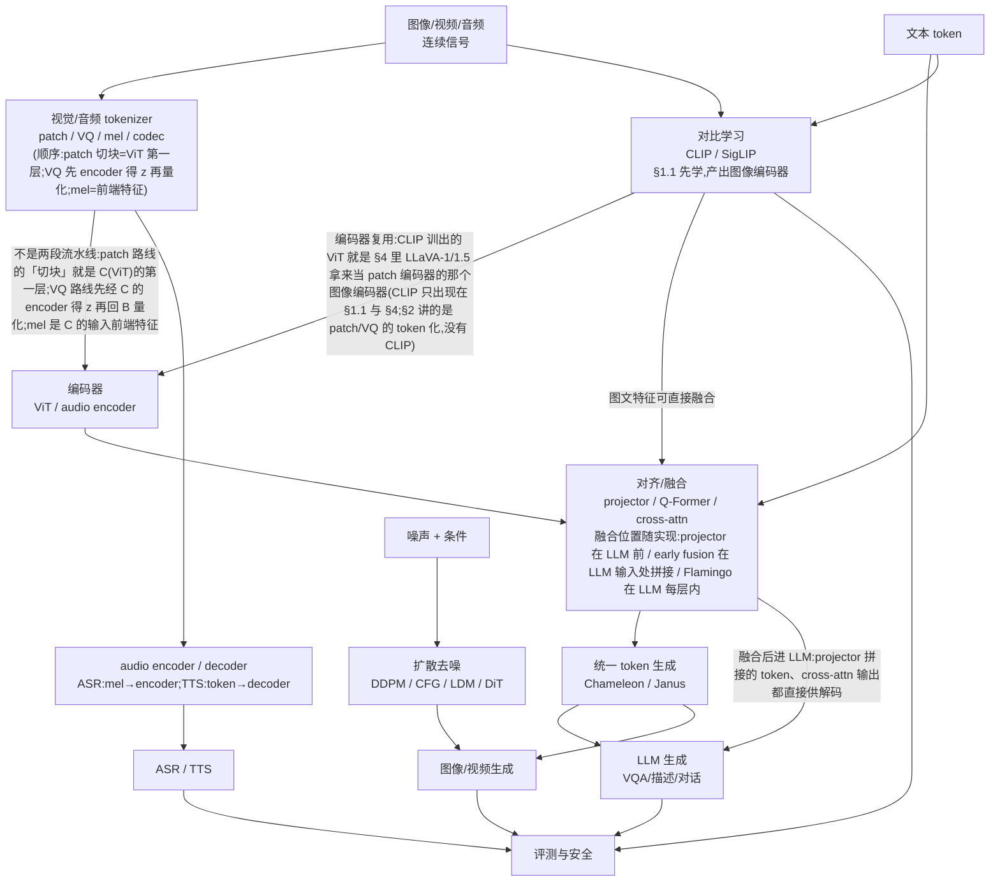

# 第十九层 · 多模态深化 —— VLM、视频/音频与扩散

> 本层回答:VLM 到底怎么训练(对比 vs 生成)?视觉 token 怎么来(patch/VQ)?图文怎么融合?视频/音频管线怎么估成本?扩散模型的前向/反向、CFG、LDM/DiT 怎么推导与复算?

> **前置(按节)**
> - §1–§4:先看 `notes/12_multimodal.md §1–§3`(VLM 概览/tokenization/融合)。
> - §5 扩散:先看 `notes/12_multimodal.md §4–§5`(DDPM/LDM/DiT 概览);本篇给公式与数值链。
> - §6 音频:先看 `notes/12_multimodal.md §6`;§7 评测:先看 `notes/12_multimodal.md §7` 与 `notes/09_evaluation.md`。

> **术语速查**:InfoNCE = 用 softmax+交叉熵实现的对比损失;`[CLS]` = ViT 额外加的可学习全局 token(计入 token 数,256→257);NaViT = Native Resolution ViT,按原生分辨率打包变长 patch;VAD = 语音活动检测;RNN-T = 带预测网络的流式端到端 ASR;vocoder = 声码器(mel→波形);ANLS = 平均归一化 Levenshtein 相似度(文档 VQA 指标)。

> **建议路径(2 次 × 45 分钟)**
> - 第 1 次(必学):§1 VLM 训练 + §2 视觉 tokenizer + §3 融合 + §4 指令微调/现代变体(55a–55c)。
> - 第 2 次(必学):§5 扩散数值链 + §6 视频/音频 + §7 评测与安全(55d/55e)。

## 0. 依赖图(学习顺序)



> **与 12 的分工**:12 是“多模态全景”:每块给直觉、代表性数字和一个数值例。
> 19 只补深水区:VLM 训练目标与 projector/Q-Former 的取舍、VQ 量化与 token 预算、
> 扩散的公式/CFG/LDM/DiT 计算链、音频管线与指标。12 已讲的定义不重复推导。

>
> **读图顺序**:L1(§1.1 对比学习)先于 B/C(§2 patch/VQ)—— CLIP 的 ViT 就是 §4 里 LLaVA-1 直接拿来当 patch 编码器的那个编码器,不是只通向评测的旁支。
> **但正文不走图上的编号顺序**:§1.2 已一次性走完 B→C→D→F(图像→ViT→patch $[N,d_v]$→projector→$[N,d_{model}]$→拼文本→LLM),§1.3 的 projector/Q-Former 也排在 §2 之前;图按概念依赖画(A→B→C→D),不等于章节编号。$N$ 的 256/576/2304 与 $[N,d_v]\to[N,d_{model}]$ 的算法要到 §2.1–§2.2 才展开,先读 §1.3 时按量级理解、回头再补即可。

## 1. VLM 训练:对比对齐 vs 生成式指令微调

### 1.1 对比学习(CLIP 类)

一对图文 `(I, T)` 分别过图像/文本编码器,得到 `z_i, z_t`,做归一化后算相似度矩阵:

```
S = z_i · z_t^T / τ          # [N, N],N=batch
L = (CE(S, labels=arange(N)) + CE(S^T, labels=arange(N))) / 2
```

对角线是正样本;温度 `τ` 控制分布的尖锐程度。训练后,图像/文本嵌入在同一空间,可做零样本分类/检索。

**CLIP vs SigLIP**:

- **CLIP**:对 `N×N` 相似度矩阵做 **softmax 对比损失**(InfoNCE),依赖 batch 内的负样本;batch 越大,负样本越多,效果通常越好,但显存/通信成本高。
- **SigLIP**:对每个图文对做 **sigmoid 二分类**(匹配/不匹配),不要求整行 softmax 归一化;对 batch 大小的依赖更弱,小/中 batch 往往更稳,训练也更易扩展。两者都不是“没有负样本”,而是负样本的组织方式不同。
- 选择:数据/算力有限时 SigLIP 常更友好;需要经典 CLIP 生态/蒸馏时仍常用 CLIP。具体效果依数据与规模,不要把它说成绝对优劣。


**数值直觉**(3×3,示意):

```
S = [[0.90, 0.20, 0.10],
     [0.20, 0.80, 0.30],
     [0.10, 0.30, 0.85]]
```

对角线应被推高,非对角线被压低。**能回答**:图文是否匹配、检索/零样本。
**不能回答**:细粒度问答、计数、空间关系;需要生成式训练。

### 1.2 生成式(LLaVA 类)

```
图像 → ViT → patch 向量 [N, d_v] → projector → 视觉 token [N, d_model]
文本 → tokenizer → 文本 token [M, d_model]
拼接 [视觉; 文本] → LLM → 回答
```

训练通常两阶段:

1. **对齐预训练**:冻结 LLM,只训 projector(或只训少量参数),用图文对教“视觉 token 与词空间对齐”;
2. **指令微调**:解冻 LLM(或 LoRA),用视觉问答/对话数据教“看图回答”;loss 只对 assistant token 算。

**对比**:

| | 对比式(CLIP) | 生成式(LLaVA) |
|---|---|---|
| 输出 | 匹配分数/嵌入 | 下一个 token 分布 |
| 监督 | 图文对(正/负) | 回答文本(教师强制:每步喂真值的前一个 token、整句并行算 next-token loss;再靠 mask 只对 assistant token 计入) |
| 强项 | 检索、零样本分类 | VQA、描述、对话 |
| 弱项 | 细粒度生成 | 需要高质量指令数据 |

### 1.3 Projector / Q-Former:对齐与压缩

- **线性层**:最便宜,LLaVA-1 用;把 `d_v` 投到 `d_model`。
- **2 层 MLP**:LLaVA-1.5 用;非线性更强,参数量仍小。
- **Q-Former / Perceiver Resampler**:用 `K` 个可学 query 从 `N` 个视觉特征里抽取,输出 `K` 个 token(`K << N`);省上下文,但可能丢细节。
> **两者不是一回事(§3 表里会分开挂,别当成同一套机制)**:Q-Former(BLIP-2)压出的 $K$ 个 token 直接拼进 LLM 输入序列 → 融合方式上归 early fusion;Perceiver Resampler(Flamingo)压出的定长视觉特征不进文本序列,而是作为 gated cross-attn 的 K/V 被文本 query 读 → 归 cross-attention。**gated cross-attn** = 在 LLM 每层插一层「文本作 Q、视觉特征作 K/V」的 cross-attention,输出经一个门控标量加回残差:$x\leftarrow x+\tanh(\alpha)\cdot\mathrm{cross\text{-}attn}(x,V)$,其中 $\alpha$ 初始化为 0;于是训练开始时这一层等于恒等映射、不破坏预训练 LLM,再逐步学出门控值。
- **动态分辨率**:Qwen2-VL 不切固定 tile:按原生分辨率切 14×14 patch、把相邻 2×2 合并成一个 token,得到变长 token 数(靠 token packing 组批:把同批多条样本的变长 patch 序列首尾相接拼成一条长序列一次算完,靠 attention mask(块对角 / 按样本切段)与按样本重置的位置编码保证各段只见自己、不跨样本串味,同时省掉 padding 浪费;NaViT 就是这条路线的代表);代价是 token 数可变、批处理复杂。

> 「大图切块/tile(anyres)」的代表是 LLaVA-NeXT(AnyRes:切成多个子图 + 一张全局缩略图,各子图各过一次 ViT)与 InternVL 的动态切块,**不是** Qwen-VL v1。Qwen-VL v1 正好相反:原文写 input images are resized to a specific resolution,视觉编码器输入从 $224\times224$ 提到 $448\times448$,训练和推理都是单一固定尺寸、单次过 ViT,没有 tile/anyres 分支。Qwen2-VL 取代的是这种 conventional predetermined-resolution(改成 naive dynamic resolution:14×14 patch + 相邻 2×2 合并、token 数变长),不是 tiling。

> 面试口径:projector(含 Q-Former 这类 query 压缩器)决定“视觉特征能不能被 LLM 读”;选哪种 projector —— 逐 token 投影(线性/MLP)还是 query 压缩(Q-Former)—— 决定“用多少 token 读”。Q-Former 是 projector 的一种,不是并列的另一类。token 数 = 成本,细节 = 能力,二者要按任务权衡。

## 2. 视觉 tokenizer:patch vs VQ

### 2.1 Patch token(连续)

```
图像 H×W, patch P×P → 网格 (H/P) × (W/P) 个 patch
每个 patch: P×P×3 个像素 → 线性投影到 ViT 宽度 d_v(= §1.2 的 patch 向量 [N,d_v];这是 ViT 宽度,不是 LLM 宽度 d_model —— 要经 §1.3 的 projector 才投成 [N,d_model])
```

数值:

```
224/14 = 16 → 16×16 = 256;加 [CLS] = 257
336/14 = 24 → 24×24 = 576(LLaVA 常用)
672/14 = 48 → 48×48 = 2304
```

**分辨率翻倍 → token 数 ×4**;视频再乘帧数:

> 口径:上面只有 224 那行加了 [CLS](256→257);576 与 2304 都是不含 [CLS] 的 patch 数。LLaVA 系不加 [CLS],两种口径不要混算(按 257 的口径算 336 会误得 577)。

```
16 帧 × 576 = 9216 个视觉 token
32 帧 → 18432
```

### 2.2 VQ token(离散)

VQ-VAE/VQGAN 把连续特征 `z` 量化到码本 `{c_k}`($z$ 由前置 encoder 产生:图像 → 卷积/ViT encoder → 每个空间位置一个 $d$ 维向量;顺序是先 encoder 得 $z$、再量化,与 patch 路线同理,不是「先 tokenize 再编码」两段流水线):
> **VAE 一句话(全文首次出现处)**:VAE = 变分自编码器,encoder 把图像压成低维**连续** latent、decoder 从 latent 重建图像,训练目标是重建损失 + KL 正则,所以是连续 latent 的有损压缩;VQ-VAE 就是把这个连续 latent 换成码本里的离散码字 —— 重建损失照旧,只是中间多一步量化。§5.4 用 LDM 时会再给正式定义与 $f=8$ 的具体尺寸。

```
k* = argmin_k ||z - c_k||²
z_hat = c_{k*}
```


> **图 55b 口径(以正文为准,图待重出)**:红框里写「最近邻 = c1 → 码字索引 1」「量化误差 ||z-c1||²=0.05」,与本节数值和验收口径冲突,一律按正文读:该码字是 **c0**([0,1],即图上标的那个 c1),索引 k*=0;图上那个 c2 = 正文的 c1([1,0],距离 1.45)。0.05 是**平方 L2 距离**,量化误差是 √0.05≈0.224。图需在源里改标号(c1→c0、索引 1→0),并把 0.05 标成「平方距离 d²」、量化误差另写 √0.05≈0.224。

**数值**:

```
z = [0.2, 0.9]
c0 = [0, 1] → ||z-c0||² = 0.2² + (-0.1)² = 0.05
c1 = [1, 0] → ||z-c1||² = (-0.8)² + 0.9² = 1.45
→ 选 c0,码字索引 k*=0(口径:码本 0-based 编号 c0→0、c1→1,c0 是列出的第 1 个码字,故索引为 0);重建 z_hat=[0,1];平方 L2 距离 0.05(这是距离的平方,量化误差=√0.05≈0.224)
```

VQ 的损失通常包含:重建损失 + 码本损失 + commitment loss。码本大小/维度决定信息损失;离散 token 可像文本一样自回归生成。

**codebook collapse(码本坍缩)**:训练中编码器可能只反复使用少数码字,其余码字变成“死码”,有效码本变小、重建变差。常用缓解:

- **EMA 更新码本**:用编码器输出的指数滑动平均更新码字,而不是只靠码本损失的梯度;
- **commitment loss**:`β·||z - sg[c]||²`,让编码器输出靠近所选码字(`sg` 为 stop-gradient);
- **死码重启/重初始化**:长时间不被选中的码字用随机样本或当前 batch 的编码重置;也可用 k-means 初始化、码本归一化、温度/噪声。
- 监控:每码字使用率、perplexity、死码比例;不要只看重建 loss。
> **这两个词先定义**:k-means 初始化 = 先对所有 encoder 输出 $z$ 跑 k-means 聚成 $K$ 类($K$=码本大小),把 $K$ 个聚类中心直接当码字初值 —— 拿「数据实际分布的中心」当初值,比随机初值更不容易开局就让一堆码字离数据太远、直接成死码。码本 perplexity = 用码字使用率 $p_k$(第 $k$ 个码字被选中的频率,$\sum_k p_k=1$)算 $\exp(-\sum_k p_k\log p_k)$,含义是「有效码字数」:$K$ 个码字均匀使用 → $=K$;只用 1 个 → $=1$。它与语言模型的 perplexity 是同一个熵公式,只是这里的分布是码字使用率、不是下一个 token 的概率。

> 注意:VQ 的“离散化”本身有损;collapse 是优化/使用率问题,和量化误差不是同一件事。

**Token 预算**:先定“视觉 token 上限”,再反推分辨率/帧数/是否用 Q-Former 压缩。不要先拉满分辨率再发现上下文爆了。

## 3. 跨模态融合:拼 token vs cross-attention

| 方式 | 做法 | 代表 | 代价 |
|---|---|---|---|
| Early fusion | 视觉 token 与文本 token 拼接,统一 self-attn | LLaVA | 视觉 token 占上下文 |
| Cross-attention | 文本 Q 看视觉 K/V | Flamingo | 额外 cross-attn 层,训练复杂 |
| Resampler(压缩器,不是独立的第三类融合) | 少量 query 抽取视觉特征;接法看具体模型 —— 压完拼进 LLM 序列 → 归 Early fusion 那行,只输出定长特征当 cross-attn 的 K/V → 归 Cross-attention 那行 | Q-Former(BLIP-2:压完仍拼进序列,归 Early fusion);Perceiver Resampler 不归这一格 —— Flamingo 里它输出定长视觉特征、只当 gated cross-attn 的 K/V,应读作上面 Cross-attention 那行 | 只改 token 数;压缩但可能丢细节 |


> **与 12 的口径差异(修正 `notes/12_multimodal.md` §3)**:前置篇 §3 的同一张表把「Resampler(Q-Former/Perceiver)」统一写成「压完仍是拼进序列,融合方式上归 early fusion」——那是过宽表述。本篇按代表模型的实际接线拆开:Q-Former(BLIP-2)输出确实拼进 LLM 序列(归 Early fusion 那行);Perceiver Resampler 在 Flamingo 里不拼进文本序列,只输出定长视觉特征当 gated cross-attn 的 K/V(归 Cross-attention 那行)。复习 Perceiver 时以本篇口径为准,12 §3 那一格按此修正。

**形状与数值**:

```
Early fusion:
  视觉 [N,d] + 文本 [M,d] → concat [N+M,d] → self-attn

Cross-attention:
  Q 来自文本 [M,d],K/V 来自视觉 [N,d]
  scores = Q·K^T [M,N]   ← 不是方阵
```

小例 `M=2, N=3, d=2`:

```
Q = [[2,1],[0,2]]
K = [[1,0],[0,1],[1,1]]
Q·K^T = [[2,1,3],[0,2,2]]
scores[0][0] = 2×1 + 1×0 = 2

# 注:本小例只演示形状与矩阵乘法,scores 未除 1/√d_k、也未接 softmax;真要算权重需按前置口径先缩放再 softmax
```

**因果 mask 细节**:early fusion 中文本通常能看全部视觉 token;视觉 token 之间是否互看取决于实现。训练/推理必须一致。

## 4. VLM 指令微调与现代变体

- **LLaVA-1**:CLIP ViT-L/14-224 → 16×16=256 token;单层线性 projector;两阶段训练。
- **LLaVA-1.5**:CLIP ViT-L/14-336 → 24×24=576 token;2 层 MLP projector;两阶段训练。
- **Qwen2-VL**:NaViT 式原生动态分辨率(14×14 patch 后 2×2 merge,变长 token),不切固定 tile;适合文档/小字,但 token 数可变。
- **Chameleon**:从预训练起就把离散视觉 token 与文本 token 放同一 Transformer;统一理解/生成,训练要求高。
- **Janus**:理解用连续视觉特征、生成用离散 token,两条路径解耦,减少任务冲突。

**指令数据**:VQA、描述、对话、OCR、图表、代码/截图;要覆盖“拒答/不确定性/安全”。数据质量比堆量更重要。

## 5. 扩散深化:DDPM → CFG → LDM/DiT

### 5.1 前向:一步跳到任意 t
> **闭式怎么来的(补推导,对应下面代码块)**:①每步 $q(x_t\mid x_{t-1})$ 是高斯,而高斯乘高斯仍是高斯,故 $x_t$ 对 $x_0$ 的条件分布仍是高斯,只需定均值与方差;②把一步重参数化成 $x_t=\sqrt{\alpha_t}\,x_{t-1}+\sqrt{\beta_t}\,\epsilon_t$,$\epsilon_t\sim\mathcal{N}(0,I)$,$\alpha_t=1-\beta_t$;③迭代代入得 $x_t=\sqrt{\textstyle\prod_{s\le t}\alpha_s}\,x_0+\sqrt{1-\textstyle\prod_{s\le t}\alpha_s}\,\bar\epsilon$,其中 $\prod_{s\le t}\alpha_s=\bar\alpha_t$,且独立标准正态的加权和仍是标准正态(方差相加、系数归一),故并成单个 $\epsilon$;④系数只能是 $\sqrt{\bar\alpha_t}$ 与 $\sqrt{1-\bar\alpha_t}$:两者平方和为 1,正好保持总方差不变——每步注入 $\beta_t$ 的新噪声、同时按 $\alpha_t$ 衰减旧信号,是同一件事的两面。§5.2 的 $\hat x_0$ 就是这式的代数逆,所以反解才「正好」是它的逆。

```
q(x_t | x_{t-1}) = N( sqrt(1-β_t) x_{t-1}, β_t I )
α_t = 1-β_t,  alpha_bar_t = Π_{s=1}^t α_s
x_t = sqrt(alpha_bar_t) x_0 + sqrt(1-alpha_bar_t) ε,  ε~N(0,I)
```

数值(t=1 的手算例;真实 DDPM schedule 是 β_1=1e-4、β_T=0.02;本例为便于手算改用假设的 β_1^demo=0.02,它与 schedule 里的 0.02(那是 β_T)无关,别把 β_T 的 0.02 记成“第一步的 β”):`x_0=1.0, t=1, β_1^demo=0.02, alpha_bar_1=1-β_1^demo=0.98, ε=0.5`

```
x_1 = sqrt(0.98)×1.0 + sqrt(0.02)×0.5
    = 0.98995 + 0.14142×0.5
    = 1.06066
```

### 5.2 反向:预测噪声,反推 x0

```
L = E[ ||ε - ε_θ(x_t,t)||² ]
x_0_hat = (x_t - sqrt(1-alpha_bar_t)·ε_hat) / sqrt(alpha_bar_t)
```

用 `ε_hat=0.5`(这里恰好取真噪声 ε,所以是前向闭式的代数反解,才精确得到 1.0000;真实采样 ε_hat≠ε,x_0_hat 只是估计,不要推广成“反向一步就能精确还原 x_0”):

```
x_0_hat = (1.06066 - 0.14142×0.5) / 0.98995 = 1.0000
```

完整采样一步(DDPM;σ_t 为反向方差:DDPM 原文取方差 σ_t²=β_t(即标准差 √β_t);严格的后验标准差是 √β̃_t = √(β_t(1-alpha_bar_{t-1})/(1-alpha_bar_t)),两者实测效果相当;但 $t=1$ 时 $\sigma_1=0$ 只在后验方差 $\tilde\beta_t$ 口径下成立($\bar\alpha_0=1\Rightarrow\tilde\beta_1=\beta_1(1-\bar\alpha_0)/(1-\bar\alpha_1)=0$,是公式推论,不是额外规定),按 $\beta_t$ 口径则 $\sigma_1=\sqrt{\beta_1}$(真实 schedule 下 $\sqrt{10^{-4}}=0.01$;§5.1 的 $\beta_1^{\text{demo}}=0.02$ 只为手算方便,照它算才得 $\sqrt{0.02}\approx0.141$,别把 0.141 当真值带走),并不为 0 —— 复算前先定口径,而且定了之后**整列 $\sigma_t$ 跟着换**:选 $\beta_t$ 就一路用 $\sqrt{\beta_t}$(真实 schedule 下 $\sigma_1=0.01$),并另按「最后一步不加噪」的人工规定把 $t=1$ 的噪声项置零;选后验 $\tilde\beta_t$ 就一路用 $\sqrt{\tilde\beta_t}$,$t=1$ 自然为 0、不需要这条人工规定):
> **采样一步的公式怎么来(补后验的定义与推导)**:①反向每一步也取高斯 $q(x_{t-1}\mid x_t,x_0)=\mathcal{N}(\tilde\mu_t,\tilde\beta_t I)$ —— 这就是上面说的「严格后验」,它的合法性来自前向是马尔可夫高斯链:把 $x_0$ 条件进来后,$q(x_{t-1}\mid x_t,x_0)$ 等于 $q(x_{t-1}\mid x_0)\cdot q(x_t\mid x_{t-1},x_0)$ 归一化,两个高斯相乘仍是高斯。②配方得 $\tilde\beta_t=\beta_t\frac{1-\bar\alpha_{t-1}}{1-\bar\alpha_t}$,$\tilde\mu_t=\frac{\sqrt{\bar\alpha_{t-1}}\beta_t}{1-\bar\alpha_t}x_0+\frac{\sqrt{\alpha_t}(1-\bar\alpha_{t-1})}{1-\bar\alpha_t}x_t$(都由 §5.1 的 $q(x_t\mid x_0)$、$q(x_{t-1}\mid x_0)$ 代数消元得到,不加新假设)。③采样时 $x_0$ 未知,把 §5.2 的 $\hat x_0=(x_t-\sqrt{1-\bar\alpha_t}\epsilon_\theta)/\sqrt{\bar\alpha_t}$ 代进 $\tilde\mu_t$ 整理,才得到下面的公式:$x_{t-1}=\frac{1}{\sqrt{\alpha_t}}\big(x_t-\frac{\beta_t}{\sqrt{1-\bar\alpha_t}}\epsilon_\theta(x_t,t)\big)+\sigma_t z$ —— 系数 $\beta_t/\sqrt{1-\bar\alpha_t}$ 不是凭空得到的,是「用 $\epsilon_\theta$ 替掉 $x_0$」后的合并结果。④$\sigma_t$ 的来源就是后验标准差 $\sqrt{\tilde\beta_t}$;DDPM 原文另取简化口径 $\sigma_t^2=\beta_t$(两者实测相当)。出处:Ho et al. 2020《Denoising Diffusion Probabilistic Models》§3.2 与 Algorithm 2。

```
x_{t-1} = (1/sqrt(α_t)) (x_t - (β_t/sqrt(1-alpha_bar_t)) ε_θ(x_t,t)) + σ_t z
```


### 5.3 Classifier-free guidance(CFG)

训练时以一定概率(如 10%)把条件置空;采样时:

```
eps_hat = eps_uncond + s · (eps_cond - eps_uncond)
```

数值:`eps_uncond=0.2, eps_cond=0.5, s=7.5`

```
eps_hat = 0.2 + 7.5×(0.5-0.2) = 2.45
```

`s=1` 无引导;`s>1` 更贴条件但可能过饱和/多样性下降;每步两次前向(有条件+无条件)。negative prompt 把 `eps_uncond` 换成 `eps_neg`。

### 5.4 Latent Diffusion 与 DiT

**LDM**:在 VAE latent 上扩散,而不是像素空间。
> **VAE 是什么**(§2.2 已一句话带过,这里给正式定义):VAE = 预训练的自编码器(autoencoder),encoder 把图像压成低维连续 latent、decoder 从 latent 重建图像,训练目标是重建 + KL 正则(Stable Diffusion 的 $f=8$ VAE 还要加 patch 对抗损失、KL 权重压到极小:只靠重建+KL 训出的 decoder 偏糊,锐度主要来自对抗目标,不是重建损失的自然结果),所以是有损压缩、且不参与扩散训练。Stable Diffusion 用的 $f=8$ VAE 把 $H\times W\times3$ 压成 $(H/8)\times(W/8)\times4$:空间边长各缩 8 倍(即 8× 下采样),通道取 4 是工程折中(通道多能多留细节,但扩散更贵)。于是 $512\times512\times3=786{,}432$ 个值 → $64\times64\times4=16{,}384$ 个值($8^2=64$ 倍空间缩减、通道 $3\to4$,净 $\div48$)。为什么必须离开像素空间:扩散骨干的算力随空间尺寸平方增长,$64\times64$ 上的 self-attn 比 $512\times512$ 像素便宜两个数量级以上,而 VAE 已把感知上重要的信息留下;代价是细节靠 decoder 补、能力上限受 VAE 重建质量约束(所以常见坑里那条「VAE 是有损压缩」)。§0 依赖图里 $G\to H$ 之间省略了 VAE encoder/decoder 这一环(图上直接写「噪声+条件 → 扩散去噪」),扩散实际发生在 latent 上,不是漏了一节。

```
512×512×3 = 786,432 个值
→ VAE encoder → 64×64×4 = 16,384 个值(下采样 8×,约 ÷48)
在 latent 上做扩散;文本条件通过 cross-attention 注入
→ VAE decoder → 图像
```

**DiT**:用 Transformer 替换 U-Net。
> **U-Net 是什么**(被替换的东西):扩散模型(DDPM、Stable Diffusion 1.x/2.x)默认的去噪骨干是 U-Net——卷积编解码器:下采样若干层(通道翻倍、空间减半)提取多尺度特征,再上采样回原分辨率,并用跳连把下采样同层的特征直接接到对应上采样层以保住高频细节;各分辨率块里再插 self-attn/cross-attn。代价是感受野受卷积核与层数限制、结构靠手工设计、scaling 不如 Transformer 顺。DiT 的动机就是把这块换成 Transformer(纯 attention 全局感受野、加宽加深即 scaling、工程栈与 LLM 共用),所以「DiT 相对 LDM 改了什么」= **只换去噪骨干**,latent 扩散那套(VAE + $64\times64\times4$ latent + 条件注入)全保留。顺便定义:**SiLU** = Sigmoid Linear Unit,$x\cdot\mathrm{sigmoid}(x)$,ReLU 的平滑版,下面 adaLN 的 MLP 就是拿它当激活函数。

```
latent 64×64×4, patch 2×2 → 32×32 = 1024 个 token
每个 token:2×2×4 = 16 维 → 线性投影到 d_model
条件:adaLN-Zero 注入时间步/类别(adaLN:把每层 LayerNorm 的 scale γ / shift β 改由一个带 SiLU 的 MLP 从条件向量回归;Zero:生成 γ/β/α 的 MLP 最后一层零初始化 → 初始 γ=β=α=0;调制式为 x·(1+γ)+β,故通过因子 1+γ=1、加性项 β=0(不调制),门控 α=0 把残差分支输出压成 0,每个 block 从恒等映射起步,训练中再放开)
```

**能回答**:扩散为什么预测噪声、CFG 怎么放大条件、LDM/DiT 为什么省算力。
**不能回答**:具体采样器/步数的质量;不同 schedule/模型差异很大,要实验。

## 6. 视频与音频:token 预算与管线

### 6.1 视频

- 均匀采样 `F` 帧,每帧 `N` 个 patch → `F×N` token;加时间位置编码;
- 或 3D tubelet 一次编码时空 patch;
- 长视频要分层/稀疏采样;先估预算:

```
336×336, 每帧 576 token
F=16 → 9216 token;F=32 → 18432
```

### 6.2 ASR
> **log-mel 是什么(补定义)**:波形是 16kHz 的一维采样点序列;前端先按 25ms 窗($16000\times0.025=400$ 点)做 STFT 得到每帧频谱,再用一组 mel 三角滤波器把频带压成约 80 个通道(mel 刻度低频细、高频粗,贴近人耳分辨率;large-v3 用 128),每通道出一个能量值——这就是「80 通道」;最后取 log 压缩动态范围(能量比变成可加、数值更稳),得到 log-mel。窗长 25ms 决定频率分辨率,移 10ms 决定帧率(1 秒 100 帧),两者必须成对给出,换任一个帧数公式都变。所以下面算出的 239,840 个值 = 2998 帧 × 80 通道,是一张「时间×频率」二维特征图,不是原始采样点;§6.3 TTS 的「mel 频谱 → vocoder」用的是同一种前端表示。

```
波形 16kHz → log-mel(80 通道,25ms 窗/10ms 移)→ encoder → 文本
```

30 秒=480,000 点,25ms 窗=400 点、10ms 移=160 点 → 1+⌊(480000−400)/160⌋=2998 帧,`80×2998=239,840` 个值;3000 帧只有 Whisper 做 center padding(首尾各补 n_fft/2=200 点,16kHz 下 12.5ms)得 3001 帧、再丢掉最后一帧后才成立。Whisper 用 30s 窗口;large-v3 用 128 mel。指标 WER/CER。


> **图 55e 口径**:图上写「30s / 10ms hop = 3000 帧;80 mel × 3000 = 240k 值」是无前提的取整/补帧口径;严格算按本段 2998 帧、239,840 值,差在 Whisper 的 center padding(3001 帧丢最后一帧才得 3000)。按图复算得到 240k 属预期,本节统一以 2998 / 239,840 为准。

**幻觉**:静音/噪声/音乐上可能“编”文本;用 VAD/静音过滤/无语音概率,不要盲信输出。流式优先 RNN-T/分块 attention。

### 6.3 TTS

```
文本 → 音素/对齐 → mel 频谱 → vocoder → 波形
或:文本 → 离散 codec token → 解码器 → 波形(codec LM)
```

经典 vocoder:HiFi-GAN;端到端:VITS;现代:flow matching/diffusion(F5-TTS、CosyVoice)。指标 MOS、说话人相似度、可懂度 WER。
> **这几个指标怎么读**:MOS(Mean Opinion Score)= 主观平均意见分,让若干听测者按 1–5 分(1 极差、5 极好)给语音打分再取平均,量纲 1–5、越大越好;样本少、不同实验之间不可直接比(人群/语料不同)。说话人相似度 = 合成语音与目标说话人嵌入的余弦相似度(用说话人验证模型提取,越高越像),客观但只测「像不像这个人」、不测自然度。可懂度 WER = 用 ASR 转写合成语音再与原文本比对得到的词错误率,越低越好,与 §6.2 的 WER 同口径。方向别弄反:WER、FID 越低越好;MOS、说话人相似度、CLIPScore 越高越好。


> **补:codec / codec token / codec LM / flow matching** —— neural audio codec(EnCodec、SoundStream、RVQ 类)是一个学出来的「波形→离散码」编码器:先把音频压到低帧率 latent,再用多级码本逐层量化残差(RVQ),得到若干层离散 token;查码本用的正是 §2.2 那套最近邻量化,所以它和 VQ 是同一套机制,只是多码本、多码率。codec token 即这些离散码;codec LM 把它们当「文本 token」做自回归/并行预测,再由 codec decoder 还原波形 —— 这正是 TTS 能复用语言模型套路的原因。flow matching 是**训练目标**,学一个速度场、用 ODE 把噪声连续搬到数据,与 diffusion 同族,不是采样器。


## 7. 评测与安全

| 任务 | 基准/指标 | 坑 |
|---|---|---|
| 图像问答 | VQAv2、MMMU、MathVista;准确率 | 题目难度/答案格式 |
| 文档 | DocVQA;ANLS/准确率 | OCR/版面 |
| 描述 | COCO Caption;CIDEr/BLEU | 指标与人类偏好不一致 |
| 视频 | MVBench 等;准确率 | 帧采样/时序推理 |
| 语音识别 | LibriSpeech;WER | 口音/噪声域外 |
| 语音合成 | MOS/说话人相似度 | 主观、样本少 |
| 生成 | FID(分布距离)、CLIPScore(图文对齐,不是生成质量)、人类偏好 | FID 依赖特征提取器;CLIPScore 与 FID 测的不是一件事 |
> **表里四个词先定义**:BLEU = n-gram **精确率**(生成句的 1–4 gram 有多少出现在参考译文里,再乘简短惩罚),常按 0–100 报、越高越好,与人类偏好只弱相关;CIDEr = n-gram 按 TF-IDF 加权后与多份参考描述算余弦「共识」,越高越好(COCO Caption 主指标);FID = 真实图与生成图各过**同一个** ImageNet 预训练 Inception-v3 的 pool3 特征,两组特征拟合成高斯后取 Fréchet 距离 $\mathrm{FID}=\lVert\mu_r-\mu_g\rVert^2+\mathrm{Tr}\big(\Sigma_r+\Sigma_g-2(\Sigma_r\Sigma_g)^{1/2}\big)$,**越低越好**,换特征提取器数值就不可比;grounding = 让回答里每个断言落到图上具体证据(框/坐标/引用),用可核查的定位压幻觉,与 §5.3 的 guidance 不是一回事。

**安全**:

- **幻觉**:描述图中不存在的东西;用 grounding/引用/不确定性;
- **视觉 prompt injection**:图片里嵌文字指令/对抗 patch;
- **NSFW/暴力**:输入输出过滤;
- **隐私/版权**:人脸、PII、训练图像版权;水印/溯源;
- **偏见**:人物描述/职业/性别刻板;分群体评测。

## 8. 面试要点

1. **对比式 vs 生成式 VLM?** → 对比学图文匹配(CLIP);生成学看图回答(LLaVA),loss 是 next-token。
2. **两类 projector 的区别(逐 token 投影 vs query 压缩)?** → 线性/MLP 一个视觉 token 换一个输入 token、不省长度;Q-Former 用少量 query 压缩,省 token 但可能丢细节。
3. **图像 patch 数怎么算?** → `(H/P)×(W/P)`;336/14=24²=576、224/14=16²=256(均不含 [CLS];224 加 [CLS] 才是 257)。
4. **VQ 怎么量化?** → 最近邻码字;`k*=argmin||z-c_k||²`;数值 z=[0.2,0.9]→c0(k*=0),平方距离 0.05,量化误差 √0.05≈0.224。
5. **early fusion vs cross-attn?** → 拼接统一 self-attn vs 文本 Q 看视觉 K/V;scores 形状 [M,N]。
6. **DDPM 前向/反向?** → 闭式加噪;预测噪声;`x0_hat` 由 ε_hat 反推(只是估计,非精确还原)。
7. **CFG 公式与代价?** → `eps_uncond+s(eps_cond-eps_uncond)`;每步两次前向;s 过大过饱和。
8. **LDM 为什么省?** → 在 64×64×4 latent 上扩散,而不是 512×512×3 像素。
9. **DiT 的 token 数?** → 64×64 latent、patch 2×2 → 32²=1024 token,每 token 16 维。
10. **视频/音频 token 怎么估?** → `F×N`;30s 按 25ms 窗/10ms 移=2998 帧(Whisper 首尾各补 n_fft/2=200 点得 3001 帧、丢最后一帧后 3000),80×2998≈240k mel 值。
11. **ASR 幻觉怎么防?** → VAD/静音过滤/无语音概率;流式用 RNN-T/分块 attention。
12. **多模态评测的坑?** → 帧采样、OCR、指标与人类偏好不一致、幻觉/偏见/注入。

## 常见坑

- 把 VLM 说成“LLM 直接看图”:必须有视觉编码器 + 对齐投影。
- 把 projector 越复杂越好:Q-Former 省 token,但可能丢细节。
- 把 VQ 当无损:量化有误差;码本大小/维度决定损失。
- 把 DDPM 训练目标说成“预测原图”:标准是预测噪声(或 v/score)。
- 把 LDM 的下采样说成无损:VAE 是有损压缩。
- 把 ASR 的 WER 与 TTS 的 MOS 混用。
- 只测干净图片/标准口音,不测对抗/域外/多语。

## 动手清单

1. **patch/token 计算器**:输入 H、W、P、帧数,输出 token 数;验收:224/14=256(+CLS)、336/14=576、16 帧=9216。
2. **VQ 复算**:给定 z 和两个码字,手算 L2 距离、索引、量化误差;验收:与 §2.2 数值一致(索引按 0-based 输出,c0→k*=0;量化误差填 √0.05≈0.224,不填 0.05)。
3. **DDPM 复算**:用 §5 的数字复算 `x_1`、`x_0_hat`、CFG;验收:1.06066 / 1.0000 / 2.45。
4. **LDM/DiT 账本**:给定像素尺寸和 VAE 下采样,算 latent 值数与 DiT token 数;验收:512²×3→16,384;64² patch2→1024。

## 相关图

`55a_vlm_training` · `55b_visual_tokenizer` · `55c_cross_modal_fusion`
· `55d_diffusion` · `55e_audio_pipeline`(均在 `diagrams/`,均为横版 `*.landscape.png`,当前无竖版)

## 下一步

Phase 2 完成。下一步按目标岗位 JD 与本层 §8 面试要点选定主/次方向,进入 Phase 3 模块三:按目标岗位/研究问题做 3–5 篇方向深入。
