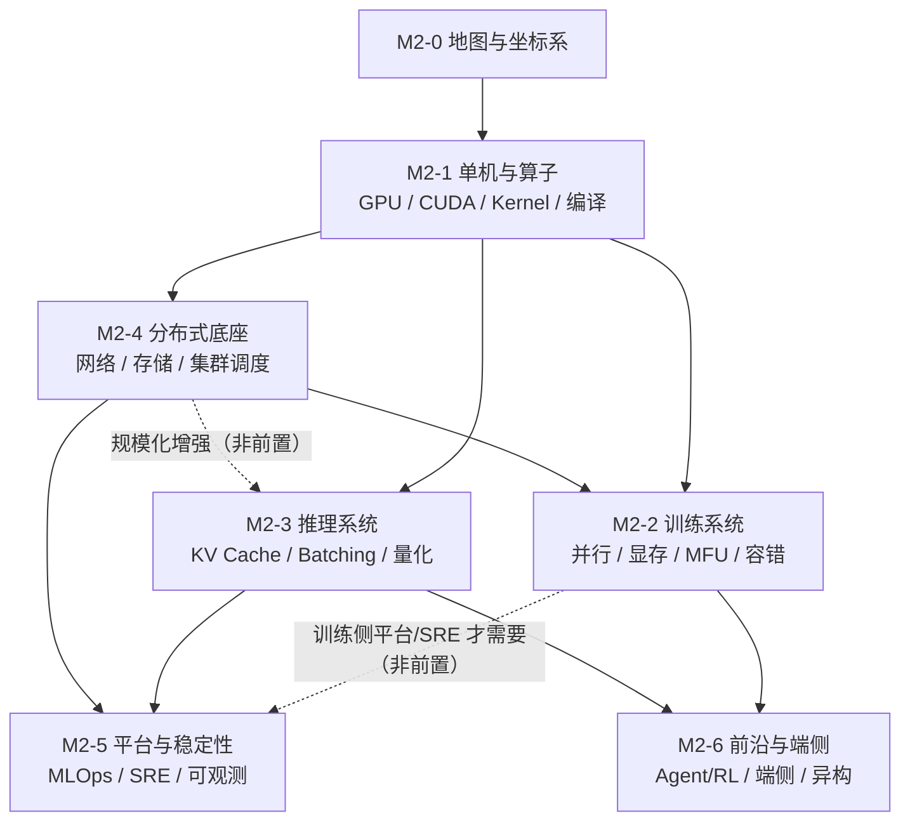
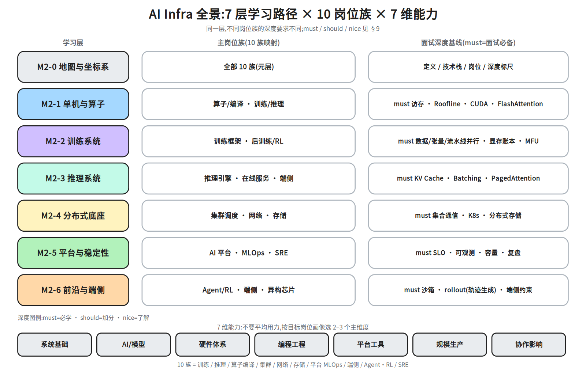

# M2-0 · 地图与坐标系

> 本层回答：AI Infra 到底在解决什么问题？市场上有哪些岗位族？这些岗位对应哪些学习层？
> 每个方向要学到什么深度？——先把坐标系建起来，后面每一层才知道自己站在哪、为什么学。

> **前置**：1A 模型结构总览（`notes/01`–`06`）；KV Cache 基础可先看 `notes/06_inference.md §3–5`，
> 量化直觉可先看 `notes/21_single_node_ops.md §8`。1B/1C 已于 2026-10-21 归档：1B = `notes/07`–`09`，1C = `notes/10`–`13`。
> **说明**：本层是地图，不要求学完 1A 全部再读；读到 M2-3 时再回补 `notes/04`–`05` 即可。

## 0. 依赖图（学习顺序）

> 根节点 = 可以无条件接受的事实；箭头 = 前者支撑后者；汇点 = 模块目标。
> **注意**：这是「概念依赖图」，不是唯一课程顺序。
> `L4 --> L2` 表示训练系统依赖分布式底座；`L4 -.-> L3` 是「规模化增强」而非前置：
> M2-3 §7.0 已给出最小前置，可以先学推理核心，再补 M2-4（M2-4 只是可以晚于 M2-3，不能跳过：图中 `L4 --> L5` 是实线前置）。
> `L2 -.-> L5` 同理：只有训练侧平台/SRE 需要 M2-2 在前；推理线不必等 M2-2，但也不跳过 M2-4——层顺序本节不复述，一律按 §8.1。
> 推荐路线见 §8.1（推理线 / 训练线两条），那里是唯一真源。
§10 的两张主线表与 §15 的下一步是 §8.1 的入口与补充：**层顺序**以 §8.1 为唯一真源，任一处层顺序与 §8.1 不同时以 §8.1 为准；但 §10 的「模型侧 ↔ Infra 侧」配对（`notes/06 §3–5`、`10_decoding`、`12_multimodal`、`14_long_context`、`11_applications` 与 `07/08/09`、`13/16` 的逐阶段对应）只在 §10 出现，§8.1 里没有，这部分不能只读 §8.1 就跳过。

## 1. 一句话定义

**AI Infra = 让大模型在真实硬件和集群上，以可接受的成本、延迟和稳定性完成训练与推理。**

它有三个递进目标：

| 层次 | 目标 | 典型问题 |
|---|---|---|
| 跑得起来 | correctness | 模型能不能在目标硬件上跑通？精度对不对？ |
| 跑得快 | performance | 吞吐、时延、MFU、显存是否达标？ |
| 跑得稳、跑得便宜 | production | 千卡/万卡、7×24、SLO、故障、成本是否可控？ |

**核心 KPI 小词典**：

| 缩写 | 含义 |
|---|---|
| MFU | 实际达到的模型 FLOP/s ÷ 硬件峰值 FLOP/s（训练常用；分子 = 模型 FLOP 总数 ÷ 单步耗时，模型 FLOP 按 2ND + 4ND = 6ND 计，N = 参数量、D = 单步处理的 token 数；不含重算/通信） |
| TTFT | 首 token 延迟（≈ 排队 + prefill） |
| TPOT / ITL | 首 token 后每个 token 的间隔（decode） |
| P99 | 99% 请求的延迟上界（容量看尾延迟，不看均值） |
| goodput | 满足 SLO 的有效吞吐（不是裸吞吐） |
| SLI / SLO / SLA | 指标 / 目标 / 合同 |
| 单位 token 成本 | 同一时间口径下：GPU 成本（元/小时）÷ 该小时生成的 token 数（token/小时）= 元/token。例：20 元/小时、3000 token/s，即 $20\text{ 元} \div (3000\times3600)\approx 1.9\times10^{-6}$ 元/token（≈1.9 元/百万 token）。若按全生命周期，则用总卡费 ÷ 总生成 token 数，两种口径不可混用 |

> 一句话区分算法与 Infra：**算法决定「效果上限」，Infra 决定「能否把效果高效、稳定、便宜地跑出来」。**

>
> **术语一次讲清**（后文直接用）：**MaaS** = Model-as-a-Service，把模型做成按调用计费的托管服务；**PagedAttention** = 把 KV Cache 切成固定大小分页存放（像操作系统分页），减少显存碎片、支持前缀共享；**PD 分离** = Prefill 与 Decode 拆到不同机器部署（前者算力密集、后者访存密集），各自调优；**ZeRO / FSDP** = 分片数据并行（ZeRO 是分级的：ZeRO-1 只切优化器状态，ZeRO-2 再切梯度，ZeRO-3 / FSDP 才切参数并在前向 all-gather 补齐），用通信换显存；**NCCL** = NVIDIA 集合通信库（AllReduce / AllToAll 的常用实现）；三个集合通信原语先在这里讲清（§8.1 的清单只列名字）：**AllReduce** = 各卡数据求和后广播回所有卡（DP 同步梯度用它）；**AllToAll** = 每卡把不同分片发给不同卡（MoE 换 expert 用它）；**all-gather** = 各卡把自己那一片发出来、拼成完整张量（ZeRO-3 / FSDP 前向补参数用它，与 AllReduce 的差别是不做求和）；**重算（activation recomputation）** = 反向时丢掉部分激活、重新前向算一遍，用算力换显存；重算会压低 MFU，但原因不是 FLOP 计数变大，而是单步耗时变长：MFU = FLOP/s ÷ 硬件峰值 FLOP/s，其中 FLOP/s = 模型 FLOP 总数 ÷ 单步耗时；模型 FLOP 总数按常用口径只算参数相关项（前向 2ND + 反向 4ND = 6ND，N = 参数量、D = 单步处理的 token 数）。重算多出的前向不进这 6ND，只拉长单步耗时，所以 FLOP/s 变小、MFU 下降（分母硬件峰值不变）。该口径默认「短序列、attention 的 O(T²) 项可忽略」；长 prompt / 长上下文要另加 attention 项（O(L_layer·T²·d_model) 量级，L_layer = 层数、d_model = 隐藏维（不是 head 维 d_k）），否则分子偏小、MFU 被低估。
补一句 4ND 的来历：前向每个参数每 token 是 1 次乘 + 1 次加 = 2 FLOP（即 2ND）；反向有两份梯度要算——对激活的梯度 dX（回传给前一层，2ND）和对权重的梯度 dW（留给本层更新，2ND），各 2 FLOP/参数/token，合计 4 FLOP/参数/token（即 4ND）。所以参数相关项是 2ND + 4ND = 6ND；这 4ND 是「不做重算」的口径。

>
> **prefill 与 decode**（全文最常混的一对）：**prefill** = 把整段 prompt 一次性前向，所有位置并行算，大矩阵、算力密集，产出首 token 之前的那一步；**decode** = 之后每次只进 1 个新 token、逐 token 生成，要反复读全部权重和 KV Cache，访存密集。所以 TTFT ≈ 排队 + prefill（长 prompt 决定它），TPOT 由 decode 的单步时间决定；PD 分离就是把这两段拆到不同机器。

**其余缩写一次展开**（后文不再解释）：**混合精度** = 前向/反向的矩阵计算与梯度计算用 fp16（或 bf16），权重按 fp16 存，同时另留一份 fp32 主权重做参数更新、优化器状态按 fp32 累积；所以「梯度」才有 2 字节与 4 字节两种口径（按计算精度存 / 按 fp32 存）；**MLOps** = Machine Learning Operations，把训练、评测、部署、监控做成可重复的流水线；**SFT** = Supervised Fine-Tuning，用标注好的「指令 → 回答」做监督微调；**RLHF** = Reinforcement Learning from Human Feedback，先训奖励模型再用 RL（PPO 等）优化策略（DPO 不在此列：它不训奖励模型、也不是 RL 采样循环，直接用偏好对做对比式优化）——SFT 与 RLHF 是两个先后训练阶段，不是两套工具；**IDC** = Internet Data Center，托管服务器与机柜的机房；**POC** = Proof of Concept，小规模试点验证；**BU** = Business Unit，业务线/事业部；**HPC** = High Performance Computing，传统高性能计算（MPI / InfiniBand 那套生态）；**RoCE / IB** = 两种 RDMA 承载网络：RoCE 跑在以太网上、IB 是专用网络——两者是并列的两套网络 + 协议栈，不是同一个协议跑在两种网络上：RoCE 是「RDMA over Converged Ethernet」这个协议本身（承载在以太网上），IB（InfiniBand）有自己的链路层与传输层——两者共同的只是「RDMA 这一内存直读语义」。
**显存账本**（§9 M2-2 的面试必备）：训练侧把每卡显存拆成四项——参数（fp16，2 字节/参数）、梯度（与参数同精度，2 字节/参数）、优化器状态（Adam = 每个参数多存两个统计量的优化器：一阶矩 = 梯度的滑动均值、二阶矩 = 梯度平方的滑动均值，各 1 份 4 字节；fp32 主权重 = 混合精度训练额外保留的 fp32 参数副本，1 份 4 字节；优化器状态合计 12 字节/参数）、激活（前向保存下来给反向用的中间张量）。**这四项里前三项相加、激活另算**——下文「三项相加」那句就是它的展开。

**再乘并行切分**：三项各按自己的切分维度折算，不是都除以同一个数：优化器状态按 ZeRO-1（在 DP 组内切）；梯度按 ZeRO-2 或 TP/PP 切；参数按 TP/PP 或 ZeRO-3/FSDP 切。DP 对三项的每卡份额都是 1（每卡留完整参数副本，只切 batch）。例：7B + ZeRO-1 + 8 卡 = 2 + 2 + 12/8 = 5.5 字节/参数 ≈ 38.5 GB；按「都除 8」会误得 14 GB。（DP = 每卡留完整参数副本、只切 batch，靠 AllReduce 同步梯度；TP = 切一层内的矩阵；PP = 不同层段放不同卡；ZeRO/FSDP 已在上文「术语一次讲清」给过定义，这里只用结论；这三个词的标准定义见 §8.1，两处不一致时以 §8.1 为准）。

**最后留余量**：工作区与显存碎片要额外预留（激活重算 = 反向时丢掉部分激活再前向算一遍，是拿算力换显存、降低激活占用；它减的是上面那项激活，不是再乘一遍，也不是额外多留一份激活）。

推理侧的 KV Cache / GQA / MLA 账是另一本，两者不可混用。

**三项相加（激活另算）**：2（参数 fp16）+ 2（梯度 fp16）+ 12（优化器状态）= **16 字节/参数**，即通行口径；7B 模型约 112 GB，激活另算（全 fp32 同样约 112 GB，见下）。

**量纲先写死**：本文 GB 一律按十进制 10⁹ 字节（不是 GiB），1B 参数 = 10⁹；所以 7B = 7×10⁹ 参数，× 16 B = 112×10⁹ B = 112 GB。若换成 GiB 口径（1 GiB = 2³⁰ B），112×10⁹ B ≈ 104 GiB——只是单位不同，不是哪边算错；下文 126 GB / 140 GB 同此口径。分数矩阵的真实数字在 `notes/21_single_node_ops.md §6.1`：T=8K 时单头 FP16 的 S 是 128 MiB（≈134 MB），本来就不是 GiB 级；全仓唯一的「1 GiB/张量」在 `notes/14_long_context.md §207`，讲的是长上下文训练的**激活**（128K×4096×2 B），既不是分数矩阵，也不属前置篇（1A = `notes/01`–`06`，除 `notes/06` §3 的 KV Cache 18 GiB 外不给 GiB 数值）。比较单位前按这两个真实出处对齐。梯度这一项有两种口径：与参数同为 fp16 时是 2 字节（上式用的就是它，合计 16）；若按 fp32 记成 4 字节，则得 18 字节/参数（7B ≈ 126 GB），这是「参数仍 fp16、只把梯度存成 fp32」这一半混合精度情形，不是全 fp32 训练。真正不做混合精度（全 fp32）是 4（参数）+ 4（梯度）+ 8（两矩）= 16 字节/参数，7B ≈ 112 GB——和混合精度同量级，不是更高。关键是那 4 字节 fp32 主权重只在「参数存 fp16」时才需要另存；全 fp32 时参数本身就是 fp32，再算一份主权重等于把参数重复计了一次（那才是 20 字节 / 140 GB 的来源，是错的）。三个口径别混：112 GB（16 B/参数）既是通行混合精度口径，也是全 fp32 口径——两者恰好同为 16 B，但构成不同（混合精度 2+2+12，全 fp32 4+4+8，后者的 8 里没有主权重）；126 GB（18 B/参数）只是「梯度 fp32、参数 fp16」的中间情形；140 GB（20 B/参数）不是任何真实口径，它是把 fp32 参数重复计了一次。

**Checkpoint（训练状态存档，≠ 重算）** = 把参数、优化器状态、学习率/数据顺序等训练状态定期落盘，用于故障后断点续训与模型存档，成本在**存储容量与写入带宽**上；它和上面「重算 / activation recomputation」（业界也叫 gradient checkpointing：省显存、费算力、**不占存储**）是两件事，别混——§4、§8、§9 的 M2-2 里写的 Checkpoint 都指前者。

## 2. 两个坐标系

学习 AI Infra 最容易犯的错，是把「招聘目录」当成「学习顺序」。这里必须分开：

| | 岗位地图 | 学习地图 |
|---|---|---|
| 组织轴 | 岗位：10 族 × 35 子方向 | 依赖：7 层学习路径 |
| 回答 | 市场要什么、要求什么 | 先学什么、后学什么、学到多深 |
| 来源 | 107 份 JD 的结构化归纳 | 技术栈的依赖关系 |
| 用途 | 目标、深度标尺、面试题 | 实际教学顺序 |

岗位地图回答「**为什么学**」，学习地图回答「**怎么学**」。两者叠起来，才是完整的模块二。

## 3. 技术栈分层

从下往上，每一层都在回答不同的问题：
（**本表自上而下读 = 从栈底到栈顶**：第一行「硬件」是栈的最底部，最后一行「产品与解决方案」才是栈顶。所以下文「越往下，越接近物理极限」指的是栈的方向，落在表格里是越靠上的行，别把表格行序当成栈的上下。）

| 层 | 解决什么 | 关键问题 | 代表岗位族 |
|---|---|---|---|
| 硬件 | 算力、显存、互联、功耗 | GPU/NPU 的峰值和瓶颈在哪？ | —（本次样本未覆盖） |
| 系统软件 | OS、驱动、虚拟化、网络、存储 | 资源怎么抽象、隔离、传输？ | 网络、存储 |
| 算子与编译 | 把模型映射到硬件指令 | 怎么把 GEMM（矩阵乘，Transformer 里绝大部分 FLOP 都落在这类算子上）/Attention/MoE 写到接近物理极限？ | 算子/编译 |
| 框架与引擎 | 训练框架、推理引擎、运行时 | 怎么组织计算、显存、并行与调度？ | 训练、推理、Agent/RL、模型优化 |
| 平台与运维 | 资源、任务、模型、流程的产品化 | 怎么让研发自助使用、可观测、可计量？ | AI 平台、MLOps、SRE、集群调度 |
| 产品与解决方案 | AI 云、MaaS、行业方案 | 怎么把能力交付给客户？ | —（本次样本未覆盖） |

> 集群调度跨「系统软件 / 平台运维」两层；表中按 `reference/ai-infra/job-map.md` 的口径放在平台与运维。

> **集群调度只按一个结论记**：§3 表里它跟「平台与运维」那一行（这是分类口径，源自 `job-map.md`），学习主层是 M2-4（§4 族 4）；M2-5 只承接纯平台/运维那部分——不要因为表行先把它归到 M2-5。
> 10 个岗位族是**本样本的分类**，不是全行业 taxonomy；芯片/服务器/IDC、解决方案/产品未纳入 107 份 JD。

>
> **§3 的 6 层技术栈与 §8 的 7 层学习路径不是同一套分层**，别横着对齐：前者按技术栈切，后者按学习依赖切（多出的 M2-0 是元层）。对应关系——硬件→M2-1（体系结构直觉，本样本无 JD）；算子与编译→M2-1；框架与引擎→M2-2 / M2-3（Agent/RL、端侧加速落 M2-6）；系统软件里的网络、存储、OS 驱动、虚拟化→M2-4（驱动细节回 M2-1）；平台与运维→M2-5（集群调度横跨 M2-4/M2-5）；产品与解决方案→本次无对应层。所以本节「算子/编译 → 框架/引擎 → 平台/运维 这三层」读成 M2-1 → M2-2/M2-3 → M2-4/M2-5（其中集群调度按 §4 以 M2-4 为主层，纯平台/运维落 M2-5）。

**越往下，越接近物理极限；越往上，越接近用户和业务。** AI Infra 的核心岗位集中在「算子/编译 → 框架/引擎 → 平台/运维」这三层。

## 4. 10 个岗位族 × 35 个子方向

数据快照 2026-10-17，6 家公司、107 份公开在招 JD。

| # | 岗位族 | JD | 子方向 | 主学习层 |
|---|---|---:|---|---|
| 1 | 训练系统与框架 | 16 | 分布式训练框架、训练性能与并行优化、后训练/RL 系统、训练稳定性与 Checkpoint | **M2-2** |
| 2 | 推理系统与引擎 | 21 | 推理引擎/运行时、在线推理服务与平台、推理性能与量化加速、多模态/语音推理 | **M2-3** |
| 3 | 算子、编译与芯片工具链 | 9 | GPU 算子开发、AI 编译器、AI 芯片工具链、软硬件协同/HPC | **M2-1** |
| 4 | 集群、调度与异构算力 | 15 | 集群调度、异构资源与 GPU 虚拟化、算力规划与容量、云原生/容器 | **M2-4** |
| 5 | 高性能网络与通信 | 6 | RDMA 与高性能网络、通信库与集合通信、网络架构与运维 | **M2-4** |
| 6 | 存储与数据基础设施 | 7 | 分布式存储/文件系统、训练数据管道、Checkpoint/模型存储 | **M2-4** |
| 7 | AI 平台与 MLOps | 14 | 机器学习平台、MaaS/模型服务平台、研发效能与 MLOps、可观测与多租户 | **M2-5** |
| 8 | 模型优化与端侧部署 | 4 | 量化与压缩、端侧/边缘部署、模型加速 | **M2-3 + M2-6** |
| 9 | AI 原生基础设施（Agent/RL） | 6 | Agent Runtime/沙箱、RL Infra、Agent 平台与弹性计算 | **M2-6** |
| 10 | 稳定性与性能工程（SRE） | 9 | 集群 SRE、训练/推理稳定性、性能工程与 Profiling | **M2-5** |

> 需求量排序（热度，不是学习顺序）：**推理 21 > 训练 16 > 集群 15 > 平台 14 > 算子 9 = SRE 9 > 存储 7 > 网络 6 = Agent 6 > 端侧 4**。
>
> **子方向证据密度不均**：35 个子方向里有 6 个在本次样本中没有直接 JD、6 个只有 1 份 JD；
> 完整 JD 数列见 `reference/ai-infra/job-map.md`。不要把「子方向存在」误读成「需求高」。
>
> 「多模态/语音推理」在本次样本中 0 个直接 JD，但作为跨族技能出现在推理/优化岗位中；
> 学习时放在 M2-3（系统部分）与 M2-6（端侧/加速部分）。
>
> 完整子方向说明、典型 title、相邻岗位、边界，见 `reference/ai-infra/job-map.md`。

## 5. 7 维能力模型

| 维度 | 含义 | 在 AI Infra 里的体现 |
|---|---|---|
| 系统基础 | OS、网络、存储、分布式系统、并发、性能分析 | 定位跨层故障、做容量与调度 |
| AI 与模型理解 | Transformer/LLM/VLM/MoE、训练与推理、量化、RL | 知道在优化什么、精度损失是否可接受 |
| 硬件与体系结构 | GPU/NPU、显存层次、互联、roofline | 判断瓶颈在计算、访存还是通信（roofline：算术强度 = 每搬 1 Byte 做多少 FLOP，拿它对比机器峰值，看卡在算力还是带宽） |
| 编程与工程 | C++/Python/Go/Rust、CUDA/Triton、调试与测试 | 能改框架/引擎/算子源码 |
| 平台与工具链 | PyTorch/Megatron/vLLM、K8s、NCCL、可观测、CI/CD | 把系统搭起来、跑起来、看得见 |
| 规模化与生产 | 千卡/万卡、线上流量、SLO、故障、成本 | 从「能跑」到「生产可用」 |
| 协作与影响力 | 跨团队、开源/论文、技术判断、带人 | 从「做模块」到「定方向」 |

**用法**：不要七项平均用力。先按目标岗位族的画像（`reference/ai-infra/profiles.md`）确定 2–3 个主维度，其余保持「够用」。

## 6. 4 个级别与证据

| 级别 | 年限 | 重点 | 典型证据 |
|---|---|---|---|
| 校招 / 实习 | 0–1 年 | 基础与潜力 | 课程/竞赛/实习、开源 PR、能讲清一个性能问题 |
| 中级 | 2–5 年 | 独立交付子系统 | 框架/引擎二次开发、算子优化、平台功能、线上排障 |
| 资深 | 5–8 年 | 架构与端到端结果 | 从 0 到 1 的系统、万卡/大规模流量、成本下降、开源影响力 |
| 专家 / 负责人 | 8 年以上 | 方向与组织 | 技术路线、跨 BU 项目、团队与标准 |

> 年限按左闭右开读：0–1 / 2–5 / 5–8 / 8 年以上 = 满 2 年未满 5 年算中级，满 5 年即进资深，正好 5 年只命中一行（资深）；但 0–1 与 2–5 之间空出 [1,2)：满 1 年未满 2 年表里没有对应行——这条兜底是讲义自定的读表口径，`job-map.md` 的「4 个级别」只给 0–1 / 2–5 / 5–8 / 8+ 四行，并没有 [1,2) 的归属规则：按「校招 / 实习」读，已有独立交付子系统证据的并入中级。

> 面试时，「你做过什么」不如「你改变了哪个指标、怎么验证的」。**可复现的性能/稳定性数据**是硬通货。

## 7. 6 组岗位边界

| 边界 | 左侧 | 右侧 | 判断 |
|---|---|---|---|
| 算法 vs AI Infra | 模型结构、数据配方、效果 | 吞吐、时延、成本、稳定性 | 算法对效果上限负责，Infra 对高效跑出来负责 |
| 业务后端 vs AI 平台 | 业务逻辑、API、数据库 | GPU/任务/模型抽象、多租户、调度 | 平台也要后端能力，但必须理解任务与资源模型 |
| 数据开发 vs 存储/数据 Infra | SQL、数仓、指标、报表 | 文件系统、对象存储、IO 路径、数据管道 | 数据开发消费存储，存储 Infra 交付底座 |
| 运维 vs SRE | 值班、重启、工单 | SLO、可观测、容量、自动化 | SRE 用软件工程做运维，产出可复用能力 |
| 芯片/驱动 vs 算子/编译 | 芯片架构、驱动、固件、指令集 | Kernel、编译器、工具链、模型适配 | 芯片交付硬件能力，算子/编译把它变成可用接口 |
| 解决方案 vs 研发 | 客户需求、方案、POC、交付 | 系统实现、性能、稳定性 | 解决方案要广度与表达，研发要深度与可复现结果 |

## 8. 7 层学习路径

| 层 | 主题 | 核心内容 | 覆盖岗位族 |
|---|---|---|---|
| **M2-0** | 地图与坐标系 | 定义、栈、岗位族、能力维度、边界、KPI | 全部（元层） |
| **M2-1** | 单机与算子 | GPU 架构、CUDA、Roofline、GEMM、FlashAttention、MoE 算子、低精度、Profiling、编译器 | 算子/编译（深）、训练/推理（中） |
| **M2-2** | 训练系统 | 并行策略、显存账本、MFU、Checkpoint、容错、后训练/RL | 训练（深）、集群/存储（中） |
| **M2-3** | 推理系统 | KV Cache、Batching、PagedAttention、引擎、量化、投机解码、SLO | 推理（深）、端侧（中） |
| **M2-4** | 分布式底座 | 集合通信、RDMA、存储、K8s 调度、GPU 虚拟化、容量 | 网络/存储/集群（深） |
| **M2-5** | 平台与稳定性 | ML 平台、MaaS、MLOps、可观测、SLO、容量、自愈 | 平台/SRE（深） |
| **M2-6** | 前沿与端侧 | Agent Runtime/沙箱、RL Infra、端侧部署、异构芯片 | Agent/端侧（深） |

### 8.1 两条推荐路线

**推理线（先走）**：M2-0 → M2-1 → M2-3 → M2-4 → M2-5

**训练线（随后）**：M2-0 → M2-1 → M2-4 → M2-2 → M2-3 → M2-5（M2-3 是进入 M2-5 的实线前置，训练侧只取最小前置面）

> 训练线把 M2-3 排在 M2-2 之后不是图上的边（图中 L2 与 L3 只是 L1 的两个兄弟，没有 L2-->L3）：理由是 M2-3 的 KV Cache / Batching 要借 M2-2 的显存账本与并行切分当尺子，学起来省力；概念上二者互不为前置，先学 M2-3 不违反 DAG。这里的「硬约束」只就 M2-2 / M2-3 / M2-5 三者谁先而言：三者之间唯一的硬约束是 L3-->L5（M2-3 先于 M2-5）；全图实线远不止这一条（L1-->L2、L1-->L3、L1-->L4、L4-->L2、L4-->L5、L2-->L6、L3-->L6 都是实线前置，其中 L4-->L5 正是 §0 用来论证「M2-4 不能跳过」的那条边），所以本句不是对全图 DAG 的断言，M2-4 与 M2-5 的先后仍按 §0 的实线读。

**前沿/端侧**：在 M2-2 与 M2-3 都完成之后接 M2-6（`L2 --> L6`、`L3 --> L6` 都是实线前置，不是二选一；只走完推理线的人进 M2-6 前要补 M2-2）。
 M2-6 与 M2-5 无先后依赖：M2-5 不是 M2-6 的前置（只有 `L2 --> L6`、`L3 --> L6` 是实线前置），训练线把 M2-5 排在最后只是层顺序，不代表要等 M2-5 学完才接 M2-6。

> 为什么 M2-3 可以排在 M2-4 前：M2-3 §7.0 只用到「AllReduce / AllToAll / TP / PP / stage /
> micro-batch / bubble / NVLink / RDMA」的最小前置，正文已给出一句话定义；完整的分布式底座留到 M2-4。

> **「最小前置面」的口径**（§8.1 / §10 阶段 3 / §15 三处同义）：指训练线上 M2-3 只为满足 `L3 --> L5` 这条实线前置所需的最小 must 子集，不是 §9 M2-3 整行 must——KV Cache、Batching、PagedAttention、TTFT/TPOT 的概念与代价要会（能估容量与延迟），量化只需知道它会改 KV Cache 字节数与精度；引擎源码、投机解码、PD 分离不要求（目标族画像把 M2-3 列为面试必备时按画像，优先级见 §9）。§0 里「M2-3 §7.0 已给出最小前置」说的是 M2-3 自己的前置词表（AllReduce / TP / PP 等），与本词不同义。

>
> 这 10 个词的最小含义（够用来判断排序；all-gather 的一句话定义见 §1）：**AllReduce** = 各卡数据求和后广播回所有卡；**AllToAll** = 每卡把不同分片发给不同卡（MoE 换 expert）；**TP** = 张量并行，把一层内的矩阵切到多卡；**PP** = 流水并行，不同层段放不同卡；**stage** = PP 里的一段层；**micro-batch** = 把 batch 再切小以填流水；**bubble** = 流水线首尾空转；**NVLink** = 机内 GPU 间高速互联；**all-gather** = 各卡把自己那一片发出来、拼成完整张量（ZeRO-3/FSDP 前向补参数）；**RDMA** = 跨机内存直读网络（走 RoCE/IB）。M2-3 只需要知道「通信要发生、大概多贵」，不需要会调。
> 推理线的 M2-4 只要求学到「集合通信类型 + 拓扑常识」这一层（存储、K8s 调度细节可留到训练线），但**不能跳过**——所以路线里 M2-4 是必学、只是深度可浅；训练线把 M2-4 放在 M2-2 前。

> **M2-4 must 的第四项 GPU 虚拟化怎么算**：它不在两条路线的深度清单里（推理线是「集合通信 + 拓扑常识」，训练线回补的是存储 + K8s 调度）——按 §9 的优先级裁决：目标族画像（集群/异构算力族）把它列为面试必备的，就学；只按路线深度走的，M2-4 到此为止、不必补；只有「把 M2-4 学到底」的人才按本表 must 补齐。
> **若已走完推理线（含 M2-4），训练线从 M2-2 继续，并在 M2-2 学完之后、训练线收尾之前回补 M2-4 的存储与 K8s 调度（训练线的 M2-4 深度包含这两块，推理线按浅深度跳过了）——这是把 M2-4 补到训练线深度；M2-5 不重学（§9 没有给推理线的 M2-5 降深度，推理线的 M2-5 就是本表 must 那一档，已学完）。所以走完推理线的人，训练线收在 M2-2（外加 M2-4 存储/K8s 回补）；M2-5 只是「只走训练线」那条路的终点（见 §10）。否则先补 M2-4。**
> DAG 是概念依赖，不是唯一的课时顺序。

图里把三件事叠在同一张坐标系里：

- **左列**是 7 个学习层（M2-0 到 M2-6），但**不是**本模块的学习顺序（顺序见本节两条路线，两条都跳层；以 §8.1 为唯一真源）；
- **中列**是 10 个岗位族分别落在哪一层（有些族跨两层，例如端侧跨 M2-3/M2-6）；
- **右列**是每层 must 的**示例**，不是完整清单（图面字数有限：M2-2 未列 Checkpoint，M2-3 未列量化与 TTFT/TPOT，M2-4 未列 GPU 虚拟化）；完整 must 以 §9 表为准，should/nice 也见 §9，具体族以画像为准；
- **底部**是 7 维能力：不要七项平均用力，先按目标岗位选 2–3 个主维度。

> 看图方法：先找到你的目标岗位族（中列），再沿它所在的行往右看 must 深度，
> 最后回到左列确定从哪一层开始学。**不要按中列的顺序学**——中列是招聘地图，不是课程顺序。

## 9. 深度标尺

> 下表是**层基线**。具体目标岗位族的深度以其画像的「面试必备」为准（见 `reference/ai-infra/profiles.md`）；
> 两者冲突时，以目标族画像为准。例如：算子族画像把 CUTLASS / Triton / PTX 列为「面试必备」（本表 M2-1 行的 nice 只对非算子族成立）；网络族画像把「RDMA / RoCE / InfiniBand」列为必备（本表把「RDMA 调优」放 should 只对非网络族成立）。
> **表内术语一句话**（只覆盖本篇判断深度必须用到的术语（下表没有加粗标记，已定义哪些以本段与下段的清单为准）；上面两段已给的 12 个词之外，must/should/nice 里其余的词——量化、Batching、访存层次、CUDA 执行模型、GPU 虚拟化、沙箱隔离、端侧约束、容量模型、拓扑设计、平台抽象、计量计费、故障复盘——在各自层（M2-1/M2-3/M2-4/M2-5/M2-6）的正文里讲，本篇不重复定义；已给的词里 投机解码（should）、轨迹回放（should）、混沌工程 / AIOps（nice）属加分/了解档，定义它们只为让本表可读，不代表升格为 must）：**FlashAttention** = 一种 attention 算子/算法（分块 + 不落 T×T 矩阵，省 HBM 读写与显存），属**算子/算法**；其公开实现是 Dao-AILab 的 flash-attn（pip 包，属**代码库**）——说原理时指算法，说安装调用时指 flash-attn 这个库；**CUTLASS** = NVIDIA 的 C++ 模板库（手写 GEMM/attention kernel 的骨架，属**代码库**）；**Triton** = Python 级 GPU kernel DSL（不用写 CUDA C 也能出 kernel，属**工具链**）；**PTX** = NVIDIA GPU 的中间汇编（CUDA 编译链里的一层，属**指令层**）；**投机解码（speculative decoding）** = 小模型先草拟 k 个 token、大模型一次并行验证，采样分布不变而 decode 步数减少，属**推理算法**；**K8s 调度** = Kubernetes 把 Pod 分配到节点（GPU 资源请求、亲和/抢占、拓扑感知），属**集群调度组件**；**混沌工程** = 主动注入故障（杀进程、断网、坏盘）验证自愈，**AIOps** = 用 ML 做告警收敛/根因定位/容量预测，两者都属**平台运维**。

> **M2-2 / M2-6 行的四个词**（接上一条，补齐表内 should/nice 与 must）：**rollout** = 用当前策略实际跑一批推理、把采到的轨迹当训练数据，是 RL 训练里最像推理、也最贵的一步，属**强化学习/后训练**；M2-2 should 里的「RL rollout」指训练系统要为这段采样提供高吞吐推理与权重同步（不是再讲一遍 RL 算法）；**轨迹回放（trajectory replay）** = 把 rollout 采到的轨迹（一条「prompt → 多个动作/token → reward」的记录）重新喂回训练或评测，做复现、离线对齐与调试，属**数据/训练组件**；**异构适配** = 让同一套系统在 GPU/NPU/不同代际芯片上都能跑（算子、精度、通信各按目标硬件改写或降级），属**工程适配**；**co-design（软硬件协同设计）** = 模型/算法结构与硬件特性一起设计（例如按指令集或互联能力定模型形状与并行切法），属**方法论**。

同一层，不同岗位族的深度要求不同：

> **三条规则的优先级**：目标族画像 > 路线深度（§8.1）> 本表 must。同时命中时按此顺序裁决——画像列为「面试必备」的一律要学；画像没列的，按 §8.1 给该路线的深度执行；两处都没提到的，才按本表 must 全学——但「§8.1 给该路线标了某层的深度」就算已经提到这一层：此时该层整行 must 一律按路线深度清单执行，清单外的 must 项不补（例：推理线给 M2-4 的深度是「集合通信类型 + 拓扑常识」，则 M2-4 其余 must——K8s 调度、分布式存储、GPU 虚拟化——都不按本表 must 学，除非目标族画像把它们列为面试必备）。
>
> **路线深度优先于本表 must**：§8.1 为某条路线标注的深度覆盖本表对应行的 must。例如推理线的 M2-4 只要求「集合通信类型 + 拓扑常识」，K8s 调度、分布式存储细节可留到训练线（分两种：只走训练线的人 M2-4 本来就在 M2-2 之前学完，没有「回补」这回事；走完推理线再转训练线的人，才在 M2-2 之后回补，见 §8.1）——只走推理线的人按此浅深度执行，不必按本表 must 学这两项，排期也按浅深度算；本表 must 是该层学到底时的完整基线，只对走完整深度的岗位族成立。

| 层 | 面试必备（must） | 加分（should） | 了解（nice） |
|---|---|---|---|
| M2-1 | 访存层次、Roofline、CUDA 执行模型、FlashAttention 思路 | 写 Triton/CUDA 算子；编译器 pipeline（算子族必学） | 芯片指令集、PTX；CUTLASS/Triton 源码（算子族画像把 CUTLASS / Triton / PTX 列为「面试必备」，本行的 nice 只适用于其他族） |
| M2-2 | DP/TP/PP、显存账本、MFU、Checkpoint | ZeRO/FSDP 细节、通信重叠、RL rollout | 弹性训练、异构训练 |
| M2-3 | KV Cache、Batching、PagedAttention、量化、TTFT/TPOT | 引擎源码（推理族必学）、投机解码、PD 分离 | 多模态推理、端侧 runtime |
| M2-4 | 集合通信、K8s 调度、分布式存储、GPU 虚拟化 | RDMA 调优、拓扑设计、容量模型 | 可编程交换、在网计算 |
| M2-5 | SLO/SLI、可观测、容量、故障复盘 | 平台抽象、计量计费（平台族必学）、混沌工程 | AIOps、多集群 |
| M2-6 | 沙箱隔离、rollout、端侧约束 | 轨迹回放、异构适配 | co-design、新硬件 |

## 10. 两条学习主线

模型侧（大模型基础）和 Infra 侧是同一座栈的两个视角，推荐**配对学习**（本表只管「模型侧 ↔ Infra」的配对，不定义层顺序，顺序以 §8.1 为唯一真源）：
> **回补落点**：§0 要求「读到 M2-3 时再回补 `notes/04`–`05`」，下面两张表的阶段 2 就是那个落点——推理线进入阶段 2（模型侧 = `notes/10_decoding.md` §3）之前要补完 `notes/04`–`05`；训练线同理，在阶段 3 进 M2-3 之前补。本表按阶段只列该阶段新读的读物，`notes/04`–`05` 属「进阶段 2 前的补课」，所以不在单元格里重复列，但排期时必须占时间。

### 推理线（先走这条）

| 阶段 | 模型侧（1A 起步 → 1C/1D） | Infra 侧（M2） |
|---|---|---|
| 1 | KV Cache 概念（`notes/06 §3–5`）；§1 贪心与 beam、§2 采样（`notes/10_decoding.md`） | M2-1 单机与算子（含量化直觉 `notes/21_single_node_ops.md §8`） |
| 2 | 解码策略、结构化输出（同一篇 `notes/10_decoding.md`，本轮只读 §3 约束解码（含 3.3 结构化输出的工程做法）；阶段 1 只读 §1 贪心与 beam、§2 采样——两阶段按小标题切、不重叠：阶段 1 读到 §2 采样（含温度）为止，阶段 2 从 §3 起） | **M2-3 推理系统** |
| 3 | 多模态基础（`notes/12_multimodal.md`，1C）、长上下文（`notes/14_long_context.md`，1D） | M2-4 分布式底座 |
| 4 | RAG / Agent 的推理链路（`notes/11_applications.md`） | M2-5 平台与稳定性 |

### 训练线（随后；时间充裕可并行，但先完成 M2-4——以 §8.1 为准）

| 阶段 | 模型侧（1B 为主；阶段 3 引 1C/1D） | Infra 侧（M2） |
|---|---|---|
| 1 | 预训练目标、数据、Scaling Law（`notes/07_pretraining.md`） | M2-4 网络/存储/集群 |
| 2 | SFT、RLHF/DPO（`notes/08_alignment.md`）、评测（`notes/09_evaluation.md`） | **M2-2 训练系统** |
| 3 | RL/Agent RL（`notes/13_reasoning.md`、`notes/16_agent_rl.md`） | M2-3 推理系统（`L3 --> L5` 是实线前置，训练侧只取最小前置面）→ M2-5 平台与稳定性（只走训练线的人的终点；已走完推理线的人 M2-5 已按标准深度学过，不重学，见 §8.1 与 §15）；M2-6 不在训练线上，见 §8.1「前沿/端侧」 |

> 模型侧讲义均已归档（括号内即对应路径），不必自行补写。层级归属（据仓库 README）：1B = `notes/07`–`09`，1C = `notes/10`–`13`，1D = `notes/14`–`19`；所以 `notes/14`（长上下文）与 `notes/16`（Agent RL）都属 1D，`notes/15` 也在 1D 区间内。
> 注：训练线表从 M2-4 起排，是假定 M2-1 已完成（§8.1 训练线以 M2-1 为第一跳；§15 只给 M2-1 的入口，不复述路线）；若还没走 M2-1，先补 M2-1 再进本表阶段 1。
> 顺序不是铁律。原则只有一条：**先知道模型在干什么，再看系统怎么让它跑。**

## 11. 怎么用岗位地图（不要背）

1. **选目标**：从 10 个族里选 1 个主方向 + 1 个次方向，不要 10 个都要。
2. **读画像**：看 `profiles.md` 里该族的「核心 KPI / 面试必备 / 技术栈 / 面试考察」，确定深度。
3. **用题探底**：优先从 `QA-BANK.md` 抽 3–5 道**可判分**题；`interview-questions.md` 是方向清单，
   开放式题先补答题骨架再用于 Probe。
（**Probe = 抽题自测**：从仓库根目录的 `QA-BANK.md` 取可判分题，答完对答案判分；`interview-questions.md` 只是方向清单，不能直接当题用。）
 **本节需配合仓库使用，不单独成立**：`profiles.md`（`reference/ai-infra/profiles.md`）、`QA-BANK.md`（仓库根目录）、`jd_index.json`（`reference/ai-infra/jd_index.json`）都在本讲义仓里（见 §14），本地 checkout 就有、不必另 clone；只有「回原文核对 JD」才需要 clone 远端仓 `ai-infra-jd`；暂时拿不到仓库时，第 2 步先按 §9 表的 must 行定深度、第 3 步用 §12 那 6 道题自测——但「画像 > 路线深度 > 本表 must」里画像那一级的优先级无法替代。
4. **按层学**：回到学习地图，按依赖顺序补，不要从岗位族标题直接开学。
5. **留证据**：每学完一层，产出一个可验证的东西（benchmark、profile、mini 实现、排障记录）。

## 12. 面试要点

1. **AI Infra 和算法工程师的区别？** → 算法对效果上限负责，Infra 对吞吐/时延/成本/稳定性负责。
2. **AI Infra 有哪些方向？** → 训练、推理、算子/编译、集群/网络/存储、平台/SRE、Agent/RL、端侧。
3. **你怎么判断一个系统是计算瓶颈还是访存瓶颈？** → Roofline：算术强度对比机器峰值，再结合 profiler（性能分析工具，如 Nsight Compute）里的 SM（GPU 的计算单元）利用率与内存吞吐（显存带宽占用率）。
4. **训练和推理的系统差异？** → 训练整句并行、算力密集、要反向；推理自回归、decode 访存密集、要 KV Cache 与调度。
5. **为什么说「JD 关键词不等于能力」？** → 关键词只说明被提到，不说明硬性要求或使用深度；要看原文和上下文。
6. **你如何为一个新方向做技术选型？** → 先定 KPI 和约束，再列候选方案，做小规模 benchmark，最后看可维护性与成本。

## 13. 常见坑

- **把岗位族当学习顺序**：先学 SRE 再学训练，会缺少系统直觉。
- **只学工具不学原理**：会 vLLM 命令不等于理解 KV Cache 与调度。
- **把 JD 关键词当能力**：JD 写「熟悉 CUDA」不代表岗位每天都在写 kernel。
- **追新工具、忽视基础**：Roofline、访存层次、集合通信这些十年不变。
- **用单点数字当结论**：某个 benchmark 快 2 倍，不代表生产吞吐也快 2 倍。
- **只学一个方向**：AI Infra 的故障往往跨层，训练问题可能出在网络或存储。
- **把 0 JD 子方向当成不重要**：样本里 6 个子方向 0 个直接 JD，可能是跨族技能或本次样本没覆盖。
- **把画像里的 `x/y` 当成硬性要求**：它是「JD 是否提及」的关键词统计，不是 must 强度。

- **`x/y` 怎么读**：分子 x = 该族 JD 中提到这个关键词的份数，分母 y = 该族入选 JD 总数（同一族内分母相同，跨族不能直接比大小）。例：网络族「RDMA 6/6」= 该族 6 份 JD 全部提到；算子族「CUTLASS 5/9」= 9 份里 5 份提到。所以 6/6 与 5/9 比的是「族内覆盖率」，不是难度。
- **把「长上下文一定 KV 先爆」当无条件结论**：4K/低并发时权重仍是大头，要看交叉点。

## 14. 相关参考

- `20g_ai_infra_map` —— 7 层 × 10 岗位族 × 7 维能力全景（横版）
- `reference/ai-infra/job-map.md` —— 10 族 / 35 子方向 / 7 维 / 级别 / 边界
- `reference/ai-infra/profiles.md` —— 10 份能力画像（核心 KPI、面试必备、技术栈、面试考察）
- `reference/ai-infra/interview-questions.md` —— 50 道面试方向题（可判分 Probe 以 `QA-BANK.md` 为主）

- `QA-BANK.md`（仓库根目录）—— 可判分题库，Probe 抽题用；开放式题需先补答题骨架
- `reference/ai-infra/jd_index.json` —— 107 条 JD 轻量索引（不含原文）
- 源仓库（远端）：https://github.com/Xingkai98/ai-infra-jd —— 本地无 checkout，回原文核对 JD 请先 clone 该仓

> **证据口径**：参考层的 `x/y` 计数来自上游 `ai-infra-jd` 的关键词统计，口径是「JD 是否提及」，
> 不是硬性要求；6 个子方向在样本中 0 个直接 JD。数据质量与口径见
> `reference/ai-infra/README.md`（含 3 条 `skills` 为空的 JD、58 条未写学历等说明）。

## 15. 下一步

- **M2-1 单机与算子**：先建立 GPU/访存/Roofline/Kernel 的底层直觉。
- **推理线**：层顺序见 §8.1（M2-1 之后 M2-3 → M2-4 → M2-5），此处只给入口、不复制顺序。
- **训练线**：若已走完推理线（含 M2-4），从 M2-2 继续，M2-2 学完后回补 M2-4 的存储与 K8s 调度（推理线只到「集合通信类型 + 拓扑常识」，这里补到训练线深度，不重学 M2-5）；否则先补 M2-4。
 **收尾位置**：走完推理线的人，训练线到 M2-2（外加 M2-4 存储/K8s 回补）即结束，M2-5 不重学；只走训练线的人以 M2-5 为终点——§10 阶段 3 的「训练线终点」只在这个语境下成立。
训练线完整顺序见 §8.1（M2-3 是 `L3 --> L5` 实线前置，只取最小前置面）；M2-6 不在训练线上，按 §8.1「前沿/端侧」在 M2-2 与 M2-3 都完成后另接。
- 本层是元层，路线以 §8.1 为准，不设动手清单。
