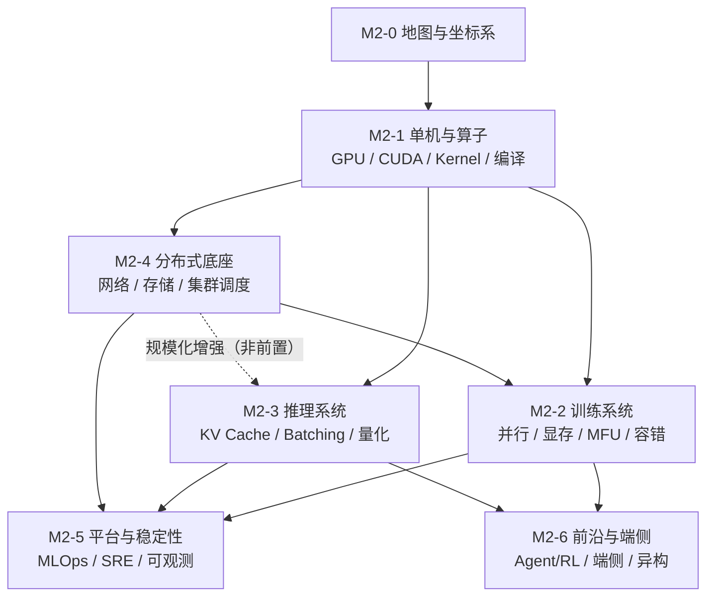

# M2-0 · 地图与坐标系

> 本层回答：AI Infra 到底在解决什么问题？市场上有哪些岗位族？这些岗位对应哪些学习层？
> 每个方向要学到什么深度？——先把坐标系建起来，后面每一层才知道自己站在哪、为什么学。

> **前置**：1A 模型结构总览（`notes/01`–`06`）；KV Cache 基础可先看 `notes/06_inference.md §3–5`，
> 量化直觉可先看 `notes/21_single_node_ops.md §8`。**1B/1C 尚未归档**。
> **说明**：本层是地图，不要求学完 1A 全部再读；读到 M2-3 时再回补第 4–5 层即可。

## 0. 依赖图（学习顺序）

> 根节点 = 可以无条件接受的事实；箭头 = 前者支撑后者；汇点 = 模块目标。
> **注意**：这是「概念依赖图」，不是唯一课程顺序。
> `L4 --> L2` 表示训练系统依赖分布式底座；`L4 -.-> L3` 是「规模化增强」而非前置：
> M2-3 §7.0 已给出最小前置，可以先学推理核心，再补 M2-4。
> 推荐路线见 §8.1（推理线 / 训练线两条），那里是唯一真源。

## 1. 一句话定义

**AI Infra = 让大模型在真实硬件和集群上，以可接受的成本、延迟和稳定性完成训练与推理。**

它有三个递进目标：

| 层次 | 目标 | 典型问题 |
|---|---|---|
| 跑得起来 | correctness | 模型能不能在目标硬件上跑通？精度对不对？ |
| 跑得快 | performance | 吞吐、时延、MFU、显存是否达标？ |
| 跑得稳、跑得便宜 | production | 千卡/万卡、7×24、SLO、故障、成本是否可控？ |

**核心 KPI 小词典**：

| 缩写 | 含义 |
|---|---|
| MFU | 实际模型 FLOP/s ÷ 硬件峰值 FLOP/s（训练常用；不含重算/通信） |
| TTFT | 首 token 延迟（≈ 排队 + prefill） |
| TPOT / ITL | 首 token 后每个 token 的间隔（decode） |
| P99 | 99% 请求的延迟上界（容量看尾延迟，不看均值） |
| goodput | 满足 SLO 的有效吞吐（不是裸吞吐） |
| SLI / SLO / SLA | 指标 / 目标 / 合同 |
| 单位 token 成本 | GPU 成本 ÷ 生成 token 数 |

> 一句话区分算法与 Infra：**算法决定「效果上限」，Infra 决定「能否把效果高效、稳定、便宜地跑出来」。**

## 2. 两个坐标系

学习 AI Infra 最容易犯的错，是把「招聘目录」当成「学习顺序」。这里必须分开：

| | 岗位地图 | 学习地图 |
|---|---|---|
| 组织轴 | 岗位：10 族 × 35 子方向 | 依赖：7 层学习路径 |
| 回答 | 市场要什么、要求什么 | 先学什么、后学什么、学到多深 |
| 来源 | 107 份 JD 的结构化归纳 | 技术栈的依赖关系 |
| 用途 | 目标、深度标尺、面试题 | 实际教学顺序 |

岗位地图回答「**为什么学**」，学习地图回答「**怎么学**」。两者叠起来，才是完整的模块二。

## 3. 技术栈分层

从下往上，每一层都在回答不同的问题：

| 层 | 解决什么 | 关键问题 | 代表岗位族 |
|---|---|---|---|
| 硬件 | 算力、显存、互联、功耗 | GPU/NPU 的峰值和瓶颈在哪？ | —（本次样本未覆盖） |
| 系统软件 | OS、驱动、虚拟化、网络、存储 | 资源怎么抽象、隔离、传输？ | 网络、存储 |
| 算子与编译 | 把模型映射到硬件指令 | 怎么把 GEMM/Attention/MoE 写到接近物理极限？ | 算子/编译 |
| 框架与引擎 | 训练框架、推理引擎、运行时 | 怎么组织计算、显存、并行与调度？ | 训练、推理、Agent/RL、模型优化 |
| 平台与运维 | 资源、任务、模型、流程的产品化 | 怎么让研发自助使用、可观测、可计量？ | AI 平台、MLOps、SRE、集群调度 |
| 产品与解决方案 | AI 云、MaaS、行业方案 | 怎么把能力交付给客户？ | —（本次样本未覆盖） |

> 集群调度跨「系统软件 / 平台运维」两层；表中按 `reference/ai-infra/job-map.md` 的口径放在平台与运维。
> 10 个岗位族是**本样本的分类**，不是全行业 taxonomy；芯片/服务器/IDC、解决方案/产品未纳入 107 份 JD。

**越往下，越接近物理极限；越往上，越接近用户和业务。** AI Infra 的核心岗位集中在「算子/编译 → 框架/引擎 → 平台/运维」这三层。

## 4. 10 个岗位族 × 35 个子方向

数据快照 2026-10-17，6 家公司、107 份公开在招 JD。

| # | 岗位族 | JD | 子方向 | 主学习层 |
|---|---|---:|---|---|
| 1 | 训练系统与框架 | 16 | 分布式训练框架、训练性能与并行优化、后训练/RL 系统、训练稳定性与 Checkpoint | **M2-2** |
| 2 | 推理系统与引擎 | 21 | 推理引擎/运行时、在线推理服务与平台、推理性能与量化加速、多模态/语音推理 | **M2-3** |
| 3 | 算子、编译与芯片工具链 | 9 | GPU 算子开发、AI 编译器、AI 芯片工具链、软硬件协同/HPC | **M2-1** |
| 4 | 集群、调度与异构算力 | 15 | 集群调度、异构资源与 GPU 虚拟化、算力规划与容量、云原生/容器 | **M2-4** |
| 5 | 高性能网络与通信 | 6 | RDMA 与高性能网络、通信库与集合通信、网络架构与运维 | **M2-4** |
| 6 | 存储与数据基础设施 | 7 | 分布式存储/文件系统、训练数据管道、Checkpoint/模型存储 | **M2-4** |
| 7 | AI 平台与 MLOps | 14 | 机器学习平台、MaaS/模型服务平台、研发效能与 MLOps、可观测与多租户 | **M2-5** |
| 8 | 模型优化与端侧部署 | 4 | 量化与压缩、端侧/边缘部署、模型加速 | **M2-3 + M2-6** |
| 9 | AI 原生基础设施（Agent/RL） | 6 | Agent Runtime/沙箱、RL Infra、Agent 平台与弹性计算 | **M2-6** |
| 10 | 稳定性与性能工程（SRE） | 9 | 集群 SRE、训练/推理稳定性、性能工程与 Profiling | **M2-5** |

> 需求量排序（热度，不是学习顺序）：**推理 21 > 训练 16 > 集群 15 > 平台 14 > 算子 9 = SRE 9 > 存储 7 > 网络 6 = Agent 6 > 端侧 4**。
>
> **子方向证据密度不均**：35 个子方向里有 6 个在本次样本中没有直接 JD、6 个只有 1 份 JD；
> 完整 JD 数列见 `reference/ai-infra/job-map.md`。不要把「子方向存在」误读成「需求高」。
>
> 「多模态/语音推理」在本次样本中 0 个直接 JD，但作为跨族技能出现在推理/优化岗位中；
> 学习时放在 M2-3（系统部分）与 M2-6（端侧/加速部分）。
>
> 完整子方向说明、典型 title、相邻岗位、边界，见 `reference/ai-infra/job-map.md`。

## 5. 7 维能力模型

| 维度 | 含义 | 在 AI Infra 里的体现 |
|---|---|---|
| 系统基础 | OS、网络、存储、分布式系统、并发、性能分析 | 定位跨层故障、做容量与调度 |
| AI 与模型理解 | Transformer/LLM/VLM/MoE、训练与推理、量化、RL | 知道在优化什么、精度损失是否可接受 |
| 硬件与体系结构 | GPU/NPU、显存层次、互联、roofline | 判断瓶颈在计算、访存还是通信 |
| 编程与工程 | C++/Python/Go/Rust、CUDA/Triton、调试与测试 | 能改框架/引擎/算子源码 |
| 平台与工具链 | PyTorch/Megatron/vLLM、K8s、NCCL、可观测、CI/CD | 把系统搭起来、跑起来、看得见 |
| 规模化与生产 | 千卡/万卡、线上流量、SLO、故障、成本 | 从「能跑」到「生产可用」 |
| 协作与影响力 | 跨团队、开源/论文、技术判断、带人 | 从「做模块」到「定方向」 |

**用法**：不要七项平均用力。先按目标岗位族的画像（`reference/ai-infra/profiles.md`）确定 2–3 个主维度，其余保持「够用」。

## 6. 4 个级别与证据

| 级别 | 年限 | 重点 | 典型证据 |
|---|---|---|---|
| 校招 / 实习 | 0–1 年 | 基础与潜力 | 课程/竞赛/实习、开源 PR、能讲清一个性能问题 |
| 中级 | 2–5 年 | 独立交付子系统 | 框架/引擎二次开发、算子优化、平台功能、线上排障 |
| 资深 | 5–8 年 | 架构与端到端结果 | 从 0 到 1 的系统、万卡/大规模流量、成本下降、开源影响力 |
| 专家 / 负责人 | 8 年以上 | 方向与组织 | 技术路线、跨 BU 项目、团队与标准 |

> 面试时，「你做过什么」不如「你改变了哪个指标、怎么验证的」。**可复现的性能/稳定性数据**是硬通货。

## 7. 6 组岗位边界

| 边界 | 左侧 | 右侧 | 判断 |
|---|---|---|---|
| 算法 vs AI Infra | 模型结构、数据配方、效果 | 吞吐、时延、成本、稳定性 | 算法对效果上限负责，Infra 对高效跑出来负责 |
| 业务后端 vs AI 平台 | 业务逻辑、API、数据库 | GPU/任务/模型抽象、多租户、调度 | 平台也要后端能力，但必须理解任务与资源模型 |
| 数据开发 vs 存储/数据 Infra | SQL、数仓、指标、报表 | 文件系统、对象存储、IO 路径、数据管道 | 数据开发消费存储，存储 Infra 交付底座 |
| 运维 vs SRE | 值班、重启、工单 | SLO、可观测、容量、自动化 | SRE 用软件工程做运维，产出可复用能力 |
| 芯片/驱动 vs 算子/编译 | 芯片架构、驱动、固件、指令集 | Kernel、编译器、工具链、模型适配 | 芯片交付硬件能力，算子/编译把它变成可用接口 |
| 解决方案 vs 研发 | 客户需求、方案、POC、交付 | 系统实现、性能、稳定性 | 解决方案要广度与表达，研发要深度与可复现结果 |

## 8. 7 层学习路径

| 层 | 主题 | 核心内容 | 覆盖岗位族 |
|---|---|---|---|
| **M2-0** | 地图与坐标系 | 定义、栈、岗位族、能力维度、边界、KPI | 全部（元层） |
| **M2-1** | 单机与算子 | GPU 架构、CUDA、Roofline、GEMM、FlashAttention、MoE 算子、低精度、Profiling、编译器 | 算子/编译（深）、训练/推理（中） |
| **M2-2** | 训练系统 | 并行策略、显存账本、MFU、Checkpoint、容错、后训练/RL | 训练（深）、集群/存储（中） |
| **M2-3** | 推理系统 | KV Cache、Batching、PagedAttention、引擎、量化、投机解码、SLO | 推理（深）、端侧（中） |
| **M2-4** | 分布式底座 | 集合通信、RDMA、存储、K8s 调度、GPU 虚拟化、容量 | 网络/存储/集群（深） |
| **M2-5** | 平台与稳定性 | ML 平台、MaaS、MLOps、可观测、SLO、容量、自愈 | 平台/SRE（深） |
| **M2-6** | 前沿与端侧 | Agent Runtime/沙箱、RL Infra、端侧部署、异构芯片 | Agent/端侧（深） |

### 8.1 两条推荐路线

**推理线（先走）**：M2-0 → M2-1 → M2-3 → M2-4 → M2-5

**训练线（随后）**：M2-0 → M2-1 → M2-4 → M2-2 → M2-5

**前沿/端侧**：在 M2-2/M2-3 之后接 M2-6。

> 为什么 M2-3 可以排在 M2-4 前：M2-3 §7 只用到「AllReduce / AllToAll / TP / PP / stage /
> micro-batch / bubble / NVLink / RDMA」的最小前置，正文已给出一句话定义；完整的分布式底座留到 M2-4。
> 推理线不要求学完 M2-4；训练线把 M2-4 放在 M2-2 前。
> **若已走完推理线（含 M2-4），训练线从 M2-2 继续；否则先补 M2-4。**
> DAG 是概念依赖，不是唯一的课时顺序。

图里把三件事叠在同一张坐标系里：

- **左列**是 7 个学习层（M2-0 到 M2-6），也是本模块的学习顺序；
- **中列**是 10 个岗位族分别落在哪一层（有些族跨两层，例如端侧跨 M2-3/M2-6）；
- **右列**是每层的 **must** 深度基线；should/nice 见下面的 §9，具体族以画像为准；
- **底部**是 7 维能力：不要七项平均用力，先按目标岗位选 2–3 个主维度。

> 看图方法：先找到你的目标岗位族（中列），再沿它所在的行往右看 must 深度，
> 最后回到左列确定从哪一层开始学。**不要按中列的顺序学**——中列是招聘地图，不是课程顺序。

## 9. 深度标尺

> 下表是**层基线**。具体目标岗位族的深度以其画像 `must_have` 为准（见 `reference/ai-infra/profiles.md`）；
> 两者冲突时，以目标族画像为准。例如 PTX/CUTLASS 源码对算子族是 must，对其他族只是了解。

同一层，不同岗位族的深度要求不同：

| 层 | 面试必备（must） | 加分（should） | 了解（nice） |
|---|---|---|---|
| M2-1 | 访存层次、Roofline、CUDA 执行模型、FlashAttention 思路 | 写 Triton/CUDA 算子；编译器 pipeline（算子族必学） | 芯片指令集、PTX、CUTLASS 源码（算子族必学） |
| M2-2 | DP/TP/PP、显存账本、MFU、Checkpoint | ZeRO/FSDP 细节、通信重叠、RL rollout | 弹性训练、异构训练 |
| M2-3 | KV Cache、Batching、PagedAttention、量化、TTFT/TPOT | 引擎源码（推理族必学）、投机解码、PD 分离 | 多模态推理、端侧 runtime |
| M2-4 | 集合通信、K8s 调度、分布式存储、GPU 虚拟化 | RDMA 调优、拓扑设计、容量模型 | 可编程交换、在网计算 |
| M2-5 | SLO/SLI、可观测、容量、故障复盘 | 平台抽象、计量计费（平台族必学）、混沌工程 | AIOps、多集群 |
| M2-6 | 沙箱隔离、rollout、端侧约束 | 轨迹回放、异构适配 | co-design、新硬件 |

## 10. 两条学习主线

模型侧（大模型基础）和 Infra 侧是同一座栈的两个视角，推荐**配对学习**：

### 推理线（先走这条）

| 阶段 | 模型侧（1C） | Infra 侧（M2） |
|---|---|---|
| 1 | KV Cache 概念（`notes/06 §3–5`）；解码/采样待 1C 补 | M2-1 单机与算子（含量化直觉 `§8`） |
| 2 | 解码策略、结构化输出（1C 待补） | **M2-3 推理系统** |
| 3 | 多模态基础、长上下文模型侧（1C 待补） | M2-4 分布式底座 |
| 4 | RAG / Agent 的推理链路（1C 待补） | M2-5 平台与稳定性 |

### 训练线（推理线之后或并行）

| 阶段 | 模型侧（1B） | Infra 侧（M2） |
|---|---|---|
| 1 | 预训练目标、数据、Scaling Law（1B 待补） | M2-4 网络/存储/集群 |
| 2 | SFT、RLHF/DPO、评测（1B 待补） | **M2-2 训练系统** |
| 3 | RL/Agent RL（1B/1C 待补） | M2-6 Agent/RL Infra |

> 1B/1C 尚未归档；学到对应阶段时先补讲义，或先用现有 `notes/06 §3–5`、`notes/21 §8` 的章节。
> 顺序不是铁律。原则只有一条：**先知道模型在干什么，再看系统怎么让它跑。**

## 11. 怎么用岗位地图（不要背）

1. **选目标**：从 10 个族里选 1 个主方向 + 1 个次方向，不要 10 个都要。
2. **读画像**：看 `profiles.md` 里该族的 KPI、must_have、toolchain、interview，确定深度。
3. **用题探底**：优先从 `QA-BANK.md` 抽 3–5 道**可判分**题；`interview-questions.md` 是方向清单，
   开放式题先补答题骨架再用于 Probe。
4. **按层学**：回到学习地图，按依赖顺序补，不要从岗位族标题直接开学。
5. **留证据**：每学完一层，产出一个可验证的东西（benchmark、profile、mini 实现、排障记录）。

## 12. 面试要点

1. **AI Infra 和算法工程师的区别？** → 算法对效果上限负责，Infra 对吞吐/时延/成本/稳定性负责。
2. **AI Infra 有哪些方向？** → 训练、推理、算子/编译、集群/网络/存储、平台/SRE、Agent/RL、端侧。
3. **你怎么判断一个系统是计算瓶颈还是访存瓶颈？** → Roofline：算术强度对比机器峰值，结合 profiler 的 SM/内存吞吐。
4. **训练和推理的系统差异？** → 训练整句并行、算力密集、要反向；推理自回归、decode 访存密集、要 KV Cache 与调度。
5. **为什么说「JD 关键词不等于能力」？** → 关键词只说明被提到，不说明硬性要求或使用深度；要看原文和上下文。
6. **你如何为一个新方向做技术选型？** → 先定 KPI 和约束，再列候选方案，做小规模 benchmark，最后看可维护性与成本。

## 13. 常见坑

- **把岗位族当学习顺序**：先学 SRE 再学训练，会缺少系统直觉。
- **只学工具不学原理**：会 vLLM 命令不等于理解 KV Cache 与调度。
- **把 JD 关键词当能力**：JD 写「熟悉 CUDA」不代表岗位每天都在写 kernel。
- **追新工具、忽视基础**：Roofline、访存层次、集合通信这些十年不变。
- **用单点数字当结论**：某个 benchmark 快 2 倍，不代表生产吞吐也快 2 倍。
- **只学一个方向**：AI Infra 的故障往往跨层，训练问题可能出在网络或存储。
- **把 0 JD 子方向当成不重要**：样本里 6 个子方向 0 个直接 JD，可能是跨族技能或本次样本没覆盖。
- **把画像里的 `x/y` 当成硬性要求**：它是「JD 是否提及」的关键词统计，不是 must 强度。
- **把「长上下文一定 KV 先爆」当无条件结论**：4K/低并发时权重仍是大头，要看交叉点。

## 14. 相关参考

- `20g_ai_infra_map` —— 7 层 × 10 岗位族 × 7 维能力全景（横竖双版）
- `reference/ai-infra/job-map.md` —— 10 族 / 35 子方向 / 7 维 / 级别 / 边界
- `reference/ai-infra/profiles.md` —— 10 份能力画像（KPI、must_have、技术栈、面试题）
- `reference/ai-infra/interview-questions.md` —— 50 道面试方向题（可判分 Probe 以 `QA-BANK.md` 为主）
- `reference/ai-infra/jd_index.json` —— 107 条 JD 轻量索引（不含原文）
- 源仓库：`../ai-infra-jd`（本地）/ https://github.com/Xingkai98/ai-infra-jd

> **证据口径**：参考层的 `x/y` 计数来自上游 `ai-infra-jd` 的关键词统计，口径是「JD 是否提及」，
> 不是硬性要求；6 个子方向在样本中 0 个直接 JD。数据质量与口径见
> `reference/ai-infra/README.md`（含 3 条 `skills` 为空的 JD、58 条未写学历等说明）。

## 15. 下一步

- **M2-1 单机与算子**：先建立 GPU/访存/Roofline/Kernel 的底层直觉。
- **推理线**：M2-3 推理系统 → M2-4 分布式底座 → M2-5。
- **训练线**：若已走完推理线（含 M2-4），从 M2-2 继续；否则先补 M2-4。
- 本层是元层，路线以 §8.1 为准，不设动手清单。
