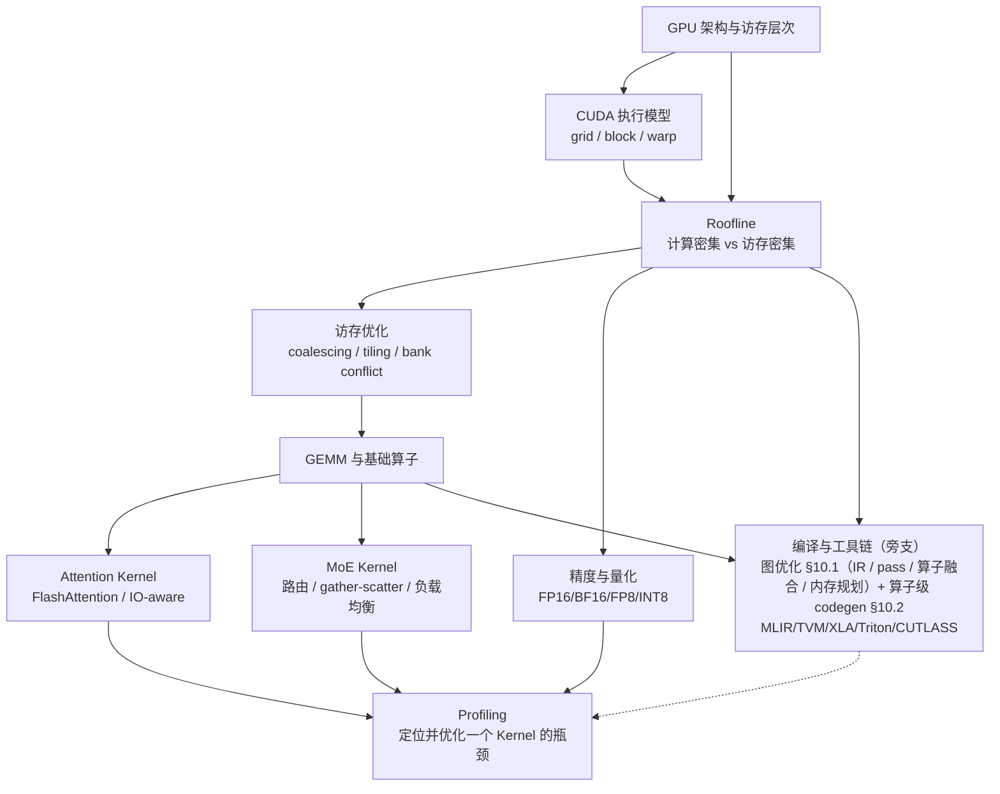
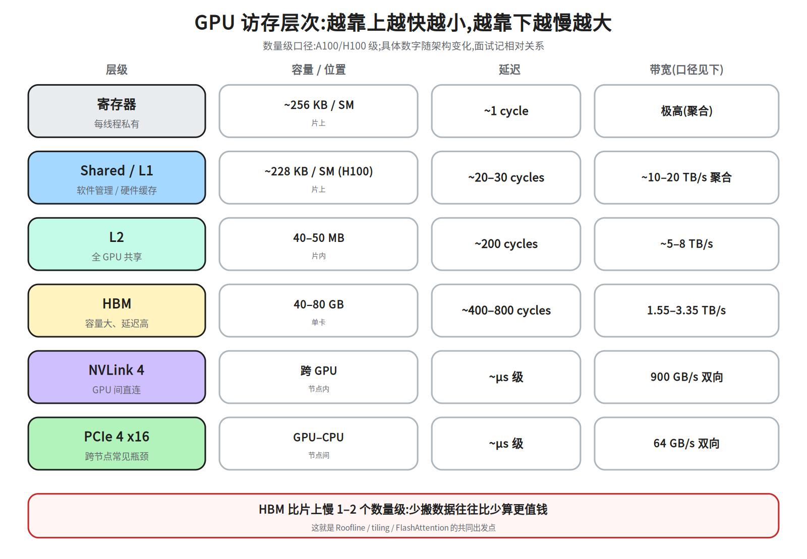
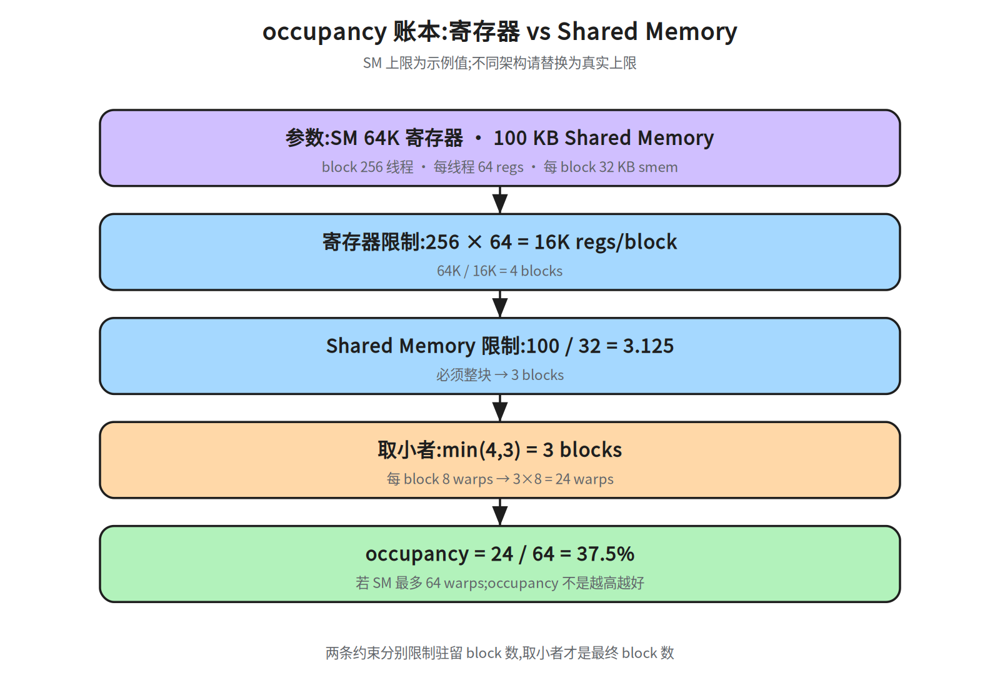
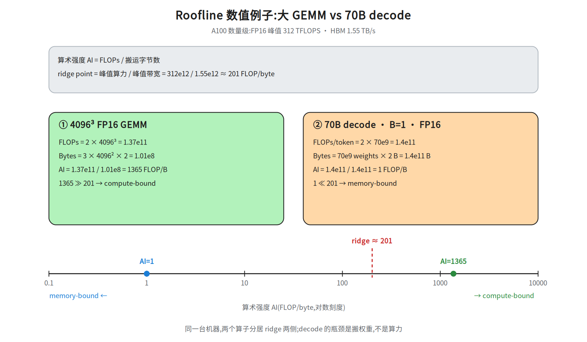
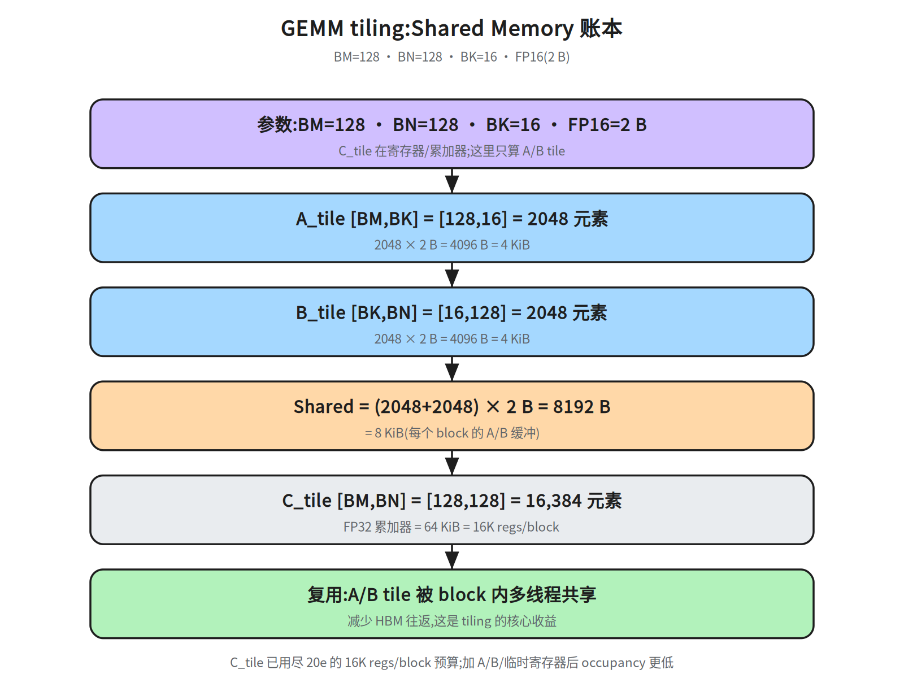
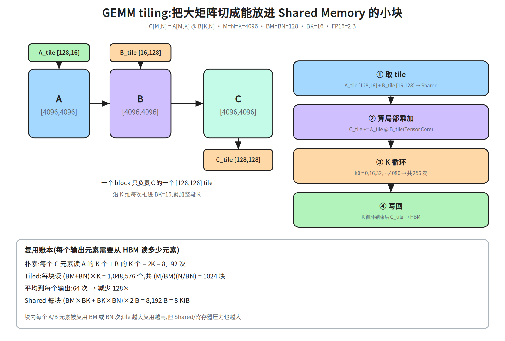
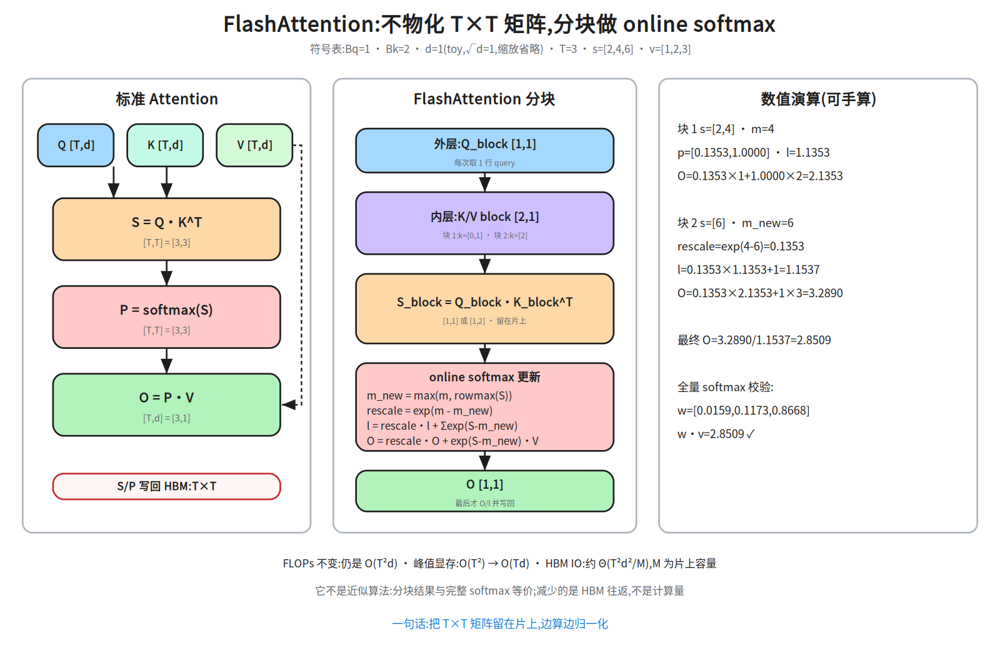
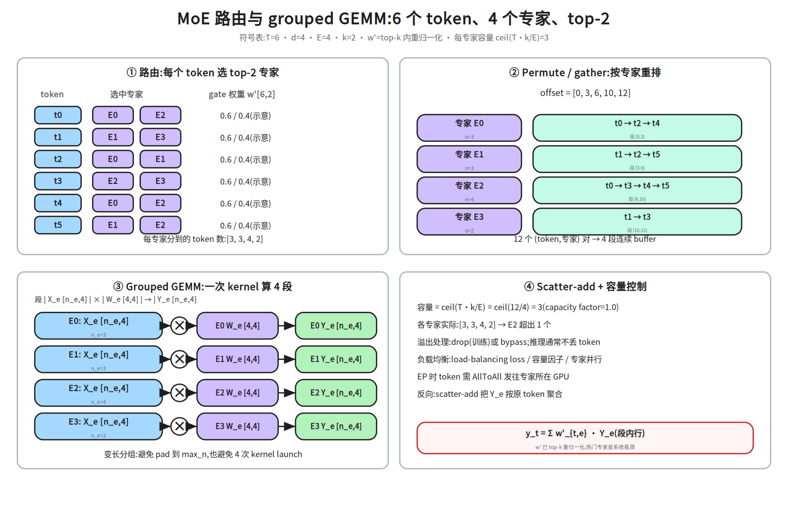
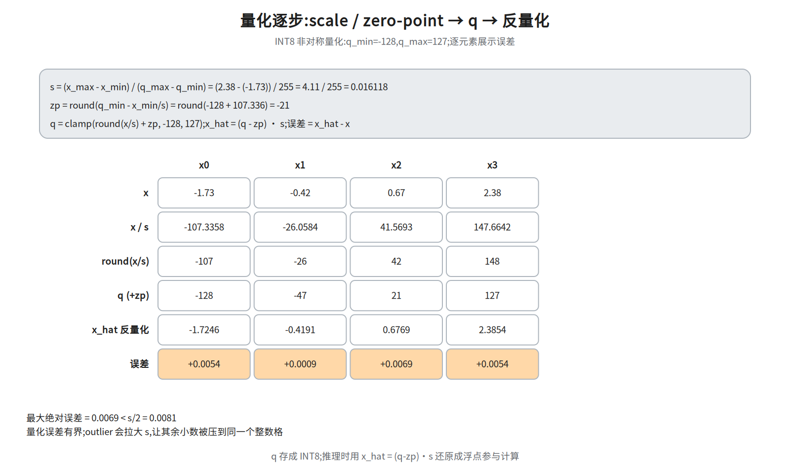

# M2-1 · 单机与算子（地基）

> 本层回答：一块 GPU 内部到底发生了什么？为什么同样的 FLOPs，有的 Kernel 快 10 倍？
> 训练和推理的性能上限，最终都由这一层的「访存 + 计算 + 并行」决定。

> **前置（按节）**：`notes/02_attention.md §4`（缩放点积）、`notes/03_block.md §5`（Block 组装）、
> `notes/05_modern.md §3`（GQA，可选）、`notes/06_inference.md §3–5`（KV Cache / prefill-decode）。
>
> **建议路径（每次 45 分钟）**：
> ① §2–3（GPU 架构 / CUDA 执行模型）；② §4–5（Roofline / 访存 / GEMM）；
> ③ §6–7（Attention / MoE Kernel）；④ §8–10（精度 / Profiling / 编译）。
>
> **深度标注**：§2–6、§8–9 为必学；§7 MoE、§10 编译为加分；芯片指令集/PTX/SASS 为了解。

## 0. 依赖图（学习顺序）



> 汇点是 **Profiling**：先测再优化。编译/工具链是从算子与图优化分出的旁支，
> 不是 Profiling 的下游（`J -.-> I` 表示它反过来帮助定位/实现优化）。

## 1. 为什么先学单机

AI Infra 的所有上层系统，最终都要落到单卡上的 Kernel：

- 训练系统的 MFU，取决于每个 Kernel 的实际吞吐；
- 推理系统的吞吐和延迟，取决于 Attention/GEMM/访存效率；
- 量化、投机解码、PagedAttention，最终都要有 Kernel 支持；
- 集群层面的问题，也常表现为「单机 Kernel 没跑满」
名词速查（后文反复用到）：**MFU** = Model FLOPs Utilization，实际达成的 FLOPs/s ÷ 峰值算力，衡量训练把卡用满了多少；**投机解码** = 小模型先草拟几个 token、大模型一次并行验证，用并行换掉大模型的串行步数；**PagedAttention** = 把 KV Cache 切成固定大小的 page 按需分配（类似虚拟内存分页），减少显存碎片和预留浪费。。

**一句话：不理解单机，就无法判断瓶颈到底在计算、访存、通信还是调度。**

## 2. GPU 架构与访存层次

GPU 不是「更快的 CPU」，而是**为吞吐设计的并行处理器**：

- 大量 SIMT 核心，用并行度隐藏延迟；
- 强调带宽和吞吐，而不是单线程延迟；
- 有复杂的显存层次，数据搬运往往比计算更贵。

### 2.1 关键部件

| 部件 | 作用 |
|---|---|
| SM（Streaming Multiprocessor） | GPU 的基本计算单元，内含 CUDA Core、Tensor Core、寄存器、Shared Memory、调度器 |
| CUDA Core | 通用标量/向量计算 |
| Tensor Core | 矩阵乘加单元，FP16/BF16/FP8/INT8 的高吞吐来源 |
| 寄存器 | 每线程私有，最快但数量有限 |
| Shared Memory | 每个 block 共享，可编程管理，用来做数据复用 |
| L1/L2 Cache | 硬件缓存，L2 全局共享 |
| HBM | 显存放数据的地方，容量大、带宽高，但延迟远高于片上 |
| NVLink / PCIe | GPU 之间、GPU 与 CPU 之间的互联 |

### 2.2 访存层次（数量级直觉）

| 层级 | 延迟（数量级） | 带宽（数量级） | 特点 |
|---|---|---|---|
| 寄存器 | ~1 cycle | 极高 | 每线程私有，用多了会降低 occupancy（occupancy = 一个 SM 上同时驻留的 warp 数 ÷ 最大 warp 数，详见 §3.1） |
| Shared Memory | ~20–30 cycles | 约 0.2 TB/s（**每 SM** 口径；A100 108 SM 聚合 ≈ 10–20 TB/s，**全卡**口径） | 软件管理，GEMM/Attention 的复用核心 |
| L1 Cache | ~30 cycles | 约 10–20 TB/s（**全卡聚合**，与 Shared 共用同一片上带宽；折到每 SM ≈ 0.2 TB/s） | 与 Shared Memory 共享片上资源 |
| L2 Cache | ~200 cycles | 约 5–8 TB/s（**全卡聚合**；折到每 SM ≈ 0.05–0.07 TB/s） | 全 GPU 共享 |
| HBM | ~400–800 cycles | 1.5–3.5 TB/s（**全卡**口径） | 容量大，但相对计算很慢 |
| NVLink | — | 数百 GB/s 到 ~1 TB/s | 多卡通信 |
| PCIe | — | 数十 GB/s | GPU-CPU / 跨节点常见瓶颈 |

> 具体数字随架构变化，这里只记数量级和相对关系。**面试时更重要的是：知道 HBM 比片上慢一到两个数量级，所以「少搬数据」往往比「少算」更值钱。**



图里的口径（A100/H100 级，数量级）：

- 寄存器约 `256 KB / SM`，延迟约 1 cycle；
- Shared Memory 与 L1 共享片上容量，H100 最多约 `228 KB / SM` 可配置给 Shared；
- L2 约 `40–50 MB`（A100 40 MB、H100 50 MB），全 GPU 共享；
- HBM 单卡 `40–80 GB`，带宽 `1.55–3.35 TB/s`（A100 40GB 1.55、A100 80GB 2.0、H100 SXM 3.35）；
- NVLink 4 约 `900 GB/s 双向`（H100），PCIe 4 x16 约 `64 GB/s 双向`。
> **带宽口径**：本表与 20h 图同一列里的数字不是同一个口径——Shared Memory / L1 的「~10–20 TB/s」、L2 的「~5–8 TB/s」、HBM 的「1.5–3.5 TB/s」都是**全卡聚合**；换算到单 SM，Shared 只有约 `0.2 TB/s`（`128 B/cycle × ~1.4 GHz ≈ 180 GB/s`）。拿「每 SM 很高」直接和 HBM 的 3.35 TB/s 比会差两个数量级，比较前先统一口径。

> **单位口径**：厂商常用十进制 `GB/TB`（1 GB = 10^9 B），操作系统/`nvidia-smi` 常显示二进制 `GiB`
> （1 GiB = 2^30 B = 1.0737 GB）。算显存账本时先统一单位，再比较“权重 vs KV”，
> 否则会凭空多出 7% 的误差。带宽同理：`1.55 TB/s = 1550 GB/s ≈ 1443 GiB/s`。

## 3. CUDA 执行模型

### 3.1 三层并行

```
Grid
 └── Block（多个，可调度到不同 SM）
      └── Warp（32 个线程，SIMT 执行）
           └── Thread
```

- 一个 **warp = 32 个线程**（NVIDIA），同一 warp 的线程执行同一条指令（**SIMT**：单指令多线程）；
- **occupancy** = 一个 SM 上同时驻留的 warp 数 / 最大值。occupancy 高，能更好地隐藏访存延迟；
- 但 occupancy 不是越高越好：寄存器、Shared Memory 用得多，会限制驻留 warp 数。

**occupancy 算例**：SM 有 64K 寄存器、100 KB Shared Memory（口径：**64K 寄存器是 A100 真实值**——65536 个 32-bit 寄存器 = 256 KB/SM；**100 KB Shared 只是便于手算的示例值**，A100 真实可配到 164 KB/SM、H100 228 KB/SM。下面这个 37.5% 只在「Shared 恰好 100 KB」的假设下成立，§5.2 沿用同一组假设，两处可互相对照，但都不是「A100 上必然出现的 occupancy」）；block 256 线程、每线程 64 寄存器、
每 block 32 KB Shared Memory →

- 寄存器限制：`256 × 64 = 16K` 寄存器/block → `64K / 16K = 4` blocks；
- Shared Memory 限制：`100 / 32 ≈ 3` blocks；
- 取小者 3 blocks；每 block 8 warps → 24 warps；若 SM 最大 64 warps，occupancy = 24/64 = 37.5%。



图里把两条约束分开算再取小者：寄存器 `64K/16K=4` blocks，Shared Memory
`100/32=3.125 → 3` blocks，最终 `3` blocks、`24/64=37.5%`。

### 3.2 一个最小 Kernel

```cuda
__global__ void vec_add(const float* a, const float* b, float* c, int n) {
    int i = blockIdx.x * blockDim.x + threadIdx.x;
    if (i < n) c[i] = a[i] + b[i];
}

// launch: n 个元素，每 block 256 线程
vec_add<<<(n + 255) / 256, 256>>>(a, b, c, n);
```

这段代码的性能关键不是 `+`，而是：

- 相邻线程访问相邻地址 → **合并访问（coalescing）**；
- 线程数足够多 → 能隐藏 HBM 延迟；
- 分支尽量少 → 避免 warp divergence。

### 3.3 同步与流水

- `__syncthreads()`：block 内同步，GEMM 分块时常用；
- Stream：多个 Kernel 可以并发；
- CUDA Graph：把一串 Kernel 录成图，减少 launch 开销，推理引擎常用；
- 异步拷贝（`cp.async` / TMA）：把数据搬运和计算重叠。

## 4. Roofline：判断瓶颈的第一工具

### 4.1 公式

```
可达性能 ≤ min(峰值算力, 算术强度 × 峰值带宽)

算术强度 AI = FLOPs / 搬运的字节数
```

- **计算密集（compute-bound）**：AI 高，性能上限由峰值算力决定；
- **访存密集（memory-bound）**：AI 低，性能上限由带宽决定。

### 4.2 三类典型算子

| 算子 | 算术强度 | 瓶颈 | 优化方向 |
|---|---|---|---|
| Elementwise（add/relu） | 很低（读+写） | 带宽 | 合并访问、向量化、融合 |
| GEMM | 高（随矩阵规模增长） | 大矩阵偏算力 | tiling、Tensor Core、流水 |
| Attention（prefill） | 中等 | 大 T 偏算力，小 T 偏访存 | FlashAttention、分块 |
| Attention（decode, batch=1） | 很低 | 带宽（权重 + KV） | batching、量化、KV 压缩 |
> **GEMM 是什么（本节起高频使用）**：GEMM = General Matrix Multiply，通用矩阵乘，即 `C[M,N] = A[M,K] @ B[K,N]`（沿 K 维求和）。深度学习里绝大多数 FLOPs 都是 GEMM 或能化成 GEMM 的形式（全连接、卷积 im2col、Attention 的 `Q@Kᵀ` 与 `P@V`）；§0 依赖图的 E 节点、§4.3 的 4096³ 例子、§7 的 grouped GEMM 指的都是它。它「算术强度高」的原因：算 `2MNK` 次乘加只需读 `(MK+KN)` 个元素，K 越大每个字节被复用得越多。

### 4.3 一个可验算的 Roofline 例子

以 A100 为例（数量级）：FP16 峰值约 312 TFLOPS，HBM 带宽约 1.55 TB/s →

**ridge point**（Roofline 拐点）= 峰值算力 ÷ 峰值带宽：

```
ridge point ≈ 312e12 / 1.55e12 ≈ 201 FLOP/byte
```

- **4096³ FP16 GEMM**：FLOPs ≈ `2 × 4096³ ≈ 1.37e11`；搬运字节 ≈ `3 × 4096² × 2 ≈ 1.0e8`；
  AI ≈ **1365 FLOP/byte** ≫ 201 → **compute-bound**。
> **乘数 3 的来历**：`3N²` = 读 A（`N²` 个元素）+ 读 B（`N²`）+ 写回 C（`N²`），各只从 HBM 搬一次，再乘 2 B/元素（FP16），所以是 `3 × 4096² × 2`；不是 `2N²`（漏了 C 写回）也不是 `4N²`（多算一遍）。这是「理想复用」下的**下界**。§5.2 会给出另两个口径：把 tile 复用也算成 HBM 的 `2N³/BM×2 ≈ 2.1e9 B`、完全不复用的朴素实现 `8192×4096²×2 ≈ 2.7e11 B`（比这里的 `1.0e8` 大 2700 倍）。roofline 只该用这里的 `3N²×2` 下界口径，三者关系在 §5.2 末尾统一说明。
- **70B decode（batch=1）**：每 token 约 `2 × 70e9 = 1.4e11` FLOPs；要读 FP16 权重约 140 GB；
  AI ≈ **1 FLOP/byte** ≪ 201 → **memory-bound**。

> 注：A100 80GB 版带宽约 2 TB/s，ridge ≈ 150+；上面用的是 40GB SXM 口径，实际以本机 GPU 为准。
>
> 这两个例子是面试里最实用的「一眼判断」：大 GEMM 偏算力，decode 偏带宽。
>
> **batch 的影响**：decode 每步读一次权重 `2N` 字节，但可以同时算 `B` 个 token，
> 所以算术强度近似 `AI ≈ B`（忽略 KV）。`B ≈ ridge` 时 decode 从 memory-bound 翻到
> compute-bound；A100 上约 `B ≈ 201`。这解释了“为什么增大 batch 能提高 decode 吞吐”，
> 但 batch 太大会拉高延迟、增加 KV 显存，吞吐和延迟要一起看。

> 图号按主题编排:正文里 `20c`(Roofline)先于 `20b`(量化)出现,编号不代表学习步骤。



图里把每个数都展开：GEMM 的 `FLOPs=2×4096³=1.37e11`、`Bytes=3×4096²×2=1.01e8`、
`AI=1365`;decode 的 `FLOPs=1.4e11`、`Bytes=1.4e11`、`AI=1`。
两者分居 ridge(`≈201`)两侧,所以一个 compute-bound、一个 memory-bound。

> **decode 阶段是典型的 memory-bound**：每生成一个 token，要把模型权重和 KV Cache 从 HBM 读一遍，算力大量闲置。这就是为什么推理优化里 batching、量化、GQA 如此重要。
> **prefill 是什么（和 decode 成对）**：推理分两段。**prefill** 把整段 prompt（长度 T）一次性并行送进模型，一遍前向就产出所有 prompt token 的 KV，计算量约 `2·T·P`（**这里的 P 是参数量**；与 §6.1 里表示 softmax 概率矩阵的 `P = softmax(S)` 重名，按上下文和量纲区分），T 大时是**算力**瓶颈、能喂满 Tensor Core；**decode** 再逐 token 自回归，每步只算 1 个新 token、却要读一遍权重 + KV，恒为**带宽**瓶颈。§4.2 那两行的差别就来自这里：同一个 Attention，prefill 的 T 是可并行的大矩阵，decode 的 T 恒为 1。§6 整节算的都是 prefill（FlashAttention 切的是 prompt 这一段）。

## 5. 访存优化与 GEMM

### 5.1 三个基本问题

1. **合并访问**：一个 warp 的 32 个线程访问连续地址，硬件可以合并成少量内存事务；
2. **Bank conflict**：Shared Memory 分成多个 bank，同一 warp 访问同一 bank 的不同地址会串行化；
3. **数据复用**：把反复使用的数据搬到 Shared Memory/寄存器，减少 HBM 往返。

**一个小例子**：Shared Memory 有 32 个 bank、每个 bank 4 B 宽。若 32 个线程访问
`smem[tid * 32]`，地址步长是 32 个 word，所有线程落到同一个 bank → **32 路冲突**，
一次访问要串行 32 次。把数组按 `33` 填充（`smem[tid * 33]`）或按 bank 数重排，
就能让线程分散到不同 bank。面试里能说出“步长是 bank 数的整数倍会冲突”就够用了。

### 5.2 GEMM 分块（tiling）

矩阵乘 `C[M,N] = A[M,K] @ B[K,N]` 的核心是**分块 + 复用**：

```cuda
// 每个 block 负责 C 的一个 tile
// 沿 K 维分块：A_tile [BM, BK], B_tile [BK, BN], C_tile [BM, BN]
for (int k0 = 0; k0 < K; k0 += BK) {
    load A_tile, B_tile into shared memory;
    __syncthreads();
    for each thread:
        accumulate C_tile += A_tile @ B_tile;
    __syncthreads();
}
```

**维度与 Shared Memory 账本**（BM=128, BN=128, BK=16, FP16）：

- `A_tile [BM, BK]` = `[128, 16]`，`B_tile [BK, BN]` = `[16, 128]`，`C_tile [BM, BN]` = `[128, 128]`；
- Shared Memory ≈ `(128×16 + 16×128) × 2 B = 8 KiB`；
- 每个 tile 被 block 内多个线程复用，HBM 读取次数从「每线程重复读」降到「每 block 读一次」。



账本：`A_tile 128×16=2048` 元素 = `4 KiB`，`B_tile 16×128=2048` 元素 = `4 KiB`，
Shared 合计 `(2048+2048)×2 B=8192 B=8 KiB`；`C_tile 128×128` 放寄存器/累加器，
不占 Shared Memory。注意:20e 的 16K 是每个 block 的寄存器用量(256 线程×64 寄存器/线程),SM 一级的预算才是 64K;C_tile 的 16K 只是累加器(128×128=16384 个,分给 256 线程就是每线程 64 个),加上 A/B fragment 与地址/临时寄存器后每线程约 88–96 个,每 block 就是 `256×~90 ≈ 23K` 寄存器,SM 的 64K 只放得下 **2 块**(16 warps,occupancy ≈ 25%);若像 CUTLASS（NVIDIA 的 CUDA C++ 模板库，工业级 GEMM/Attention 实现，选型对比见 §10.2）的 128×128 实现那样用到 ~168 寄存器/线程,每 block 要 `256×168 ≈ 43K`,只剩 **1 块**(8 warps,≈ 12.5%)。Shared 这条不紧(每 block 8 KiB,沿用 §3.1 的 100 KB 假设 `100/8=12` 块;换成 A100 真实的 164 KB 则 ≈ 20 块,仍是寄存器先到),取小者仍是寄存器。所以 §3.1 的 `64K/16K=4`(只把 C_tile 当寄存器、Shared 取 100 KB 示例值)在这里不适用,换算是「SM 寄存器总数 ÷(每线程寄存器 × block 线程数)」再取整。



图里把“为什么省 HBM”算成每个输出元素的读取次数（M=N=K=4096、BM=BN=128、BK=16、FP16）：

- **朴素实现**：每个 `C` 元素要读 `A` 的 `K` 个 + `B` 的 `K` 个 = `2K = 8192` 次；
- **tiled**：每块读 `(BM+BN)×K = 1,048,576` 个，共 `(M/BM)(N/BN) = 1024` 块，
  平均到每个输出 `K(1/BM+1/BN) = 64` 次；
- 两者相差 `8192 / 64 = 128×`；块内每个 A/B 元素被复用 `BM` 或 `BN` 次（tile 复用因子
  `BM·BN/(BM+BN) = 64`）；
- Shared 每块 `(BM×BK + BK×BN)×2 B = 8 KiB`，这是能放进片上、又能保持较高 occupancy 的折中。

> 注意区分两个“复用”，不要混：
>
> - **单个元素的复用次数**：一个 A 元素被 `BN=128` 个输出复用，一个 B 元素被 `BM=128` 个输出复用；
> - **块内平均复用因子** `BM·BN/(BM+BN)=64`，是“总乘加数 ÷ 总加载元素数”；
> - **总读取减少倍数** `2BM·BN/(BM+BN)=128`，还额外乘了朴素实现每个输出读 A、B 两遍。
>
> 面试时说“平均每个输出从 2K 次读取降到 64 次，约 128×”最准确。
> **两套账口径不同，不要拿 64 去代 ridge**：64 次/输出是「算法层面的加载次数」，数的是 A/B tile 在 Shared Memory / L1 / L2 里被复用的次数，并不等于 HBM 流量。喂给 roofline 的只能是 HBM 字节：理想下限是 §4.3 的 `3N²×2 ≈ 1.0e8 B`（A、B 各从 HBM 读一次、C 写回一次，合计 `3N²×2` 字节，AI≈1365）；tile 在 Shared Memory 内已经复用、只差「跨 block 的 L2 复用」这一层时的字节上界是 `2N³/BM×2 ≈ 2.1e9 B`（AI≈64，也就是把 64 次读全算成 HBM 的那个算法）；真正的「完全不复用」是「优化层次」第 1 层的朴素实现：每个输出读 `2K=8192` 次，`8192×4096²×2 B ≈ 2.7e11 B`（AI≈0.5），比这里大 128 倍。**三个 AI 该怎么读**：能直接喂 roofline 的只有 `1.0e8 B` 这个下界（AI≈1365）；`2.1e9 B`（AI≈64）和 `2.7e11 B`（AI≈0.5）都是把片上/寄存器里的复用也算进「搬运字节」的保守口径，按这两个口径算，AI 会掉到 ridge 201 以下、被判成 memory-bound——那是口径错，不是硬件事实。真实 4096³ FP16 的 HBM 流量在 `1.0e8`（理想下界）与 `2.1e9`（跨 block 不复用上界）之间、且更靠近下界（tile 内复用与 L2 跨 block 复用都在起作用），有效 AI 仍 ≫ 201；A100 上实测接近峰值算力，也从正面印证 compute-bound。所以 §4.3 的结论不变，但依据是「口径正确 + 实测」，不是「64 落在某个区间里」。**记法：§5.2 的 64 次衡量片上复用因子，roofline 只吃 HBM 字节。**

优化层次：

1. 朴素实现：每个线程直接读 HBM，访存爆炸；
2. Shared Memory tiling：一个 tile 的数据被多个线程复用；
3. Register blocking：每个线程算多个输出，进一步提高复用；
4. 双缓冲 / 异步拷贝：搬下一块的同时算当前块；
5. Tensor Core：用 `mma` 指令做矩阵乘加；
6. CUTLASS / Triton：工业级模板或 DSL，自动处理很多细节（CUTLASS = CUDA C++ 模板库；Triton = 用 Python 写 Kernel 的 DSL，语法见 §5.4、选型见 §10.2）。

### 5.3 为什么 Tensor Core 要求对齐

Tensor Core 一次处理一个矩阵块（如 16×16×16），要求：

- 数据类型匹配（FP16/BF16/FP8/INT8）；
- 维度/步长满足对齐要求；
- 数据布局符合指令预期。

不满足时，编译器可能退回普通 CUDA Core，性能差距可达数倍。

### 5.4 Reduction 算子：LayerNorm / Softmax

这两个算子的共同点：沿某一维做 reduction（均值/方差/最大值/求和），再逐元素变换。
> **warp shuffle 是什么**：一个 warp 的 32 个线程逻辑上互不相通，但用 `__shfl_xor_sync` / `__shfl_down_sync` 这类 **warp-level 原语**，可以在一条指令内**直接交换寄存器里的值**——不写 Shared Memory，也不用 `__syncthreads()`。所以 reduction 分两级最省：先在 warp 内 shuffle 5 步（`32→16→8→4→2→1`，即 `log2(32)`）得到每个 warp 的部分和，再由每个 warp 把 **1** 个数写进 Shared Memory，最后让第一个 warp 读这 8 个数（256 线程 = 8 warps）做第二次 shuffle reduction。相比「256 个线程全写 Shared Memory 再同步汇总」，写共享内存的次数从 256 降到 8，也少一次全 block 的等待——这就是下面骨架里「两级 reduction（warp shuffle → shared memory）」省掉的开销。

优化要点：

- 一次读入、片上 reduction（warp shuffle / shared memory）；
- 向量化加载，尽量合并访问；
- 与相邻算子融合（如 `LayerNorm + residual`、`Softmax + dropout`）；
- 数值稳定：softmax 先减最大值；LayerNorm 的 `E[x²] - E[x]²` 省一遍读取，但在 FP16/大均值时
  可能发生抵消，精度敏感时用两遍算法或 Welford。

一个简化的 Triton softmax（一行一个 block）：
> **先补一句 Triton 是什么**：Triton 是用 Python 写 GPU Kernel 的 DSL——带 `@triton.jit` 的函数在首次调用时被 JIT 编译成 CUDA/PTX（**PTX** = NVIDIA 的虚拟指令集，比最终机器码 SASS 高一层，完整定义在 §10.3；这里只是顺带提到，不属于本节前置），`BLOCK: tl.constexpr` 是编译期常量（用来定 tile 大小），`tl.load / tl.max / tl.sum` 分别对应向量化加载和块内 reduction。这里只要求看懂「一行一个 block：load → 减最大值 → exp/sum → store」的写法；工具链定位与选型见 §10.2（那节是加分项，跳过不影响本节，但别把这里的语法当成前置已学）。

```python
@triton.jit
def softmax_kernel(x, y, n, BLOCK: tl.constexpr):
    offs = tl.arange(0, BLOCK)
    mask = offs < n
    vals = tl.load(x + offs, mask=mask, other=-float("inf"))
    vals = vals - tl.max(vals, axis=0)
    num = tl.exp(vals)
    den = tl.sum(num, axis=0)
    tl.store(y + offs, num / den, mask=mask)

# host 侧（仅演示 n <= BLOCK；n 更大时要多 block 循环）
# assert n <= BLOCK
# softmax_kernel[(1,)](x, y, n, BLOCK=triton.next_power_of_2(n))
# assert torch.allclose(y, torch.softmax(x, dim=0), atol=1e-5)
```

> 真实的高性能实现还要处理：多行/多 block、行内 reduction、warp-level 原语、向量化与边界。

LayerNorm 的参考实现（一行一个 token，`d_model` 维做 reduction）：

```python
def layernorm(x, gamma, beta, eps=1e-5):
    mu = x.mean(dim=-1, keepdim=True)
    var = x.var(dim=-1, unbiased=False, keepdim=True)
    x_hat = (x - mu) / torch.sqrt(var + eps)
    return x_hat * gamma + beta
```

> 两遍算法（先均值、再方差）数值稳；一遍 `E[x²]-E[x]²` 少读一遍，但大均值/FP16 时
> 容易发生抵消。kernel 实现常用 Welford 或分块统计，把 reduction 放在片上完成。
>
> **高性能 LayerNorm kernel 的骨架**：一行/一个 tile 一个 block → 向量化加载 →
> warp shuffle 或 shared memory 做两级 reduction（均值/方差）→ 片上归一化 + 仿射 →
> 一次写回；常和 residual add 融合。面试问“怎么写高性能 LayerNorm”，答这四步比背 API 有用。

## 6. Attention Kernel 与 FlashAttention

### 6.1 标准 Attention 的问题

```python
S = Q @ K.T / sqrt(d_head)   # [T, T] 写回 HBM;缩放不能省
P = softmax(S)               # [T, T]
O = P @ V                    # [T, d]
```

中间矩阵 `S/P` 是 `T × T`：

- T=8K 时，单头 FP16 的 `S` 就是 128 MiB（≈134 MB）；
- 写回 HBM 再读出来做 softmax，产生大量**不必要的显存流量**；
- 计算量仍是 `O(T²d)`，但**访存**成为瓶颈。

### 6.2 FlashAttention 的核心

不把 `T×T` 矩阵写回 HBM，而是**分块 + online softmax**：

```python
for each Q_block:
    m, l, O = -inf, 0, 0          # running max / normalizer / output
    for each K_block, V_block:
        S = Q_block @ K_block.T / sqrt(d_head)
        m_new = max(m, rowmax(S))
        l = exp(m - m_new) * l + rowsum(exp(S - m_new))
        O = exp(m - m_new) * O + exp(S - m_new) @ V_block
        m = m_new
    O = O / l
```

关键点：

- **计算量不变**（仍是 `O(T²d)`），变的是**访存**；
- `m/l` 是 online softmax 的 running statistics，保证分块结果与完整 softmax 等价；
- **峰值显存/激活占用**从 `O(T²)` 降到 `O(Td)`（不再物化 `T×T` 矩阵）；
- **HBM 读写量**约 `Θ(T²d²/M)`（M 为 SRAM 容量，按**元素个数**计、不是字节，口径见下方注；SRAM = 片上存储，含寄存器/Shared Memory；注意 §5.2 的 `M` 是矩阵行数，这里只是重名），
  对 T 仍是**二次方**，只是常数项更小——
  **不要说成 O(Td) 流量**；
- 例：T=8K、d=128 时，标准 attention 的 `T×T` 分数矩阵单头 FP16 就是
  `8192²×2B = 128 MiB`；FlashAttention 不物化它，但 IO 仍随 T² 增长；
- FlashAttention-2/3 进一步优化并行切分、warp 调度和低精度。



图右侧用 `T=3`、`s=[2,4,6]`、`v=[1,2,3]` 走了一遍 online softmax，数字可手算复核：

- 块 1：`s=[2,4]`，`m=4`，`p=[0.1353,1.0000]`，`l=1.1353`，`O=2.1353`；
- 块 2：`s=[6]`，`m_new=6`，`rescale=e^(4-6)=0.1353`，
  `l=0.1353×1.1353+1=1.1537`，`O=0.1353×2.1353+1×3=3.2890`；
- 最终 `O/l=3.2890/1.1537=2.8509`；全量 softmax 权重 `[0.0159,0.1173,0.8668]`，
  加权和同为 `2.8509`，验证分块结果与完整 softmax 等价。

> 注意口径：FLOPs 仍是 `O(T²d)`；峰值显存/激活从 `O(T²)` 降到 `O(Td)`；
> HBM IO 约 `Θ(T²d²/M)`（M 为片上容量），对 T 仍是二次方，只是常数更小。
> **不要说成 O(T) 流量，也不要说成降低计算复杂度。**
>
> 对照标准 attention 的 HBM IO：读 Q/K/V 约 `Θ(Td)`，写回并重读 `T×T` 的 S/P 约 `Θ(T²)`，
> 合计 `Θ(T² + Td)`。FlashAttention 把 `T²` 项压到 `Θ(T²d²/M)`；只有 `M ≫ d²` 时
> `T²d²/M` 才明显小于 `T²`。这才是“同样的 FLOPs，少搬很多数据”的准确条件。

> 面试高频：**FlashAttention 不是「近似算法」，也不减少 FLOPs；它通过 IO-aware 的分块和 online softmax，减少 HBM 读写，从而更快、更省显存。**

## 7. MoE 算子

MoE（Mixture of Experts）把 FFN 换成多个专家，每个 token 只激活 top-k 个：

```
gate = softmax(W_g @ x)
topk = top_k(gate, k)
y = sum_{i in topk} gate_i * Expert_i(x)
```

Kernel 层面的难点：

1. **路由与分发**：按专家把 token gather 到一起；
2. **Grouped GEMM**：每个专家一个 GEMM，但批量大小不同，需要分组/变长 GEMM；
3. **负载均衡**：热门专家 token 多、冷门专家少 → 需要 **capacity factor**（每专家容量系数）、
   **token dropping**（容量溢出的 token 被丢弃或绕过）、**load-balancing loss**（路由概率均衡惩罚）；
4. **AllToAll**：专家并行（EP）时，token 要跨 GPU 发送；
5. **融合**：路由、gather/scatter、GEMM、scatter-add 尽量融合，减少访存。



图里用 `T=6`、`d=4`、`E=4`、`top-2` 走了一遍系统链路：

1. **路由**：每个 token 选 top-2 专家，得到 12 个 `(token, 专家)` 对；
2. **permute**：按专家把 token 重排成 4 段连续 buffer，`offset=[0,3,6,10,12]`；
3. **grouped GEMM**：每个专家一段 `X_e [n_e,d] @ W_e [d,d_out]`，`n_e` 分别为 `3/3/4/2`，
   一次 kernel 算完变长分组，避免 pad 到 `max_n` 或 4 次 launch；
4. **scatter-add**：按原 token 聚合 `y_t = Σ w'_{t,e} · Y_e`。
> **图是 drop 前（未截断）的状态**：②③ 的 `offset=[0,3,6,10,12]`、`n_e=3/3/4/2` 是 12 个 `(token,专家)` 对的**全量**排布，还没套 capacity factor。按下一段 capacity factor=1.0 的规则（每专家 `ceil(12/4)=3` 行）截断后，E2 那一段只保留 3 行，grouped GEMM 实际吃的是 `n_e=3/3/3/2`（共 11 行）；被 drop 的 1 个 token 不参与本次 GEMM，它的 `w'` 置 0（或走 bypass 残差），scatter-add 时不再累加回 `y_t`。图 ④ 的「溢出处理：drop(训练)或 bypass」就是这一步。

**容量与负载均衡**：capacity factor 为 1.0 时，每专家容量 `ceil(T·k/E)=ceil(12/4)=3`；
本例 E2 分到 4 个 token，超出 1 个，需要 **drop**（丢弃）或 **bypass**（绕过残差）。
热门专家会造成 capacity 溢出、通信热点和显存不均；`load-balancing loss`、容量因子、
专家并行（EP）的 AllToAll 都是围绕这个问题。

> **训练 vs 推理**：训练时可以用 capacity factor + token drop 来控制单卡显存和计算量，
> 而 aux loss 的输入是路由概率与各专家负载占比（如 `E×Σ f_i·P_i`），压的是路由不均衡、并不以被丢弃的 token 为对象，只是间接减少溢出与丢弃；推理通常**不丢 token**（会影响输出质量），容量不足时
> 排队、改路由或扩专家。现代变体还有 **expert-choice**（专家选 token）、**shared expert**
> （常驻共享专家）和 **aux-loss-free** 负载均衡（用 bias 调整路由，而不是加辅助损失）。

> **`gate_i` 与 `w'` 的关系**：代码里的 `gate_i` 是 softmax 后的原始路由权重；图里的 `w'`
> 是在 top-k 选出后再归一化的权重（`w'_i = gate_i / Σ_{j∈topk} gate_j`）。实现时常做这一步，
> 让被选中的专家权重和为 1；两种写法都常见，比较时要看是否重归一化。
>
> MoE 的「参数量大、计算量小」是它的卖点，但系统上会被**负载不均、通信、显存**拖累——这也是 M2-2 专家并行的核心问题。

## 8. 精度与量化

### 8.1 常见数值格式

| 格式 | 字节 | 指数/尾数位 | 特点 | 典型用途 |
|---|---:|---|---|---|
| FP32 | 4 | 8 / 23 | 精度高、慢、占显存 | 基准、累加 |
| TF32 | 4（19 位有效） | 8 / 10 | NVIDIA 张量核心加速 | 训练/推理折中 |
| FP16 | 2 | 5 / 10 | 范围小，最大约 65504，可能溢出 | 混合精度训练、推理 |
| BF16 | 2 | 8 / 7 | 范围与 FP32 接近，精度略低 | 现代训练/推理主流 |
| FP8 E4M3 | 1 | 4 / 3 | 需要 scaling；范围小、精度较高 | H100 起推理/部分训练 |
| FP8 E5M2 | 1 | 5 / 2 | 范围更大、精度更低 | 梯度/对范围敏感的场景 |
| INT8 / INT4 | 1 / 0.5 | — | 需要 scale/zero-point | 推理、端侧 |

> **“字节数”不等于“有效精度”**：BF16 和 FP16 都是 2 B，但 BF16 指数位与 FP32 相同（范围大），
> 尾数只有 7 位（精度低）；FP16 反过来。训练默认用 BF16 主要是为了范围稳定，不是为了更高精度。
> FP8 的 E4M3/E5M2 也不是“一种格式”，选哪种取决于你要范围还是精度。

### 8.2 混合精度

- 计算用 FP16/BF16，累加用 FP32；
- FP16 需要 loss scaling 防止梯度下溢：把 loss 乘一个常数 S 再反传，梯度同比放大 S 倍，优化器更新前再除回 S（unscale）；S 通常从 2^16 起试，遇到 inf/NaN 就减半，连续若干步稳定后可尝试加倍；BF16 范围大，通常不需要；
- FP8 需要 per-tensor/per-block scaling，且对异常值敏感。

### 8.3 量化基本式

```
q = clamp(round(x / s) + z, q_min, q_max)
x_hat = (q - z) * s
```

- **per-tensor / per-channel / per-group**：粒度 = scale（和 zero-point）的个数——per-tensor 整张张量 1 个 scale；per-channel 每个输出通道 1 个（权重沿输出通道维切，激活沿 token 维切）；per-group 每 G 个元素 1 个（如 G=128，沿 K 维连续切，W4 常用）。粒度越细，精度越好，元数据越多（多存 scale/zp，反量化时还多一次按组索引取值）；
- **weight-only（W4A16）**：只量化权重，适合 decode 的访存瓶颈；
- **W8A8 / FP8**：权重和激活都量化，需要**校准**——拿几百条代表性数据跑一遍前向，统计每层激活的 min/max（或 99.9% 分位），据此定 scale/zp；权重是确定的，可直接算范围，激活随输入分布变，所以只有激活这一侧才需要「校准」；
- **outlier**：少数极大值会拉大 scale，常用保留 outlier、混合精度、per-group 解决。
> **z 是什么**：z 是 zero-point（零点），表示「实数 0 落在整数格点的哪个位置」，保证 x=0 能精确表示（q(0)=z、反量化回 0）。这是**非对称量化**：z≠0，用来把 [x_min,x_max] 对齐到 [q_min,q_max]。由 q_min=round(x_min/s)+z 反解：`z = round(q_min − x_min/s)`；**对称量化**（以 0 为中心，q∈[−127,127]）时 z=0，公式退化成 `q = clamp(round(x/s), −127, 127)`。本例：`x_min/s = −1.73/0.016118 = −107.33`，`z = round(−128 − (−107.33)) = round(−20.67) = −21`；代回验证 `x_max/s + z = 147.66 − 21 = 126.66 → 127`，正好铺满 [−128,127]。负号的直白含义就是「0 这个实数落在 −21 号格点上」，所以 q=−21 反量化回来≈0。



图里用 4 个值走完 `s → zp → q → x_hat` 的每一步：`x=[-1.73,-0.42,0.67,2.38]`、
`s=(2.38-(-1.73))/255=0.016118`、`zp=-21`,得到 `q=[-128,-47,21,127]`;
最大绝对误差 `0.0069 < s/2 = 0.0081`。

> 量化不是「免费加速」：它用精度换带宽/算力，必须做**精度评测**（ perplexity、任务指标、长尾 case）。

## 9. Profiling：不要猜，先测

### 9.1 工具分工

| 工具 | 看什么 |
|---|---|
| Nsight Systems | 时间线：CPU/GPU 是否空转、Kernel 顺序、NCCL、数据拷贝 |
| Nsight Compute | 单个 Kernel：occupancy、内存吞吐、计算吞吐、stall 原因 |
| torch.profiler | Python/PyTorch 层：算子耗时、显存、调用栈 |
| nvidia-smi / DCGM | 利用率、显存、温度、功耗、ECC |
> **两个裸缩写**：**NCCL**（NVIDIA Collective Communications Library）= 跨 GPU 的集合通信库，`AllReduce / AllGather / ReduceScatter / AllToAll` 都由它实现，链路走 NVLink/PCIe/IB。时间线里 **NCCL 段长 = 卡在等通信、不是在算**（典型是梯度 AllReduce，或 MoE 专家并行的 AllToAll 没和计算重叠），看到长 NCCL 段要先查重叠与分桶，而不是调 Kernel。**DCGM**（Data Center GPU Manager）= 集群级 GPU 管理与监控（利用率、显存、温度、功耗、ECC、XID），`nvidia-smi` 是单机命令行的当前快照，DCGM 负责持续采集与告警（常配 `dcgm-exporter` + Prometheus）。

### 9.2 读 Profile 的顺序

1. **先看时间线**：GPU 有没有空转？是不是在等数据/通信？
2. **找 Top Kernel**：哪些 Kernel 占了大头？
3. **看 Kernel 类型**：GEMM、Attention、elementwise、reduce、copy？
4. **算 Roofline**：它是 compute-bound 还是 memory-bound？
5. **看指标**：occupancy 够不够？内存吞吐是否接近峰值？warp stall 在哪？
6. **做实验**：改 block size、tile size、向量化、融合，重新测。

### 9.3 常见性能陷阱

- benchmark 没 warmup、没同步，测到的是 launch 开销；
- 比较不同 batch size / 精度 / 输入长度，结论不可比；
- 只看平均延迟，不看 P99；
- 把理论峰值当成可达性能；
- 忽略数据搬运和 Kernel launch 开销。

## 10. 编译与工具链

### 10.1 计算图与 IR

深度学习框架先把模型变成计算图，再在图上做优化（**IR** = 中间表示；**pass** = 一次图变换）：

- 常量折叠、死代码消除；
- 算子融合（如 `LayerNorm + residual`、`GEMM + bias + activation`）；
- 布局转换（NCHW/NHWC、转置）；
- 内存规划（复用 buffer、减少峰值显存）；
- 并行/流水调度。

### 10.2 主流工具

| 工具 | 机制/定位 | 代价 | 何时选 |
|---|---|---|---|
| MLIR | 多层 IR + 可插拔 pass | 学习曲线陡 | 自研编译器/新硬件 |
| TVM | 图优化 + schedule + auto-tuning | 调优耗时 | 跨硬件部署 |
| XLA | JIT + 图优化 | 动态形状/生态限制 | TensorFlow/JAX |
| Triton | Python DSL 写 Kernel | 极致性能不如手写 | 快速迭代、中等性能 |
| CUTLASS | CUDA C++ 模板库 | 模板复杂 | 工业级 GEMM/Attention |
| TileLang | 面向 tile 的 Kernel DSL | 生态较新 | 实验性 Kernel |

**一个融合例子**：`GEMM → bias add → GELU` 在图上融合成一个 Kernel，省掉中间结果的 HBM 往返；
`LayerNorm + residual` 同理。融合的代价是 Kernel 更复杂、寄存器/Shared Memory 压力更大。

**一个布局例子**：卷积的 NCHW → NHWC 变换，本质是把通道维放到最内层，让相邻线程读到
相邻通道；GEMM 则希望 K 维连续（K-major），才能向量化加载并喂给 Tensor Core。
布局变换本身可能引入一次全局 copy——所以编译器要判断“变换的收益是否大于搬运成本”，
不能看到不连续就无脑插 transpose。

### 10.3 选型直觉

- **追求极致性能、可控性**：手写 CUDA/CUTLASS；
- **快速迭代、中等性能**：Triton；
- **整图优化、跨算子融合**：MLIR/TVM/XLA；
- **新硬件适配**：芯片工具链 + 编译器后端。

> 编译器不是魔法：它只能在 IR 层面做等价变换，真正的性能上限仍由硬件和算法决定。
> PTX 是 NVIDIA 的虚拟指令集，SASS 是实际机器码；了解即可，面试更常问「编译器如何从高层 IR 生成 Kernel」。

### 10.4 AI 芯片工具链与软硬件协同（边界说明）

本层以 NVIDIA GPU 为主。AI 芯片方向还要补：

- 芯片 Runtime、算子库、量化工具、模型转换与评测；
- Ascend C / BangC 等厂商 DSL；
- 软硬件协同：模型结构 ↔ 数值格式 ↔ 互联拓扑 ↔ 指令集；
- HPC：多节点强扩展、通信与计算重叠。

这些内容在 **M2-6（前沿与端侧）**展开；面试算子岗时至少要能说清「工具链各层解决什么问题」。

## 面试要点

1. **为什么 GPU 快？** → 大量并行核心 + 高带宽，用吞吐换延迟；适合数据并行。
2. **Shared Memory 和 L1 的区别？** → Shared Memory 由软件显式管理、可预测；L1 由硬件缓存、不可控。
3. **什么是 occupancy？越高越好吗？** → 驻留 warp 数 / 最大 warp 数；高 occupancy 有助于隐藏延迟，但受寄存器/Shared Memory 限制，不是绝对越高越好。
4. **GEMM 为什么要 tiling？** → 提高数据复用，减少 HBM 往返；配合寄存器分块和 Tensor Core。
5. **FlashAttention 为什么快？** → 不减少 FLOPs，减少 HBM 读写；分块 + online softmax，IO-aware。
6. **怎么判断 compute-bound 还是 memory-bound？** → 算算术强度，和机器 roofline 对比；再看 profiler 的计算/内存吞吐。
7. **MoE 算子的难点？** → 路由、gather/scatter、grouped GEMM、负载均衡、AllToAll。
8. **FP16 和 BF16 怎么选？** → FP16 精度高但范围小；BF16 范围大、训练更稳，现代训练常用 BF16。
9. **量化为什么会掉精度？** → scale 截断、outlier、激活分布变化；需要校准和精度评测。
10. **编译器能做什么优化？** → 常量折叠、算子融合、布局转换、内存规划、代码生成。

## 常见坑

- **把 FlashAttention 说成「降低计算复杂度」**：它降低的是访存，计算仍是 O(T²d)。
- **忽略合并访问和 bank conflict**：同样的 FLOPs，访存方式不同可能差数倍。
- **只看理论峰值**：实际可达性能受 occupancy、访存、指令依赖限制。
- **benchmark 不 warmup/不同步**：测到的是噪声。
- **量化只看速度不看精度**：必须做任务级评测。
- **把编译器当银弹**：图优化无法弥补算法/数据布局的根本问题。
- **忽略 Kernel launch 和 Python 开销**：小算子多时，框架开销可能超过计算。

## 动手清单（30–60 分钟）

> 环境：任意 NVIDIA GPU；没有 Nsight Compute 时用 `torch.profiler` 替代；
> ridge point 用**本机 GPU** 的峰值算力/带宽算，不要直接套 A100 数字。

1. **Roofline 实测**：用 `torch.profiler` 跑一个 4096³ FP16 matmul（先 warmup 10 次，
   用 `torch.cuda.synchronize()` 或 CUDA events 计时），算实际 TFLOPS 和算术强度，
   和本机 ridge point 比较。
2. **Triton softmax**：实现上面的 softmax kernel，用 `torch.softmax` 做 `allclose` 正确性检查，
   再扫不同 `BLOCK` 大小，记录延迟和带宽。
3. **Profile 一个 Kernel**：用 Nsight Compute 看 occupancy、memory throughput、stall 原因，
   写一句「瓶颈是 compute 还是 memory，下一步改什么」。

验收标准：能对一个 Kernel 给出「瓶颈判断 + 一个可验证的优化方向」，且 softmax 结果数值正确，
而不是只报一个耗时数字。

## 相关图

结构/机制图：

- `20h_memory` — GPU 访存层次：容量、延迟、带宽（A100/H100 数量级）；
- `20i_gemm_reuse` — GEMM tiling：分块、K 循环、复用账本；
- `20j_flash_attn` — FlashAttention：分块 + online softmax 数值链；
- `20k_moe_grouped` — MoE：多 token 路由、permute、4 专家 grouped GEMM、容量控制。

数值/账本图：

- `20c_roofline` — Roofline 数值例子(GEMM vs 70B decode，含 ridge 对比轴)；
- `20b_quant` — INT8 量化的逐步账本(scale / zero-point / 误差)；
- `20e_occupancy` — occupancy 账本（寄存器 vs Shared Memory）；
- `20f_tiling` — GEMM tiling 的 Shared Memory 账本。

## 下一步

- **推理线**：M2-3 推理系统 → M2-4 分布式底座 → M2-5 平台与稳定性。
- **训练线**（若还没走推理线）：M2-4 分布式底座 → M2-2 训练系统 → M2-5。
- 不要从 M2-3 直接跳到 M2-2 而跳过 M2-4；训练系统需要网络/存储/调度基础。
