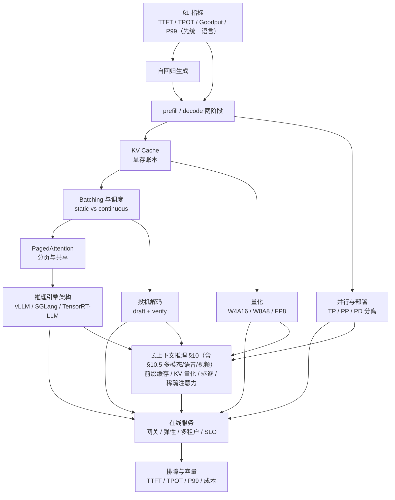
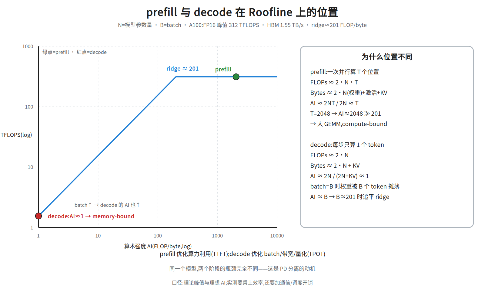
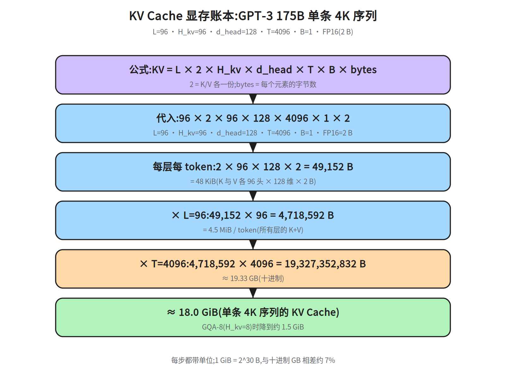
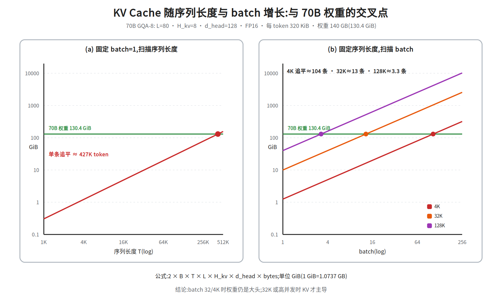
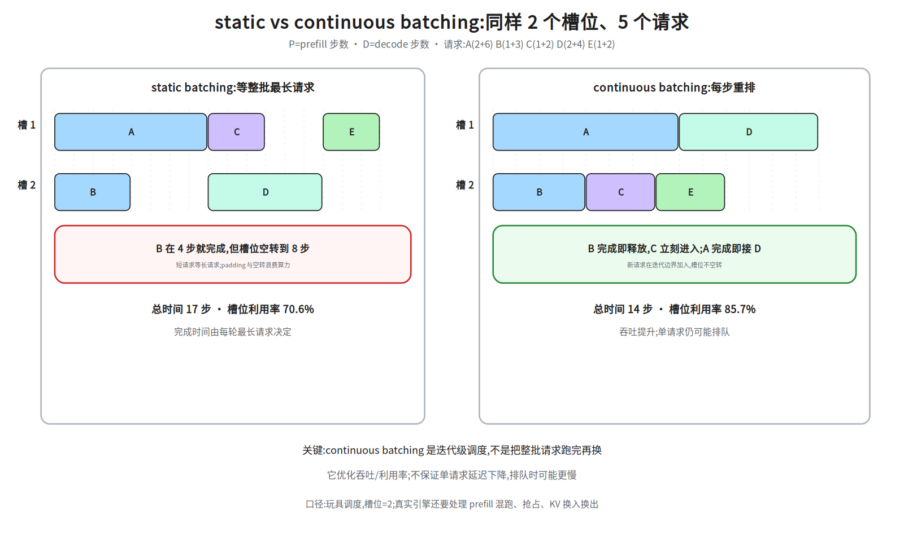
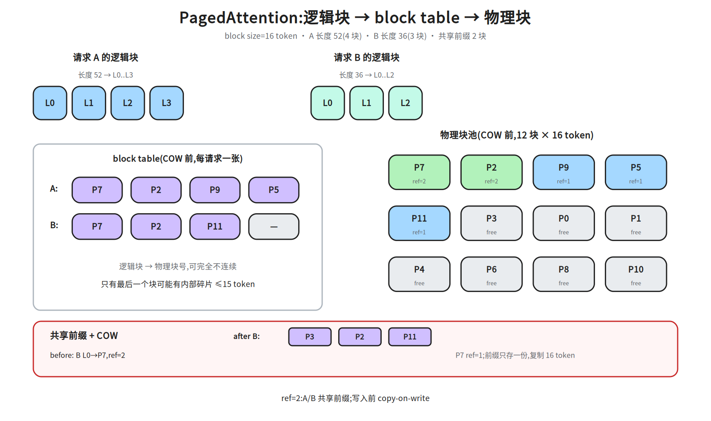
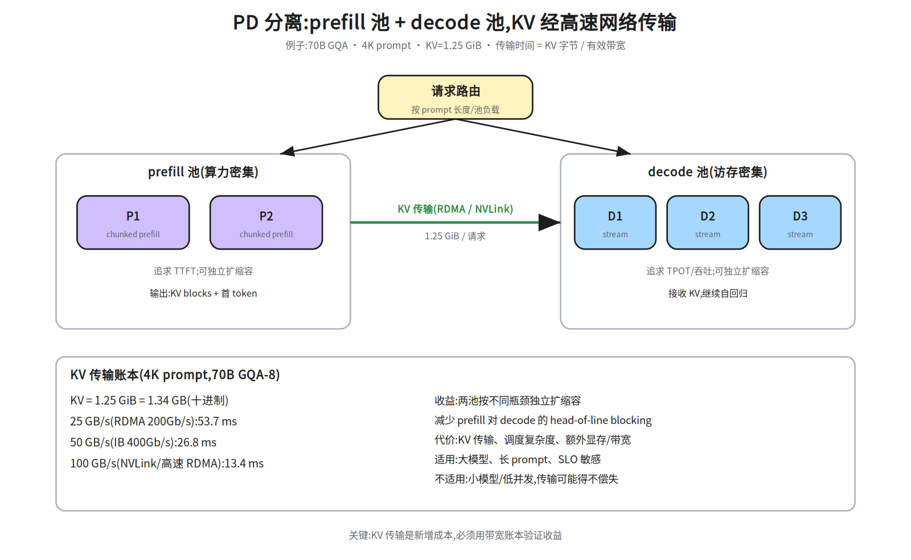
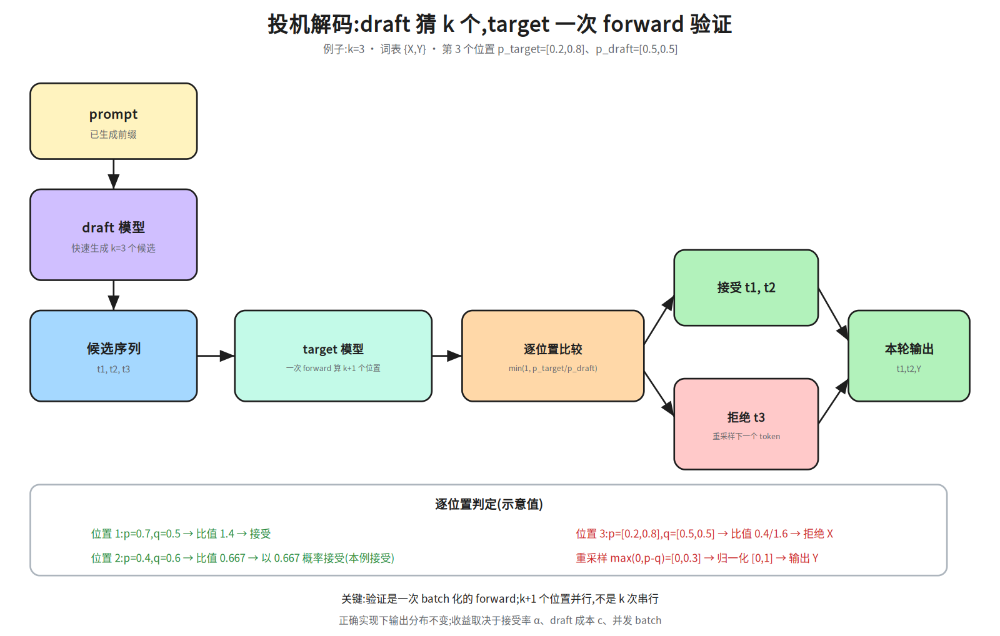
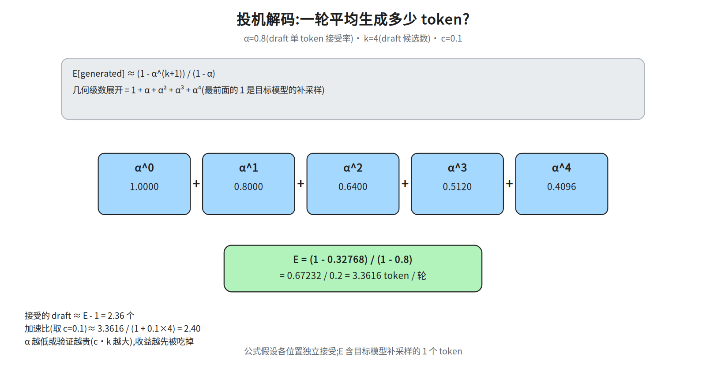

# M2-3 · 推理系统

> 本层回答：一个线上推理服务，如何在给定 GPU、延迟和 SLO 下，把每个 token 的成本打到最低、
> 吞吐拉到最高？——模型侧的自回归/KV Cache 原理见 `notes/06_inference.md`，本层讲系统与工程。

> **前置（按节）**：`notes/04_architecture.md §2`（因果掩码）、`notes/05_modern.md §3`（GQA）、
> `notes/06_inference.md §3–5`（KV Cache / prefill-decode）、`notes/21_single_node_ops.md §4`（Roofline）、
> `notes/21_single_node_ops.md §8`（量化）。
>
> **建议路径（每次 45 分钟）**：① §1–5（指标 / 两阶段 / KV / batching / PagedAttention）；
> ② §6–9（引擎 / 并行 / 量化 / 投机解码）；③ §10–13（长上下文 / 在线服务 / 排障 / 容量）。
>
> **深度标注**：§1–6、§7.1、§8、§11–13 为必学；§9 投机解码、§10 长上下文为加分（§7.2 PD 分离只有「动机 + 分开扩缩容」算加分；它那段 KV 传输账本是必学——§12 的「网络」行与面试要点第 9 条都要用）；
> §7.1 的 TP/PP 是必学，EP 为了解；**§7.0 是前置**，没学 M2-4 也能读。

>
> 依赖图上的箭头只表示**概念引用**（「讲到 J/L 时会用到 I、G」），不是必学门槛：按「加分」跳过 §9 投机解码或 §10 长上下文都不影响主线（§7.2 不算可跳过：只有动机和分开扩缩容那半页是加分，KV 传输账本是 §12 与面试要点第 9 条的前置）（图里 `F/G/H/I→L→J` 只是概念引用：跳过 §10 后读 J 只少了「前缀缓存 / KV 驱逐 / 长上下文成本」这层铺垫，J 的网关、弹性、多租户、SLO 不依赖它），只是 J（在线服务）和 L（长上下文）里与之相关的段落会少一层铺垫，回头补即可。

## 0. 依赖图（学习顺序）



## 1. 推理指标：先统一语言


> **SLO（Service Level Objective，服务等级目标）**：对服务质量指标给出的目标值，通常是一组约束而不是一条，例如 `TTFT P99 < 500 ms`、`TPOT P99 < 50 ms`、可用性 > 99.9%（完整示例见 §11.3）。后文的 Goodput、容量规划、弹性伸缩都以这组约束为准。

| 指标 | 含义 | 谁在意 |
|---|---|---|
| **TTFT**（Time To First Token） | 从请求到第一个 token 的延迟 | 交互体验、首屏 |
| **TPOT / ITL**（Time Per Output Token） | 首 token 之后，每个 token 的平均间隔 | 流式输出的流畅度 |
| **Throughput** | 单位时间生成的 token 数 / 完成的请求数 | 成本、容量 |
| **P99 延迟** | 99% 请求的延迟上界 | 线上 SLO |
| **Goodput** | 满足 SLO 的有效吞吐 | 真实服务能力 |
| **单位 token 成本** | GPU 成本 / 生成 token 数 | 商业与容量 |
| **GPU 利用率 / KV Cache 使用率** | 资源效率 | 运维与调度 |

> **吞吐和延迟经常是 trade-off**：增大 batch 提高吞吐，但可能拉高单请求延迟；continuous batching 主要优化吞吐和 GPU 利用率，不保证单请求更快。

**一条请求的时间线**：

```
到达 → 排队 → prefill → decode(t1) → decode(t2) → … → 结束
       └── TTFT ──┘
                  └──────── TPOT ────────┘
```

- **TTFT ≈ 排队时间 + prefill 时间**；
- **TPOT ≈ decode 每步间隔**；
- **P99** 是端到端延迟的 99 分位，不是平均值；
- **goodput**：如 10 req/s 的负载里有 8 个满足 SLO，则 goodput ≈ 8 req/s。

## 2. prefill 与 decode：两种完全不同的负载

| | prefill | decode |
|---|---|---|
| 输入 | 整个 prompt（T 个 token） | 1 个新 token + 历史 KV |
| 并行度 | 高（T 个位置并行） | 低（每步 1 个 token） |
| 计算特征 | 大 GEMM，偏 **compute-bound** | 权重 + KV 读取，偏 **memory-bound** |
| 主要指标 | TTFT | TPOT |
| 优化手段 | 算子融合（见下注）、TP（§7.1）、chunked prefill（§4.3） | batching（§4.2）、量化（§8）、KV 压缩（§8.2 / §10）、投机解码（§9） |

**关键直觉**：

- prefill 像「批量读一篇文章」，算力利用率高；
- decode 像「每步只写一个字」，每步都要把模型权重和 KV Cache 从 HBM 读一遍，算力大量闲置；
- 所以 decode 的核心是**提高 batch、减少每步搬运**，而不是堆 FLOPs。

> **表里这两个词先给定义**：**算子融合**（operator fusion）把相邻小算子（LayerNorm+线性层、bias+激活）合成一个 kernel，省的是 kernel 启动与中间张量的 HBM 往返，属实现层优化、不改模型结构；**GEMM** 就是矩阵乘，prefill 一次并行算 T 个位置，主体是 QKV 投影 / MLP 的几个大 GEMM，这也是它被归为 compute-bound 的原因。二者与 §4.3 的 chunked prefill 不在同一层：前者管「一个 kernel 算什么、访存几次」，后者管「请求怎么排进 GPU」，可以叠加。


> 图 20l 只画了「短序列、KV 可忽略」这条近似线；70B/4K 的严格读数（含它与 §3.4「104 条」的区别）见下面 bullet 之后的「严格式」一段。


> **`KV_seq` 的定义**（本节首次出现，账本在 §3）：一条序列**整段 KV 的字节数**，不是每 token 字节、也不是 token 数——把 §3.1 的公式去掉 batch 维就是 `KV_seq = 2 × T × L × H_kv × d_head × bytes`；70B GQA-8、T=4K、FP16 时 `KV_seq≈1.34 GB`（≈1.25 GiB，账见 §3.2）。具体读数（104、52、69）由后面「严格式」一段一次算清。
> **主线一句话**：KV 可忽略的短序列下 `AI≈B`、`B≈201` 追平 ridge（1.55 TB/s 口径）；长序列的边界见下一段。

用算术强度把直觉量化（A100 40GB SXM：FP16 峰值 312 TFLOPS、HBM 1.55 TB/s、ridge≈201 FLOP/byte）：

- **prefill**：一次并行算 `T` 个位置，`FLOPs≈2NT`，`Bytes≈2N+激活+KV`（权重为主），
  所以 `AI≈2NT/(2N+激活+KV)≈T`；`T=2048` 时 `AI≈2048 ≫ 201`，**compute-bound**；
- **decode**：每步只算 1 个 token，`FLOPs≈2N`，`Bytes≈2N+KV`，`AI≈1`，
  **memory-bound**；batch=`B` 时权重被 B 个 token 摊薄，`AI≈B`，`B≈201` 时追平 ridge。
（ridge 随带宽口径变，这里先给对应关系：`312/1.55≈201` 对应 A100 40GB SXM 的 1.55 TB/s；`312/2.04≈153` 对应 80GB 的 2.04 TB/s；`312/2.0≈156` 是按 2.0 TB/s 粗算——三个数各对应一个带宽，都对，差别只在 SKU 与取整；**153/156 只是另两个带宽 SKU 的读数、不是本节门槛**，下文「追平 ridge」默认指 201 这一档，另两个数不再重复出现。）


> 这一步用了「短 `T`、KV 可忽略」的前提：严格式是 `AI = 2NB/(2N + B·KV_seq)`，只有 `B·KV_seq ≪ 2N` 才化简成 `AI≈B`。70B、4K 时 `2N=140 GB`、单条 KV≈1.34 GB，渐近上界只有 `2N/KV_seq ≈ 104`——**无论 batch 多大都追不平 ridge=201**；按严格式 B=104 时 `AI≈52`。
同一式代 `B=201` 得 `AI≈68.7`——前面 `KV_seq` 注释里 69 这个读数就是它（不是那个渐近上界 104）。所以「`B≈201` 追平」只在 KV 可忽略的短序列下成立，长序列请用 §3.4 的 104 条口径（**两个 104 别混**：这里的 ≈104 是算术强度的渐近上界、量纲 FLOP/byte「每读一字节能算几次」，§3.4 的「104 条」是并发序列数、量纲「条」；数值相同只因都来自 `140/1.34`，且这个上界只跟字节比有关、与带宽口径无关）。


> **140 GB 凭什么跟 40 GB 卡比**：`AI≈B` 用的是「每卡权重字节 ÷ 每卡带宽」——TP 把权重和 KV 都按卡切（每卡权重 ≈ `2N/t`，带宽仍是单卡带宽），`B` 也按每卡算，所以 **AI 与 TP 度数 `t` 无关**；140 GB 只说明「必须多卡」（容量问题，见 §3.4），不进这行 AI 的分子。

> 这里 `N` 是**模型参数量**，`B` 是 batch，`T` 是序列长度。注意 `N` 在 prefill 的
> `2NT/2N` 里抵消了，所以 7B 和 70B 的**AI 位置几乎相同**；差别在绝对 FLOPs（70B 是 7B 的 10×）
> 和权重/KV 的绝对字节数。decode 同理：`AI≈B` 与模型大小无关，但 70B 的每步延迟更高，
> 因为它要搬的权重更多。


> 注意两个 `2N` 里的 `2` **含义不同**：`FLOPs≈2NT` 的 2 是「每参数每 token 约 2 FLOPs（一次乘 + 一次加）」；`Bytes≈2N` 的 2 是「FP16/BF16 每参数 2 字节」——这就是 §3.3「权重 ≈ 参数量 × 2 字节」（70B ≈ 140 GB）的出处。两者能约掉只是因为数值上都是 2：`2NT/2N≈T` 读作「每读一遍权重（2N 字节）能并行算 NT 次乘加（一次乘加 = 2 FLOPs，正好 2NT FLOPs），所以 AI 约等于 T」。

> 口径：这是理论峰值与理想 AI；实测要乘上 kernel 效率，还要加通信/调度开销。
> 结论不变：prefill 优化算力利用（TTFT），decode 优化 batch/带宽/量化（TPOT）。

> 这也是 PD 分离（prefill/decode disaggregation）的动机：两种负载对硬件和并行的需求不同，混在一起会互相拖累。

> **回看上面的表**：TP、量化、KV 压缩、投机解码在 §2 就已经当已知手段下结论了，定义分别在 §7.1、§8、§9；依赖图上 `B→G`、`C→H`、`D→I` 只表示「§2 会引用到它们」，不表示「学到 §2 时还用不上或可以跳过」——按加分跳过 §9 仍读得懂 §2 的结论，只是不知道那两格背后的机制。

## 3. KV Cache 显存账本

### 3.1 公式

```
KV Cache 字节数 = 2 × B × T × L × H_kv × d_head × bytes_per_element
```

- `2`：K 和 V 各一份；
- `B`：batch；
- `T`：序列长度（含历史）；
- `L`：层数；
- `H_kv`：K/V 头数（MHA 时等于注意力头数，GQA/MQA 时更少）；
- `d_head`：每个头的维度；

- **前提**：前导的 `2` 来自「K、V 各一份」（见上面的符号说明），不是维度系数；上式另外默认 `d_k = d_v = d_head`，那只是为了让 `2·d_head` 能合并成一项；若 `d_v≠d_k`，要把前导的 `2·d_head` 整体换成 `(d_k+d_v)`，不能只替换 `d_head`（见 `notes/06_inference.md §3`）。下表三个例子都满足 `d_k=d_v=128`，所以没暴露这条限制。
- `bytes_per_element`：FP16/BF16 = 2，FP8/INT8 = 1。

### 3.2 三个具体例子（FP16）

| 模型 | L | H_kv | d_head | 每 token | 4K 序列（GiB） | 4K 序列（十进制 GB） |
|---|---:|---:|---:|---:|---:|---:|
| LLaMA-2 7B（MHA） | 32 | 32 | 128 | 512 KiB | 2.0 GiB | 2.15 GB |
| LLaMA-2 70B（GQA-8） | 80 | 8 | 128 | 320 KiB | 1.25 GiB | 1.34 GB |
| GPT-3 175B（MHA） | 96 | 96 | 128 | 4.5 MiB | 18.0 GiB | 19.33 GB |

> 注意 `H_kv`：以 LLaMA-2 70B 为例（64 个 query 头，MHA 下等价的 KV 头数也是 64），GQA-8 把 K/V 头数从 64 降到 8，KV Cache 随之降到 1/8。只省容量并不会自动更快——GQA 在推理侧的核心价值是**每步要读的 KV 变少**（带宽），decode 本来就是带宽受限口径。
>
> batch 32、4K、70B GQA：`1.25 GiB × 32 = 40 GiB`——还没算模型权重，就已经很可观。
>
> **单位口径**：上表按 `1024^3` 算 GiB；换算十进制 GB 要乘 `1.0737`。
> 例：LLaMA-2 70B GQA 4K 的 `1.25 GiB ≈ 1.34 GB`；GPT-3 175B 的 `18.0 GiB ≈ 19.3 GB`。



图里把 GPT-3 175B 的账逐步展开：`96 × 2 × 96 × 128 × 4096 × 1 × 2`
= `19,327,352,832 B` = `19.33 GB` ≈ `18.0 GiB`。每步都带单位，方便面试时现场推。

### 3.3 显存总账

```
总显存 ≈ 模型权重 + KV Cache + 激活/临时缓冲 + 框架开销
```

- 权重：FP16 下约 `参数量 × 2` 字节（70B ≈ 140 GB）；
- KV Cache 随 **batch × 序列长度** 线性增长；
- 长上下文、高并发时，KV Cache 往往先于权重成为瓶颈。

### 3.4 谁先成为瓶颈？

以 70B GQA 为例：4K 序列每条约 1.25 GiB（≈1.34 GB），FP16 权重约 140 GB（**多卡聚合**，单张 80 GB 卡放不下）→
`140 / 1.34 ≈ 104` 条并发序列时 KV 才追平权重；
32K 时每条约 10 GiB（≈10.74 GB），`140 / 10.74 ≈ 13` 条就追平。

> 所以 **batch 32、4K 时权重仍是大头**；32K 或高并发时 KV Cache 才成为主导。
> 不要把「长上下文/高并发时 KV 成为瓶颈」当成无条件结论。



图用 70B GQA-8（每 token 320 KiB、权重 140 GB = 130.4 GiB）画了两条扫描线：

- **batch=1，扫 T**：KV 随 T 线性增长，单条要到约 **427K token** 才追平权重；
  所以 4K/32K 单条时，权重仍是显存大头。
- **固定 T，扫 batch**：4K 时约 **104 条**并发追平权重；32K 约 **13 条**；128K 约 **3.3 条**。
  batch 越高、序列越长，KV 越快成为主导。

> 这解释了为什么长上下文服务要同时做 **GQA + KV 量化 + PagedAttention + PD 分离**：
> 它们分别从“每 token 更小”（GQA，见 §3.2）“每字节更少”（KV 量化，见 §8.2）“少浪费”（PagedAttention，见 §5）“分开扩容”（PD 分离，见 §7.2）四个方向压 KV 成本——后三个本节还没展开，这里先当结论用，读到对应节再回看。

## 4. Batching 与调度

### 4.1 静态 Batching 的问题

静态 batching 把一批请求凑齐、一起跑：

- 要等最长的序列结束，短的 GPU 空转；
- padding 浪费算力和显存；
- 请求到达时间不同，凑批增加排队延迟。

### 4.2 Continuous Batching（迭代级调度）

每生成一个 token（或每若干步）就重新组批：

- 完成的请求立刻离开，新请求立刻加入；
- 不需要等整批结束，GPU 利用率显著提高；
- vLLM、TensorRT-LLM、SGLang 等引擎的核心能力。



图里用 2 个槽位、5 个请求做玩具调度，**每个请求按不可分的总长度计**（`P` 与 `D` 不分开建模，槽位占用也不分 prefill/decode 阶段；prefill 与 decode 混跑见 §4.3）：


5 个请求的总长度（不再拆 `P`/`D`）：A=8、B=4、C=3、D=6、E=3，总工作量 `8+4+3+6+3=24` 槽位步。static 总时长 17 步 × 2 槽位 = 34 槽位步 → `24/34≈70.6%`；continuous 总时长 14 步 × 2 槽位 = 28 槽位步 → `24/28≈85.7%`。两条都能手算复核。

- **static**：第一轮 `[A,B]` 要等最长请求 A 跑完 8 步；B 在第 4 步就完成，槽位空转到第 8 步。
  第二轮 `[C,D]` 又等 D 到第 14 步；第三轮 E 到第 17 步。槽位利用率 `24/34≈70.6%`。
- **continuous**：B 完成立刻让 C 进入（B 占着槽位 0 跑到 t=4，C 接着用同一槽位跑到 t=7）；C 在 t=7 结束，空出的槽位给 **E**（7→10）——这是让 E 越过队首 D 的**非 FIFO 指派**，图 20o 画的正是这一条；A 在 t=8 结束接 D（8→14）。总时间 14 步，利用率 `24/28≈85.7%`。


> 手算对照：若严格按 FCFS（t=7 的空槽给队首 D，7→13；E 等 A 空出的槽位，8→11），总时长是 13 步、利用率 `24/26≈92.3%`。也就是说 continuous 的利用率取决于指派策略：14 步/85.7% 对应「E 插队」，13 步/92.3% 对应 FIFO——两条时间线都能手算复现，但别把 85.7% 当成 continuous batching 的固定数字（它明显低估了这一档）。

> **对外该引哪个数**：真实引擎按到达顺序派槽位（FIFO），所以「continuous vs static」报 13 步 / `24/26≈92.3%`（对 70.6%）；14 步 / 85.7% 是本节刻意让 E 越过队首 D 的非 FIFO 变体，图 20o 画的正是这一条，只用来演示「指派策略会改变利用率」，拿它和 70.6% 比会把收益讲小。

> 注意：这里的“利用率”是玩具口径（占用槽位步数 / 总槽位步数），真实引擎还要算
> prefill 混跑、抢占、KV 换入换出。**吞吐提升不等于单请求延迟下降**：排队时单请求可能更慢。

代价：

- 调度、KV Cache 管理更复杂；
- 单请求延迟可能变长（尤其在排队时）；
- 需要处理 preemption、抢占、KV 换入换出（把某请求的 KV 腾到 CPU 内存或更低层存储、需要时再换回；机制见 §5 分页与块共享；§4.3 的 Preemption 只有一行策略名、没展开机制）。

### 4.3 调度策略

| 策略 | 目的 |
|---|---|
| FCFS / 优先级 | 公平性或业务优先级 |
| 连续 batching | 提高吞吐 |
| Chunked prefill | 把长 prompt 的 prefill 切成块，和 decode 混跑，减少长 prompt 的队头阻塞、降低 TPOT 抖动 |
| Preemption | 显存不足时，抢占/重算/换出某些请求 |
| 长度感知 / 分桶 | 减少 padding 和碎片 |
| 多租户配额 | 隔离与公平 |

> **chunked prefill 的直觉**：prefill 是 compute-bound，decode 是 memory-bound；把 prefill 切块插进 decode 的间隙，能同时利用算力和带宽，**减少长 prompt 对其他请求的 head-of-line blocking 和 TPOT 抖动**。代价是被切块请求自身的 TTFT 可能变长、调度更复杂。

## 5. PagedAttention

### 5.1 要解决的问题

传统 KV Cache 给每个请求预分配一段连续显存：

- 不知道最终生成长度 → 预分配过大 → 浪费；
- 预分配过小 → 频繁扩容/拷贝；
- 不同请求长度差异大 → 外部碎片严重。

### 5.2 分页思路

把 KV Cache 切成固定大小的 **block**（如 16 个 token），按需分配：

```
逻辑块：  [0]   [1]   [2]   [3]
物理块：  [7]   [2]   [9]   [5]     ← 不连续也可以
block table: 逻辑块 → 物理块 的映射
```

- 每个请求维护一张 **block table**；
- 只有最后一个 block 可能有内部碎片（≤ `block_size-1`=15 token：块一旦分配就至少写入 1 个 token）；
- 显存按需增长，外部碎片大幅减少；
- **前缀共享**：相同 prompt 前缀的请求可以共享物理 block（copy-on-write）；
- **Beam search / 并行采样**：分支共享已生成的 KV，写时复制。
看图先定住触发条件：**COW 只在「这一步要写的块仍被别人共享」时触发**。append-only 解码只写末块，装满的块永不被写——所以图 20n 红框把 COW 画在装满的共享块 `L0`/`P7` 上（箭头 `P7→P3`）是按错条件画的示意；正确触发是**共享的半满末块被写**，块号与复制量一律按本节账本读数。



> **图注更正（红框的块号与复制量按本段读，机制不变）**：红框要表达的是「写共享块触发 COW」，但标签标错了——触发点画在**装满**的共享块 `L0`/`P7` 上、一次复制 16 token；append-only 解码只写末块，装满的块永不被写，所以这种情形不存在。正确读法是「**共享的半满末块**被写、只复制它已写的 4 个 token」：`ref(P11)` 2→1、`ref(P9)=1`。红框自带的那组读数（`L0`/`P7` 整块 16 token、`P3`）**整组作废、不要拿去换算**——`P3` 在账本里根本不存在（A 的第三块是 `P9`），照红框换算出来的是另一组数；块号与复制量一律以下面账本 `[P7,P2,P11]→[P7,P2,P9]`、复制 4 token 为准，该图待按正确触发条件（写共享的半满末块）重绘。

图里的具体账本（block=16 token）：
> 先定义 `ref`：`ref(b)` 是物理块 `b` 的**引用计数**，即有几个请求的 block table 指向它（fork 时每块 +1，COW 或释放时 -1）。`ref=1` = 私有块，随便写；`ref>1` = 被共享，写它必须先复制。下面账本里的 `ref` 都按这个含义读。

- 请求 A 长度 52 → `ceil(52/16)=4` 个逻辑块，容量 64，内部碎片 12；
- 请求 B 长度 36 → 3 个逻辑块，容量 48，内部碎片 12；
- A 的 block table `[P7,P2,P9,P5]`，B 的 `[P7,P2,P11]`（这是两者都停止增长时的**最终态**；A 不是独立长起来的，见下面第 4 个「-」条（`ref(P7)=ref(P2)=2` 那条））：前两块共享，第三块私有；
- `ref(P7)=ref(P2)=2`（A、B 最终只共享前 **32** 个 token 的前缀：`P7`、`P2` 都装满 16、`ref=2`；`P11` 是 B 的末块，只装了 4 个 token 且 `ref=1`，A 的末块 `P5` 同理私有——36 token 的共享只存在于 A 写第 37 个 token 之前的中间态）；A 的前 36 个 token 与 B 共享同一段前缀（相当于 A 从 B fork 出来），所以写第 37 个 token 时 A 的末块正是共享的半满块 `P11`（这是中间态 `[P7,P2,P11]`，三块 `ref` 都是 2），写它就触发 **copy-on-write**：分配 `P9`、把 `P11` 已写的 4 个 token 复制过去、`ref(P11)` 从 2 降到 1，A 的 block table 变成 `[P7,P2,P9]`（`P9` 从此 `ref=1`；A 再长到 52 token 才补上私有的 `P5`）；图 20n 红框的读数一律作废，以本账本为准（触发点、块号与复制量的正确读法见上方图注更正，即紧接图 20n 那段）」。
- 逻辑块总数 7，物理块只用了 5 个（共享省下 2 块）。


> 上面那串块号按**时间顺序**只有三态，不要横向比对：`[P7,P2,P11]`（A 从 B **fork** 出来时 B 已长到 36 token，`P11` 是共享的半满末块、三块 `ref` 都是 2；若 fork 发生在 32 token，`P7`/`P2` 已装满，A 写第 33 个 token 时 `need>len(blocks)` 只会 `_take()` 一个新块、根本不碰共享块，COW 永远不会触发）→ 写第 37 个 token 触发 COW，换成 `[P7,P2,P9]` → 长到 52 token 补私有块，成 `[P7,P2,P9,P5]`。**fork** = 把父序列的 block table 整份复制给子序列，块号共享、每块 `ref` 加 1，不复制 KV 数据（实现见文末 `fork()`；COW 就发生在 fork 之后第一次写共享末块）。


> COW 的触发条件只有一条：**这一步要写的块还被别人共享**。append-only 解码只写末块，所以装满的 `P7`/`P2` 永远不会被写，也就不会触发 COW（图 20n 红框按上文图注更正读：写的是共享的**半满末块** `P11`、复制 4 token，不是装满的 `L0`/`P7` 整块 16 token；块号与 `ref` 可对照本账本逐项验算）；上例若换成 B 先追加，COW 就发生在 B 的末块上。这与动手清单 `append_token` 里「末块被共享才 COW」是同一个条件。

> 碎片只出现在每个请求的**最后一个块**，上限是 `block_size-1=15` token；
> 外部碎片基本消失，因为物理块不需要连续。
>
> PagedAttention 不是「让计算更快」，而是**让 KV Cache 的显存管理更高效**：更高并发、更少浪费、支持共享。它是 vLLM 的核心创新之一。

## 6. 推理引擎架构

### 6.1 典型请求生命周期

```
API Server
  → Scheduler（排队、组批、chunked prefill）
  → KV Cache Manager（分配/回收/共享 block）
  → Model Executor / Worker（prefill + decode）
  → Sampler（greedy / temperature / top-k / top-p）
  → Detokenizer
  → 流式返回
```

### 6.2 三个主流引擎的侧重

| 引擎 | 机制 | 代价/限制 | 何时选 |
|---|---|---|---|
| **vLLM** | PagedAttention + continuous batching + 可扩展调度 | 极致性能不如编译方案 | 通用高吞吐服务、需要改源码/扩展 |
| **SGLang** | RadixAttention 前缀缓存（前缀树复用共享前缀的 KV，见 §10）+ 前端 DSL（用 Python 直接写「生成/选择/并行」控制流，调度由运行时生成，不必手写 scheduler） | 生态较新 | 多轮/Agent、大量共享前缀 |
| **TensorRT-LLM** | 图编译 + NVIDIA 插件 + in-flight batching（= §4.2 的 continuous batching，TensorRT-LLM 的叫法） | 编译/适配成本高、硬件绑定 | 稳定模型 + NVIDIA、追求极致性能 |

> 面试不要只背名字：能说清「它解决哪个环节的问题、代价是什么」才有价值。

## 7. 并行与部署

### 7.0 最小前置（没学 M2-4 也能读）

- **AllReduce**：所有卡把梯度/激活求和，结果广播给所有卡；
- **AllToAll**：每张卡向其他卡发送不同的数据切片；MoE 的 EP 用它做 token 路由；
- **ReduceScatter / AllGather**：AllReduce 的两半，§7.1 的 TP 账本要用。**ReduceScatter** 把每卡的 `[B,T,d_model]` 切成 `N` 份、每份 `S/N`，第 `i` 份发给卡 `i` 去归约，结果每卡只留 `1/N` 的完整和；**AllGather** 再把这 `N` 份拼回完整张量。ring 实现下每张卡要发 `N-1` 份、每份 `S/N`，合计 `(N-1)/N·S`；一次 AllReduce = 两阶段相加 ≈ `2(N-1)/N·S`，`N` 大时收敛到 `2S`（§7.1 的「每层 4S = 2 次 AllReduce × 2S」就是这么来的）。
- **TP（张量并行）**：层内切分，每层后通常要 AllReduce；
- **PP（流水线并行）**：按层切 **stage**（一段连续的层），**micro-batch**（切成小批）流水；
  **bubble** 是流水线空转；
- **NVLink 域**：单机内 GPU 的高带宽互联；跨机通常走 RDMA/IB；
- **RDMA**：绕过 CPU 的直接内存访问，用于跨机通信和 KV 传输。

### 7.1 推理并行

| 方式 | 做法 | 适用 |
|---|---|---|
| **TP（张量并行）** | 切注意力头/FFN，层内 AllReduce | 单机多卡、低延迟 |
| **PP（流水线并行）** | 按层切分，多 stage | 跨节点、超大模型 |
| **EP（专家并行）** | MoE 按专家切分，token 通过 AllToAll 路由 | 超大 MoE 推理；代价是通信与负载均衡 |
| **DP（数据并行；推理侧就是 §11.1 的「推理服务（多实例）」，不做梯度同步）** | 每个 GPU/节点跑完整模型，各吃一部分请求 | 吞吐扩展、弹性 |
| **PD 分离** | prefill 池 + decode 池，KV 通过高速网络传输 | 大模型、长 prompt、SLO 敏感 |

TP 的代价是每层都要通信，通常放在 NVLink 域内；PP 的代价是 pipeline bubble 和跨节点通信。

**TP/PP 通信账本（记住数量级）**：

- **TP（推理，只看前向）**：每个 Transformer 层前向有 2 次 AllReduce（attention 输出投影后、
  FFN 下投影后），每次张量 `[B, T, d_model]`；ring all-reduce 每卡通信量约 `2S`（推导：`N` 卡 ring 分两阶段——先 reduce-scatter（每卡只留 1/N 的归约结果，走 `(N-1)/N·S`）、再 all-gather（把各卡的 1/N 拼回完整张量，走 `(N-1)/N·S`）——合计 `2(N-1)/N·S`，`N` 大时收敛到 `2S`；这是**一次** AllReduce 的每卡量，`4S` 来自上一句的「每层 2 次 AllReduce × 2S」，不是 ring 公式直接产出），
  所以每层前向约 `4S`。`S = B·T·d_model·bytes`。训练还要反向，再加 `4S`，合计约 `8S`。
- **PP**：在 stage 边界传 `[B, T, d_model]` 激活，每个 micro-batch 一次 send/recv；
  通信量不大，但**延迟**和 **bubble** 是主要成本。bubble 比例约
  `(p-1)/(m+p-1)`（`p`=stage 数，`m`=micro-batch 数）。
- 因此 **TP 放 NVLink 域内**（每层都通信，跨节点会拖垮），**PP/DP 可跨节点**；
  TP 度数受 NVLink 带宽和层内延迟限制，常见 ≤8。

### 7.2 PD 分离

- prefill 池：算力密集，追求 TTFT；
- decode 池：访存密集，追求 TPOT 和吞吐；
- KV Cache 从 prefill 传到 decode（RDMA/NVLink）；
- 好处：分别扩缩容、减少相互干扰；
- 代价：KV 传输、调度复杂度、部署成本。



**KV 传输账本**（70B GQA、4K prompt、FP16）：

```
KV = 1.25 GiB ≈ 1.34 GB
25 GB/s（RDMA 200Gb/s）  → 1.34 / 25  ≈ 53.7 ms
50 GB/s（IB 400Gb/s）    → 1.34 / 50  ≈ 26.8 ms
300 GB/s（A100 NVLink 单向有效）→ 1.34 / 300 ≈ 4.5 ms（比 400Gb/s IB 快约 6×）
```

> 传输时间是**新增成本**。长 prompt 的 prefill 可能几百 ms，KV 传输几十 ms 仍划算；
> 但小模型/低并发时，传输和调度开销可能吃掉收益。**不要默认 PD 分离更快，要用带宽账本验证。**
> 另外，KV 传输带宽是单向有效带宽，和网卡标称的双向带宽不是一回事。
> 图 20p 账本第 3 行 `100 GB/s(NVLink/高速 RDMA): 13.4 ms` 是作废读数（PNG 未按 300 GB/s 重绘），不要拿它算：`快约 6×` 只在 300 GB/s 口径下成立（50→300），一律以上面文本账本 `300 GB/s → 4.5 ms` 为准。

## 8. 量化

### 8.1 常见方案

| 方案 | 量化对象 | 适用 |
|---|---|---|
| W4A16 / W8A16 | 只量化权重 | decode 访存瓶颈、端侧 |
| W8A8 | 权重 + 激活 | 通用推理加速 |
| FP8 | 权重 + 激活 | H100 等新硬件 |
| KV Cache 量化 | KV Cache | 长上下文、高并发 |


> 记号读法：**W**=weight（权重）、**A**=activation（激活），后面的数字是位宽。`W4A16` = 权重 INT4、激活 FP16（即只量化权重）；`W8A8` = 权重与激活都 INT8；`FP8` = 权重与激活都用 FP8（E4M3）。`amax` = 某个量化粒度内的**绝对值最大值**，scale 通常取 `amax / 该位宽可表示的最大值`；per-head / per-block 就是每个 head / 每个 block 各算一个 amax。

>
> **粒度从粗到细一条线**：**per-tensor**（整个张量一个 amax，元数据最省、最不准）→ **per-channel**（每个输出通道/每列权重一个）→ **per-group**（每 G 个元素一组，常见 G=64/128）→ **per-block**（每个 block 一个，KV 分页里就是一个物理 block 的 16~128 个元素）→ **per-head**（每个 KV head 一个，KV Cache 专用）。§8.3 第 3 步的「per-channel / per-group」就是权重侧这两档：越细越准，kernel 与元数据越贵。
>
> **PTQ 与校准集**：**PTQ**（post-training quantization，训练后量化）= 不做反向传播、只靠样本统计量定 scale 的量化，AWQ / GPTQ / SmoothQuant 都属于 PTQ（QAT 是它的反面：训练中模拟量化）；**校准集**（calibration set）= 那批只跑前向、用来统计 `amax` 与通道敏感度的样本，通常几百条、不需要标签、但要覆盖长尾输入——它不进梯度却决定 scale，所以 §8.2 的「校准集不具代表性会掉点」与 §8.3 第 2 步说的是同一件事。

### 8.2 精度问题

- **outlier**：少数极大值拉大 scale，导致整体精度下降；
- **激活分布随输入变化**：校准集不具代表性会掉点；
- **长尾任务**：平均指标没掉，但某些任务明显退化。

**必须做任务级评测**，不能只看 perplexity 或单个 benchmark。

**KV Cache 量化**：常用 FP8 E4M3（精度高、范围小）或 INT8；按 head / block 维护 scale，
用校准集的 `amax` 估计。KV 的 outlier 会直接放大 attention score 误差，长上下文尤其敏感；
建议逐层评估，先量化非敏感层，保留首尾层或 attention sink 的 KV。

> FP8 E4M3 与 E5M2 不是一回事：E4M3 尾数多、精度高但范围小；E5M2 范围大、精度低。
> 权重/激活常用 E4M3，梯度或对范围敏感的中间量才考虑 E5M2。scale 的粒度（per-tensor /
> per-channel / per-block）越细，精度越好，但元数据和 kernel 复杂度也越高。

### 8.3 掉点后的恢复流程

1. **定位**：权重 / 激活 / KV Cache？哪一层/哪个模块最敏感？
2. **校准集**：有代表性、覆盖长尾输入。
3. **粒度**：per-channel / per-group；保留 outlier。
4. **方法**：按掉点类型选。

| 方法 | 机制 | 代价 | 何时选 |
|---|---|---|---|
| AWQ | 用激活敏感度保护显著权重通道（weight-only） | 需校准 | W4A16、decode 带宽瓶颈 |
| GPTQ | 用校准数据的二阶信息做逐列误差补偿（weight-only） | 需校准、离线耗时 | W4A16/W8A16、离线量化 |
| SmoothQuant | 把激活 outlier 迁移到权重，支持 W8A8 | 需校准、可能损精度 | 激活 outlier 严重的 W8A8 |
| QAT | 训练中模拟量化 | 训练成本高 | PTQ 不够、精度要求高 |

> 对应关系：**权重掉点 → AWQ/GPTQ；激活掉点 → SmoothQuant；KV 掉点 → KV 量化或回退；
> 敏感层 → 混合精度回退。**

5. **混合精度**：敏感层回退 W8A16 / FP16；KV Cache 不量化。
6. **回归**：任务级指标 + 长尾 case + 与 FP16 基线对比。

## 9. 投机解码（Speculative Decoding）

### 9.1 基本流程

1. 用小 draft 模型快速生成 `k` 个候选 token；
2. 目标模型一次 forward 验证这 `k` 个 token（causal mask 让每个位置只看前缀，见 `notes/04_architecture.md §2`）；
3. **greedy**：接受最长匹配前缀；**sampling**：对每个 draft token 以
   `min(1, p_target / p_draft)` 接受，拒绝后从 `max(0, p_target - p_draft)` 归一化后的分布重采样；
4. 重复。



图里用 `k=3`、词表 `{X,Y}` 走了一遍 sampling 版流程：

- 位置 1：`p=0.7, q=0.5`，比值 `1.4` → 接受；
- 位置 2：`p=0.4, q=0.6`，比值 `0.667` → 以 0.667 概率接受（本例接受）；
- 位置 3：draft 在这个位置采到的是 X；判定只对被采到的这一个 token 做一次——`p[X]=0.2`、`q[X]=0.5`，比值 `0.2/0.5=0.4` → 以 `1-0.4=0.6` 的概率拒绝（本例拒绝）。Y 的比值 `1.6` 不参与判定，Y 不是 draft 采出来的那个 token；
- 拒绝后从 `max(0,p-q)=[0,0.3]` 归一化得到 `[0,1]`，重采样输出 Y；
- 本轮输出 `t1,t2,Y` 共 3 个 token。

> **验证是一次 batch 化的 forward**：把 prompt + k 个 draft token 一起送进 target，
> 一次算 `k+1` 个位置（causal mask 保证每个位置只看到自己的前缀），不是 k 次串行。
> 这就是为什么投机解码在正确实现下**不改变输出分布**；只匹配前缀只描述了 greedy 特例。

### 9.2 收益条件

- draft 模型足够快（成本远低于目标模型）；
- 接受率 `α` 足够高；
- 目标模型 forward 的 batch 维度能容纳验证，摊销成本。

近似期望生成 token 数（独立接受率 α）：

```
E[generated] ≈ (1 - α^(k+1)) / (1 - α)
```

> 这是**每轮生成的 token 数**（含目标模型补采样的 1 个），不是「被接受的 draft token 数」；
> 后者约为 `E[generated] - 1`。



以 `α=0.8, k=4` 为例：几何级数 `1 + 0.8 + 0.64 + 0.512 + 0.4096 = 3.3616`，
即每轮约生成 `3.36` 个 token（接受的 draft ≈ `2.36`）；取 `c=0.1` 时加速比约 `2.40`。

加速比粗略为：

```
speedup ≈ E[generated] / (1 + c · k)
```

其中 `c` 是 draft 单步成本 / 目标单步成本。**α 低或 batch 很大时，验证成本会吃掉收益。**

### 9.3 变体

- **Medusa**：多个解码头并行预测未来 token；不需要独立 draft 模型，但要训练额外头，代价是显存和训练成本。
- **EAGLE**：在特征层做 draft，复用目标模型特征；接受率通常更高，实现更复杂。
- **Lookahead decoding**：Jacobi 迭代（把未来若干位置当成未知量，先用上一轮结果并行猜一遍、再迭代修正的不动点式迭代）+ 前瞻/验证分支；n-gram pool 来自迭代轨迹，不是从 prompt 检索。
- **Prompt lookup / n-gram decoding**：从输入/上下文里检索重复 n-gram 作为 draft；不需要额外模型，
  对复制/重复多的任务有效，泛化有限。

## 10. 长上下文推理

长上下文的核心矛盾：**KV Cache 随 T 线性增长，而 decode 每步都要读它。**

优化方向：

| 方向 | 做法 | 代价 |
|---|---|---|
| 前缀缓存 | 复用相同 prompt 前缀的 KV（RadixAttention） | 需要缓存管理 |
| Chunked prefill | 长 prompt 分块，减少队头阻塞、降低 TPOT 抖动（被切块请求自身 TTFT 可能变长） | 调度复杂 |
| KV 量化 | FP8/INT8 存 KV | 精度损失 |
| KV 压缩/驱逐 | 丢弃低重要性 token、滑动窗口、attention sink | 可能丢信息 |
| 稀疏/线性注意力 | 减少 O(T²) 计算 | 模型结构改动 |
| PD 分离 | prefill 与 decode 分开扩缩容 | 部署复杂 |

> 长上下文不是「把 T 调大」这么简单：TTFT、KV 显存、吞吐、P99 都会同时恶化，必须做系统级取舍。

**两个常被点名的机制**：

- **Attention sink**：始终保留开头少数 token 的 KV，作为「稳定锚点」，缓解长上下文/流式生成中的分布漂移。
- **RadixAttention**：用前缀树（radix tree）缓存共享前缀的 KV，多轮对话/Agent 场景可大幅提高缓存命中。

### 10.5 多模态 / 语音 / 视频推理

| 类型 | 链路 | 系统瓶颈 | 优化 |
|---|---|---|---|
| VLM | 视觉编码器 + LLM | 视觉 token 的 prefill、图像/视频编码 | token 压缩、编码器批处理、跨模态融合 |
| 视频生成 | 扩散模型多步去噪 | 计算密集、多步采样 | step 蒸馏、并行采样、专用 Kernel |
| 语音 ASR/TTS | 流式编码/解码 | 低延迟、分块 | 流式推理、chunked prefill、缓存 |

> VLM 的 LLM 部分仍有 KV Cache；扩散模型没有自回归 KV Cache，不要把 LLM 推理的优化直接套上去。
> 表里两个扩散名词补一句（本节不展开扩散细节，够读表即可）：**step 蒸馏**指蒸馏「去噪**步数**」——教师几十步的采样轨迹压成学生 4~8 步走完，省的是**算力与延迟**，不是模型大小；**并行采样**指扩散没有自回归的逐 token 依赖，一步里整段 latent（以及多个候选/多个 batch）能一起算，省的是**串行步数与端到端时延**，代价是单步算力更密。

## 11. 在线服务与 SLO

### 11.1 服务分层

```
客户端 → 网关（鉴权/限流/路由） → 推理服务（多实例）
        → 引擎（scheduler/worker） → GPU
```

### 11.2 关键能力

- **弹性伸缩**：按队列长度、GPU 利用率、TTFT SLO 扩缩容；
- **多租户**：配额、隔离、公平调度、计量计费；
- **灰度/回滚**：模型版本、流量切分、A/B；
- **模型热更新**：不中断服务地换权重；
- **可观测**：TTFT、TPOT、P99、队列时长、KV 使用率、preemption、OOM、GPU 利用率；
- **限流/降级**：过载时保护系统。

### 11.3 SLO 示例

```
TTFT P99 < 500 ms
TPOT P99 < 50 ms
可用性 > 99.9%
错误率 < 0.1%
```

SLO 必须和容量、成本一起算：同样的 GPU，SLO 越严，能承载的并发越低。

## 12. 排障：分层定位

线上「变慢」不要一上来就调 Kernel，按层排查：

| 层 | 症状 | 检查 |
|---|---|---|
| 客户端/网关 | 连接、超时、限流 | 网关指标、错误码、队列 |
| 调度/队列 | TTFT 高、排队久 | 队列长度、batch 组成、优先级 |
| 引擎 | TPOT 高、吞吐低 | batching、preemption、KV 使用率 |
| 显存 | OOM、频繁抢占 | KV Cache、batch、序列长度 |
| Kernel/GPU | 单步变慢 | nsys/ncu（= Nsight Systems / Nsight Compute：nsys 看时间线找空泡、ncu 看单 kernel）、GPU 利用率、时钟/温度 |
| 网络 | 多卡/PD 分离变慢 | NCCL、RDMA、带宽、重传 |
| 模型/输入 | 长 prompt、长输出 | 输入输出长度分布 |

**常见症状对照**：

- **TTFT 高**：prompt 太长、prefill 排队、chunked prefill 配置不当；
- **TPOT 高**：batch 太大导致显存压力、KV 读带宽不足、preemption；
- **吞吐低**：batch 不够、并行度不足、Kernel 未跑满；
- **P99 抖动**：抢占、GC（如 Python/Go 的垃圾回收停顿，或显存块的周期性回收）、网络抖动、热点请求。

## 13. 容量与成本

### 13.1 Little's Law 与容量

```
平均并发 ≈ 吞吐（请求/秒） × 平均延迟（秒）
```

**注意**：Little's Law 给的是**平均并发**，不能直接拿平均延迟去估 P99 容量。
在 P99 SLO 下，要用 SLO 对应的尾延迟 + 安全系数。

例（两边必须同一口径）：平均口径——50 req/s × 平均 2s = 100 平均并发，若单实例平均能扛 20 并发，则约需 5 个实例；这只是平均账，不能当 P99 容量。P99 口径要换尾延迟重算：设 P99 端到端延迟 6s、单实例在 P99 下可承载 20 并发，则所需并发 ≈ 50 × 6 = 300，实例数 ≈ 300 / 20 = 15，再加 headroom——同一份流量，平均口径 5 个、P99 口径 15 个，相差 3 倍（15/5），不能说成「差一个量级」；精确值要用排队模型（M/G/k）或实测曲线复核。

### 13.2 单位 token 成本

```
每百万 token 成本 = GPU 小时成本 / (tokens/秒 × 3600) × 1,000,000
```

示例（仅示意）：GPU $2/小时，单卡 2,000 tokens/s →

```
2 / (2000 × 3600) × 1e6 ≈ $0.28 / 百万 token
```

真实成本还要加上：空闲容量、冗余、网络、存储、运维。

## 面试要点

1. **TTFT 和 TPOT 的区别？** → 首 token 延迟 vs 后续每 token 间隔；分别对应 prefill 和 decode。
2. **KV Cache 显存怎么算？** → `2 × B × T × L × H_kv × d_head × bytes`；GQA 降低 `H_kv`；
   注意 GiB 与 GB 的换算（1 GiB = 1.0737 GB）。
3. **PagedAttention 解决什么？** → KV Cache 的显存碎片与按需分配；支持前缀共享和 COW，不是加速计算。
4. **Continuous Batching 和静态 Batching 的区别？** → 迭代级调度，完成的请求立刻离开、新请求加入；提高吞吐和利用率。
5. **prefill 和 decode 的瓶颈为什么不同？** → prefill 大 GEMM 偏算力；decode 每步读权重+KV，偏带宽。
6. **投机解码什么时候有收益？** → draft 快、接受率高、验证成本可摊销；batch 大或 α 低时收益下降。
7. **量化怎么选？** → 看瓶颈（权重/激活/KV）、硬件支持、精度要求；必须做任务级评测。
8. **线上 P99 升高怎么定位？** → 网关/队列/调度/显存/Kernel/网络分层排查，结合 TTFT vs TPOT 判断。
9. **PD 分离的动机？** → prefill 算力密集、decode 访存密集，分开扩缩容、减少干扰；代价是 KV 传输和复杂度。
   4K/70B GQA 的 KV 约 1.25 GiB，50 GB/s 下传输约 27 ms，要用账本判断是否划算。
10. **长上下文为什么贵？** → KV Cache 线性增长、decode 每步读 KV、TTFT 变长、吞吐下降。

## 常见坑

- **把 TTFT 和 TPOT 混为一谈**：优化手段完全不同。
- **算 KV Cache 忘记 batch 和层数**：只算单 token 会严重低估。
- **以为 PagedAttention 提升算力**：它优化的是显存管理与并发。
- **以为 continuous batching 降低单请求延迟**：它主要提升吞吐，排队可能让单请求更慢。
- **只用 batch=1 benchmark**：线上是高并发，结论不可用。
- **量化不做精度评测**：平均指标正常，长尾任务可能崩。
- **忽略排队和 P99**：平均延迟好看，线上仍然超时。
- **把 PD 分离当默认方案**：小模型/低并发下，KV 传输和复杂度可能得不偿失。

## 动手清单（30–60 分钟）

1. **KV 账本**：写一个函数算 `2×B×T×L×H_kv×d_head×bytes`，扫 batch×T，画出 KV 显存曲线，
   标出「追平权重」的交叉点（用 7B/70B 两组参数）。
2. **Toy KV allocator**：实现 block table 的 alloc/free，再加一个前缀共享的 copy-on-write 分支；打印碎片率。
3. **Batching 模拟**：用离散事件模拟 static vs continuous batching，比较吞吐、平均延迟、P99。

一个最小的 block allocator 骨架（含按需增长、fork 与 block 级 COW）：

```python
from collections import Counter

class BlockAllocator:
    def __init__(self, num_blocks, block_size=16):
        self.free = list(range(num_blocks))
        self.block_size = block_size
        self.tables = {}      # seq_id -> [physical block ids]
        self.lengths = {}     # seq_id -> token count
        self.ref = Counter()  # block id -> ref count

    def _take(self):
        if not self.free:
            raise MemoryError("out of KV blocks")
        b = self.free.pop()
        self.ref[b] = 1
        return b

    def alloc(self, seq_id, n_tokens):
        if seq_id in self.tables:
            raise ValueError("sequence already allocated")
        need = (n_tokens + self.block_size - 1) // self.block_size
        self.tables[seq_id] = [self._take() for _ in range(need)]
        self.lengths[seq_id] = n_tokens
        return self.tables[seq_id]

    def append_token(self, seq_id):
        # decode 每步调用；跨 block 边界或末块被共享（COW）时分配新块
        n = self.lengths[seq_id] + 1
        blocks = self.tables[seq_id]
        need = (n + self.block_size - 1) // self.block_size
        if need > len(blocks):
            blocks.append(self._take())
        else:
            last = blocks[-1]
            if self.ref[last] > 1:          # 共享块：写时复制
                self.ref[last] -= 1
                blocks[-1] = self._take()
        self.lengths[seq_id] = n

    def fork(self, parent, child):
        # beam search / 并行采样：先共享所有块
        self.tables[child] = list(self.tables[parent])
        self.lengths[child] = self.lengths[parent]
        for b in self.tables[child]:
            self.ref[b] += 1

    def free_seq(self, seq_id):
        for b in self.tables.pop(seq_id):
            self.ref[b] -= 1
            if self.ref[b] == 0:
                self.free.append(b)
        self.lengths.pop(seq_id)

    def fragmentation(self, seq_id):
        used = self.lengths[seq_id]
        capacity = len(self.tables[seq_id]) * self.block_size
        return 1 - used / capacity      # 内部碎片率
```

> 这是 **block 级 COW 的最小演示**：fork 后只共享块号，不复制张量数据；真正实现还要复制
> 被改写 block 的 KV 内容。验收时要覆盖 `alloc → append 跨边界 → fork → append(触发 COW) → free`。

验收标准：

1. 能画出「batch/T → KV 显存」曲线，并解释 PagedAttention 在哪个环节减少了浪费；
2. allocator 的 alloc/append/free/fork/COW 测试通过，能报出内部碎片率——注意上面骨架的 COW 只换块号、**不复制被改写块的 KV**，这些断言证明的是「块号唯一 + `ref` 计数对」，不是 COW 语义；要真验 COW，先在 `blocks[-1] = self._take()` 之前把旧块已写的 token 拷进新块，再断言新块前 4 个 token 的 KV 与旧块一致；
3. batching 模拟能给出 static vs continuous 的吞吐、平均延迟、P99 对比。

## 相关图

结构/机制图：

- `20l_pd_roofline` — prefill vs decode 的 roofline 位置与算术强度；
- `20m_kv_growth` — KV Cache 随序列/batch 的增长曲线与权重交叉点；
- `20n_paged_attn` — 逻辑块 / block table / 物理块 / COW；
  （红框把 COW 画在装满的块上、复制 16 token，与 append-only 机制和账本不符：该处读数作废，一律按 §5.2 账本 `[P7,P2,P11]→[P7,P2,P9]`、复制 4 token，待重绘）
- `20o_batching` — static vs continuous batching 时间线；
- `20p_pd_disagg` — PD 分离拓扑与 KV 传输账本；
- `20q_spec_verify` — 投机解码 draft/verify 流程与接受/拒绝示例。

数值/账本图：

- `20a_kv_ledger` — KV Cache 显存账本(GPT-3 175B 单条 4K)；
- `20d_spec_decode` — 投机解码的期望生成长度与加速比。

## 下一步

- **推理线**：M2-4 分布式底座 → M2-5 平台与稳定性。
- **训练线**：M2-4 分布式底座 → M2-2 训练系统 → M2-5。
- 不要跳过 M2-4 直接进 M2-2；§7.0 只是让本篇可读的最小前置，不是完整的分布式基础。
- 模型侧配套：`notes/06_inference.md`（自回归、KV Cache 原理、完整 forward）。
