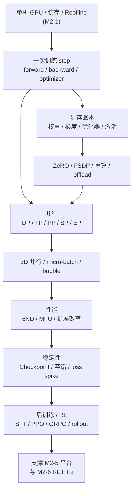
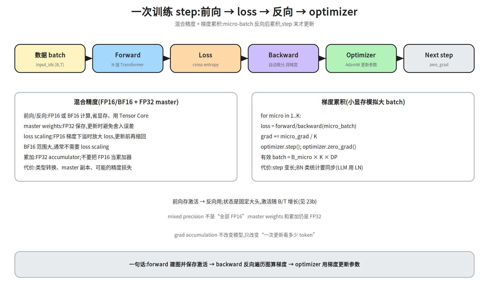
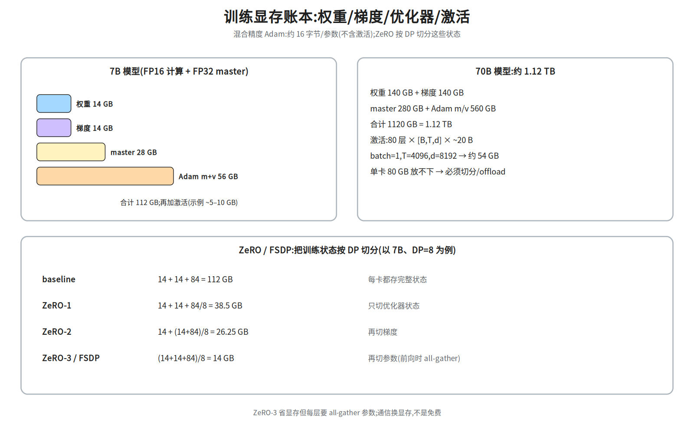
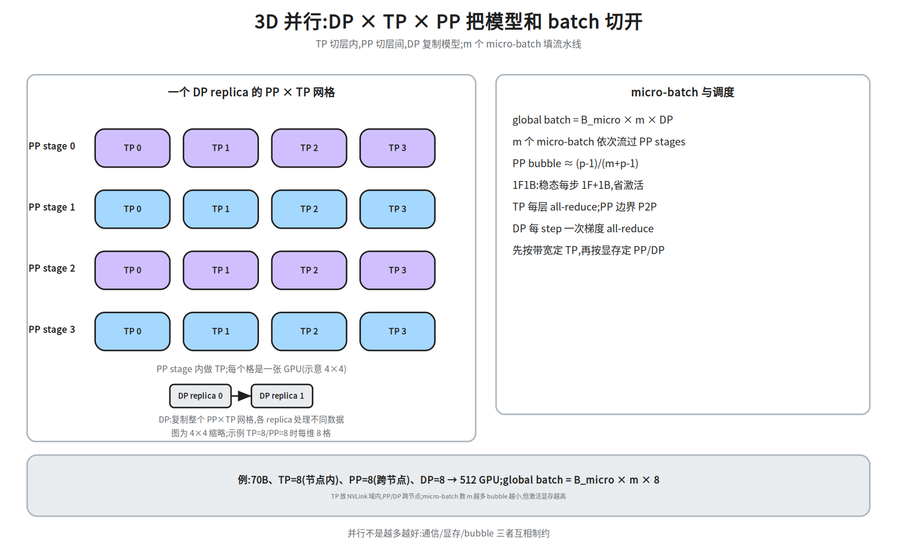
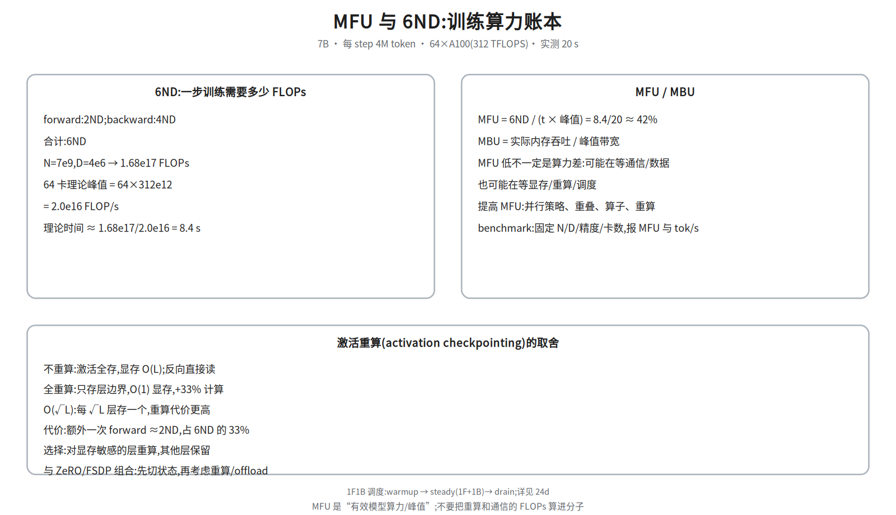
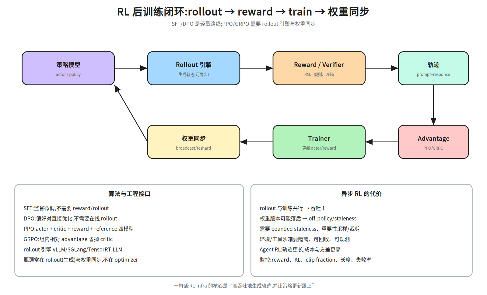

# M2-2 · 训练系统

> 本层回答：一次大模型训练 step 里，显存、通信、算力分别花在哪？
> 为什么 70B 模型需要 ZeRO/FSDP/3D 并行？MFU 怎么算、怎么提高？RL 后训练为什么需要另一套 Infra？

> **前置（按节）**：
> - §1–§3：`notes/21_single_node_ops.md §2–§6`（GPU/访存/Roofline/GEMM）——知道“搬数据贵”。
> - §4：**`notes/24_distributed_base.md §2、§6`**（集合通信、DP/TP/PP/EP 通信账本）。
>   没读 M2-4 也能看：本节会就地定义 DP/TP/PP/SP/EP 与 `S_act`。
> - §1、§7：`notes/04_architecture.md`（Block）、`notes/05_modern.md §5`（MoE）、
>   `notes/06_inference.md §1–2`（训练 vs 推理）。
>
> **建议路径（每次 45 分钟）**：
> ① §1–§3（step / 显存 / ZeRO）；② §4–§5（并行 / MFU）；
> ③ §6（稳定性 / Checkpoint）；④ §7–§8（后训练/RL / 框架选型）。
>
> **深度标注**：§1–§6 为必学；§7 后训练/RL 为必学（至少能讲清 rollout 与权重同步）；
> §8 框架选型为了解；芯片/编译器细节回到 M2-1/M2-6。

## 0. 依赖图（学习顺序）



> 根节点是“一次 step 要存什么、算什么”；汇点是：能对一个训练任务做
> **显存账本 + 通信账本 + MFU 账本**，并定位它卡在哪。

## 1. 一次训练 step：从数据到参数更新



一个 step 的五件事：

1. **Forward**：`input_ids [B,T]` → embedding → N 层 Transformer → logits `[B,T,V]`；
   前向会保存反向需要的**激活**（每层的输入/中间量）；状态是固定大头，激活随 B/T 增长。
2. **Loss**：交叉熵（或 RL 的 policy loss）→ 一个标量。
3. **Backward**：从 loss 反向遍历计算图，得到每个参数的梯度；链式法则 + 自动微分。

> 显存直觉：**权重/梯度/优化器状态是固定大头**（约 16 字节/参数），**激活随 `B·T` 增长**；
> 小 batch 时状态主导，大 batch/长序列时激活才成为大头。
4. **Optimizer**：AdamW/Adam 用梯度更新参数（含动量、方差、weight decay）。
5. **zero_grad**：清空梯度，进入下一步。

**关键账本**：前向的 FLOPs 约 `2ND`，反向约 `4ND`（对输入/激活 + 对权重各 2ND），
合计 `6ND`（`N`=参数量，`D`=token 数）。这就是 MFU 的分子（见 §5）。

### 1.1 混合精度与 loss scaling

- **计算用 FP16/BF16**：省显存、用 Tensor Core；累加用 **FP32**（不要 FP16 累加）。
- **master weights 用 FP32**：更新参数时避免“小梯度加到大权重上被舍入掉”。
- **FP16 需要 loss scaling**：梯度太小会下溢成 0；先把 loss 乘 `2^k`，更新前再除回去。
  BF16 指数范围与 FP32 接近，通常不需要。
- **代价**：类型转换、master 副本、可能的精度损失；FP8 还要 per-tensor/per-block scaling。

> 常见误解：“混合精度 = 全部 FP16”。实际是 **FP16/BF16 计算 + FP32 master + FP32 累加**；
> 三者缺一不可。

### 1.2 梯度累积

显存不够大 batch 时，把 `K` 个 micro-batch 的梯度累加，再 `optimizer.step()`：

```
for micro in 1..K:
    loss = forward/backward(micro_batch)
    grad += micro_grad / K
optimizer.step(); optimizer.zero_grad()
```

- 有效 batch = `B_micro × K × DP`；
- 代价：step 变长；BatchNorm 类统计要同步（LLM 用 LayerNorm，无此问题）；
- 与梯度检查点/ZeRO 组合时，注意累积的梯度仍在显存里。

## 2. 显存账本：训练为什么这么吃显存



### 2.1 四类显存

| 类别 | 内容 | 量级（每参数） |
|---|---|---:|
| 权重 | FP16/BF16 参数 | 2 B |
| 梯度 | 与权重同精度 | 2 B |
| 优化器状态 | FP32 master + Adam m + v | 4 + 4 + 4 = 12 B |
| 激活 | 前向保存、反向使用 | 与 `B·T·d_model·L` 成正比 |

> 混合精度 Adam 的“状态”约 **16 字节/参数**（2+2+4+4+4），不含激活和工作区。
> 注意符号：`B` 在形状里是 batch，在容量里是字节；本文容量统一写“字节”，避免一符三义。
> 7B → `7e9×16 B=112 GB`；70B → `1.12 TB`。单卡 80 GB 放不下 7B 的完整训练状态，
> 70B 更必须切分。

### 2.2 7B / 70B 例子

- **7B**：权重 14 GB、梯度 14 GB、master 28 GB、Adam 56 GB = **112 GB**；
  再加激活（`B=1,T=2048` 约 5–10 GB）和工作区。
- **70B**：权重 140 GB、梯度 140 GB、master 280 GB、Adam 560 GB = **1.12 TB**；
  激活（`B=1,T=4096,d=8192`，80 层，约 20 B/元素）≈ **54 GB**。

> 激活的精确值取决于实现（是否重算、是否融合、是否存 attention 中间量）。
> 面试时说“约 20 B/元素 × 层数 × B·T·d”并注明是量级，比背一个绝对数安全。

### 2.3 显存总账

```
总显存 ≈ 权重 + 梯度 + 优化器状态 + 激活 + 工作区/碎片
```

优化顺序：先切**优化器状态/梯度/参数**（ZeRO/FSDP），再考虑**激活重算**，
最后才是 **offload**（CPU/NVMe，PCIe 带宽会成为新瓶颈）。

## 3. ZeRO / FSDP / 重算 / offload

### 3.1 ZeRO-1/2/3

以 7B、DP=8 为例（单位 GB）：

| 方案 | 每卡显存 | 切什么 |
|---|---:|---|
| baseline | `14+14+84=112` | 每卡完整状态 |
| ZeRO-1 | `14+14+84/8=38.5` | 只切优化器状态 |
| ZeRO-2 | `14+(14+84)/8=26.25` | 再切梯度 |
| ZeRO-3 / FSDP | `(14+14+84)/8=14` | 再切参数（前向时 all-gather） |

> **ZeRO 为什么省显存**：它把“每卡都存一份”的训练状态按 DP 组成分片；
> 计算时再通过 all-gather/reduce-scatter 拼回来。省的是**冗余副本**，不是模型本身。
> 代价是通信：ZeRO-3 每层前向都要 all-gather 参数，通信量随层数增长。

### 3.2 FSDP / DTensor

- **FSDP**：PyTorch 的 fully sharded data parallel，思想接近 ZeRO-3；
  参数/梯度/优化器状态分片，前向 all-gather、反向 reduce-scatter。
- **DTensor**：PyTorch 的张量并行抽象，用 `DeviceMesh` 描述 DP/TP/PP 的拓扑，
  让“切分”成为张量布局的一部分。
- **选型**：Megatron 适合极致 TP/PP；DeepSpeed 适合 ZeRO/offload；FSDP 适合 PyTorch 原生生态。

### 3.3 激活重算（activation checkpointing）

- 不重算：激活全存，显存 `O(L)`；
- 全重算（每层重算、只存层输入）：显存 `O(1)`，代价约 `+33%` 计算（多一次 forward）；
- 选择性/`√L` checkpoint：每 `√L` 层存一个，显存 `O(√L)`，重算代价高于 `+33%`；
- 不要把 `O(√L)` 和 `+33%` 无条件绑定：`+33%` 对应“每层都重算”的 `O(1)` 方案；
- 选择：对显存敏感的层重算，其他层保留；与 ZeRO 组合时先切状态，再考虑重算/offload。

> 面试常问“重算值不值”：如果 GPU 是 compute-bound 且显存不够，重算用算力换显存，通常值；
> 如果已经 memory-bound 或通信瓶颈，重算可能只增加时间。

### 3.4 offload

- **CPU offload**：把优化器状态/参数放到 CPU 内存，PCIe 传输；
- **NVMe offload**：更慢，但容量大；
- 代价：PCIe 带宽（64 GB/s 双向）远低于 HBM；offload 后往往变成 PCIe-bound。
- 适用：显存极度紧张、吞吐不敏感；不建议作为第一选择。

## 4. 并行：DP / TP / PP / SP / EP



> 通信量的完整推导见 **M2-4 §6**；这里只记结论与放置。

| 并行 | 切什么 | 通信 | 放哪 |
|---|---|---|---|
| **DP** | batch/数据 | 每 step 梯度 all-reduce | 跨节点 |
| **TP** | 层内（注意力头/FFN） | 每层 2 次 all-reduce | NVLink 域内，通常 ≤8 |
| **PP** | 层间（stage） | stage 边界 P2P 激活 | 跨节点；bubble |
| **SP** | 序列维（LayerNorm/dropout） | all-gather/reduce-scatter | 与 TP 同域 |
| **EP** | MoE 专家 | 2 次 all-to-all | 高带宽 rail |

- **3D = DP × TP × PP**：先按带宽定 TP（节点内），再按显存定 PP/DP。
- **micro-batch**：`global batch = B_micro × m × DP`；**micro-batch 数 `m` 越大** bubble 越小，但激活显存越高（不是“单块 batch 越大”）。
- **bubble**：`(p-1)/(m+p-1)`；`p=4,m=4` 时 42.9%，`m=8` 时 27.3%。
- **1F1B**：稳态每步一前一后，未完成 micro-batch 从 `O(m)` 降到 `O(p)`。

> **AllGather / ReduceScatter 的量级**：每 rank 约 `S(N-1)/N`（`S` 为完整张量、`N` 为组大小）；
> FSDP 的参数 all-gather / 梯度 reduce-scatter 都用它，总通信约 `2S`。
> **SP（序列并行）**：把 `T` 维切到 TP 组，LayerNorm/dropout 在本地算，前后用 all-gather/
> reduce-scatter 拼回；它不改变模型，只降低单卡激活，常和 TP 一起用。

**70B 3D 例子**（TP=8、PP=8、DP=8、B=1、T=4096、d=8192、FP16）：

```
S_act = 1×4096×8192×2 ≈ 67 MB          # 每 rank 激活
S_grad = 140 GB / (TP×PP) = 140/64 ≈ 2.2 GB  # 每 rank 梯度分片
TP:PP=8 → 每 stage 10 层;前向 10×4×S_act ≈ 2.7 GB / rank / step
DP:all-reduce 每 rank 2×S_grad ≈ 4.4 GB / step
PP:每个 micro-batch 传 S_act=67 MB 激活;主要成本是 bubble
```

> 先分片再 all-reduce：DP 的 `S_grad` 是分片后的梯度，不是完整 140 GB；
> TP 只算本 stage 的 10 层，不是 80 层。面试时这两步最容易多乘。

**同一 3D 配置的显存账本**：模型状态 1.12 TB 先按 `TP×PP=64` 分片，
每 GPU 约 `1.12 TB / 64 ≈ 17.5 GB`（未计 DP 复制；DP 每个 replica 都有一份 TP×PP 分片）。
再加激活/工作区；如果单卡 80 GB 仍不够，再上 ZeRO/重算/offload。

## 5. 性能：6ND、MFU、MBU、扩展效率



### 5.1 每步 FLOPs = 6ND

```
forward: 2ND
backward: 4ND(对激活 2ND + 对权重 2ND)
合计: 6ND
```

`N`=参数量，`D`=一个 step 处理的 token 数（`B×T×grad_accum×DP`）。

### 5.2 MFU / MBU

```
MFU = 6ND / (step_time × GPU 峰值 FLOP/s)
MBU = 实际内存吞吐 / 峰值带宽
```

例：7B、`D=4M`、64×A100（312 TFLOPS）、实测 20 s：

```
6ND = 6×7e9×4e6 = 1.68e17 FLOPs
峰值 = 64×312e12 = 2.0e16 FLOP/s
理论 = 8.4 s → MFU = 8.4/20 ≈ 42%
```

> MFU 是“有效模型算力 / 峰值”，**不含**重算/通信的额外 FLOPs；
> 不要把“GPU 利用率 90%”当成 MFU 90%——利用率高可能只是在等数据/通信。

### 5.3 扩展效率与 benchmark

- **弱扩展**：每卡 batch 固定，卡数翻倍，吞吐应线性增长；
- **强扩展**：总 batch 固定，卡数翻倍，单卡工作量减半，通信占比上升；
- **扩展效率** = 实际吞吐 / 线性外推吞吐；TP/PP 的通信和 bubble 会拉低它。
- **benchmark 口径**：固定模型、序列长度、精度、卡数、batch、是否重算；
  报 `tokens/s`、`MFU`、`step time`，并注明是否含通信/Checkpoint。

### 5.4 从 35% MFU 到 50%：先 profile 再改

1. **看时间线**：Nsight Systems 看 GPU 空转、NCCL 等待、数据加载 gap；
2. **找 Top Kernel**：GEMM/Attention/elementwise；算 Roofline 判断 compute/memory-bound；
3. **通信重叠**：DP 分桶、TP 与下一层 GEMM 重叠、PP 的 P2P；看 NCCL 是否与计算并发；
4. **算子效率**：FlashAttention、融合、FP8/BF16、Tensor Core 对齐；
5. **显存/重算**：是否因重算/offload 增加了额外开销；先切状态再重算；
6. **数据**：dataloader 是否成为 gap；本地 cache/prefetch/大 shard。

例：以理想 step time `8.4 s` 为分母，MFU 35% → 实际 `8.4/0.35=24 s`；
MFU 50% → `8.4/0.50=16.8 s`。同样卡数下 step time 降低 30%，吞吐约提升 `24/16.8≈1.43×`。
每一刀优化都要用同一个 benchmark 口径验证，避免“数字好看但不可复现”。

### 5.5 重算的取舍

- 省显存：激活从 `O(L)` 降到 `O(√L)`/`O(1)`；
- 多算：一次额外 forward，约 +33% FLOPs；
- 结论：显存不够且 compute-bound 时值；已经 memory/communication-bound 时要谨慎。

## 6. 稳定性：长稳训练比“跑通”难

### 6.1 数据管线与 packing

- **数据配比/质量**：脏数据、重复、长度分布会直接影响 loss；
- **packing**：把短样本拼到固定长度，减少 padding；注意 attention mask 和样本边界；
- **shuffle/分片**：每个 rank 读不同 shard；保证 epoch 间可复现；
- **尾延迟**：一个慢 reader 拖住整个同步 step；用本地 cache、prefetch、足够大的 shard。

### 6.2 Checkpoint 与容错

- Checkpoint 内容：权重、优化器状态、学习率/step、数据 loader 状态、RNG；
- 分片写、本地 NVMe 暂存、异步；间隔用 `τ≈sqrt(2·C·MTBF)` 估算（见 M2-4 §5.2）；
- **弹性训练**：节点故障后重新组网、从 Checkpoint 恢复；代价是复杂度和性能波动；
- **straggler**：慢卡/慢 reader 拖住同步 step；用每卡 step time、NCCL 时间线定位；
- **NCCL 超时**：先用 `NCCL_DEBUG=INFO` 定位，不要只靠调大 timeout“解决”。

### 6.3 loss spike / NaN 排查

按“数据 → 精度 → 通信 → 优化器 → 框架”分层：

1. **数据**：某个 shard 有脏样本/重复/长度异常？固定数据重跑能否复现？
2. **精度**：FP16 溢出/loss scale 异常？换 BF16 或关闭混合精度对比；
3. **通信**：梯度 all-reduce 是否出现 NaN/Inf？单卡 vs 多卡对比；
4. **优化器**：学习率、weight decay、Adam eps；梯度裁剪是否生效；
5. **框架/模型**：新代码、新算子、新并行切分；用最小配置二分。

> 处理原则：先**保住可复现**（固定 seed、数据、配置），再二分；不要一上来重启整个集群。

## 7. 后训练 / RL：另一套 Infra



### 7.1 四条路线

| 路线 | 需要什么 | 特点 |
|---|---|---|
| SFT | 标注数据、监督 loss | 最简单，不需要 reward/rollout |
| DPO | 偏好对 `(chosen, rejected)` | 不需要在线 rollout，训练稳定 |
| PPO | actor + critic + reward + reference | 需要 rollout、reward、优势估计 |
| GRPO | 组内相对 advantage | 省掉 critic，仍需 rollout |

### 7.2 rollout 引擎与权重同步

- **rollout**：用当前策略生成轨迹（prompt → response），是 RL 的“数据生产线”；
  常用 vLLM/SGLang/TensorRT-LLM 做高吞吐生成。
- **reward**：RM、规则/verifier、代码执行沙箱、工具环境；要可扩展、可观测。
- **权重同步**：训练侧更新后，把新权重推给 rollout 引擎（broadcast/reshard/增量）；
  同步太慢会成为瓶颈。
- **异步 RL**：rollout 与训练并行，吞吐↑，但权重版本落后 → off-policy/staleness；
  需要 bounded staleness、重要性采样/裁剪。
- **Agent RL**：轨迹更长、工具调用/沙箱、reward 稀疏；成本与方差更高。

> 面试问“RL Infra 瓶颈在哪”：先在 **rollout 吞吐、reward 延迟、权重同步、训练利用率**
> 四处量化，再决定加卡/异步/蒸馏；不要默认“RL 一定慢在训练”。

**一段 RL step 的时间账本**：`t_step ≈ t_rollout + t_reward + t_train + t_sync`。
例：rollout 60%、reward 15%、train 20%、权重同步 5% → 优化 rollout 的收益最大；
但异步 rollout 会引入 staleness，要一起看 reward/KL/长度。

### 7.3 训练框架选型

| 框架/栈 | 强项 | 代价 |
|---|---|---|
| Megatron-LM | TP/PP/EP 极致性能、3D 并行 | 配置复杂、和 HuggingFace 生态有距离 |
| DeepSpeed | ZeRO/offload、易用 | 极致性能不如 Megatron |
| FSDP/DTensor | PyTorch 原生、组合灵活 | 需要自己搭并行策略 |
| JAX/Pathways | XLA 编译、TPU 生态 | 生态与人才门槛 |

> 选型看团队：研究迭代快选 PyTorch + FSDP/DeepSpeed；追求极致吞吐选 Megatron；
> TPU/自研芯片看 JAX/XLA。不要只看 benchmark 数字。

### 7.4 读源码找优化点（Q5）

面试常给一段 PyTorch/DeepSpeed 代码问“哪里能优化”。按四层看：

1. **Autograd/图**：是否有不必要的 `retain_graph`、重复 forward、Python 循环；
   能否用 `torch.compile`/融合减少 kernel launch。
2. **FSDP/ZeRO**：all-gather/reduce-scatter 的 bucket 是否够大、是否与计算重叠；
   参数分片是否导致每层都 all-gather；`sharding_strategy` 是否匹配模型。
3. **数据/显存**：`pin_memory`、`non_blocking`、梯度累积、activation checkpointing；
   是否有 `item()`/`.cpu()` 造成同步。
4. **通信**：NCCL 调用是否在关键路径；能否 bucket/异步；TP/PP 的切分是否让通信跨节点。

> 答法：先说“这段代码在干什么”，再给“瓶颈证据（profile/公式）”，最后给“改动 + 验证指标”。
> 不要一上来就说“换 FlashAttention”。

## 8. 面试要点

1. **ZeRO 为什么省显存？** → 把权重/梯度/优化器状态按 DP 分片，省的是冗余副本；
   ZeRO-1/2/3 分别切优化器、梯度、参数；代价是 all-gather/reduce-scatter 通信。
2. **TP 和 DP 的区别？** → DP 复制模型、切数据，每步同步梯度；TP 切层内，每层都通信，
   适合 NVLink 域内。
3. **PP 的 bubble 怎么算？** → `(p-1)/(m+p-1)`；增大 micro-batch 数可降低 bubble，
   但激活显存上升；1F1B 省激活不改变 bubble。
4. **MFU 怎么算？** → `6ND/(step_time×峰值)`；不含重算/通信额外 FLOPs；
   低 MFU 要分通信/数据/显存/算子排查。
5. **激活重算值不值？** → 用算力换显存；compute-bound 且显存不够时值，
   memory/communication-bound 时可能只增加时间。
6. **7B/70B 训练显存怎么估？** → 16 字节/参数（混合精度 Adam）+ 激活；
   7B≈112 GB，70B≈1.12 TB；再加工作区/碎片。
7. **loss spike 怎么排查？** → 数据/精度/通信/优化器/框架五层，固定 seed 二分，
   先保住可复现。
8. **RL Infra 的瓶颈？** → rollout 吞吐、reward 延迟、权重同步、训练利用率；
   异步 RL 用 staleness/重要性采样换吞吐。
9. **3D 并行怎么放？** → TP 节点内（NVLink），PP/DP 跨节点；先按带宽定 TP，
   再按显存定 PP/DP。
10. **Checkpoint 怎么设计？** → 分片、异步、本地 NVMe 暂存、版本一致；
    间隔用 `sqrt(2·C·MTBF)` 估；RTO 包括检测/调度/加载。

## 9. 常见坑

- **只算权重，不算优化器状态**：7B 的 Adam 状态就有 84 GB。
- **以为 ZeRO-3 免费**：每层 all-gather，通信换显存。
- **把 TP 扩到跨节点**：每层 all-reduce 会被网络拖垮。
- **忽略 bubble**：PP 的 micro-batch 太少，GPU 大量空转。
- **用 GPU 利用率冒充 MFU**：利用率高不等于有效算力高。
- **重算当万能**：已经 memory-bound 时，重算只增加时间。
- **Checkpoint 只存权重**：不存优化器/step/RNG，恢复后训练不连续。
- **RL 只看训练卡**：rollout/reward/权重同步才是常见瓶颈。
- **benchmark 口径不一致**：不同精度/序列长度/是否重算的数字不可比。

## 动手清单（60–90 分钟）

1. **显存账本**：写一个函数，输入 `N, bytes_per_param, DP, TP, PP`，输出
   baseline/ZeRO-1/2/3 的每卡显存；用 7B/70B 验证 112 GB/1.12 TB。
2. **MFU 计算**：给定 `N, D, GPU 数, 峰值, step_time`，算 6ND、理论时间、MFU；
   扫 `D` 与卡数，画 MFU/吞吐曲线。
3. **3D 切分**：用 512 GPU 设计 TP/PP/DP，算每 rank 的 `S_act`、TP 通信量、DP 梯度通信量；
   解释为什么 TP 不能跨节点。
4. **ZeRO 配置**：用 DeepSpeed/FSDP 跑一个小模型（或读 config），对比 ZeRO-1/2/3
   的显存与 step time；记录通信开销。
5. **RL 闭环（可选）**：用一个小模型 + 规则 reward 跑 GRPO/PPO 的 toy loop，
   记录 rollout 时间、reward 时间、训练时间、权重同步时间。

验收标准：能对“这个训练任务为什么 OOM / MFU 低 / step 慢”分别给出
**账本 + 一个可验证实验**，而不是只报现象。

## 相关图

- `23a_train_step` — 一次 step：forward/loss/backward/optimizer + 混合精度/梯度累积；
- `23b_memory_zero` — 7B/70B 显存账本 + ZeRO-1/2/3；
- `23c_3d_parallel` — DP×TP×PP 映射 + micro-batch；
- `23d_mfu` — 6ND、MFU/MBU、激活重算；
- `23e_rl_loop` — rollout → reward → train → 权重同步；
- `24d_pipeline` — GPipe/1F1B/bubble（M2-4）。

## 下一步

- **M2-5 平台与稳定性**：把训练任务、Checkpoint、SLO、on-call 上升为平台能力。
- **M2-6 前沿与端侧**：RL Infra/Agent RL、长上下文训练、异构芯片。
- 回到 **M2-4** 补通信/拓扑细节；回到 **M2-1** 补算子/Profiling 细节。
