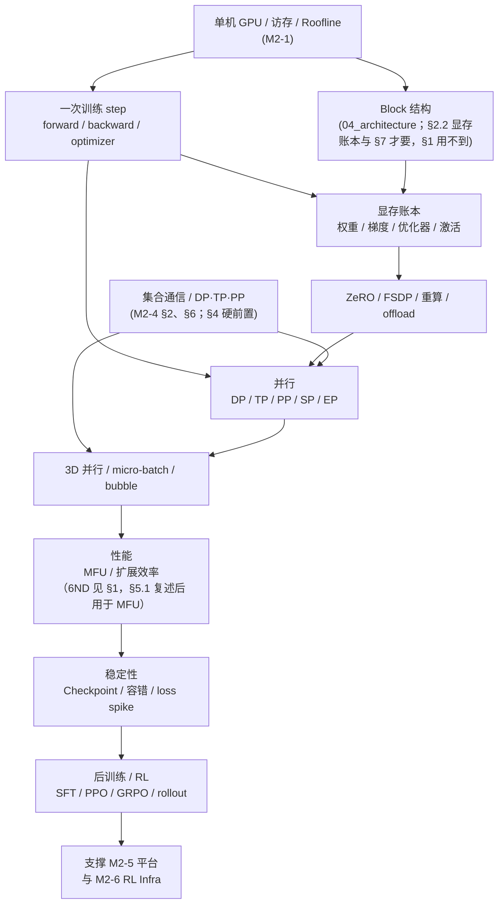

# M2-2 · 训练系统

> 本层回答：一次大模型训练 step 里，显存、通信、算力分别花在哪？
> 为什么 70B 模型需要 ZeRO/FSDP/3D 并行？MFU 怎么算、怎么提高？RL 后训练为什么需要另一套 Infra？

> **前置（按节）**：
> - §1–§3：`notes/21_single_node_ops.md §2–§6`（GPU/访存/Roofline/GEMM）——知道“搬数据贵”;**§2.2 另需 `notes/04_architecture.md` 的 Block 结构（即依赖图里的 A2 节点；§1 本身用不到，拆 QKV 头数/`d_ff` 时才要）**。
> - §4：**`notes/24_distributed_base.md §2、§6`**（集合通信、DP/TP/PP/EP 通信账本）。
>   没读 M2-4 也能看：本节会就地定义 DP/TP/PP/SP/EP 与 `S_act`；但 70B 例子里的通信系数（`10×4×S_act`、DP `2×S_grad`、bubble）只给结论；**其中 `4 = 每层 2 次 all-reduce × 每次 2S_act`、DP 的 `(N−1)/N` 系数、以及 14% 的上界偏差 §4 已就地交代、不必外读**，只有 ring 的完整推导要读 M2-4 §2.2「ring all-reduce：两阶段、通信量」，bubble 的 `(p−1)/(m+p−1)` 来源要读 M2-4 §6.1。

>   - EP 的前置（只有 §4 的 EP 行用到，§1/§7 不需要）：`notes/05_modern.md §5`（只需“专家常分在不同设备”这一句；top-k 路由/capacity factor/共享专家在正文没再用到，可跳过）+ `notes/21_single_node_ops.md §7` 第 4 条（该条全文只有一句：AllToAll 在 EP 时把 token 跨 GPU 发送；专家如何分组、放到哪些 rank、与 capacity factor 的关系该条没有）。
> - §2.2、§7：`notes/04_architecture.md`（Block）、
>   `notes/06_inference.md §1–2`（训练 vs 推理的差异，§7 只借用这一点；该篇本身没有 rollout 内容，PPO/GRPO 的 `advantage`/`critic`/`reference`（连 KL 与 β）在 §7.1 就地定义，`reward` 与 RM 在 §7.2 展开，`actor` 正文只写 π_θ、不再单列定义，不必为 §7 先读它）。
>
> **建议路径（每次 45 分钟）**：
> ① §1–§3（step / 显存 / ZeRO）；② §4–§5（并行 / MFU）；
> ③ §6（稳定性 / Checkpoint）；④ §7（后训练/RL；框架选型在 §7.3）。
>
> **深度标注**：§1–§6 为必学；§7 后训练/RL 为必学（至少能讲清 rollout 与权重同步）；
> §7.3 框架选型为了解；§8 是面试要点，用来自查；芯片/编译器细节回到 M2-1/M2-6。

## 0. 依赖图（学习顺序）



> 根节点是“一次 step 要存什么、算什么”；汇点是：能对一个训练任务做
> **显存账本 + 通信账本 + MFU 账本**，并定位它卡在哪。

> **M2-4 为什么也在图上**：集合通信与 DP/TP/PP 账本（M2-4 §2、§6）是 §4 的硬前置，所以单列 K 节点、指向并行两节;§6.2 只借用 M2-4 §5.2 的 τ 公式做对照（那边只有公式、没有推导），不必为此先读全篇。

## 1. 一次训练 step：从数据到参数更新


一个 step 的五件事：

1. **Forward**：`input_ids [B,T]` → embedding → N 层 Transformer → logits `[B,T,V]`；
   前向会保存反向需要的**激活**（每层的输入/中间量）；状态是固定大头，激活随 B/T 增长。
2. **Loss**：交叉熵（或 RL 的 policy loss）→ 一个标量。
3. **Backward**：从 loss 反向遍历计算图，得到每个参数的梯度；链式法则 + 自动微分。

> 显存直觉：**权重/梯度/优化器状态是固定大头**（约 16 字节/参数），**激活随 `B·T` 增长**；
> 小 batch 时状态主导，大 batch/长序列时激活才成为大头。
4. **Optimizer**：AdamW/Adam 用梯度更新参数（含动量、方差、weight decay）。
5. **zero_grad**：清空梯度，进入下一步。

**关键账本**：前向的 FLOPs 约 `2ND`，反向约 `4ND`（对输入/激活 + 对权重各 2ND），
合计 `6ND`（`N`=参数量，`D`=token 数）。这就是 MFU 的分子（见 §5）。

### 1.1 混合精度与 loss scaling

- **计算用 FP16/BF16**：省显存、用 Tensor Core；累加用 **FP32**（不要 FP16 累加）。
- **master weights 用 FP32**：更新参数时避免“小梯度加到大权重上被舍入掉”。
- **FP16 需要 loss scaling**：梯度太小会下溢成 0；先把 loss 乘 `2^k`，更新前再除回去。
  BF16 指数范围与 FP32 接近，通常不需要。
- **代价**：类型转换、master 副本、可能的精度损失；FP8 还要 per-tensor/per-block scaling。

> 常见误解：“混合精度 = 全部 FP16”。实际是 **FP16/BF16 计算 + FP32 master + FP32 累加**；
> 三者缺一不可。

### 1.2 梯度累积

显存不够大 batch 时，把 `K` 个 micro-batch 的梯度累加，再 `optimizer.step()`：

```
for micro in 1..K:
    loss = forward/backward(micro_batch)
    grad += micro_grad / K
optimizer.step(); optimizer.zero_grad()
```

- 有效 batch = `B_micro × K × DP`（这里的 `K` 就是 §4 的 `m`、§5.1 的 `grad_accum`，同一个量;`DP` 是数据并行的副本数，§4 才正式定义，此处先按“几份数据各跑一份模型”理解）；
- 代价：step 变长；BatchNorm 类统计要同步（LLM 用 LayerNorm，无此问题）；
- 与梯度检查点/ZeRO 组合时，注意累积的梯度仍在显存里。

## 2. 显存账本：训练为什么这么吃显存


### 2.1 四类显存

| 类别 | 内容 | 量级（每参数） |
|---|---|---:|
| 权重 | FP16/BF16 参数 | 2 B |
| 梯度 | 与权重同精度 | 2 B |
| 优化器状态 | FP32 master + Adam m + v | 4 + 4 + 4 = 12 B |
| 激活 | 前向保存、反向使用 | 线性项 `∝ B·T·d_model·L`；另有 T² 分数矩阵 `∝ L·B·h·T²`（式中的 `L` 就是层数，已含“每层一份”，别再乘一次；本行两个口径都列了，具体数见 §2.2） |

> 混合精度 Adam 的“状态”约 **16 字节/参数**（2+2+4+4+4），不含激活和工作区。
> **“状态”一词在本文指两个范围，先分清**：**训练状态** = 权重 + 梯度 + 优化器 = `2+2+12` = **16 B/参数**（§1 的显存直觉、§2.3、§8 第 6 问用它，7B = `7e9×16` = 112 GB）；**优化器状态** = master + m + v = **12 B/参数**（上表第 3 行、§3.1 的 ZeRO 账本、§9 的“84 GB”用它）。两者差的正是权重与梯度的 4 B，不是矛盾；看到“状态”先看有没有带“优化器”三个字。
> 注意符号：`B` 在形状里是 batch（如 `B·T·d`）；容量里的字节同样写 `B`（上表的 2 B、12 B 与下面的 16 B/参数 都是字节）。判别有三条：**`B` 在单位位置（数字后、或 `/元素`、`/参数` 之前）是 byte；在形状/乘积里（`B·T·d`、`B=1`）是 batch；紧跟整数且指模型规模时（`7B`、`70B`）是 billion（十亿参数），既不是 byte 也不是 batch**——所以“20 B/元素”“16 B/参数”按字节读，“`B·T·d`”按 batch 读。
> 7B → `7e9×16 B=112 GB`；70B → `1.12 TB`。单卡 80 GB 放不下 7B 的完整训练状态，
> 70B 更必须切分。

### 2.2 7B / 70B 例子

- **7B**：权重 14 GB、梯度 14 GB、master 28 GB、Adam 56 GB = **112 GB**；
**先看口径**：本条按 **20 B/元素** 计 —— 即 `10d` 个 `d`-张量 × 2 B，逐项来源见本节“20 B/元素 从哪来”段，是 dense MHA 上界（7B 按自身配置复算 ≈18 B，见本节末括号）；且 **14 GB 含 T² 分数矩阵**、70B 的 44 GB 不含，两者不是同一口径（详见下框）；后文说的“清单”就是这 `10d` 个张量。
  再加激活（`B=1,T=2048`、d=4096、32 层。三条分开算：① **线性项**：每层 `B·T·d`≈8.4 M 元素，按 20 B/元素 ≈168 MB/层 → 32 层 ≈5.4 GB（20 B 的逐项来源见本节“20 B/元素 从哪来”段）;② QKV 与 attention 输出已含在这 20 B 里，不能重复加;③ **没进清单的两项** = T² 分数矩阵（32 层×32 头×2048²×2 B≈8.6 GB，加上它总数 ≈14 GB）+ 最后一层 logits `[B,T,V]` 及 CE/softmax 中间量（`B=1,T=2048,V=32k` 约 131 MB，占 5.4 GB 的约 2.4%、占 14 GB 的约 0.9%）。**14 GB 是含分数矩阵的口径**（70B 的 44 GB 不含，见下框）;只把序列翻倍（T=4096）而不加分数矩阵是 ≈10.8 GB；全重算只存层输入则降到 ≈0.5 GB）和工作区。
- **70B**：权重 140 GB、梯度 140 GB、master 280 GB、Adam 560 GB = **1.12 TB**；
  激活（`B=1,T=4096,d=8192`，80 层，按 GQA-8 实配 ≈16.5 B/元素）≈ **44 GB**。
> **14 GB 与 44 GB 不是同一口径**（本节最容易算崩的一处）：14 GB = 20 B/元素 + T² 分数矩阵；44 GB = 只有激活线性项（70B 按 GQA-8 的 16.5 B/元素）。照 7B 刚立的规则给 70B 补上分数矩阵（80 层×64 头×4096²×2 B≈172 GB），总数应是 ≈216 GB，不是 44 GB。两个数都保留是因为回答不同问题：**不用 FlashAttention**（分数矩阵落 HBM）看上界 216 GB；**用 FlashAttention**（分块计算、分数矩阵不落 HBM）看 44 GB。§2.3 的显存总账与 §8 第 6 问统一按「状态 + 线性激活项」这一个口径落地：70B ≈1.12 TB + 44 GB ≈1.16 TB、7B ≈112 GB + 5.4 GB ≈117 GB（7B 按实配 ≈4.8 GB 时总数仍 ≈117 GB，报整百即可）；要报上界就两个例子同时加分数矩阵，别一边加一边不加。
> **20 B/元素 从哪来**（否则 168 MB/层、5.4 GB、44 GB、0.55 GB/层 都成了背下来的数；**先声明口径：下面这串 `8.5d`/`10d`/20 B 是 QKV 按 dense MHA 的 `3d`、`d_ff` 按 70B 实配 `3.5d` 的上界口径，不是 7B 的实配**——7B 照自己配置（32/32 头、`d_ff=2.69d`）复算是 `9.2d`≈18 B/元素、≈150 MB/层、≈4.8 GB，详见本节末那段括号，两套口径别相加）：按“bf16 存全部中间量、只让 SwiGLU 的 gate/up 在反向重算”（严格连 gate/up 也存是 `13.5d`≈27 B，见下条）逐项数每层 `d` 大小的张量——attention 输入 `d` + QKV `3d` + attention 输出 `d` + SwiGLU 中间量 `3.5d`，四个大张量 = `8.5d`（**QKV 的 `3d` 是 dense MHA 口径，如 32/32 头的 7B**；70B 是 GQA-8、K=V=`0.125d`，故 QKV=`1.25d`、四个大张量=`6.75d`，见下）；再加残差相加、LayerNorm 输出、dropout mask 等零碎（约 `1.5d` 个 `d`-张量，即 ≈**3 B/元素**;逐项：两个 dropout mask 各 1 个 `d` 张量、物化成 bf16 按 **2 B/元素**计（反向要与梯度相乘，主流实现按激活同精度存，不是 bool 的 1 B），共 4 B;残差相加与 LayerNorm 输出在主流实现里复用上层张量、不单独落盘，抵掉约 1 B，净增 ≈3 B = `1.5d`。`1.5d` 取工程经验值，17 B + 3 B 正好 20 B，别当成精确到小数的定值），合计 ≈ `10d` 张量（70B 按 GQA-8 是 `d+1.25d+d+3.5d+1.5d=8.25d`，即 `16.5 B/元素`）。
（**这里的 `3.5d` 是 70B 的配置值**：`d_ff/d=28672/8192=3.5`，不是 SwiGLU 的结构常数。7B 的 `d_ff=11008≈2.69d`（且 7B 是 32/32 头 MHA、QKV 就是 `3d`，不像 70B 的 GQA-8 只有 `1.25d`），按同口径应是 `d+3d+d+2.69d=7.69d`，加零碎 `1.5d`≈`9.2d`≈**18 B/元素**。所以下面 7B 的 168 MB/层、5.4 GB 是沿用 70B 比例的上界值，按 7B 实配应低约一成（≈150 MB/层、≈4.8 GB），量级不变。）每个 `B·T·d` 槽位摊 `10` 个 `d`-张量、逐个元素 × 2 B(bf16) = **20 B/元素**（70B 的 GQA-8 摊 `8.25` 个 → `16.5 B/元素`）（“元素”指一个 `B·T·d` 标量位置，不是 token，也不是整层）。代入:7B 一层 `2048×4096`≈8.4 M 元素 ×20 B≈168 MB;70B 一层 `4096×8192`≈33.5 M 元素 ×16.5 B≈0.55 GB，×80≈44 GB（若沿用 dense MHA 的 20 B 上界则是 0.67 GB/层、80 层≈54 GB，两者只差这一个口径）。只数那四个大张量、按 dense MHA 口径会得 17 B（即本节 `8.5d` 的枚举；70B 的 GQA-8 口径是 `6.75d`=13.5 B），20 B 是把零碎也算上的工程口径，差 18%、不影响量级;而 20 B → 2 B（checkpoint 只存层输入）才是 §3.3/§5.5 说的那个十倍。

> **为什么 SwiGLU 只记 `3.5d`**：gate 与 up 是两个 `d_ff` 张量（各 `3.5d`），反向算 σ′ 要 pre-activation，严格逐项存应是 `7d` → 大张量 `d+1.25d+d+7d=10.25d`、加零碎 `1.5d` 得 `11.75d`（**≈23.5 B/元素**；沿用 dense MHA 的 `3d` 才是 `13.5d`≈27 B）;20 B 的口径是“gate/up 反向时重算、只存门控相乘后的 `3.5d` 乘积”，代价是多一次 FFN forward——16.5 B 与 23.5 B 差的就是这一条（20 B/27 B 是 dense MHA 口径），与 17 B→20 B 那 18% 的零碎不是一回事。

> 同词两义，先分清：此处及 §2.2/§3.3/§4/§5.5 的 checkpoint 是**激活重算的分段锚点**（只存每层输入、不存中间量）；§6.2「Checkpoint 与容错」说的是**训练存档**（权重/优化器/step/RNG）；§5.3「是否含 Checkpoint」指存盘时间是否计入 step time。两者不是一回事。

> 用 `notes/03_block.md §6`（GPT-3 量级那张表，不在文首前置清单里）的「一层参数 ≈12d²」核对:12×8192²×80 ≈ **6.4e10**，比 70B 少约 8%。这不是 d/L 写错，而是 12d² 是粗口径:LLaMA 式 70B 用 GQA（64 query 头 / 8 KV 头、d_head=128）:Q=`d²`、O=`d²`、K=V=`d×1024`=0.125d²，attention 合计 ≈**2.25d²**（对照 dense MHA 的 4d²；Q+O 本身就是 2d²，GQA 再省也降不到 2d² 以下）；SwiGLU 的 FFN 按 LLaMA-2 70B 的超参取三个 3.5d 矩阵 ≈10.5d²（3.5d=d_ff/d=28672/8192 是该模型的配置选择，不是 SwiGLU 的结构常数；结构口径按等参数量取 d_ff=8/3·d、三个矩阵≈8d²）。两项合计 `2.25+10.5=12.75d²`，即 `12.75×80×8192²≈6.85e10`，再加 embedding 与 **`lm_head`（输出投影：把 `d` 投到词表 `V`，参数 `V·d`）** 各 `V·d`≈2.6e8（V≈32k、两者不共享权重）≈0.52e9，得 ≈6.9e10——“70B”是名义值。后面所有账本都用 16 B/参数 × 70e9 = 1.12 TB，不受这个 8% 影响。

> 若按 `notes/05_modern.md §4`（同样不在文首前置清单里）的「d_ff 取 8/3·d（≈2.67d，正是 4d 的 2/3，对应 ReLU-FFN 的 2·4d²=8d²）」的等参数口径复算，会得 `8d²+2.25d²=10.25d²`、`10.25×80×8192²≈5.5e10`（比这里少约 20%）——差的是口径（LLaMA-2 70B 实配 3.5d vs 等参数 2.67d），不是算错；上面 6.85e10 用的是 3.5d 实配值。

> 激活的精确值取决于实现（是否重算、是否融合、是否存 attention 中间量）。
> 面试时说“约 20 B/元素 × 层数 × B·T·d”并注明是量级，比背一个绝对数安全。

### 2.3 显存总账

```
总显存 ≈ 权重 + 梯度 + 优化器状态 + 激活 + 工作区/碎片
```

优化顺序：先切**优化器状态/梯度/参数**（ZeRO/FSDP），再考虑**激活重算**，
最后才是 **offload**（CPU/NVMe，PCIe 带宽会成为新瓶颈）。

## 3. ZeRO / FSDP / 重算 / offload

### 3.1 ZeRO-1/2/3

以 7B、DP=8 为例（单位 GB）：

| 方案 | 每卡显存 | 切什么 |
|---|---:|---|
| baseline | `14+14+84=112` | 每卡完整状态 |
| ZeRO-1 | `14+14+84/8=38.5` | 只切优化器状态 |
| ZeRO-2 | `14+(14+84)/8=26.25` | 再切梯度 |
| ZeRO-3 / FSDP | `(14+14+84)/8=14` | 再切参数（前向时 all-gather） |

> **ZeRO 为什么省显存**：它把“每卡都存一份”的训练状态按 DP 组成分片；
> 计算时再通过 all-gather/reduce-scatter 拼回来（这两个原语 §4 才正式定义;§3 先按“all-gather = 把分片拼成完整张量、reduce-scatter = 组内求和后各留一片”理解，通信量级也留到 §4）。省的是**冗余副本**，不是模型本身。
> 代价是通信：ZeRO-3 每层前向都要 all-gather 参数，通信量随层数增长。

### 3.2 FSDP / DTensor

- **FSDP**：PyTorch 的 fully sharded data parallel，思想接近 ZeRO-3；
  参数/梯度/优化器状态分片，前向 all-gather、反向 reduce-scatter。
- **DTensor**：PyTorch 的张量并行抽象，用 `DeviceMesh` 描述 DP/TP/PP 的拓扑，
  让“切分”成为张量布局的一部分。
- **选型**：Megatron 适合极致 TP/PP；DeepSpeed 适合 ZeRO/offload；FSDP 适合 PyTorch 原生生态。

### 3.3 激活重算（activation checkpointing）

- 不重算：激活全存，显存 `O(L)`；
- 全重算（每层重算、只存层输入）：显存 `O(L)`（每层只存一份 `B·T·d` 层输入），但每元素字节数从约 20 B 降到约 2 B，常数小一个量级；代价约 `+33%` 计算（多一次 forward）；
- `√L` 分段 checkpoint（与下一行的“选择性重算”是两回事，别混名）：每 `√L` 层存一个，显存 `O(√L)`；反向时每层仍只重算一次，总开销同样是“多一次 forward”≈`+33%`，与全重算持平（不是更高）；
- 真正低于 `+33%` 的是“选择性重算”（只挑 attention 等部分层重算）；`√L` 分段省的是显存——但要看清相对谁：相对**不重算**的 `O(L)`（每元素 20 B）确实省；它相对紧跟其上的**全重算**在**锚点个数**上少 `√L` 倍——`√L` 分段的锚点和全重算一样是**层输入**，单价同为 2 B/元素（锚点只存层输入、每元素 2 B，别把 20 B 套到锚点上;但反传重算某一段时该段中间量必须同时在飞，峰值要另算，见下），只是锚点数从 L 个减到 √L 个：`2·√L` 对 `2·L`，本讲义 70B 例 `L=80` 时 ≈18 单位对 160 单位，而对不重算的 `20×80=1600` 单位省约 90 倍。
**注意这笔账只数锚点，不是峰值显存**：反传重算某一段时，这段 `√L` 层的中间量必须同时在飞，按本节 20 B/元素 口径是 `20·√L`≈179 单位——于是 `√L` 方案峰值 ≈18+179=197 单位，反而略高于逐层全重算的 160+20=180 单位;只有段内也逐层重算、算完即放，峰值才 ≈18+20=38 单位，对 180 单位约 4.7 倍。所以“省 `√L` 倍”只在“锚点个数”这一个口径成立，讲峰值显存请按这笔账。它和全重算算力持平（都是多一次 forward），多出来的是锚点数再降 `√L` 倍（峰值见上注）;
- 选择：对显存敏感的层重算，其他层保留；与 ZeRO 组合时先切状态，再考虑重算/offload。

> 面试常问“重算值不值”：如果 GPU 是 compute-bound 且显存不够，重算用算力换显存，通常值；
> 如果已经 memory-bound 或通信瓶颈，重算可能只增加时间。

### 3.4 offload

- **CPU offload**：把优化器状态/参数放到 CPU 内存，PCIe 传输；
- **NVMe offload**：更慢，但容量大；
- 代价：PCIe 带宽（64 GB/s 双向）远低于 HBM；offload 后往往变成 PCIe-bound。
- 适用：显存极度紧张、吞吐不敏感；不建议作为第一选择。

## 4. 并行：DP / TP / PP / SP / EP


> 通信量的完整推导见 **M2-4 §6**；这里只记结论与放置。

| 并行 | 切什么 | 通信 | 放哪 |
|---|---|---|---|
| **DP** | batch/数据 | 每 step 梯度 all-reduce | 跨节点 |
| **TP** | 层内（注意力头/FFN） | 每层 2 次 all-reduce | NVLink 域内，通常 ≤8 |
| **PP** | 层间（stage） | stage 边界 P2P 激活 | 跨节点；bubble |
| **SP** | 序列维（LayerNorm/dropout） | all-gather/reduce-scatter | 与 TP 同域 |
| **EP** | MoE 专家 | 2 次 all-to-all | 高带宽 rail |

> **四个集合通信原语 + 一个点对点原语（就地定义，本节后面反复用；P2P 不算 collective）**：
> - **all-reduce**：组内对同一张量求和，结果**每个 rank 都拿到完整一份**（DP 每 step 的梯度同步；ring 实现 = reduce-scatter + all-gather，每 rank 通信量约 `2S(N−1)/N`）。
> - **all-gather**：每 rank 各出一片，拼成完整张量，**人人一份**（ZeRO-3/FSDP 前向把分片参数拼回来）。
> - **reduce-scatter**：先求和、再按片分回，**每 rank 只留自己那片**（ZeRO/FSDP 反向的梯度归约）。
> - **all-to-all**：每 rank 把不同的片发给不同的 rank，是“全交换”（EP 把 token 发到专家所在 rank）。
> - **P2P（send/recv）**：点对点，一发送方对一接收方（PP 相邻 stage 之间传激活）。

> - **NCCL**：NVIDIA 的集合通信库（NVIDIA Collective Communications Library），上面四个 collective（外加 P2P 的 send/recv）在 GPU 上的工业实现就来自它；NCCL 自己也把 send/recv 与 collective 分开。§5.4「看 NCCL 是否与计算并发」、§6.2 的 `NCCL_DEBUG=INFO`、§7.4「NCCL 调用是否在关键路径」都指它——它不在计算图上，等它就是等通信。
> 区别记一条：DP/ZeRO 是**整张量级**通信（`S` 量级、每 step 或每层一次），TP/EP 是**每层/每 token** 通信，PP 是点对点。§3.1“省的是冗余副本”指的就是：分片后靠 all-gather/reduce-scatter 临时拼回，而不是每卡常驻一份。

- **3D = DP × TP × PP**：先按带宽定 TP（节点内），再按显存定 PP/DP。

> **NVLink 与 rail 就地定义（“≤8”的依据）**：NVLink 是机内 GPU 直连，H100 的 NVLink 4 双向合计约 900 GB/s（单向 ~450 GB/s），8 卡可全互联；跨节点走 InfiniBand/RoCE，单口 NDR 400 Gb/s ≈ 50 GB/s 单向。差约 **9 倍（单向）**，而 TP 每层要 2 次 all-reduce——放到跨节点网络上，通信时间会超过 GEMM 本身，所以 TP 留在 NVLink 域内、通常 ≤8（=一台 8 卡机）。
> **rail** 指 rail-optimized 拓扑：8 卡机配 8 张网卡，第 i 张卡固定走第 i 个 rail，同 rail 的卡一跳可达、不经过别的 rail。EP 的 all-to-all 每个 token 要去不同专家（不同卡），所以要求高带宽 rail;rail 不够时专家切得越散越慢。
- **micro-batch**：`global batch = B_micro × m × DP`；**micro-batch 数 `m` 越大** bubble 越小;但激活显存只在 GPipe 下 ∝ m——1F1B 稳态同时在飞的只有 `O(p)` 个、激活峰值由 `p` 而非 `m` 定（见下条）。
- **bubble**：`(p-1)/(m+p-1)`；`p=4,m=4` 时 42.9%，`m=8` 时 27.3%。
- **GPipe vs 1F1B**：GPipe 在每 stage 先把**所有** m 个 micro-batch 的前向做完、再统一做反向，所以同时在飞的 micro-batch 有 `O(m)` 个、激活峰值 ∝ m;1F1B（one-forward-one-backward）稳态下一前一后交替，同时在飞的只有 `O(p)` 个 → 激活峰值降到 `O(p)`，但 bubble 一点没变（见 §8 第 3 问）。

> **AllGather / ReduceScatter 的量级**：每 rank 约 `S(N-1)/N`（`S` 为完整张量、`N` 为组大小）；
> FSDP 的参数 all-gather / 梯度 reduce-scatter 都用它，总通信约 `2S`。
> **bucket（分桶，就地定义）**：把多个小张量按序攒进同一块通信缓冲，攒到阈值再发一次集合通信，而不是每个张量各发一次。为什么要大：每次 NCCL 调用都有固定启动/同步开销，桶太小就退化成“每层好几次小 all-reduce”，延迟盖过带宽；为什么不能无限大：桶要先占显存，且要等攒满才发，首包延迟升高、与计算 overlap 变差。FSDP/DeepSpeed 的 `bucket_cap_mb`、`reduce_bucket_size` 就是它。§4 的“每层一次 all-gather”是理想切分；§5.4 第 3 条的“DP 分桶”与 §7.4 第 2 条的“bucket 是否够大”都是调这个阈值，并且要和分片粒度匹配（按层分片时桶要跨层才减少调用次数）。
> **SP（序列并行）**：把 `T` 维切到 TP 组，LayerNorm/dropout 在本地算，前后用 all-gather/
> reduce-scatter 拼回；它不改变模型，只降低单卡激活，常和 TP 一起用。

> TP 与 SP 的边界：TP 切层内权重和“按头切”的那部分激活（QKV/attention 输出按头切，LayerNorm/dropout 的输入在各 rank 是复制的），
> 所以例子里的 `S_act`（就地定义:**单层、单个**激活张量的字节数 = `B·T·d`×2 B（FP16），不是一层全部激活）取完整 `d=8192` 当保守上界；SP 才把 `T` 维也切开，直接降低单卡激活。

**70B 3D 例子**（TP=8、PP=8、DP=8、B=1、T=4096、d=8192、FP16）：

```
S_act = 1×4096×8192×2 ≈ 67 MB          # 单层单个激活张量（完整 d 的保守上界，未按 TP=8 切）
S_grad = 140 GB / (TP×PP) = 140/64 ≈ 2.2 GB  # 每 rank 梯度分片
PP=8（TP=8 另计）→ 每 stage 10 层
TP:每层 2 次 all-reduce、每次约 2×S_act → 前向 10 层通信量 10×4×S_act ≈ 2.7 GB / rank（仅前向；反向再加同量 → 整步 ≈5.4 GB / rank;M2-4 §6 同一算例把 2.7 GB 标成“/rank /step”（即整步），与本式往返口径差 2 倍——与下面 PP 那处 67→134 MB 同属一类口径切换，以本式为准）（通信量，不是激活存储）
激活存储（checkpoint 只存层输入，≈2 B/元素）:10×S_act ≈ 0.67 GB / rank
DP:all-reduce 每 rank 2×S_grad×(DP−1)/DP = 2×2.2×7/8 ≈ 3.8 GB / step  # 2S_grad=4.4 GB 是 M2-4 §6 不带 (N−1)/N 的口径；此处补上 ring 系数 7/8，与 PP 那处 67→134 MB 的 2 倍差同属一类口径切换
PP:每个 micro-batch 传 2×S_act≈134 MB 激活（前向一次 + 反向一次;M2-4 §6 的算例只计单程 67 MB，故两边差 2 倍，以本式的往返为准）;主要成本是 bubble（`(p−1)/(m+p−1)`;本例只给了 p=8、未给 m，所以 bubble 这一项要补 m 才算得出来:m=8→46.7%（7/15），m=16→30.4%（7/23））
```

> 先分片再 all-reduce：DP 的 `S_grad` 是分片后的梯度，不是完整 140 GB；
> TP 只算本 stage 的 10 层，不是 80 层。面试时这两步最容易多乘。

>
> **两处激活口径要对齐**：`S_act` 是“单层单个”张量；本例 10 层的激活按 checkpoint 口径只存层输入
> （≈2 B/元素/层，10 层 ≈0.67 GB;`10×4×S_act`≈2.7 GB 是 TP 通信量，不是存储）。§2.2 的 20 B/元素 是“存全部中间量、只重算 SwiGLU gate/up”的上界口径（70B 按 GQA-8 实配 16.5 B/元素 → 80 层≈44 GB、0.55 GB/层）；
> 同一个 70B、同一个 `B·T`，10 层按 16.5 B/元素应是 ≈5.5 GB，与 checkpoint 口径 ≈0.67 GB 相差约 **8 倍**（16.5 B vs 2 B；§3.3/§5.5 用 20 B 上界口径讲的正是这个十倍/量级关系），与 §3.3/§5.5 一致;口径差只有这两个，没有第三档。
> 系数 4 = TP 每层 2 次 all-reduce × 每次约 `2×S_act`（ring 口径 2S）= `4×S_act`/层（见 M2-4 §6;严格按本节 `2S(N−1)/N` 口径，每次应为 `2×S_act×(TP−1)/TP≈2×S_act×7/8`，故 2.7/5.4 GB 是偏大约 14% 的上界口径），是**通信量**的倍数（ring 公式只给**单次** all-reduce 的 `2S(N−1)/N`；“每层 2 次”来自 TP 的两处列切分——attention 输出投影后要把按头切的分片归约回完整 `d`、FFN 的 down 投影后同理，即 Megatron 的 f 与 g 各一次 all-reduce；换 TP 组大小只改系数 `(N−1)/N`，加 SP 则这两次改走 all-gather/reduce-scatter，次数仍按“每层几处列切分”数；与任何存储枚举无关）;与之对照的 `6.75d` 是**激活存储**的枚举——attention 输入 `d` + QKV `1.25d` + attention 输出 `d` + SwiGLU 中间量 `3.5d` = `6.75d`（与 §2.2 那组同源；dense MHA 口径才是 `8.5d`），拿它去凑通信系数永远凑不出 4；
> 换并行策略（TP 组大小、是否加 SP、用 all-gather 还是 all-reduce）这组数会变;checkpoint 只决定“存多少”，不影响这个 4。

**同一 3D 配置的显存账本**：模型状态 1.12 TB 先按 `TP×PP=64` 分片，
每 GPU 约 `1.12 TB / 64 ≈ 17.5 GB`（17.5 GB 已是每卡值:DP 的每个 replica 各持一份 TP×PP 分片，彼此独立、**不叠加**，别再乘 DP=8;乘 8 会得到 140 GB 的错误结论）。
再加激活/工作区（上例激活约 0.67 GB/rank，合计约 18.2 GB，80 GB 卡够用）；只有把 `TP×PP` 缩小（如 TP=4、PP=4 → 每卡 ≈70 GB，再加激活就逼近上限）时才需要 ZeRO/重算/offload。

## 5. 性能：6ND、MFU、MBU、扩展效率
MFU = Model FLOPs Utilization（模型算力利用率）；MBU = Model Bandwidth Utilization（模型带宽利用率）——两个全称在本节首次展开，后面只用缩写。


### 5.1 每步 FLOPs = 6ND

```
forward: 2ND
backward: 4ND(对激活 2ND + 对权重 2ND)
合计: 6ND
```

`N`=参数量，`D`=一个 step 处理的 token 数（`B_micro×T×grad_accum×DP`，`B_micro`=每卡 micro-batch，`grad_accum`=§1.2 的 `K`＝§4 的 `m`）。

### 5.2 MFU / MBU

```
MFU = 6ND / (step_time × GPU 数 × 单卡峰值 FLOP/s)
MBU = 实际内存吞吐 / 峰值带宽
```

例：7B、`D=4M`、64×A100（312 TFLOPS 是 FP16/BF16 dense 峰值；FP32 是 19.5、TF32 是 156，MFU 的分母必须与 `6ND` 同精度，取错会差一个量级）、实测 20 s：

```
6ND = 6×7e9×4e6 = 1.68e17 FLOPs
峰值 = 64×312e12 = 2.0e16 FLOP/s
理论 = 8.4 s → MFU = 8.4/20 ≈ 42%
```

> MFU 是“有效模型算力 / 峰值”，**不含**重算/通信的额外 FLOPs；
> 不要把“GPU 利用率 90%”当成 MFU 90%——利用率高可能只是在等数据/通信。

### 5.3 扩展效率与 benchmark

- **弱扩展**：每卡 batch 固定，卡数翻倍，吞吐应线性增长；
- **强扩展**：总 batch 固定，卡数翻倍，单卡工作量减半，通信占比上升；
- **扩展效率** = 实际吞吐 / 线性外推吞吐；TP/PP 的通信和 bubble 会拉低它。
- **benchmark 口径**：固定模型、序列长度、精度、卡数、batch、是否重算；
  报 `tokens/s`、`MFU`、`step time`，并注明是否含通信/Checkpoint。

### 5.4 从 35% MFU 到 50%：先 profile 再改

1. **看时间线**：Nsight Systems 看 GPU 空转、NCCL 等待、数据加载 gap；
2. **找 Top Kernel**：GEMM/Attention/elementwise；算 Roofline 判断 compute/memory-bound；
3. **通信重叠**：DP 分桶、TP 与下一层 GEMM 重叠、PP 的 P2P；看 NCCL 是否与计算并发；
4. **算子效率**：FlashAttention、融合、FP8/BF16、Tensor Core 对齐；
5. **显存/重算**：是否因重算/offload 增加了额外开销；先切状态再重算；
6. **数据**：dataloader 是否成为 gap；本地 cache/prefetch/大 shard。

例：以理想 step time `8.4 s` 为分母，MFU 35% → 实际 `8.4/0.35=24 s`；
MFU 50% → `8.4/0.50=16.8 s`。同样卡数下 step time 降低 30%，吞吐约提升 `24/16.8≈1.43×`。
每一刀优化都要用同一个 benchmark 口径验证，避免“数字好看但不可复现”。

### 5.5 重算的取舍

- 省显存：激活从 `O(L)`（不重算，约 20 B/元素/层）降到 `O(√L)`（每 `√L` 层存一份**层输入**，每元素 2 B：`2·√L` 对不重算的 `20·L`，L=80 时 ≈18 对 1600 单位；与全重算的 `2·L=160` 比，按**锚点个数**少 `√L`≈9 倍（按峰值显存只约 4.7 倍，因为重算某段时该段中间量要同时在飞，见 §3.3 第 3 条）），或降到常数小一个量级的 `O(L)`（只存层输入，约 2 B/元素/层）；
- 多算：一次额外 forward，约 +33% FLOPs；
- 结论：显存不够且 compute-bound 时值；已经 memory/communication-bound 时要谨慎。

## 6. 稳定性：长稳训练比“跑通”难

### 6.1 数据管线与 packing

- **数据配比/质量**：脏数据、重复、长度分布会直接影响 loss；
- **packing**：把短样本拼到固定长度，减少 padding；注意 attention mask 和样本边界——**因果掩码必须按样本重置**（用 `cu_seqlens`/块对角 mask，样本 N 的 token 只能看到同一样本内 ≤t 的位置），否则样本 2 能看到样本 1 的内容:loss 照常下降、指标虚高，属于训练里最难查的一类静默泄漏；
**`cu_seqlens` 是什么**：长度 `B+1` 的 int32 前缀和数组 `[0, l₁, l₁+l₂, …, B·T]`，把拼好的长序列切成各样本的起止区间;FlashAttention 的 varlen 接口（`flash_attn_varlen_func` 的 `cu_seqlens_q`/`cu_seqlens_k`）直接吃它，kernel 内部按段做 causal attention，等价于块对角 mask，且不必构造 `T×T` 的 mask 张量（这正是它省显存的原因）;换普通 attention 实现就退回显式块对角 mask。
- **shuffle/分片**：每个 rank 读不同 shard；保证 epoch 间可复现；
- **尾延迟**：一个慢 reader 拖住整个同步 step；用本地 cache、prefetch、足够大的 shard。

### 6.2 Checkpoint 与容错

- Checkpoint 内容：权重、优化器状态、学习率/step、数据 loader 状态、RNG；
- 分片写、本地 NVMe 暂存、异步；间隔用 `τ≈sqrt(2·C·MTBF)` 估算：`τ`=最优 checkpoint 间隔，`C`=单次 checkpoint 写盘耗时（含暂存/落盘），`MTBF`=平均无故障时间（平均多久坏一次）；推导：单位时间写盘摊销 `C/τ`;故障时平均丢 `τ/2` 的进度，按故障率 `1/MTBF` 折算成单位时间期望损失 `(τ/2)/MTBF`;两项相加 `C/τ + τ/(2·MTBF)` 对 `τ` 求极小（导数为 0）得 `τ≈sqrt(2·C·MTBF)`（M2-4 §5.2 只有公式 `τ≈sqrt(2×C×MTBF)` 和一个算例 C=60 s、MTBF=24 h→3220 s，没有上面这两步推导；推导就在本节内）；
- **弹性训练**：节点故障后重新组网、从 Checkpoint 恢复；代价是复杂度和性能波动；
- **straggler**：慢卡/慢 reader 拖住同步 step；用每卡 step time、NCCL 时间线定位；
- **NCCL 超时**：先用 `NCCL_DEBUG=INFO` 定位，不要只靠调大 timeout“解决”。

### 6.3 loss spike / NaN 排查

按“数据 → 精度 → 通信 → 优化器 → 框架”分层：

1. **数据**：某个 shard 有脏样本/重复/长度异常？固定数据重跑能否复现？
2. **精度**：FP16 溢出/loss scale 异常？换 BF16 或关闭混合精度对比；
3. **通信**：梯度 all-reduce 是否出现 NaN/Inf？单卡 vs 多卡对比；
4. **优化器**：学习率、weight decay、Adam eps；梯度裁剪是否生效；
5. **框架/模型**：新代码、新算子、新并行切分；用最小配置二分。

> 处理原则：先**保住可复现**（固定 seed、数据、配置），再二分；不要一上来重启整个集群。

## 7. 后训练 / RL：另一套 Infra


### 7.1 四条路线

| 路线 | 需要什么 | 特点 |
|---|---|---|
| SFT | 标注数据、监督 loss | 最简单，不需要 reward/rollout |
| DPO | 偏好对 `(chosen, rejected)` + **reference**（冻结的参考策略，loss 里算 log-ratio） | 不需要在线 rollout、不需要显式 RM（省的是 RM 与 rollout，不是 reference）；稳定性不是无条件的——常见 chosen/rejected 似然同降、对偏好数据过拟合退化，要靠 β 与数据分布压住 |
| PPO | actor + critic + reward + reference | 需要 rollout、reward、优势估计 |
| GRPO | 组内相对 advantage | 省掉 critic，仍需 rollout |


> **就地定义**：`advantage` = 这条回答比“基线”好多少，`A = R − baseline`；PPO 用 critic（价值网络）估 baseline，
> GRPO 直接把同一 prompt 的 G 条回答的平均分当 baseline、再除以组内标准差做归一化（`A_i = (r_i − mean(r))/std(r)`，“组内相对”），所以省掉 critic；
> `reference` 是冻结的参考模型（通常是 SFT 之后的初始策略），用来算 KL、把策略拴住:$D_{\mathrm{KL}}\big(\pi_\theta \,\|\, \pi_{\mathrm{ref}}\big)$ 逐 token 求和。实现上**PPO（InstructGPT）把它当 reward shaping、从 reward 里扣**——$r_t = r_\phi(x,a_t) - \beta\log\dfrac{\pi_\theta(a_t|s_t)}{\pi_{\mathrm{ref}}(a_t|s_t)}$;**GRPO（DeepSeekMath/DeepSeek-R1）不改写 reward**，而是把 $\beta\cdot\mathrm{KL}$ 作为**独立项加进 loss**（k3 估计器:逐 token $\mathrm{KL}\approx e^{r}-r-1$，其中 $r=\log\pi_{\mathrm{ref}}-\log\pi_\theta$（Δ 取 ref 减 θ，与 DeepSeekMath/TRL 同口径；符号取反估的是反向 KL））;$\beta$（常 0.01–0.1）由训练者按 reward 量级定，越大越保守，调它就是调“允许策略离 reference 多远”，要和 reward 量级、回答长度一起看——§7.2 时间账本末那句“一起看 reward/KL/长度”指的就是它（§7.2 本身讲 rollout/权重同步，不再重复 β 的定义）。

### 7.2 rollout 引擎与权重同步

- **rollout**：用当前策略生成轨迹（prompt → response），是 RL 的“数据生产线”；
  常用 vLLM/SGLang/TensorRT-LLM 做高吞吐生成。
- **reward**：RM、规则/verifier、代码执行沙箱、工具环境；要可扩展、可观测。**RM = reward model**：先拿人类偏好数据训一个“给回答打分”的模型来当 reward（可训练、会被更新）；它和 §7.1 里冻结的 `reference` 不是一个角色——reference 只算 KL 拴策略；DPO 省掉的是 RM 与 rollout，不是 reference。
- **权重同步**：训练侧更新后，把新权重推给 rollout 引擎（broadcast/reshard/增量）；
  同步太慢会成为瓶颈。
- **异步 RL**：rollout 与训练并行，吞吐↑，但权重版本落后 → off-policy/staleness；
  需要 bounded staleness、重要性采样/裁剪。
  > **这几个词就地展开**（面试常追这一问）:训练侧拿到的是**旧策略** $\pi_{\theta_{\text{old}}}$ 采的数据、却要更新新策略 $\pi_\theta$，这就是 **off-policy**;两者差几个权重版本就是 **staleness**。**bounded staleness** 是给这个差设上限 $k$:样本落后超过 $k$ 个版本就丢弃/重采，把 off-policy 程度压在还能修正的范围内。**重要性采样**用比值 $\rho=\pi_\theta(a|s)/\pi_{\theta_{\text{old}}}(a|s)$ 把旧策略下的期望校正到新策略（PPO 的 ratio 就是它）;但 $\rho$ 的方差随 $k$ 放大，所以要 **clip**（PPO 的 $\mathrm{clip}(\rho,1-\epsilon,1+\epsilon)$）或直接丢样本，否则一次梯度的方差会盖过信号。
- **Agent RL**：轨迹更长、工具调用/沙箱、reward 稀疏；成本与方差更高。

> 面试问“RL Infra 瓶颈在哪”：先在 **rollout 吞吐、reward 延迟、权重同步、训练利用率**
> 四处量化，再决定加卡/异步/蒸馏；不要默认“RL 一定慢在训练”。

**一段 RL step 的时间账本**：`t_step ≈ t_rollout + t_reward + t_train + t_sync`。
例：rollout 60%、reward 15%、train 20%、权重同步 5% → 优化 rollout 的收益最大；
但异步 rollout 会引入 staleness，要一起看 reward/KL/长度。

### 7.3 训练框架选型

| 框架/栈 | 强项 | 代价 |
|---|---|---|
| Megatron-LM | TP/PP/EP 极致性能、3D 并行 | 配置复杂、和 HuggingFace 生态有距离 |
| DeepSpeed | ZeRO/offload、易用 | 极致性能不如 Megatron |
| FSDP/DTensor | PyTorch 原生、组合灵活 | 需要自己搭并行策略 |
| JAX/Pathways | XLA 编译、TPU 生态 | 生态与人才门槛 |
> **这四个词是什么**（其余三行对的是框架，这行对的是“编译器 + 芯片 + 编排”，强项与代价都来自框架之外）：**TPU** = Google 的加速器（对标 GPU）；**XLA** = 把计算图整体编译成设备代码的编译器（对标 PyTorch 的 eager + 逐 op kernel），融合与布局由编译器决定 → 上限高，但形状一变就要重编译、动态形状吃亏；**JAX** = 建在 XLA 上的数值 + 自动微分库（`jit`/`grad`/`vmap`，对标 PyTorch）；**Pathways** = TPU 上的分布式执行/编排系统（对标 Megatron + 调度器：把一段 `jit` 计算铺到多个 TPU 切片、管跨切片通信与容错），它不是训练框架。所以这行的代价 = 编译/重编译成本 + 生态与人才（HF 生态以 PyTorch 为主），不是“JAX 本身慢”；末段“TPU/自研芯片看 JAX/XLA”说的就是这条栈。

> 选型看团队：研究迭代快选 PyTorch + FSDP/DeepSpeed；追求极致吞吐选 Megatron；
> TPU/自研芯片看 JAX/XLA。不要只看 benchmark 数字。

### 7.4 读源码找优化点（Q5）

面试常给一段 PyTorch/DeepSpeed 代码问“哪里能优化”。按四层看：

1. **Autograd/图**：是否有不必要的 `retain_graph`、重复 forward、Python 循环；
   能否用 `torch.compile`/融合减少 kernel launch。
2. **FSDP/ZeRO**：all-gather/reduce-scatter 的 bucket 是否够大、是否与计算重叠；
   参数分片是否导致每层都 all-gather；`sharding_strategy` 是否匹配模型。
3. **数据/显存**：`pin_memory`、`non_blocking`、梯度累积、activation checkpointing；
   是否有 `item()`/`.cpu()` 造成同步。
4. **通信**：NCCL 调用是否在关键路径；能否 bucket/异步；TP/PP 的切分是否让通信跨节点。

> 答法：先说“这段代码在干什么”，再给“瓶颈证据（profile/公式）”，最后给“改动 + 验证指标”。
> 不要一上来就说“换 FlashAttention”。

## 8. 面试要点

1. **ZeRO 为什么省显存？** → 把权重/梯度/优化器状态按 DP 分片，省的是冗余副本；
   ZeRO-1/2/3 分别切优化器、梯度、参数；代价是 all-gather/reduce-scatter 通信。
2. **TP 和 DP 的区别？** → DP 复制模型、切数据，每步同步梯度；TP 切层内，每层都通信，
   适合 NVLink 域内。
3. **PP 的 bubble 怎么算？** → `(p-1)/(m+p-1)`；增大 micro-batch 数可降低 bubble;激活只在 GPipe 下随 `m` 上升，1F1B 的激活峰值由 `p` 定、与 `m` 无关（1F1B 省激活但不改变 bubble）。
4. **MFU 怎么算？** → `6ND/(step_time×GPU 数×单卡峰值)`；不含重算/通信额外 FLOPs；
   低 MFU 要分通信/数据/显存/算子排查。
5. **激活重算值不值？** → 用算力换显存；compute-bound 且显存不够时值，
   memory/communication-bound 时可能只增加时间。
6. **7B/70B 训练显存怎么估？** → 16 字节/参数（混合精度 Adam）+ 激活；
   7B≈112 GB，70B≈1.12 TB；再加工作区/碎片。
7. **loss spike 怎么排查？** → 数据/精度/通信/优化器/框架五层，固定 seed 二分，
   先保住可复现。
8. **RL Infra 的瓶颈？** → rollout 吞吐、reward 延迟、权重同步、训练利用率；
   异步 RL 用 staleness/重要性采样换吞吐。
9. **3D 并行怎么放？** → TP 节点内（NVLink），PP/DP 跨节点；先按带宽定 TP，
   再按显存定 PP/DP。
10. **Checkpoint 怎么设计？** → 分片、异步、本地 NVMe 暂存、版本一致；
    间隔用 `sqrt(2·C·MTBF)` 估（`C`=写盘耗时、`MTBF`=平均无故障时间）；RTO（Recovery Time Objective，故障后恢复服务的目标时间，含模型/优化器状态加载）包括检测/调度/加载。

## 9. 常见坑

- **只算权重，不算优化器状态**：7B 的优化器状态（master 28 GB + Adam m/v 56 GB）就有 84 GB。
- **以为 ZeRO-3 免费**：每层 all-gather，通信换显存。

- **packing 不重置因果掩码**：拼包后样本 2 能看到样本 1 的前文，loss 正常但效果虚高;修法是按样本边界重置 mask 位置。
- **把 TP 扩到跨节点**：每层 all-reduce 会被网络拖垮。
- **忽略 bubble**：PP 的 micro-batch 太少，GPU 大量空转。
- **用 GPU 利用率冒充 MFU**：利用率高不等于有效算力高。
- **重算当万能**：已经 memory-bound 时，重算只增加时间。
- **Checkpoint 只存权重**：不存优化器/step/RNG，恢复后训练不连续。
- **RL 只看训练卡**：rollout/reward/权重同步才是常见瓶颈。
- **benchmark 口径不一致**：不同精度/序列长度/是否重算的数字不可比。

## 动手清单（60–90 分钟）

1. **显存账本**：写一个函数，输入 `N, bytes_per_param, DP, TP, PP`，输出
   baseline/ZeRO-1/2/3 的每卡显存；用 7B/70B 验证 112 GB/1.12 TB。
2. **MFU 计算**：给定 `N, D, GPU 数, 峰值, step_time`，算 6ND、理论时间、MFU；
   扫 `D` 与卡数，画 MFU/吞吐曲线。
3. **3D 切分**：用 512 GPU 设计 TP/PP/DP，算每 rank 的 `S_act`、TP 通信量、DP 梯度通信量；
   解释为什么 TP 不能跨节点。
4. **ZeRO 配置**：用 DeepSpeed/FSDP 跑一个小模型（或读 config），对比 ZeRO-1/2/3
   的显存与 step time；记录通信开销。
5. **RL 闭环（可选）**：用一个小模型 + 规则 reward 跑 GRPO/PPO 的 toy loop，
   记录 rollout 时间、reward 时间、训练时间、权重同步时间。

验收标准：能对“这个训练任务为什么 OOM / MFU 低 / step 慢”分别给出
**账本 + 一个可验证实验**，而不是只报现象。

## 相关图

- `23a_train_step` — 一次 step：forward/loss/backward/optimizer + 混合精度/梯度累积；
- `23b_memory_zero` — 7B/70B 显存账本 + ZeRO-1/2/3；
- `23c_3d_parallel` — DP×TP×PP 映射 + micro-batch；
- `23d_mfu` — 6ND、MFU/MBU、激活重算；
- `23e_rl_loop` — rollout → reward → train → 权重同步；
- `24d_pipeline` — GPipe/1F1B/bubble（M2-4）。

## 下一步

- **M2-5 平台与稳定性**：把训练任务、Checkpoint、SLO、on-call 上升为平台能力。
- **M2-6 前沿与端侧**：RL Infra/Agent RL、长上下文训练、异构芯片。
- 回到 **M2-4** 补通信/拓扑细节；回到 **M2-1** 补算子/Profiling 细节。
