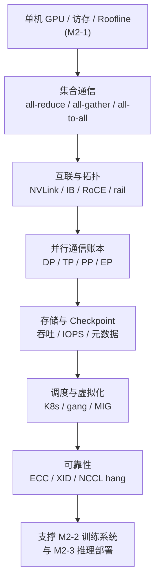
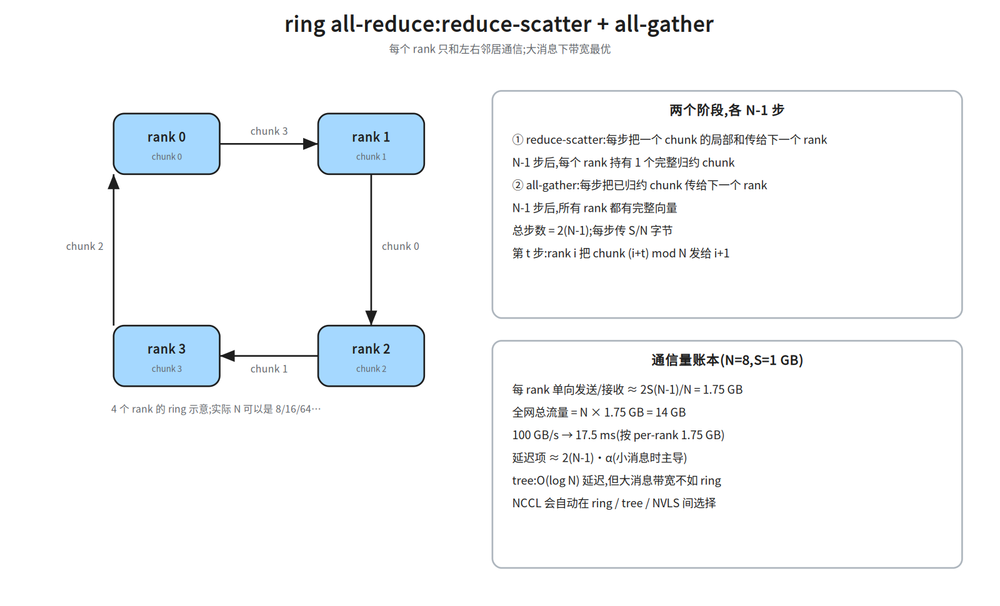
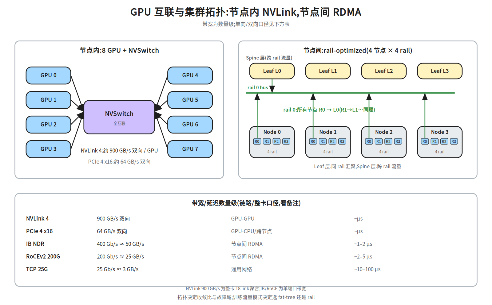
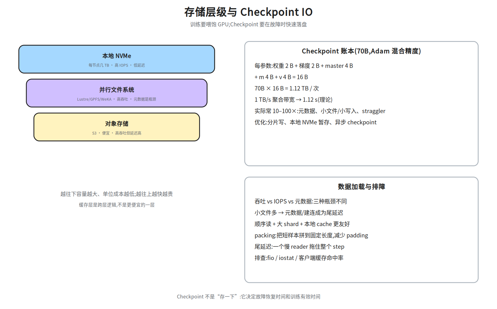
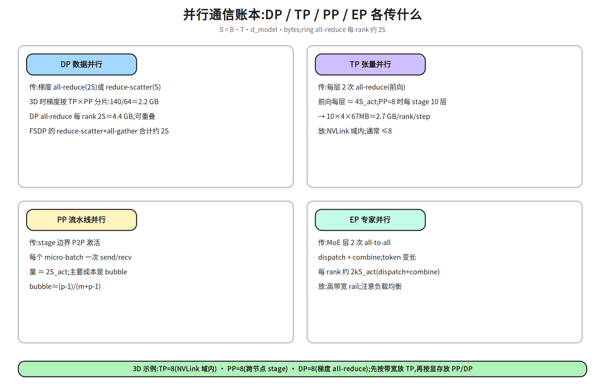
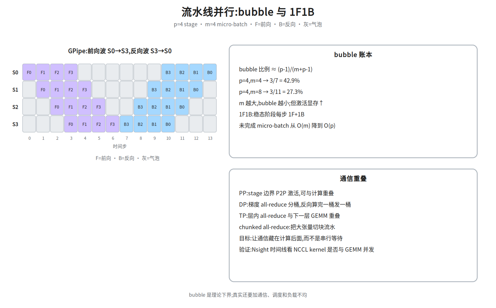
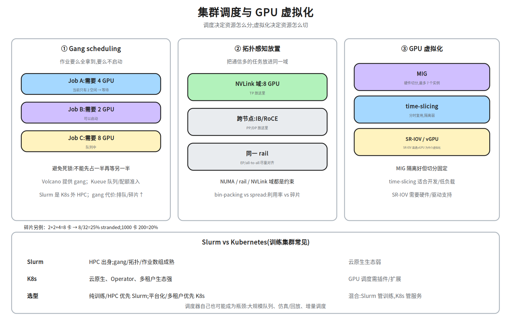

# M2-4 · 分布式底座

> 本层回答：多张 GPU、多台机器，如何连成一台“可编程的训练机”？
> 通信、网络、存储、调度、可靠性各自解决什么问题？为什么训练系统的瓶颈经常不在 GPU 里？

> **前置（按节）**：
> - §2–§4：`notes/21_single_node_ops.md §2–§4`（GPU 访存层次 / Roofline）——只需要知道“搬数据很贵”。
> - §5：无硬前置；会看 `ls`/`fio` 即可。
> - §6：`notes/20_ai_infra_map.md §8–§9`（7 层与深度标尺）；TP/PP/DP/EP 会在 §6 就地定义。
> - §7–§8：`notes/21_single_node_ops.md §9`（Profiling 思路）可选。
>
> **建议路径（每次 45 分钟）**：
> ① §2–§4（集合通信 / 互联 / 拓扑）；② §5–§6（存储 / 并行通信账本）；
> ③ §7（调度与虚拟化）；④ §8（可靠性 / 排障）。
>
> **深度标注**：§2–§4、§6–§7 为必学；§5、§8 为必学（至少会算账/会分层排查）；
> RDMA 调优、拓扑设计、容量模型为加分；可编程交换、在网计算为了解。

## 0. 依赖图（学习顺序）



> 根节点是“单机搬数据很贵”；每往上一层，问题从“一张卡”变成“一个域/一个集群”。
> 汇点是：能判断一个分布式任务**卡在通信、存储、调度还是硬件**，并给出可验证的下一步。

**术语速查（后文第一次出现时也会解释）**：

| 术语 | 一句话 |
|---|---|
| rank | 一个参与通信的进程/GPU 编号；`N` 个 rank 组成通信组 |
| chunk | 把一个大向量切成的等长分片；ring 算法按 chunk 传 |
| `S` | 每个 rank 上的数据量（字节）；注意“每 rank”还是“全网” |
| NVLink 域 | 通过 NVLink/NVSwitch 全互联的一组 GPU；域内带宽远高于跨节点 |
| rail | 节点上一组网卡/端口的编号；同一 rail 通常接同一台 leaf 交换机 |
| leaf / spine | 两层交换机的下/上层；leaf 接节点，spine 连 leaf |
| bisection | 把集群对半切，两半之间的可用带宽；全 bisection = 无收敛 |
| 收敛比 | 下行带宽 ÷ 上行带宽；越大越容易拥塞 |
| PFC / ECN | 无损以太网的流控 / 拥塞标记机制 |
| GPUDirect | 网卡/存储直接读写 GPU 显存，绕过 CPU 拷贝 |
| MIG | 把一张 GPU 硬件切成多个隔离实例 |
| SR-IOV | 网卡/GPU 的硬件虚拟化直通 |
| XID | NVIDIA 驱动报的硬件/驱动错误码 |
| straggler | 拖慢整个同步 step 的慢节点/慢 reader |
| bin-packing | 把任务尽量塞进已有节点，减少碎片 |

## 1. 为什么需要分布式底座

单卡放不下 70B 模型：FP16 权重 140 GB，而单卡 80 GB。即使放得下，训练也要把
梯度、优化器状态和激活同时放进显存。于是必须把模型/数据/流水线切开，切开的代价就是**通信**。

分布式底座回答四个问题：

| 问题 | 本层内容 |
|---|---|
| 卡之间怎么传数据？ | 集合通信、NVLink/PCIe、IB/RoCE、RDMA |
| 怎么切模型、切完要传多少？ | DP/TP/PP/EP 的通信账本 |
| 数据与 Checkpoint 放哪？ | 本地 NVMe、并行文件系统、对象存储、缓存 |
| 任务怎么分到卡上、坏了怎么办？ | K8s/Slurm、gang、拓扑感知、虚拟化、可靠性 |

> **一句话**：M2-1 让一张卡跑得快；M2-4 让一万张卡**像一台机器一样**跑得稳、跑得便宜。

> **术语速查**：`rank` = 一个参与通信的进程/GPU（编号 0..N-1）；`leaf/spine` = 交换机层级；
> `NVLink 域` = 同一 NVSwitch 下、可高带宽直连的 GPU 集合；`XID` = NVIDIA 驱动的错误码；
> `DCQCN` = RoCE 的拥塞控制算法；`bin-packing` = 把任务塞进已有空隙以提高利用率。

## 2. 集合通信：多卡协作的动词

### 2.1 六个基本原语

| 原语 | 做什么 | 输入 → 输出 | 典型用途 |
|---|---|---|---|
| Broadcast | 一个 rank 的数据发给所有 rank | root 的 `S` → 所有 rank 的 `S` | 广播参数/配置 |
| Scatter | root 把不同分片发给不同 rank | root 的 `N×S/N` → 各 rank `S/N` | 分发数据 |
| Gather | 各 rank 的分片收给 root | 各 rank `S/N` → root `N×S/N` | 收集结果 |
| Reduce | 各 rank 的数据按 op 归约到 root | 各 rank `S` → root `S` | 汇总指标 |
| AllReduce | 所有 rank 归约，结果给所有 rank | 各 rank `S` → 所有 rank `S` | 梯度同步 |
| AllGather | 各 rank 的分片拼给所有 rank | 各 rank `S/N` → 所有 rank `S` | 收集分片参数 |
| ReduceScatter | 归约后按分片散给各 rank | 各 rank `S` → 各 rank `S/N` | ZeRO/FSDP |
| AllToAll | 每个 rank 给每个 rank 发不同分片 | 各 rank `N×S/N` → 各 rank `N×S/N` | MoE 路由、转置 |

> `S` 是每个 rank 上的数据量（字节）；`N` 是 rank 数。表中“输入/输出”是**每个 rank 的视角**。

**一句话记法**：AllReduce = ReduceScatter + AllGather。这也是 ring all-reduce 的两阶段。

### 2.2 ring all-reduce：两阶段、通信量



把 `N` 个 rank 排成环，把向量切成 `N` 个 chunk：

1. **reduce-scatter**（`N-1` 步）：每个 rank 把自己的一个 chunk 与邻居的局部和合并后传给下一个；
   走完 `N-1` 步，每个 rank 持有**一个完整归约好的 chunk**。
2. **all-gather**（`N-1` 步）：每个 rank 把自己负责的 chunk 沿环传一圈；
   走完 `N-1` 步，所有 rank 都有完整向量。

**通信量账本**（`S` = 每 rank 向量字节数）：

```
每 rank 单向发送/接收 ≈ 2 × S × (N-1)/N
全网总流量       = 2 × S × (N-1)
总步数           = 2 × (N-1)
```

例：`N=8`、`S=1 GB` → 每 rank **单向**发送/接收 `2×1×7/8 = 1.75 GB`，全网 `14 GB`；
100 GB/s 下约 `17.5 ms`，300 GB/s 下约 `5.8 ms`。

> **大消息看带宽，小消息看延迟**：ring 的带宽最优，但有 `2(N-1)` 步的延迟；
> tree 的延迟是 `O(log N)`，但大消息的带宽不如 ring。NCCL 会按拓扑和消息大小自动选。

### 2.3 其他原语的量级

| 原语 | 每 rank 通信量（近似） | 说明 |
|---|---|---|
| Broadcast | `S` | root 发一圈/树 |
| Reduce | `S` | 收到 root |
| AllGather | `S(N-1)/N` | 每 rank 发自己的 `S/N` 给其他 `N-1` 个 |
| ReduceScatter | `S(N-1)/N` | 归约后只保留自己那份 |
| AllToAll | `S(N-1)/N` | 每 rank 给其他每个 rank 发 `S/N`，共 `N-1` 份 |

> 这些是“每 rank 发送量”的口径；全网总流量再乘 `N`。面试先说口径，否则数字会差 `N` 倍。

### 2.4 ring vs tree

| | ring | tree |
|---|---|---|
| 延迟 | `O(N)` 步 | `O(log N)` 步 |
| 大消息带宽 | 最优（每 rank 约 `2S`） | 较差（上层链路成为瓶颈） |
| 适用 | 大梯度/大张量 | 小消息、延迟敏感 |
| NCCL | Ring | Tree / 双二叉树 |

> NCCL 的默认策略不是“永远 ring”：它会根据拓扑、消息大小、通道数选择
> Ring / Tree / CollNet / NVLS。调优时不要盲目 `NCCL_ALGO=Ring`，先看拓扑和消息大小。

### 2.5 NCCL 常用旋钮

| 变量 | 作用 |
|---|---|
| `NCCL_DEBUG=INFO` | 打印拓扑、算法、通道、错误 |
| `NCCL_DEBUG_SUBSYS=INIT,NET` | 只看初始化/网络 |
| `NCCL_ALGO=Ring/Tree` | 强制算法（排障用，不要长期写死） |
| `NCCL_PROTO=LL/LL128/Simple` | 协议；小消息 LL、大消息 Simple |
| `NCCL_IB_HCA` | 指定 RDMA 网卡 |
| `NCCL_SOCKET_IFNAME` | 指定 TCP 控制面网卡 |
| `NCCL_P2P_LEVEL` | P2P 走 NVLink/PCIe 的层级 |
| `NCCL_NET_GDR_LEVEL` | GPUDirect RDMA 的层级 |

> 排障顺序：`NCCL_DEBUG=INFO` 看它选了哪条路径 → `ibstat/ibv_devinfo` 看网卡 →
> `nvidia-smi topo -m` 看 GPU 拓扑 → `nccl-tests` 复现。

### 2.6 分层 all-reduce：NVLink 域内 + 跨节点

真实集群不是一张平 ring，而是**两级**：

1. **节点内（NVLink 域）**：先做 reduce-scatter，把每个 GPU 负责的 chunk 归约好；
2. **跨节点（IB/RoCE）**：每个节点把对应 chunk 发给其他节点，做一次 all-reduce；
3. **节点内 all-gather**：把跨节点结果拼回每个 GPU。

```
节点内 reduce-scatter → 跨节点 all-reduce(按节点) → 节点内 all-gather
```

> 这样跨节点只传“每节点一份”的 chunk，而不是每个 GPU 都发一遍；这也是 NCCL
> 拓扑检测的价值。若跨节点链路是瓶颈，可以调小跨节点消息、增大节点内 chunk；
> NVLS/CollNet 则把归约放到交换机/网卡里做（了解即可）。
>
> 面试画 AllReduce 路径时，要画出“节点内 NVLink + 节点间 IB”两层，而不是一条 ring 画到底；
> 瓶颈通常在 leaf/spine 上行、rail 不均衡和跨 rail 流量。


## 3. 互联与拓扑：数据走哪条路

### 3.1 节点内：NVLink / NVSwitch / PCIe



| 链路 | 带宽（数量级） | 用途 |
|---|---|---|
| NVLink 3（A100） | 600 GB/s 双向 / GPU | 8 卡节点内全互联 |
| NVLink 4（H100） | 900 GB/s 双向 / GPU | NVSwitch 全互联 |
| PCIe 4 x16 | 64 GB/s 双向 | GPU–CPU、跨节点 |
| PCIe 5 x16 | 128 GB/s 双向 | 新一代 CPU/网卡 |

> **双向口径**：厂商标称的 900 GB/s 是整卡 18 条 link 的双向合计（约 450 GB/s 单向）。
> IB/RoCE 的 400/200 Gb/s 则是**单端口**带宽。算“传一个梯度要多久”时，要用**单向有效带宽**，
> 再乘上协议效率（通常 80–90%）；不要拿整卡 NVLink 去和单口 IB 直接比。

### 3.2 节点间：IB / RoCE / RDMA

| 网络 | 带宽 | 延迟 | 特点 |
|---|---|---|---|
| InfiniBand NDR | 400 Gb/s ≈ 50 GB/s | ~1–2 µs | 专用网络、无损、生态成熟 |
| InfiniBand HDR | 200 Gb/s ≈ 25 GB/s | ~1–2 µs | 上一代 |
| RoCEv2 200G | 200 Gb/s ≈ 25 GB/s | ~2–5 µs | 以太网承载 RDMA，依赖 PFC/ECN |
| TCP 25G | 25 Gb/s ≈ 3 GB/s | ~10–100 µs | 通用、便宜、延迟高 |

**RDMA**（Remote Direct Memory Access）：网卡直接读写远端内存，绕过 CPU 和内核协议栈；
**GPUDirect RDMA** 让网卡直接读写 GPU 显存，省掉一次 GPU→CPU 拷贝；
**GPUDirect Storage** 让 NVMe 直接读写 GPU 显存，Checkpoint/数据加载更快。

> 面试常问“RDMA vs TCP”：RDMA 省的是**CPU 拷贝和内核路径**，带来低延迟、低 CPU 占用；
> 代价是需要无损网络（PFC/ECN）、配置复杂、故障域更敏感。

### 3.3 拓扑：fat-tree / rail-optimized / 收敛比

- **fat-tree**：leaf–spine 多层，任意两节点间有多条等价路径；**全 bisection** 时任意一半节点
  能同时与另一半通信。代价是交换机和光模块数量。
- **rail-optimized**：每个节点有 `R` 个网卡（rail），第 `r` 个网卡固定接第 `r` 个 leaf；
  同一 rail 跨节点通信只经过一层 leaf，适合 all-to-all/专家并行。
- **收敛比（oversubscription）**：下行带宽 ÷ 上行带宽。`1:1` 全无收敛最贵；
  `3:1`、`4:1` 常见。收敛比越大，跨 spine 的流量越容易拥塞。
- **超节点**：NVLink/NVSwitch 把更多 GPU 放进一个高带宽域（如 8/16/32 卡），
  让 TP/EP 的通信留在域内。

> 例：收敛比 `3:1` 表示下行 300 Gb/s 只配 100 Gb/s 上行；跨 spine 的流量一旦超过 1/3，
> 就会在 leaf 上行拥塞。所以“非阻塞/全 bisection”很贵，通常只给关键 rail 或关键租户。
>
> 选型直觉：**TP 要低延迟、高带宽 → 放 NVLink 域；PP/DP 可跨节点；EP 的 all-to-all
> 要对齐 rail**。拓扑不是“画得好看”，它直接决定集合通信走几条链路、会不会拥塞。

**万卡拓扑算例**：1024 卡 = 128 节点 × 8 卡，每节点 8 个 400 Gb/s 网卡（8 rail）。

- 全 bisection：每节点 8 条上行 = `128×8=1024` 条 400G 链路；leaf 层需要能同时承载
  这 1024 条链路，spine 层再按收敛比配置。
- `1:1` 收敛：spine 侧带宽 = leaf 侧带宽，最贵；`3:1` 收敛：上行只需 1/3 带宽，
  跨 spine 流量会排队，适合 PP/DP 为主、EP 不跨 rail 的负载。
- rail-optimized：每个节点的第 `r` 张网卡接第 `r` 台 leaf；同一 rail 的 all-to-all
  只过一层 leaf，跨 rail 才走 spine。EP 的 token 路由要尽量让同一专家组的流量落在同一 rail。

### 3.4 RoCE 的稳定性：PFC / ECN / 拥塞

RoCEv2 把 RDMA 跑在以太网上，需要“无损”语义：

- **PFC（Priority Flow Control）**：按优先级暂停上游流量，防止丢包；配置不当会**PFC 风暴**，
  一台交换机暂停扩散到全网。
- **ECN（Explicit Congestion Notification）**：交换机标记拥塞，端侧 DCQCN 降速；
  比 PFC 更“软”，但需要端网协同。
- **排查**：`ethtool -S` 看 pause/丢包，`perfquery`/`mlxlink` 看链路误码，
  `ibstat`/`ibv_devinfo` 看端口状态；先确认“是丢包、拥塞还是链路误码”。

> 现象：训练周期性变慢、NCCL 超时、某个 rail 的带宽只有一半。
> 先看交换机端口计数和 PFC 事件，不要一上来就换网卡。

## 4. 集合通信之外的通信：P2P 与重叠

- **P2P（point-to-point）**：`send/recv`，PP 的 stage 边界、PD 分离的 KV 传输都用它。
- **通信/计算重叠**：反向传播算完一桶梯度就发一桶 all-reduce（bucket）；
  PP 的激活传输与下一层计算重叠；TP 的 all-reduce 与下一层 GEMM 重叠。
- **压缩/低精度**：FP8/INT8 梯度、稀疏通信、Top-k 压缩；代价是精度和实现复杂度。
- **异步**：异步 all-reduce 可能引入 stale gradient，训练稳定性要评估。

> 重叠的目标不是“通信消失”，而是**把通信藏到计算后面**。验证方法：Nsight 时间线里
> NCCL kernel 是否与 GEMM 并发；如果 NCCL 前后有大段空隙，说明没有重叠好。

## 5. 存储：数据与 Checkpoint 的底座



### 5.1 四层存储

| 层 | 特点 | 典型系统 |
|---|---|---|
| 本地 NVMe | 几 TB、高 IOPS、低延迟 | 节点本地盘 |
| 并行文件系统 | 高吞吐、POSIX、元数据是瓶颈 | Lustre、GPFS、WeKA |
| 对象存储 | 便宜、高吞吐、延迟高 | S3、OSS |

> **缓存层是跨层逻辑**，不是“更便宜的一层”：Alluxio/JuiceFS 把热点数据放到计算节点附近，
> 命中时走本地/内存，未命中再回源对象存储。
>
> **吞吐 vs IOPS vs 元数据**是三种不同的瓶颈：
> 大文件顺序读看吞吐；小文件随机读看 IOPS/元数据；海量小文件还会打爆目录服务。

**副本 vs 纠删码（EC）**：

| | 3 副本 | 8+3 纠删码 |
|---|---|---|
| 原始容量开销 | 3× | 1.375×（11/8） |
| 可容忍故障 | 2 份 | 3 个 shard |
| 写放大 | 3× | 8 数据 + 3 校验 |
| 重建 | 读 1 份 | 读 8 个 shard，CPU/网络开销大 |
| 适用 | 热数据、低延迟 | 冷数据、大容量、成本敏感 |

> 例：1 PB 可用容量，3 副本要 3 PB 原始盘；8+3 只要 1.375 PB。代价是重建更慢、
> 小文件/随机读更不友好。训练 Checkpoint 常用“副本/多路径 + 分片”，数据湖冷存用 EC。
> Checkpoint 常见“热副本 + 冷 EC”：最近几个 Checkpoint 用副本保证快速恢复，旧的转 EC 省钱。

### 5.2 Checkpoint 账本

70B 模型、Adam 混合精度，每个参数大约：

```
权重 2 B + 梯度 2 B + master weights 4 B + Adam m 4 B + Adam v 4 B = 16 B
70B × 16 B = 1.12 TB / 次
```

`1 TB/s` 聚合带宽下理论 `1.12 s`，但真实常慢 `10–100×`：元数据、小文件/小写入、客户端缓存、
straggler、同步屏障。优化：

- **分片写**：每个 rank 写自己的 shard，避免所有 rank 写一个文件；
- **本地 NVMe 暂存**：先落本地，再异步上传；
- **异步 Checkpoint**：训练继续，后台落盘；需要保证一致性/版本；
- **增量**：只存变化的部分（实现复杂，慎用）。

**Checkpoint 间隔与 RTO**：设单次 Checkpoint 成本 `C`（秒），集群平均无故障时间 `MTBF`（秒），
Young-Daly 的近似最优间隔：

```
τ ≈ sqrt(2 × C × MTBF)
```

例：`C=60 s`、`MTBF=24 h=86,400 s` → `τ≈sqrt(2×60×86400)≈3,220 s≈54 min`。
间隔太短，Checkpoint 开销大；太长，故障后重算多。`RTO = 故障检测 + 重新调度 + 加载 Checkpoint`，
万卡集群要把“检测/调度”也算进去，不能只看盘上带宽。

> 万卡训练里，节点故障是常态：Checkpoint 要**异步、分片、可并发读**；
> 只写一个文件会被元数据和单客户端带宽卡死。

### 5.3 数据加载

- **顺序读 + 大 shard** 对并行文件系统更友好；海量小文件会打爆元数据。
- **本地 cache**：每个 epoch 预取到本地 NVMe；注意容量和失效。
- **packing**：把短样本拼到固定长度，减少 padding 和无效计算。
- **尾延迟**：一个慢 reader 会拖住整个 step；用 `fio`/`iostat`/客户端指标定位。
   checklist：shard 是否够大、prefetch 是否足够、本地 cache 命中率、是否有单文件热点、
   reader 进程数是否匹配 CPU、是否被其他租户的 IO 抢占、网络重传/元数据延迟。
- **P99 而不是平均**：平均吞吐够，P99 慢 reader 仍会让同步 step 等；用预取、分片重试、
  本地 cache、reader 隔离把尾延迟压下来。

> Checkpoint 不是“存一下”：它决定故障恢复时间（RTO）和有效训练时间。
> 万卡训练里，Checkpoint 写失败/写慢是常见的长稳问题。
>
> **间隔与 RTO**：太频繁 → 训练被写盘拖慢；太稀疏 → 故障后重算多。Young/Daly 近似给出
> 最优间隔 `≈ sqrt(2 × T_ckpt × MTBF)`。万卡集群还要考虑并发写、分片数、元数据服务；
> 异步 Checkpoint 能把写盘藏到训练后面，但要保证版本一致、回滚可用。

### 5.4 KV Cache 持久化

**价值**：多轮对话/Agent 的相同前缀、PD 分离的 KV 交接、请求抢占后的恢复，都可以复用 KV，
避免重复 prefill。**挑战**：KV 不是“小文件”，而是按请求/前缀组织的块。

- 账本：70B GQA-8、4K 上下文，每请求 KV ≈ `1.25 GiB`；1000 个并发就是 `1250 GiB ≈ 1.22 TiB`。
- 分层：本地 NVMe（热）→ 并行 FS/对象存储（温/冷）；按前缀 hash 建索引。
- 一致性：KV 必须绑定**模型版本 + tokenizer + RoPE 配置**；模型一换，缓存全部失效。
- 安全：KV 可能包含用户上下文，多租户要隔离/加密/TTL。
- 传输：PD 分离/跨节点复用要走 RDMA；`1.25 GiB` 在 50 GB/s 下约 27 ms（见 M2-3 §7.2）。

> 不要把 KV 持久化当“免费缓存”：命中率低、索引/元数据、版本失效都会吃掉收益。

## 6. 并行通信账本：DP / TP / PP / EP



先定义：`S_act = B × T × d_model × bytes`（一个激活张量），`S_grad = 参数字节`。

| 并行 | 传什么 | 每 rank 通信量（近似） | 放哪 |
|---|---|---|---|
| **DP** | 梯度 all-reduce；FSDP 用 reduce-scatter + all-gather | all-reduce `2S_grad`；reduce-scatter `S_grad`(FSDP 总 `2S_grad`) | 跨节点；可与反向重叠 |
| **TP** | 每层 2 次 all-reduce（前向） | 前向 `4 S_act` / 层；反向再加 `4 S_act` | NVLink 域内，通常 ≤8 |
| **PP** | stage 边界 P2P 激活 | `2 S_act` / micro-batch | 跨节点；成本主要是 bubble |
| **EP** | MoE 层 2 次 all-to-all | 每 rank 约 `2·k·S_act`（dispatch+combine） | 高带宽 rail；注意负载均衡 |

> **为什么 TP 放节点内**：TP 每层都要 all-reduce，通信频繁且延迟敏感；跨节点会拖垮。
> **为什么 PP/DP 可跨节点**：PP 只在 stage 边界传激活，DP 每个 step 只同步一次梯度，
> 通信/计算比更低。

**一个 3D 例子**：70B、`TP=8`、`PP=8`、`DP=8`、`B=1`、`T=4096`、`d_model=8192`、FP16：

```
S_act = 1 × 4096 × 8192 × 2 B ≈ 67 MB
TP:PP=8 时每个 stage 10 层;前向 10×4S ≈ 2.7 GB / rank / step
DP:梯度先按 TP×PP 分片 → 140/64 ≈ 2.2 GB;all-reduce 每 rank 2S ≈ 4.4 GB / step
PP:每个 micro-batch 传 67 MB 激活;主要成本是 bubble
```

> 关键：**先分片，再 all-reduce**。3D 下 DP 的 `S_grad` 是“每 rank 分片后的梯度”，
> 不是完整 140 GB；TP 只计算本 stage 的 10 层，不是 80 层。面试时这两步最容易多乘。

> **EP 口径**：表里的 `S_act` 是 **每 rank** 本层输入的激活量；`k` 是 top-k。
> 若你手里是 EP 组内全局 token 数 `G`，每 rank 的 all-to-all 量约
> `2·G·k/E·d_model·bytes`。两种写法只差“B 是全局还是每 rank”，面试时先声明口径，
> 否则会差 `E` 倍。
>
> 这些是数量级，不是 benchmark。真实值还要乘协议效率、拓扑跳数、拥塞。
> 面试时先写公式，再代数字；不要只报一个“很快/很慢”。

### 6.1 3D 映射与流水线调度



- **global batch = B_micro × m × DP**：`m` 是 micro-batch 数（流水线切分），不是 batch 维。
- **GPipe**：每个 stage 先做完所有 micro-batch 的前向，再做所有反向；前向波 `S0→S3`，
  反向波 `S3→S0`。气泡比例 `(p-1)/(m+p-1)`：`p=4,m=4` 时 `3/7≈42.9%`。
- **1F1B**：稳态阶段每步一前一后，未完成 micro-batch 从 `O(m)` 降到 `O(p)`，省激活；
  bubble 比例不变。
- **重叠**：PP 的 P2P 激活、DP 的分桶 all-reduce、TP 的层内 all-reduce 都要尽量与计算重叠。
- **选择**：显存紧 → 小 `m` + 重算/ZeRO；吞吐优先 → 大 `m`（bubble 小）但激活涨。

## 7. 调度与虚拟化：资源怎么分、怎么切



### 7.1 K8s 的 GPU 抽象

- **Device Plugin**：把 `nvidia.com/gpu` 这类资源暴露给 K8s；
- **GPU Operator**：自动装驱动、容器运行时、DCGM exporter；
- **MIG**：把一张 GPU 切成多个硬件实例（A100 最多 7 个），隔离好、切分固定；
- **time-slicing**：多个容器分时复用一张 GPU，隔离弱，适合开发/低负载；
- **SR-IOV / vGPU**：SR-IOV 是硬件直通；vGPU 是中介虚拟化（hypervisor 调度），两者都依赖硬件/驱动。

### 7.2 gang scheduling

分布式训练要求“所有 worker 同时启动”，否则先启动的 worker 会空等甚至死锁。
**gang scheduling** 保证一个作业要么全拿到资源，要么不启动：

- K8s 的 gang 由 Volcano 等提供；Slurm 是另一套 HPC 调度器（K8s 外）；Kueue 主要做队列/配额/准入，不替代 gang 调度器，通常和 Volcano 组合；
- 代价：排队时间变长、碎片可能增加；
- 与优先级/抢占结合时，要避免低优先级作业被反复抢占。

### 7.3 拓扑感知与碎片治理

- **拓扑感知**：把 TP 放进同一 NVLink 域，把 EP 对齐 rail，把 NUMA/网卡亲和性考虑进去。
- **碎片**：大作业要 8 卡整机，但集群只剩零散 2 卡 → 利用率下降。
  治理：整机预留、bin-packing、队列分级、可抢占的碎片作业。
- **碎片算例**：1000 张卡、碎片率 20% ≈ 200 张卡无法组成整机；如果大作业都要 8 卡整机，
  这部分卡就“看着空闲、实际不可用”。治理：整机预留、bin-packing、队列分级、允许小作业
  填缝、坏节点及时 drain。
- **在离线混部**：在线服务保 SLO，离线训练用剩余资源；需要资源隔离、优先级、
  动态配额和快速驱逐。混部不是“把空闲卡塞满”：在线 P99 一抖，离线任务就要让路。

**多租户与公平性**：

- **配额**：namespace/ResourceQuota 限制每租户的 GPU 数、并发任务数；
- **fair share**：按权重分配空闲资源，避免一个大租户饿死其他人；
- **隔离**：MIG/time-slicing/SR-IOV；训练任务优先整卡，开发任务可共享；
- **优先级/抢占**：高优任务可抢占低优任务；被抢占任务要能从 Checkpoint 恢复；
- **计量**：按 GPU·小时/ token/存储计费，账单要能追溯到任务与租户；
- **准入**：配额不足时排队或拒绝，不要让“先到先占”打乱公平性。

> 例：32 卡集群，租户 A 配额 16 卡、B 配额 16 卡；A 空闲时 B 可以借用，但 A 有任务时要能
> 在约定时间内收回（抢占/排队），这就是“弹性 + 公平”的取舍。

**在离线混部算例**：在线推理占 60% 卡、SLO `TTFT P99<500 ms`；离线训练用剩余 40% 卡，
但随时可能被抢占。做法：在线池预留 + 离线池 best-effort；离线任务每 10 分钟 Checkpoint，
被抢占后 2 分钟内 drain 并从 Checkpoint 恢复；监控在线 P99、离线有效训练时间、抢占次数。
如果离线流量把在线 P99 推高，就触发限流/降级，而不是继续塞任务。

### 7.4 Slurm vs K8s

| | Slurm | K8s |
|---|---|---|
| 出身 | HPC | 云原生 |
| 强项 | gang/拓扑/作业数组、超算生态 | Operator、多租户、服务编排 |
| 弱项 | 云原生生态弱 | GPU 调度需插件/扩展 |
| 选型 | 纯训练/HPC 优先 | 平台化/多租户/在线服务优先 |

### 7.5 调度器性能、仿真与碎片算例

- **调度延迟**：队列里有 1 万个作业时，调度器要在一秒内做出决策；常见优化是增量调度、
  只重算受影响节点、缓存拓扑/配额、批量绑定。
- **吞吐**：调度次数/秒、Pod 绑定次数/秒、API server 压力；大规模集群里 etcd 和
  kube-scheduler 都可能成为瓶颈。
- **仿真/回放**：用真实 trace（作业到达时间、资源需求、运行时长）回放调度策略，
  比较利用率、排队时间、碎片率；不要直接在线上 A/B。
- **碎片定义**：**stranded（搁浅）GPU** = 空闲但无法满足任何排队作业资源形状的卡。
  碎片率 = stranded GPU 数 / 总 GPU 数。
  例：32 卡集群，空闲是 `2+2+4` 三块，8 卡整机作业无法启动 → stranded = 8，
  碎片率 `8/32=25%`。若 1000 卡里 200 卡 stranded，就是 20% 碎片率。
  治理：整机预留、bin-packing、队列分级、可抢占碎片作业。

> 面试问“调度器瓶颈在哪”：先分**决策延迟**、**绑定吞吐**、**状态存储**、**碎片**四层，
> 再给一个可观测指标（queue latency / scheduling throughput / fragmentation / utilization）。

**队列算例**：作业到达 100 个/s，调度器稳定能处理 120 个/s → 利用率 83%，队列不会无限增长；
若到达升到 150 个/s，积压速度 30 个/s，10 分钟就积压 1.8 万个作业。
用 Little's Law 估队列长度 `L=λW`：到达 100/s、平均排队 30 s → 约 3000 个等待作业。

**指标**：调度吞吐（jobs/s）、绑定吞吐（pods/s）、排队 P99、利用率、碎片率、抢占次数、任务成功率。
多租户/公平性见 §7.3；Slurm vs K8s 见 §7.4。

## 8. 可靠性：坏卡、坏链路、hang

### 8.1 常见硬件错误

| 现象 | 可能原因 | 检查 |
|---|---|---|
| ECC 错误 | HBM 位翻转 | `nvidia-smi -q`、DCGM |
| XID 79 | GPU 掉卡/PCIe 问题 | dmesg、`nvidia-smi -q` |
| XID 48/63/94/95 | ECC/显存/驱动错误 | DCGM、厂商文档 |
| NVLink 错误 | 链路误码/连接器 | `nvidia-smi nvlink -e`、`dcgmi diag` |
| PCIe AER | 链路错误 | dmesg、`lspci -vv` |
| 温度/功耗 | 散热/供电 | `nvidia-smi -q -d TEMPERATURE,POWER` |

> XID 的具体含义随驱动/架构变化，面试时说“先查 XID 表和 dmesg，再决定 drain 还是重启”，
> 不要背一个绝对映射。

### 8.2 健康检查与自愈

- **burn-in**：新节点跑 `dcgmi diag`、`nccl-tests`、`gpu-burn`；
- **巡检**：定期 ECC/NVLink/PCIe 检查，发现坏节点 `cordon`/`drain`；
- **自愈**：坏节点自动隔离、任务重调度、Checkpoint 恢复；
- **冗余**：热备节点、N+1 电源/网络、双 rail。

### 8.3 NCCL hang 排查

训练“卡住”不一定是 NCCL，但 NCCL hang 很常见：

1. **看日志**：`NCCL_DEBUG=INFO`、`NCCL_DEBUG_SUBSYS=INIT,NET`；确认卡在哪个 collective；
2. **看是否异步错误**：`CUDA_LAUNCH_BLOCKING=1` 复现，检查 `cudaGetLastError`；
3. **看拓扑/网卡**：`nvidia-smi topo -m`、`ibstat`、`ibv_devinfo`、`ping`；
4. **看进程**：`py-spy dump`、`gdb`、`strace`，确认是等通信还是等锁；
5. **缩小规模**：`nccl-tests` 从 2 卡到 8 卡逐级复现；换节点/换网卡做二分；
6. **超时**：`NCCL_TIMEOUT`/`TORCH_NCCL_TIMEOUT` 只用于暴露问题，不要用它“解决” hang。

> 分层定位：单机内 → NVLink/PCIe；跨机 → IB/RoCE/交换机；框架 → 进程组/collective 顺序；
> 存储 → Checkpoint/数据加载。不要一上来就重启整个集群。

### 8.4 长稳训练

- **straggler**：某张卡/某个 reader 慢，拖住整个同步 step；
- **silent data corruption**：ECC 没报错但结果错，靠校验/对比/重复实验发现；
- **loss spike/NaN**：可能是数据、精度、通信、优化器或框架 bug，按 M2-2 §9 排查；
- **弹性训练**：节点故障后重新组网、恢复 Checkpoint；代价是复杂度和性能波动。

## 9. 面试要点

1. **ring all-reduce 的通信量怎么算？** → 两阶段，每 rank `2S(N-1)/N`，总流量 `2S(N-1)`；
   总步数 `2(N-1)`。大消息看带宽，小消息看延迟。
2. **ring 和 tree 怎么选？** → ring 大消息带宽最优；tree 延迟 `O(log N)`，适合小消息；
   NCCL 会按拓扑/消息大小自动选。
3. **为什么 TP 放节点内、PP/DP 跨节点？** → TP 每层都 all-reduce，延迟敏感；
   PP 只在 stage 边界传激活，DP 每步只同步一次梯度。
4. **RDMA 和 TCP 的区别？** → RDMA 绕过 CPU/内核，低延迟、低 CPU 占用；
   需要无损网络（PFC/ECN），配置复杂。
5. **fat-tree 和 rail-optimized 怎么选？** → fat-tree 全 bisection、通用；
   rail 让同一 rail 只过一层 leaf，适合 all-to-all/EP；看流量模式和成本。
6. **Checkpoint 为什么慢？** → 写放大、元数据、小文件、straggler、同步屏障；
   优化：分片、本地 NVMe 暂存、异步、增量。
7. **K8s 怎么调度 GPU？** → device plugin 暴露 `nvidia.com/gpu`；gang scheduling 保证
   全有或全无；拓扑感知把 TP 放进 NVLink 域；MIG/time-slicing/SR-IOV 做切分。
8. **NCCL hang 怎么排查？** → `NCCL_DEBUG=INFO` 看卡在哪个 collective；查拓扑/网卡/
   进程；`nccl-tests` 缩小规模；二分换节点；不要只靠超时。
9. **万卡集群碎片率 20% 怎么治理？** → 整机预留、bin-packing、队列分级、可抢占碎片作业、
   拓扑感知；先量化碎片来源（大作业/小作业/坏节点）。
10. **GPU 虚拟化怎么选？** → MIG 隔离好但固定；time-slicing 隔离弱、适合开发；
    SR-IOV/vGPU 支持多租户但依赖硬件/驱动。
11. **存储的吞吐、IOPS、元数据瓶颈怎么区分？** → 大文件顺序读看吞吐；小文件随机看 IOPS；
    海量小文件看元数据；用 `fio` 分场景测。
12. **训练集群的 SLO 是什么？** → 任务成功率、有效训练时间、Checkpoint 耗时、
    故障恢复时间、GPU 利用率；不是单一“可用性”。

## 10. 常见坑

- **把“带宽”当成“有效吞吐”**：标称 900 GB/s 是双向峰值，实际单向、协议效率、拥塞都要打折。
- **只看单卡利用率**：GPU 利用率高不代表在算，可能在等通信/等数据。
- **把 ring 当万能**：小消息时 tree 更快；NCCL 的选择要看拓扑。
- **算通信量不写口径**：每 rank 还是全网？发送还是收发？差 `N` 倍。
- **以为 TP 可以无限扩**：TP 每层都通信，跨节点会拖垮；通常 ≤8。
- **忽略 bubble**：PP 的 bubble 是理论下界，micro-batch 太少时利用率很低。
- **Checkpoint 只算写入时间**：元数据、同步、straggler 才是大头。
- **把 MIG 当“免费切分”**：切分固定、显存/带宽也切；不是所有模型都适合。
- **NCCL hang 就重启**：不定位根因，下一次还会 hang；先看日志和拓扑。
- **把拓扑图画成“逻辑图”**：真正决定性能的是物理链路、rail、收敛比。

## 动手清单（60–90 分钟）

> 环境：至少 2 张 NVIDIA GPU；没有多卡时用 `nccl-tests` 的单机多进程模式。

1. **ring all-reduce 账本**：写一个函数，输入 `N, S, BW`，输出每 rank 通信量、总流量、
   理论时间；扫 `N=2..64`，画曲线并解释为什么大 `N` 下时间近似线性。
2. **nccl-tests**：跑 `all_reduce_perf -b 8M -e 1G -f 2 -g <GPU 数>`，记录不同消息大小的
   bus bandwidth；对比 `NCCL_ALGO=Ring` 与默认，解释差异。
3. **拓扑检查**：`nvidia-smi topo -m`、`ibstat`、`ibv_devinfo`，画出本机/本集群的
   GPU–网卡–交换机路径；标出 TP/PP 应该放哪。
4. **Checkpoint 账本**：用 7B/70B 参数，算 FP16/Adam 的 Checkpoint 大小；
   用 `fio` 测本地 NVMe 与网络盘的顺序写带宽，估算实际 Checkpoint 时间。
5. **K8s gang / 队列（可选）**：用 Volcano 提交 2-worker job 观察“全有或全无”；用 Kueue 提交队列/配额实验观察排队/准入（Kueue 不是 gang 调度器）；
   故意只给 1 张卡，确认不会启动半个作业。

验收标准：能对“一次 all-reduce / 一次 Checkpoint / 一次 NCCL hang”分别给出
**公式 + 数量级 + 下一步验证**，而不是只报一个现象。

## 相关图

- `24a_ring_allreduce` — ring all-reduce 两阶段与通信量；
- `24b_topology` — NVLink/NVSwitch、IB/RoCE、rail-optimized；
- `24c_parallel_comm` — DP/TP/PP/EP 通信账本；
- `24d_pipeline` — GPipe 调度、bubble、1F1B、通信重叠；
- `24e_storage` — 存储层级、Checkpoint 账本、数据加载；
- `24f_scheduling` — gang、拓扑感知、MIG/time-slicing、Slurm vs K8s。

## 下一步

- **M2-2 训练系统**：把本层的通信账本、存储、调度用到一次完整的训练 step；
  显存账本、ZeRO/FSDP、3D 并行、MFU、Checkpoint、RL。
- **M2-5 平台与稳定性**：把本层的调度/可靠性上升为平台、SLO、on-call 与容量。
- 若走推理线：回到 **M2-3 §7**，用 PD 分离/KV 传输把本层的 RDMA/NVLink 用起来。
