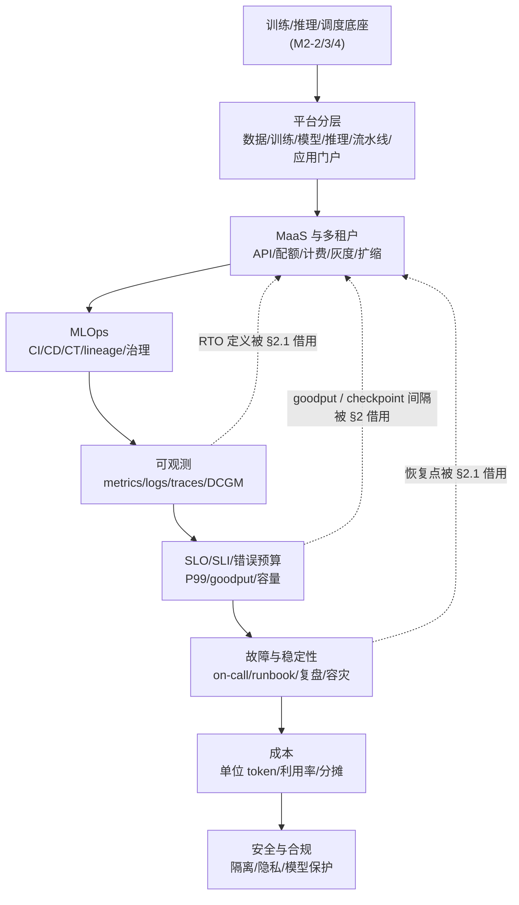
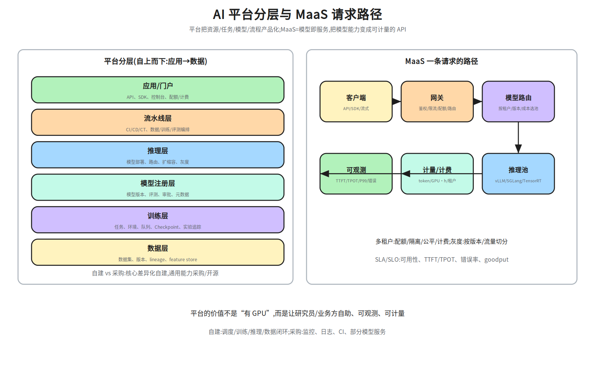
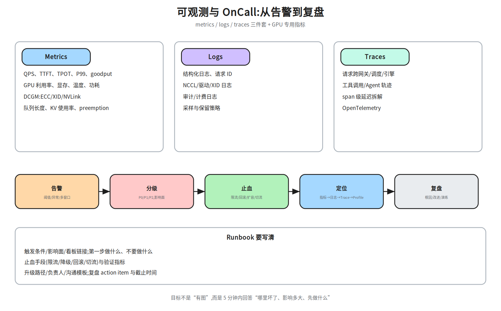
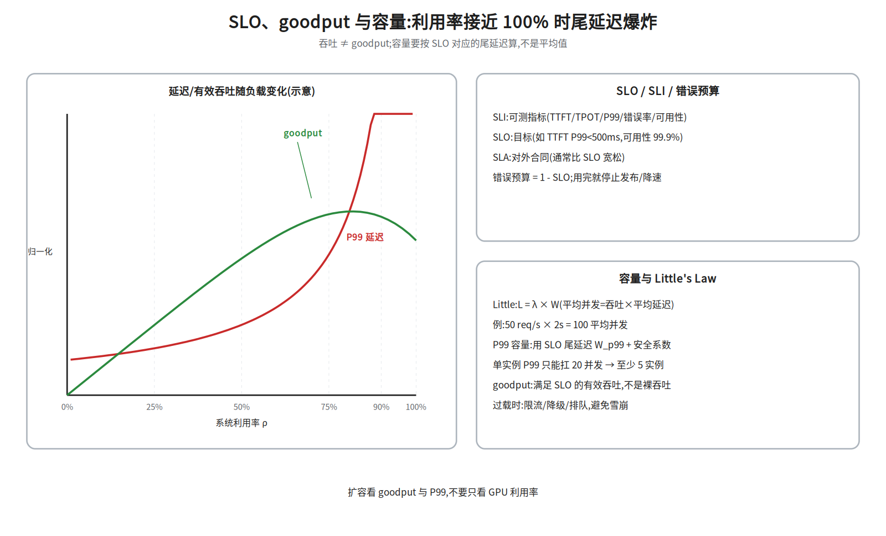
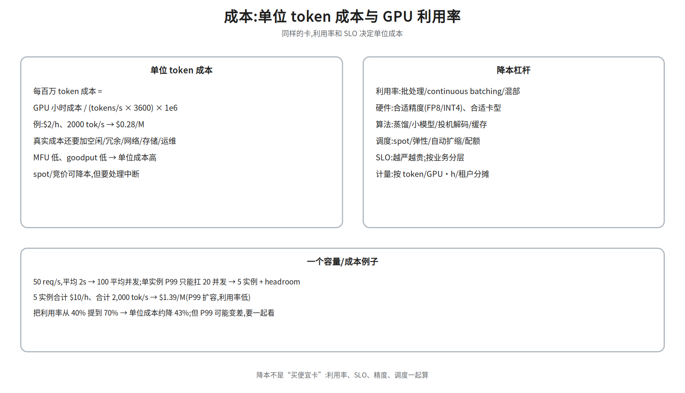

# M2-5 · 平台与稳定性

> 本层回答：怎么把训练/推理/数据/模型能力变成研究员和业务方**自助、可观测、可计量**的平台？
> 线上出问题时，怎么在 5 分钟内判断“哪里坏了、影响多大、先做什么”？

> **前置（按节）**：
> - §2：`notes/24_distributed_base.md §7`（K8s/gang/多租户/虚拟化）、
>   `notes/22_inference_systems.md §11.2`（多租户/弹性伸缩/灰度回滚/热更新/可观测/限流降级；该节没有「路由」条目、本批笔记也未出现「MaaS」一词——路由只在 §11.1 的路径示意「网关 鉴权/限流/路由」出现，MaaS 与「模型路由」这两项按**本文补充**对待；§2.2 的灰度/回滚/热更新不属补充，已由上述 §11.2 覆盖）。
> - §3：MLOps 的 CI/CD/CT、artifact lineage、feature store 离线在线一致、模型治理/审批
>   **在本批笔记里没有对应的来源章节**，只按通用平台实践了解，不要当成笔记结论引用；
>   §3 提到的生命周期/Checkpoint 可回 `notes/23_training_systems.md §6`（Checkpoint/容错）。
> - §4–§5：`notes/22_inference_systems.md §1、§11–§13`（TTFT/TPOT/SLO/容量；§6 不在这个区间，来源见下一条）。
> - §6：`notes/24_distributed_base.md §8`（坏卡/XID/NCCL hang；§6.1 的「hang 三步」是**本文归纳**、不是 §8 原文：§8.3 是六步——看日志/查异步错误（CUDA_LAUNCH_BLOCKING）/拓扑网卡/进程/缩小规模/超时；注意上面六步与本文 §6.1 的三步不是同一套编号——「查坏节点/链路/存储，隔离后从 Checkpoint 恢复」是 §6.1 三步的第三步，对应 §8.2 自愈与 §8.4）。
> - §7：`notes/22_inference_systems.md §13.2`（$0.28/M 算例；那条含利用率的公式是**本文改写**，来源式不含利用率项）。24 §8 是可靠性内容，与 §7 成本无关。
> - §8：安全/合规（隔离/隐私/水印/数据出境）**在本批笔记里没有对应的来源章节**，
>   只按通用平台实践了解，不要当成笔记结论引用。
>
> **建议路径（每次 45 分钟）**：
> ① §1–§3（平台分层 / MaaS / MLOps）；② §4–§5（可观测 / SLO / 容量）；
> ③ §6–§7（故障 / 成本）；④ §8（安全合规，点到为止）。
>
> **深度标注**：§1–§6 为必学；§7 成本为必学（至少会算单位 token 成本）；
> §8 安全/合规为了解；调度/网络/存储细节回到 M2-4。

## 0. 依赖图（学习顺序）



> 汇点是：能把一个 AI 系统**产品化、可观测、可计量、可恢复**，并用 SLO 和成本做取舍。

> **读图注意**：A 是前置底座（M2-2/3/4），本篇正文从 B 开始，节点与小节错开一格——B = §1、C = §2、D = §3、E = §4、F = §5、G = §6、H = §7、I = §8，A 在本篇没有对应小节。整条链一路连到「安全与合规」，不是只到 §4；§3 不能跳过，建议路径 ① 就是 §1–§3 连读。
（预告性引用不止一处，正文都做了就地指路、不改依赖顺序：§2 借用 §4.1 的 RTO，§2.1 向前引用 §5.3 的 checkpoint 间隔与 §6.4 的恢复点，§2.3 借用 §5.1 的 goodput 定义，§4.1 用到的 runbook 模板在 §4.2；这里只举 RTO 一个例子。）

## 1. 平台分层：从资源到用户



| 层 | 解决什么 | 典型能力 |
|---|---|---|
| 数据层 | 数据从哪来、版本是什么 | 数据集、lineage、feature store、质量 |
| 训练层 | 任务怎么跑 | 任务提交、环境、队列、Checkpoint、实验追踪 |
| 模型注册层 | 哪个模型能上线 | 版本、评测、审批、元数据 |
| 推理层 | 怎么服务 | 部署、路由、扩缩容、灰度 |
| 流水线层 | 怎么串起来 | CI/CD/CT、数据/训练/评测编排 |
| 应用/门户 | 用户怎么用 | API、SDK、控制台、配额/计费 |

**自建 vs 采购**：调度、训练、推理、数据闭环是核心差异化，通常自建；
监控/日志/CI/部分模型服务可以采购或开源。不要为了“全栈自研”重复造轮子。

> 平台的价值不是“有 GPU”，而是让用户**自助**（不用找人开权限）、**可观测**（知道任务在干什么）、
> **可计量**（知道花了多少）。这三件事决定采用率。

## 2. MaaS：模型即服务

一条请求的路径：

```
客户端 → 网关(鉴权/限流/配额/路由) → 模型路由(租户/版本/成本)
      → 推理池(引擎/GPU) → 计量/计费 → 可观测
```

### 2.1 多租户

- **配额**：每租户的 GPU 数、并发请求数、token/月上限；
- **隔离**：命名空间、MIG（把一张 GPU 切成多个隔离小卡）/time-slicing（按时间片轮转共享一张卡）、网络策略；训练任务优先整卡；
- **公平**：fair-share（按配额权重分配空闲资源）/优先级/抢占；空闲资源可借用，但要有回收机制；
- **计费**：按 token、GPU·小时、存储、网络分别计量；账单可追溯到任务/租户。

> 多租户不是“加个 namespace”：要同时解决**隔离、公平、配额、计费、审计**。

**任务状态机**：`提交 → 准入(配额/权限) → 排队 → 运行 → 成功/失败/取消`——Checkpoint 不是终态，而是**运行期周期性**发生的动作（被抢占/失败时还需要一次收尾写盘）。
每个状态都要可观测、可重试、可取消；准入要检查配额、镜像/环境、数据权限，
避免“先占资源再失败”。

Checkpoint 里存的是**参数 + 优化器状态（如 Adam 的 m/v）+ 学习率调度器 step + RNG 与数据 loader 位置**，少一样就恢复不成“接着训练”；这是 §6.4「恢复点 = 最近的 Checkpoint + 数据 loader/RNG 状态」、以及 §5.3 把 checkpoint 间隔与 RTO 绑在一起的前提。
（**RTO** = 恢复时间目标，业务允许多久恢复；正式定义、与 RPO 的区别见 §4.1——§2 在这里提前借用这个词，读到 §4.1 再补齐。）

**配额层级**：租户 → 项目/团队 → 用户/任务；支持硬配额（不能超）和软配额（可借用，
但高优任务来了要回收）。配额要和优先级/抢占一起设计。

### 2.2 模型路由、灰度、回滚

- **路由**：按租户/版本/成本/地域选择模型池；A/B 测试、影子流量（把真实流量复制一份打到新版本，只观察、不把结果返回给用户）；
- **灰度**：按流量比例/用户群/请求特征逐步放量；
- **回滚**：模型版本、配置、提示词都要可回滚；回滚要能在分钟级完成（「分钟级」是本文自拟的示例目标，来源未给时限）；
- **热更新**：不中断服务地换权重；注意 KV Cache/前缀缓存要随模型版本失效。

### 2.3 自动扩缩与 SLA

- 指标：队列长度、TTFT SLO、GPU 利用率、goodput；

- goodput = **满足 SLO 的有效吞吐**（正式定义见 §5.1）：超时/失败/被降级且未达降级 SLO 的请求不算产出；被降级但仍满足降级 SLO 的请求单列、不计入主 goodput（与 §5.1 同一口径；**这条「降级单列」是本文补充**，来源 `22 §1` 只给「满足 SLO 的有效吞吐」——10 req/s 里 8 个达标则 goodput ≈ 8 req/s，没有降级单列口径），所以“按 goodput 扩缩”和“按裸 QPS 扩缩”结论不同。
- 扩容有冷启动（拉镜像/加载模型），要预留 buffer；
- **SLA** 是对外合同，**SLO** 是内部目标；SLA 通常比 SLO 宽松。
- 过载时：限流、排队、降级（小模型/短输出）、切流；不要等雪崩。

## 3. MLOps：可复现、可追溯、可治理

> **缩写**：**MLOps** = 把模型交付当软件工程来管（CI/CD + 持续训练 + lineage + 治理）；**CI** 持续集成、**CD** 持续交付/部署、**CT** 持续训练（continuous training，按数据漂移触发重训）。

- **CI/CD/CT**：代码/配置/数据/模型都要版本化；CT（continuous training）按数据漂移触发；
- **可复现**：固定代码、数据、环境、随机种子、硬件；记录每一步的输入/输出；
- **Artifact lineage**：数据 → 训练 → 模型 → 部署，每条边可追溯；
- **Feature store**：离线/在线特征一致，避免训练-服务偏差；
- **模型治理**：评测、审批、卡点、审计、合规；谁在什么时候把哪个模型放上线。

> 面试问“平台怎么设计”：先讲**任务模型/资源模型/权限模型**，再讲生命周期
> （提交 → 排队 → 运行 →（运行期周期性写 Checkpoint，不是独立阶段，见 §2.1）→ 评测 → 注册 → 部署 → 监控），最后讲失败路径。

>
> **两条链不要连成同一条（本节与 §2.1 的区别）**：上面这条是**模型交付生命周期**。§2.1 那条链的终点是**成功/失败/取消**，并且只有它带**准入**（配额/权限）；上面这条省略准入不是笔误，因为它讲的是模型而不是任务。记法：任务到「成功/失败/取消」为止看 §2.1，模型从「评测」起算看本节；上面那句「见 §2.1」只回指「Checkpoint 是运行期动作、不是独立阶段」，并不表示整条链就是 §2.1 的状态机。

### 3.1 把研究员需求抽象成 API

一个最小训练 API 的四块：

```
POST /jobs            {image, command, resources(GPU/CPU/mem), dataset, priority}
GET  /jobs/{id}       → {state, queue_position, metrics, checkpoint_uri, error}
POST /jobs/{id}/cancel
POST /jobs/{id}/retry  {from_checkpoint: true}
```

- **任务模型**：镜像/命令/资源/数据/优先级/超时/重试策略；
- **资源模型**：GPU 型号/数量、拓扑（整机/NVLink 域）、存储挂载；
- **权限模型**：谁能提交到哪个队列、能看哪些数据/日志、能花多少配额；
- **错误模型**：可重试（硬件/抢占）vs 不可重试（代码/数据 poison）；返回结构化错误码；
- **异步**：提交返回 job_id，状态用轮询/事件/Webhook；日志/指标用独立接口。

> API 要稳定、可组合、可观测；不要把内部调度细节泄漏给用户。

## 4. 可观测：metrics / logs / traces



| 信号 | 看什么 | AI 专用 |
|---|---|---|
| Metrics | QPS、延迟、错误率、饱和度 | TTFT/TPOT/P99/goodput、GPU 利用率、KV 使用率 |
| Logs | 结构化日志、请求 ID、错误栈 | NCCL/驱动/XID、审计/计费 |
| Traces | 跨服务调用链、span 延迟 | 网关→调度→引擎→工具调用 |
| GPU | 利用率、显存、温度、功耗 | DCGM：ECC/XID/NVLink |


> 两个缩写先说清：**XID** 是 NVIDIA 驱动/硬件上报的错误编号（如 48 = 不可纠正 ECC 错误、79 = GPU 掉总线、94 = contained ECC error，即错误被抑制在单个进程/上下文内）；48、79 一般不可恢复、出现就要隔离该卡，94 只需终止并重启该应用、卡仍可继续服务（先记录观察，不要直接 cordon）；
**95 = uncontained**——错误已扩散到该进程/上下文之外（与 94 的 contained 相对），不能只重启应用，必须重置/隔离这张卡、按 §6.3 的隔离流程走；**ECC** 是显存纠错；可纠正错误计数（volatile/non-volatile）持续上涨说明显存开始坏——`24 §8.1` 的 ECC 那一行只写到「ECC 错误 → HBM 位翻转 → 查 `nvidia-smi -q`、DCGM」（该节同表还有 XID 79、XID 48/63/94/95 两行粗分组，见下一段），volatile/non-volatile 的计数口径和「持续上涨即开始坏」这条判据是**本文补充**，不是笔记结论。
**volatile 与 non-volatile 分别累什么（补，判据要能执行）**：volatile = 自上次驱动加载/重启以来累计的可纠正 ECC 数，驱动一重载就清零；non-volatile = 整卡生命周期累计，不清零。判「显存开始坏」看的是 **volatile 的增速**：固定观察窗内单调上涨才算信号（建议与巡检同频，例如 24 h 一次、连续 3 次都在涨）；non-volatile 只当历史总量参考，老卡本来就大，单看它涨不是故障。两个数都用 `nvidia-smi -q -d ECC` / `dcgmi` 采，runbook 里写明盯哪个计数器、观察窗多长。


> **两个口径要分清**：① cordon = 把**节点**标为不可调度（`kubectl cordon <node>`，阻止新任务落上；没有按单张 GPU cordon 的命令，卡级隔离要靠 MIG/device plugin 或整节点隔离），drain = 驱逐存量任务，两者都不动硬件，完整状态机见 §6.3；② 来源：`notes/24_distributed_base.md §8.1` 只给了粗分组（`XID 79` = 掉卡/PCIe；`XID 48/63/94/95` = ECC/显存/驱动错误），并明确「XID 的具体含义随驱动/架构变化，不要背一个绝对映射」；因此 48 = 不可纠正 ECC、94 = contained ECC error（错误抑制在单个进程/上下文内）这些**精确语义**，以及「94 只需终止并重启该应用、先记录观察不要直接 cordon」这类**处置口径**，都按**本文补充**对待（语义出自 NVIDIA 官方文档；`24 §8.2` 的实际覆盖范围见 §6.3），不要当成笔记结论引用。


**DCGM**（Data Center GPU Manager）是 NVIDIA 的 GPU 遥测/诊断工具集，`dcgmi` 是它的命令行，`dcgmi diag` 跑整卡自检；ECC/XID/NVLink/温度/功耗都由它采集。§4 表、§6.3 和动手清单 4 里的「DCGM 巡检」「dcgmi diag 二次确认」指的都是它（§6.4 只讲失败分类、重试与恢复点，不含巡检）。

**排障顺序**：先看**影响面**（多少请求/任务、哪个租户/地域），再看**时间线**
（何时开始、和什么变更重合），然后按层排查：网关 → 调度 → 引擎 → GPU → 网络 → 存储 → 模型。

### 4.1 告警与 OnCall

- 告警要**可执行**：每条告警对应一个 runbook，不要求人“自己猜”；
- 分级：P0（全站/数据损坏）、P1（核心功能降级）、P2（局部/可绕过）；

> 缩写口径（后文反复用）：**MTTD** = 平均检测时间，故障发生到被监控发现；**MTTR** = 平均恢复时间，故障发生到服务恢复；**RTO** = 恢复时间目标，业务允许多久恢复；**RPO** = 恢复点目标，业务允许丢多少数据（按时间算）。RTO 管“停多久”，RPO 管“丢多少”，是两个独立目标。
- **止血优先**：限流/回滚/扩容/切流，先恢复再定位；
- **复盘**：根因、影响、时间线、改进项、负责人、截止时间；不做“背锅会”。

**AI 辅助 OnCall（点到为止）**：

- 告警聚合/去重、根因候选排序、日志摘要、runbook 检索、相似故障推荐；
- 自动生成“影响面 + 建议止血步骤 + 需要谁确认”的卡片；
- **guardrail**：高风险动作（删数据/改配额/重启集群）必须人工确认；只读诊断可自动；
- 评估：MTTD/MTTR、误报率、建议采纳率；不要用“AI 说没事”替代验证。

### 4.2 Runbook 模板

```
触发条件 / 影响面 / 看板链接
第一步做什么、不要做什么
止血手段(限流/降级/回滚/切流) + 验证指标
升级路径 / 负责人 / 沟通模板
复盘 action item + 截止时间
```

> 可观测的目标不是“有图”，而是 5 分钟内回答：**哪里坏了、影响多大、先做什么**。

## 5. SLO / SLI / 错误预算 / 容量



### 5.1 指标口径

| 指标 | 含义 | 注意 |
|---|---|---|
| SLI | 可测指标 | 要能稳定采集、和用户体验相关 |
| SLO | 内部目标 | 如 TTFT P99 < 500 ms、可用性 99.9% |
| SLA | 对外合同 | 通常比 SLO 宽松，带赔偿条款 |
| 错误预算 | `1 - SLO` | 用完就**冻结发布**（feature freeze）、优先投稳定性工作；必要时**扩容/降级**去救 SLO |
| P99 | 99% 请求的延迟上界 | 容量看尾延迟，不看均值 |
| goodput | 满足 SLO 的有效吞吐（正式定义，与 QPS 同量纲的速率）：单位时间内满足 SLO 的请求数（req/s）或有效 token 数（tokens/s）；超时/失败/被降级且未达降级 SLO 的请求不计入。**SLO 达成率** = 满足 SLO 的请求数 / 时间窗内全部请求，是 0–1 的比例，别当 goodput 用。「降级单列」是**本文补充**口径，`22 §1` 只有「满足 SLO 的有效吞吐」| 被降级但仍满足降级 SLO 的请求单列，不与裸 QPS 混用 |

### 5.2 容量：Little's Law 与排队

```
平均并发 L = 吞吐 λ × 平均延迟 W
```

例：50 req/s × 2 s = 100 平均并发。但**P99 容量**要用 SLO 对应的尾延迟 +
安全系数，不能直接用平均延迟。设**平均口径**单实例可扛并发 $c_{\mathrm{avg}} = 20$（本文自拟的假设值，要压测得出；它与下文的 $c_{99}$ 是两个不同的量，也与下文「照抄来源」那个 20 不是同一个量——数值同为 20，但那是来源 P99 口径的分母（300 / 20 里的 20），只有来源「平均口径 20 → 5 实例」那一处才与本处的 $c_{\mathrm{avg}}$ 同值同口径）：按平均口径 100 / 20 ≈ 5 实例；按 P99 口径必须换 SLO 的尾延迟重算——若 SLO P99 = 6 s，则尾并发 50 req/s × 6 s = 300，再除以 P99 口径单实例可扛并发 c₉₉ 才是实例数。来源 `22 §13.1` 同一段里两个 20 是**两种口径**：先「单实例平均能扛 20 并发 → 约需 5 个实例」（平均口径），后「单实例在 P99 下可承载 20 并发」（P99 口径）——来源自己就把同一个 20 用在两处，所以「不存在混用」只对后一句成立；这里只作**来源复述**：300 / 20 = 15 实例（照抄来源的示意值，**未乘 headroom**；来源这个 20 不作为本文的 c₉₉ 使用——它与平均口径同值，正落在下文「口径填错」的怀疑区，也不与本节末乘 1.3 的 33 直接比）；但分子 300 由 λ × W₉₉ 得来，是量级估计、偏差方向不定（W₉₉ 不构成 E[W] 的上界，见下段），可以当规划起点，真正申请资源前要用自己压测出的 c₉₉ 重算（公式与算例见本节末），再加 headroom（额外留的余量实例，常取 30%）。


注意：Little's Law 是均值关系，代进 P99 得到的 300 不等于任一时刻的真实并发（P99 = 6 s 的意思是约 1% 的请求延迟 ≥ 6 s，不是「都卡在 6 s」），但 W₉₉ 并不从上方约束 E[W]：只要那 1% 超时请求的延迟远大于 6 s（LLM 尾延迟常态），E[W] 就会超过 W₉₉，真实并发大于 300，此时 λ × W₉₉ 反而**偏小**，按它规划会少配实例；只有尾部在 6 s 附近快速衰减时它才偏保守。所以这条路径只能读作**量级起点**：可以作为规划起点（重算式见下），但偏差方向不定，最终数字必须由压测或排队模型校准，不能当成精确值；分母也必须换成「P99 口径下单实例可扛并发」c₉₉（同样由压测得出），否则就是拿平均口径的分母去除尾延迟口径的分子。
**按 P99 口径重算（可执行版）**：所需实例数 = ⌈λ × W₉₉ / c₉₉ × (1 + 30%)⌉，λ = 峰值 QPS、W₉₉ = SLO 的尾延迟上界（如 6 s）、c₉₉ = **P99 口径下单实例可扛并发**——这是唯一必须由压测给出的输入，没有它就算不出数。例（假设值，仅示意）：这里的 $c_{99}$ 换成**自己压测**的取值（与上文照抄来源的 15 个实例是两个不同来源，实际规划以自己压测为准）：平均口径单实例可扛 $c_{\mathrm{avg}} = 20$；P99 口径通常更低，但不是必然（取决于 SLO 尾延迟与 batching）——若压测给出与平均相同的数，先怀疑口径填错，而不是据此认定尾延迟不吃容量——若自己压测显示单实例在 P99 ≤ 6 s 下只能扛 $c_{99} = 12$，则 50 × 6 / 12 = 25 实例，×1.3 = 32.5 → 按 33 个规划；唯一对齐的只有 headroom：33 / (5 × 1.3 ≈ 6.5) ≈ 5.1 倍；但两边既差口径（平均 vs P99）又差单实例容量假设（c_avg = 20 vs c₉₉ = 12），这个倍数无法归因到单一因素，只能当量级参考，不能叫「同口径比较」；直接拿 33 比 5 得 6.6 倍是两边 headroom 也不一致，更不能这么读。
（15 与本例的 33 不是同一套参数：15 照抄来源、未乘 headroom；33 用自己压测的 $c_{99}=12$ 并乘了 1.3。实际规划只用后者。）


分界说明：本节前半（到「300 / 20 = 15 实例」那段）是**来源复述**（20 得 15；同值只能算「可疑、需复核口径」，不能反证「口径填错、自洽性不成立」——$c_{99}$ 与 $c_{avg}$ 同值是允许的）；从「按 P99 口径重算（可执行版）」那段起才是**本文可执行口径**（c₉₉ = 12 得 33）——这两段都在上文，本段只做归纳；来源那个 20 不作为 c₉₉ 使用，实际规划只用 33 这一支。c₉₉ 一旦填错（填成平均口径的 20，或填出比 20 还大的数），倍数差就会被抹平，所以必须写明它是哪次压测、按哪个口径得出的。精确做法是排队论（来源 `22 §13.1` 用的是 **M/G/k**：LLM 服务时间重尾，指数服务时间假设不成立，M/M/c + Erlang C 只能当量级估算，口径见下），或直接压测：该 QPS 下达到 P99 目标需要多少副本。


> **【本文补充】** M/M/c 与 Erlang C 的最小口径（够用即可；`22 §13.1` 只写「精确值要用排队模型（M/G/k）或实测曲线复核」，没有 M/M/c、Erlang C、尾分布这些式子）：c = 服务台数（≈ 副本数）、λ = 到达率（req/s）、μ = 单副本服务率（1 / 平均服务时间），ρ = λ/(cμ) 必须 < 1；Erlang C 给出「到达后需要排队的概率」，据此推 P99 等待，反解满足尾延迟目标的最小 c。
Kendall 记号 $A/S/k$：$A$ = 到达过程（$M$ 泊松/马尔可夫、$G$ 一般分布）、$S$ = 服务时间分布（$M$ 指数、$G$ 一般）、$k$ = 服务台数（= 副本数 $c$）。所以 $M/M/c$ = 泊松到达 + 指数服务 + $c$ 个服务台（有闭式，才跑得动 Erlang C）；$M/G/k$ = 泊松到达 + 一般分布服务（$G$ 就是「一般分布」，重尾只是本文选它当例子的理由）+ $k$ 个服务台（无闭式，只能仿真/近似当量级估算）。
Erlang C 的 $C$ 有闭式（$\rho = \lambda/(c\mu) < 1$）：$C = \dfrac{\frac{(c\rho)^c}{c!}\cdot\frac{1}{1-\rho}}{\sum_{k=0}^{c-1}\frac{(c\rho)^k}{k!} + \frac{(c\rho)^c}{c!}\cdot\frac{1}{1-\rho}}$；再用 M/M/c 的等待时间尾分布 $P(W_q > t) = C\,e^{-(c\mu-\lambda)t}$ 换成尾延迟，令 $P(W_q > t_{99}) = 0.01$ 反解最小 $c$（该式依赖指数服务时间假设，重尾服务要用 M/G/k 或直接压测）。输入是 λ、μ 和尾延迟目标，输出是最小副本数 c。两条路径**二选一**即可、不必都做：输入拿不准或服务时间重尾（$M/G/k$ 无闭式）就直接压测，别把 $\rho$、$\mu$ 硬凑成能算的数。

> 利用率接近 100% 时，排队延迟非线性爆炸；goodput 会在饱和前达峰后下降。
> 过载时主动限流/降级，比“让所有请求都超时”好。

### 5.3 训练集群的 SLO/SLI

训练集群的 SLO 不是“可用性 99.9%”这么简单：

- **任务成功率**：提交后能跑完的比例；
- **有效训练时间**：扣除故障/排队/Checkpoint 后的时间；
- **Checkpoint 写盘耗时 / 实测恢复时间（对照 §4.1 的 RTO 目标）**：两个量分开采——写盘耗时是每次 checkpoint 落盘的秒数（越频越吃训练吞吐）；后面这个量是**实测秒数**（「检测 + 重调度 + 读最近 Checkpoint 回到失败 step」），不是 §4.1 那个业务目标值，采集的是实测值、拿它去比 §4.1 的 RTO 目标；checkpoint 间隔是二者的共同旋钮：间隔越短，RTO 和可回退的 step 越少，写盘开销越大（§6.4 的恢复点就落在这条上）；
- **调度排队 P99**：大作业等多久；
- **GPU 利用率/碎片率**：资源效率；
- **故障率/MTTR**：硬件/网络/存储故障的恢复时间。

> 训练 SLO 要和业务目标绑定：比如“7 天内完成 1T token 训练，故障导致的回退不超过 2 次”——只有具体数字是**本文自拟的示例**：`23 §6` 只讲数据管线/Checkpoint/loss spike，没有任何训练 SLO/SLI 数值；但**清单的项目有来源**——`notes/24_distributed_base.md §9` 第 12 条已给「任务成功率、有效训练时间、Checkpoint 耗时、故障恢复时间、GPU 利用率；不是单一可用性」，依次对应本清单第 1、2、3、3、5 项——来源第 4 条「故障恢复时间」落在第 3 项后半的「实测恢复时间」（逐项可对，但不是整份清单的完备依据）；本清单多出的「调度排队 P99」（第 4 项）、「故障率/MTTR」（第 6 项）两项在该处没有对应条目（第 6 项的 MTTR 是多次故障的平均恢复时间，与第 3 项那次实测值不同口径），按本文补充对待。引用时数值按示例、其余项目按该处对待。

## 6. 故障与稳定性

### 6.1 分层定位

| 层 | 症状 | 检查 |
|---|---|---|
| 网关/客户端 | 超时、限流、错误码 | 网关指标、配额、队列 |
| 调度 | 排队久、任务起不来 | 队列、gang、配额、节点状态 |
| 引擎 | TTFT/TPOT 高、吞吐低 | batching、preemption（**引擎内**请求被驱逐/重算，vLLM 语义；不是 §2.1 的租户间抢占）、KV |
| GPU | OOM、XID、降频 | DCGM、nvidia-smi、dmesg |
| 网络 | 多卡/PD 变慢、NCCL 超时 | IB/RoCE、PFC（无损以太网的优先级流控）、NCCL 日志 |
| 存储 | Checkpoint/数据加载慢 | fio、iostat、元数据 |
| 模型/输入 | 长 prompt/长输出 | 输入输出长度分布 |

**大面积 hang 的三步**：① 看是否所有节点都卡在同一个 collective（`NCCL_DEBUG=INFO`/进程栈）；
② 缩小到 2/8 卡复现，换节点/网卡二分；③ 查坏节点/链路/存储，隔离后从 Checkpoint 恢复。
不要先重启整个集群。

### 6.2 降级、容灾与演练

- **降级**：小模型、短输出、关闭非核心功能、缓存兜底；
- **fallback**：多模型/多地域/多供应商；切换要能自动触发；
- **多地域/容灾**：数据/模型复制、DNS/流量切换、RTO/RPO 目标；
- **混沌工程**：定期主动注入故障（杀节点/丢包/断依赖），验证预案真的能切；
- **演练**：on-call 轮值、runbook 走查、复盘 action 闭环。

> 不要等故障发生才第一次打开 runbook；平时要演练。

### 6.3 GPU 故障自动发现与自愈
**隔离对象先说清（补）**：本节状态机的对象是**节点**，不是单张卡——cordon/drain 都是节点级动作（§4 口径①：没有按单张 GPU cordon 的命令）；卡级处置只能靠 MIG/device plugin 摘除或整节点隔离来落地，所以下文「隔离(cordon)」一律读作节点级，「这张卡坏了」是这一步里的具体动作。

状态机：`健康 → 可疑 → 隔离(cordon) → drain → 维修/重启 → 回归验证 → 健康`；旁路：XID 48/79/95 这类不可恢复事件走 `健康 → 隔离(cordon)` 直跳，不经过「可疑」（去抖只作用于 ECC/NVLink/PCIe 计数）。
**XID 94 走哪条（补）**：94 是 contained ECC error——是**事件**，但按事件处置：不进「可疑」计数去抖，也不进 48/79/95 的旁路直跳；走 §4 那条处置路径（终止并重启该应用、记录一次、卡继续服务、不 cordon）。若同类 94 在短窗口反复出现，或同期 ECC 计数持续上涨，才升级为「可疑」进状态机。

- **检测**：DCGM 巡检 ECC/XID/NVLink/温度/功耗；此处去抖逻辑是本文补充的设计建议（`24 §8.2` 只写定期 ECC/NVLink/PCIe 巡检 + 发现坏节点 cordon/drain + burn-in，没有“连续 N 次”这类规则）：连续 N 次阈值/自检失败才判可疑（去抖**只**管 ECC 计数、NVLink/PCIe 巡检这类会波动的计数信号；XID 48/79/95 是不可恢复的**事件**（95 = uncontained，不能只重启应用），按 §4 单次即隔离，不等阈值），
  避免误杀；`dcgmi diag`/`nvidia-smi -q` 做二次确认。
- **隔离**：cordon 阻止新任务；drain 驱逐/等待 Checkpoint；不要直接拔卡。
- **恢复**：重启驱动/节点、跑 burn-in（上量前的压力/老化测试，如 gpu-burn、dcgmi diag）、`nccl-tests` 验证；通过后才回到资源池。
- **任务侧**：坏节点上的任务从 Checkpoint 重调度；记录故障根因，避免反复踩同一节点。

> 自愈的目标是“缩短 MTTR”，不是“永不故障”；要有误判保护和人工兜底。

### 6.4 训练任务失败：分类、重试、恢复

| 类型 | 例子 | 处理 |
|---|---|---|
| 硬件 | XID/ECC/NVLink/节点掉线 | 隔离节点、重调度、从 Checkpoint 恢复 |
| 软件 | OOM、NCCL hang、镜像/依赖 | 修配置/换镜像；不要盲目重试 |
| 数据 poison | 某个 shard 导致 NaN/崩溃 | 定位 shard、跳过/修复；重试会再次失败 |
| 抢占 | 高优任务来了 | 保存 Checkpoint、优雅退出、排队重试 |

**重试策略**：指数退避 + 上限（如 3 次）；同一失败原因连续出现要停止并告警；
重试要**幂等**（从 Checkpoint 恢复，不重复写坏数据）；gang 作业要整组重调度，
避免半组启动。**恢复点**：最近的 Checkpoint + 数据 loader/RNG 状态；
恢复后要校验 step/学习率/优化器状态。

> “失败就重启”是最贵的策略：先分类，再决定重试/修复/隔离。

## 7. 成本：单位 token 成本与利用率



```
每百万 token 成本 = GPU 小时成本 / (峰值 tokens/s × 利用率 × 3600) × 1e6
# 【本文改写】来源 22 §13.2 原式 = GPU 小时成本 /(tokens/秒 × 3600) × 1e6，不含利用率项；本式把利用率折进分母，利用率 100% 时才与来源式相同：2000 tok/s、40% → ≈$0.69/M，来源式给 $0.28/M
# 口径：GPU 小时成本 = **单卡**每小时单价，峰值 tokens/s = **单卡**峰值吞吐；
# 两处必须同口径（都单卡，或都用「集群总成本 / 集群总吞吐」，后者卡数会约掉）。混用会差 N 卡倍：10 卡部署把 2000 tok/s 当集群总吞吐、$2/h 按单卡价，算出的 $/M 会小 10 倍
# 实际 tokens/s = 峰值 tokens/s × 利用率；利用率 100% 时才等于峰值
```

例：`$2/h`、`2000 tok/s` → `2/(2000×3600)×1e6 ≈ $0.28/M token`。
真实成本还要加空闲容量、冗余、网络、存储、运维；**goodput 低时单位成本会显著上升**。

**降本杠杆**：利用率（batching/混部）、硬件（FP8/INT4/合适卡型）、算法（蒸馏/小模型/
投机/缓存）、调度（spot 竞价实例/弹性/配额）、SLO 分层、计量分摊。

> 降本不是“买便宜卡”：要同时看 **利用率、SLO、精度、调度**；
> 在 tokens/s 与单卡单价不变时，单位 token 成本与利用率成反比：40% / 70% ≈ 0.571，即降本约 43%（不是降 30 个百分点）；但利用率推高会拉长排队，P99 可能变差。

**Showback vs Chargeback**：

- **Showback**：给租户看账单/用量，不真正扣钱；适合平台早期；
- **Chargeback**：按预算真实扣减/结算；需要准确的计量、标签、价格表；
- **共享资源**：网关/存储/监控按用量分摊；空闲容量按配额或实际使用分摊，规则要透明；
- **标签**：租户/项目/任务/模型/环境；账单可下钻到任务，支持预算告警。

例：租户 A 本月用 10,000 GPU·h（$2/h）= `$20,000`；按峰值 2000 tok/s、利用率 100% 计，这等价于 720 亿 token，按精确单价 $0.2778/M 也是 `72,000 × $0.2778 ≈ $20,000`——**同一笔算力只能按一种口径计费，两行不能相加**；再按共享存储/网络分摊。

## 8. 安全与合规（点到为止）

- **多租户隔离**：网络/存储/GPU 隔离；防止跨租户数据泄漏；
- **数据隐私**：脱敏、加密、访问控制、审计；训练数据/日志的保留策略；
- **模型/IP 保护**：权重加密、访问审批、水印；防止模型被窃取/滥用；
- **合规**：数据出境、许可证、内容安全；按业务所在地要求处理。

> 这一节不展开：面试点到“隔离/隐私/审计/合规”即可，深入要看具体行业。

## 9. 面试要点

1. **训练平台怎么设计？** → 任务模型/资源模型/权限模型；生命周期（提交→排队→运行→
   （运行期周期性写 Checkpoint，非独立阶段）→评测→注册→部署→监控）；失败路径（重试/恢复/降级）。
2. **LLM 服务的 SLO 怎么定？** → TTFT/TPOT/可用性/错误率/goodput；按业务分层；
   P99 容量 + 安全系数；错误预算。
3. **GPU 利用率怎么提高？** → batching/continuous batching、混部、拓扑感知调度、
   MIG/共享、减少空闲/碎片；但不要牺牲 P99。
4. **线上 P99 升高怎么定位？** → 先止血（限流/回滚/扩容），再按网关→调度→引擎→GPU→
   网络→存储→模型分层排查；看时间线和变更。
5. **训练任务大面积 hang 怎么排查？** → NCCL_DEBUG、进程栈、网络/存储、坏节点；
   缩小规模复现；区分“真死”和“慢”。
6. **GPU 故障怎么自动发现/自愈？** → DCGM/XID/ECC 巡检、cordon/drain、任务重调度、
   Checkpoint 恢复；热备/冗余。
7. **模型上线怎么灰度/回滚/计量？** → 按流量/用户/版本切分；回滚模型/配置/提示词；
   按 token/GPU·h/租户计量。
8. **平台怎么分摊成本？** → GPU·小时 + token + 存储 + 网络；按租户/任务/模型打标签；
   账单可追溯；配额/预算告警。
9. **怎么把研究员需求抽象成 API？** → 先看任务生命周期与失败路径，再定义资源/权限/
   产物模型；API 要稳定、可组合、可观测。
10. **怎么用 AI 提升 OnCall？** → 告警聚合/根因推荐/日志摘要/runbook 检索/自动止血；
    但要有 guardrail，不能自动执行高风险操作。

> **AI OnCall 的边界**：数据要有权限/脱敏；建议要可解释、可回滚；自动动作只允许
> 低风险（查状态、拉日志、扩容只读副本），高风险（回滚/删数据/切流）必须人工确认。
> 指标：MTTR、误报率、建议采纳率、自动化覆盖率。

## 10. 常见坑

- **只建平台不管采用率**：接口难用、文档缺失，研究员绕开平台。
- **SLO 只看平均值**：P99 超时，用户已经跑了。
- **把 SLA 当 SLO**：对外承诺和内部目标混为一谈。
- **告警没有 runbook**：值班的人不知道先做什么。
- **降级没有演练**：真故障时切不过去。
- **成本只看 GPU 单价**：利用率/goodput 低，便宜卡也贵。
- **多租户只做 namespace**：没有隔离/配额/计费，迟早出事。
- **监控只有 dashboard**：没有告警/追踪/日志关联，定位靠猜。

## 动手清单（60–90 分钟）

1. **SLO 账本**：给定 QPS、平均延迟、SLO P99，用 Little's Law 估**平均**并发（L = λ × W，这一条成立）；P99 口径**也**用 Little's Law（公式本身没被禁，禁的是把平均延迟或 $c_{\mathrm{avg}}$ 塞进 P99 口径的分子/分母），只是分子换尾延迟、分母换 $c_{99}$：按 §5.2 的重算式 $\lambda \times W_{99} / c_{99}$ 算（c₉₉ = 压测得到的「P99 口径下单实例可扛并发」，必须写明取值来源）；
   再加 30% headroom，比较“按平均”和“按 P99”的差异，并说明两者为什么不能混用；写清重算式给的是**量级估计**（λ × W₉₉ 不保证偏大：那 1% 超时请求若远慢于 W₉₉，真实并发反而更大），最终实例数要标成“待压测校准”还是“已实测确认”。
2. **单位成本**：给定 GPU 单价、tokens/s、利用率，算 `$/M token`；扫利用率 30–80%，
   画成本曲线。
3. **Runbook**：为一个 LLM 服务写一页 runbook（触发条件/影响面/止血/升级/复盘）。
4. **可观测清单**：列出你会采集的 10 个指标（含 DCGM/TTFT/TPOT/goodput/队列/KV），
   说明每个指标的告警阈值和动作。
5. **成本分摊**：给一个多租户平台设计标签体系（租户/任务/模型/环境），
   说明如何把 GPU·h 和 token 账单分摊到租户。

验收标准：能对一个线上故障给出“影响面 + 止血 + 分层定位 + 复盘”的完整链路，
并能用 SLO/成本数字解释取舍。

## 相关图

- `25a_platform` — 平台分层 + MaaS 请求路径；
- `25b_slo` — SLO/goodput/容量曲线；
- `25c_observability` — metrics/logs/traces + OnCall 流程；
- `25d_cost` — 单位 token 成本与降本杠杆。

## 下一步

- **M2-6 前沿与端侧**：Agent Runtime、RL Infra、端侧部署、异构芯片。
- 回到 **M2-4 §7–§8** 补调度/可靠性细节；回到 **M2-3（`notes/22_inference_systems.md`）§11–§13** 补推理 SLO/容量（推理篇是 M2-3；训练系统是 M2-2 的 `23_training_systems.md`）。
