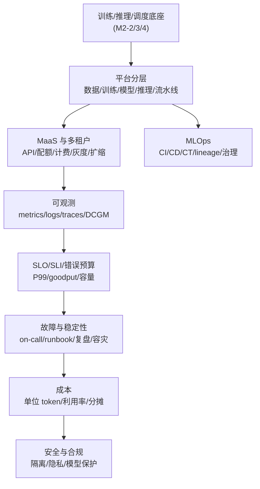

# M2-5 · 平台与稳定性

> 本层回答：怎么把训练/推理/数据/模型能力变成研究员和业务方**自助、可观测、可计量**的平台？
> 线上出问题时，怎么在 5 分钟内判断“哪里坏了、影响多大、先做什么”？

> **前置（按节）**：
> - §2–§3：`notes/24_distributed_base.md §7`（K8s/gang/多租户/虚拟化）、
>   `notes/23_training_systems.md §6`（Checkpoint/容错）。
> - §4–§6：`notes/22_inference_systems.md §1、§11–§13`（TTFT/TPOT/SLO/容量）。
> - §7–§8：`notes/24_distributed_base.md §8`（XID/NCCL hang/可靠性）。
>
> **建议路径（每次 45 分钟）**：
> ① §1–§3（平台分层 / MaaS / MLOps）；② §4–§5（可观测 / SLO / 容量）；
> ③ §6–§7（故障 / 成本）；④ §8（安全合规，点到为止）。
>
> **深度标注**：§1–§6 为必学；§7 成本为必学（至少会算单位 token 成本）；
> §8 安全/合规为了解；调度/网络/存储细节回到 M2-4。

## 0. 依赖图（学习顺序）



> 汇点是：能把一个 AI 系统**产品化、可观测、可计量、可恢复**，并用 SLO 和成本做取舍。

## 1. 平台分层：从资源到用户


| 层 | 解决什么 | 典型能力 |
|---|---|---|
| 数据层 | 数据从哪来、版本是什么 | 数据集、lineage、feature store、质量 |
| 训练层 | 任务怎么跑 | 任务提交、环境、队列、Checkpoint、实验追踪 |
| 模型注册层 | 哪个模型能上线 | 版本、评测、审批、元数据 |
| 推理层 | 怎么服务 | 部署、路由、扩缩容、灰度 |
| 流水线层 | 怎么串起来 | CI/CD/CT、数据/训练/评测编排 |
| 应用/门户 | 用户怎么用 | API、SDK、控制台、配额/计费 |

**自建 vs 采购**：调度、训练、推理、数据闭环是核心差异化，通常自建；
监控/日志/CI/部分模型服务可以采购或开源。不要为了“全栈自研”重复造轮子。

> 平台的价值不是“有 GPU”，而是让用户**自助**（不用找人开权限）、**可观测**（知道任务在干什么）、
> **可计量**（知道花了多少）。这三件事决定采用率。

## 2. MaaS：模型即服务

一条请求的路径：

```
客户端 → 网关(鉴权/限流/配额/路由) → 模型路由(租户/版本/成本)
      → 推理池(引擎/GPU) → 计量/计费 → 可观测
```

### 2.1 多租户

- **配额**：每租户的 GPU 数、并发请求数、token/月上限；
- **隔离**：命名空间、MIG/time-slicing、网络策略；训练任务优先整卡；
- **公平**：fair-share/优先级/抢占；空闲资源可借用，但要有回收机制；
- **计费**：按 token、GPU·小时、存储、网络分别计量；账单可追溯到任务/租户。

> 多租户不是“加个 namespace”：要同时解决**隔离、公平、配额、计费、审计**。

**任务状态机**：`提交 → 准入(配额/权限) → 排队 → 运行 → Checkpoint → 成功/失败/取消`。
每个状态都要可观测、可重试、可取消；准入要检查配额、镜像/环境、数据权限，
避免“先占资源再失败”。

**配额层级**：租户 → 项目/团队 → 用户/任务；支持硬配额（不能超）和软配额（可借用，
但高优任务来了要回收）。配额要和优先级/抢占一起设计。

### 2.2 模型路由、灰度、回滚

- **路由**：按租户/版本/成本/地域选择模型池；A/B 测试、影子流量；
- **灰度**：按流量比例/用户群/请求特征逐步放量；
- **回滚**：模型版本、配置、提示词都要可回滚；回滚要能在分钟级完成；
- **热更新**：不中断服务地换权重；注意 KV Cache/前缀缓存要随模型版本失效。

### 2.3 自动扩缩与 SLA

- 指标：队列长度、TTFT SLO、GPU 利用率、goodput；
- 扩容有冷启动（拉镜像/加载模型），要预留 buffer；
- **SLA** 是对外合同，**SLO** 是内部目标；SLA 通常比 SLO 宽松。
- 过载时：限流、排队、降级（小模型/短输出）、切流；不要等雪崩。

## 3. MLOps：可复现、可追溯、可治理

- **CI/CD/CT**：代码/配置/数据/模型都要版本化；CT（continuous training）按数据漂移触发；
- **可复现**：固定代码、数据、环境、随机种子、硬件；记录每一步的输入/输出；
- **Artifact lineage**：数据 → 训练 → 模型 → 部署，每条边可追溯；
- **Feature store**：离线/在线特征一致，避免训练-服务偏差；
- **模型治理**：评测、审批、卡点、审计、合规；谁在什么时候把哪个模型放上线。

> 面试问“平台怎么设计”：先讲**任务模型/资源模型/权限模型**，再讲生命周期
> （提交 → 排队 → 运行 → Checkpoint → 评测 → 注册 → 部署 → 监控），最后讲失败路径。

### 3.1 把研究员需求抽象成 API

一个最小训练 API 的四块：

```
POST /jobs            {image, command, resources(GPU/CPU/mem), dataset, priority}
GET  /jobs/{id}       → {state, queue_position, metrics, checkpoint_uri, error}
POST /jobs/{id}/cancel
POST /jobs/{id}/retry  {from_checkpoint: true}
```

- **任务模型**：镜像/命令/资源/数据/优先级/超时/重试策略；
- **资源模型**：GPU 型号/数量、拓扑（整机/NVLink 域）、存储挂载；
- **权限模型**：谁能提交到哪个队列、能看哪些数据/日志、能花多少配额；
- **错误模型**：可重试（硬件/抢占）vs 不可重试（代码/数据 poison）；返回结构化错误码；
- **异步**：提交返回 job_id，状态用轮询/事件/Webhook；日志/指标用独立接口。

> API 要稳定、可组合、可观测；不要把内部调度细节泄漏给用户。

## 4. 可观测：metrics / logs / traces


| 信号 | 看什么 | AI 专用 |
|---|---|---|
| Metrics | QPS、延迟、错误率、饱和度 | TTFT/TPOT/P99/goodput、GPU 利用率、KV 使用率 |
| Logs | 结构化日志、请求 ID、错误栈 | NCCL/驱动/XID、审计/计费 |
| Traces | 跨服务调用链、span 延迟 | 网关→调度→引擎→工具调用 |
| GPU | 利用率、显存、温度、功耗 | DCGM：ECC/XID/NVLink |

**排障顺序**：先看**影响面**（多少请求/任务、哪个租户/地域），再看**时间线**
（何时开始、和什么变更重合），然后按层排查：网关 → 调度 → 引擎 → GPU → 网络 → 存储 → 模型。

### 4.1 告警与 OnCall

- 告警要**可执行**：每条告警对应一个 runbook，不要求人“自己猜”；
- 分级：P0（全站/数据损坏）、P1（核心功能降级）、P2（局部/可绕过）；
- **止血优先**：限流/回滚/扩容/切流，先恢复再定位；
- **复盘**：根因、影响、时间线、改进项、负责人、截止时间；不做“背锅会”。

**AI 辅助 OnCall（点到为止）**：

- 告警聚合/去重、根因候选排序、日志摘要、runbook 检索、相似故障推荐；
- 自动生成“影响面 + 建议止血步骤 + 需要谁确认”的卡片；
- **guardrail**：高风险动作（删数据/改配额/重启集群）必须人工确认；只读诊断可自动；
- 评估：MTTD/MTTR、误报率、建议采纳率；不要用“AI 说没事”替代验证。

### 4.2 Runbook 模板

```
触发条件 / 影响面 / 看板链接
第一步做什么、不要做什么
止血手段(限流/降级/回滚/切流) + 验证指标
升级路径 / 负责人 / 沟通模板
复盘 action item + 截止时间
```

> 可观测的目标不是“有图”，而是 5 分钟内回答：**哪里坏了、影响多大、先做什么**。

## 5. SLO / SLI / 错误预算 / 容量


### 5.1 指标口径

| 指标 | 含义 | 注意 |
|---|---|---|
| SLI | 可测指标 | 要能稳定采集、和用户体验相关 |
| SLO | 内部目标 | 如 TTFT P99 < 500 ms、可用性 99.9% |
| SLA | 对外合同 | 通常比 SLO 宽松，带赔偿条款 |
| 错误预算 | `1 - SLO` | 用完就停止发布/降级/扩容 |
| P99 | 99% 请求的延迟上界 | 容量看尾延迟，不看均值 |
| goodput | 满足 SLO 的有效吞吐 | 不是裸吞吐 |

### 5.2 容量：Little's Law 与排队

```
平均并发 L = 吞吐 λ × 平均延迟 W
```

例：50 req/s × 2 s = 100 平均并发。但**P99 容量**要用 SLO 对应的尾延迟 +
安全系数，不能直接用平均延迟。单实例 P99 只能扛 20 并发 → 至少 5 实例 + headroom。

> 利用率接近 100% 时，排队延迟非线性爆炸；goodput 会在饱和前达峰后下降。
> 过载时主动限流/降级，比“让所有请求都超时”好。

### 5.3 训练集群的 SLO/SLI

训练集群的 SLO 不是“可用性 99.9%”这么简单：

- **任务成功率**：提交后能跑完的比例；
- **有效训练时间**：扣除故障/排队/Checkpoint 后的时间；
- **Checkpoint 耗时/RTO**：故障后多久能恢复；
- **调度排队 P99**：大作业等多久；
- **GPU 利用率/碎片率**：资源效率；
- **故障率/MTTR**：硬件/网络/存储故障的恢复时间。

> 训练 SLO 要和业务目标绑定：比如“7 天内完成 1T token 训练，故障导致的回退不超过 2 次”。

## 6. 故障与稳定性

### 6.1 分层定位

| 层 | 症状 | 检查 |
|---|---|---|
| 网关/客户端 | 超时、限流、错误码 | 网关指标、配额、队列 |
| 调度 | 排队久、任务起不来 | 队列、gang、配额、节点状态 |
| 引擎 | TTFT/TPOT 高、吞吐低 | batching、preemption、KV |
| GPU | OOM、XID、降频 | DCGM、nvidia-smi、dmesg |
| 网络 | 多卡/PD 变慢、NCCL 超时 | IB/RoCE、PFC、NCCL 日志 |
| 存储 | Checkpoint/数据加载慢 | fio、iostat、元数据 |
| 模型/输入 | 长 prompt/长输出 | 输入输出长度分布 |

**大面积 hang 的三步**：① 看是否所有节点都卡在同一个 collective（`NCCL_DEBUG=INFO`/进程栈）；
② 缩小到 2/8 卡复现，换节点/网卡二分；③ 查坏节点/链路/存储，隔离后从 Checkpoint 恢复。
不要先重启整个集群。

### 6.2 降级、容灾与演练

- **降级**：小模型、短输出、关闭非核心功能、缓存兜底；
- **fallback**：多模型/多地域/多供应商；切换要能自动触发；
- **多地域/容灾**：数据/模型复制、DNS/流量切换、RTO/RPO 目标；
- **混沌工程**：定期注入故障（节点/网络/依赖），验证预案；
- **演练**：on-call 轮值、runbook 走查、复盘 action 闭环。

> 不要等故障发生才第一次打开 runbook；平时要演练。

### 6.3 GPU 故障自动发现与自愈

状态机：`健康 → 可疑 → 隔离(cordon) → drain → 维修/重启 → 回归验证 → 健康`。

- **检测**：DCGM 巡检 ECC/XID/NVLink/温度/功耗；连续 N 次阈值/自检失败才判可疑，
  避免误杀；`dcgmi diag`/`nvidia-smi -q` 做二次确认。
- **隔离**：cordon 阻止新任务；drain 驱逐/等待 Checkpoint；不要直接拔卡。
- **恢复**：重启驱动/节点、跑 burn-in、`nccl-tests` 验证；通过后才回到资源池。
- **任务侧**：坏节点上的任务从 Checkpoint 重调度；记录故障根因，避免反复踩同一节点。

> 自愈的目标是“缩短 MTTR”，不是“永不故障”；要有误判保护和人工兜底。

### 6.4 训练任务失败：分类、重试、恢复

| 类型 | 例子 | 处理 |
|---|---|---|
| 硬件 | XID/ECC/NVLink/节点掉线 | 隔离节点、重调度、从 Checkpoint 恢复 |
| 软件 | OOM、NCCL hang、镜像/依赖 | 修配置/换镜像；不要盲目重试 |
| 数据 poison | 某个 shard 导致 NaN/崩溃 | 定位 shard、跳过/修复；重试会再次失败 |
| 抢占 | 高优任务来了 | 保存 Checkpoint、优雅退出、排队重试 |

**重试策略**：指数退避 + 上限（如 3 次）；同一失败原因连续出现要停止并告警；
重试要**幂等**（从 Checkpoint 恢复，不重复写坏数据）；gang 作业要整组重调度，
避免半组启动。**恢复点**：最近的 Checkpoint + 数据 loader/RNG 状态；
恢复后要校验 step/学习率/优化器状态。

> “失败就重启”是最贵的策略：先分类，再决定重试/修复/隔离。

## 7. 成本：单位 token 成本与利用率


```
每百万 token 成本 = GPU 小时成本 / (tokens/s × 3600) × 1e6
```

例：`$2/h`、`2000 tok/s` → `2/(2000×3600)×1e6 ≈ $0.28/M token`。
真实成本还要加空闲容量、冗余、网络、存储、运维；**goodput 低时单位成本会显著上升**。

**降本杠杆**：利用率（batching/混部）、硬件（FP8/INT4/合适卡型）、算法（蒸馏/小模型/
投机/缓存）、调度（spot/弹性/配额）、SLO 分层、计量分摊。

> 降本不是“买便宜卡”：要同时看 **利用率、SLO、精度、调度**；
> 把利用率从 40% 提到 70% 可能降本 43%，但 P99 可能变差。

**Showback vs Chargeback**：

- **Showback**：给租户看账单/用量，不真正扣钱；适合平台早期；
- **Chargeback**：按预算真实扣减/结算；需要准确的计量、标签、价格表；
- **共享资源**：网关/存储/监控按用量分摊；空闲容量按配额或实际使用分摊，规则要透明；
- **标签**：租户/项目/任务/模型/环境；账单可下钻到任务，支持预算告警。

例：租户 A 本月用 10,000 GPU·h（$2/h）+ 5 亿 token（$0.28/M）→
`$20,000 + $140 = $20,140`；再按共享存储/网络分摊。

## 8. 安全与合规（点到为止）

- **多租户隔离**：网络/存储/GPU 隔离；防止跨租户数据泄漏；
- **数据隐私**：脱敏、加密、访问控制、审计；训练数据/日志的保留策略；
- **模型/IP 保护**：权重加密、访问审批、水印；防止模型被窃取/滥用；
- **合规**：数据出境、许可证、内容安全；按业务所在地要求处理。

> 这一节不展开：面试点到“隔离/隐私/审计/合规”即可，深入要看具体行业。

## 9. 面试要点

1. **训练平台怎么设计？** → 任务模型/资源模型/权限模型；生命周期（提交→排队→运行→
   Checkpoint→评测→注册→部署→监控）；失败路径（重试/恢复/降级）。
2. **LLM 服务的 SLO 怎么定？** → TTFT/TPOT/可用性/错误率/goodput；按业务分层；
   P99 容量 + 安全系数；错误预算。
3. **GPU 利用率怎么提高？** → batching/continuous batching、混部、拓扑感知调度、
   MIG/共享、减少空闲/碎片；但不要牺牲 P99。
4. **线上 P99 升高怎么定位？** → 先止血（限流/回滚/扩容），再按网关→调度→引擎→GPU→
   网络→存储→模型分层排查；看时间线和变更。
5. **训练任务大面积 hang 怎么排查？** → NCCL_DEBUG、进程栈、网络/存储、坏节点；
   缩小规模复现；区分“真死”和“慢”。
6. **GPU 故障怎么自动发现/自愈？** → DCGM/XID/ECC 巡检、cordon/drain、任务重调度、
   Checkpoint 恢复；热备/冗余。
7. **模型上线怎么灰度/回滚/计量？** → 按流量/用户/版本切分；回滚模型/配置/提示词；
   按 token/GPU·h/租户计量。
8. **平台怎么分摊成本？** → GPU·小时 + token + 存储 + 网络；按租户/任务/模型打标签；
   账单可追溯；配额/预算告警。
9. **怎么把研究员需求抽象成 API？** → 先看任务生命周期与失败路径，再定义资源/权限/
   产物模型；API 要稳定、可组合、可观测。
10. **怎么用 AI 提升 OnCall？** → 告警聚合/根因推荐/日志摘要/runbook 检索/自动止血；
    但要有 guardrail，不能自动执行高风险操作。

> **AI OnCall 的边界**：数据要有权限/脱敏；建议要可解释、可回滚；自动动作只允许
> 低风险（查状态、拉日志、扩容只读副本），高风险（回滚/删数据/切流）必须人工确认。
> 指标：MTTR、误报率、建议采纳率、自动化覆盖率。

## 10. 常见坑

- **只建平台不管采用率**：接口难用、文档缺失，研究员绕开平台。
- **SLO 只看平均值**：P99 超时，用户已经跑了。
- **把 SLA 当 SLO**：对外承诺和内部目标混为一谈。
- **告警没有 runbook**：值班的人不知道先做什么。
- **降级没有演练**：真故障时切不过去。
- **成本只看 GPU 单价**：利用率/goodput 低，便宜卡也贵。
- **多租户只做 namespace**：没有隔离/配额/计费，迟早出事。
- **监控只有 dashboard**：没有告警/追踪/日志关联，定位靠猜。

## 动手清单（60–90 分钟）

1. **SLO 账本**：给定 QPS、平均延迟、SLO P99，用 Little's Law 估并发与实例数；
   再加 30% headroom，比较“按平均”和“按 P99”的差异。
2. **单位成本**：给定 GPU 单价、tokens/s、利用率，算 `$/M token`；扫利用率 30–80%，
   画成本曲线。
3. **Runbook**：为一个 LLM 服务写一页 runbook（触发条件/影响面/止血/升级/复盘）。
4. **可观测清单**：列出你会采集的 10 个指标（含 DCGM/TTFT/TPOT/goodput/队列/KV），
   说明每个指标的告警阈值和动作。
5. **成本分摊**：给一个多租户平台设计标签体系（租户/任务/模型/环境），
   说明如何把 GPU·h 和 token 账单分摊到租户。

验收标准：能对一个线上故障给出“影响面 + 止血 + 分层定位 + 复盘”的完整链路，
并能用 SLO/成本数字解释取舍。

## 相关图

- `25a_platform` — 平台分层 + MaaS 请求路径；
- `25b_slo` — SLO/goodput/容量曲线；
- `25c_observability` — metrics/logs/traces + OnCall 流程；
- `25d_cost` — 单位 token 成本与降本杠杆。

## 下一步

- **M2-6 前沿与端侧**：Agent Runtime、RL Infra、端侧部署、异构芯片。
- 回到 **M2-4 §7–§8** 补调度/可靠性细节；回到 **M2-3 §11–§13** 补推理 SLO/容量。
