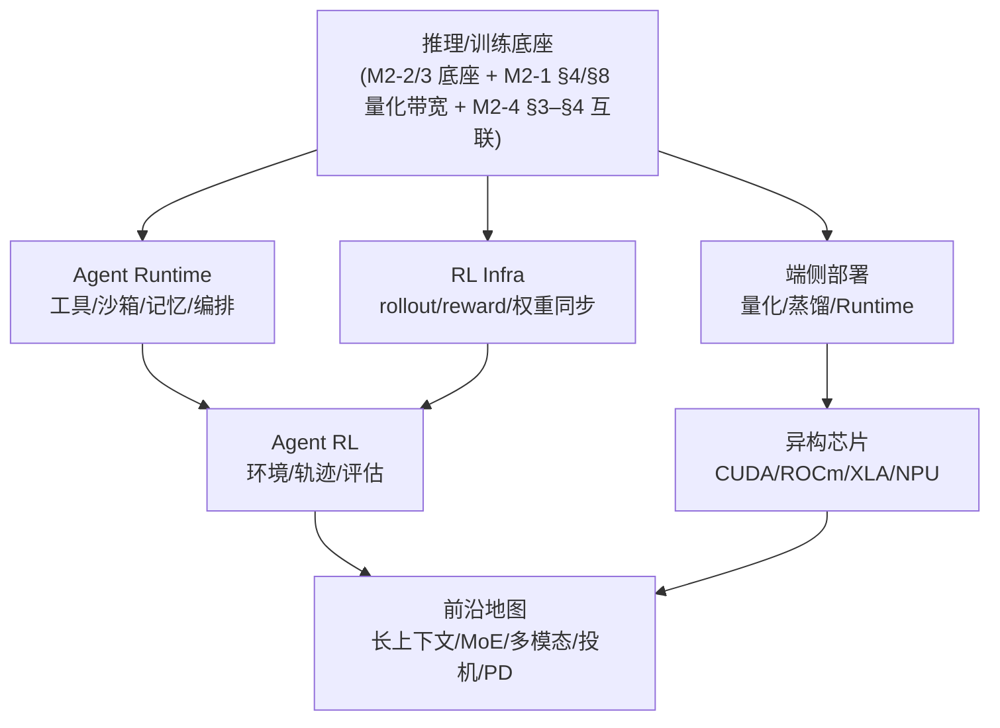

# M2-6 · 前沿与端侧

> 本层回答：Agent、RL、端侧、异构芯片、长上下文这些“新方向”，在 Infra 上到底新在哪？
> 哪些瓶颈是老的（显存/带宽/调度），哪些是真的新（沙箱、rollout、功耗、可移植性）？

> **前置（按节）**：
> - §2–§3：`notes/23_training_systems.md §7`（SFT/PPO/GRPO/rollout/权重同步）、
>   `notes/22_inference_systems.md §1–§3`（prefill/decode 与延迟/吞吐口径、KV 显存账本）。
> - §4：`notes/21_single_node_ops.md §4、§8`（Roofline/量化）、`notes/22 §8`（量化）。
> - §5：`notes/24_distributed_base.md §3–§4`（§3「互联与拓扑」，拓扑在 §3.3；§4 是「集合通信之外的通信：P2P 与重叠」，不是拓扑）；硬件细节可先跳过。

> - §4（先读 `21 §9.3`）与 §6：`notes/22_inference_systems.md §9–§10`（投机解码/长上下文）、`notes/21_single_node_ops.md §9.3`（性能对比口径：不同 batch/精度/输入长度不可比、不能只看平均延迟）；其中 21 §9.3 的对比口径在**本节 §4.1/§4.2**（指**本文第 4 节「端侧」**的 §4.1/§4.2 那两小节，不是 notes/21 的节号；本文 frontmatter 是 layer: 6，按层号去找会落到 M2-4 分布式底座）就要用：跨机型、跨长度的读数不可比，所以它必须在读 §4 之前补；22 §9–§10 只在 §6 用到；读 §2–§3 时不必先读。
>
> **建议路径（每次 45 分钟）**：
> ① §2（Agent Runtime/沙箱）；② §3（RL Infra）；③ §4（端侧）；
> ④ §5–§6（异构芯片/前沿地图）。
>
> **深度标注**：§2–§4 为必学；§5 异构芯片为了解–加分（按目标岗位）；
> §6 前沿方向为了解，面试能讲清“瓶颈 + 技术 + 代价”即可。

## 0. 依赖图（学习顺序）



> 汇点是：面对一个新方向，能判断它**复用了哪些旧瓶颈**、**新增了哪些系统问题**，
> 并给出可验证的优化方向。

> 依赖图只画学习顺序：G（前沿地图）的**内容前置**是 22 §9–§10（投机解码/长上下文），所以图上没有这条边。A 是压缩写法：它一并代表 22/23 底座、`21 §4、§8`（Roofline/量化）和 `24 §3–§4`（§3 互联与拓扑、§3.3 讲拓扑；§4 是 P2P 与重叠，不是拓扑），所以图上不单画 M2-1/M2-4 节点——读 §4 前补 21 §8，读 §5 前补 24 §3–§4，与上面「前置」块一致。

## 1. 为什么这些方向“新”

- **Agent/RL**：新增了**沙箱/环境/轨迹**这条“数据生产线”，瓶颈从单次推理变成“每单位时间
  产生多少可训练/可执行的轨迹”；
- **端侧/异构**：新增了**功耗、散热、内存带宽、可移植性**约束，不能直接套云侧优化；
- **前沿模型**（长上下文/MoE/多模态/投机/PD）：多数是把旧的**显存/带宽/通信**瓶颈放大（例外：视频生成的 DiT 多步去噪是 compute-bound、且没有自回归 KV Cache，见 §6.1——它放大的是算力，不在显存/带宽/通信这三项里），
  再用系统手段拆开。

> 本层的方法固定：**先找瓶颈指标 → 再看技术打中了哪个瓶颈 → 最后说代价和适用边界**。
> 不要从名词出发，也不要把“新”当成“一定更好”。

## 2. Agent Runtime：让模型在沙箱里“做事”


### 2.1 组成

| 组件 | 作用 | 系统问题 |
|---|---|---|
| Orchestrator | 规划、调用工具、重试/停止 | 状态机、预算、超时、最大步数 |
| LLM | 推理/决策 | 延迟、成本、上下文长度 |
| Tool Router | 选工具、填参数 | 工具 schema、鉴权、失败重试 |
| Sandbox | 执行代码/浏览器/文件 | 隔离、启动速度、资源回收 |
| Memory | 短期/长期/检索 | 一致性、压缩、隐私 |
| Trace | 记录每步 | 存储、回放、评估 |

### 2.2 一次 Agent 任务

```
用户目标 → 规划 → 调工具 → 观察结果 → 继续/重试/停止
```

- **预算**：token/时间/工具调用次数/金额；超预算要优雅停止；
- **重试**：工具失败/超时/返回不可解析；区分可重试与不可重试；
- **记忆**：长会话要摘要/检索/压缩；不要把整个历史塞进 prompt；
- **可观测**：每步 prompt/工具/结果/延迟/成本；trajectory 可回放。

### 2.3 沙箱：隔离与启动速度

| 方案 | 启动 | 隔离 | 适用 |
|---|---|---|---|
| 容器（Docker） | ~100 ms–1 s | 中 | 生态好、可信代码 |
| gVisor | ~200 ms–1 s | 较强 | 用户态内核、兼容性有代价 |
| Firecracker | ~50–150 ms | 强 | microVM、高并发 |
| WASM | ~ms | 强（能力受限） | 插件/工具、系统调用受限 |

> 表中四档启动时间都是**量级工程估计**（无实测来源，也未标机型/镜像大小/宿主负载），只用于比较数量级，不能当硬数字引用。小账本里的两个取值是**约定值**而非另一次实测：1 s 取容器(Docker)/gVisor 区间的上端当冷启动基线，100 ms 取 Firecracker 与快照恢复量级（个位数 ms–百 ms）的乐观端当“优化后”；换方案就要重取这两个数，别把表里的区间中值直接代入账本。

> 1 万并发 Agent 任务：资源波峰 = 同时在跑沙箱数 × 单沙箱配额（“启动时间 × 并发”量纲是沙箱·秒，不是 vCPU/内存；同时在启动的数 = 到达速率 × 启动时长）。要做**沙箱池/预热/快照/回收**；
> 每个沙箱要有 CPU/内存/磁盘/网络配额，防止资源滥用。
>
> 小账本：10k 任务、每任务 2s、池 500 → 约 20 波；若冷启动 1s，首波就要 500 个沙箱同时起，
（这里用的是**批量齐发**模型：20 波整齐推进、每波 500 个一起冷启动，所以峰值并发是 500；若按**流式到达**套 `同时在启动的数 = 到达速率 × 启动时长`，10k 任务摊在 40–60 s 里约 167–250 个/秒到达、1 s 启动 → 同时在建只有约 170–250 个。**算峰值容量用批量口径的 500，算并发创建速率用流式口径**，别混用。）
> 按这个账：20 波 ×（1s 冷启动 + 2s 执行）≈ 60s 墙钟，冷启动约 20s（≈1/3）；压到 100ms 能省约 18s（对 60s 约 30%，对 40s 纯执行约 45%）。先分清基线：上面 60 s 是**不建池**的账（20 波 ×（1 s 冷启动 + 2 s 执行））。20 s 是**基线里冷启动的总量**（20 波 × 1 s = 20 s），18 s 是**压到 100 ms 后省下的差值**（60 s → 42 s，即降幅）——一个是总量、一个是降幅，**互斥不可相加**：只做池化（池 500 预热，**第 1 波起即命中预热实例**（20 波全走 2 s 执行、零冷启动））→ 排队等冷启动≈0，墙钟落到约 40 s（=20 波 ×2 s 的执行下限）；只做启动优化/快照恢复（每次创建 1 s→100 ms）→ 20×（0.1 s+2 s）≈42 s；两条都做仍是约 40 s。所以先按池化记 60 s→40 s；启动优化/快照压的是**单次创建的时长**（也决定补实例有多快），既不省创建次数，也不能在 40 s 上再减 18 s。
**同一件事的两个视角，别混主体**：**任务侧**看不到冷启动——池命中就直接拿预热实例，排队等待≈0，这才是池化省掉的；**池子侧**并没有少建沙箱，稳态仍要按约 250/s 补实例（10000 个任务摊在约 40 s 里；按 60 s 算是约 167/s——333/s 属于下一段“10000 个在跑、每任务 30 s”的场景，不是本条账），快的只是「取用」这一步，补实例本身靠快照/恢复（Firecracker 约 5 ms 级、CRIU 几十–几百 ms）而不是靠池子。
（补两个词的最小语义：**Firecracker** 是 microVM，快照/恢复的是整台微虚拟机的内存 + 设备状态，对象是“整机”，所以是个位数 ms；**CRIU**（Checkpoint/Restore In Userspace）是**进程级**检查点/恢复，要冻结并重建进程的地址空间、文件描述符、线程，对象是“一个进程”，更通用也更重，所以是几十到几百 ms。两者对象不同、量级不同，别记成同一个 10 ms 档，也不能互相替代。）所以 60 s→40 s 那 20 s 记在**池化/预热**（消掉排队等冷启动）名下；单次创建 1 s→100 ms 省下的约 18 s 属于**启动优化/快照恢复**，但它和那 20 s 是同一笔冷启动账的“总量 vs 降幅”关系（互斥、不可相加，见上面小账本），只在“不做池化”那条路上兑现；快照/恢复的实际作用是让「补实例」更快、不让池子变少。三个名字对应三个机制，收益只有一笔账，别并计。

>
> 两个口径别混：**到达总量**（一共 10k 个任务，按池 500 排队 → 峰值约 1k vCPU / 2 TB）vs **同时在跑**（下一条是另一种场景：10000 个沙箱同一时刻活着 → 20k vCPU / 40 TB）。规划池子按“同时在跑 = 到达速率 × 单任务时长”，规划总成本按“到达总量 × 单任务成本”。
单沙箱配额先给死：2 vCPU / 4 GB（下一条同一套配额）→ 500 的池 ≈ 500×2 = 1k vCPU、500×4 GB = 2 TB；10000 个同时在跑 ≈ 10000×2 = 20k vCPU、10000×4 GB = 40 TB。三个账本共用这一套配额，验算时只换「个数」。

**1 万并发池账本（另一场景：任务 30 s、10000 个沙箱同时在跑，不是上一条的“到达 10k、池 500”）**：每个沙箱 2 vCPU/4 GB/1 GB 盘 → 峰值 `20k vCPU/40 TB 内存`；
启动 100 ms、任务 30 s → 新建/完成速率约 `10000/30≈333 个/秒`；同一时刻约 `10000×0.1/30≈33` 个沙箱在启动（不是 33 个/秒）。池化的收益是消掉**排队等冷启动的时间**（命中预热实例直接毫秒级取用；沙箱创建次数仍是 ~333/s，并没有减少），也不是把冷启动本身从 100 ms 变成 10 ms——那是**快照/恢复**（Firecracker microVM snapshot、CRIU）的事，Firecracker 的公开快照/恢复数字是个位数 ms（约 5 ms），CRIU 的恢复通常是几十到几百 ms，别把二者记成同一个 10 ms 量级，两者手段不同、不矛盾；按上式，同时在启动的只有约 33 个，池子按几十到一两百配即可。没有池化，启动风暴会先打满 API/镜像仓库，而不是 GPU。

> 三个数各管一件事，别混着用：**① 500 的池** 是“到达 10k、每任务 2 s”那条小账本的**单波并发**（20 波 × 500），也是预热池要覆盖的实例数（=排队并发，不是“同时在启动”的数），峰值 1k vCPU/2 TB 来自排队并发 × 配额；**② 10000 个同时在跑** 是另一场景的**稳态在跑总量**（20k vCPU/40 TB），描述占用而不是池子大小；**③ 约 33 个** 是“这一瞬间正在启动”的数量（10000 × 0.1s / 30s），决定的是并发创建速率与镜像仓库/API 要扛的 QPS。规划口径（两个场景别抄串）：**做「10k 任务、每任务 2 s」这道题就抄 ① 的池 500**（峰值 ≈1k vCPU/2 TB）；**几十到一两百只属于“10000 个同时在跑、每任务 30 s”那一场景的启动缓冲**（对应 ② 的 20k vCPU/40 TB），不是池容量；③ 的约 33 只决定“同时在建”的并发度与镜像仓库/API 的 QPS，不能拿来定池容量。成本按到达总量 × 单任务成本。

### 2.4 延迟与成本瓶颈

- **LLM decode**：每个 token 都要读权重；长输出/大模型是主要成本；
- **工具调用**：串行工具让延迟累加；能并行就并行，能缓存就缓存；
- **沙箱启动**：冷启动占大头；池化/快照；
- **长上下文/记忆**：token 成本 + prefill 延迟；
- **重试**：失败重试会放大成本；要有上限和降级。

**单任务成本** ≈ `LLM tokens × 单价 + 工具调用 × 单价 + 沙箱秒 × 单价 + 重试/长尾`；
按 task_id/tenant 打标签，才能做预算、限流和归因。

> 优化顺序：先减少步数/工具调用（算法/编排），再并行/缓存，再小模型路由，
> 最后才是换更快的 GPU。


### 2.5 Trajectory：采集、存储、回放

一条 trajectory 至少要有：

```
task_id · step · prompt/context · tool + args · result · latency · cost · model_version
```

- **存储**：对象存储/列式文件；大轨迹分块，索引与内容分离；
- **版本**：模型/提示词/工具 schema 都要版本化，否则回放不可比；
- **确定性回放**：固定 seed、工具返回（mock/录制）、环境快照；否则“回放”只是重跑；
- **隐私**：轨迹可能含用户数据，要脱敏/访问控制/保留策略。

> Agent 的调试和评估高度依赖 trajectory；没有 schema/版本/回放，失败无法归因。

## 3. RL Infra：rollout 是新的“数据生产线”


### 3.1 闭环

```
Rollout workers(旧权重) → 环境池 → Reward/Verifier → Replay/队列
→ Trainer(PPO/GRPO) → 权重同步 → Rollout workers(新权重)
```

- **rollout**：用当前策略生成轨迹；常用 vLLM/SGLang/TensorRT-LLM 做高吞吐；
- **环境池**：代码执行/浏览器/工具/游戏；要隔离、可回收、可观测；
- **reward**：RM、规则/verifier、沙箱结果；要可扩展、可回放；
- **训练**：PPO（actor+critic+reward+reference）或 GRPO（组内相对 advantage，省 critic）；
- **权重同步**：broadcast/reshard/增量；同步太慢会成为瓶颈。


> 术语速查（只给判断用的最小语义，推导见 `notes/23 §7`）：**actor**=被训练的策略；**critic**=估状态价值的模型，用来当基线；**reference**=冻结的旧策略，KL 罚的是“当前策略 vs reference”的分布差，防止学歪；**advantage**=这个动作比基线好多少（GRPO 用同组样本均值当基线，所以省掉 critic）；**重要性采样/裁剪**=异步时新旧策略分布不一致，用概率比修正、裁掉过大的更新。
补三个没展开的词：**RM**=reward model，学出来的打分模型（和规则/verifier、沙箱结果并列，是 §3.1 里 reward 的一种来源）；**off-policy**=更新用的样本由**旧权重**采出、与当前策略分布不一致（异步 rollout 必然 off-policy）；**bounded staleness**=给“样本比当前权重旧多少”设上限（按版本号/训练步数，超限就丢样本或等一次同步），不是批次大小上限。

### 3.2 同步 vs 异步

- **同步**：rollout 完再训练，稳定但 GPU 利用率低；
- **异步**：rollout 与训练并行，吞吐↑；但权重陈旧 → off-policy/staleness；
- 需要 **bounded staleness**、重要性采样/裁剪、版本号；
- **Agent RL**：轨迹更长、工具调用/沙箱、reward 稀疏；成本与方差更高。

### 3.3 时间账本

```
t_step ≈ t_rollout + t_reward + t_train + t_sync
```

例：rollout 60%、reward 15%、train 20%、sync 5% → 先优化 rollout；
但异步 rollout 会引入陈旧度，要一起看 reward/KL/长度。

> 面试问“RL Infra vs 推理 Infra”：推理 Infra 优化单次请求的延迟/吞吐；
> RL Infra 优化**轨迹生产 + 训练闭环**的吞吐，瓶颈常在 rollout/环境/同步，而不是单次推理。


### 3.4 Agent RL：环境 / 轨迹 / 评估

依赖图的节点 D 就是这一节：它是 §2（工具/沙箱/记忆）+ §3.1–§3.3（rollout/训练闭环）的交叉，不是“异步 rollout 的副作用”。

- **环境**：工具/浏览器/代码沙箱，要可重置、可并行、可复现（seed/快照）；
- **轨迹**：多步长 horizon，一条样本是一串 (prompt, action, observation)；reward 常是终局/稀疏；
- **评估**：除 reward 还要看成功率/步数/成本；评测环境与训练环境隔离，防过拟合；
- **新瓶颈**：环境吞吐（每秒多少 episode）、轨迹存储/回放、reward 服务、训练↔推理权重同步。

## 4. 端侧：内存、带宽、功耗


### 4.1 优化链

```
模型选择/蒸馏/小模型 → 量化(AWQ/GPTQ/INT4) → 编译/Runtime → 设备
```

> 顺序别搞反：通常**先蒸馏/换小模型，再量化**；经验上先量化再蒸馏容易把量化误差带进蒸馏目标（这是工程经验规则，不是定量结论，具体要按目标做实验对比）。
> 但如果目标是“保留大模型能力、只压体积”，也可以先量化大模型——面试时要说清目标。

- **量化**：AWQ（保护显著通道）、GPTQ（二阶误差补偿）、INT8/INT4；weight-only 对 decode 带宽友好；


> **perplexity（PPL）** = 对留出文本的平均负对数似然取指数，读作“每步平均在多少个等概率候选里犹豫”，无量纲、越低越好。它只看 token 级似然、不看任务对不对，所以量化后 PPL 与任务指标可能脱钩：工程经验上常见“PPL 只涨一点点、任务指标已掉一截”（长尾/格式/推理链更敏感）——这句是本层的经验判断、无定量来源，M2-3 §8.2 只支撑“平均指标没掉、个别任务明显退化”与“不能只看 perplexity”，不支撑这个量级；PPL 只是筛查项，门禁仍看任务指标 + 长尾。
（下面 FP8、蒸馏、Runtime、设备四条仍是同一条 bullet 列表的续项，不是另一组条目；这段 PPL 是插入的旁注。）
- **FP8**：E4M3 精度高/范围小、E5M2 范围大/精度低；per-tensor/per-block scale，权重是确定的、直接统计 `amax` 定范围，静态量化的激活侧要用校准集估 `amax`（动态 per-token/per-block scale 是在线统计、不需要校准集）；反过来 weight-only 的 AWQ/GPTQ 不量化激活，却也要用校准集挑显著通道/近似 Hessian（选 scale 的机制见下面“补充：INT4 的量化机制”）；outlier/敏感层要评估，掉点时可回退或混合精度。INT4 常用 per-group；
  评测必须看任务指标 + 长尾，不能只看 perplexity（详见 M2-3 §8.2）；
- **蒸馏**：小模型学大模型分布；端侧常直接换 1–3B；
- **Runtime**：llama.cpp、MLC、ONNX Runtime、TensorRT、厂商 NPU SDK；
- **设备**：NPU/GPU/DSP/CPU；算子支持/内存/功耗差异大。

**顺序为什么是这个顺序**（机制解释；结论只认本节第一段那一条，这里不重复结论）：图里自上而下就是“蒸馏/小模型 → 量化 → 编译/Runtime → 设备”，和上面的代码块是同一个顺序。
实际通常先**选/蒸馏合适的小模型**（决定能力上限），再对最终模型做**量化**（决定体积/带宽），
最后选 Runtime/算子。顺序和取舍最终要用同一套任务评测比（见下文“评测门禁”），不靠口号。

**补充：INT4 的量化机制**（顺序只认本节第一段那一条，下面「顺序为什么是这个顺序」只是它的机制解释，不另立口径；FP8 的 E4M3/E5M2 见上面的 bullet）：
INT4 的 AWQ/GPTQ 都是 weight-only、都要校准集，但选 scale 的机制不同：**AWQ** 按激活敏感度搜索保护显著通道（scale 由搜索定，不是简单 amax），**GPTQ** 用校准数据的二阶信息（Hessian 近似）做逐列误差补偿；amax 只决定量化区间。
掉点评估见 M2-3 §8：任务级指标 + 长尾 + 与 FP16 基线对比；敏感层回退 FP16/INT8。

**评测门禁**：端侧上线前要有“精度-延迟-内存-功耗”四张表；任何量化/蒸馏改动都要过
同一套任务评测和真机 benchmark，不能只看 perplexity 或实验室 tok/s。

### 4.2 手机账本（7B INT4）

```
权重 ≈ 7e9 × 0.5 B = 3.5 GB
理论上限(T→0、batch=1、几乎不读 KV) ≈ 内存带宽 / 权重字节 = 50 GB/s / 3.5 GB ≈ 14 tok/s
理论上限(4K 上下文) ≈ 50 GB/s / (3.5 GB 权重 + 2.0 GiB KV；2.0 GiB = 2.15 GB，合计 5.65 GB) ≈ 8.8，取约 9 tok/s
实际 7–10 tok/s(短上下文/他机型读数；未给机型/上下文长度/出处，无可复现来源，只能当量级参考；4K 下受上面 ≈9 的上限约束；开销/热/调度)
KV 4K 约 2 GiB(7B MHA：L=32、d_model=4096、32 头×128、fp16 → 2×L×(H_kv×d_head)×T×2 B = 2×32×(32×128)×4096×2 B（此处 H_kv×d_head = 32×128 = 4096 = d_model 的每层 KV 总维；单头 d_head 只有 128，按 128 代入会小 32 倍） ≈ 2 GiB)
```

> 端侧 decode 仍是 **memory-bound**；带宽 ÷（权重字节 + 该上下文长度必须读的 KV）才是 tok/s 上限：T 很小时 KV 可忽略（≈14），T=4K 时 KV 约占四成（2.15 GB / 5.65 GB ≈ 38%），上限掉到约 9；这里的“实际 7–10”是短上下文/他机型的读数；4K 下约 9 只是按 50 GB/s 算出的**上限**（沿用同一个假设，换 68 GB/s 档位约 12），不是实测，不能拿它去卡他机读数。
> 功耗量级约 5 W（工程估计：未标机型/NPU 档位、无实测来源，不能当账本里的硬数字），长时间跑会发热降频；内存不足就换 1–3B/蒸馏/更激进的量化。

### 4.3 端侧 vs 云侧

| | 端侧 | 云侧 |
|---|---|---|
| 优势 | 隐私、离线、低延迟 | 大模型、弹性、集中运维 |
| 约束 | 内存/带宽/功耗/散热 | 网络、成本、SLO |
| 优化 | 量化/蒸馏/小模型/Runtime | batching/并行/量化/PD |

> 不要把云侧优化直接套到端侧：端侧没有 NVLink/大 batch，功耗和热是硬约束。

### 4.4 可复用加速 pipeline

```
模型注册 → 蒸馏/量化 → 编译/Runtime → 评测门禁 → 灰度/部署 → 监控/回滚
```

- **评测门禁**：任务指标、长尾集、延迟/内存/功耗；不过门禁不进部署；
- **版本/血缘**：模型、量化配置、Runtime、硬件都要记录，才能复现；
- **回滚**：保留 FP16/上一版量化包；线上异常能切回；
- **自动化**：同一套 pipeline 支持 LLM/VLM/语音，按模型类型换 evaluator。

## 5. 异构芯片：可移植性是分层的


| 厂商 | 软件栈 | 特点 |
|---|---|---|
| NVIDIA | CUDA/cuDNN/TensorRT | 生态最成熟，迁移成本低 |
| AMD | ROCm/HIP/MIOpen | 生态追赶，移植/调优成本 |
| Google TPU | XLA/JAX/PJRT | 编译友好，绑定 JAX/云 |
| AWS Trainium | Neuron SDK/XLA | 成本/云绑定 |
| Huawei Ascend | CANN/Ascend C | 国内生态，工具链差异 |
| 端侧 NPU | CoreML/Hexagon/厂商 SDK | 算子受限、功耗优先 |

**可移植性分层**：

```
模型代码(PyTorch/JAX/ONNX) → 图/算子(Attention/GEMM/MoE/融合) → 编译器(CUDA/ROCm/XLA/oneAPI)
→ 运行时/库(cuDNN/MIOpen/PJRT/Neuron) → 硬件
```

> 不要假设一个二进制跨厂商；用框架导出(ONNX) + 编译层(MLIR) 做抽象，再落厂商库（Triton 是 kernel 级 Python DSL，不是 ONNX/MLIR 那种图级可移植层，但**它确实跨厂商**：走分层 IR（TTIR 与硬件无关、只表达 tile 级算子；TTGIR 已补 layout、线程数、shared memory 等 target 相关决定），后端分别生成 NVIDIA PTX 与 AMD HSACO，PyTorch Inductor 在两侧产出的都是 Triton kernel；能站得住的只有“极致性能仍不如手写”这条）；
> 关键路径留 fallback。
（术语补在这里，读上面那句要用的最小语义：**TTIR/TTGIR** 是 Triton 的两层 IR——TTIR 与硬件无关、只表达 tile 级算子，TTGIR 在其上补 layout、线程数、shared memory 等 target 相关决定；**PTX** 是 NVIDIA 的 GPU 虚拟指令集（cuDNN/驱动之前的汇编级中间层），**HSACO** 是 AMD 的 GPU 代码对象（HIP 编译产物，地位约等于 NVIDIA 的 cubin）；**PyTorch Inductor** 是 PyTorch 2 的默认编译器，把计算图降成 Triton kernel。所以这条链条是「厂商无关 IR → 各自后端生成 PTX/HSACO」，而 IR（图/算子级抽象，ONNX、MLIR）与 kernel DSL（Triton，写单颗 kernel）是两层不同的东西：Triton 的好处是同一份 kernel 代码两条后端都能出，不是替代 ONNX/MLIR 的图级抽象。）芯片选型看生态、内存、互联、功耗、供应，不只 TOPS。

## 6. 前沿地图：先找瓶颈，再看技术


| 方向 | 瓶颈 | 代表技术 | 代价 |
|---|---|---|---|
| 长上下文 | KV 显存/带宽 | RingAttention、KV offload、稀疏/线性注意力 | 精度/实现复杂 |
| 大规模 MoE | EP all-to-all/负载均衡 | 专家并行、grouped GEMM、capacity/均衡 | 通信/负载不均 |
| 多模态/音视频 | 视觉 token/DiT 多步去噪/VAE | token 压缩/step 蒸馏/VAE 分块 | 质量/延迟 |
| 投机解码 | 接受率/验证成本 | draft/Medusa/EAGLE、n-gram lookup | 显存/训练成本 |
| PD 分离 | KV 传输/调度 | prefill/decode 池、RDMA、KV store | 传输/复杂度 |
| Agent RL | rollout/环境/权重同步 | 沙箱、异步 rollout、reward 服务 | 陈旧度/成本 |

>
> **EP all-to-all 是什么**（本层唯一没定义的通信原语，补在这里，也是要点 6 的前半句）：专家并行下每张卡只放一部分专家，本卡 token 要先按路由结果重新分发——每张卡把本地 token 按目标专家切成至多 E 份发出去、再收回到自己的那份，这就是 all-to-all。与 all-reduce（每卡收发同形状数据、单卡流量 ≈ 2×数据量）不同，它是**一对多的数据置换**：单卡发送量 ≈ 本卡 token 数 × top-k × 隐藏维 × 精度字节，并随路由倾斜出现长尾。所以它比 all-reduce 贵在两维：① 流量随 top-k/专家数放大、且不能靠对称性压缩；② 负载不均时最慢的卡决定整体延迟，要用 capacity factor/丢 token/均衡损失来换。


> 长上下文那一格里的三个技术打的是**不同**瓶颈（面试要点 5 考的就是这个）：**RingAttention** 把序列切块、KV 块在设备间环形传递，打“单卡显存装不下 + 单卡算不过来”；**KV offload** 把 KV 挪到 CPU/SSD，打“显存容量”，代价是带宽；**稀疏/线性注意力** 少算/近似 KV，打“算力+带宽”，代价是精度。
> 只出现名字的其它表项：**grouped GEMM** = 多个专家的 GEMM 合成一次调用，打 MoE 小 kernel 的启动开销/利用率；**Medusa/EAGLE** = 投机解码的 draft 结构（多头/特征层预测），打“draft 慢、接受率低”；**DiT** = 扩散 Transformer 主干，多步去噪 compute-bound（见 §6.1）。
**n-gram lookup** = 不训 draft 模型，直接从 prompt/已生成历史里检索后缀匹配的 token 串当 draft（prompt-lookup decoding），训练成本为零、对摘要/改写/代码编辑这类“复制型”任务接受率高，对自由生成几乎无效；**RDMA** = 跨节点远端直接内存访问，PD 分离搬 KV 靠它，打“KV 传输”的延迟/带宽，代价是 RoCE/网卡与运维复杂度。

### 6.1 视频生成：和 LLM 推理不是一套

- **链路**：文本/图像 → VAE/编码器 → DiT/UNet 多步去噪 → VAE 解码 → 视频；

- **VAE 是什么**：变分自编码器的编/解码器对——编码器把像素压成低分辨率 latent（典型 8× 下采样、16 通道），扩散在 latent 上做多步去噪，最后解码器把 latent 解回像素。所以“VAE 解码也贵”指把整段视频 latent 解回像素这一步的卷积算力/显存；“VAE 分块”是按时间或空间切块逐块解码，用时间换显存峰值。
- **瓶颈**：多步去噪是 compute-bound；视频 latent/attention 显存大；VAE 解码也贵；
- **优化**：step 蒸馏/少步采样、并行采样、序列并行/分块、专用 kernel、低精度；
- **注意**：主流是 DiT/UNet + VAE；视频 latent 显存随 `帧数×分辨率×通道` 增长，
  去噪步数又多，所以瓶颈是**显存 + 多步计算**。扩散模型没有自回归 KV Cache，
  不要把 LLM 的 PagedAttention/投机解码直接套上去。

> 面试答法：先说“这个方向的瓶颈是什么”，再说“技术打中了哪个瓶颈”，
> 最后说“代价是什么、什么场景不适用”。不要只报名词。

## 7. 面试要点

1. **手机怎么部署 LLM？** → 蒸馏/小模型 → INT4 量化 → Runtime（llama.cpp/MLC/ORT）→
   NPU/GPU；瓶颈是内存带宽/功耗/热；7B INT4 3.5GB；50GB/s 下 T→0 理论上限约 14 tok/s，4K 上下文要连 KV 一起读（≈5.6 GB）只剩约 9 tok/s。
2. **Agent Runtime 的瓶颈？** → LLM decode、工具调用串行、沙箱启动、长上下文/记忆、
   重试；优化：减少步数、并行工具、沙箱池、小模型路由。
3. **RL Infra 和推理 Infra 的区别？** → 推理优化单请求；RL 优化轨迹生产 + 训练闭环，
   瓶颈在 rollout/环境/reward/权重同步。
4. **怎么选芯片？** → 看生态/库/调试、内存/互联、功耗、供应、成本；
   用框架导出(ONNX)/编译层(MLIR) 保持可移植性（Triton 是 kernel 级 DSL，有 NVIDIA/AMD 双后端、本身跨厂商，但它不替代 ONNX/MLIR 的图级抽象），关键路径留 fallback。
5. **长上下文为什么贵？** → KV 线性增长、decode 每步读 KV、TTFT 变长；
   RingAttention/KV offload/稀疏注意力这三个各打不同瓶颈（单卡显存+算力 / 显存容量 / 算力+带宽）；PD 分离在本层 §6 表里是单独一格，打的是 KV 传输/调度；注意 `notes/22 §10` 的长上下文优化表把它也列了一行（代价“部署复杂”）——那是来源的分类口径，与本层按瓶颈分格不同，不构成冲突。
6. **MoE 推理的系统难点？** → 专家并行 all-to-all、负载不均、grouped GEMM、
   容量/丢 token；推理通常不丢 token。
7. **投机解码什么时候值？** → draft 快、接受率高、验证成本可摊销；batch 大/接受率 α 低时退化（α = 接受率，draft 出的 token 通过验证的比例；每步 draft γ 个 token 时加速比上界 ≈ (1−α^(γ+1))/(1−α)，α 越低越接近 1）。
8. **端侧量化和蒸馏怎么选？** → 先蒸馏/换小模型，再量化；AWQ/GPTQ/INT4 看精度/硬件；
   必须做任务级评测。
9. **Agent RL 为什么难？** → 轨迹长、环境/工具沙箱、reward 稀疏、rollout 与训练同步；
   成本/方差/可复现性。
10. **异构芯片上怎么保证可移植？** → 分层抽象（框架/图/编译器/运行时），
    厂商库做后端；不要绑死一个二进制。

## 8. 常见坑

- **把端侧当“小云侧”**：没有大 batch/NVLink，功耗/热是硬约束。
- **量化只看体积**：精度/任务指标/长尾可能崩。
- **Agent 只优化 LLM**：工具/沙箱/长上下文才是瓶颈。
- **RL 只看训练卡**：rollout/reward/同步经常是大头。
- **异步 RL 不看 staleness**：吞吐上去了，策略学歪了。
- **芯片只看 TOPS**：生态/内存/互联/供应决定实际可用性。
- **前沿技术当万能**：每个技术只打一个瓶颈，换场景可能不适用。

## 动手清单（60–90 分钟）

1. **端侧账本**：给 7B/3B/1B 模型算 INT4 权重、50 GB/s 下的 tok/s 上限、
   4K KV 显存；比较“换小模型”和“更激进量化”的收益。
2. **Agent 成本**：设计一个 10 步 Agent 任务，估算 LLM token/工具调用/沙箱启动成本；
   找出最大项并给 2 个优化。
3. **RL 时间账本**：给定 rollout/reward/train/sync 四段耗时，算吞吐瓶颈；
   比较同步 vs 异步的吞吐与 staleness。
4. **芯片选型**：给一个训练任务和一个端侧推理任务，各选 2 个候选芯片，
   列出生态/内存/互联/功耗/成本的取舍。
5. **前沿 maps**：选一个方向（长上下文/MoE/多模态/投机/PD），画“瓶颈→技术→代价”一页。

验收标准：能对一个新方向说清“复用了哪些旧瓶颈、新增了什么系统问题、怎么验证”。

## 相关图

- `26a_agent_runtime` — Agent 编排/工具/沙箱/记忆/Trace；
- `26b_rl_infra` — rollout/reward/trainer/权重同步与异步代价；
- `26c_edge` — 量化/蒸馏/Runtime/设备 + 手机账本；
- `26d_hetero` — NVIDIA/AMD/TPU/Trainium/NPU 栈与选型；
- `26e_frontier` — 长上下文/MoE/多模态/投机/PD/Agent RL 地图。

## 下一步

- 回到 **M2-2 §7** 补 RL 训练细节；回到 **M2-3 §9–§10** 补投机/长上下文；
- 回到 **M2-4 §3–§4** 补异构互联/拓扑；
- 按目标岗位选一个方向做深：Agent 平台 / RL Infra / 端侧 / 芯片工具链。
