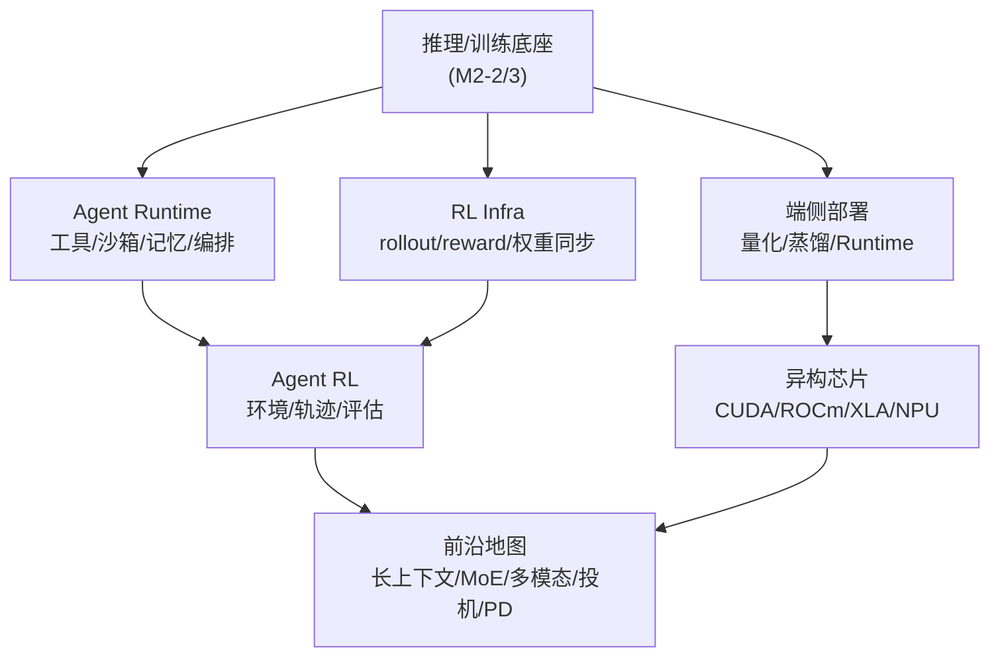
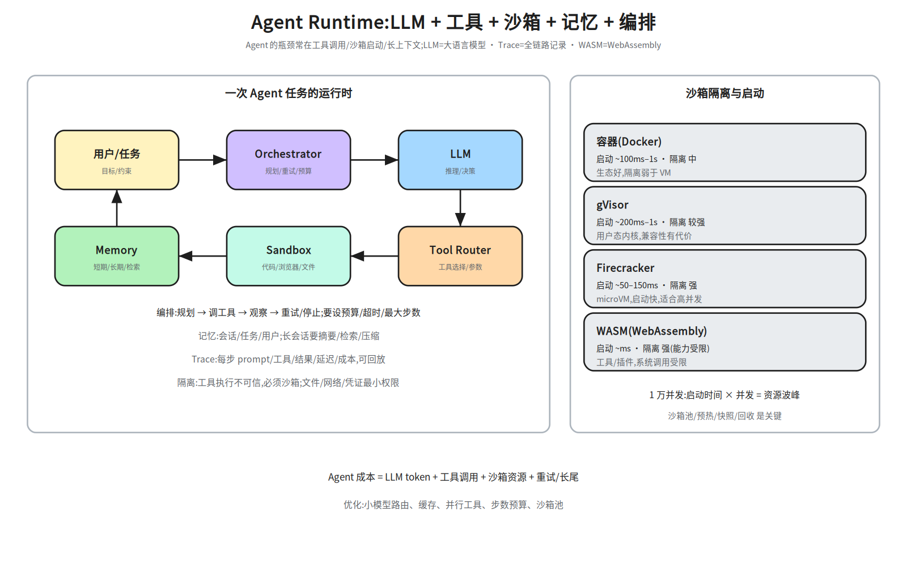
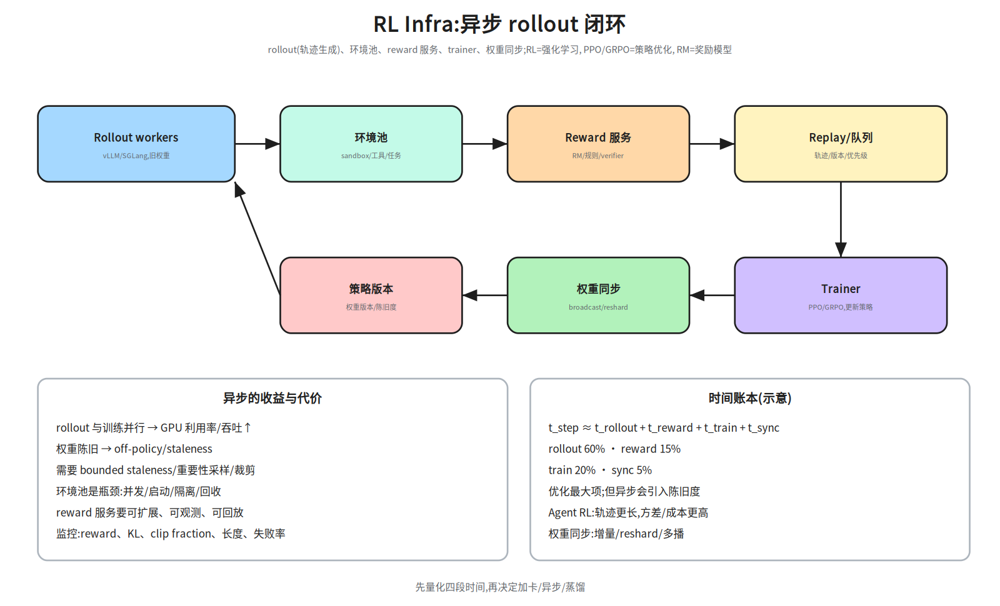
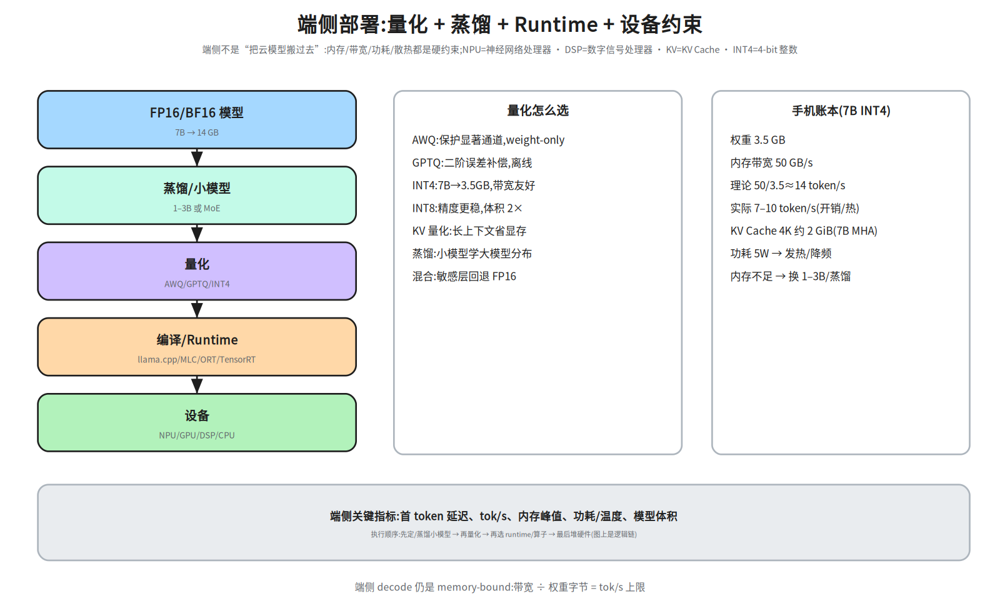
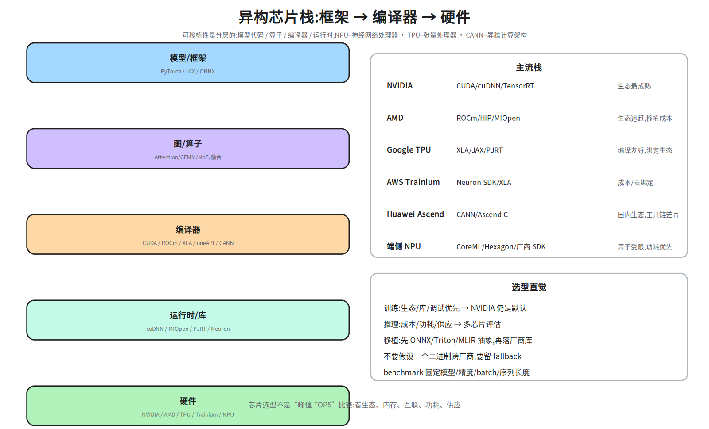
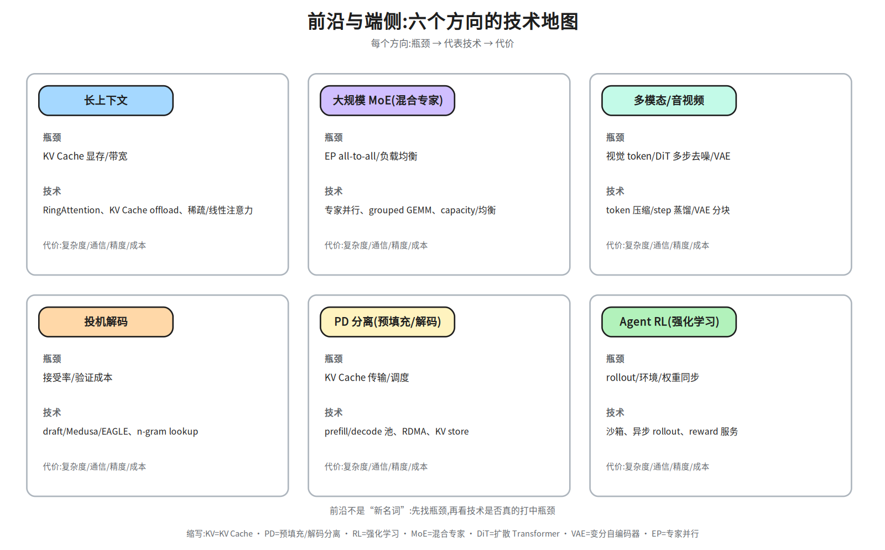

# M2-6 · 前沿与端侧

> 本层回答：Agent、RL、端侧、异构芯片、长上下文这些“新方向”，在 Infra 上到底新在哪？
> 哪些瓶颈是老的（显存/带宽/调度），哪些是真的新（沙箱、rollout、功耗、可移植性）？

> **前置（按节）**：
> - §2–§3：`notes/23_training_systems.md §7`（SFT/PPO/GRPO/rollout/权重同步）、
>   `notes/22_inference_systems.md §9–§10`（投机解码/长上下文）。
> - §4：`notes/21_single_node_ops.md §4、§8`（Roofline/量化）、`notes/22 §8`（量化）。
> - §5：`notes/24_distributed_base.md §3–§4`（互联/拓扑）；硬件细节可先跳过。
>
> **建议路径（每次 45 分钟）**：
> ① §2（Agent Runtime/沙箱）；② §3（RL Infra）；③ §4（端侧）；
> ④ §5–§6（异构芯片/前沿地图）。
>
> **深度标注**：§2–§4 为必学；§5 异构芯片为了解–加分（按目标岗位）；
> §6 前沿方向为了解，面试能讲清“瓶颈 + 技术 + 代价”即可。

## 0. 依赖图（学习顺序）



> 汇点是：面对一个新方向，能判断它**复用了哪些旧瓶颈**、**新增了哪些系统问题**，
> 并给出可验证的优化方向。

## 1. 为什么这些方向“新”

- **Agent/RL**：新增了**沙箱/环境/轨迹**这条“数据生产线”，瓶颈从单次推理变成“每单位时间
  产生多少可训练/可执行的轨迹”；
- **端侧/异构**：新增了**功耗、散热、内存带宽、可移植性**约束，不能直接套云侧优化；
- **前沿模型**（长上下文/MoE/多模态/投机/PD）：多数是把旧的**显存/带宽/通信**瓶颈放大，
  再用系统手段拆开。

> 本层的方法固定：**先找瓶颈指标 → 再看技术打中了哪个瓶颈 → 最后说代价和适用边界**。
> 不要从名词出发，也不要把“新”当成“一定更好”。

## 2. Agent Runtime：让模型在沙箱里“做事”



### 2.1 组成

| 组件 | 作用 | 系统问题 |
|---|---|---|
| Orchestrator | 规划、调用工具、重试/停止 | 状态机、预算、超时、最大步数 |
| LLM | 推理/决策 | 延迟、成本、上下文长度 |
| Tool Router | 选工具、填参数 | 工具 schema、鉴权、失败重试 |
| Sandbox | 执行代码/浏览器/文件 | 隔离、启动速度、资源回收 |
| Memory | 短期/长期/检索 | 一致性、压缩、隐私 |
| Trace | 记录每步 | 存储、回放、评估 |

### 2.2 一次 Agent 任务

```
用户目标 → 规划 → 调工具 → 观察结果 → 继续/重试/停止
```

- **预算**：token/时间/工具调用次数/金额；超预算要优雅停止；
- **重试**：工具失败/超时/返回不可解析；区分可重试与不可重试；
- **记忆**：长会话要摘要/检索/压缩；不要把整个历史塞进 prompt；
- **可观测**：每步 prompt/工具/结果/延迟/成本；trajectory 可回放。

### 2.3 沙箱：隔离与启动速度

| 方案 | 启动 | 隔离 | 适用 |
|---|---|---|---|
| 容器（Docker） | ~100 ms–1 s | 中 | 生态好、可信代码 |
| gVisor | ~200 ms–1 s | 较强 | 用户态内核、兼容性有代价 |
| Firecracker | ~50–150 ms | 强 | microVM、高并发 |
| WASM | ~ms | 强（能力受限） | 插件/工具、系统调用受限 |

> 1 万并发 Agent 任务：启动时间 × 并发 = 资源波峰。要做**沙箱池/预热/快照/回收**；
> 每个沙箱要有 CPU/内存/磁盘/网络配额，防止资源滥用。
>
> 小账本：10k 任务、每任务 2s、池 500 → 约 20 波；若冷启动 1s，首波就要 500 个沙箱同时起，
> 所以池化/快照/预热比“把启动优化到 100ms”更关键。

**1 万并发池账本**：每个沙箱 2 vCPU/4 GB/1 GB 盘 → 峰值 `20k vCPU/40 TB 内存`；
启动 100 ms、任务 30 s → 新建/完成速率约 `10000/30≈333 个/秒`；同一时刻约 `10000×0.1/30≈33` 个沙箱在启动（不是 33 个/秒）。池化后可把冷启动从 100 ms 降到 ~10 ms。没有池化，启动风暴会先打满 API/镜像仓库，而不是 GPU。

### 2.4 延迟与成本瓶颈

- **LLM decode**：每个 token 都要读权重；长输出/大模型是主要成本；
- **工具调用**：串行工具让延迟累加；能并行就并行，能缓存就缓存；
- **沙箱启动**：冷启动占大头；池化/快照；
- **长上下文/记忆**：token 成本 + prefill 延迟；
- **重试**：失败重试会放大成本；要有上限和降级。

**单任务成本** ≈ `LLM tokens × 单价 + 工具调用 × 单价 + 沙箱秒 × 单价 + 重试/长尾`；
按 task_id/tenant 打标签，才能做预算、限流和归因。

> 优化顺序：先减少步数/工具调用（算法/编排），再并行/缓存，再小模型路由，
> 最后才是换更快的 GPU。


### 2.5 Trajectory：采集、存储、回放

一条 trajectory 至少要有：

```
task_id · step · prompt/context · tool + args · result · latency · cost · model_version
```

- **存储**：对象存储/列式文件；大轨迹分块，索引与内容分离；
- **版本**：模型/提示词/工具 schema 都要版本化，否则回放不可比；
- **确定性回放**：固定 seed、工具返回（mock/录制）、环境快照；否则“回放”只是重跑；
- **隐私**：轨迹可能含用户数据，要脱敏/访问控制/保留策略。

> Agent 的调试和评估高度依赖 trajectory；没有 schema/版本/回放，失败无法归因。

## 3. RL Infra：rollout 是新的“数据生产线”



### 3.1 闭环

```
Rollout workers(旧权重) → 环境池 → Reward/Verifier → Replay/队列
→ Trainer(PPO/GRPO) → 权重同步 → Rollout workers(新权重)
```

- **rollout**：用当前策略生成轨迹；常用 vLLM/SGLang/TensorRT-LLM 做高吞吐；
- **环境池**：代码执行/浏览器/工具/游戏；要隔离、可回收、可观测；
- **reward**：RM、规则/verifier、沙箱结果；要可扩展、可回放；
- **训练**：PPO（actor+critic+reward+reference）或 GRPO（组内相对 advantage，省 critic）；
- **权重同步**：broadcast/reshard/增量；同步太慢会成为瓶颈。

### 3.2 同步 vs 异步

- **同步**：rollout 完再训练，稳定但 GPU 利用率低；
- **异步**：rollout 与训练并行，吞吐↑；但权重陈旧 → off-policy/staleness；
- 需要 **bounded staleness**、重要性采样/裁剪、版本号；
- **Agent RL**：轨迹更长、工具调用/沙箱、reward 稀疏；成本与方差更高。

### 3.3 时间账本

```
t_step ≈ t_rollout + t_reward + t_train + t_sync
```

例：rollout 60%、reward 15%、train 20%、sync 5% → 先优化 rollout；
但异步 rollout 会引入陈旧度，要一起看 reward/KL/长度。

> 面试问“RL Infra vs 推理 Infra”：推理 Infra 优化单次请求的延迟/吞吐；
> RL Infra 优化**轨迹生产 + 训练闭环**的吞吐，瓶颈常在 rollout/环境/同步，而不是单次推理。

## 4. 端侧：内存、带宽、功耗



### 4.1 优化链

```
模型选择/蒸馏/小模型 → 量化(AWQ/GPTQ/INT4) → 编译/Runtime → 设备
```

> 顺序别搞反：通常**先蒸馏/换小模型，再量化**；先量化再蒸馏会把量化误差带进蒸馏目标。
> 但如果目标是“保留大模型能力、只压体积”，也可以先量化大模型——面试时要说清目标。

- **量化**：AWQ（保护显著通道）、GPTQ（二阶误差补偿）、INT8/INT4；weight-only 对 decode 带宽友好；
- **FP8**：E4M3 精度高/范围小、E5M2 范围大/精度低；per-tensor/per-block scale，用校准集
  `amax` 估；outlier/敏感层要评估，掉点时可回退或混合精度。INT4 常用 per-group；
  评测必须看任务指标 + 长尾，不能只看 perplexity（详见 M2-3 §8.3）；
- **蒸馏**：小模型学大模型分布；端侧常直接换 1–3B；
- **Runtime**：llama.cpp、MLC、ONNX Runtime、TensorRT、厂商 NPU SDK；
- **设备**：NPU/GPU/DSP/CPU；算子支持/内存/功耗差异大。

**顺序很重要**：图里的“量化 → 蒸馏 → Runtime”是**逻辑链**，不是执行顺序。
实际通常先**选/蒸馏合适的小模型**（决定能力上限），再对最终模型做**量化**（决定体积/带宽），
最后选 Runtime/算子。先量化再蒸馏会把量化误差带进蒸馏目标，通常不划算。

**FP8 与 INT4 的口径**：FP8 E4M3（精度高、范围小）适合权重/激活，E5M2 范围大、精度低；
INT4 的 AWQ/GPTQ 是 weight-only，需要校准集，按 group/channel 维护 scale，用 `amax` 估计。
掉点评估见 M2-3 §8：任务级指标 + 长尾 + 与 FP16 基线对比；敏感层回退 FP16/INT8。

**评测门禁**：端侧上线前要有“精度-延迟-内存-功耗”四张表；任何量化/蒸馏改动都要过
同一套任务评测和真机 benchmark，不能只看 perplexity 或实验室 tok/s。

### 4.2 手机账本（7B INT4）

```
权重 ≈ 7e9 × 0.5 B = 3.5 GB
理论上限 ≈ 内存带宽 / 权重字节 = 50 GB/s / 3.5 GB ≈ 14 tok/s
实际 7–10 tok/s(开销/热/调度)
KV 4K 约 2 GiB(7B MHA)
```

> 端侧 decode 仍是 **memory-bound**；带宽 ÷ 权重字节就是 tok/s 上限。
> 功耗 5 W 左右，长时间跑会发热降频；内存不足就换 1–3B/蒸馏/更激进的量化。

### 4.3 端侧 vs 云侧

| | 端侧 | 云侧 |
|---|---|---|
| 优势 | 隐私、离线、低延迟 | 大模型、弹性、集中运维 |
| 约束 | 内存/带宽/功耗/散热 | 网络、成本、SLO |
| 优化 | 量化/蒸馏/小模型/Runtime | batching/并行/量化/PD |

> 不要把云侧优化直接套到端侧：端侧没有 NVLink/大 batch，功耗和热是硬约束。

### 4.4 可复用加速 pipeline

```
模型注册 → 蒸馏/量化 → 编译/Runtime → 评测门禁 → 灰度/部署 → 监控/回滚
```

- **评测门禁**：任务指标、长尾集、延迟/内存/功耗；不过门禁不进部署；
- **版本/血缘**：模型、量化配置、Runtime、硬件都要记录，才能复现；
- **回滚**：保留 FP16/上一版量化包；线上异常能切回；
- **自动化**：同一套 pipeline 支持 LLM/VLM/语音，按模型类型换 evaluator。

## 5. 异构芯片：可移植性是分层的



| 厂商 | 软件栈 | 特点 |
|---|---|---|
| NVIDIA | CUDA/cuDNN/TensorRT | 生态最成熟，迁移成本低 |
| AMD | ROCm/HIP/MIOpen | 生态追赶，移植/调优成本 |
| Google TPU | XLA/JAX/PJRT | 编译友好，绑定 JAX/云 |
| AWS Trainium | Neuron SDK/XLA | 成本/云绑定 |
| Huawei Ascend | CANN/Ascend C | 国内生态，工具链差异 |
| 端侧 NPU | CoreML/Hexagon/厂商 SDK | 算子受限、功耗优先 |

**可移植性分层**：

```
模型代码(PyTorch/JAX) → 图/算子(ONNX/Triton/MLIR) → 编译器(CUDA/ROCm/XLA/oneAPI)
→ 运行时/库(cuDNN/MIOpen/PJRT/Neuron) → 硬件
```

> 不要假设一个二进制跨厂商；用 ONNX/Triton/MLIR 做抽象，再落厂商库；
> 关键路径留 fallback。芯片选型看生态、内存、互联、功耗、供应，不只 TOPS。

## 6. 前沿地图：先找瓶颈，再看技术



| 方向 | 瓶颈 | 代表技术 | 代价 |
|---|---|---|---|
| 长上下文 | KV 显存/带宽 | RingAttention、KV offload、稀疏/线性注意力 | 精度/实现复杂 |
| 大规模 MoE | EP all-to-all/负载均衡 | 专家并行、grouped GEMM、capacity/均衡 | 通信/负载不均 |
| 多模态/音视频 | 视觉 token/DiT 多步去噪/VAE | token 压缩/step 蒸馏/VAE 分块 | 质量/延迟 |
| 投机解码 | 接受率/验证成本 | draft/Medusa/EAGLE、n-gram lookup | 显存/训练成本 |
| PD 分离 | KV 传输/调度 | prefill/decode 池、RDMA、KV store | 传输/复杂度 |
| Agent RL | rollout/环境/权重同步 | 沙箱、异步 rollout、reward 服务 | 陈旧度/成本 |

### 6.1 视频生成：和 LLM 推理不是一套

- **链路**：文本/图像 → VAE/编码器 → DiT/UNet 多步去噪 → VAE 解码 → 视频；
- **瓶颈**：多步去噪是 compute-bound；视频 latent/attention 显存大；VAE 解码也贵；
- **优化**：step 蒸馏/少步采样、并行采样、序列并行/分块、专用 kernel、低精度；
- **注意**：主流是 DiT/UNet + VAE；视频 latent 显存随 `帧数×分辨率×通道` 增长，
  去噪步数又多，所以瓶颈是**显存 + 多步计算**。扩散模型没有自回归 KV Cache，
  不要把 LLM 的 PagedAttention/投机解码直接套上去。

> 面试答法：先说“这个方向的瓶颈是什么”，再说“技术打中了哪个瓶颈”，
> 最后说“代价是什么、什么场景不适用”。不要只报名词。

## 7. 面试要点

1. **手机怎么部署 LLM？** → 蒸馏/小模型 → INT4 量化 → Runtime（llama.cpp/MLC/ORT）→
   NPU/GPU；瓶颈是内存带宽/功耗/热；7B INT4 3.5GB，50GB/s 理论上限约 14 tok/s。
2. **Agent Runtime 的瓶颈？** → LLM decode、工具调用串行、沙箱启动、长上下文/记忆、
   重试；优化：减少步数、并行工具、沙箱池、小模型路由。
3. **RL Infra 和推理 Infra 的区别？** → 推理优化单请求；RL 优化轨迹生产 + 训练闭环，
   瓶颈在 rollout/环境/reward/权重同步。
4. **怎么选芯片？** → 看生态/库/调试、内存/互联、功耗、供应、成本；
   用 ONNX/Triton/MLIR 保持可移植性，关键路径留 fallback。
5. **长上下文为什么贵？** → KV 线性增长、decode 每步读 KV、TTFT 变长；
   RingAttention/KV offload/稀疏注意力/PD 分离各自打不同瓶颈。
6. **MoE 推理的系统难点？** → 专家并行 all-to-all、负载不均、grouped GEMM、
   容量/丢 token；推理通常不丢 token。
7. **投机解码什么时候值？** → draft 快、接受率高、验证成本可摊销；batch 大/α 低时退化。
8. **端侧量化和蒸馏怎么选？** → 先蒸馏/换小模型，再量化；AWQ/GPTQ/INT4 看精度/硬件；
   必须做任务级评测。
9. **Agent RL 为什么难？** → 轨迹长、环境/工具沙箱、reward 稀疏、rollout 与训练同步；
   成本/方差/可复现性。
10. **异构芯片上怎么保证可移植？** → 分层抽象（框架/图/编译器/运行时），
    厂商库做后端；不要绑死一个二进制。

## 8. 常见坑

- **把端侧当“小云侧”**：没有大 batch/NVLink，功耗/热是硬约束。
- **量化只看体积**：精度/任务指标/长尾可能崩。
- **Agent 只优化 LLM**：工具/沙箱/长上下文才是瓶颈。
- **RL 只看训练卡**：rollout/reward/同步经常是大头。
- **异步 RL 不看 staleness**：吞吐上去了，策略学歪了。
- **芯片只看 TOPS**：生态/内存/互联/供应决定实际可用性。
- **前沿技术当万能**：每个技术只打一个瓶颈，换场景可能不适用。

## 动手清单（60–90 分钟）

1. **端侧账本**：给 7B/3B/1B 模型算 INT4 权重、50 GB/s 下的 tok/s 上限、
   4K KV 显存；比较“换小模型”和“更激进量化”的收益。
2. **Agent 成本**：设计一个 10 步 Agent 任务，估算 LLM token/工具调用/沙箱启动成本；
   找出最大项并给 2 个优化。
3. **RL 时间账本**：给定 rollout/reward/train/sync 四段耗时，算吞吐瓶颈；
   比较同步 vs 异步的吞吐与 staleness。
4. **芯片选型**：给一个训练任务和一个端侧推理任务，各选 2 个候选芯片，
   列出生态/内存/互联/功耗/成本的取舍。
5. **前沿 maps**：选一个方向（长上下文/MoE/多模态/投机/PD），画“瓶颈→技术→代价”一页。

验收标准：能对一个新方向说清“复用了哪些旧瓶颈、新增了什么系统问题、怎么验证”。

## 相关图

- `26a_agent_runtime` — Agent 编排/工具/沙箱/记忆/Trace；
- `26b_rl_infra` — rollout/reward/trainer/权重同步与异步代价；
- `26c_edge` — 量化/蒸馏/Runtime/设备 + 手机账本；
- `26d_hetero` — NVIDIA/AMD/TPU/Trainium/NPU 栈与选型；
- `26e_frontier` — 长上下文/MoE/多模态/投机/PD/Agent RL 地图。

## 下一步

- 回到 **M2-2 §7** 补 RL 训练细节；回到 **M2-3 §9–§10** 补投机/长上下文；
- 回到 **M2-4 §3–§4** 补异构互联/拓扑；
- 按目标岗位选一个方向做深：Agent 平台 / RL Infra / 端侧 / 芯片工具链。
