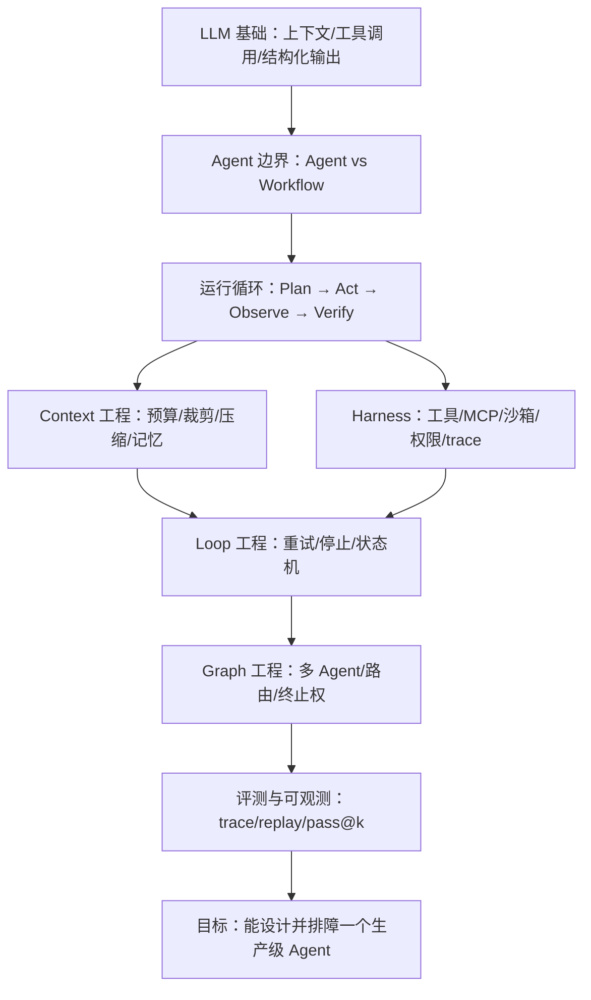
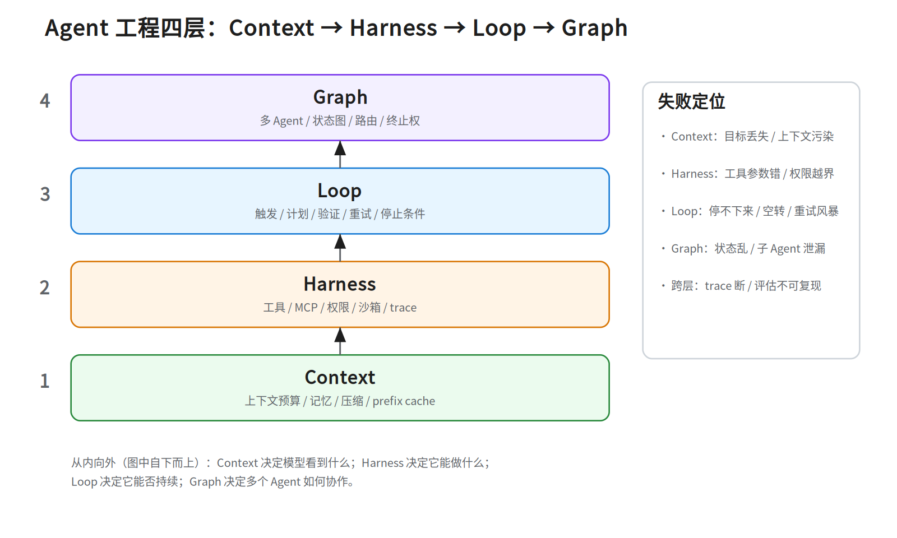

# 第二十七层 · Agent 工程化：Context / Harness / Loop / Graph

> 本层是 **1C（应用）与 M2-6（Agent Runtime）之间的补丁**：把“会用 Agent”升级成“能设计、能排障、能评估 Agent 系统”。
> 前置：`notes/11_applications.md`（工具/RAG/记忆/Agent Loop）、`notes/16_agent_rl.md`（rollout/沙箱/RL）、`notes/26_frontier_edge.md §2`（Agent Runtime）。
> 外部资产：Obsidian `AI Agent面试准备/` 的 Wiki、面试 Q&A、Asterwynd 讲稿；本讲义只做结构化综合，不复制原文。

## 0. 依赖图（学习顺序）



**建议 45 分钟路径**：§2 边界 → §3 四层框架 → §4 Context → §5 Harness → §6 Loop → §7 Graph → §9 评测 → §11 Asterwynd 映射。

> 与 `notes/11` 的 delta：11 讲单 Agent 基本循环（ReAct/工具/RAG/记忆/guardrails）；27 新增四层框架、多 Agent Graph、状态恢复、trace/replay、评测 Infra 与项目复盘。不要用 27 替代 11。

**前置（按节）**：

- §2–§3：知道 LLM 的上下文窗口、tool calling、JSON 输出（`notes/11 §1–2`）。
- §5：知道容器/沙箱的基本概念（`notes/26 §2`）。
- §9：知道 pass@k、LLM-as-judge（`notes/09`）。

---

## 1. 一句话：Agent 不是“更长的 Prompt”

**Agent = LLM + 上下文 + 工具 + 循环 + 验证 + 停止条件。**

它的工程难点不在“模型会不会调用工具”，而在：

- 模型**看到什么**（Context）；
- 它能**做什么、不能做什么**（Harness）；
- 它**什么时候继续、什么时候停**（Loop）；
- 多个 Agent 如何**分工、通信、收场**（Graph）。

一个能跑 Demo 的 Agent 和一个生产级 Agent 的差距，通常不是模型能力，而是这四层的工程约束。

---

## 2. 边界：Agent / Workflow / Chatbot / RPA / Function Calling

| 形态 | 谁决定下一步 | 是否有循环 | 典型场景 | 失败模式 |
|---|---|---|---|---|
| **Chatbot** | 人 | 否 | FAQ、客服问答 | 答错、幻觉 |
| **Workflow** | 人预先写死 | 有，但固定 | 审批流、ETL、编排 | 分支漏、异常没兜底 |
| **RPA** | 规则/脚本 | 有，固定 | 点击、填表、搬运 | UI 变了就挂 |
| **Function Calling** | 模型选函数 | 单次/少量 | 查天气、查订单 | 参数错、工具错 |
| **Agent** | 模型 + 工程约束 | 有，动态 | Coding Agent、研究 Agent、运维 Agent | 空转、跑偏、越权、成本失控 |

**面试一句话**：

> Agent 和 Workflow 的核心区别不是“有没有 LLM”，而是**谁决定下一步**：Workflow 是人把路径写死，Agent 是模型在工程约束内动态选择；一旦动态选择，就必须补上循环、验证、停止、权限和可观测。

---

## 3. 四层框架：Context → Harness → Loop → Graph



> 手机版：`../diagrams/27a_agent_layers.portrait.png`

> 两种视角：本讲义按**工程边界/依赖图**讲 Context → Harness → Loop → Graph；Obsidian Wiki 的“Harness 外层 / Graph 中间 / Loop 内层”是**运行时嵌套**视角。**上下文内容/预算/压缩归 Context；Harness 只提供存储/检索/工具执行机制**。

从内向外：

| 层 | 解决什么 | 核心问题 | 典型失败 |
|---|---|---|---|
| **Context** | 模型看到什么 | 注意力预算、记忆、裁剪、压缩、prefix cache | 目标丢失、上下文污染、关键信息被挤掉 |
| **Harness** | 模型能做什么 | 工具 schema、MCP、权限、沙箱、trace | 参数错、越权、工具失败没兜底 |
| **Loop** | 能否持续 | 触发、计划、验证、重试、停止 | 停不下来、空转、重试风暴 |
| **Graph** | 多 Agent 如何协作 | 角色、通信、共享状态、终止权 | 状态乱、子 Agent 泄漏、互相甩锅 |

**排障顺序**：先看 Context（模型是否知道目标），再看 Harness（工具是否可用/权限是否够），再看 Loop（是否该停），最后看 Graph（是否是多 Agent 协作问题）。不要一上来就怪模型。

### 3.1 五层演进 ↔ 四层结构

| 五层演进 | 落在四层哪里 | 说明 |
|---|---|---|
| Prompt Engineering | Context | 角色/风格/输出约束 |
| Context Engineering | Context（内容/预算/压缩）+ Harness（存储/检索机制） | 上下文组装与检索 |
| Skills | Context + Harness | 程序记忆 + 工具组合 |
| Loop | Loop | 触发/验证/重试/停止 |
| Graph | Graph | 多 Agent/状态流/路由 |

**记法**：五层是“历史演进”，四层是“工程边界”。面试先讲四层定位瓶颈，再用五层解释为什么会有这些层。

---

## 4. Context 工程：注意力预算

Context 不是“把资料都塞进去”，而是**在有限窗口里做优先级编排**。

### 4.1 上下文的四类内容

| 类型 | 例子 | 生命周期 |
|---|---|---|
| **系统约束** | 角色、权限、输出格式、红线 | 长期稳定 |
| **任务状态** | 目标、计划、已完成步骤、待办 | 单次任务 |
| **工作记忆** | 最近工具结果、错误、观察 | 短期 |
| **知识/记忆** | RAG 文档、用户偏好、历史经验 | 按需检索 |

### 4.2 上下文压缩：触发 → 策略 → 校验 → 恢复

1. **触发**：窗口用到 85–90% 或固定 token 预算时触发；不要等 OOM。
2. **策略**：
   - 滑动窗口保留最近 10 条消息；
   - 结构化摘要固定字段：`goal / constraints / progress / pending / decisions / key_context`；
   - tool_call 与 tool_result 成对保留/成对丢弃；
   - 长工具结果只留摘要 + 原始消息 ID。
3. **校验**：压缩前后检查目标/约束/待办是否还在；保留原始消息 ID 可回溯；限制最大压缩次数，避免“摘要的摘要”。
4. **恢复**：压缩后如果任务跑偏，用 checkpoint + 原始 ID 回滚；不要只靠模型“回忆”。压缩过程中崩溃/超时，未完成的新摘要不替换原上下文，从上一个 checkpoint 重试。

**数字例子**：128K 窗口在约 109K token（85%）或固定 90K 预算时触发；保留最近 10 条消息；摘要目标 500–1000 token；连续压缩最多 2–3 次，之后必须回滚或把任务拆小。验证方式：用压缩后的上下文重放当前任务，检查 `goal/constraints/pending/decisions` 和 tool_call/result 配对是否还在。

> 压缩不是“写一段自然语言总结”，而是**有 schema 的状态转移**。

### 4.3 常见坑

- 压缩把**任务目标**压没了 → 模型开始做别的事。
- 工具结果太长，把关键错误挤出窗口。
- 多轮对话中重复注入相同长文，浪费预算。
- 上下文里混入不可信内容（网页/工具输出）→ prompt injection（指令注入）。
- 工具返回过期/错误观察 → poisoned observation；要标来源/时间戳，冲突时重新验证。
- 长上下文中间信息被忽略 → context rot / lost-in-the-middle；关键信息放前面或重复 grounding。
- 多条历史指令冲突 → 要检测冲突并明确以哪条为准，不要静默覆盖。

**自检**：如果模型“变笨了”，先问：它是没看到目标，还是看到了太多无关内容？

### 4.4 压缩与 prefix cache / Agent workload

**最小前置**（没读过 `notes/22 §5` 也能继续）：

- **prefix cache**：推理引擎把已算过的前缀 KV 按块缓存，下一轮按块匹配最长公共前缀；连续相同的前缀块可部分命中，不同部分不能复用。
- **OOM**：显存不足，通常是权重 + KV + 激活超了；压缩/限流/量化都是缓解手段。
- **TTFT**：首 token 延迟（请求发出到第一个输出 token）；**KV**：每层的 K/V 缓存，随上下文长度线性增长。
- **thinking token**：推理模型在最终答案前生成的内部分析 token，会计成本，但很多模型不把它暴露给用户。
- **max_num_seqs**：引擎一次最多同时跑的请求数；子 Agent 并发会撞这个上限。
- **pass^k**：k 次独立尝试全部成功（和 pass@k 的“至少一次”相反）。

压缩不是纯文本操作，它会改变推理后端的缓存命中：

- **稳定前缀**（system prompt、工具 schema、长期规则）放前面，动态内容放后面；压缩时不要重写稳定前缀，否则 prefix cache 整段失效。
- 压缩重写历史 → 从改写点之后的块失效（未改动的稳定前缀仍可命中），下一轮要重新 prefill；省下的 token 成本要和重算成本一起算。
- 尽量在 **turn 边界** 压缩，避免每步都改上下文；压缩后记录 `cache_hit_rate` 和首步 TTFT，确认收益。
- 回滚同样会击穿缓存：回滚后从 checkpoint 重建，别假设 KV 还在。

**Agent workload 的推理特征**（也是 28 的输入）：

- 每步新增 prefill（工具结果/观察），系统前缀稳定，适合 prefix cache；
- 工具结果会快速膨胀，必须截断/摘要；
- 子 Agent 并发会撞上 `max_num_seqs`/KV 上限，需要配额和排队；
- 流式 tool call、结构化输出需要约束解码；thinking token 会放大成本，评测要单独记。

---

## 5. Harness 工程：工具、MCP、沙箱、权限

Harness 是模型在执行环境里的“身体”。

### 5.1 工具调用

一个可靠的工具调用链要覆盖：

```text
工具选择 → 参数生成 → schema 校验 → 权限检查 → 执行 → 结果截断/结构化 → 错误分类 → 重试/补偿
```

关键设计：

- **schema 要窄**：参数越少、类型越明确，模型越不容易编。
- **参数校验**：JSON schema + 业务校验；不要直接执行模型给的字符串。
- **幂等**：写操作要带 idempotency key；失败可重试。
- **补偿**：不可回滚的操作要有反向操作或人工确认。
- **结果截断**：工具返回大结果时先摘要/分页，避免撑爆上下文。
- **并行工具调用**：模型一次可能返回 k 个 tool_call；按依赖分组——无依赖的并行、有写冲突/先后依赖的串行；结果按 call_id 合并，单个失败要决定整体重试还是部分补偿，预算按调用分摊。流式 tool call 要等参数 JSON 完整再执行，别边拼边跑。

### 5.2 MCP（Model Context Protocol）

MCP 解决的是**工具/资源的标准化接入**：

- 工具发现：Agent 不需要为每个工具写死适配；
- 权限边界：server 端决定暴露哪些工具；
- 审计：工具调用可统一记录；
- 隔离：不同租户/任务使用不同 server。

**协议层**：host（IDE/Agent 宿主）→ client（每个 server 一个连接）→ server（暴露工具/资源）；transport 常用 stdio（本地）或 streamable HTTP（远程）；初始化时做 capability negotiation；认证/OAuth/凭据隔离；有 start/stop/restart 生命周期。MCP 是 function calling 的标准化接入层，不替代工具治理与安全。

**MCP 威胁模型（5 条）**：

1. **工具描述投毒**：server 的工具描述里藏指令，诱导模型调用危险工具。
2. **返回内容注入**：工具结果里含“忽略之前指令”，把数据当指令。
3. **供应链**：`@latest` / 未固定版本的 server 可能在运行中变更行为。
4. **运行时工具变更**：tool list 在会话中变化，模型按旧 schema 调用。
5. **confused deputy / 凭据滥用**：server 用高权限凭据替低权限调用者执行。

**接入五步审查**：固定版本 → 最小工具集 → 权限/凭据隔离 → 输入输出审查 → 审计与回滚。

**面试追问**：MCP 不是“更安全的工具调用”，它只是协议；安全仍要靠权限、沙箱、审计和最小暴露面。

### 5.3 沙箱

沙箱要回答四个问题：

1. **隔离什么**：文件、网络、进程、设备、凭据。
2. **怎么隔离**：容器 / gVisor / Firecracker / microVM / 用户态内核 / WASM / 独立 VM。
3. **生命周期**：创建、预热、执行、回收、超时。
4. **怎么观测**：命令、文件变更、网络请求、资源用量。

**取舍**：容器轻但隔离弱；gVisor 相对 Docker 有 syscall 兼容性缺口和性能开销，但比 microVM 部署轻；Firecracker 隔离强、启动快，但生态/运维复杂。没有“最好”，只有“按风险分级”。

### 5.4 权限：四层护栏

- **最小权限**：默认只读，写操作显式授权。
- **风险分级**：读文件 < 写文件 < 执行命令 < 访问网络 < 改生产配置。
- **人工确认**：高风险操作必须有人确认。
- **凭据隔离**：不要把长期 token 放进模型上下文。

这四条是**通用参考模型**（可称“四层护栏”），不是 Asterwynd 项目的实际实现；项目口径见 §11.2。

### 5.5 模型集成与降级

- **协议适配**：OpenAI-compatible / Anthropic Messages 等协议做适配层，统一 `tool_calls`、流式 chunk、usage、错误码；不要在每个业务里手写两套。
- **路由/降级**：按任务类型/租户/成本选模型；超时、限流、5xx 触发 fallback 或小模型降级；熔断 + 预算，避免重试风暴。
- **能力差异**：不同模型的工具调用格式、上下文窗口、thinking token 不同；适配层要版本化并写测试。

---

## 6. Loop 工程：计划、验证、重试、停止

Loop 是 Agent 的心跳：

```text
观察 → 计划 → 行动 → 观察结果 → 验证 → 继续/重试/停止
```

### 6.0 任务拆解

拆解的目标不是“分得越细越好”，而是**每个子任务都可验证、可恢复、可观测**。

| 子任务契约 | 要写什么 |
|---|---|
| 输入 | 文件/数据/上下文引用 |
| 输出 | 产物路径/结构/格式 |
| 验收 | 测试/断言/rubric |
| 预算 | 步数/token/时间/金额 |
| 恢复点 | checkpoint / 幂等键 / 重试策略 |
| owner | 哪个 Agent/工具负责 |

粒度：一个子任务最好能在 **1–3 个工具调用**内完成；太小调度开销大，太大失败难归因。串行/并行边界按依赖和写冲突划，不要按“看起来平均”划。

### 6.0.1 规划范式：ReAct / Plan-Execute / Reflexion

| 范式 | 怎么做 | 适合 | 主要失败模式 |
|---|---|---|---|
| **ReAct** | 边想边做：Thought → Action → Observation 循环 | 探索型任务、工具反馈会改变下一步 | 原地打转、没有全局计划、长任务漂移 |
| **Plan-Execute** | 先出全局计划，再按子任务执行；执行中按需 replan | 步骤可预先分解、依赖清晰的任务 | 计划过时、工具能力变化、计划与执行脱节 |
| **Reflexion** | 执行后反思失败原因，把教训写回下一次尝试 | 可重试、有明确成败信号的任务 | 没有可靠反馈时反思是幻觉；成本随尝试次数上升 |

选型：**反馈密集、路径不确定 → ReAct；步骤可预判、要控预算 → Plan-Execute；有测试/评分信号、可多轮试错 → Reflexion**。生产里通常是组合：Plan 给骨架，ReAct 做局部探索，Reflexion 只在有 verifier 时开启。

### 6.1 停止条件

必须有**可判定的停止条件**：

- 任务完成（测试通过、文件生成、答案满足 rubric）；
- 达到最大步数 / 最大 token / 最大时间 / 最大成本；
- 连续失败且没有新信息 → 先 replan；replan 用尽/无进展 → stop；
- 需要人工确认；
- 检测到越权/危险操作。

**没有停止条件的 Agent 不是 Agent，是失控循环。**

### 6.2 验证

- **工具结果验证**：命令退出码、测试结果、schema 校验。
- **任务验证**：单元测试、断言、rubric、LLM judge（辅助）。
- **过程验证**：是否重复调用同一工具、是否在原地打转。

### 6.3 重试

- 区分**可重试**（网络抖动、临时限流）和**不可重试**（参数错、权限不足）。
- 重试要退避 + 上限；不要“失败就再来一次”。
- 重试要保留上次错误，避免模型重复同一个错误。

### 6.4 状态机

一个生产级 Agent 通常有：

```text
CREATED → RUNNING ⇄ WAITING_TOOL；RUNNING → NEEDS_HUMAN → RUNNING（审批通过）/ FAILED|CANCELLED（拒绝）；RUNNING → DONE / FAILED / CANCELLED
```

状态要持久化，支持断线重连、幂等恢复、取消和超时。

### 6.5 重规划（replan）

计划不是一次写死的。触发重规划的典型信号：

- 同一子任务验证连续失败 N 次（不是重试能解决的参数/权限问题）；
- 工具能力缺失或 schema 变了，原计划不可执行；
- 子任务超预算（步数/token/时间/金额）；
- 发现新的依赖或写冲突，原 DAG 不再成立。

**失败后的决策顺序**：瞬时/可重试错误 → retry；同一子任务失败 N 次且没有新证据 → replan；replan 用尽、连续无进展或全局预算耗尽/越权 → stop。

重规划的输入/输出：

- **输入**：已完成 checkpoint、失败证据（trace/错误）、剩余预算、当前 DAG；
- **输出**：只重算受影响的子图，保留已完成且验证过的节点；不要整盘推倒；
- **校验**：新 DAG 无环、预算合计不超、每个节点仍有验收标准和恢复点。

**面试点**：重规划和重试的区别——重试是同一计划再执行一次，重规划是改计划；两者都要可观测、可回滚。

---

## 7. Graph 工程：多 Agent 协作

多 Agent 不是“多个模型一起聊天”，而是**把任务拆成有边界的节点**。

### 7.1 角色分工

- **Planner**：拆任务、定顺序、定义验收。
- **Executor**：在干净上下文里执行单个子任务。
- **Reviewer / Auditor**：只读校验，防止执行者自证。
- **Router**：按任务类型路由到不同 Agent/工具。

### 7.2 通信

**消息不能只传自由文本。** 信封至少包含：

```text
msg_id, task_id, trace_id, sender, receiver,
message_type, permissions, deadline, payload_ref
```

- `msg_id` 用于幂等：重复投递不能重复执行。
- `trace_id` 必须由基础设施透传，不能靠 Agent 自觉。
- 负载可以是文本/结构化结果/文件引用；大结果放对象存储，消息里只传引用。
- 接收方要校验发送方权限和任务归属。

**共享状态三种并发方案**：

| 方案 | 做法 | 适用 |
|---|---|---|
| 锁 | 悲观锁/租约 | 写多/临界区长、冲突高、重试代价大 |
| reducer | 事件归并（如 LangGraph reducer） | 事件流、可重放 |
| 版本号 | CAS/乐观锁 | 读多写少、冲突低 |

**面试追问**：为什么信封和负载分离？因为路由/权限/幂等/审计需要结构化字段，而负载可能很大且不可信。

### 7.3 终止权

**谁有资格喊停？** 通常是：

- 预算/步数/超时控制器；
- Reviewer 的否决；
- 人工；
- 安全策略。

不要让执行 Agent 自己决定“我完成了”而没有外部验证。

### 7.4 常见坑

- 子 Agent 没有生命周期管理 → 资源泄漏。
- 多 Agent 互相转发，没人对最终结果负责。
- 共享上下文太大 → 每个 Agent 都被污染。
- 没有全局 trace → 出问题无法定位。

---

## 8. Skills、记忆与状态

### 8.1 Skills

Skill 是**程序记忆**：把重复出现的流程、规则、工具组合固化下来。

**声明 → 触发 → 版本 → 治理 → 评测**：

| 阶段 | 要做什么 |
|---|---|
| 声明 | 名称/描述/输入输出/依赖工具/权限/示例 |
| 触发 | 触发条件、误触发/漏触发测试、与相似 skill 的边界 |
| 版本 | 语义版本；变更记录；可回滚 |
| 治理 | owner、权限清单、依赖固定版本、弃用策略 |
| 评测 | 固定任务集，比较有无 skill 的成功率/步数/成本 |

**运行时怎么选中 skill**：skill 描述本身就是路由信号——按任务检索/embedding 取 top-k，再让模型在候选里选；描述要写清“何时用/何时不用”，否则会和相似 skill 或工具互相抢。skill 列表也占上下文，加载前算 token 预算；误触发用负样本测，漏触发用正样本测，冲突用“相似 skill 的边界任务”测。

不要把“所有东西”塞进一个 skill；一个 skill 只解决一类可复用流程。

### 8.2 记忆

| 类型 | 存什么 | 检索方式 |
|---|---|---|
| 短期上下文 | 当前任务对话 | 直接放窗口 |
| 任务状态 | 计划、进度、待办 | 结构化存储 |
| 长期记忆 | 用户偏好、历史经验 | 检索 + 去重 + 整合 |
| 知识库 | 文档、代码、FAQ | RAG |

**记忆的难点不是“存”，而是“什么时候取、取多少、怎么去重、怎么证明有用”。** 这里的“记忆”是广义（含知识库）；狭义 memory 只指状态/偏好/经验，知识库/RAG 单列。

**怎么证明记忆有用**：固定任务集，做有/无记忆两组；控制模型、上下文 token 预算、检索 top-k 和工具版本一致；重复 N 次；看任务成功率、平均步数、token/成本、P95 的配对差值。注意混淆因素：检索质量、提示长度、任务难度；不要把“上下文更长”误当成“记忆更好”。

### 8.3 状态恢复

**run-state 至少要存**：

```text
run_id, task_id, stage, status, owner, lease_expiry,
epoch/fencing_token, idempotency_key, side_effect_log,
last_checkpoint, attempt
```

恢复流程：

```text
租约过期/进程崩溃
→ 扫描 stale run
→ 读 side_effect_log 对账（哪些请求已发出、哪些文件已改）
→ 用 idempotency_key 查询下游是否已执行
→ 已执行：标记完成；未执行：重试
→ 不可回滚：走补偿（Saga：每步都有反向操作/补偿的分布式事务模式）
→ 继续下一个 checkpoint
```

- **租约 + fencing token**：worker 定期续租；过期才允许接管。租约本身防不住“旧 worker 暂停后复活继续写”，所以每次写操作要携带单调递增的 `epoch`/fencing token，下游拒绝旧 epoch；恢复时以 `epoch + idempotency_key` 对账。
- **执行键**：`sha256(stage + item + input)`，同一操作重复调用不重复执行。
- **副作用日志**：每次外部写操作先写日志再执行（或事务表），恢复时以此对账。
- **并发隔离**：不同 run 的 state 不共享；共享资源用锁/配额。
- **状态存哪**：小规模用 DB/Redis 存 run_state + 事件日志；长任务/多步骤用 durable workflow engine（Temporal 类）管重试、定时器和恢复；不要把关键状态只放在进程内存或对话历史里。
- **恢复成本**：恢复不是免费的——重新加载上下文要重新 prefill、重读工具产物、重新拿沙箱；按 checkpoint 粒度估算 RTO 和 token 成本。
- **哪些不可恢复**：没有幂等键的外部副作用、已被删除的文件、已发送的通知；这些必须人工对账/补偿，不能假装重放能解决。
- **不要盲目重放写操作**：先对账，再决定重试/补偿/人工。

---

## 9. 评测与可观测

### 9.1 四层评测

| 层 | 看什么 |
|---|---|
| **Turn** | 单轮回答/工具调用是否正确 |
| **Session** | 多轮任务是否完成、是否跑偏 |
| **Trace** | 路径是否合理、是否重复、是否越权 |
| **Outcome** | 业务结果、成本、延迟、用户满意度 |

### 9.2 指标

- **pass@k / 任务成功率**：最终结果。
- **平均步数 / 工具调用次数**：效率。
- **工具错误率 / 重试率**：Harness 质量。
- **失败归因分布**：理解错 / 规划错 / 检索错 / 工具错 / 调度错 / 环境错 / 评分错。
- **单任务成本 / 延迟**：token、沙箱秒数、judge 调用。

### 9.3 方法

- **eval set**：固定任务集 + rubric；任务版本化，防止过拟合。
- **replay**：用 trace 复现失败。
- **shadow**：线上流量旁路评分，不影响用户。
- **A/B**：固定任务集/环境/评分器版本，同一任务配对跑两版；报告 pass@k/pass^k/成功率/成本/P95 的差值与置信区间，先估效应量再定样本量（详见 `notes/29 §7.5`）。
- **非确定性断言**：先区分**模型随机**（温度/采样/并行）和**环境随机**（网络/工具/数据）；对输出做结构断言 + 分布边界，重复运行 N 次统计通过率/方差；flaky 用例隔离并记录 seed/版本，关键路径用确定性测试或 mock。允许合理波动，但阈值要写死。
- **LLM-as-judge**：只做辅助，关键任务用测试/人工复核；judge 要校准、版本化。
- **Hook 与可观测**：在 before/after tool、on_error、on_completion 等生命周期挂 hook；项目实际 7 切面是 `on_run_started / before_iteration / after_llm_call / before_tool_execute / after_tool_execute / on_error / on_completion`。hook 本身要有权限/沙箱/超时，失败不能拖垮主流程；每次 hook 进出都进 trace，便于回放。

**eval set 怎么构造和维护**：

1. **来源**：真实工单/线上失败、SWE-bench 子集、合成回归用例；每类任务至少 N 条（按难度/工具/权限分层）。
2. **样本量**：先跑 30–50 条配对任务估效应量。符号：`α=0.05 → z≈1.96`，power 0.8 → `z≈0.84`，`σ` 指标标准差，`Δ` 最小可检测差，`N` 为每组样本量。两组独立均值比较用 `N ≈ 2(z_{1-α/2}+z_{1-β})²σ²/Δ²`；配对连续指标用 `N ≈ (z_{1-α/2}+z_{1-β})²σ_d²/Δ²`（σ_d 为配对差标准差，没有系数 2）。例：σ=10%、Δ=5% → 独立组约 63/组，配对差 σ_d=10% → 约 31 对。二进制指标用 McNemar 的不一致对（discordant pairs）：`b = A 成功/B 失败`，`c = A 失败/B 成功`；McNemar 只看 b/c，不看双方都成功/都失败的对。先跑 30–50 对估 b/c 比例，再按 `b+c` 和要检测的差异查表/仿真，不要拿总样本量硬套。
3. **门禁**：核心回归集必须通过；新题先进缓冲区，观察 1–2 轮再转正；失败样本自动回流。
4. **换题**：保留 10–20% 隐藏集，定期轮换，防止过拟合和污染；任务版本化。
5. **维护人**：eval set 有 owner 和更新记录，不随模型版本悄悄改。

---

## 10. 安全与成本

### 10.1 安全

- 最小权限、风险分级、人工确认。
- prompt injection：不信任网页/工具输出；隔离指令与数据。
- 数据隔离：多租户、敏感字段脱敏。
- 沙箱逃逸：限制网络、文件、设备、凭据。
- 审计：谁在什么时候调用了什么工具、改了什么。

### 10.2 成本

- 模型路由：简单任务用小模型/规则。
- 缓存：prefix cache、结果缓存、工具缓存。
- 异步：长任务后台执行，前端轮询/推送。
- 预算：每任务 token/时间/金额上限。
- 观测：按任务类型拆分成本，找到头部消耗。

---

## 11. Asterwynd 项目映射

| Asterwynd 模块 | 对应知识 | 面试怎么讲 |
|---|---|---|
| Agent Loop | Loop 工程 | 心跳、停止条件、重试 |
| 工具系统 | Harness | schema、校验、幂等、补偿 |
| 沙箱执行 | Harness/安全 | 3 层隔离、生命周期、回收 |
| 上下文与记忆 | Context | 预算、压缩、记忆检索 |
| 子代理 | Graph | 角色、生命周期、资源回收 |
| 权限安全 | Harness/安全 | capability/risk/origin 三维 + 配置/审批 |
| 钩子与可观测 | 评测/可观测 | trace、回放、失败归因 |
| 模型集成 | Harness | 双协议适配、降级 |
| MCP 集成 | Harness | 工具发现、权限、审计 |
| 上下文构建器 | Context | 优先级编排、prefix cache |

### 11.1 项目 STAR（面试直接用）

**S/T**：Coding Agent 项目，27K 行、40 个内置工具（含 worktree 控制；MCP/子代理动态工具另计）、3 层纵深防御、72 任务（34 本地 + 38 SWE-bench）、1700+ tests、7 切面 Hook、SWE-bench/pass@k/CI。目标不是“能跑”，而是能稳定定位失败、控制权限和成本。

**A/R（三个案例）**：

1. **工具参数幻觉**
   - S：模型给工具参数编字段，执行层报错。
   - T：让错误在执行前被拦住。
   - A：schema 窄化 + JSON schema 校验 + 业务校验 + 只对可重试错误重试；错误进 trace。
   - R：错误不再进入执行层；同类问题可用 trace 复现。
2. **上下文压缩导致目标丢失**
   - S：长任务压缩后模型开始做无关子任务。
   - T：压缩后仍保留目标/约束/待办。
   - A：结构化摘要固定字段（goal/constraints/progress/pending/decisions/key_context；项目里 done/todo 是 progress/pending 的别名，open_questions 单独保留或并入 pending，不等同 decisions），压缩后做目标/约束一致性检查。
   - R：长任务不再因压缩跑偏；可用 replay 验证。
3. **子代理资源泄漏**
   - S：子代理超时后仍占沙箱/句柄。
   - T：任何退出路径都能回收。
   - A：租约 + 超时 + 父级回收 + trace 标记；子代理生命周期纳入 run-state。
   - R：沙箱池不再被僵尸任务吃满；可观测到泄漏。

**指标怎么补（面试前必做）**：固定 72 任务、环境、评分器版本，跑 before/after 两组；记录成功率/pass@k、工具错误率、平均步数、单任务 token+沙箱成本、P95 完成时间；用配对比较和置信区间，没有实测就标“待补”，不要编数字。R 段只讲“可归因、可回归”不够，最好带一个具体提升幅度。

### 11.2 项目追问 10 问

1. 为什么用 Agent 而不是 Workflow？
2. 工具 schema 怎么设计？怎么防参数幻觉？
3. 沙箱为什么 3 层？每层隔离什么？
4. 上下文怎么组装/压缩？怎么保证目标不丢？
5. 子代理怎么派生/回收？父级崩了怎么办？
6. 权限四层护栏分别拦什么？
7. trace 采什么？怎么回放？
8. 72 任务怎么选？pass@k 怎么算？
9. 一次线上事故怎么定位/止损？
10. 如果重做，你会改哪三个设计？

**追问口径**：

- **项目 3 层纵深防御（Asterwynd 实际口径）**：WorkspacePolicy（敏感文件/正则黑名单，具体计数以源文档为准）→ CommandGuard（argv 语义检查）→ ExecutionBackend（ProcessBackend / DockerBackend + cgroup v2）。容器→gVisor→Firecracker 是通用参考模型，不是项目实现。
- **项目权限模型**：工具 capability/risk/origin 三维 + `run_config` 配置 + `approval` 审批；最小权限/风险分级/人工确认/凭据隔离是通用参考“四层护栏”，不要冒充项目三层。
- **项目 7 切面 Hook**：`on_run_started / before_iteration / after_llm_call / before_tool_execute / after_tool_execute / on_error / on_completion`；通用讲法里的“on_stop”对应项目的 `on_completion`。
- **72 任务怎么选**：真实事故回归 + SWE-bench 子集 + 合成用例；按难度/工具/权限覆盖分层，留 10–20% 隐藏集，做污染检查，失败样本回流；不是“随便攒 72 个”。
- **重做改哪三个设计**：① 先做事件日志/状态机，再做 Agent 循环；② 状态用 durable store + fencing token，不靠内存；③ 工具走统一网关（schema/权限/审计），沙箱池化并做生命周期回收。

**三个必讲失败案例**：

1. 工具调用参数幻觉 → schema 窄化 + 校验 + 重试。
2. 上下文压缩导致目标丢失 → 结构化摘要保留目标/约束/待办。
3. 子代理资源泄漏 → 生命周期管理 + 超时 + 回收 + trace。

---

## 12. 面试要点

- Agent 和 Workflow 的区别：谁决定下一步。
- 四层框架：Context / Harness / Loop / Graph。
- 工具调用失败怎么处理：分类、校验、重试、补偿、trace。
- 上下文超了怎么办：裁剪、压缩、分层、检索。
- 多 Agent 谁喊停：预算/Reviewer/人工/安全策略。
- 没有用户反馈怎么评估：eval set、replay、shadow、rubric、人工抽检。
- 如何证明记忆有用：对照实验、任务成功率、步数/成本。
- 沙箱怎么选：隔离强度、启动速度、兼容性、运维成本。

## 13. 常见坑

- 把 Agent 当成“更长的 Prompt”，没有循环/停止/验证。
- 工具 schema 太宽，模型参数幻觉。
- 上下文只做自然语言摘要，目标丢失。
- 多 Agent 没有全局 trace 和终止权。
- 只测最终答案，不看路径和成本。
- 沙箱只做容器，没有网络/文件/凭据隔离。
- 记忆只写不读，或只读不评估。

## 14. 动手清单（60–90 分钟）

1. 画一个最小 Agent Loop：目标、工具、验证、停止条件。
2. 给一个工具写 JSON schema，并列出 3 种失败模式。
3. 设计一个上下文压缩策略：保留什么、丢什么、怎么验证没丢目标。
4. 给一个多 Agent 任务定义角色、通信信封、终止权。
5. 写 5 条 eval rubric，区分 Turn/Session/Trace/Outcome。

| # | 产出 | 验收 |
|---|---|---|
| 1 | 一页 Loop 图 | 有目标/工具/验证/停止；能指出失败点 |
| 2 | 一个 schema + 3 个失败 | 参数窄、有校验、有重试/补偿 |
| 3 | 压缩前后对照 | 目标/约束/待办仍在；有检查方法 |
| 4 | 消息信封 + 角色表 | 有 msg_id/trace_id/权限/终止权 |
| 5 | 5 条 rubric | 每条能判分；至少 2 条看 Trace/成本 |

## 15. 下一步

- 读 `notes/29_agent_eval_infra.md`：把评测从“打分”升级成“评测 Infra”。
- 读 `notes/28_vllm_source_trace.md`：把 Agent 的推理后端追到 vLLM 源码。
- 用 `docs/system-design-drills.md` 做一次 Agent 评测平台设计。
- 用 `docs/hand-calc.md` 算一次 Agent 成本/延迟预算。
