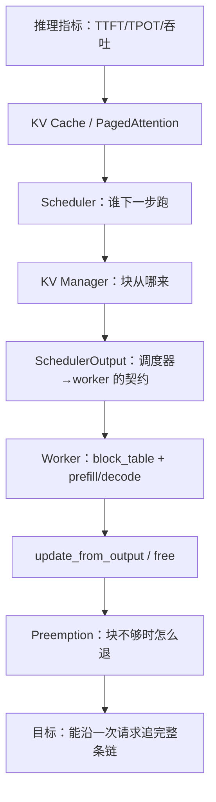
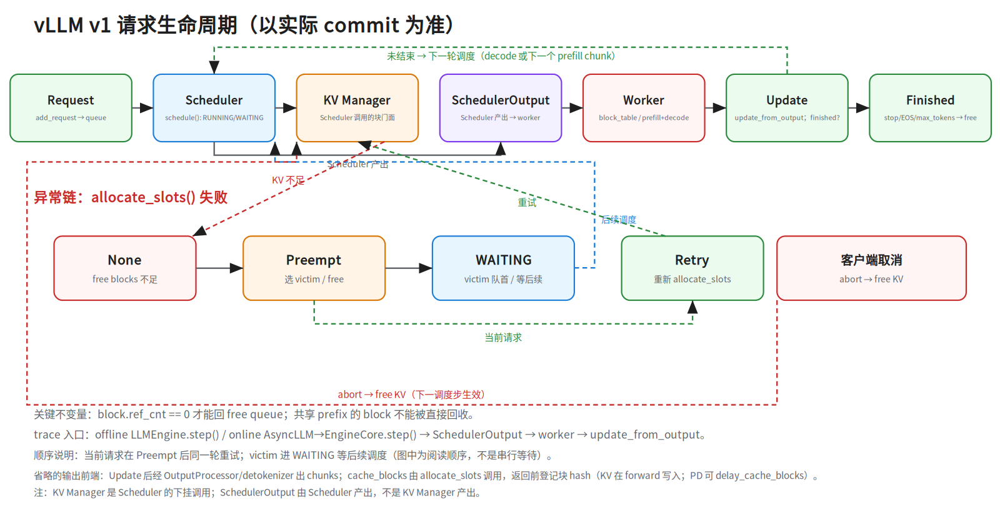

# 第二十八层 · vLLM v1 源码 trace：一次请求怎么走

> 本层是 **M2-3 推理系统的源码补丁**：把 `notes/22_inference_systems.md` 的引擎架构落到 vLLM v1 的代码路径。
> 前置：`notes/22 §3–6`（KV Cache、PagedAttention、调度、引擎架构）、Python 基础、会跑 vLLM。
> **重要**：源码会变。本文以 vLLM v1 的公开结构为骨架，读之前先钉 commit/tag，不要背行号。

## 0. 依赖图（学习顺序）



**建议 45 分钟路径**：§2 钉版本 → §3 文件地图 → §4 正常链 → §5 异常链 → §6 数据结构 → §7 trace 产物 → §8 练习。

**前置（按节）**：

- §0/§6.3：知道 TTFT/TPOT/吞吐等推理指标（`notes/22 §1`）；TP=张量并行、PP=流水线并行、PD=prefill/decode 分离。
- §3–§4：知道 prefill/decode、KV Cache、PagedAttention（`notes/22 §2–5`）。
- §5：知道 continuous batching 与 preemption（`notes/22 §4`）。
- §7：知道 `docs/source-trace-template.md` 的字段。

---

## 1. 为什么读源码

面试问“你熟悉 vLLM 吗”，只答“它用 PagedAttention”不够。真正区分人的是：

- 一次请求从哪进、经过谁、在哪结束；
- KV 块什么时候分配、什么时候释放；
- 块不够时谁被抢占、怎么恢复；
- prefix cache 命中在哪一层判断；
- 你改一个参数/策略，会影响哪条路径。

源码 trace 的目标不是“读完 vLLM”，而是**能闭卷画出这条链，并回答 3 层追问：机制（谁调谁）、异常（preemption/cancel）、取舍（block_size/版本）**。

---

## 2. 先钉版本

vLLM v0 和 v1 的文件结构差异很大。v0 有 `vllm/core/block_manager.py`；v1 没有同名类，职责拆到 `BlockPool` / `KVCacheManager` / `SingleTypeKVCacheManager` / `KVCacheCoordinator`。

开始前记录：

```text
repo: vllm-project/vllm
version / tag:
commit:
date:
```

本文以 **vLLM v1** 为骨架；读的时候以实际 commit 为准。

---

## 3. 文件地图

| 层 | 文件 | 作用 |
|---|---|---|
| 引擎入口 | `vllm/v1/engine/llm_engine.py` / `LLMEngine` | 接收请求、驱动 `step()`；v1 不再是 v0 的 `vllm/engine/llm_engine.py` |
| 输出前端 | `vllm/v1/engine/output_processor.py` + detokenizer | 把 sampled token 变成文本增量/流式 chunk；在引擎前端，不在 scheduler 侧 |
| 调度 | `vllm/v1/core/sched/scheduler.py` | 选请求、算新 token、触发 preemption |
| 调度输出 | `vllm/v1/core/sched/output.py` | `SchedulerOutput`：调度器→worker 的契约 |
| KV 门面 | `vllm/v1/core/kv_cache_manager.py` | `get_computed_blocks` / `allocate_slots` / `free` |
| KV 协调 | `vllm/v1/core/kv_cache_coordinator.py` | 多 KV group（full/sliding window）协调 |
| 单类型 KV | `vllm/v1/core/single_type_kv_cache_manager.py` | 单个 attention 类型的块账本 |
| 物理块池 | `vllm/v1/core/block_pool.py` | 分配/回收/prefix hash/ref_cnt |
| Worker | `vllm/v1/worker/gpu_model_runner.py` | 执行 forward、更新 block table |
| Block table | `vllm/v1/worker/block_table.py` | 逻辑块 → 物理块 |
| 设计文档 | `docs/design/prefix_caching.md`（v0.10.x 有）、`docs/design/hybrid_kv_cache_manager.md`（目前 main 有，v0.10.x 可能没有） | 先读设计，再读代码；版本不同先确认文件是否存在 |

> 不要从 `vllm/core/block_manager.py` 开始读 v1；那是 v0 的入口。

### 3.1 进程架构（v1 和 v0 的关键差异）

v1 把调度和前端拆开（以实际版本为准）：

```text
API server / AsyncLLM（frontend，跑在 API 进程）
  → EngineCoreClient（in-process 或 MP client）
  → EngineCoreProc（独立进程，ZMQ input/output socket）
      → Scheduler / KVCacheManager / 每卡 worker（TP/PP）
  → OutputProcessor / detokenizer（frontend 侧）
```

- **EngineCore 独立进程**：scheduler 在 EngineCore 里跑 busy loop（`run_busy_loop`），通过 ZMQ 收请求/发输出；frontend 做 HTTP/SSE/detokenize。这样调度不被 Python HTTP 前端拖慢。
- **worker 进程**：每卡一个 worker（TP/PP 组合），通过 executor/消息拿 `SchedulerOutput` 并返回 sampled tokens。
- **v0 vs v1**：v0 有 swap 队列/换出；v1 默认 recompute、scheduler 无 swap 队列（多序列/beam 等特例可能仍需 swap，以钉住版本为准），所以 v1 的 `EngineCore`/scheduler 结构更简单。
- 读代码顺序：frontend `AsyncLLM` → `EngineCoreClient` → `EngineCore.abort_requests/step` → scheduler → KV manager → worker。

---

## 4. 正常链：一次新请求



> 手机版：`../diagrams/28a_vllm_lifecycle.portrait.png`

### 4.1 请求进入

```text
add_request()
→ 请求进入 waiting/engine queue
→ EngineCore.step()（offline 经 LLMEngine → client；online 经 AsyncLLM → EngineCoreProc）
```

`step()` 是 trace 的起点：它驱动一次调度 + 一次（或多次）模型执行。

### 4.2 调度

`scheduler.schedule()` 通常分两段：

1. **RUNNING**：已经在跑的请求。为每个请求算 `num_new_tokens`，调用 `allocate_slots()`；分配失败就触发 preemption。
2. **WAITING**：新请求/被抢占后恢复的请求。先 `get_computed_blocks()` 查 prefix cache 命中，再 `allocate_slots()`。

关键：**RUNNING 分配失败才会抢占；WAITING 分配失败通常继续等。**

### 4.3 KV 分配

`KVCacheManager` 是 scheduler 的门面：

```text
get_computed_blocks(request)
→ 查最长 prefix cache 命中（prefix cache 定义见 `notes/27 §4.4`：复用已算前缀的 KV，跳过这段 prefill）
→ 返回 computed blocks，作为 new_computed_blocks 传给 allocate_slots
allocate_slots(request, num_new_tokens)
→ 只为未命中的 token 从 BlockPool 拿新块
→ 分配后、返回前调用 coordinator.cache_blocks(request, num_tokens_to_cache)
   登记块 hash（KV 内容在随后的 forward 写入；hash 基于 token IDs）
→ 返回 None 表示块不够
cache_blocks(...)  # KVCacheManager 的公开 wrapper，也可被外部调用
→ 把已计算 token 的块登记到 prefix cache；PD 用 delay_cache_blocks 延迟登记
→ 下一请求才能命中
free(request)
→ 请求结束/被抢占时释放
```

`num_new_tokens` = 本轮新增 token 数（decode 为 1；prefill 为 chunk 长度）。

`BlockPool` 负责物理块：

- `get_new_blocks(n)`：从 free queue 取块；必要时驱逐 cached 块；`ref_cnt++`。
- `free_blocks(blocks)`：`ref_cnt--`；归零才回 free queue。
- `cached_block_hash_to_block`：prefix hash → block。

**启动时可用 KV 块数**：加载权重、激活/通信缓冲、CUDA context 之后，用 profiling run 量剩余显存；`num_gpu_blocks = 可用 KV 显存 ÷ 每块字节`，其中每块字节 = `block_size × 2(K+V) × L × H_kv × d_head × bytes`。例：7B GQA-8（L=32, H_kv=8, d_head=128）、block_size=16、FP16，每块 = `16×2×32×8×128×2 = 2 MiB`；50 GiB KV 预算 → 25,600 块。`gpu_memory_utilization` 太低 → KV 预算少、更早 preemption/拒绝；太高 → 启动预分配失败/OOM（headroom 不足）；模型/`max_model_len`/`max_num_seqs` 太大也会让可用块变少。若 `num_gpu_blocks=0`，先看启动日志的可用 KV 显存与块数。

### 4.4 SchedulerOutput

`SchedulerOutput` 是调度器给 worker 的“任务单”，至少包含：

- 新请求的 block IDs；
- 被恢复请求的 block IDs / computed token 数；
- 总调度 token 数；
- 完成的请求。

**面试点**：scheduler 管策略（谁跑、跑多少），KV manager 管机制（块从哪来、怎么回收）。不要把两者混成一个“block manager”。

### 4.5 Worker 执行

`gpu_model_runner` 根据 `SchedulerOutput`：

1. 更新 GPU 侧 `block_table`（逻辑块 → 物理块）；
2. 执行 prefill（新请求的 prompt；chunked prefill 时按块）；
3. 执行 decode（每步 1 token）；
4. 通过 PagedAttention kernel 读写 KV；
5. 返回 logits / sampled tokens。

### 4.6 收尾

`update_from_output()`：

- 处理采样结果；
- 判断请求是否结束（stop string / max_tokens / EOS）；
- scheduler 判定 finished 后，经 OutputProcessor / detokenizer 生成文本增量；
- 流式路径把增量包装成 chunk 出引擎，非流式路径攒到结束再返回；
- 结束则 `free()` 释放块；
- 未结束则下一轮继续。

### 4.7 取消 / abort

客户端断开、超时、用户取消时，不能只“停止读响应”。abort 通常在**下一个调度步**生效，不能打断正在执行的 forward：

```text
客户端取消 / 超时
→ vllm/v1/engine/async_llm.py: AsyncLLM.abort(request_id)
→ vllm/v1/engine/core.py: EngineCore.abort_requests(...)
→ scheduler 标记 finished/aborted，不再分配新 token
→ vllm/v1/core/kv_cache_manager.py: KVCacheManager.free(request)
→ worker 下一调度步停止后续 forward
→ metrics 记录取消原因/已生成 token
```

关键：**取消要释放 KV 块和调度资源**；否则高并发下会被“僵尸请求”吃满显存。流式代理要把客户端断连翻译成取消信号，不能只关 socket。

---

## 5. 异常链：块不够时怎么退

```text
RUNNING 请求 allocate_slots() → None
→ 选 victim（FCFS 取队尾 / priority 按优先级+到达时间）
→ _preempt_request(victim)
→ kv_cache_manager.free(victim)
→ victim 状态 = PREEMPTED，num_computed_tokens = 0
→ victim 放到 WAITING 队首（后续再调度）
→ 当前请求在同一轮立即重试 allocate_slots()（不等待 victim）
```

> 版本提示：`_preempt_request` 是 main 分支抽出的方法；v0.10.x 里抢占内联在 `schedule()` 中（`running.pop()` → `PREEMPTED`/`num_computed_tokens=0` → `waiting.prepend_request`）。按固定版本读时以实际源码为准。

关键不变量：

- `block.ref_cnt == 0` 才能回 free queue；
- 共享 prefix 的块可能被多个请求持有，不能因为一个请求结束就直接回收；
- 被抢占请求的已计算 token 会丢，恢复时要重新 prefill（或依赖 prefix cache）。

**面试追问**：

- 为什么 WAITING 分配失败不抢占？因为 RUNNING 已经在执行，抢占成本更高；先让新请求等。
- FCFS 为什么抢“队尾”？FCFS 下队尾是**最近才进入 RUNNING** 的请求，已投入计算最少，抢占代价最低。
- 抢占一定丢 KV 吗？不一定，取决于块是否被 prefix cache 持有/能否复用。
- 为什么 ref_cnt 重要？它防止“一个请求释放了别人还在用的共享 prefix 块”。

---

## 6. 数据结构

| 结构 | 关键字段 | 生命周期 |
|---|---|---|
| `KVCacheBlock` | `block_id`、`ref_cnt`、`_block_hash`、free queue 指针 | 分配 → 使用 → ref_cnt=0 → 回收 |
| `BlockPool` | free queue、cached hash map | 全局 |
| `KVCacheManager` | request → blocks、prefix cache 门面 | 请求级 |
| `SingleTypeKVCacheManager` | `req_to_blocks`、`num_cached_block` | 单 attention 类型/请求 |
| `BlockTable`（worker） | 逻辑块位置 → 物理 block_id | GPU 侧，每步更新 |

**不变量**：

- 一个逻辑块只能映射到一个物理块；
- 一个物理块可被多个请求共享（prefix cache），用 `ref_cnt` 计数；
- 只有 `ref_cnt == 0` 的块才能被驱逐/复用；
- block table 是 worker 侧视图，scheduler 侧只持有 block IDs。

### 6.1 prefix cache 的哈希链与 LRU

- 写满的块按 **前缀 token 的 hash** 建索引；命中时从最长前缀开始复用。
- `cached_block_hash_to_block` 存 hash → block；`free_block_queue` 近似 LRU。
- 复用块 `ref_cnt++`；请求结束 `ref_cnt--`；只有归零才可驱逐。
- 命中判断在 scheduler 侧（`get_computed_blocks`），不在 worker。

### 6.2 chunked prefill 与本文边界

- **chunked prefill**：把长 prompt 的 prefill 切成多个 chunk，和 decode 交替调度；入口在 scheduler 的 token 预算（`max_num_batched_tokens`）分配，不在 attention kernel。vLLM v1 常开，实验里更实际的是调分块粒度，而不是找 on/off 开关。
- **本文不覆盖**：PD 分离、KV connector、约束解码、MLA/DeepSeek 专属路径、多模态 encoder。它们各自有独立路径，不要用本文的六步链硬套；投机解码只做 §6.4 的指路。

### 6.3 block_size 取舍

`block_size` 是 KV 块的粒度：

- 小块：内部碎片上限更小（最后一块最多浪费 `block_size-1` 个 token 的槽），prefix cache 共享粒度更细；但 block table 更大、寻址/调度开销更高。
- 大块：block table 小、寻址快；但内部碎片和 prefix cache 共享浪费变大。
- 调参时看 `kv_cache_usage_perc`（v1；v0 叫 `gpu_cache_usage_perc`）、preemption 计数（v0 引擎与 v0.11.x 的 v1 看 `num_preemptions_total`；latest v1 看 `num_preemptions` 计数器 + `request_num_preemptions` per-request 直方图）、TTFT/TPOT 和吞吐，不要只看单请求。指标名随版本变，以实际 `/metrics` 为准。

### 6.4 投机解码：只指路

投机解码的源码主链（不做逐行 trace）：

```text
draft/proposer 生成 k 个候选 token
→ target model 一次 verify
→ 接受最长匹配前缀 + 1 个 bonus token（或按拒绝重采样）
→ 更新 KV / 调度下一步
```

- **入口/文件**：v1 的 speculative decoding 在引擎/scheduler 的配置与 `vllm/v1/spec_decode/`（具体文件随版本变化，以钉住的 commit 为准）；常见配置 `speculative_model`、`num_speculative_tokens`，调度侧受 token 预算约束。
- **收益条件**：接受率 α 高、draft 成本低、并发/延迟有空闲；退化条件：α 低、draft 太贵、verification 抢占算力、高并发下 KV/调度开销上升。大 batch 时 decode 已接近 compute-bound，verify 的算力不再被带宽掩盖，加速比可能 <1；公式是单请求/低并发近似。
- **数值**：期望生成 token `E=(1-α^(k+1))/(1-α)`（含 1 个 bonus；接受的 draft token 约 `E−1`），加速 `E/(1+c·k)`，见 `hand-calc #11`；概念与取舍见 `notes/22 §9`。


---

## 7. Trace 产物

按 `docs/source-trace-template.md` 输出：

```text
learning/repos/vllm/traces/request-lifecycle.md
learning/repos/vllm/traces/preemption.md
```

每份至少包含：

- 版本/commit；
- 入口/出口；
- 正常链表格（文件 + 符号）；
- 异常链；
- 数据结构与不变量；
- 3 道 quiz；
- 开放问题。

---

## 8. 三个练习

### 练习 1：画正常链

不看源码，先画：

```text
add_request → schedule → allocate_slots → SchedulerOutput → worker → decode → update → free
```

再打开源码，标出每一步的文件/符号；差异就是学习点。

### 练习 2：追一次 preemption

构造一个块不足的场景（可复现参数示例：**7B MHA（LLaMA-2 7B，L=32/H_kv=32/d_head=128，512 KiB/token；和 §4.3 的 GQA-8 例子不同）** / 24 GiB 卡，`gpu_memory_utilization=0.9`、`max_model_len=4096`、`max_num_seqs=8`，并发发 6 条 ~3500 token 的 prompt。每请求 KV ≈ 512 KiB × 3500 ≈ 1.71 GiB，6 条约 10.3 GiB；24×0.9−13 ≈ 8.6 GiB 是 KV 上限（未扣激活/CUDA graph），实际以启动日志 `Available KV cache memory`/`num_gpu_blocks` 为准；预计第 4–6 条触发 preemption，留 1–2 条余量）。观察 vLLM 日志和 `/metrics` 的 preemption 指标（v0 引擎与 v0.11.x 的 v1 看 `num_preemptions_total`；latest v1 看 `num_preemptions` + `request_num_preemptions` 直方图，以版本为准）。回答：

- 谁被选为 victim？
- victim 的 `num_computed_tokens` 变成多少？
- 它回到哪个队列？
- 当前请求什么时候重试？
- 共享 prefix 块会不会被误回收？

### 练习 3：改一个参数

选 `block_size`、`max_num_batched_tokens` 或 `gpu_memory_utilization` 之一，回答：

- 影响哪条路径？
- 吞吐/延迟/显存怎么变？
- 怎么用 benchmark 验证？

---

## 动手清单（60–90 分钟）

| # | 动作 | 产出 / 验收 |
|---|---|---|
| 1 | 画正常链 | 一张图 + 每步文件/符号；能不看源码复述 |
| 2 | 追一次 preemption | 一页 trace：victim、队列、ref_cnt、恢复路径 |
| 3 | 追一次取消 | 一页 trace：取消信号 → free → worker 停止 |
| 4 | 改一个参数 | 用 benchmark 跑 before/after，写 3 行解释 |
| 5 | 写 3 道 quiz | 入口/出口、ref_cnt 不变量、chunked prefill 入口 |

验收：能回答“scheduler 和 KV manager 分工”“为什么 ref_cnt=0 才能回收”“取消为什么必须 free”。

---

## 9. 面试要点

- vLLM v1 的请求生命周期（能画图）。
- Scheduler 和 KV Manager 的分工。
- PagedAttention 的 block table / ref_cnt / prefix cache。
- preemption 的触发条件、victim 选择、恢复路径。
- 为什么 `ref_cnt=0` 才能回收。
- 改 `block_size` / `gpu_memory_utilization` 的影响。
- 怎么用 trace 定位“请求慢”是排队、prefill、decode 还是 KV 不足。

## 10. 常见坑

- 用 v0 的 `block_manager.py` 讲 v1。
- 把 scheduler 和 KV manager 说成一个东西。
- 以为 PagedAttention 直接减少 attention FLOPs；它优化的是显存管理。
- 忽略 prefix cache 的共享块和 ref_cnt。
- 只看正常链，不看 preemption/取消/结束。
- 背行号，不记版本。

## 11. 下一步

- 用 `/learn-repo` 在 `nano-vllm` 上先跑一遍同样链路，再读完整 vLLM。
- 用 `labs/inference-bench/` 改 `block_size` / batch，验证你对源码的理解。
- 读 `notes/29_agent_eval_infra.md`：把推理后端接到 Agent 评测。
