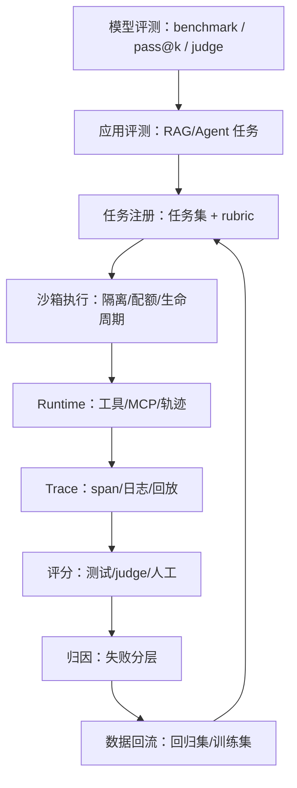
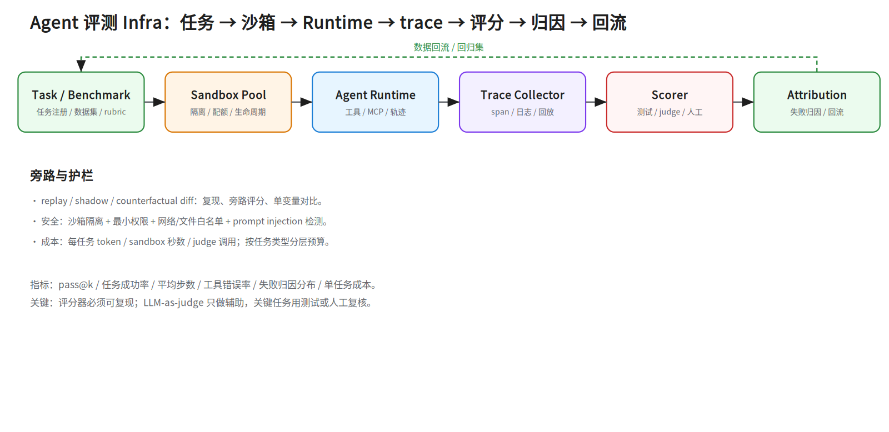

# 第二十九层 · Agent 评测 Infra：从打分到可复现的评测平台

> 本层是 **D 类（评测 Infra / Agent Infra）的核心补丁**：把 `notes/09` 的模型评测、`notes/11 §6` 的应用评测、`notes/26 §2` 的 Agent Runtime 串成一套评测系统。
> 前置：`notes/09_evaluation.md`、`notes/11 §6`、`notes/26 §2`、`notes/27`（Agent 工程）。
> 外部资产：Obsidian `AI Agent面试准备/Wiki` 的评测卡、`系统设计题汇总-Agent与后端通用架构模式`。

## 0. 依赖图（学习顺序）



**建议 45 分钟路径**：§2 架构 → §3 任务 → §4 沙箱 → §5 Runtime → §6 trace → §7 评分 → §8 归因。

**前置（按节）**：

- §3–§4：知道容器/沙箱、K8s 基本概念（`notes/24 §7`、`notes/26 §2`）。
- §7：知道 pass@k、LLM-as-judge（`notes/09`）。
- §8：知道 Agent Loop / trace（`notes/27`）。

---

## 1. D 类岗位在做什么

评测 Infra 不是“写几个 benchmark 脚本”，而是建设一条**可复现、可扩展、可归因、可回流**的流水线：

```text
任务接入 → 环境准备 → Agent 执行 → 轨迹采集 → 自动评分 → 失败归因 → 数据集回流
```

核心 KPI：

- 评测吞吐：任务/小时；
- 沙箱启动时间、并发数；
- 任务成功率 / pass@k；
- 评分一致性（自动 vs 人工）；
- 单任务成本（token + 沙箱秒数 + judge 调用）；
- 失败归因准确率。

---

## 2. 架构



> 手机版：`../diagrams/29a_eval_infra.portrait.png`

六个核心模块：

| 模块 | 职责 | 关键设计 |
|---|---|---|
| **Task / Benchmark** | 任务注册、数据集、rubric、版本 | 任务不可变；版本化；难度/领域标签 |
| **Sandbox Pool** | 隔离、配额、生命周期、预热 | 池化；按风险分级；超时/回收 |
| **Agent Runtime** | 工具、MCP、轨迹 | 统一工具协议；权限；可回放 |
| **Trace Collector** | span、日志、工具调用、文件/网络 | traceId 透传；结构化；脱敏 |
| **Scorer** | 测试、LLM judge、人工 | 可复现；多评分器；一致性校验 |
| **Attribution** | 失败归因、数据回流 | 分层归因；回归集；训练集 |

---

## 3. 任务与 Benchmark

### 3.1 任务模型

一个任务至少包含：

```text
task_id
version
instruction / prompt
repo / environment / fixtures
allowed tools / permissions
timeout / budget
scoring rubric (tests / assertions / judge prompt)
difficulty / domain / source
```

### 3.2 任务类型

- **确定性任务**：有单测/断言，比如修 bug、通过测试。
- **探索性任务**：没有唯一答案，比如研究、写作、方案设计。
- **交互式任务**：多轮、工具、环境状态变化。

**关键**：确定性任务优先用测试评分；探索性任务才用 judge/rubric，且必须人工抽检。

**评测完整性（防作弊）**：

- Agent 只写非测试文件；public tests 只读；**gold patch（参考解补丁）不挂载、也不应用到候选仓库**，只用于任务注册时校验测试有效性，不喂给评分 judge（避免 reference bias）；hidden test patch 评分时注入；
- 评分在独立容器/进程，不复用 Agent 沙箱；网络出口默认禁网或 allowlist，防止联网取答案；
- 检测测试文件改动、hash/canary（埋点字符串/标记）、异常 diff、外部答案获取；发现直接判失败并告警；
- 任务/测试版本化，记录测试补丁应用顺序。

### 3.3 版本与污染

- 任务集版本化；模型/Agent 版本化；评分器版本化。
- 防止训练集污染：任务来源、时间、去重、泄露检测。
- 难任务要保留“失败样本”，不要只留简单题。

---

## 4. 沙箱池

### 4.1 为什么要池化

Agent 任务生命周期短、并发高；每次冷启动容器/VM 会很慢。

池化要解决：

- **预热**：提前拉镜像、装依赖、准备 fixture；
- **隔离**：每任务独立文件系统/网络/进程；
- **配额**：CPU/内存/GPU/磁盘/网络；
- **回收**：超时、失败、取消都要回收；
- **复用**：同任务类型可复用基础镜像，但状态要清理。

### 4.2 隔离级别

| 方案 | 隔离 | 启动量级 | 适用 |
|---|---|---|---|
| Docker | 中 | ~100 ms–1 s | 低风险、可信代码 |
| gVisor | 较强 | ~200 ms–1 s | 多租户、不可信代码 |
| Firecracker/microVM | 强 | ~50–150 ms | 高风险、强隔离 |
| WASM | 强（能力受限） | ~ms | 插件/工具、系统调用受限 |
| 独立 VM | 最强 | 慢 | 极高风险/合规 |

**1 万并发池账本**：每沙箱 2 vCPU / 4 GB / 1 GB 盘 → 峰值 `20k vCPU / 40 TB 内存`；这显然不能全常驻，必须池化 + 排队 + 配额。启动 100 ms、任务 30 s → 完成约 `10000/30≈333 次/秒`；同一时刻约 `10000×0.1/30≈33 个` 在启动（不是 33 次/秒）。池化/快照能把冷启动从 100 ms 降到 ~10 ms。通用池化账本见 `notes/26 §2.3`；本节只补评测特有的评分/归因开销。

**面试回答**：按风险分级选隔离，不要一律上最重；同时要讲清启动时间、兼容性、运维成本，以及池化/预热/回收。

### 4.3 生命周期

```text
CREATED → WARMING → READY → RUNNING → COLLECTING → DESTROYED
```

必须有超时、取消、失败回收；否则沙箱池会被泄漏任务吃光。

---

## 5. Runtime 与工具

- 统一工具协议（MCP / function calling）；
- 工具权限按任务配置；
- 工具调用结果结构化；
- 工具失败要分类：参数错、权限错、超时、下游错；
- 所有工具调用进 trace；
- 支持断点/回放。

---

## 6. Trace 与回放

### 6.1 Trace 要采什么

- LLM 调用：模型、token、延迟、成本；
- 工具调用：名称、参数（脱敏）、结果、错误；
- 文件/网络：读写、请求；
- Agent 状态：计划、步数、停止原因；
- 评分：评分器、分数、证据。

### 6.2 回放

**replay 不是“再跑一遍”**。要可复现，至少固定四件事：

1. 录制/mock 工具返回；
2. 固定 seed / 采样参数；
3. 环境快照（镜像、依赖、fixture）；
4. 模型、prompt、工具 schema 版本化。

三种用法：

- **replay**：用同一 trace + mock 工具重放，验证失败是否可复现；
- **shadow**：线上流量旁路评分，不影响用户；
- **counterfactual diff**：只改一个变量（模型/prompt/工具），比较轨迹差异。

**关键**：没有 trace，就没有可复现的评测；没有回放，就无法区分“模型随机”与“环境问题”。

---

## 7. 评分

### 7.1 评分器分层

1. **确定性测试**：单测、断言、编译、lint。
2. **规则评分**：格式、字段、工具调用次数。
3. **LLM-as-judge**：rubric 评分，需校准。
4. **人工复核**：关键任务/低置信度样本。

### 7.2 指标

- **pass@k**：k 次尝试至少一次成功；
- **pass^k**：k 次尝试全部成功（更严格，防“蒙对一次”）；
- **任务成功率**：一次运行成功比例；
- **FAR（false accept rate）**：失败轨迹被评分器误判为成功；
- **平均步数 / 工具调用次数**：效率；
- **P95 任务时长 / P95 单任务成本**：长尾；
- **工具错误率 / 重试率**：Harness 质量；
- **失败归因分布**：理解/规划/检索/工具/调度；
- **评分一致性**：自动 vs 人工、judge 多次一致性；
- **每成功任务成本**：总成本 / 成功任务数（含重试/失败）。

### 7.3 评分器校准

- 用人工标注集校准 judge；
- 报告 judge 与人工的一致率；
- 对关键任务保留人工复核；
- 评分器版本化，变更要回归。

### 7.4 judge 偏差与降方差

| 偏差 | 表现 | 对策 |
|---|---|---|
| 位置偏差 | 偏爱 A 或 B | 交换 A/B 两次评分 |
| 冗长偏差 | 长答案分高 | rubric 加“简洁/切题”项 |
| 自偏好 | 偏爱同模型输出 | 多模型 judge / 人工抽检 |
| 讨好偏差 | 顺着候选答案 | 不给候选解释，只给 rubric |
| 分数漂移 | 不同批次不可比 | 固定 judge 版本 + 锚点样本 |

降方差：同一答案重复评 K 次（K=3/5），取中位数/多数票；报告置信区间；关键任务人工复核。不要用一次 judge 分数定胜负。

### 7.5 A/B 两版本怎么判定更好

- 固定任务集、固定环境、固定评分器版本；
- 每版至少 N 个任务（先看效应量，不要 20 个就下结论）；
- **效应量**：比例指标用 Cohen's h = `2·arcsin(√p1) − 2·arcsin(√p2)`，或报告成功率差及其置信区间；先跑 30–50 个配对任务估效应量，再反推所需 N（公式与算例见 `notes/27 §9.3`）；
- 报告 `pass@k / pass^k / 成功率 / 成本 / P95` 的差值与置信区间；
- 用配对比较（同一任务跑 A/B）降低方差；配对二进制结果可用 McNemar，连续指标用配对 bootstrap；
- 结论写“在什么任务分布、什么预算下更好”，不写“全面更好”。

---

## 8. 失败归因与数据回流

### 8.1 归因分层

```text
理解错：没看懂任务/约束
规划错：计划不合理/漏步骤
检索错：RAG 召回/排序错
工具错：参数/权限/下游失败
调度错：多 Agent/队列/超时
环境错：沙箱/fixture/依赖
评分错：rubric/judge 误判
```

### 8.2 回流

- 失败样本 → 回归集；
- 高质量轨迹 → SFT/偏好数据；
- 工具失败 → Harness 修复；
- 评分争议 → rubric 更新；
- 任务太难/太简单 → 调整难度分布。

### 8.3 归因准确率怎么验收

- 建一个**归因标注集**：人工标好每个失败样本的主因；
- 两名标注者独立标，计算一致性（Cohen's kappa：扣除随机一致后的标注一致度，1=完全一致、0=随机水平）；单人学习可让 LLM 作第二标注 + 48h 后自己重标，报告一致率/混淆矩阵；
- 报告每类 precision/recall 和混淆矩阵，不只看总 accuracy；
- 归因器版本化；用新样本回归；
- 归因结果要能指向可执行动作（修工具/改 prompt/补检索/加权限）。

**数据飞轮**：评测不是终点，是下一轮训练/优化的输入。

---

## 9. 安全、成本与 SLO

### 9.1 安全

- 沙箱隔离 + 最小权限；
- 网络/文件白名单；
- prompt injection 检测；
- 敏感数据脱敏；
- 审计：谁跑了什么任务、改了什么。

### 9.2 成本

- 每任务预算：token/时间/金额；
- 模型路由：简单评分用小模型；
- 缓存：任务 fixture、工具结果、judge 结果；
- 并发/配额：防止单任务吃满池子。

### 9.3 SLO

- 任务排队时间；
- 沙箱启动 P95；
- 评测完成时间；
- 评分失败率；
- 单任务成本上限。

---

## 10. 系统设计练习

设计一个支持 **1 万并发 Agent 任务**的评测平台，回答：

1. 任务如何注册、版本化、去重？
2. 沙箱池怎么预热、隔离、回收？
3. trace 怎么采、怎么存、怎么回放？
4. 评分器怎么组合、怎么校准？
5. 失败怎么归因、怎么回流？
6. 成本怎么计量、怎么限额？
7. 多租户怎么隔离？
8. 出故障怎么止损？

参考 `docs/system-design-drills.md` 的 Agent 评测平台模板。

---

## 动手清单（90–120 分钟）

| # | 动作 | 产出 / 验收 |
|---|---|---|
| 1 | 写一个任务 schema | 有 version/rubric/permissions/timeout；能去重 |
| 2 | 画沙箱池状态机 | 有预热/运行/回收/超时；能算 1 万并发账本 |
| 3 | 设计 trace 字段 | 有 traceId/工具调用/文件网络/评分；能 replay |
| 4 | 写 5 条评分 rubric | 至少 2 条确定性测试；judge 有校准方案 |
| 5 | 做一次失败归因 | 7 类标签；两人标注一致性；能回流 |

验收：能回答“1 万并发怎么池化”“judge 偏差怎么降”“失败怎么归因/回流”。

---

## 11. 面试要点

- 评测 Infra 和“跑 benchmark”的区别：可复现、可扩展、可归因、可回流。
- 沙箱隔离方案与取舍。
- trace/replay/shadow 的作用。
- pass@k、任务成功率、judge 一致性。
- 失败归因分层。
- 1 万并发任务平台的架构。
- 成本/配额/SLO。
- 安全与多租户。

## 12. 常见坑

- 只测最终答案，不看轨迹和成本。
- 沙箱不复用/不回收，池子被泄漏任务吃光。
- judge 没校准，分数不可信。
- 任务集污染/泄露。
- 失败样本不回流，下一轮还在犯。
- 多租户没有隔离，互相影响。
- 只看平均，不看 P95/P99。

## 13. 下一步

- 用 `notes/27` 的 Agent 工程四层画评测平台的模块边界。
- 用 `labs/inference-bench/` 采一次真实推理指标，作为评测后端。
- 用 `docs/system-design-drills.md` 做一次 45 分钟设计。
- 把 Asterwynd 的评测闭环映射到本层的六个模块。
