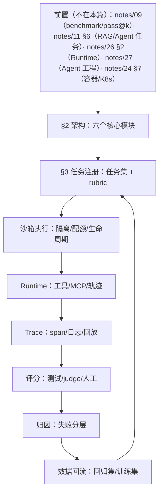

# 第二十九层 · Agent 评测 Infra：从打分到可复现的评测平台

（A/B/C/D 只是本系列内部的岗位分档：A 模型训练、B 推理与 serving、C 应用后端、D 评测与 Agent Infra，不是业界通用术语。）

> 本层是 **D 类（评测 Infra / Agent Infra）的核心补丁**：把 `notes/09` 的模型评测、`notes/11 §6` 的应用评测、`notes/26 §2` 的 Agent Runtime 串成一套评测系统。
> 前置：`notes/09_evaluation.md`、`notes/11 §6`、`notes/26 §2`、`notes/27`（Agent 工程）。
> 外部资产：Obsidian `AI Agent面试准备/Wiki` 的评测卡、`AI Agent面试准备/面试Q&A/系统设计题汇总-Agent与后端通用架构模式.md`。

## 0. 依赖图（学习顺序）



**建议 45 分钟路径**：§2 架构 → §3 任务 → §4 沙箱 → §5 Runtime → §6 trace → §7 评分 → §8 归因。


图里只有 A 节点标了 §2、C 节点标了 §3（且 §3 正文节名是「任务与 Benchmark」，不是「任务注册」），其余七个节点（D–I 六个，加上没被算进节的 P 前置节点）不标节号；§2 的六模块表只给名词与职责，Trace Collector / Scorer / Attribution 分别在 §6、§7、§8 展开，第一屏读到不熟的名词直接往后跳到对应节即可。
补一句图与节的对齐关系：沙箱/Runtime/Trace/评分/归因/数据回流六个节点依次对应 §4、§5、§6、§7、§8、§8.2；归因与数据回流在图上是两个节点，正文合在 §8 一节讲（8.1 归因、8.2 回流），与 §2 六模块表把两者并入 Attribution 一致——所以图上是七步、表里是六个模块。

**前置（按节）**：

- §3–§4：知道容器/沙箱、K8s 基本概念（`notes/24 §7`、`notes/26 §2`）。
- §7：知道 pass@k、LLM-as-judge（`notes/09`）。

- §7.5（只在要判「A 版是否真的更好」时才用）：知道效应量、power、z 分位这几个词的含义就够；该小节把 α=0.05 双侧、power=0.80（z=1.96/0.84）、单侧与双侧的区别、两个 N 公式、Cohen's h 的 arcsin 算例，以及 σ/Δ 口径的推导与 63/31 组算例都写在正文里，不需要先读 `notes/27` 的统计小节。
- §8：知道 Agent Loop / trace（`notes/27`）。
- §2/§6：知道 trace 与 span 的基本含义（一次运行 vs 运行中的一次操作，详见 §6.1）。
口径对齐：文首前置行、图中 P 节点、上面按节清单是同一份前置的不同粒度——最全的是「notes/09 + notes/11 §6 + notes/26 §2 + notes/27 + notes/24 §7」，按这一份准备即可；只读 §7 可以先跳过 notes/24 §7，但进 §4.2 与 §5 前要补容器/K8s 与 Agent Loop。

---

## 1. D 类岗位（评测 Infra）在做什么

评测 Infra 不是“写几个 benchmark 脚本”，而是建设一条**可复现、可扩展、可归因、可回流**的流水线：

```text
任务接入 → 环境准备 → Agent 执行 → 轨迹采集 → 自动评分 → 失败归因 → 数据集回流
```

核心 KPI：

- 评测吞吐：任务/小时；
- 沙箱启动时间、并发数；
- 任务成功率 / pass@k；
- 评分一致性（自动 vs 人工）；
- 单任务成本（token + 沙箱秒数 + judge 调用）；
- 失败归因准确率。

---

## 2. 架构


> 手机版：本篇只有横版 `29a_eval_infra.landscape.png`；竖版 `29a_eval_infra.portrait.png` 尚未生成，源码仓 diagrams/、发布站与镜像里均无此文件，暂时取不到。

六个核心模块：

| 模块 | 职责 | 关键设计 |
|---|---|---|
| **Task / Benchmark** | 任务注册、数据集、rubric、版本 | 任务不可变；版本化；难度/领域标签 |
| **Sandbox Pool** | 隔离、配额、生命周期、预热 | 池化；按风险分级；超时/回收 |
| **Agent Runtime** | 工具、MCP、轨迹 | 统一工具协议；权限；可回放 |
| **Trace Collector** | 采 trace 及其下的 span（层级见 §6.1）、日志、工具调用、文件/网络 | traceId 透传；结构化；脱敏 |
| **Scorer** | 测试、规则评分、LLM judge、人工（四层见 §7.1） | 可复现；多评分器；一致性校验 |
| **Attribution** | 失败归因、数据回流 | 分层归因；回归集；训练集 |

---

## 3. 任务与 Benchmark

### 3.1 任务模型

一个任务至少包含：


两个字段先说清：**fixture** 是任务预置的固定输入与环境前置状态——仓库快照、初始数据文件、预装依赖、要注入的工具/mock 返回值；实践上按「随基础镜像打包」+「注册时挂载」两种方式组合，§6.2 环境快照的边界就是「镜像 + 挂载的 fixture」这一层。
术语统一：全篇一律写 fixture，任务 schema 里的键名用复数 `fixtures`，指的是同一个概念；依赖不单列，算 fixture 的一部分，所以 §6.2 的环境快照只按「镜像 + 挂载的 fixture（含依赖/数据文件/mock 返回）」来记，seed 与版本是快照之外另记的两件事（对应 §6.2 回放四件事的第 2、4 条）。**rubric** 是评分依据的集合，形态为断言列表（可机器执行）与评分指引文本（喂给 judge）二选一或混用；§7.4 的对策里只有「rubric 加简洁/切题项」作用在后者（评分指引文本）的写法上，其余四条（交换 A/B 两次评分、多模型 judge/人工抽检、不给候选解释只给 rubric、固定 judge 版本 + 锚点样本）属于调用流程与版本控制，不落在文本写法上。

```text
task_id
version
instruction / prompt
repo / environment / fixtures
allowed tools / permissions
timeout / budget
scoring rubric (tests / assertions / judge prompt)
difficulty / domain / source
```

### 3.2 任务类型

- **确定性任务**：有单测/断言，比如修 bug、通过测试。
- **探索性任务**：没有唯一答案，比如研究、写作、方案设计。
- **交互式任务**：多轮、工具、环境状态变化。

**关键**：确定性任务优先用测试评分；探索性任务才用 judge/rubric，且必须人工抽检。

**评测完整性（防作弊）**：


三个词先定义：**public tests** 是随任务一起交给 Agent、运行期看得到也能跑、但只读不许改的测试；**hidden test patch** 是一份不打进候选仓库、只在评分时由评分侧注入的测试补丁，Agent 运行期完全不可见，所以无法针对隐藏用例硬编码；**gold patch** 是人工参考解，只在任务注册时用来验证「这批测试能否把参考解判过、把空改动判挂」，既不挂进 Agent 环境也不进评分。三者防的是三件不同的事：public tests 只读防改测试，hidden 注入防对可见用例过拟合，gold patch 不挂载防抄答案。

- Agent 只写非测试文件；public tests 只读；**gold patch（参考解补丁）不挂载、也不应用到候选仓库**，只用于任务注册时校验测试有效性，不喂给评分 judge（避免 reference bias）；hidden test patch 评分时注入；
- 评分在独立容器/进程，不复用 Agent 沙箱；网络出口默认禁网或 allowlist，防止联网取答案；
- 检测测试文件改动、hash/canary（埋点字符串/标记）、异常 diff、外部答案获取；发现直接判失败并告警；
- 任务/测试版本化，记录测试补丁应用顺序。

### 3.3 版本与污染

- 任务集版本化；模型/Agent 版本化；评分器版本化。
- 防止训练集污染：任务来源、时间、去重、泄露检测。
- 难任务要保留“失败样本”，不要只留简单题。

---

## 4. 沙箱池

### 4.1 为什么要池化

Agent 任务生命周期短、并发高；每次冷启动容器/VM 会很慢。

池化要解决：

- **预热**：提前拉镜像、装依赖、准备 fixture；
- **隔离**：每任务独立文件系统/网络/进程；
- **配额**：CPU/内存/GPU/磁盘/网络；
- **回收**：超时、失败、取消都要回收；
- **复用**：同任务类型可复用基础镜像，但状态要清理。

### 4.2 隔离级别

| 方案 | 隔离 | 启动量级 | 适用 |
|---|---|---|---|
| Docker | 中 | ~100 ms–1 s | 低风险、可信代码 |
| gVisor | 较强 | ~200 ms–1 s | 多租户、不可信代码 |
| Firecracker/microVM | 强 | ~50–150 ms | 高风险、强隔离 |
| WASM | 强（能力受限） | ~ms | 插件/工具、系统调用受限 |
| 独立 VM | 最强 | 慢 | 极高风险/合规 |

**1 万并发池账本**：每沙箱 2 vCPU / 4 GB / 1 GB 盘 → 峰值 `20k vCPU / 40 TB 内存 / 10 TB 盘`（盘按 10,000×1 GB 计；多为可回收的临时盘，但配额与节点本地盘容量里要单列一项）；这显然不能全常驻，必须池化 + 排队 + 配额。按表里 Docker 那一档取启动 100 ms（换成 gVisor 的 200 ms–1 s，同时在启动的会翻到数十至数百个）、任务 30 s → 完成约 `10000/30≈333 次/秒`；同一时刻约 `10000×0.1/30≈33 个` 在启动（不是 33 次/秒）。池化/快照能把冷启动从 100 ms 降到 ~10 ms（依据：池化后不再冷启动，从预热池领一个已 READY 的沙箱只剩领取 + 挂载改动的毫秒级开销，快照恢复同理；~10 ms 是 Docker 档经验值，gVisor/Firecracker 要按各自档位另测）。本节账本与 `notes/26 §2.3` 同源，数字一致，不另立一套；评测特有的评分开销见 §7、成本与配额见 §9.2；归因分层与数据回流见 §8。

**面试回答**：按风险分级选隔离，不要一律上最重；同时要讲清启动时间、兼容性、运维成本，以及池化/预热/回收。


四种方案各是什么（表里第五行的「独立 VM」= 每任务一台完整虚拟机/云主机，隔离最强、启动最慢、成本最高，只在极高风险/合规场景用）：**Docker** 共享宿主内核，隔离靠 namespace/cgroup；**gVisor** 在容器与宿主内核之间插一层用户态内核，拦截并代执行 syscall，所以隔离强于 Docker、系统调用更贵、启动仍接近容器量级；**Firecracker** 是 microVM，每个任务一台带独立内核的轻量 VM，靠精简设备模型把启动压到 ~100 ms，所以既强又快；**WASM** 是能力受限运行时，默认拿不到系统调用，只适合插件/工具。
三个内核词补一句：**namespace** 管进程「看得见什么」（PID/网络/挂载/用户等视图隔离），**cgroup** 管「能用多少」（CPU/内存/IO 配额）——两者都是宿主内核提供的功能，所以共享宿主内核的 Docker 一旦逃逸就直接落在宿主内核上；**syscall** 是用户态程序请求内核做事的唯一入口（读文件、建 socket 都算），gVisor 把它拦下来自己实现一遍再转发，这就是「隔离更强、系统调用更贵」的机制来源。

### 4.3 生命周期

```text
CREATED → WARMING → READY → RUNNING → COLLECTING → DESTROYED
```

必须有超时、取消、失败回收；否则沙箱池会被泄漏任务吃光。

---

## 5. Runtime 与工具

- 统一工具协议（MCP / function calling）；
- 工具权限按任务配置；
- 工具调用结果结构化；
- 工具失败要分类：参数错、权限错、超时、下游错；
- 所有工具调用进 trace；
- 支持断点/回放。

---

## 6. Trace 与回放

### 6.1 Trace 要采什么


先定层级：**trace 是一次任务运行的完整记录**，一次运行一条 trace（同一 task_id 重跑 k 次就是 k 条 trace，pass@k 下 k 条、A/B 两版各 k 条（A 版 k 条 + B 版 k 条，合计 2k 条）），`traceId` 才是主键，task_id 只能作外键/索引；**span 是 trace 内的一次操作**（一次 LLM 调用、一次工具调用、一次文件读写），带 `spanId`、`parentSpanId`、起止时间，嵌成树。下面五条按本节 bullet 的顺序编号：第 1–3 条各成一个 span（LLM 调用、工具调用、文件/网络），第 4 条 Agent 状态（计划/步数/停止原因）不是 span，而是挂在 trace 上的汇总字段，第 5 条评分仍是 span；`traceId` 要透传到工具子进程和评分进程，正是为了让它们的 span 落回同一条 trace。

- LLM 调用：模型、token、延迟、成本；
- 工具调用：名称、参数（脱敏）、结果、错误；
- 文件/网络：读写、请求；
- Agent 状态：计划、步数、停止原因；
- 评分：评分器、分数、证据。

### 6.2 回放

**replay 不是“再跑一遍”**。要可复现，至少固定四件事：

1. 录制/mock 工具返回；
2. 固定 seed / 采样参数；
3. 环境快照（镜像 + fixture，依赖算在 fixture 里，口径见 §3.1）；
4. 模型、prompt、工具 schema 版本化。

三种用法：

- **replay**：用同一 trace + mock 工具重放，验证失败是否可复现；
- **shadow**：线上流量旁路评分，不影响用户；
- **counterfactual diff**：只改一个变量（模型/prompt/工具），比较轨迹差异。

**关键**：没有 trace，就没有可复现的评测；没有回放，就无法区分“模型随机”与“环境问题”。

---

## 7. 评分

### 7.1 评分器分层

1. **确定性测试**：单测、断言、编译、lint。
2. **规则评分**：格式、字段、工具调用次数。
3. **LLM-as-judge**：rubric 评分，需校准。

   （judge = 让一个 LLM 拿 rubric 当评分指引给候选答案打分；它只管没有唯一答案的探索性任务，替代不了确定性测试与规则评分，边界见 §3.2、校准见 §7.3。）
4. **人工复核**：关键任务/低置信度样本。

### 7.2 指标

- **pass@k**：k 次尝试至少一次成功；
- **pass^k**：k 次尝试全部成功（更严格，防“蒙对一次”）；
- **任务成功率**：一次运行成功比例；
- **FAR（false accept rate）**：失败轨迹被评分器误判为成功；
- **平均步数 / 工具调用次数**：效率；
- **P95 任务时长 / P95 单任务成本**：长尾；
- **工具错误率 / 重试率**：Harness 质量；
- **失败归因分布**：理解/规划/检索/工具/调度/环境/评分七类（口径与 §8.1 一致，动手清单第 5 条也按这七类标）；
- **评分一致性**：自动 vs 人工、judge 多次一致性；
- **每成功任务成本**：总成本 / 成功任务数（含重试/失败）。

### 7.3 评分器校准

- 用人工标注集校准 judge；
- 报告 judge 与人工的一致率；
- 对关键任务保留人工复核；
- 评分器版本化，变更要回归。

### 7.4 judge 偏差与降方差

| 偏差 | 表现 | 对策 |
|---|---|---|
| 位置偏差 | 偏爱 A 或 B | 交换 A/B 两次评分 |
| 冗长偏差 | 长答案分高 | rubric 加“简洁/切题”项 |
| 自偏好 | 偏爱同模型输出 | 多模型 judge / 人工抽检 |
| 讨好偏差 | 顺着候选答案 | 不给候选解释，只给 rubric |
| 分数漂移 | 不同批次不可比 | 固定 judge 版本 + 锚点样本 |

降方差：同一答案重复评 K 次（K=3/5），取中位数/多数票；报告置信区间；关键任务人工复核。不要用一次 judge 分数定胜负。


两个只报了名字的概念先定义：**锚点样本**是一批分数稳定的固定任务（20–50 条，好坏答案各半，答案与人工分长期冻结），judge 换版本/换批次时重跑它们、比对分数漂移——分数动了说明 judge 变了，不是模型变了。**配对 bootstrap** 是对「同一任务上 A、B 的配对差值」做有放回重采样（1,000–10,000 次），取差值均值的 2.5%/97.5% 分位作 95% 置信区间；区间跨 0 就是没有证据说谁更好。分工：连续指标看 bootstrap 区间，二进制指标再叠 McNemar 判显著性（§7.5）。

### 7.5 A/B 两版本怎么判定更好

- 固定任务集、固定环境、固定评分器版本；
- 每版至少 N 个任务（先看效应量，不要 20 个就下结论）；
- **效应量**：比例指标用 Cohen's h = `2·arcsin(√p1) − 2·arcsin(√p2)`（p 取 0–1 的比例，代入 0.60/0.55，不要代百分数 60/55；算例（0.886、0.835 是 arcsin 结果的弧度值 rad，不是角度；角度制会算出 ≈5.8，与 0.10 对不上，计算器记得切弧度）：p1=0.60、p2=0.55 → h≈2×0.886−2×0.835≈0.10，低于 Cohen 小效应门槛 0.2，属可忽略差异（要检出这组差距每组约需 1,570 条——这是非配对公式的结果，不是配对设计的界；本节推荐的是同任务 A/B 配对设计，改用 σ_d 口径 n≈7.84×(σ_d/δ)² 重算，省不省取决于不一致对（discordant）的比例，但省多少必须按 σ_d/δ 实算：8 条/组、18 条/组只是 σ_d/δ=1 与 1.5 的示意，前提是 σ_d 与 δ 同量级。本节这组 p1=0.60/p2=0.55 是二进制指标，配对差 d∈{−1,0,1}、σ_d²=(p_b+p_c)−δ²，δ=0.05 时 σ_d 的下限 √(0.05−0.0025)≈0.22、σ_d/δ≈4.4 只在「B 从不比 A 多过」的极端（p_c=0、p_b=0.05）取到，代回公式约 150 条/组，这是最省的一端，不是这组比例的代表值。另一端 p_b=0.45、p_c=0.40（则 p_11=0.15、p_00=0，合法联合分布）时 σ_d²=(0.45+0.40)−0.0025=0.8475、σ_d≈0.92、σ_d/δ≈18.4，代回同一公式约 2,660 条/组，比非配对的 1,570 还多。所以不能按 150 条排期，1,570 也不是配对的最坏情况；先估不一致对比例 b+c 再定 N。1,570 是 h=0.2 小效应门槛所需约 392 条/组的约 4 倍，不是「成数量级」，所以不能按「小效应」估 N）），或报告成功率差及其置信区间；先跑 30–50 个任务只够看方向（n=30–50 时 Cohen's h 的抽样标准误 √(2/n) 约 0.20–0.26（n=30→0.258、n=50→0.200；比例本身的抽样标准误只有 0.07–0.09），与被估的 0.10 同量级，估不出可信效应量），所需 N 要按下面的公式算，但 σ_d（或 b/c 比例）先用这 30–50 条估个初值再代入（与 `notes/27 §9.3`「先跑 30–50 对估效应量、再按 b+c 查表/仿真」的操作一致）；注意 Cohen's h 只由两组边际比例算出、不含配对信息，**不要用它给配对设计反推 N**，配对设计按配对差 σ_d 估效应量。
- **样本量与功效口径**：本篇把口径写死，免得跳篇（这几项只服务 §7.5，已列入 §0 前置；本节把要用的口径与算例全写在下面（power 与单/双侧的取值理由见本段末））：默认 α=0.05 双侧、power=0.80（z_{1−α/2}=1.96、z_{1−β}=0.84），非配对比例每组样本量 n ≈ 2(z_{1−α/2}+z_{1−β})²/h²，配对设计 n ≈ (z_{1−α/2}+z_{1−β})²·σ_d²/δ²（δ 为要检出的均值差，即配对差值的均值；σ_d 是同一任务上 A、B 两版配对差 (A_i−B_i) 的标准差，与 δ 同单位；它小于两版各自的总体 sd 只在两版高度正相关、不一致对很少时成立，二进制高落差端 σ_d 可达 0.92（边际 sd 仅约 0.49），此时配对比非配对更费样本）；代 h≈0.10 得非配对每组约 1,570，说明 0.60 对 0.55 这种差距靠 30–50 个任务判不出来。σ/Δ 口径的算例就在本节：σ=10%、Δ=5% 时 (1.96+0.84)²=7.84，非配对 n≈2×7.84×(σ/Δ)²≈63 组、配对 n≈7.84×(σ/Δ)²≈31 组（与 `notes/27 §9.3` 的算例数值一致；该节讲的是方差/均值差版，不含 Cohen's h）。
符号对照：这个算例里的 σ 就是前文定义的 σ_d、Δ 就是前文定义的 δ，只是换了字母、同一对量。另外，63/31 是**连续指标**（方差/均值差版）的答案，不是 p1=0.60/p2=0.55 那种比例指标的数——比例指标要先算 Cohen's h 或配对差 σ_d，再代对应公式，不能把 63/31 直接当比例题的答案。三个常数的来由：power=1−β 是「真有这么大效应时被判为显著」的概率，取 0.80 是惯例，等价于容忍 20% 漏检（β=0.20），power 再往上抬所需 N 增长很快；α=0.05 双侧把 5% 分到两端，所以用 z_{1−α/2}=1.96，改单侧则用 1.645、同样 power 下 N 更小，但方向必须事先定死；z_{1−β}=0.84 对应 β=0.20。
补一句 z 分位是什么：z_q 指标准正态分布的 q 分位点（满足 Pr(Z≤z_q)=q 的那个数）。所以双侧 α=0.05 把 5% 均分到两端、每端 2.5%，查 z_{0.975}=1.96；power=0.80 即容忍漏检 β=0.20，查 z_{0.80}=0.84；单侧 α=0.05 把 5% 全留一端，查 z_{0.95}=1.645。换 power 或换单/双侧，就是按这个定义重查对应分位，公式结构不变。
- 报告 `pass@k / pass^k / 成功率 / 成本 / P95` 的差值与置信区间；
- 用配对比较（同一任务跑 A/B）降低方差；配对二进制结果可用 McNemar（只看不一致对的配对检验，展开见本列表下方那段）、连续指标用配对 bootstrap；


补上一条 bullet 的展开，仍属 §7.5（不是新小节）：McNemar 只看**不一致对**——把同一任务在 A、B 两版的结果排成 2×2 表，只用「A 过 B 挂」（b 格）和「A 挂 B 过」（c 格）做检验，两边都过或都挂的任务不提供信息；b、c 差距够大才判有差，小样本用精确二项检验。它检验的是成功率这类二进制指标的**配对差异显不显著**；Cohen's h 只告诉你两组比例的效应量多大、不含配对信息。分工是：h/bootstrap 报效应与区间，McNemar 判配对差异是否显著。
- 结论写“在什么任务分布、什么预算下更好”，不写“全面更好”。

---

## 8. 失败归因与数据回流

### 8.1 归因分层

```text
理解错：没看懂任务/约束
规划错：计划不合理/漏步骤
检索错：RAG 召回/排序错
工具错：参数/权限/下游失败
调度错：多 Agent/队列/超时
环境错：沙箱/fixture/依赖
评分错：rubric/judge 误判
```

### 8.2 回流

- 失败样本 → 回归集；
- 高质量轨迹 → SFT/偏好数据；
- 工具失败 → Harness 修复；
- 评分争议 → rubric 更新；
- 任务太难/太简单 → 调整难度分布。

### 8.3 归因准确率怎么验收

- 建一个**归因标注集**：人工标好每个失败样本的主因；
- 两名标注者独立标，计算一致性（Cohen's kappa：κ=(p_o−p_e)/(1−p_e)，p_o 是两人实际一致的比例、p_e 是按两人各自标注分布算出的随机一致概率；κ=1 完全一致、0 等于随机水平、为负说明比随机还差；报告以 κ 为主、原始一致率并列作参照，只报原始一致率不足以证明「扣除随机后仍一致」）；单人学习可让 LLM 作第二标注 + 48h 后自己重标，报告一致率/混淆矩阵；
- 报告每类 precision/recall 和混淆矩阵，不只看总 accuracy；
- 归因器版本化；用新样本回归；
- 归因结果要能指向可执行动作（修工具/改 prompt/补检索/加权限）。

**数据飞轮**：评测不是终点，是下一轮训练/优化的输入。

---

## 9. 安全、成本与 SLO

### 9.1 安全

- 沙箱隔离 + 最小权限；
- 网络/文件白名单；
- prompt injection 检测；
- 敏感数据脱敏；
- 审计：谁跑了什么任务、改了什么。

### 9.2 成本

- 每任务预算：token/时间/金额；
- 模型路由：简单评分用小模型；
- 缓存：任务 fixture、工具结果、judge 结果；
- 并发/配额：防止单任务吃满池子。

### 9.3 SLO

- 任务排队时间；
- 沙箱启动 P95；
- 评测完成时间；
- 评分失败率；
- 单任务成本上限。

---

## 10. 系统设计练习

设计一个支持 **1 万并发 Agent 任务**的评测平台，回答：

1. 任务如何注册、版本化、去重？
2. 沙箱池怎么预热、隔离、回收？
3. trace 怎么采、怎么存、怎么回放？
4. 评分器怎么组合、怎么校准？
5. 失败怎么归因、怎么回流？
6. 成本怎么计量、怎么限额？
7. 多租户怎么隔离？
8. 出故障怎么止损？

参考 Obsidian `AI Agent面试准备/面试Q&A/系统设计题汇总-Agent与后端通用架构模式.md` 的「14. Agent Benchmark 评测体系」。

---

## 动手清单（90–120 分钟）

| # | 动作 | 产出 / 验收 |
|---|---|---|
| 1 | 写一个任务 schema | 有 version/rubric/permissions/timeout；能去重 |
| 2 | 画沙箱池状态机 | 有预热/运行/回收/超时；能算 1 万并发账本 |
| 3 | 设计 trace 字段 | 有 traceId/工具调用/文件网络/评分；能 replay |
| 4 | 写 5 条评分 rubric | 至少 2 条确定性测试；judge 有校准方案 |
| 5 | 做一次失败归因 | 7 类标签；两人标注一致性；能回流 |

验收：能回答“1 万并发怎么池化”“judge 偏差怎么降”“失败怎么归因/回流”。

---

## 11. 面试要点

- 评测 Infra 和“跑 benchmark”的区别：可复现、可扩展、可归因、可回流。
- 沙箱隔离方案与取舍。
- trace/replay/shadow 的作用。
- pass@k、任务成功率、judge 一致性。
- 失败归因分层。
- 1 万并发任务平台的架构。
- 成本/配额/SLO。
- 安全与多租户。

## 12. 常见坑

- 只测最终答案，不看轨迹和成本。
- 沙箱不复用/不回收，池子被泄漏任务吃光。
- judge 没校准，分数不可信。
- 任务集污染/泄露。
- 失败样本不回流，下一轮还在犯。
- 多租户没有隔离，互相影响。
- 只看平均，不看长尾（本层口径是 P95 任务时长/成本、沙箱启动 P95；要报 P99 就先按 §9.3 把它定义进 SLO，否则前后对不上）。

## 13. 下一步

- 用 `notes/27` 的 Agent 工程四层画评测平台的模块边界。
- 自建 `bench/inference/` 目录，用 vLLM/SGLang 自带 benchmark 脚本采一次真实推理指标（TTFT/TPOT/吞吐），作为评测后端。
- 用同一份 Obsidian 文档「14. Agent Benchmark 评测体系」做一次 45 分钟设计。
- 把 Asterwynd 的评测闭环映射到本层的六个模块。
（Asterwynd 指我自己那套常驻 Agent 系统，带任务执行、工具调用与跑分闭环；映射时按 §2 的六个模块逐项对照它的实际实现，哪块缺就是待补的缺口。）
