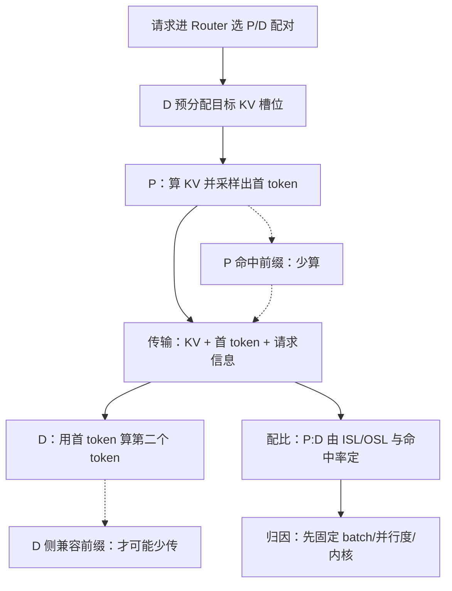

# 第 30 篇 · PD 分离 —— 交接、配比与归因

## 这篇补的是哪一块

notes/22_inference_systems.md §7.2 已经把骨架给全了：两个池子的负载特性、KV 走 RDMA/NVLink、分开扩缩容与减少干扰的好处、传输与调度的代价，以及那份 70B GQA 传输账本。本篇一句都不重讲，只补它没往下钻的三处：「交接顺序」（谁先占坑、首 token 落在谁账上）、「配比算术」（三个排队信号各自指向加谁）、「归因纪律」（公开倍数为什么不能整笔记给 PD），以及两个最容易讲错的交叉面——PD 与缓存层（少算 ≠ 少传）、PD 与 PP（切阶段 ≠ 切层）。

**delta 一句话**：22 号回答"PD 值不值得上"，本篇回答"上了之后延迟记在哪、资源怎么分、收益归谁"。源章是 `course-material/ch/part3/第5章_PrefillDecode分离.md`（同章英文版 `course-material/eng/part3/Chapter5_Prefill-Decode-Disaggregation.md`，术语对照用），本篇按 commit bcf0cd8 对齐；本文只读了代码与文档、推了公式，本机无 GPU，任何"跑过"的说法都不成立。

## 依赖图



## 一句话直觉：PD 把"谁等谁"从时间轴上搬到了拓扑上

同一组卡上的干扰，本质是两条请求共享一条时间轴；PD 没有消灭等待，只是把等待变成一段可以并行发生、也可以被计量的传输，于是"等多久"变成了"传多少字节、有效带宽多少、槽位什么时候腾出来"三个能算的问题。

## 1 干扰是怎么发生的，该看哪个指标

一轮计算的成员是调度器选的。若这一轮里既有 B 的长 prefill、又有 A 的 decode，这一轮的耗时由 prefill 的算力需求决定，A 的那次前向被挤到后面。A 没做错任何事，它只是"下一轮"来得晚了。

这个"晚"是一个**间隔**，不是一个均值。ch1 第 5 章把两件事分得很清楚：TPOT 是除首 token 外的平均每 token 时间，ITL 是相邻两个 token 的间隔、可逐次观测（`course-material/ch/part1/第5章_Benchmark入门.md`）。一次 60 ms 的额外阻塞放进 199 个间隔里，几乎看不见。

算一遍最省事的版本。一条请求生成 200 个 token，正常 20 ms/token；中途被一次长 prefill 挡了 60 ms，那一个间隔变成 80 ms：

- 199 个间隔里 198 个 20 ms、1 个 80 ms，TPOT = (198×20 + 80) / 199 = 20.30 ms，只涨 1.5%；
- 同一个现场，被挡的那一个间隔是 20 ms 的 4 倍。用户"卡了一下"的全部体感在 4 倍里，不在 20.30 里。

这种阻塞出现 10 次时 (189×20 + 10×80)/199 = 23.0 ms，TPOT 涨 15%，仍然把"十次明显停顿"描述成"整体慢了一点"。用 TPOT 排查抖动查不出来，不是因为它错了，是因为它按定义就在做平均。

**采样口径**：五条，缺一条结论就不可信。

- 逐 token 打时间戳，客户端按流式 chunk 到达时间记，不靠服务端事后聚合；**但一个 chunk 常含多个 token**，此时只有 chunk 级时间戳，**按 token 数均摊只能给近似值，不能用来判尖峰**（均摊会把 chunk 内的不均匀抹平）。要判尖峰只能把 stream interval 压到一个 token 一个 tick；做不到就老老实实报"chunk 级间隔"，并说明它可能低估 max ITL；
- 先按请求算、再按请求取分位：每条请求取 max ITL 与 p99 ITL，再对这些值取 P50/P95/P99。不要把全集群的 token 间隔倒进一个池子取分位，那会让长回答的请求权重被放大、短请求的尖峰被稀释；
- 窗口要盖住尖峰成因：至少覆盖若干次长 prompt 到达。只截 30 秒平稳期，采到的永远是"没有 prefill 干扰"的分布；
- 按 ISL 分桶再取分位：同一份看板里 512 token 与 8K token 的请求混在一起，尖峰会被短请求的样本量淹没。**注意分桶只能回答"哪类请求的 SLO 余量更小"**（受害方视角：一次阻塞给谁加的绝对延迟是一样多的；若各桶用的是同一个延迟上限，那么本来单轮 decode 就更久的请求余量更薄），回答不了"谁造成的"；
- 同时报 goodput：在 TTFT/TPOT 上限约束下还剩多少有效吞吐（ch1 第 5 章的 goodput 口径）。否则"吞吐涨了、尾延迟炸了"会被记成一次优化。

要归因就得换一个量：**看阻塞源，不看受害方的 ISL**。一次尖峰的幅度约等于插进来的那次 prefill 的计算时间，而 prefill 时间随**那次请求自己的未缓存输入长度**增长。所以判据是「尖峰时刻附近到达的长请求有多长」，而不是「被拖的那条请求有多长」：同一条短请求，撞上 8K 的 prefill 会尖，撞上 512 的不会。要验这条因果链，得在 trace 里同时记下每个间隔前后进入的 prefill 请求及其未缓存长度（`cached_len` / `extend_len` 两个量就能算出未缓存长度，见 §6）。反过来，若尖峰与相邻 prefill 长度无关、只与 running batch 大小相关，那更像是单轮 decode 变慢（§2 的另一种成因）：前者切预算或分离，后者调 batch 上限。用这一步先判成因，比直接换架构便宜得多。

顺带一个反直觉的读数：PD 上线后 TTFT 变好、ITL 尾部却不一定变好。原因要按 §3 的两条路径分开说——首 token 在交接完成前就回传客户端时，交接里未隐藏的那部分时间落在"第 1 到第 2 个 token"；等交接完成才回传时，它先记进 TTFT，此时 TTFT 未必变好、ITL 反而干净。只报 TTFT、或只报 TPOT 的看板都会给出错误结论，必须两个指标并排看。

## 2 同一个问题的两个解：Chunked Prefill 与 PD 分离

Chunked Prefill 不动设备，只动**预算**：给一轮 prefill 设一个尚未缓存 token 的上限，超出的部分留到下一轮。`course-material/ch/part2/第6章_ContinuousBatching与调度.md` §5.3 的例子是预算 1024、请求 2500 个未缓存 token，分 1024 / 1024 / 452 三轮走完。

把量级放大到长文档：8192 token、预算 1024 → 8 轮。若一次算完要 480 ms，切完每轮约 60 ms，被阻塞的最长单块缩短 8 倍，而总工作量一点没少（8×60 = 480 ms）。代价在另一头：

- 轮次从 1 变 8 意味着 8 次调度边界、8 次更小的 GEMM。ch6 §6.4 讲过合批提高算术强度的道理，反过来切碎就压低它，所以同样 8192 token 的 prefill 有效吞吐会掉；
- 切得更碎不等于让路。ch6 §6.2 明文写了本版本 mini-sglang 把未完成的 prefill 放回队首继续 prefill 优先，只把预算调小并不会自动让 decode 请求获得执行机会。要降 ITL，得同时有块间让路策略，光调预算是不够的。

预算还是整个 batch 共用的，不是逐请求的：ch6 §5.3 写明前一条请求用掉 800，后一条就只剩 224。并发一高，每条请求分到的块更小、轮次更多，chunked 的有效性随负载下降——它缓解的是单次阻塞的上限，不是总量。调度侧的预算检查落在 `PrefillAdder` 上：代码章（`course-material/ch/part2/第6章_ContinuousBatching与调度_代码.md`）里它逐条检查 KV 容量与 token 预算，超预算的请求只被批入一部分。

**够用的判据**：并发不高、ISL 中等、TTFT 有余量、两端不需要不同的 batch 形状和内核，先在同一个池子里调预算最便宜——它不改部署、不改显存预算，也不新增一次 KV 传输。

**必须分离的判据**：长 prompt 持续到达且 ITL 尾部有 SLO；或者两端要的调度/内核形态根本互斥。后者不是延迟问题而是能力问题，SGLang 团队 2025-05-05 的报告里写得很直接（链接见 §5）：DeepEP 的 normal dispatch 服务长输入、low-latency dispatch 服务逐 token 生成，两者无法在同一个通信组里同时成立，统一调度就与 DP attention 打架。这种冲突不是调预算能解的，只能把两个阶段放到不同的组里。

**判断顺序**：先量每请求 max ITL 的分位（§1）→ 再试 chunked 并记下 TTFT 与吞吐的损失 → 两者都不够再谈分离。反过来先上 PD，通常会把一个调度问题付成一次网络问题。

## 3 交接三阶段：首 token 在 P 上产生

真正的顺序比"P 算完给 D"多一步前置。按 SGLang 官方文档（https://docs.sglang.io/docs/advanced_features/pd_disaggregation ）：

1. Router 把请求配成一对 P 与 D，两端通过 P 的 bootstrap 端口握手；
2. D 先在自己的 KV 池里预分配这条请求的目标槽位，再通知 P 开始前向；
3. P 算完各层 KV，采样出**首个 token**；
4. 传输：KV、首 token 的 id、请求信息（采样参数、输出上限）一起交给 D；
5. D 用这些状态算出第二个 token，之后逐 token 继续，新 KV 只加在 D 上。

三个必须点明的细节：

- **首 token 在 P 上产生，不在 D 上**。但"在 P 上产生"不等于"客户端立刻收到"：TTFT 按定义结束于**客户端收到第一个 token**，所以它包含 P 的算力与排队、D 的准入等待、以及首 token 到客户端的那一段路径。若首 token 由 P 直接回传（不待交接完成），交接里还没被隐藏的那部分时间才主要落进"第 1 到第 2 个 token"的间隔；若路由等交接完成才回传，传输与 D 侧等待会先记进 TTFT。**SGLang 默认路由在这一点上究竟走哪条、首 chunk 由谁发出，本机没有核到源码，按"两种都可能"设计看板**：TTFT 与每请求 max ITL 一起报，不要只报一个。
- 传的是 prompt 位置的全部层 KV，不含首 token 自己的 KV。首 token 的 KV 由 D 的第一步前向顺带算出来，因为对 D 来说它是"要作为输入喂进去的那个位置"。
- 硬约束只有一条：**接收侧必须先有落点，KV 才能写进去**。落点什么时候占是两个策略，不是"顺序反了就死锁"：`--disaggregation-decode-allocation-policy` 默认 early（P 开始算之前 D 就占住目标槽位），另一个取值 prefill_complete（P 算完、D 再占）。early 省延迟但长 prefill 会一直攥着槽位，prefill_complete 相反——代价见 §6。

**bootstrap**：P 侧开一个专用端口做注册与配对，D 通过它拿到对端信息；心跳间隔默认 5 秒（同文档的环境变量表）。握手、超时、取消都走这条控制面，它和数据面（RDMA 搬 KV）是两条独立的链路——控制面抖动和数据面拥堵的排查方法完全不同。

**数据面**：SGLang 用 Mooncake 或 NIXL 作传输后端，发送/接收放在后台线程，避免阻塞调度循环；RDMA 侧用 queue pair 建连、用 scatter-gather 元素处理非连续的显存块（这些细节出自上面那篇 2025-05-05 的报告）。"非连续"是关键：KV 页在显存里本来就是一页一页散着的。

把时间账写成两行，谁承担什么就一目了然：

```text
记 ITL_1 = 第 1 个 token 到第 2 个 token 的间隔；T_decode,1 = 产出第 2 个 token 的那一步 decode

路径 A（首 token 交接前就回传客户端；early 策略下 D 已先占坑）：
  TTFT  = T_准入,P + T_准入,D + T_prefill,P
  ITL_1 = T_交接,剩余 + T_transfer,未隐藏 + T_decode,1
  E2E   = TTFT + ITL_1 + Σ_{i≥2} ITL_i
路径 B（等交接完成再回传）：
  TTFT  = T_准入,P + T_prefill,P + T_交接 + T_准入,D + T_transfer
  ITL_1 = T_decode,1（交接已完成）
  E2E   = TTFT + ITL_1 + Σ_{i≥2} ITL_i
```

三个符号先定义清楚，否则很容易两边都算一遍：T_准入,P / T_准入,D 是两端各自等可用槽位的时间（early 策略下 D 先占坑，准入发生在 P 之前，路径 A 里也计入 TTFT）；T_交接 是握手与状态传递；T_transfer 只出现一次，位置由路径决定——路径 A 在 ITL_1 里，路径 B 在 TTFT 里。两处都只计**未隐藏的部分**：传输若能按块与 P 侧计算重叠（§7 末条），只有没被覆盖的尾巴会变成等待；同理首 token 回传后若还有握手收尾，那点控制开销也记在 ITL_1 里，而不是消失。

同池方案里 prefill 与 decode 抢同一条时间轴，T_prefill 的不确定性（排队、被打断）全落在 TTFT 上；PD 方案里 T_prefill 只受 P 侧队列影响，但 E2E 里多出一次 T_transfer，它落在哪里取决于路径——路径 A 落进 ITL_1，路径 B 落进 TTFT。所以"分离后首字更快、第一个字到第二个字更慢"只在路径 A 下成立，是账目搬家而不是凭空变快。这也是 §1 坚持按请求报 max ITL 的原因：路径 A 下那个最大值往往就是 ITL_1。P 侧的调度入口是 `PrefillManager`（同代码章），它决定这一轮接哪几条、每条算多少 token；D 侧则是常规的 decode 批调度，两边连 CUDA Graph 的 batch size 列表都要各配一份。

## 4 资源配比与排队诊断

一阶模型只有两个式子：P 要吞掉 λ·L_in_eff 个输入 token/s，D 要吐出 λ·L_out 个输出 token/s，于是节点数之比是 (L_in_eff / R_p) : (L_out / R_d)。用报告给出的每节点速率 R_p = 54,543 input tok/s、R_d = 22,282 output tok/s（口径见 §7.1），三种负载算出来差别很大：

| 负载 | ISL / OSL | P:D | 12 节点怎么切 |
| --- | --- | --- | --- |
| 通用对话 | 2000 / 500 | 1.63 : 1 | 7 P + 5 D |
| 长文生成 | 2000 / 2000 | 1 : 2.45 | 4 P + 8 D |
| 文档问答 | 4096 / 256 | 6.5 : 1 | 10 P + 2 D |

同一批卡，只改输入输出的形状，P:D 就从 1:2.45 翻到 6.5:1。这就是"配比不能抄别人"的全部理由，也是为什么文档问答类负载要往 P 侧堆卡、长文生成要往 D 侧堆。

配比还是稳态量，而卡是整数，**取整不能按比例四舍五入，要按瓶颈最大化**：12 节点上，长文负载按 1:2.45 解出 3.48 : 8.52，四舍五入得到 3 P + 9 D，可它只能跑到 min(3×54,543/2000, 9×22,282/2000) ≈ 81.8 req/s；换成 4 P + 8 D 是 min(109.1, 89.1) ≈ 89.1 req/s，反而多 9%。原因是四舍五入把 P 削成了瓶颈。通用对话那行同理：7 P + 5 D 得 190.9 req/s，8 P + 4 D 只有 178.0。所以报配比时要连"落到的整数比 + 该比下的瓶颈速率"一起报，只报一个比例会让人以为按秒扩缩容就能贴住最优。

**三个排队信号**：分别指向三种完全不同的动作。

- P 前面等 prefill 的请求在涨、D 的 running batch 没顶满 → 输入处理跟不上，加 P；
- D 的 running batch 顶到 `--max-running-requests` 上限、等 decode 的请求在涨、P 侧反而空 → 生成侧跟不上，加 D；
- 两端队列都不长、但端到端延迟高 → 请求卡在中间，这时**不能直接判"网络问题"**，要再分三种（见下）。

第三种是最容易误诊的。文档讲得很清楚：默认 early 策略下，D 会在 P 算完之前就把目标槽位占住，而长 prefill 会把槽位一直攥在手里，于是"看起来在等传输"其实是"在等 D 腾显存"。三条线索要**逐条排除**，任何一条单独都不足以定案（三条都能各自把端到端延迟拉高，也可能同时成立）：

1. 先看 D 的 KV 池水位与未完成请求数：高水位能解释"等槽位"，但高水位本身可能是前面的慢请求堆出来的，所以要连**未完成请求的年龄分布**一起看，确认它在等槽位而不是在等别的；
2. 再看网卡吞吐与传输队列：占满有效带宽说明链路是瓶颈之一，但也可能只是上游 P 算得太快、把流量打满；
3. 最后看 bootstrap 的握手/超时/取消计数：这些计数干净只能说明控制面此刻没有失败，不能反推"问题一定在控制面"——第 1、2 步都正常时，才把控制面列为主嫌。

文档为第 1 种情况给了开关：把 `--disaggregation-decode-allocation-policy` 改成 prefill_complete，P 先算、算完再让 D 占坑。但文档同时说清了两条限制——它保留 P 侧 KV 更久，并且**取消了 chunked prefill 与 KV 传输的重叠**；它也不是通用吞吐优化，要按负载对比。§6 还有第三条限制，那条最容易踩。

**前缀缓存会改 P 的实际工作量**：命中率 h 让 P 只需算 (1−h)·L_in。h = 87.5% 时 P 的算力需求降到 1/8，配比要按 (1−h)·L_in 重算，而不是按请求里的 token 数算。这一条经常被漏：配比表按原始 ISL 算，上线后发现 P 长期空转。

还有一层常被忽略：两端的弹性不对称。P 与 D 各持一份完整权重，任何一侧扩容都要重新加载模型；而 D 侧还有一批长驻的生成中请求，扩出来的新实例接不了它们，只能接新请求。所以"P 不够就加 P"在秒级并不成立，§4 的比更接近一个规划量，而不是一个可实时调节的旋钮。

最后一个容易错的观察口径：两端的容量参数本来就不是一个量纲。文档给的 DeepSeek 多机示例里，P 端 `--max-running-requests` 取 32、D 端取 448（同一份配置里的两个值，差 14 倍）。拿"并发数"这一个数去比两端谁忙，比不出来。

## 5 归因纪律：5.2× 不能整笔记给 PD

先把原始数字摆清（SGLang 团队 2025-05-05 的大规模部署报告，https://www.lmsys.org/blog/2025-05-05-large-scale-ep/ ，12 节点 × 8×H100 = 96 卡，节点间 IB）：

- Prefill：4 节点、EP32、输入 2K → 每节点 54,543 input tok/s，相对 TP16 基线最高 3.3×；
- Decode：9 节点、EP72、输入 2K → 每节点 22,282 output tok/s，相对 TP16 基线 5.2×。

原文对这两个倍数的归因写得很具体，而且是两套不同的原因：prefill 的 3.3× 主要归于 GroupedGEMM 内核（DeepGEMM）与两批重叠；decode 的 5.2× 主要归于 EP 带来的约 4× 更大 batch——EP 把权重显存摊薄，同样显存能装下更多序列。也就是说，5.2× 里最大的那一块是 batch 和 EP，不是 PD。

还有两处更隐蔽的误读：

- 4 节点和 9 节点是**两组独立实验**，各自测量时假设另一端资源充足，不是一次 4:9 的部署；12 节点是全篇的规模，不是 4+9 = 13。把它读成"推荐的 P:D"，方向就错了——按 §4 的算法（并按瓶颈取整），2000/2000 的长文负载是 4:8，2000/500 的对话是 7:5。
- 报告自己的"局限"一节写着当时 TTFT 在 2–5 秒、ITL 约 100 ms。也就是说那 22,282 tok/s 是吞吐优先的读数，不能拿来当"低延迟已解决"的证据。

**要单独判 PD 的收益，得固定这些条件**（缺一条，差值就不是 PD 的）：

1. 同一批 GPU 数量与拓扑（同 IB 域、同 NVLink 域），否则带宽与 EP 规模都在变；
2. 同一并发与 batch 上限（同 max-running-requests、同 ISL/OSL 分布），这是 5.2× 里最大的混淆项；
3. 同一并行度：TP/EP/PP 度数完全一致；
4. 同一内核与 dispatch 模式（DeepEP normal 与 low_latency 是两种形态）；
5. 同一前缀缓存命中率 h，否则 P 干的活根本不一样；
6. 同一测量口径：TTFT、ITL 分位、吞吐三者分开报，且注明分位。

固定完这些，PD 的净收益通常不是"节点吞吐翻几倍"，而是两件更朴素的事：ITL 尾部分位变好，以及两端能按 §4 的比独立扩缩容。把公开倍数当 PD 的收益，等于把一次"整套方案 vs 朴素 TP"的对照读成了单变量实验。

还有一种更便宜的归因法：不动并行度，只把 P 与 D 合回一个池、保留同一套 EP 与 batch 上限，跑同一份 trace。但要写清它测的**不是"PD"这个单变量**：单池无法同时保留 P 侧的 normal dispatch 与 D 侧的 low_latency dispatch（§2 说过两者互斥），所以差值里必然混着调度与 dispatch 的差异。它只能当**一次便宜的 sanity check**，不能定论：差值里同时混着两种 dispatch 与两套调度的差异，方向不确定，赢或输都不能单独说明 PD 有没有收益。要报净收益仍得靠下面那套对照。

如果非要单测 PD，一个能落地的对照设计是这样：同样 96 张卡，A 组单池 + chunked prefill（预算压到 SLO 允许的最小值），B 组按 §4 的比切成 P/D；两组喂同一份请求 trace（同 ISL/OSL 分布、同到达时刻、同命中率 h），并行度、内核、并发上限全部一致；然后只比三件事——max ITL 的 P99、TTFT 的 P99、满足 SLO 的 goodput。这样得到的差值才接近 PD 的净收益（残余偏差来自单池无法同时保住两套 dispatch，见上一段），而且它只在这个 trace 上成立，换负载要重测。

## 6 与缓存层的交互：少算和少传是两件事

P 命中前缀缓存（`RadixCache` / `HiCache`）时发生的是**少算**：只需为后缀算 KV，TTFT 与 P 的负载一起降。但 D 要生成第二个 token，必须对 prompt 的全部位置做注意力，所以它需要整段 KV。

于是 4096 token、命中率 87.5%（D 侧没有这份前缀）的现场是这样：P 只算 512 个 token（省 8 倍算力），而传输量仍是 4096 token 的 1.34 GB，在 50 GB/s 下仍是 26.8 ms（账本复用 notes/22_inference_systems.md §7.2）。少算一点没让少传。

P 侧"到底少算了多少"在代码里有两个明确的量：`cached_len` 是命中的前缀长度，`extend_len` 是这一轮仍需计算的部分（`course-material/ch/part2/第4章_KVCache优化_代码.md`）。少算的边界就是 extend_len；而传输的字节数按 L_in 算，与 extend_len 无关。这两个量分属两条账，混起来就会得出"命中率越高、传输越便宜"的错误结论。

**才能少传的条件**：D 侧也保留了这段前缀的 KV（D 的 radix cache 或 D 侧 HiCache），且两端的页布局兼容、传输协议支持按页复用。这时只传缺失的 512 个 token——0.167 GB（512×320 KiB），50 GB/s 下 3.35 ms，比整段传省下 23.5 ms。三个条件缺一个，就退回整段传。D 侧命中长度与本例不同的，按 (L_in − D 侧命中长度) 重算，别套 512 这个数。

**最容易错的互斥**：文档明确列出 prefill_complete 策略不支持 decode 侧的 radix cache 与 decode HiCache（同 §4 引的那页）。也就是说"让 D 提前留前缀以便少传"和"让 D 延迟占槽位以免攥住显存"这两个优化在配置上互斥。想做前者，就得接受 early 策略下长 prefill 攥住槽位的代价；反过来也一样。这一条在文档里只有一行，但它决定了两条优化路线只能选一条。

这还不是唯一一处互斥。同一页文档列了 prefill_complete 的一串不支持项，其中与缓存相关的是：P 侧 HiCache 被限制在 L2、必须 write_back、且不能挂外部存储后端。也就是说选了"延迟占槽位"，不只是失去 D 侧复用，连 P 侧的 L3 也一起没了。这类"策略 × 缓存"的交叉约束文档只给一行，但每一条都能改变容量规划，读配置时要把不支持项逐条对照自己的部署。

还有一层常被当成免费：P 侧 HiCache 的 L2/L3 命中不等于免费。`course-material/ch/part3/第3章_分层缓存.md` §3.2 说得很准确——查到副本只说明"有地方可以取"，KV 仍要从 Host 或外部存储搬回 GPU 才能参与计算。所以 L3 命中是把"重复算"换成了"搬一次"，两者都要进时间账；在 PD 里这一次搬运还叠在 TTFT 上。

**口径上的收束**：前缀缓存带来的收益要拆成两个数报——省下的 P 侧计算时间、省下的传输字节。只报前一个，读者会以为 KV 传输也跟着变便宜了。

## 7 PP 切层，PD 切阶段

两者的划分对象不同，这是最容易被一句话说混的地方：

- **PP**：切模型层。每个 stage 持有一部分层，激活值在 stage 边界上传，单卡显存随 stage 数下降；
- **PD**：切推理阶段。P 与 D 都要跑完整模型，所以两端各需一份完整权重。

推论有三条。其一，PD 的显存代价是双份权重（相对同并行度的单池），PP 不是；模型勉强装进现有卡时，PD 直接出局。其二，两端内部仍然可以各自上 TP/EP/PP（`course-material/ch/part3/第4章_横向扩展.md`），所以两端的并行度不必一致，EP 度数按各自的显存与 batch 需要各定一份，不是错误。其三，异构 PD（P/D 用不同型号的卡甚至 NPU）只是适配问题，但要额外解决 KV 的内存布局差异。

布局差异不是小事，而且它不是改个启动参数能解决的。两端 TP 不同时，KV head 的切片方式不同、页布局也不同，没法直接对拷。文档给的解法是 GPU staging buffer：P 侧把 KV head 切片先 gather 成一段连续缓冲，做一次批量 RDMA，D 侧再 scatter 回自己的 KV 页；文档称高并发下比逐 token 切片快 2–5×，与同构基线差距约 5%，两端 TP 相同时自动绕过。这条同时解释了"为什么异构 PD 不是改个启动参数"。

两端的失败面不对称，但要分两个问题问，别合成一个。**问题一：这条请求还能不能继续？** 看交接是否完成、继续生成所需的状态是否还活着——交接完成后 KV 与状态已在 D 侧，P 之后再挂通常不影响这条请求；交接完成前挂，要先看存活那一端手里有没有完整且可确认的续算状态：传输已经落到 D、只丢了完成确认的，可以尝试接着走或重传补齐；确认不了也没有可用副本的，才从输入重算。**问题二：如果重试，能不能对用户透明？** 看客户端有没有已经看见输出——看见了就得从零重来（或做状态恢复），没看见才能静默重排。两个问题的答案组合起来才是重试成本，所以不能简单写成"P 失败便宜、D 失败贵"。"请求卡在中间"这类现象多发生在 D 一侧的槽位与显存上（§4 第三种信号），这属于问题一里的"状态还在但走不动"。

还有一条只在 PD 里出现的资源问题：请求在传输途中被取消或被超时打断时，P 侧已经算好的 KV 与 D 侧已经占住的槽位要各自回收，回收不干净就会表现为"池子越跑越满、但队列不长"。文档里 bootstrap 的成功/失败/取消记录各有自己的超时窗口，取消后同一间 bootstrap room 还能被下一次重试复用。排障时它属于第三种信号（§4）的细分之一，而不是网络问题。

顺带一个反证：分离之后 P 侧往往干脆把 chunked prefill 关掉（文档的 DeepSeek 多机示例里 P 用 chunked-prefill-size 取 -1，同时给 max-prefill-tokens 一个较大的值）——**因为 P 上没有正在 decode 的请求需要让路**，切块换来的"让路"收益在 P 侧不存在。但这不是"只剩坏处"：切块仍有两个用处，降低单次执行的显存峰值、以及让计算与 KV 传输按块重叠（§7 末条）。所以关不关是取舍，判据不是"要不要低延迟"，而是**单请求的瓶颈在算力还是在传输**：传输是瓶颈、且分块能与传输重叠时留（否则暴露尾部等待）；显存峰值不是问题时关（少一次分块调度开销）。文档那个 -1 只是该示例的选择，不是通用最优。D 侧另配一份 CUDA Graph batch 列表。两端参数是两套，这本身就是"PD 不是同一个进程换个角色"的证据。

**传输优化的三条路**，各自的作用点不同：

- 少传字节：KV 量化。FP16 → FP8 让 1.34 GB 变 0.67 GB，50 GB/s 下 26.8 ms 变 13.4 ms（未计量化/反量化的算力开销）；
- 提高有效带宽：RDMA/IB 直连、按拓扑选链路。25 → 50 GB/s 就是时间减半（53.7 → 26.8 ms）；
- 重叠计算与传输：P 算完一块就发一块，收发在后台线程里跑，不阻塞调度循环。

**重叠的边界要写清**：它摊薄的是最后那次集中等待，不是总传输量。4 块流水、累计 26.8 ms 传输摊在 480 ms 计算里，暴露出来的只剩最后一块的 6.7 ms；但链路上跑的字节一个没少。高并发时链路是共享资源，重叠改善的是单请求延迟，不会凭空多出带宽——把它当"省带宽"的手段，是这一节最常见的错。

### 7.1 本篇数字的口径

| 数字 | 值 | 口径 |
| --- | --- | --- |
| 每 token KV | 320 KiB | 本文假设值（70B GQA：80 层 × 2 × 8 KV 头 × 128 维 × 2 B；账本复用 notes/22 §7.2） |
| 4K prompt KV | 1.25 GiB ≈ 1.34 GB | 本文假设值（320 KiB × 4096，同 notes/22 §7.2） |
| 传输 @25/50/300 GB/s | 53.7 / 26.8 / 4.5 ms | 本文假设值（1.34 GB ÷ 有效带宽，复用 notes/22 §7.2） |
| FP8 KV | 0.67 GB → 13.4 ms | 本文假设值（字节减半，未计量化开销） |
| Prefill 每节点吞吐 | 54,543 input tok/s | 未核到（官方博客自述，本机无 GPU 无法复现） |
| Decode 每节点吞吐 | 22,282 output tok/s | 未核到（同上） |
| 相对 TP16 基线 | prefill ≤3.3×，decode 5.2× | 未核到复现（原文归因：DeepGEMM+两批重叠 / EP 的 4× batch） |
| 反推 TP16 基线 | ≈4,285 output tok/s/节点 | 本文假设值（22,282 ÷ 5.2，非原文报告值） |
| ITL 示例 | 20 → 80 ms，TPOT 20.30 ms | 本文假设值（199 个间隔，1 次 60 ms 额外阻塞） |
| chunk 切分 | 8 块 × 60 ms | 本文假设值（8192/1024，总 480 ms 均分） |
| P:D 比 | 1.63:1 / 1:2.45 / 6.5:1 | 本文假设值（用上面两行速率 + 假设 ISL/OSL 推算） |
| bootstrap 心跳 | 5 s | 未核到（文档环境变量表默认值，未在仓内核对） |
| staging buffer 收益 | 2–5× | 未核到（文档自述，无本地复现） |

配套的 6 道手算题在 `worksheet.md`：题面里的参数与本节表格逐行对应，答案给出算式。建议先自己算 §1 的 TPOT、§4 的三个配比、§6 的少传字节，再回读正文——这三处的结论都是算出来的，不是记住的。

## 面试要点

- **问：PD 之后 TTFT 变好，用户还是说卡，怎么回事？** 答：首 token 在 P 上产生，但它到客户端的路径决定账记在哪：若首 token 在交接前就回传，未隐藏的交接等待落在第 1→2 个 token 的间隔里，TTFT 看不到；若等交接完成才回传，传输会先记进 TTFT。两种都要报，所以看板上 TTFT 与每请求 max ITL 的 P99 必须并排。
- **问：为什么不能用 TPOT 诊断 prefill 干扰？** 答：TPOT 是均值，一次 60 ms 阻塞在 199 个间隔里只抬高 1.5%（20 → 20.30 ms），而那一个间隔本身是 4 倍。均值按定义抹平尖峰，ITL 才能逐次观测。
- **问：Chunked Prefill 和 PD 怎么选？** 答：先量 ITL 分位，再试 chunked（它只改预算、不改部署，代价是轮次变多、算术强度下降）；chunked 不够或两端内核形态互斥（DeepEP normal vs low_latency）才分离。
- **问：P 排队、D 排队、卡传输怎么区分？** 答：P 队列涨 D 未满 → 加 P；D 顶到 max-running-requests → 加 D；两端都不长却延迟高 → 先查 D 的 KV 池水位（early 策略下长 prefill 会攥住目标槽位），再看网卡，最后看 bootstrap。
- **问：5.2× 能算 PD 的收益吗？** 答：不能。它是"整套方案 vs 朴素 TP16"，原文把 decode 增益主要归给 EP 带来的 4× batch，prefill 的 3.3× 归给 DeepGEMM 与两批重叠；而且 4 节点与 9 节点是两组独立实验，不是一次 4:9 部署。
- **问：要单独测 PD，固定哪些条件？** 答：GPU 数量与拓扑、并发与 ISL/OSL 分布、TP/EP/PP 度数、内核与 dispatch 模式、前缀命中率 h、以及 TTFT/ITL/吞吐分开报的分位口径。
- **问：P 命中前缀缓存，KV 能少传吗？** 答：不能只凭这一点。少算是 P 侧的事，D 仍要整段 KV 才能 attend 全序列；只有 D 也保留兼容前缀且协议支持按页复用时，才只传缺失部分。
- **问：PP 和 PD 差在哪？** 答：PP 切层，每 stage 一部分层；PD 切阶段，两端各一份完整权重。所以 PD 的显存代价是双份权重，两端内部仍可各上 TP/EP/PP。

## 常见坑

- 用集群平均 TPOT 或 token/s/user 判抖动：前者按定义做平均，后者是吞吐的倒数，两者都看不见单次尖峰。要按请求取 max ITL 再取分位。
- 把报告的 4 节点 / 9 节点读成一个部署的 P:D：它们是两组独立实验（另一侧假设资源无限），也超过全篇 96 卡 = 12 节点的规模。按 §4 算，长文负载该是 4:8、对话该是 7:5。
- 把 5.2× 整笔记给 PD：混淆项至少有三个（EP 的更大 batch、DP attention 省显存、DeepGEMM/DeepEP 内核），且原文自己把主因写在 batch 上。
- 以为 P 命中前缀缓存就等于少传：少算与少传是两个开关，第二个还要求 D 有兼容前缀，且与 prefill_complete 策略互斥。
- 以为重叠计算与传输能省带宽：它只摊薄尾部等待（4 块 → 暴露 6.7 ms），链路上的字节一个没少，高并发时带宽仍是硬约束。
- 以为 PD 是"每个模型切一半层"：那是 PP。PD 两端都要完整权重，这是它最硬的准入门槛。

## 动手清单

1. 拿任意一份逐 token 时间戳（线上日志或 bench_serving 输出），按请求算 max ITL 与 p99，再取分位，和你现在的 TPOT 均值并排放一次——先确认你的监控能不能看见尖峰。
2. 用你自己的 ISL/OSL 分布和前缀命中率 h，套 §4 的 (L_in_eff/R_p) : (L_out/R_d) 算一遍 P:D，再和现有池子的卡数比，看差几倍。
3. 用 §7.1 的账本给你自己的模型重算一遍 KV 字节（改层数、KV 头数、精度），再算 25/50/300 GB/s 三种带宽下的传输时间，判断这次传输在你的 TTFT 里占多少。
4. 读 `--disaggregation-decode-allocation-policy` 那一节，判断你的负载该用 early 还是 prefill_complete，并把"选了它就放弃了哪些特性"写进部署文档。

## 下一步

往下走是这条链路的两个底面。第一个是数据面本身：RDMA 的 queue pair 怎么建、scatter-gather 怎么处理非连续页、多后端（Mooncake/NIXL）在什么拓扑下各自占优——这些在 notes/24_distributed_base.md 的 P2P 段落里有底子，但只到"用 send/recv"这一层，再往下要读传输库自己的文档。第二个是控制面：router 按什么信号选 P 与 D、配对失败怎么重试、超时预算怎么定，这决定 §4 的配比在运行时能不能真的被兑现。两条路的排障都回到 notes/25_platform_sre.md 的网络与超时口径：先分清是数据面堵、控制面抖，还是两端容量不够，再决定是加卡还是改配置。
